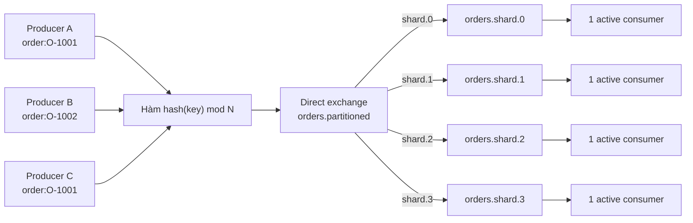
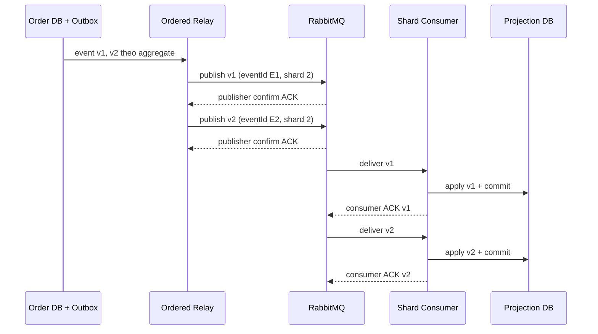

# Định tuyến nhất quán theo aggregate hoặc khách hàng trong Spring AMQP

## 1. Vì sao định tuyến ảnh hưởng trực tiếp đến thứ tự xử lý?

Trong hệ thống dùng **RabbitMQ và Spring AMQP**, các message về cùng một đối tượng nghiệp vụ thường phải được áp dụng theo thứ tự. Ví dụ, một đơn hàng có chuỗi sự kiện:

```text
Order O-1001
  version 1: CREATED
  version 2: PAID
  version 3: SHIPPED
```

Nếu xử lý `SHIPPED` trước `PAID`, trạng thái cuối có thể sai, thông báo gửi ra không hợp lệ hoặc kiểm tra nghiệp vụ từ chối một sự kiện vốn đúng. Tăng số consumer để nâng throughput càng làm nguy cơ xử lý xen kẽ rõ hơn.

Một cách thiết kế là **chọn một khóa phân vùng ổn định** (partition key), dùng khóa đó định tuyến mọi sự kiện liên quan tới **cùng một queue trong một tập queue cố định**, rồi để mỗi queue có một chuỗi xử lý tuần tự. Chẳng hạn:

- `aggregateKey = "order:O-1001"`: giữ thứ tự giữa các sự kiện của **cùng đơn hàng**.
- `customerKey = "customer:C-77"`: giữ thứ tự giữa các sự kiện liên quan tới **cùng khách hàng**, kể cả khi thuộc những đơn hàng khác nhau, nếu tất cả sự kiện liên quan cùng đi qua tuyến đó.

Đây là chủ đề **Thứ tự và đồng thời** của module **SPRING_AMQP**. Ta sẽ kết hợp `RabbitTemplate`, `@RabbitListener`, direct exchange, queue, binding, consumer acknowledgment, retry, dead-letter, transaction và quan sát để kiểm soát thứ tự trong một hệ thống xử lý bất đồng bộ.

**Lưu ý quan trọng:** định tuyến nhất quán cung cấp **affinity** (message cùng key tới cùng tuyến). Nó không tự chứng minh mọi message đã được **publish đúng thứ tự**, không ngăn được duplicate/redelivery và không thể tạo thứ tự toàn cục giữa tất cả queue. Muốn an toàn đầu cuối, cần thêm **version/sequence của aggregate, idempotency và quy tắc phục hồi khi thiếu phiên bản**.

## 2. “Thứ tự” có ít nhất bốn tầng

Phân biệt từng tầng trước khi tuyên bố “RabbitMQ bảo đảm FIFO”.

| Tầng | Câu hỏi | Điều phải bảo đảm |
|---|---|---|
| Thứ tự nghiệp vụ | `PAID` có thật sự xảy ra sau `CREATED`? | Nơi phát sinh sự kiện gán version tăng dần, nhất quán với transaction |
| Thứ tự publish | Broker nhận `v1` trước `v2` không? | Producer/relay phát đúng chuỗi; tránh các producer song song đảo lượt |
| Thứ tự delivery | Consumer nhận `v1` trước `v2` không? | Cùng queue, một consumer hoạt động cho shard, xét requeue và failover |
| Thứ tự áp dụng | Database ghi `v1` trước `v2` không? | Xử lý tuần tự hoặc khóa/so sánh version trong transaction |

RabbitMQ queue có thứ tự lưu trữ/delivery ban đầu theo cơ chế của queue, nhưng thứ tự thực tế có thể bị ảnh hưởng bởi **nhiều publisher, nhiều consumer, priority, redelivery/requeue, nack, xử lý bất đồng bộ và thời điểm ACK**. Một queue có nhiều consumer không bảo đảm thời điểm *hoàn tất nghiệp vụ* giữ nguyên thứ tự delivery: consumer B có thể xử lý `v2` trước khi consumer A commit `v1`.

Ngay cả một consumer cũng có thể làm sai nếu listener chạy:

```java
@RabbitListener(queues = "orders.events")
public void onEvent(String json) {
    executor.execute(() -> applyToDatabase(json));
    // Trả về ngay: worker của v2 có thể hoàn tất trước worker của v1.
}
```

Trong `AcknowledgeMode.AUTO` thông thường, listener trả về thành công có thể được ACK trước khi job thực sự hoàn tất. Việc tăng thread pool để “xử lý nhanh hơn” không đồng nghĩa còn giữ được thứ tự áp dụng.

### Ba mục tiêu thường bị đánh đồng

- **FIFO của queue:** trật tự các message mà broker ghi và giao, trong phạm vi một queue và các điều kiện tương ứng.
- **Per-key ordering:** với từng khóa `K`, ứng dụng phải áp dụng `K:v1` trước `K:v2`; giữa các khóa khác nhau có thể chạy song song.
- **Global ordering:** tất cả sự kiện của mọi khóa được xử lý theo một thứ tự tổng duy nhất, thường không cần thiết và có thể làm giảm mạnh throughput.

Trong đa số nghiệp vụ, **per-key ordering** cân bằng được tính đúng đắn và khả năng mở rộng tốt hơn global ordering.

## 3. Chọn khóa: aggregate hay khách hàng?

Khóa là **định nghĩa phạm vi phải tuần tự hóa**, nên chọn từ invariant nghiệp vụ thay vì chọn tùy tiện một field có sẵn trong JSON.

| Lựa chọn | Phạm vi tuần tự | Phù hợp | Đánh đổi |
|---|---|---|---|
| `orderId` / `order:{id}` | Mọi thay đổi của cùng một đơn hàng | Order lifecycle: create, pay, ship, cancel | Hai đơn hàng của cùng khách hàng có thể xử lý đồng thời |
| `accountId` / `account:{id}` | Mọi giao dịch ảnh hưởng cùng tài khoản | Số dư, hạn mức, giao dịch có quy tắc tổng theo account | Tài khoản lớn trở thành khóa nóng |
| `customerId` / `customer:{id}` | Các tác vụ cần nhất quán trên phạm vi khách hàng | Tính điểm, hạn mức theo khách hàng, ưu đãi chồng chéo | Mọi đơn hàng của một khách hàng bị tuần tự hóa dù nhiều việc độc lập |
| `tenantId` | Tất cả dữ liệu theo tenant | Các phép cập nhật phải tuần tự ở mức tenant | Tenant lớn dễ quá tải một shard |
| Khóa ngẫu nhiên / ID message | Mỗi message có tuyến riêng | Phân phối tải không yêu cầu ordering | **Không** giữ thứ tự cùng aggregate |

### 3.1. Aggregate key thường là mặc định tốt

Trong Domain-Driven Design, *aggregate* là đơn vị giữ invariant và có ranh giới consistency. Nếu trạng thái `Order` chỉ phụ thuộc vào các sự kiện của chính `Order`, chọn `orderId` làm partition key:

```text
order:O-1001  -> shard 2: CREATED, PAID, SHIPPED
order:O-1002  -> shard 0: CREATED, CANCELLED
order:O-1003  -> shard 1: CREATED, PAID
```

Các đơn hàng khác nhau có thể xử lý song song. Mỗi đơn hàng vẫn cần version tăng dần và consumer idempotent để chịu được redelivery.

### 3.2. Customer key khi invariant thật sự vượt qua một aggregate

Ví dụ, cùng khách hàng có giới hạn tổng số voucher được dùng. Nếu hai đơn hàng `O-1001` và `O-1002` cùng trừ quota của `C-77`, định tuyến bằng hai `orderId` có thể cho chúng chạy đồng thời. Khi **cần tuần tự hóa tất cả lệnh thay đổi quota theo khách hàng**, route bằng `customerId` cho pipeline đó có thể hợp lý.

Tuy nhiên, routing theo customer **chỉ tuần tự hóa những message thật sự đi qua cùng đường xử lý**. Nếu một event khác vẫn sửa quota trực tiếp qua HTTP/DB hoặc dùng queue khác, sẽ không có ràng buộc toàn cục. Quy tắc tại DB như unique constraint, optimistic locking hoặc row locking vẫn phải bảo vệ invariant cuối cùng.

Một customer có thể chứa nhiều aggregate. **Routing key `customerId` không có nghĩa mọi order dùng chung một chuỗi `orderVersion`.** Nếu mỗi order có version riêng, consumer phải theo dõi `lastVersion` **theo orderId**, ngay cả khi route theo customerId. Chỉ dùng một bộ đếm version theo customer nếu hệ thống nguồn thật sự định nghĩa và phát hành chuỗi version ở cấp khách hàng.

### 3.3. Quy tắc chọn key

1. Viết rõ invariant cần bảo vệ: “mọi thay đổi cùng đơn hàng phải được áp dụng theo version” hay “mọi quyết định hạn mức của cùng khách hàng phải tuần tự”.
2. Chọn **key hẹp nhất** bao phủ invariant đó. Key quá rộng làm giảm concurrency và tạo điểm nóng.
3. Chuẩn hóa key nhất quán: ví dụ `order:O-1001`, `customer:C-77`; tránh mơ hồ giữa các entity có cùng chuỗi ID.
4. Key phải **có ngay lúc publish** và ổn định qua retry, replica và deploy. Không lấy một giá trị có thể đổi, như email, làm key nếu nghiệp vụ nhận diện khách hàng bằng ID cố định.
5. Mọi publisher cùng luồng phải dùng **cùng hàm route, số shard và phiên bản cấu hình**. Nếu producer Java và Python dùng hash khác nhau cho cùng key, chúng có thể gửi tới hai queue khác nhau.

## 4. Mô hình: direct exchange và các shard queue cố định

Có thể dùng một direct exchange và một tập `N` queue. Producer tính:

```text
partitionKey = "order:" + aggregateId
shardIndex   = floorMod(hash(partitionKey), N)
routingKey   = "shard." + shardIndex
```

Sau đó publish qua `RabbitTemplate` đến exchange `orders.partitioned` với routing key tương ứng. Exchange có một binding cho mỗi shard:



Trong ví dụ có bốn shard. Hai message của `order:O-1001` luôn tính ra **cùng shard** miễn là key, thuật toán và `N` không đổi. Các key khác vẫn có thể trùng shard; đó là điều bình thường. **Không phải mỗi aggregate có một queue.** Hàng triệu aggregate có thể được phân vào vài chục queue.

Để thực sự xử lý từng queue tuần tự, cần một consumer hoạt động tại mỗi shard và xử lý đồng bộ theo đúng ranh giới hoàn tất. Có thể dùng queue argument `x-single-active-consumer=true` để RabbitMQ chỉ chọn **một active consumer trên từng queue**, kể cả khi nhiều replica ứng dụng cùng đăng ký. Queue khác vẫn có active consumer riêng và chạy song song.

Nếu một shard được tiêu thụ bởi nhiều consumer active, hoặc một listener đẩy job vào nhiều thread không giữ thứ tự, bước định tuyến thôi chưa đủ.

## 5. Cấu hình RabbitMQ topology bằng Spring AMQP

Ví dụ sau sử dụng Java 17+, Spring Boot 3.x với `spring-boot-starter-amqp` và một broker RabbitMQ hoạt động. Hệ thống gửi payload JSON dạng chuỗi để tập trung vào phân vùng và theo dõi version. Các đoạn code là những thành phần của một ví dụ cùng ứng dụng; lớp và bean phải ở trong package được Spring quét.

### 5.1. Tạo bốn queue và binding

```java
import java.util.ArrayList;
import java.util.List;
import org.springframework.amqp.core.BindingBuilder;
import org.springframework.amqp.core.Declarable;
import org.springframework.amqp.core.Declarables;
import org.springframework.amqp.core.DirectExchange;
import org.springframework.amqp.core.Queue;
import org.springframework.amqp.core.QueueBuilder;
import org.springframework.context.annotation.Bean;
import org.springframework.context.annotation.Configuration;

@Configuration
public class OrderPartitionTopology {
    public static final String EXCHANGE = "orders.partitioned";
    public static final String DEAD_EXCHANGE = "orders.partitioned.dlx";
    public static final String DEAD_ROUTING_KEY = "orders.failed";
    public static final int SHARDS = 4;

    public static String queueName(int shard) {
        return "orders.shard." + shard;
    }

    public static String routingKey(int shard) {
        return "shard." + shard;
    }

    @Bean
    Declarables orderPartitionDeclarables() {
        List<Declarable> declarations = new ArrayList<>();

        DirectExchange exchange = new DirectExchange(EXCHANGE, true, false);
        DirectExchange deadExchange =
                new DirectExchange(DEAD_EXCHANGE, true, false);
        Queue deadQueue =
                QueueBuilder.durable("orders.partitioned.dead").build();

        declarations.add(exchange);
        declarations.add(deadExchange);
        declarations.add(deadQueue);
        declarations.add(
                BindingBuilder.bind(deadQueue)
                        .to(deadExchange)
                        .with(DEAD_ROUTING_KEY)
        );

        for (int i = 0; i < SHARDS; i++) {
            Queue queue = QueueBuilder.durable(queueName(i))
                    .withArgument("x-single-active-consumer", true)
                    .deadLetterExchange(DEAD_EXCHANGE)
                    .deadLetterRoutingKey(DEAD_ROUTING_KEY)
                    .build();

            declarations.add(queue);
            declarations.add(
                    BindingBuilder.bind(queue)
                            .to(exchange)
                            .with(routingKey(i))
            );
        }

        return new Declarables(declarations);
    }
}
```

Điểm chính:

- `DirectExchange` đưa routing key `shard.0` vào đúng binding `shard.0`; bản thân RabbitMQ **không tính hash** trong cách cấu hình này.
- `QueueBuilder.durable(...)` tạo queue bền; queue còn cần message persistent và cấu hình broker phù hợp để đạt mục tiêu độ bền.
- `x-single-active-consumer` chọn một active consumer của **mỗi queue**; các replica khác có thể đăng ký để failover. Cơ chế này không quyết định thứ tự publish của producer.
- DLX và dead queue giữ message bị reject không requeue khi định tuyến phù hợp. **Không tự động giải quyết lỗi thiếu một phiên bản (gap)**, vì version sau có thể tiếp tục nằm trong shard.
- `x-single-active-consumer` là argument lúc khai báo queue; nếu queue cùng tên đã tồn tại với cấu hình không tương thích, RabbitMQ có thể từ chối redeclare. Cần chiến lược migration topology thay vì thay argument tùy tiện trên queue đang chạy.

Không cần tạo một queue riêng cho từng khách hàng. Việc tạo queue động theo hàng triệu customer làm vận hành tốn kém và không bảo đảm tốt hơn về thứ tự.

### 5.2. Dùng một hàm shard xác định

Trong ví dụ **chỉ có producer Java**, `String.hashCode()` đủ để minh họa một phép ánh xạ lặp lại được với cùng chuỗi. Đây **không phải lựa chọn bắt buộc cho production đa ngôn ngữ**:

```java
public final class PartitionRouter {
    private PartitionRouter() {}

    public static int shardFor(String partitionKey) {
        if (partitionKey == null || partitionKey.isBlank()) {
            throw new IllegalArgumentException("partitionKey phải có giá trị");
        }

        return Math.floorMod(
                partitionKey.hashCode(),
                OrderPartitionTopology.SHARDS
        );
    }
}
```

`Math.floorMod` luôn trả về chỉ số từ `0` đến `N-1` ngay cả khi hash âm; dùng trực tiếp `hash % N` có thể tạo chỉ số âm. Quy tắc này chỉ ổn định khi:

- Giá trị key được chuẩn hóa theo **cùng một quy tắc**.
- Hash algorithm và seed giữ nguyên giữa các bản triển khai.
- Số shard `N` không đổi.
- Tất cả publisher đều có cùng contract định tuyến.

`String.hashCode()` của Java không được mặc nhiên tái tạo bằng hash mặc định của Python, JavaScript hay một ngôn ngữ khác. Nếu có nhiều producer đa ngôn ngữ, định nghĩa thuật toán byte-level chuẩn, encoding UTF-8, seed và test vector cố định, hoặc đưa routing qua một producer service/SDK chung.

## 6. Producer: cùng key phải cùng routing key

### 6.1. Định nghĩa sự kiện có ID và version

```java
public record OrderStatusEvent(
        String eventId,
        String aggregateId,
        String customerId,
        long aggregateVersion,
        String status
) {
    public String aggregateKey() {
        return "order:" + aggregateId;
    }

    public String customerKey() {
        return "customer:" + customerId;
    }
}
```

`eventId` dùng nhận diện một sự kiện cụ thể và chống duplicate; `aggregateVersion` là thứ tự cập nhật **của cùng đơn hàng**. Ví dụ, `O-1001` có version 1, 2, 3; `O-1002` cũng có dãy version riêng 1, 2, 3. Dù có chọn customer key để route, vẫn phải đối chiếu version với **aggregateId** vì sequence đang được định nghĩa ở cấp order.

### 6.2. Publish tới shard

```java
import com.fasterxml.jackson.core.JsonProcessingException;
import com.fasterxml.jackson.databind.ObjectMapper;
import org.springframework.amqp.core.MessageDeliveryMode;
import org.springframework.amqp.rabbit.core.RabbitTemplate;
import org.springframework.stereotype.Service;

@Service
public class PartitionedOrderPublisher {
    private final RabbitTemplate rabbitTemplate;
    private final ObjectMapper objectMapper;

    public PartitionedOrderPublisher(
            RabbitTemplate rabbitTemplate,
            ObjectMapper objectMapper) {
        this.rabbitTemplate = rabbitTemplate;
        this.objectMapper = objectMapper;
    }

    public void publishByAggregate(OrderStatusEvent event)
            throws JsonProcessingException {
        publish(event, event.aggregateKey());
    }

    public void publishByCustomer(OrderStatusEvent event)
            throws JsonProcessingException {
        publish(event, event.customerKey());
    }

    private void publish(OrderStatusEvent event, String partitionKey)
            throws JsonProcessingException {
        int shard = PartitionRouter.shardFor(partitionKey);
        String json = objectMapper.writeValueAsString(event);

        rabbitTemplate.convertAndSend(
                OrderPartitionTopology.EXCHANGE,
                OrderPartitionTopology.routingKey(shard),
                json,
                message -> {
                    message.getMessageProperties()
                            .setMessageId(event.eventId());
                    message.getMessageProperties()
                            .setDeliveryMode(MessageDeliveryMode.PERSISTENT);
                    message.getMessageProperties()
                            .setHeader("partition-key", partitionKey);
                    message.getMessageProperties()
                            .setHeader("aggregate-version",
                                    event.aggregateVersion());
                    return message;
                }
        );
    }
}
```

Trong một **message family**, hãy chọn **một trong hai** `publishByAggregate` hoặc `publishByCustomer` và áp dụng nhất quán từ producer tới consumer. Không phát cùng một chuỗi sự kiện lúc bằng `orderId`, lúc bằng `customerId`: chúng có thể rơi vào queue khác nhau và mất trật tự.

Code ví dụ này thể hiện **định tuyến**, chưa triển khai publisher confirms. `convertAndSend` trả về không có nghĩa message chắc chắn đã được broker chấp nhận. Với yêu cầu độ tin cậy, bật `publisher-confirm-type=correlated`, `publisher-returns=true` và `mandatory=true`; xử lý publisher ACK/NACK/return/timeout, duy trì `eventId` ổn định trên retry. Kết hợp **transactional outbox** nếu sự kiện phát sinh cùng thay đổi trong database.

### 6.3. Rủi ro khi có nhiều producer cùng aggregate

Giả sử hai instance cùng lấy dữ liệu của `O-1001`:

```text
Producer A: tạo v1, nhưng publish chậm
Producer B: tạo v2, publish nhanh

RabbitMQ nhận v2 rồi v1 dù cả hai được hash vào cùng shard.
```

**Một shard không đảo ngược được thứ tự đã tới broker.** Cần đảm bảo trật tự từ nguồn: cập nhật aggregate có version tăng dần trong transaction, lưu outbox với version, rồi relay theo **thứ tự version trên từng aggregate**. Không cho hai relay publish đồng thời các version của cùng key nếu không có cơ chế tuần tự hóa. Chỉ dùng `ORDER BY created_at` trên một bảng outbox không chắc đủ khi có nhiều worker hoặc transaction commit lệch thứ tự.

Nếu confirm của `v1` timeout và producer retry sau khi `v2` đã publish, `v1` có thể xuất hiện muộn hoặc trùng. Vì thế consumer phải kiểm soát version, kể cả khi đã có ordered relay.

## 7. Consumer: một luồng xử lý cho mỗi queue

### 7.1. Cấu hình một consumer đồng bộ cho mỗi shard

Với `SimpleRabbitListenerContainerFactory`, giữ concurrency bằng 1 trong **mỗi listener container**, `prefetch=1` để giảm số delivery chưa xác nhận tại một thời điểm. Ta tạo một container riêng cho mỗi shard thông qua bốn annotation listener.

```java
import org.springframework.amqp.core.AcknowledgeMode;
import org.springframework.amqp.rabbit.config.SimpleRabbitListenerContainerFactory;
import org.springframework.amqp.rabbit.connection.ConnectionFactory;
import org.springframework.context.annotation.Bean;
import org.springframework.context.annotation.Configuration;

@Configuration
public class OrderedListenerConfig {

    @Bean("orderedShardFactory")
    SimpleRabbitListenerContainerFactory orderedShardFactory(
            ConnectionFactory connectionFactory) {
        SimpleRabbitListenerContainerFactory factory =
                new SimpleRabbitListenerContainerFactory();

        factory.setConnectionFactory(connectionFactory);
        factory.setConcurrentConsumers(1);
        factory.setMaxConcurrentConsumers(1);
        factory.setPrefetchCount(1);
        factory.setAcknowledgeMode(AcknowledgeMode.AUTO);

        return factory;
    }
}
```

Nếu một `@RabbitListener` nhận **nhiều queue trong cùng một container**, cần hiểu rõ container phân bố consumer và concurrency; ví dụ chọn **một listener container cho từng queue** để mối quan hệ shard–worker dễ kiểm chứng.

### 7.2. Listener gọi service theo thứ tự đồng bộ

```java
import com.fasterxml.jackson.core.JsonProcessingException;
import com.fasterxml.jackson.databind.ObjectMapper;
import org.springframework.amqp.rabbit.annotation.RabbitListener;
import org.springframework.stereotype.Component;

@Component
public class OrderedOrderListener {
    private final ObjectMapper mapper;
    private final OrderProjectionService service;

    public OrderedOrderListener(
            ObjectMapper mapper,
            OrderProjectionService service) {
        this.mapper = mapper;
        this.service = service;
    }

    @RabbitListener(
            queues = "orders.shard.0",
            containerFactory = "orderedShardFactory")
    public void shard0(String json) throws JsonProcessingException {
        handle(json);
    }

    @RabbitListener(
            queues = "orders.shard.1",
            containerFactory = "orderedShardFactory")
    public void shard1(String json) throws JsonProcessingException {
        handle(json);
    }

    @RabbitListener(
            queues = "orders.shard.2",
            containerFactory = "orderedShardFactory")
    public void shard2(String json) throws JsonProcessingException {
        handle(json);
    }

    @RabbitListener(
            queues = "orders.shard.3",
            containerFactory = "orderedShardFactory")
    public void shard3(String json) throws JsonProcessingException {
        handle(json);
    }

    private void handle(String json) throws JsonProcessingException {
        OrderStatusEvent event =
                mapper.readValue(json, OrderStatusEvent.class);

        // Thực thi và commit trước khi callback trả về thành công.
        service.applyInVersionOrder(event);
    }
}
```

Mỗi container phục vụ một shard, và ứng dụng có thể chạy nhiều replica. Queue có `x-single-active-consumer=true` nên broker chọn một consumer đang active cho queue đó; các consumer còn lại dự phòng. Một replica có thể nhận shard 0, replica khác nhận shard 1. Đây là **phân bổ tự động theo queue**, không có bảo đảm mỗi replica nhận cùng số shard.

Khi callback đồng bộ trả về sau commit, `AcknowledgeMode.AUTO` cho phép container ACK delivery thành công. Nếu callback ném lỗi, container xử lý exception theo chính sách requeue/reject đã cấu hình.

**Không** thay `handle` bằng `CompletableFuture.runAsync(...)` rồi trả về `void`. Khi đó lệnh xử lý được xếp hàng, callback trả về và có thể ACK sớm; nhiều worker hoàn tất lệch thứ tự. Nếu bắt buộc làm việc bất đồng bộ, phải có bộ lập lịch **tuần tự theo key** và adapter hoàn tất chính xác, hoặc lưu bền vững công việc và chuyển trách nhiệm sang một pipeline khác có thứ tự rõ ràng.

### 7.3. Single-active-consumer có đủ không?

`x-single-active-consumer` giải quyết **một consumer active tại một thời điểm trên mỗi queue**, nhưng không giải quyết:

- Producer publish sai thứ tự hoặc cùng key gửi tới hai queue bởi cấu hình khác nhau.
- Side effect đã commit nhưng ACK mất, gây redelivery.
- Retry/requeue và failover có thể khiến message xuất hiện lại.
- Listener tự tạo nhiều job song song và hoàn tất lệch thứ tự.
- Sự kiện bị thiếu, lỗi dữ liệu hoặc nằm trong DLQ nhưng phiên bản sau vẫn tới.
- Các luồng khác sửa cùng dữ liệu ở ngoài pipeline có khóa.

Vì vậy **định tuyến giữ affinity**, còn **version + transaction + idempotency** bảo vệ trạng thái nghiệp vụ.

## 8. Kiểm soát version và idempotency trong database

Giả sử các event của một đơn hàng được đánh số từ 1 và tăng từng đơn vị. Consumer chỉ được áp dụng version `v` khi version cuối đã commit là `v-1`.

| Version incoming | Last applied | Quyết định |
|---|---:|---|
| `v=1` | 0 | Áp dụng rồi cập nhật lastVersion=1 |
| `v=2` | 1 | Áp dụng rồi cập nhật lastVersion=2 |
| `v=2` | 2 | Duplicate hoặc event đến lại; không áp dụng side effect lần hai |
| `v=1` | 2 | Stale event; ghi metric, không ghi đè trạng thái mới |
| `v=4` | 2 | **Gap**: chưa có v3; không áp dụng v4 ngay |

### 8.1. Schema ví dụ (PostgreSQL)

```sql
CREATE TABLE order_projection (
    aggregate_id VARCHAR(120) PRIMARY KEY,
    status VARCHAR(30) NOT NULL DEFAULT 'UNKNOWN',
    last_version BIGINT NOT NULL DEFAULT 0
);

CREATE TABLE applied_order_events (
    event_id VARCHAR(120) PRIMARY KEY,
    aggregate_id VARCHAR(120) NOT NULL,
    aggregate_version BIGINT NOT NULL,
    applied_at TIMESTAMPTZ NOT NULL DEFAULT NOW(),
    UNIQUE (aggregate_id, aggregate_version)
);
```

`order_projection.last_version` là **checkpoint đã commit**, còn `applied_order_events` ghi event ID đã áp dụng. Ràng buộc duy nhất trên `(aggregate_id, aggregate_version)` giúp phát hiện hai event khác nhau cố gắng chiếm cùng vị trí trong chuỗi.

### 8.2. Service xử lý tuần tự và khóa hàng

```java
import org.springframework.jdbc.core.JdbcTemplate;
import org.springframework.stereotype.Service;
import org.springframework.transaction.annotation.Transactional;

@Service
public class OrderProjectionService {
    private final JdbcTemplate jdbc;

    public OrderProjectionService(JdbcTemplate jdbc) {
        this.jdbc = jdbc;
    }

    @Transactional
    public void applyInVersionOrder(OrderStatusEvent event) {
        if (event.aggregateId() == null
                || event.aggregateId().isBlank()
                || event.eventId() == null
                || event.eventId().isBlank()
                || event.aggregateVersion() <= 0) {
            throw new IllegalArgumentException("Event không hợp lệ");
        }

        jdbc.update("""
            INSERT INTO order_projection (aggregate_id, status, last_version)
            VALUES (?, 'UNKNOWN', 0)
            ON CONFLICT (aggregate_id) DO NOTHING
            """, event.aggregateId());

        Long lastVersion = jdbc.queryForObject("""
            SELECT last_version
            FROM order_projection
            WHERE aggregate_id = ?
            FOR UPDATE
            """, Long.class, event.aggregateId());

        if (lastVersion == null) {
            throw new IllegalStateException("Thiếu checkpoint");
        }

        if (event.aggregateVersion() <= lastVersion) {
            // Đã áp dụng version này hoặc version mới hơn.
            // Production cần ghi metric và đối soát ID khi có nghi vấn.
            return;
        }

        long expected = lastVersion + 1;
        if (event.aggregateVersion() != expected) {
            throw new VersionGapException(expected,
                    event.aggregateVersion());
        }

        jdbc.update("""
            INSERT INTO applied_order_events
                (event_id, aggregate_id, aggregate_version)
            VALUES (?, ?, ?)
            """, event.eventId(), event.aggregateId(),
                    event.aggregateVersion());

        jdbc.update("""
            UPDATE order_projection
               SET status = ?, last_version = ?
             WHERE aggregate_id = ?
            """, event.status(), event.aggregateVersion(),
                    event.aggregateId());
    }
}

class VersionGapException extends RuntimeException {
    VersionGapException(long expected, long actual) {
        super("Thiếu version " + expected
                + " trước khi nhận version " + actual);
    }
}
```

**Vì sao cần `FOR UPDATE`?** Hai đường cập nhật cùng aggregate có thể đến từ các consumer khác nhau khi failover, retry hoặc một API bên ngoài. Khóa row trong transaction giúp một lần cập nhật đọc và ghi checkpoint tuần tự với lần khác, tránh race của phép kiểm tra version. Với PostgreSQL, statement `INSERT ... ON CONFLICT DO NOTHING` bảo đảm có row trước khi lock; với DB khác cần cú pháp tương ứng.

Với version bằng hoặc thấp hơn checkpoint, ví dụ trả về không side effect để ACK duplicate/stale. Trong production, nên ghi metric, đối chiếu `eventId`/hash nếu phát hiện cùng version nhưng payload khác, và có cơ chế cảnh báo **vi phạm contract**; không nên âm thầm coi mọi event đến muộn là hợp lệ.

Code minh họa **không tự bảo đảm** trạng thái order nghiệp vụ là hợp lệ, ví dụ không cho chuyển từ `CANCELLED` sang `SHIPPED`. Các invariant đó phải được kiểm tra bổ sung trong cùng transaction. Bảng `applied_order_events` không thay thế business validation.

### 8.3. Ranh giới transaction và ACK

Luồng đúng trong ví dụ:

```text
RabbitMQ deliver
  -> @RabbitListener
  -> @Transactional service
  -> SELECT ... FOR UPDATE
  -> kiểm tra version, apply, commit DB
  -> listener return
  -> Spring listener container ACK
```

Nếu consumer crash **sau DB commit nhưng trước ACK**, RabbitMQ có thể redeliver cùng event. Checkpoint và event ID cho phép nhận diện duplicate. Nếu ACK **trước commit**, crash có thể làm mất sự kiện. Hai mốc ACK của RabbitMQ và commit DB vẫn **không nguyên tử**: version/idempotency làm phương án này chịu được at-least-once delivery.

## 9. Khi thiếu version: không thể cứ retry nóng

Một tình huống khó:

```text
Đã áp dụng: order O-1001 v1
Nhận:        order O-1001 v3
Thiếu:       order O-1001 v2
```

Có thể `v2` chưa được publish, đang retry, bị dead-letter, được gửi tới shard sai, hoặc đã bị mất vì lỗi producer. Nếu áp dụng `v3` ngay, consumer vi phạm thứ tự. Nếu NACK `requeue=true` liên tục, `v3` có thể quay lại ngay và chiếm tài nguyên mà `v2` chưa tới.

Các chiến lược thường gặp:

| Chiến lược | Khi áp dụng | Điều phải lưu ý |
|---|---|---|
| Retry có backoff, giới hạn | `v2` chỉ chậm tạm thời | Tránh requeue nóng; cần đường xử lý sau khi hết lượt |
| Ghi bền vững `v3` vào **parking/inbox** và ACK delivery sau commit | Muốn cho shard tiếp tục nhận event của key khác | Chỉ ACK khi đã lưu bền vững; scheduler chỉ replay khi checkpoint của key đạt `v2` |
| Tạm ngừng xử lý key bị gap | Yêu cầu bảo vệ thứ tự nghiêm ngặt | Đừng chặn vô hạn cả queue chứa nhiều key; có dashboard/cơ chế đối soát |
| Chuyển sự kiện lỗi sang DLQ và cảnh báo | Dữ liệu sai hoặc quá ngưỡng phục hồi | DLQ không giải quyết tự động missing predecessor; version sau phải được chặn |
| Đối soát từ nguồn authoritative | Có khả năng truy vấn event/history hoặc snapshot | Cần quy tắc áp dụng snapshot và version rõ ràng |

**Không được ACK `v3` như đã áp dụng chỉ vì đã log “missing v2”.** Nếu chọn parking, lưu `eventId`, `aggregateId`, `version`, payload, lý do, thời gian retry, trạng thái trong một kho bền vững và có worker tái xét theo thứ tự. ACK có thể diễn ra **sau khi chuyển giao bền vững trách nhiệm**, theo contract của consumer.

Nếu `v2` bị loại vào DLQ, `v3`, `v4` vẫn có thể tồn tại trong shard. Vì vậy khi vận hành DLQ cần hiểu **chuỗi phụ thuộc version**, không tự động replay event sau trước event trước.

### 9.1. Poison message và dead-letter

Giả sử event `v2` có JSON sai schema nên không thể deserialise. Có DLX trên queue không đồng nghĩa broker sẽ tự nhận ra lỗi business. Consumer cần throw để container error handler và recoverer quyết định reject/requeue, hoặc chủ động NACK theo `MANUAL`.

- `basicNack(tag, false, false)` / `AmqpRejectAndDontRequeueException` có thể khiến broker dead-letter **nếu** DLX đã được khai báo và message có đường định tuyến hợp lệ.
- `basicNack(tag, false, true)` yêu cầu requeue, **không tự tạo delay hoặc giới hạn**. Dùng không kiểm soát có thể gây vòng lặp vô hạn.
- Retry interceptor trong Spring có thể gọi lại listener; xử lý idempotent là cần thiết nếu trước đó đã có side effect.
- Khi retry hết lượt, recoverer trả bình thường có thể khiến message được ACK mà không giữ lại nơi phục hồi. Chọn recovery phù hợp với yêu cầu không mất dữ liệu.

Đối với ordering nghiêm ngặt, việc đẩy một predecessor sang DLQ cần **đồng thời đánh dấu aggregate bị blocked** trong hệ thống vận hành hoặc state store, để các version sau không được áp dụng. Cơ chế theo dõi gap là một phần của hợp đồng nghiệp vụ, không chỉ là cấu hình queue.

## 10. Outbox và publisher confirms: thứ tự phải bắt đầu từ nguồn

Định tuyến nhất quán ở consumer không thể sửa được một producer phát sự kiện sai thứ tự. Với aggregate `O-1001`, thiết kế đáng tin cậy thường gồm:

1. Khi cập nhật Order trong DB, tăng `aggregateVersion` với optimistic lock/row lock.
2. Trong **cùng transaction**, ghi outbox event chứa `eventId`, `aggregateId`, `aggregateVersion` và partition key chuẩn.
3. Relay publish event theo **thứ tự version trên cùng aggregate**, không có hai publish song song vượt nhau cho cùng key.
4. Dùng publisher confirms và returns để xác định broker đã nhận và định tuyến; khi timeout/NACK, đánh dấu trạng thái chưa rõ và retry an toàn.
5. Consumer dùng checkpoint + idempotency để chịu được duplicate, redelivery và sự kiện đến lệch thứ tự.



Sơ đồ là **happy path**. Relay phải giải quyết crash giữa confirm ACK và cập nhật outbox; khi xảy ra, một event có thể publish lại. Giữ **cùng eventId** và bảo đảm consumer idempotent.

**Cảnh báo về relay song song:** hai worker cùng quét outbox bằng `ORDER BY created_at` rồi `SKIP LOCKED` có thể lấy `v1` và `v2` trong hai transaction khác nhau và publish đảo thứ tự. Dùng ràng buộc ownership/locking **theo aggregate**, một relay tuần tự cho từng partition, hoặc cơ chế điều phối tương đương. Việc biết version để consumer từ chối gap là lớp bảo vệ cuối, không phải giấy phép cho upstream gửi sai thứ tự tùy ý.

`Publisher confirm ACK` của RabbitMQ chứng minh broker đã chấp nhận publish theo ngữ nghĩa confirm, không chứng minh projection đã apply. Cần theo dõi consumer outcome riêng nếu nghiệp vụ đòi hỏi SLA xử lý đầu cuối.

## 11. Mở rộng: thêm consumer không làm một shard nhanh hơn

Định tuyến theo `N` shard tạo trần concurrency ở tầng message: nếu mỗi shard có một consumer active, tối đa `N` shard có thể xử lý song song theo thiết kế này.

| Quy mô | Thiết kế ví dụ | Tác động |
|---|---|---|
| 1 shard, 1 active consumer | Mọi key đi chung queue | Dễ hiểu nhưng throughput thấp, một lỗi có thể chặn nhiều key |
| 4 shard, 4 active consumer | Key được băm vào 4 queue | Tối đa 4 tuyến xử lý độc lập, vẫn thứ tự theo key khi giữ các điều kiện |
| 16 shard, 4 replica | Các queue có thể phân bố trên các replica | Mỗi replica có thể sở hữu nhiều shard; không cam kết cân bằng hoàn hảo |
| 16 shard, 32 replica | Mỗi queue chỉ 1 active consumer với SAC | Có thể có replica chỉ đứng dự phòng; số replica không làm tăng số active shard |
| 1 khách hàng rất nóng | Mọi event của khách hàng cùng shard | Thêm shard không tách được chính key nóng nếu cần thứ tự tuyệt đối của key |

### 11.1. Hot key và hash skew

Một số customer có hàng chục nghìn event mỗi phút, các customer khác gần như không có. Hash phân phối **số lượng key**, không bảo đảm phân phối đều **chi phí xử lý**. Một key nóng vẫn nằm trên một shard nên có thể tạo backlog dù các shard khác rảnh.

Các hướng xử lý hợp lệ:

- Giảm thời gian xử lý mỗi event: batch database theo ranh giới phù hợp, index tốt hơn, cache read, tránh I/O thừa.
- Giới hạn công việc ngoài transaction; tách tác vụ không yêu cầu ordering sang đường xử lý khác **sau khi** trạng thái tuần tự đã commit.
- Tách phạm vi key nếu invariant cho phép: thay `customerId` bằng `orderId` cho sự kiện chỉ phụ thuộc từng order.
- Thiết kế lại invariant bằng optimistic concurrency/compare-and-swap hoặc một bộ xử lý trạng thái duy nhất theo key.
- Đặt SLA và cảnh báo riêng cho các key nóng; không dùng thêm thread trên cùng key như “giải pháp” mặc định.

### 11.2. Thay số shard không phải chỉnh một hằng số rồi deploy

Với phép `hash(key) mod N`, nếu đổi `N=4` thành `N=8`, nhiều key sẽ map sang queue khác. Trong thời gian producer cũ và mới cùng chạy:

```text
Producer cũ: order:O-1001 -> shard 2
Producer mới: order:O-1001 -> shard 6
```

Hai message cùng aggregate có thể được xử lý song song bởi hai consumer khác nhau. Ngay cả khi tất cả producer đổi đồng thời, message cũ còn `Unacked` hoặc đang đợi trong shard cũ có thể bị xử lý **sau** message mới ở shard mới.

Các cách migration:

1. **Đóng băng/giới hạn publish** các key bị di chuyển, đợi queue và in-flight cũ thoát, rồi chuyển routing; kiểm soát thời điểm đổi cấu hình.
2. Dùng **routing epoch/version** với bảng ánh xạ key–shard có kiểm soát; trong giai đoạn chuyển, chỉ có một tuyến được quyền áp dụng version của mỗi key.
3. Chọn consistent hashing để giảm số key bị đổi shard khi thêm/bớt queue, nhưng vẫn phải giải quyết **in-flight/drain** và xử lý version.
4. Dùng checkpoint/version ở consumer để phát hiện trường hợp hai tuyến áp dụng lệch nhau và chặn ghi sai.

**Consistent hashing không đồng nghĩa bảo đảm ordering trong khi rebalance.** Nó chỉ có thể giảm phạm vi key cần di chuyển.

### 11.3. RabbitMQ consistent-hash exchange

RabbitMQ có plugin **consistent hash exchange** (`x-consistent-hash`). Khi được kích hoạt trên broker, exchange có thể dùng hash của routing key (hoặc thông tin được cấu hình) để chọn queue đích theo vòng băm và trọng số binding. Producer vẫn phải gửi một **partition key ổn định**.

So với direct exchange + `mod N` trong bài này, plugin giúp broker đảm nhiệm phép ánh xạ và hỗ trợ phân bổ khi thay đổi topology. Tuy nhiên:

- Plugin **không mặc định có ở mọi broker**; cần bật và quản lý phiên bản.
- Việc thêm/bớt queue hoặc thay binding có thể làm một số key đổi đường đi; phải áp dụng quy trình drain/epoch khi cần ordering nghiêm ngặt.
- Không được giả định plugin tự sửa producer out-of-order, redelivery hay consumer parallelism.
- Cần đo độ lệch tải thực tế, nhất là khi có hot key.

Nếu hạ tầng không cho phép plugin hoặc ưu tiên topology dễ kiểm soát, direct exchange với shard cố định là phương án đơn giản để bắt đầu.

## 12. Khi nào phải dùng database lock thay vì tin vào queue?

Định tuyến theo key thường chỉ áp dụng cho một luồng message cụ thể. Cùng một aggregate có thể bị sửa qua API HTTP, scheduled job, stream khác hoặc consumer trong một dịch vụ khác. Vì vậy cần phân biệt:

- **Queue serialisation:** giảm xung đột và giữ một chuỗi xử lý trong tuyến RabbitMQ.
- **Business data integrity:** DB unique constraint, optimistic locking và transaction đảm bảo trạng thái đúng trước những đường ghi khác nhau.

Ví dụ, hai request cùng cập nhật hạn mức khách hàng qua hai nguồn: một message RabbitMQ và một HTTP endpoint. Dù message được định tuyến theo `customerId`, HTTP request vẫn có thể chạy đồng thời. Nếu hạn mức phải không vượt ngưỡng, transaction/locking ở DB mới là lớp bảo vệ cuối.

Một số luồng dài phải gọi API bên ngoài không thể giữ DB lock suốt nhiều giây. Khi đó dùng saga/workflow và trạng thái chuyển tiếp có version, không cố biến một queue consumer đơn thành transaction phân tán toàn hệ thống.

## 13. Anti-pattern thường gặp

| Anti-pattern | Vì sao nguy hiểm | Cách sửa |
|---|---|---|
| Hash `messageId` thay vì aggregate/customer ID | Hai event cùng aggregate bị phân sang hai shard | Hash khóa invariant nghiệp vụ |
| Producer A hash `orderId`, producer B hash `customerId` | Cùng chuỗi state không còn cùng tuyến | Chuẩn hóa contract và kiểm thử routing |
| `concurrency=8` trên một queue trong khi đòi thứ tự tuyệt đối của queue | Nhiều active consumer hoàn tất khác thứ tự | Một active consumer/queue, chia thành nhiều shard queue |
| Listener `void` tạo job nền rồi return | ACK sớm, worker kết thúc lệch thứ tự | Xử lý đồng bộ hoặc pipeline async bảo đảm completion/serialisation |
| Thấy queue FIFO rồi bỏ version | Không phát hiện gap, retry, duplicate hoặc publish đảo lượt | Version + idempotency + checkpoint |
| Đổi `SHARDS` khi còn message cũ | Cùng key có thể nằm ở hai queue cùng lúc | Drain, routing epoch, kiểm soát migration |
| NACK requeue ngay cho mọi lỗi | Poison message gây vòng lặp nóng | Retry có giới hạn, backoff, parking/DLQ |
| Dead-letter v2 rồi áp dụng v3 | Phá thứ tự state | Chặn aggregate đến khi phục hồi predecessor |
| Chỉ dùng application-level mutex trong một instance | Không khóa được replica khác | Shard/SAC và DB constraint/transaction |
| Dùng một queue cho mỗi customer | Số queue lớn gây chi phí vận hành | N shard queue cố định, map nhiều key vào mỗi shard |

## 14. Quan sát và kiểm thử thiết kế định tuyến

### 14.1. Metrics và log nên có

Khi một consumer nhận event, log hoặc trace có cấu trúc có thể chứa:

- `eventId`, `aggregateId`, `customerId` (nếu không nhạy cảm), `partitionKey`, `shardIndex` và `routingEpoch` (nếu có).
- `aggregateVersion`, `lastAppliedVersion`, thời gian nhận, thời gian bắt đầu xử lý và thời điểm commit.
- Queue, exchange, routing key, consumer instance, kết quả ACK/NACK, `redelivered` và mã lỗi.
- Số gap, duplicate, stale event, số aggregate đang blocked, số event ở parking store và DLQ.
- RabbitMQ `messages_ready`, `messages_unacknowledged`, consumer count, số active shard, tốc độ publish/deliver/ACK và backlog theo shard.
- **Phân bố tải theo shard**, chẳng hạn 95th percentile xử lý, lượng event/s và thời gian chờ.

Không dùng `deliveryTag` làm event ID: nó chỉ có ý nghĩa trong phạm vi channel. Không log payload chứa token, thông tin thanh toán hoặc dữ liệu khách hàng nhạy cảm.

### 14.2. Kịch bản kiểm thử bắt buộc

| Kịch bản | Thiết lập | Kết quả đúng mong đợi |
|---|---|---|
| Hai aggregate khác nhau | `O-1` v1/v2 và `O-2` v1/v2 gửi xen kẽ | Mỗi aggregate áp dụng version tăng dần; hai aggregate có thể song song |
| Cùng aggregate, nhiều producer | Cố tình publish `O-1:v2` trước `v1` | Consumer phát hiện gap và không apply v2 sớm |
| Duplicate delivery | Gửi hai lần cùng `eventId/version` | Chỉ một side effect được commit |
| Crash sau DB commit trước ACK | Kill consumer giữa hai mốc | Event có thể redeliver, trạng thái không bị áp dụng lần hai |
| Failover replica | Dừng active consumer một shard | Consumer dự phòng nhận việc; version/idempotency vẫn đúng |
| Poison message | `O-1:v2` sai định dạng, `v3` hợp lệ | v2 vào đường lỗi có giám sát; v3 không được apply vượt qua v2 |
| Hot key | Một customer chiếm phần lớn lưu lượng | Xác định shard nóng, không tự làm mất ordering để tăng tốc |
| Thay số shard | Thử chuyển 4 → 8 khi còn in-flight | Phát hiện nguy cơ hai tuyến; thực hiện drain/epoch trước khi chuyển |

### 14.3. Gợi ý bài thực hành

**Bài 1 — Route ổn định.** Tạo bốn queue và exchange ở mục 5. Gửi 100 event từ 10 `aggregateId` khác nhau. In `partitionKey` và `shardIndex`; xác nhận mọi event cùng `aggregateId` có shard giống nhau.

**Bài 2 — So sánh aggregate với customer.** Gửi hai order `O-1001` và `O-1002` đều thuộc `C-77`. Khi route bằng orderId, chúng có thể chạy song song ở shard khác. Khi route bằng customerId, chúng vào cùng shard. Nêu invariant cụ thể nào đòi cách thứ hai.

**Bài 3 — Một active consumer.** Chạy hai replica có cùng bốn listener và queue argument `x-single-active-consumer`. Quan sát mỗi queue chỉ có một active consumer, sau đó dừng replica đang active để quan sát failover.

**Bài 4 — Gửi sai thứ tự.** Gửi `O-1001:v2` trước `v1`, kiểm tra `VersionGapException`. Thiết kế parking store bền vững và chỉ replay v2 khi checkpoint đã lên v1; không dùng requeue nóng vô hạn.

**Bài 5 — Idempotency.** Gửi `O-1001:v1` hai lần với cùng `eventId`. Kiểm tra `order_projection.last_version=1` và một bản ghi tương ứng trong `applied_order_events`.

**Bài 6 — Crash window.** Dừng consumer sau DB commit nhưng trước khi broker nhận ACK. Khởi động lại và xác minh event redeliver nhưng DB không áp dụng lặp.

**Bài 7 — Rebalance.** Tạo bảng thử với nhiều partition key, tính `shardFor` cho `N=4` và `N=8` (trên bản mô phỏng, không đổi queue production). Liệt kê key bị đổi tuyến và mô tả quy trình drain in-flight trước khi đổi topology.

**Bài 8 — Đo shard nóng.** Sinh lưu lượng lệch: một customer tạo 80% event. Đo backlog từng shard, thời gian apply và số pending. Đề xuất tách những công việc không cần ordering ra luồng khác, giữ invariant nghiệp vụ nguyên vẹn.

## 15. Câu hỏi tự kiểm tra

1. Trong hệ thống quản lý Order, khi nào nên chọn `orderId` và khi nào nên chọn `customerId` làm partition key?
2. Nếu có bốn shard, vì sao một triệu đơn hàng không cần một triệu queue?
3. Một key luôn vào cùng queue có bảo đảm producer đã publish `v1` trước `v2` không?
4. Vì sao một queue có tám consumer có thể xử lý hoàn tất khác với thứ tự broker giao message?
5. `x-single-active-consumer` có thay thế được kiểm tra `aggregateVersion` và idempotency không?
6. Nếu consumer nhận `v4` khi checkpoint là `v2`, làm sao xử lý mà không làm mất `v4` hoặc apply sai thứ tự?
7. Đổi số shard từ 4 thành 8 khi queue cũ còn message tạo nguy cơ nào?
8. Publisher confirm ACK có chứng minh consumer đã apply thành công không?
9. Nếu API HTTP ngoài pipeline cũng cập nhật trạng thái customer, routing theo customerId đã bảo vệ toàn bộ invariant chưa?
10. Sau khi `v2` vào DLQ, vì sao việc tự động apply `v3` có thể sai dù `v3` hoàn toàn hợp lệ về schema?

## Ghi nhớ

- **Partition key phải biểu diễn đúng ranh giới cần tuần tự**: ưu tiên aggregate ID cho invariant của aggregate; dùng customer ID khi business invariant thật sự trải qua nhiều aggregate của khách hàng.
- **Cùng key → cùng shard** là cam kết định tuyến khi hàm hash, số shard và cấu hình thống nhất. Một queue có **một active consumer**, xử lý đồng bộ và ACK sau commit giúp giảm khả năng hoàn tất lệch thứ tự.
- **Version, idempotency và transaction** vẫn cần vì producer có thể publish đảo lượt, message có thể bị giao lại hoặc mất kết nối giữa commit và ACK.
- **Gap phải được xử lý có chủ đích**: retry có giới hạn, parking bền vững hoặc đối soát; đừng áp dụng version sau qua mặt predecessor đã lỗi.
- **Đổi topology phải có migration**: consistent hashing giảm số key chuyển queue nhưng không tự bảo vệ ordering của message đang in-flight.
- Trong Spring AMQP, kết hợp `RabbitTemplate`, `@RabbitListener`, exchange/queue/binding, publisher confirm, consumer ACK, retry, dead-letter và quan sát để vừa mở rộng concurrency vừa giữ đúng ranh giới nhất quán nghiệp vụ.

## Tài liệu tham khảo

- [RabbitMQ — Queues](https://www.rabbitmq.com/docs/queues)
- [RabbitMQ — Consumers and Single Active Consumer](https://www.rabbitmq.com/docs/consumers#single-active-consumer)
- [RabbitMQ — Consumer Acknowledgements and Publisher Confirms](https://www.rabbitmq.com/docs/confirms)
- [RabbitMQ — Consistent Hash Exchange Plugin](https://github.com/rabbitmq/rabbitmq-consistent-hash-exchange)
- [Spring AMQP — RabbitMQ Support Reference](https://docs.spring.io/spring-amqp/reference/)
- [Spring AMQP — @RabbitListener and Listener Containers](https://docs.spring.io/spring-amqp/reference/amqp/receiving-messages/async-annotation-driven.html)
