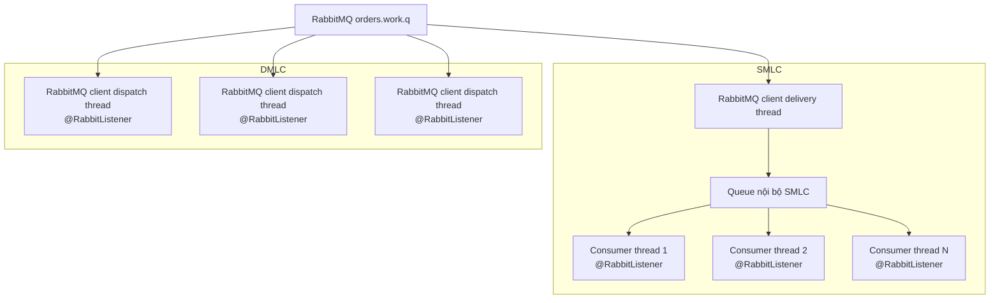
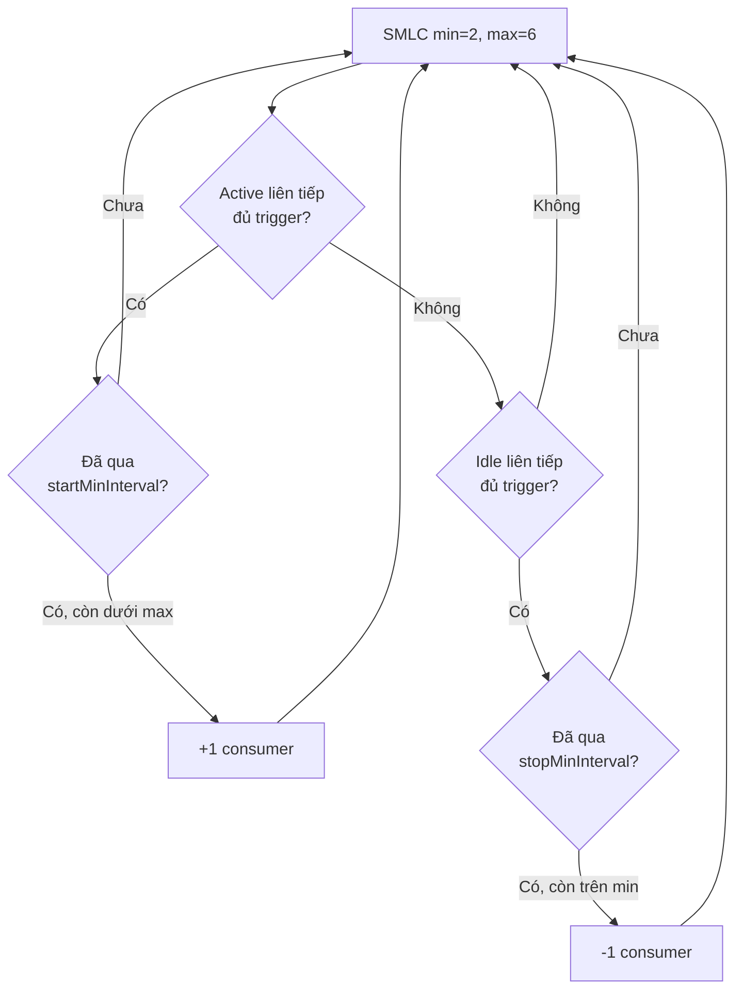
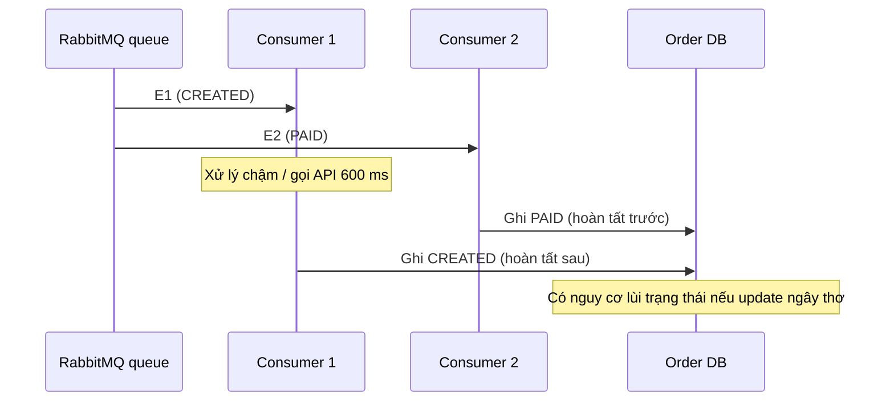
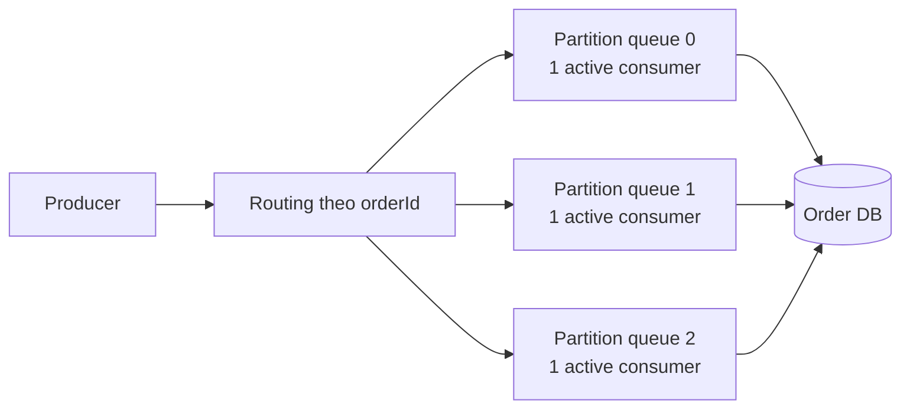

# Tăng concurrency của SMLC và DMLC đúng cơ chế

Trong Spring AMQP, tăng concurrency giúp một ứng dụng xử lý nhiều message RabbitMQ đồng thời, nhưng hai listener container phổ biến có **hai cơ chế khác nhau**:

- **SimpleMessageListenerContainer (SMLC)** dùng `concurrentConsumers`, `maxConcurrentConsumers` và các ngưỡng *active/idle* để tăng hoặc giảm số consumer.
- **DirectMessageListenerContainer (DMLC)** dùng `consumersPerQueue` cho **từng queue**; nó không có thuật toán tự co giãn theo `maxConcurrentConsumers` như SMLC. Số luồng thực tế còn phụ thuộc executor của RabbitMQ Java client.

Vì vậy, sao chép `concurrency="2-6"` từ SMLC sang DMLC, hoặc tăng `consumersPerQueue` mà quên giới hạn luồng và downstream, có thể khiến cấu hình sai hoặc không đạt thông lượng mong muốn.

Bài học thuộc chương **Thứ tự và đồng thời** của module **SPRING_AMQP**. Ta sử dụng `@RabbitListener`, `RabbitTemplate`, exchange, queue, binding, ACK/NACK, prefetch và retry để tăng độ song song **có chủ đích**, đồng thời bảo vệ thứ tự nghiệp vụ, dữ liệu và khả năng vận hành.

## 1. Mục tiêu học tập

Sau bài này, bạn có thể:

1. Mô tả đường đi của message qua **SMLC** và **DMLC**, biết thread nào gọi listener.
2. Cấu hình số consumer **cố định** hoặc **tự co giãn** cho SMLC.
3. Cấu hình `consumersPerQueue` đúng với DMLC, tính số consumer khi một container nghe nhiều queue.
4. Hiểu ý nghĩa khác nhau của thuộc tính `@RabbitListener(concurrency = "...")` tùy container.
5. Phân tích tương tác của concurrency với `prefetchCount`, thread pool, connection/channel, ACK, redelivery và downstream.
6. Nhận diện khi nào xử lý song song phá vỡ thứ tự theo `orderId` và cách giữ thứ tự theo khóa nghiệp vụ.
7. Đo hiệu quả scaling bằng queue depth, unacked, consumer count, latency và tốc độ xử lý thực tế.

## 2. Trước khi tăng số: phân biệt consumer, channel, thread và instance

**Consumer** là một đăng ký nhận message từ queue qua giao thức RabbitMQ, thường có consumer tag và channel liên quan. Một Spring Boot instance có thể tạo nhiều consumer trên cùng queue. Một queue cũng có thể được nhiều instance cùng tiêu thụ.

**Channel** là đối tượng giao tiếp AMQP trên connection. ACK/NACK gắn với delivery tag theo **channel**, không dùng delivery tag làm định danh toàn cục.

**Thread** là luồng thực thi listener. **Một consumer không phải luôn tương đương một thread riêng**: đây chính là khác biệt quan trọng giữa SMLC và DMLC.

**Instance/pod** là tiến trình JVM triển khai ứng dụng. Số consumer thực tế trên broker phụ thuộc **cả** concurrency mỗi instance **và** số replica:

```text
Tổng consumer cho cùng queue
  ≈ số instance × số consumer mỗi instance cho queue đó
```

Đây là phép tính cấu hình trong điều kiện mọi instance đã kết nối đầy đủ, chưa tính consumer từ dịch vụ khác và các ngoại lệ như **Single Active Consumer (SAC)**.

Ví dụ ba instance cùng nghe `orders.work.q`, mỗi instance tạo bốn consumer: RabbitMQ có thể thấy **12 consumer đăng ký**. Nhưng điều này **không có nghĩa** 12 message sẽ được xử lý xong cùng lúc: còn phụ thuộc prefetch, CPU, I/O, thread pool và hệ thống đích.

### Sơ đồ luồng xử lý



Sơ đồ thể hiện **hai phương án thay thế** cùng nghe một queue. Trong bài thực hành, chạy lần lượt SMLC rồi DMLC để so sánh; không vô tình khởi chạy cả hai listener trên cùng queue nếu muốn đo từng phương án độc lập.

## 3. SMLC: mỗi consumer có luồng xử lý riêng

**`SimpleMessageListenerContainer`** nhận delivery qua RabbitMQ Java client, chuyển vào hàng đợi nội bộ rồi gọi `MessageListener` bằng **luồng consumer chuyên dụng**. Nếu container nghe nhiều queue, mỗi consumer của SMLC có thể đăng ký nhận từ các queue đó nhưng vẫn dùng **một channel** cho consumer đó.

Tham số điều khiển là:

| Thuộc tính SMLC | Ý nghĩa |
| --- | --- |
| `concurrentConsumers` | **Số consumer tối thiểu/ban đầu** của container; khi không cấu hình max cao hơn, đây là số cố định. |
| `maxConcurrentConsumers` | **Giới hạn trên** để SMLC tăng thêm consumer khi có tải. |
| `concurrency="4"` | Cách rút gọn cấu hình **4 consumer cố định**. |
| `concurrency="2-6"` | Cách rút gọn cấu hình **tối thiểu 2, tối đa 6**, có thuật toán co giãn trong khoảng. |
| `consecutiveActiveTrigger` | Số chu kỳ nhận liên tiếp được xem là *active* trước khi cân nhắc tăng consumer; mặc định **10**. |
| `startConsumerMinInterval` | Khoảng tối thiểu giữa các lần khởi động consumer; mặc định **10.000 ms**. |
| `consecutiveIdleTrigger` | Số chu kỳ không nhận được message trước khi cân nhắc giảm consumer; mặc định **10**. |
| `stopConsumerMinInterval` | Khoảng tối thiểu giữa các lần dừng consumer; mặc định **60.000 ms**. |
| `receiveTimeout`, `batchSize` | Tham gia xác định cửa sổ *active/idle* trong thuật toán SMLC, không phải thông số số thread. |

### 3.1 Số cố định

Nếu muốn luôn có bốn consumer trên mỗi instance SMLC:

```java
factory.setConcurrentConsumers(4);
// Không đặt max cao hơn: giữ cấu hình cố định 4 consumer.
```

Hoặc đặt trên listener:

```java
@RabbitListener(
    queues = "orders.work.q",
    containerFactory = "smlcFactory",
    concurrency = "4"
)
public void onOrder(String payload) {
    // Mỗi message được một consumer xử lý.
}
```

Số `4` chỉ số consumer trên **container của instance đó**. Nếu có ba instance, tổng đăng ký trên broker sẽ gần 12. Concurrency trong `@RabbitListener` **ghi đè** thiết lập concurrency tương ứng trên factory cho listener cụ thể.

### 3.2 Co giãn theo tải: tối thiểu–tối đa

```java
factory.setConcurrentConsumers(2);
factory.setMaxConcurrentConsumers(6);
```

Hoặc:

```java
@RabbitListener(
    queues = "orders.work.q",
    containerFactory = "smlcFactory",
    concurrency = "2-6"
)
public void onOrder(String payload) {
    // SMLC có thể tăng từ 2 tới 6 consumer.
}
```

Với cấu hình này, SMLC **khởi đầu bằng 2 consumer**, có thể tăng từng consumer tới 6 khi quan sát thấy tải đủ liên tục. Khi ít tải, nó có thể giảm về 2. Nó **không** lập tức tạo 6 consumer chỉ vì queue đang có backlog.

Nếu cần xử lý 6 message song song ngay lúc vừa startup, hãy cấu hình **6 consumer cố định**, đồng thời bảo đảm backend và CPU chịu nổi. Nếu muốn tiết kiệm tài nguyên ở giờ thấp điểm, dùng khoảng min/max.

### 3.3 Thuật toán scale up/down của SMLC

Theo mặc định:

1. Khi một consumer được coi là **active** trong **10 chu kỳ liên tiếp** và đã qua ít nhất **10 giây** kể từ lần khởi tạo consumer trước, SMLC có thể **thêm một consumer**, miễn chưa đạt `maxConcurrentConsumers`.
2. Khi có consumer **idle** qua **10 chu kỳ liên tiếp**, đồng thời đã qua ít nhất **60 giây** từ lần dừng trước và số consumer vẫn cao hơn tối thiểu, SMLC có thể **dừng một consumer**.
3. Chu kỳ active/idle bị ảnh hưởng bởi `batchSize × receiveTimeout`. Nếu dùng `receiveTimeout=1.000 ms` và `batchSize=1`, một chu kỳ nhận thường quanh một giây, nhưng scheduler, tải và cách nhận thực tế có thể khiến thời gian khác.
4. Trong hệ thống có nhiều consumer, RabbitMQ phân phối message giữa consumer. Vì thế scale down có thể cần thời gian **cả container ít tải**; không phải cứ một consumer tạm im lặng là nó lập tức bị dừng.



**Cần đọc đúng đơn vị:** `consecutiveActiveTrigger=10` là **10 chu kỳ nhận**, không phải "đạt 10 msg/s"; `startConsumerMinInterval=10000` là **mili giây**, không phải số request.

Nếu giảm quá thấp các khoảng min interval hoặc trigger, container có thể tạo/hủy consumer liên tục trước những đợt tải ngắn, gây dao động và tốn tài nguyên. Khi lần đầu làm việc, dùng ngưỡng mặc định rồi đo tải thực tế.

### 3.4 Ví dụ điều chỉnh ngưỡng SMLC

```java
factory.setConcurrentConsumers(2);
factory.setMaxConcurrentConsumers(6);

factory.setConsecutiveActiveTrigger(10);
factory.setConsecutiveIdleTrigger(10);
factory.setStartConsumerMinInterval(10_000L);
factory.setStopConsumerMinInterval(60_000L);

factory.setReceiveTimeout(1_000L);
factory.setBatchSize(1);
```

Các thuộc tính trigger và interval này **chỉ thuộc cơ chế co giãn của SMLC**. Với cùng `concurrentConsumers=maxConcurrentConsumers`, không có khoảng trống để scale tự động dù bạn thay trigger.

## 4. DMLC: số consumer **trên từng queue**, client thread pool xử lý

**`DirectMessageListenerContainer`** gọi listener trực tiếp trên thread dispatch của **RabbitMQ Java client**, không chuyển message qua queue nội bộ và thread consumer riêng như SMLC. Đây là lý do nó có mô hình concurrency khác.

Tham số chính:

```java
factory.setConsumersPerQueue(3);
```

- Một queue: tạo **3 consumer** cho queue đó.
- Hai queue trong cùng container: tạo **3 consumer cho mỗi queue**, tương đương **6 đăng ký consumer/channel**.
- Ba queue: **9 đăng ký consumer/channel**, giả sử tất cả queue tồn tại và container hoạt động bình thường.

**Không dùng** `setConcurrentConsumers(...)`, `setMaxConcurrentConsumers(...)`, `consecutiveActiveTrigger` hay các ngưỡng active/idle để điều khiển DMLC. Các thuộc tính đó không áp dụng cho DMLC.

### 4.1 `@RabbitListener(concurrency)` trên DMLC

Với DMLC, annotation chỉ chấp nhận **một số nguyên** và ánh xạ nó thành `consumersPerQueue`:

```java
@RabbitListener(
    queues = "orders.work.q",
    containerFactory = "dmlcFactory",
    concurrency = "3"
)
public void onOrder(String payload) {
    // DMLC tạo 3 consumer cho queue này.
}
```

Đây là cú pháp hợp lệ. Ngược lại:

```java
@RabbitListener(
    queues = "orders.work.q",
    containerFactory = "dmlcFactory",
    concurrency = "2-6" // SAI với DMLC: không nhận khoảng min-max
)
public void onOrder(String payload) { }
```

Cú pháp `"2-6"` thuộc về **SMLC**. DMLC không có tự động tăng/giảm consumer theo tải theo cách của SMLC. DMLC cho phép **đổi `consumersPerQueue` trong lúc chạy**; framework sẽ điều chỉnh số consumer, nhưng ứng dụng/automation của bạn phải quyết định khi nào đổi.

### 4.2 Client thread pool là giới hạn thực tế

DMLC không cấp một thread riêng cố định cho mỗi consumer. Thread thực thi listener đến từ **executor của RabbitMQ client** được cấu hình qua connection factory. Một số client configuration mặc định tạo pool gần `availableProcessors() * 2` thread mỗi connection, nhưng kích thước chính xác tùy phiên bản, connection factory và cấu hình ứng dụng.

Đặt `consumersPerQueue=20` trong khi executor thực tế chỉ cho phép rất ít listener chạy đồng thời có thể khiến:

- số consumer đăng ký tăng nhưng tốc độ xử lý không tăng tương ứng;
- một listener xử lý chậm làm các callback khác chờ khả năng dispatch;
- độ trễ và số unacked message tăng mà dashboard vẫn cho thấy nhiều consumer.

Khi triển khai DMLC với concurrency lớn, kiểm tra **executor của `CachingConnectionFactory`/RabbitMQ client**, tổng số DMLC cùng chia connection factory và số thread thực sự hoạt động. `taskExecutor` cấu hình trực tiếp trên DMLC phục vụ chủ yếu cho hoạt động giám sát consumer, **không thay thế thread pool dispatch của client**.

> Không được suy ra "DMLC 6 consumer tức có 6 thread chuyên dụng" hoặc "tăng `taskExecutor` của DMLC sẽ tự cấp 6 thread xử lý". Phải đo cả RabbitMQ client executor.

### 4.3 Bổ sung và xóa queue khi runtime

DMLC thường cập nhật tập queue thuận tiện hơn khi cần thêm/bớt queue động: các consumer của queue không bị tác động không phải bị hủy và tạo lại như với SMLC. Đây có thể là lý do chọn DMLC cho hệ thống có nhiều queue thay đổi theo thời gian. Tuy nhiên, tính năng đó **không đồng nghĩa** DMLC có auto-scale active/idle.

## 5. Bảng so sánh trực tiếp

| Đặc điểm | SMLC | DMLC |
| --- | --- | --- |
| Đường nhận message | Thread của RabbitMQ client → queue nội bộ → thread consumer SMLC. | Gọi listener trực tiếp trên dispatch thread RabbitMQ client. |
| Tham số chính | `concurrentConsumers`. | `consumersPerQueue`. |
| Min/max theo tải | `maxConcurrentConsumers` với active/idle triggers. | Không có thuật toán min/max giống SMLC. |
| `@RabbitListener(concurrency="4")` | 4 consumer cố định trên container. | 4 consumer **cho mỗi queue**. |
| `@RabbitListener(concurrency="2-6")` | Có: 2–6 consumer co giãn. | Không: cú pháp không hợp lệ với DMLC. |
| Khi nghe 2 queue, concurrency = 3 | 3 consumer thread, mỗi consumer đăng ký nghe cả 2 queue; mỗi consumer có 1 channel. | 3 consumer trên mỗi queue = 6 consumer/channel. |
| Thread listener | Thread executor của SMLC, thường mỗi consumer cần một thread. | Thread executor dispatch của RabbitMQ Java client. |
| Auto-scale theo active/idle | Có, khi cấu hình max > min. | Không; có thể chỉnh `consumersPerQueue` bằng mã. |
| `batchSize`/consumer-created batching | Có, cùng cơ chế ACK/transaction phù hợp. | Không có cùng chức năng; `messagesPerAck` là cấu hình khác. |
| Thêm/bớt queue runtime | Có thể kéo theo restart các consumer của container. | Ít ảnh hưởng tới consumer của queue còn lại. |
| Ưu tiên chọn | Cần co giãn theo tải, batching hoặc mô hình thread riêng đơn giản. | Cần dispatch trực tiếp, queue động hoặc muốn kiểm soát consumer trên từng queue. |

**Tăng concurrency không đồng nghĩa tạo thêm queue hoặc shard.** Mỗi consumer tăng thêm trên **cùng queue** sẽ cùng tranh message với các consumer khác; broker phân phối các message cho chúng và thứ tự hoàn tất nghiệp vụ có thể thay đổi.

## 6. Ví dụ Spring Boot hoàn chỉnh theo hai phương án

Giả sử producer gửi đơn hàng vào direct exchange `orders.events.x`, routing key `orders.created` và queue `orders.work.q`. Ví dụ dùng Java 17+, Spring Boot với dependency `spring-boot-starter-amqp`. Các bean factory SMLC/DMLC có thể cùng tồn tại; tuy nhiên **chỉ kích hoạt một listener tiêu thụ queue đó** khi đo hai phương án.

### 6.1 Khai báo exchange, queue, binding

```java
import org.springframework.amqp.core.Binding;
import org.springframework.amqp.core.BindingBuilder;
import org.springframework.amqp.core.DirectExchange;
import org.springframework.amqp.core.Queue;
import org.springframework.amqp.core.QueueBuilder;
import org.springframework.context.annotation.Bean;
import org.springframework.context.annotation.Configuration;

@Configuration
public class OrderTopology {
    public static final String EXCHANGE = "orders.events.x";
    public static final String QUEUE = "orders.work.q";
    public static final String ROUTING_KEY = "orders.created";

    @Bean
    DirectExchange orderExchange() {
        return new DirectExchange(EXCHANGE);
    }

    @Bean
    Queue orderQueue() {
        return QueueBuilder.durable(QUEUE).build();
    }

    @Bean
    Binding orderBinding(Queue orderQueue,
                         DirectExchange orderExchange) {
        return BindingBuilder.bind(orderQueue)
                .to(orderExchange)
                .with(ROUTING_KEY);
    }
}
```

Producer có thể publish từng message:

```java
rabbitTemplate.convertAndSend(
    OrderTopology.EXCHANGE,
    OrderTopology.ROUTING_KEY,
    jsonPayload
);
```

**Định danh:** payload nên mang `eventId` và `orderId` ổn định để listener có thể ghi log và xử lý idempotent khi bị giao lại. Đừng dùng delivery tag làm ID nghiệp vụ.

### 6.2 Tạo hai factory có tên khác nhau

```java
import org.springframework.amqp.core.AcknowledgeMode;
import org.springframework.amqp.rabbit.config.DirectRabbitListenerContainerFactory;
import org.springframework.amqp.rabbit.config.SimpleRabbitListenerContainerFactory;
import org.springframework.amqp.rabbit.connection.ConnectionFactory;
import org.springframework.context.annotation.Bean;
import org.springframework.context.annotation.Configuration;

@Configuration
public class OrderListenerFactories {

    @Bean
    SimpleRabbitListenerContainerFactory smlcFactory(
            ConnectionFactory connectionFactory) {

        var factory = new SimpleRabbitListenerContainerFactory();
        factory.setConnectionFactory(connectionFactory);

        factory.setConcurrentConsumers(2);
        factory.setMaxConcurrentConsumers(6);

        factory.setConsecutiveActiveTrigger(10);
        factory.setConsecutiveIdleTrigger(10);
        factory.setStartConsumerMinInterval(10_000L);
        factory.setStopConsumerMinInterval(60_000L);

        factory.setPrefetchCount(20);
        factory.setAcknowledgeMode(AcknowledgeMode.AUTO);
        return factory;
    }

    @Bean
    DirectRabbitListenerContainerFactory dmlcFactory(
            ConnectionFactory connectionFactory) {

        var factory = new DirectRabbitListenerContainerFactory();
        factory.setConnectionFactory(connectionFactory);

        factory.setConsumersPerQueue(3);
        factory.setPrefetchCount(20);
        factory.setAcknowledgeMode(AcknowledgeMode.AUTO);
        return factory;
    }
}
```

Hai cấu hình này giải quyết **cùng mục tiêu tăng khả năng xử lý song song** nhưng dùng đúng property của từng loại container.

- SMLC bắt đầu bằng **2 consumer** và có thể tăng tới **6**.
- DMLC tạo **3 consumer trên mỗi queue** ngay khi chạy. Nó không tự tăng tới 6 theo active trigger.
- `setPrefetchCount(20)` **không phải** số consumer, cũng không làm hàm listener chạy 20 lần song song.
- `AcknowledgeMode.AUTO` có nghĩa container xử lý ACK/NACK theo kết quả listener; không nghĩa message sẽ được xử lý đúng một lần ở cấp nghiệp vụ.

### 6.3 Listener cho phương án SMLC

```java
import java.nio.charset.StandardCharsets;
import org.springframework.amqp.core.Message;
import org.springframework.amqp.rabbit.annotation.RabbitListener;
import org.springframework.stereotype.Component;

@Component
public class OrderSmlcListener {
    private final OrderProcessor processor;

    public OrderSmlcListener(OrderProcessor processor) {
        this.processor = processor;
    }

    @RabbitListener(
        id = "orders-processing",
        queues = OrderTopology.QUEUE,
        containerFactory = "smlcFactory",
        concurrency = "2-6"
    )
    public void handle(Message message) {
        String eventId = message.getMessageProperties().getMessageId();
        String body = new String(
            message.getBody(), StandardCharsets.UTF_8);

        System.out.printf(
            "SMLC thread=%s eventId=%s%n",
            Thread.currentThread().getName(), eventId);

        processor.processIdempotently(body);
    }
}
```

`OrderProcessor` là service nghiệp vụ giả định; hàm `processIdempotently(...)` phải có khả năng xử lý lặp an toàn. Trong thực tế hãy dùng ID nằm trong payload nếu publisher không cam kết cung cấp `messageId` ổn định.

### 6.4 Chuyển qua DMLC: thay listener, giữ nghiệp vụ

Trong lần chạy **thay thế** cho SMLC, dùng class sau và **không khởi chạy** `OrderSmlcListener` ở mục 6.3. Có thể thực hiện bằng Spring profile/điều kiện cấu hình, hoặc tạm chỉ giữ một class listener trong project bài thực hành:

```java
import java.nio.charset.StandardCharsets;
import org.springframework.amqp.core.Message;
import org.springframework.amqp.rabbit.annotation.RabbitListener;
import org.springframework.stereotype.Component;

@Component
public class OrderDmlcListener {
    private final OrderProcessor processor;

    public OrderDmlcListener(OrderProcessor processor) {
        this.processor = processor;
    }

    @RabbitListener(
        id = "orders-processing",
        queues = OrderTopology.QUEUE,
        containerFactory = "dmlcFactory",
        concurrency = "3"
    )
    public void handle(Message message) {
        String eventId = message.getMessageProperties().getMessageId();
        String body = new String(
            message.getBody(), StandardCharsets.UTF_8);

        System.out.printf(
            "DMLC thread=%s eventId=%s%n",
            Thread.currentThread().getName(), eventId);

        processor.processIdempotently(body);
    }
}
```

**Lưu ý:** hai class mẫu cùng dùng `id="orders-processing"` vì chúng **không được kích hoạt đồng thời**. Nếu kích hoạt cả hai, listener ID sẽ trùng và chúng cũng sẽ tranh message trên cùng queue, làm sai mục đích so sánh. Trong sản phẩm thực tế, thường chỉ chọn **một** container factory cho mỗi listener.

### 6.5 Ghi đè concurrency trên annotation

Nếu trong factory đặt `setConsumersPerQueue(3)` nhưng listener DMLC ghi `concurrency="5"`, listener đó sẽ dùng **5 consumer trên mỗi queue**. Tương tự, SMLC `concurrency="2-6"` ghi đè cấu hình min/max trong factory.

Thuộc tính `@RabbitListener(concurrency = "...")` xuất hiện từ **Spring AMQP 2.0** và hỗ trợ property placeholders hoặc SpEL. Với cấu hình điều khiển tập trung, chỉ nên chọn một nơi làm nguồn chính để tránh người đọc nghĩ giá trị factory luôn là kết quả thực.

## 7. Hai queue: vì sao công thức concurrency khác nhau?

Giả sử cùng một container đăng ký **hai queue**:

```text
orders.new.q
orders.retry.q
```

Với SMLC:

```text
concurrentConsumers = 3
    Consumer 1 -> đăng ký cả orders.new.q và orders.retry.q
    Consumer 2 -> đăng ký cả orders.new.q và orders.retry.q
    Consumer 3 -> đăng ký cả orders.new.q và orders.retry.q

Khoảng 3 consumer thread / 3 channel cho container,
mỗi consumer nghe nhiều queue.
```

Với DMLC:

```text
consumersPerQueue = 3
    orders.new.q   -> Consumer A1, A2, A3 (3 channel)
    orders.retry.q -> Consumer B1, B2, B3 (3 channel)

Tổng 6 consumer/channel, cùng chia RabbitMQ client thread pool.
```

Bảng tính nhanh:

| Queue mỗi container | SMLC `concurrency=3` | DMLC `consumersPerQueue=3` |
| ---: | ---: | ---: |
| 1 | 3 consumer/container | 3 consumer/container |
| 2 | 3 consumer/container, đăng ký với cả hai queue | 6 consumer/container |
| 4 | 3 consumer/container, đăng ký với cả bốn queue | 12 consumer/container |

Đếm **số consumer registrations** cho mỗi queue cần quan sát trực tiếp qua RabbitMQ Management UI/CLI, đặc biệt khi triển khai nhiều replica hoặc queue không tồn tại. Đừng nhân số queue vào `concurrentConsumers` của SMLC để ước tính **số thread chuyên dụng**; ngược lại, phải nhân `consumersPerQueue × số queue` để hiểu số consumer đăng ký của DMLC.

## 8. Prefetch và giới hạn xử lý thực tế

RabbitMQ dùng `basic.qos`/prefetch để hạn chế số delivery **chưa ACK** mà consumer giữ. Với RabbitMQ, prefetch thông thường áp dụng **theo consumer**.

Ví dụ:

```text
SMLC: 6 consumer × prefetch 20 = tối đa khoảng 120 delivery chưa ACK.
DMLC: 2 queue × 3 consumer/queue × prefetch 20
    = tối đa khoảng 120 delivery chưa ACK trên hai queue.
```

Đây là **giới hạn lý thuyết** trong điều kiện áp dụng prefetch per-consumer, không phải lượng message chắc chắn đang nằm trong bộ nhớ hay số task CPU đang chạy. Số message thực tế còn phụ thuộc hoạt động của broker và tốc độ ACK.

**Nếu prefetch quá cao:**

- Các consumer có thể giữ nhiều message chưa ACK, gây tăng memory khi message lớn.
- Message phân phối thiếu đều ở tải nhẹ khi một consumer nhận trước nhiều delivery.
- Khi connection/channel mất, nhiều message chưa ACK có thể được giao lại và tạo thêm công việc cho hệ thống.
- Listener chậm hoặc phụ thuộc database có thể trở thành nút thắt, dù tổng số consumer cao.

**Nếu prefetch quá thấp:**

- Consumer có thể thường xuyên đợi broker gửi tiếp, giảm throughput đối với nghiệp vụ nhanh.
- Nhưng prefetch thấp giúp kiểm soát memory, phân phối đều hơn trong một số trường hợp và hữu ích khi phải giữ thứ tự nghiêm ngặt.

Không nên đồng thời tăng concurrency từ 2 lên 20 và prefetch từ 20 lên 500 khi chưa đo tài nguyên và độ trễ; tổng số delivery chưa ACK có thể tăng mạnh. Một điểm xuất phát cho bài thực hành là `prefetchCount=10` hoặc `20`, rồi đo throughput và unacked message.

### Downstream cũng có mức đồng thời tối đa

Ví dụ ứng dụng có **database pool chỉ 10 connection** nhưng đặt SMLC 20 consumer, ba instance:

```text
3 instance × 20 consumer = có thể 60 tác vụ gọi DB đồng thời
mỗi instance DB pool = 10 connection
=> 20 listener/instance có thể tranh 10 kết nối DB
```

Con số listener tăng **không bảo đảm** số transaction/giây tăng; có thể chỉ làm tăng thời gian chờ connection pool. Cần xem thêm thread dump, HikariCP pool usage, lock contention, CPU, giới hạn HTTP downstream và p95/p99 latency.

## 9. Concurrency ảnh hưởng trực tiếp đến thứ tự hoàn tất

RabbitMQ cố gắng duy trì trật tự FIFO của message **trên một queue** trong những điều kiện nhất định. Nhưng khi có **nhiều consumer cạnh tranh**, message có thể được giao tuần tự song **xử lý hoàn tất không theo thứ tự**.

Giả sử hai event liên tiếp thuộc cùng đơn hàng:

```text
E1: orderId=O-42, version=1, trạng thái CREATED
E2: orderId=O-42, version=2, trạng thái PAID
```

Kịch bản:



Một queue FIFO **không cam kết** hệ quả nghiệp vụ hoàn tất theo FIFO khi listener chạy song song. Retry/requeue, publisher song song và priority cũng có thể đổi thứ tự quan sát.

### 9.1 Trường hợp cần giữ thứ tự tuyệt đối của queue

Nếu yêu cầu xử lý nghiêm ngặt theo thứ tự cho **toàn bộ queue**:

- Giữ **một active consumer thực tế**, xem tổng số consumer trên tất cả replica.
- Cân nhắc `prefetchCount=1` nếu phải xử lý và ACK từng message trước khi nhận message tiếp theo.
- Dùng **Single Active Consumer (SAC)** khi muốn có nhiều consumer dự phòng nhưng chỉ một consumer nhận từ queue ở mỗi thời điểm.
- Khi có retry/requeue, vẫn cần xử lý chính sách redelivery và ngữ nghĩa thứ tự cẩn thận; việc cấu hình một consumer không tự bảo đảm mọi tình huống lỗi.

Ví dụ khai báo queue SAC:

```java
@Bean
Queue orderedQueue() {
    return QueueBuilder.durable("orders.ordered.q")
            .singleActiveConsumer()
            .build();
}
```

SAC là tính năng **queue do RabbitMQ quản lý**, không phải một tham số tăng concurrency của SMLC/DMLC. Khi SAC bật, dù container tạo nhiều consumer, chỉ một consumer được RabbitMQ chọn làm **active** tại một thời điểm; các consumer khác làm dự phòng. Tăng `consumersPerQueue`/`concurrentConsumers` khi đã dùng SAC **không làm cùng queue xử lý nhiều message cùng lúc theo nhiều active consumer**.

### 9.2 Giữ thứ tự **theo orderId** nhưng vẫn tăng throughput

Nhiều hệ thống không cần thứ tự trên **mọi đơn hàng**; chỉ cần mọi event của **cùng orderId** được xử lý đúng thứ tự. Có thể partition theo khóa:



Ý tưởng: mọi event có `orderId=O-42` luôn đi tới **cùng queue partition**, trong khi các order ID khác có thể được xử lý song song ở queue khác. Có thể dùng routing ổn định từ ứng dụng hoặc exchange hỗ trợ phân vùng theo hash (ví dụ plugin consistent-hash exchange của RabbitMQ). Cần thiết kế việc đổi số partition và rebalance để không làm event cùng key sang hai queue song song trong lúc chuyển đổi.

Dù dùng partition, **bảo vệ bằng version/sequence** ở DB vẫn quan trọng. Ví dụ:

```sql
UPDATE orders
SET status = :newStatus,
    version = :newVersion
WHERE order_id = :orderId
  AND version = :expectedPreviousVersion;
```

Nếu `UPDATE` ảnh hưởng 0 dòng, cần xác định event đang trùng, đến muộn hay thiếu phiên bản trước; không cứ thế ghi đè hoặc ACK như một thành công nghiệp vụ. Cơ chế version check và idempotency bổ trợ cho thứ tự routing, đặc biệt trong failover và redelivery.

## 10. Retry, ACK và concurrent consumer

Khi `@RabbitListener` ném exception, container xử lý reject/requeue tùy `AcknowledgeMode`, error handler và cấu hình retry. Tăng concurrency không giải quyết message lỗi; nếu `defaultRequeueRejected=true`, lỗi lặp lại có thể gây **requeue loop** với nhiều consumer tranh nhận cùng message.

| Sự cố | Khi tăng concurrency | Giải pháp |
| --- | --- | --- |
| Message xử lý thành công nhưng ACK không tới broker | Có thể redeliver vào consumer khác; dữ liệu trùng nếu handler không idempotent. | Dùng event ID ổn định và unique constraint/inbox. |
| Lỗi tạm thời ở downstream | Nhiều consumer cùng retry, đè tải lên DB/API. | Backoff, retry giới hạn, DLX/DLQ và circuit breaker phù hợp. |
| Message lỗi cố định | Một vài consumer có thể liên tục nhận lại và thất bại. | Phân loại permanent failure, reject không requeue, DLQ/quarantine. |
| Bắt buộc theo thứ tự orderId | Các consumer có thể xử lý event mới trước event cũ. | Partition theo key hoặc một active consumer; version check. |
| DB connection pool cạn | Thêm consumer chỉ làm tăng số tác vụ chờ. | Đo pool/lock/CPU, giới hạn concurrency theo hệ thống đích. |

Với `AcknowledgeMode.AUTO`, container ACK khi listener hoàn thành bình thường; listener thất bại khiến container áp dụng chính sách NACK/reject. Với `AcknowledgeMode.MANUAL`, ứng dụng phải ACK/NACK trên đúng channel và delivery tag. ACK theo `multiple=true` trên một channel có thể xác nhận cả những delivery khác chưa hoàn tất; đặc biệt cần thận trọng nếu dùng các cơ chế callback bất đồng bộ.

**Đừng mặc định rằng hai consumer sẽ nhận mỗi consumer đúng 50% lượng message.** Broker dispatch theo consumer availability, prefetch, khả năng ACK và những ràng buộc khác; phân phối thực tế có thể lệch.

## 11. Chọn SMLC hay DMLC cho từng tình huống?

| Tình huống | Lựa chọn thường hợp lý | Vì sao? |
| --- | --- | --- |
| Một queue cố định, cần tăng từ 2 lên tối đa 8 theo tải | **SMLC** | Có `concurrentConsumers`/`maxConcurrentConsumers` và active/idle triggers. |
| Một queue cố định, luôn muốn 5 consumer | **Cả hai** | SMLC `concurrency="5"`; DMLC `consumersPerQueue=5`. |
| Một container nghe nhiều queue, muốn chính xác 2 consumer **trên mỗi queue** | **DMLC** | `consumersPerQueue` áp dụng từng queue. |
| Cần gom các message độc lập thành consumer-created batch | **SMLC** | Có `consumerBatchEnabled`, `batchSize` và cơ chế batch ACK/transaction. |
| Tập queue thay đổi thường xuyên khi runtime | **DMLC** | Thêm/xóa queue ít ảnh hưởng consumer trên queue khác. |
| Cần thread listener chuyên dụng, dễ kiểm soát executor pool | **SMLC** | Listener chạy qua thread executor của SMLC. |
| Muốn tối ưu đường dispatch, tránh một lớp queue/chuyển thread | **DMLC** | Listener chạy trực tiếp trên client dispatch thread, cần cấp đủ thread pool. |
| Cần thứ tự nghiêm ngặt của một queue | **Không tăng active consumer** | Dùng một active consumer/SAC với chính sách ordering thích hợp. |

Không có loại container "luôn nhanh hơn". DMLC có thể giảm chuyển thread, nhưng khi nghiệp vụ xử lý chậm hoặc thread pool thiếu tài nguyên, lợi ích này không tự xuất hiện. SMLC có cơ chế co giãn tốt, nhưng thêm consumer cũng tăng cạnh tranh với broker/downstream. Cần benchmark theo ứng dụng thật.

## 12. Đo và tinh chỉnh concurrency theo số liệu

### 12.1 Những chỉ số cần lấy

| Chỉ số | Diễn giải |
| --- | --- |
| `messages_ready` / queue depth | Message đang chờ broker giao. |
| `messages_unacknowledged` | Delivery đã giao nhưng chưa ACK; có thể tăng do prefetch hoặc listener chậm. |
| Consumer count theo **queue** | Kiểm chứng SMLC/DMLC đã đăng ký đúng số consumer. |
| Message xử lý thành công/giây | Throughput thật ở business, không chỉ số delivery. |
| p50/p95/p99 thời gian xử lý listener | Tăng concurrency có làm latency tốt hơn không? |
| Redelivery, retry, DLQ | Phát hiện lỗi và tác động xử lý lặp. |
| CPU, heap, thread count, channel count, client executor | Kiểm soát giá thành của concurrency. |
| DB pool active/waiting, lock waits, HTTP downstream 429/5xx | Kiểm tra bottleneck đã chuyển xuống backend hay chưa. |
| Thứ tự event theo entity/version | Phát hiện hoàn tất ngược thứ tự khi chạy song song. |

Khi vận hành SMLC, cần so sánh **số consumer hiện tại** với `concurrentConsumers` tối thiểu và `maxConcurrentConsumers` tối đa. Nếu đã ở max, queue vẫn tăng, hệ thống có thể đã đạt giới hạn xử lý hoặc đang bị nghẽn downstream. Nếu SMLC không scale up dù queue sâu, hãy kiểm tra listener thực sự active, trigger, khoảng thời gian chờ và tài nguyên executor.

Với DMLC, nếu RabbitMQ Management hiển thị đúng `consumersPerQueue` nhưng throughput thấp, kiểm tra **RabbitMQ client dispatch executor**, thời gian listener xử lý, prefetch và downstream trước khi tăng số consumer tiếp.

### 12.2 Quy trình tuning có kiểm soát

1. Bắt đầu với một consumer, `prefetchCount=10`; đo throughput, latency và độ dài queue.
2. Với SMLC, thử `concurrency="2"` rồi `"2-6"`; xem số consumer tăng theo thời gian, không kỳ vọng tạo 6 ngay.
3. Với DMLC, thử `consumersPerQueue=2` rồi `4` trên **một queue**, xác nhận RabbitMQ client executor đủ thread.
4. Tăng tải bằng một tốc độ publisher cố định, đo cùng số message/loại công việc và cùng số replica.
5. So sánh throughput **đã hoàn tất nghiệp vụ**, unacked, p95 latency và số lỗi/duplicate; không chỉ nhìn số message được dispatch.
6. Tăng concurrency từng bước; dừng khi bottleneck chuyển sang DB/API hoặc throughput không còn cải thiện.
7. Chạy lại dưới điều kiện lỗi, redelivery và shutdown để xác minh idempotency và ordering.

### 12.3 Quy đổi trên nhiều replica

Giả sử ba pod, mỗi pod có một listener SMLC co giãn từ 2 tới 6:

```text
Tổng consumer trên orders.work.q:
  thấp nhất ≈ 3 × 2 = 6
  cao nhất ≈ 3 × 6 = 18
```

Nếu đổi sang DMLC với hai queue, `consumersPerQueue=4`, ba pod:

```text
Mỗi pod: 2 queue × 4 consumer/queue = 8 consumer
Cả cụm: 3 pod × 8 = 24 consumer đăng ký
Mỗi queue: 3 pod × 4 = 12 consumer đăng ký
```

Đây là số cấu hình nếu tất cả queue/connection hoạt động; các giá trị có thể khác khi startup, recovery hoặc SAC. Ngoài ra, tổng thread phải được xem xét riêng, nhất là với DMLC.

## 13. Thực hành: cùng một workload, hai cách tăng concurrency

### Bài A — SMLC cố định rồi co giãn

Chuẩn bị queue `orders.work.q` và publisher theo mục 6. Listener mô phỏng một thao tác I/O có thời gian xử lý kiểm soát, đồng thời log `eventId`, tên thread và thời điểm bắt đầu/kết thúc.

- Chạy `concurrency="1"`, publish 100 message, đo thời gian hoàn tất.
- Chạy `concurrency="4"` với **cùng workload**, quan sát consumer count và khả năng xử lý song song.
- Chạy `concurrency="2-6"`, publish liên tục đủ lâu để quan sát scale up sau chu kỳ active/min interval.
- Dừng publisher nhưng giữ container chạy để quan sát scale down dần về 2, phụ thuộc idle trigger và min interval.

**Câu hỏi:** vì sao `2-6` chỉ có 2 consumer ở thời điểm vừa khởi chạy, dù queue đã có backlog?

### Bài B — DMLC nhân theo số queue

Đổi sang listener DMLC, chạy **một listener** cho queue:

- `consumersPerQueue=3` trên `orders.work.q`: RabbitMQ Management dự kiến thấy 3 consumer của instance.
- Thêm queue thử nghiệm thứ hai vào **cùng container DMLC** và đăng ký với cả hai: dự kiến tổng 6 consumer/channel ở instance, 3 trên mỗi queue.
- Tăng lên `consumersPerQueue=5`, quan sát consumer đăng ký trên broker và thread dispatch thực tế.

**Câu hỏi:** vì sao số consumer đăng ký tăng không bảo đảm số thread đang xử lý listener tăng theo tỷ lệ 1:1?

### Bài C — thứ tự xử lý bị đảo

Publish hai event `orderId=O-42`, `version=1` và `version=2` liên tiếp. Tạo delay ở version 1 và chạy nhiều consumer. Quan sát việc version 2 có thể hoàn tất trước version 1. Sau đó:

- Đặt tổng **một active consumer** và `prefetch=1` để so sánh.
- Hoặc chia message theo `orderId` vào partition ổn định và dùng một active consumer trên từng partition.
- Thêm version check khi ghi database, bảo đảm event cũ không ghi đè trạng thái mới.

### Bài D — tăng concurrency khi backend chậm

Giới hạn pool DB giả lập, cho listener giữ kết nối DB một khoảng thời gian. Tăng SMLC từ 2 lên 10 consumer. Đo throughput, thời gian chờ pool và queue depth.

**Câu hỏi:** tới điểm nào throughput không cải thiện, dù số consumer vẫn tăng? Đó là lúc cần cải thiện downstream hoặc điều chỉnh workload thay vì tiếp tục tăng consumer.

### Bài E — redelivery và idempotency

Cho một message xử lý DB thành công nhưng cố tình mất ACK trong môi trường test, sau đó quan sát redelivery sang consumer khác. Dùng `eventId` và unique constraint/inbox để chứng minh nghiệp vụ không bị áp dụng hai lần. Cấu hình retry giới hạn và DLQ để xử lý thông điệp lỗi, tránh requeue nóng.

## 14. Lỗi cấu hình thường gặp

| Sai lầm | Triệu chứng | Hướng sửa |
| --- | --- | --- |
| Đặt `@RabbitListener(concurrency="2-6")` trên DMLC | Cú pháp không phù hợp container, khởi tạo listener lỗi. | DMLC dùng một số nguyên, ví dụ `"3"`. |
| Tăng `maxConcurrentConsumers` nhưng giữ min=max | Không có khoảng co giãn. | SMLC đặt min nhỏ hơn max và kiểm tra triggers. |
| Kỳ vọng SMLC từ 2 lên 8 ngay sau startup | Ban đầu chỉ có hai consumer. | Hiểu active trigger + start interval, hoặc cấu hình số cố định. |
| Dùng `setConcurrentConsumers` để điều khiển DMLC | Không tác động đến cơ chế DMLC. | Dùng `setConsumersPerQueue`/annotation phù hợp. |
| DMLC nhiều queue nhưng tính concurrency như SMLC | Tạo nhiều channel/consumer hơn dự kiến. | Nhân `consumersPerQueue × số queue × số instance`. |
| Chỉ tăng DMLC `taskExecutor` và kỳ vọng listener nhanh hơn | Client dispatch vẫn thiếu thread. | Xem executor trên connection factory của RabbitMQ client. |
| Tăng consumer nhưng giữ DB pool rất nhỏ | Thread chờ DB, p95 tăng. | Đo và cân đối database pool, xử lý nhanh hơn hoặc giới hạn concurrency. |
| Tăng prefetch rất cao cùng concurrency | Nhiều unacked, memory tăng, redelivery lớn khi lỗi. | Tune prefetch theo kích thước message và thời gian ACK. |
| Cho nhiều consumer xử lý event phụ thuộc thứ tự | Có thể ghi trạng thái ngược phiên bản. | Một active consumer, partition theo key, version check và idempotency. |
| Chạy cả SMLC/DMLC test cùng queue | Cả hai tranh message, benchmark sai. | Chỉ kích hoạt một phương án mỗi lần so sánh. |
| Mỗi instance tự nghĩ concurrency=2 là tổng toàn cluster | Nhiều replica tạo số consumer lớn hơn dự định. | Nhân thêm số pod/instance và quan sát broker. |

## 15. Ghi nhớ quan trọng

- **SMLC** tăng song song bằng `concurrentConsumers`; muốn tự co giãn thêm `maxConcurrentConsumers` và các trigger active/idle. `concurrency="2-6"` là cú pháp dành cho SMLC.
- **DMLC** tăng bằng `consumersPerQueue`; `@RabbitListener(concurrency="3")` có nghĩa **3 consumer trên mỗi queue**. Nó không tự scale theo min/max như SMLC.
- **SMLC dùng thread consumer riêng; DMLC gọi listener trên RabbitMQ client dispatch thread.** Vì thế sizing executor khác nhau.
- **Prefetch × consumer count** tác động lượng message chưa ACK. Tăng consumer cần xét cả số replica, backend pool và chi phí retry.
- **Một queue có nhiều active consumer không đảm bảo hoàn tất nghiệp vụ theo FIFO.** Khi cần thứ tự theo entity, dùng partition theo khóa, một active consumer mỗi partition và version check/idempotency.
- **Đo throughput nghiệp vụ, latency và redelivery** trước khi kết luận concurrency cao hơn là tốt hơn.

## Tài liệu tham khảo

- [Spring AMQP — Listener Concurrency](https://docs.spring.io/spring-amqp/reference/amqp/listener-concurrency.html): thuật toán SMLC, các ngưỡng active/idle, `consumersPerQueue` của DMLC.
- [Spring AMQP — Choosing a Container](https://docs.spring.io/spring-amqp/reference/amqp/receiving-messages/choose-container.html): đường xử lý message, tradeoff SMLC/DMLC, batch và runtime queue changes.
- [Spring AMQP — Enable Listener Endpoint Annotations](https://docs.spring.io/spring-amqp/reference/amqp/receiving-messages/async-annotation-driven/enable.html): cấu hình factory, `@RabbitListener(concurrency)` theo loại container.
- [Spring AMQP — Threading and Asynchronous Consumers](https://docs.spring.io/spring-amqp/reference/amqp/receiving-messages/threading.html): khác biệt executor của SMLC với client thread pool của DMLC.
- [Spring AMQP — Message Listener Container Configuration](https://docs.spring.io/spring-amqp/reference/amqp/containerAttributes.html): prefetch, ACK, recovery, concurrency và thuộc tính hỗ trợ trên từng container.
- [RabbitMQ — Consumer Prefetch](https://www.rabbitmq.com/docs/consumer-prefetch): phạm vi prefetch trên mỗi consumer và số delivery chưa ACK.
- [RabbitMQ — Queues / Message Ordering](https://www.rabbitmq.com/docs/queues): FIFO, requeue, competing consumers và chiến lược giữ thứ tự.
- [RabbitMQ — Consumers / Single Active Consumer](https://www.rabbitmq.com/docs/consumers): ngữ nghĩa SAC khi cần một consumer active và các consumer dự phòng.
