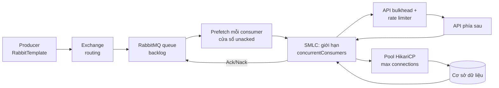
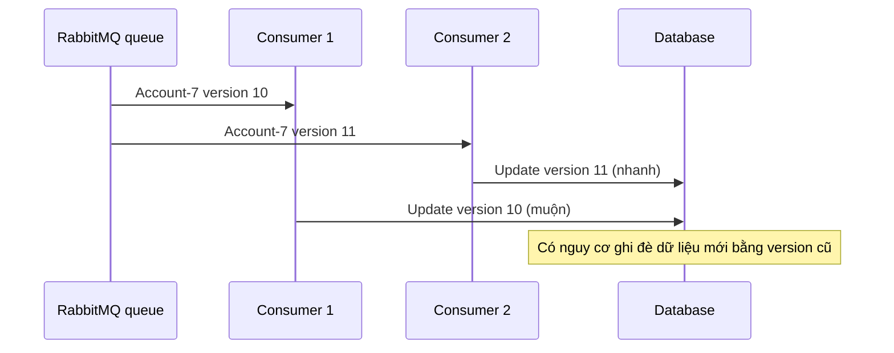

# Giới hạn đồng thời theo tài nguyên cơ sở dữ liệu hoặc API phía sau

## 1. Bài toán: consumer nhanh hơn tài nguyên downstream

Trong chương **Thứ tự và đồng thời** của module **SPRING_AMQP**, chúng ta dùng RabbitMQ và Spring AMQP (`RabbitTemplate`, `@RabbitListener`, exchange, queue và binding) để xử lý công việc bất đồng bộ. Khi backlog tăng, phản xạ phổ biến là tăng `concurrency` từ 2 lên 20 consumer để queue được xử lý nhanh hơn.

Cách tăng này chỉ hiệu quả nếu **cơ sở dữ liệu (DB), dịch vụ HTTP phía sau và các tài nguyên liên quan còn đủ công suất**. Nếu không, thêm consumer sẽ biến hàng chờ RabbitMQ thành hàng chờ bên trong ứng dụng, dẫn tới:

- Thread consumer chờ connection từ pool DB, làm thời gian ack tăng.
- API downstream trả `429 Too Many Requests`, `503` hoặc timeout vì quá nhiều request đồng thời.
- HikariCP connection pool hết chỗ, request đợi tới `connectionTimeout` rồi lỗi.
- Nhiều delivery được prefetch nhưng chưa xử lý, chiếm RAM và tăng độ trễ đuôi (p95/p99).
- Retry liên tục gây tải bổ sung, làm downstream càng quá tải.
- Nhiều consumer xử lý cùng entity đồng thời khiến thứ tự hoàn tất và kết quả nghiệp vụ khó kiểm soát.

Ví dụ: một dịch vụ nhận `RiskCheckRequested` để gọi API kiểm tra rủi ro rồi lưu kết quả vào PostgreSQL. API chỉ chịu được tối đa **12 request đang thực thi đồng thời** cho toàn bộ ứng dụng. Nếu chạy **3 replica**, mỗi replica mở **8 consumer**, tổng tối đa **24 listener đồng bộ** có thể cùng gọi API. Đây là quá nhiều dù queue còn hàng nghìn message.

**Mục tiêu bài học:** thiết kế giới hạn đồng thời dựa trên **ngân sách kết nối DB, số request API đang thực thi, rate limit và số replica**; cấu hình Spring AMQP để RabbitMQ giữ backlog thay vì đẩy toàn bộ vào downstream; quan sát và thử tải để xác định giới hạn thực tế.

## 2. Phân biệt những khái niệm dễ bị nhầm

| Khái niệm | Giới hạn điều gì? | Không bảo đảm điều gì? |
| --- | --- | --- |
| `concurrentConsumers` | Số consumer đồng thời của `SimpleMessageListenerContainer`; với listener **đồng bộ**, gần bằng số lần gọi listener đang chạy trên một instance | Không trực tiếp giới hạn QPS của API nếu mỗi listener gọi nhiều API, tạo thread khác hoặc trả async result |
| `maxConcurrentConsumers` | Số consumer tối đa khi container tăng/giảm động theo tải | Không biết giới hạn DB/API; có thể tự tăng tới mức gây nghẽn nếu cấu hình quá cao |
| `consumersPerQueue` | Số consumer trên **mỗi queue** với `DirectMessageListenerContainer` | Không phải số consumer tổng của container nếu listener có nhiều queue |
| `prefetchCount` | Số delivery chưa được ack tối đa mà broker cho mỗi consumer giữ, theo RabbitMQ QoS thường dùng | Không tương đương số request API thực sự đang chạy; delivery có thể đang nằm trong buffer |
| `AcknowledgeMode.AUTO` | Spring container ack khi listener đồng bộ thành công; xử lý reject/nack khi lỗi | Không tự cung cấp transaction phân tán giữa DB/API và RabbitMQ |
| DB connection pool | Số connection vật lý ứng dụng giữ tới DB, ví dụ HikariCP `maximumPoolSize` | Không tự chặn request API hay đảm bảo DB có đủ CPU, IOPS và lock capacity |
| HTTP connection pool | Số connection/socket được client HTTP tái sử dụng hoặc mở đồng thời tùy cấu hình | Không nhất thiết giới hạn request đang chạy hoặc QPS, nhất là HTTP/2 multiplexing |
| Bulkhead / semaphore | Số tác vụ được phép đồng thời vào một downstream | Không bảo đảm số request mỗi giây nằm dưới rate limit |
| Rate limiter | Số yêu cầu trong mỗi khoảng thời gian, như 100 request/s | Không tự hạn chế in-flight nếu một request trở nên rất chậm |

**Ba đơn vị đo khác nhau:** consumer/thread, in-flight request và request/giây. Cần theo dõi cả ba. `prefetch=1` hạn chế mỗi consumer nhận trước quá nhiều delivery, nhưng nếu có 30 consumer hoặc listener tự khởi chạy 100 tác vụ async, downstream vẫn có thể bị quá tải.

### 2.1. Sơ đồ vị trí áp dụng giới hạn



Trong pipeline listener **đồng bộ**, giảm consumer concurrency khiến số thao tác nghiệp vụ có thể thực thi đồng thời giảm, và phần dư tiếp tục chờ ở queue. Trong pipeline **bất đồng bộ**, method có thể trả về sớm trong khi các tác vụ vẫn chạy; cần bổ sung giới hạn ở executor/bulkhead và kiểm soát số delivery unacked.

## 3. Tính ngân sách tài nguyên trước khi đặt concurrency

### 3.1. Ngân sách DB

Giả sử PostgreSQL cho tối đa 100 connection, trong đó application khác, quản trị, transaction nền và công việc không thuộc RabbitMQ cần giữ 40. Ngân sách còn lại là **60 connection**, nhưng không nên dùng hết 60 cho consumer; cần để dự phòng cho spike và kiểm soát tổng connection thực tế của **mọi replica**.

Đặt:

- `R`: số replica ứng dụng.
- `C`: số consumer đồng bộ tối đa mỗi replica của listener đang xét.
- `K_db`: số connection DB mà một message có thể giữ **đồng thời**, thường khoảng 1 nếu xử lý tuần tự trên một transaction.
- `B_db_global`: số connection DB có thể cấp cho **nhóm công việc này** trên toàn cụm sau khi đã trừ ngân sách dịch vụ khác.
- `B_db_pod`: số connection dành được từ HikariCP của **mỗi replica**, sau khi để chỗ cho HTTP endpoint, job nền và các tác vụ khác.

Điều kiện ngân sách bảo thủ:

\[
R \times C \times K_{db} \le B_{db\_global}
\]

và đồng thời:

\[
C \times K_{db} \le B_{db\_pod}
\]

Giới hạn này **chỉ là một ràng buộc connection**, chưa chứng minh DB đủ CPU, disk IOPS hoặc khóa row để chạy đúng số thao tác đó.

**Đặc điểm HikariCP:** `maximumPoolSize` thường là giới hạn **trên một DataSource của một process**, không phải giới hạn trên toàn cluster. Nếu 3 replica, mỗi replica đặt `maximumPoolSize=20`, về lý thuyết cả cụm có thể mở tới 60 connection cho pool đó, chưa kể các ứng dụng khác. Khi pool hết connection rảnh, thread sẽ **chờ tối đa `connectionTimeout`** rồi nhận lỗi; nâng pool quá lớn có thể làm DB chậm hơn.

### 3.2. Ngân sách API: concurrency và rate limit là hai ràng buộc riêng

Đặt:

- `B_api_global`: số HTTP request **đang chạy đồng thời** mà API cho phép trên toàn hệ thống.
- `K_api`: số request HTTP mà một job phát sinh **đồng thời**, không phải tổng số lần gọi tuần tự.
- `Q_api_global`: số request/giây API cho phép.
- `A_api`: số lần gọi API trung bình trên mỗi job.
- `T_jobs`: tốc độ xử lý job thành công mỗi giây của toàn cụm.

Cần xét ít nhất:

\[
R \times C \times K_{api} \le B_{api\_global}
\]

và:

\[
T_{jobs} \times A_{api} \le Q_{api\_global}
\]

**Giới hạn concurrency không tự tạo rate limiting.** Ví dụ chỉ 4 request cùng lúc nhưng mỗi request mất 20 ms, tốc độ lý thuyết đã có thể lên tới khoảng 200 request/s khi tải liên tục. API có quota 100 request/s vẫn có thể trả 429 dù in-flight luôn nhỏ hơn 4. Khi đó cần thêm **token bucket hoặc rate limiter theo quota thực tế**, và cân nhắc quota có được chia sẻ giữa các replica/ứng dụng hay không.

### 3.3. Công thức lựa chọn ban đầu

Nếu một message dùng tối đa một DB connection và một API call tại một thời điểm, một ước lượng khởi đầu là:

\[
C_{pod} \le \min\left(
\left\lfloor \frac{B_{db\_pod}}{K_{db}} \right\rfloor,\quad
\left\lfloor \frac{B_{api\_global}}{R \times K_{api}} \right\rfloor,\quad
B_{worker\_threads}
\right)
\]

Ở đây `B_worker_threads` là ngân sách thread thực thi đã dành cho listener. Công thức cần điều chỉnh nếu consumer chỉ dùng DB ở một phần nhỏ thời gian, API có nhiều endpoint quota khác nhau, hoặc các job tạo công việc song song. **Luôn chạy thử tải và dành headroom**, thay vì lấy kết quả toán học làm giá trị tối ưu tuyệt đối.

### 3.4. Ví dụ chọn số consumer cho 3 replica

Giả sử đã phân bổ các ngân sách **riêng cho luồng RiskCheckRequested** như sau:

| Tài nguyên | Ngân sách cho nhóm công việc | Tính trên mỗi replica |
| --- | --- | --- |
| PostgreSQL | 24 connection trên toàn cụm | 8 connection/replica nếu phân đều |
| Pool HikariCP | `maximumPoolSize=10`, dành 6 cho các việc khác | Còn khoảng 4 connection/replica |
| API kiểm tra rủi ro | 12 request đồng thời toàn cụm, dành 3 cho dịch vụ khác | Còn 9 request, khoảng 3/replica |
| Số replica | 3 | Không đổi trong lượt thiết kế |
| Một job | Tối đa 1 connection DB và 1 HTTP request cùng lúc | `K_db=K_api=1` |

Ràng buộc mạnh nhất là API: `9/3 = 3` consumer/replica. Có thể bắt đầu với **2 consumer/replica**, giữ tổng tối đa **6 job đồng bộ** đang xử lý, còn dự phòng khi API chậm. Nếu thử tải cho thấy dư tài nguyên, cân nhắc tăng lên 3.

Các con số trên là **ví dụ tính toán**, không phải cấu hình khuyến nghị chung. Nếu autoscaling từ 3 lên 6 replica nhưng vẫn để 2 consumer/replica, tổng concurrency lên **12**, vượt mức 9 dành cho nhóm job: cần tính lại hoặc bổ sung **giới hạn toàn cụm**.

### 3.5. Little's Law để ước lượng throughput có thể đạt

Trong trạng thái ổn định, với `N` tác vụ đang thực thi đồng thời và thời gian xử lý trung bình `W`:

\[
N \approx \lambda W \quad \Rightarrow \quad \lambda \approx \frac{N}{W}
\]

Ví dụ có 6 slot xử lý, mỗi job mất trung bình 250 ms, năng lực lý thuyết khi luôn bận là khoảng `6/0.25=24` job/s. Con số này **không bảo đảm throughput**, vì database lock, độ trễ phân bố không đều, retry và quota API có thể hạ thấp tốc độ thật.

Nếu publisher tạo 100 job/s nhưng downstream chỉ xử lý bền vững 24 job/s, queue sẽ tích thêm khoảng **76 job/s** trong giai đoạn đó. Cần lập kế hoạch về backlog, SLA chờ và tăng công suất downstream. Tăng consumer lên 40 không làm API bỗng xử lý nhanh hơn.

## 4. Cấu hình Spring AMQP: giới hạn listener đồng bộ

Ví dụ sử dụng **Spring Boot 3.2+**, Java 17+, RabbitMQ, JDBC/HikariCP và một HTTP API. Tác vụ xử lý: nhận mã `jobId`, gọi một API `GET` tra cứu kết quả rồi ghi kết quả bằng khóa idempotency vào PostgreSQL.

> Các đoạn code minh họa các lớp riêng trong cùng ứng dụng. Cần cấu hình địa chỉ API, kết nối RabbitMQ/DB và tạo bảng dữ liệu trước khi chạy.

### 4.1. Queue, exchange và binding

```java
import org.springframework.amqp.core.Binding;
import org.springframework.amqp.core.BindingBuilder;
import org.springframework.amqp.core.DirectExchange;
import org.springframework.amqp.core.Queue;
import org.springframework.amqp.core.QueueBuilder;
import org.springframework.context.annotation.Bean;
import org.springframework.context.annotation.Configuration;

@Configuration
class RiskTopology {
    @Bean
    DirectExchange riskExchange() {
        return new DirectExchange("risk.x", true, false);
    }

    @Bean
    Queue riskJobsQueue() {
        return QueueBuilder.durable("risk.jobs").build();
    }

    @Bean
    Binding riskBinding(Queue riskJobsQueue, DirectExchange riskExchange) {
        return BindingBuilder.bind(riskJobsQueue)
                .to(riskExchange)
                .with("risk.run");
    }
}
```

Producer có thể gửi từng job:

```java
import org.springframework.amqp.rabbit.core.RabbitTemplate;
import org.springframework.stereotype.Service;

@Service
class RiskJobPublisher {
    private final RabbitTemplate rabbitTemplate;

    RiskJobPublisher(RabbitTemplate rabbitTemplate) {
        this.rabbitTemplate = rabbitTemplate;
    }

    void submit(String jobId) {
        rabbitTemplate.convertAndSend("risk.x", "risk.run", jobId);
    }
}
```

**Lưu ý:** queue durable, message persistent, publisher confirms và xử lý unroutable returns là những cơ chế khác nhau. Trong môi trường production cần thiết kế đồng bộ với hợp đồng phát lại message.

### 4.2. Cố định số consumer và hạ prefetch

```java
import org.springframework.amqp.core.AcknowledgeMode;
import org.springframework.amqp.rabbit.config.SimpleRabbitListenerContainerFactory;
import org.springframework.amqp.rabbit.connection.ConnectionFactory;
import org.springframework.context.annotation.Bean;
import org.springframework.context.annotation.Configuration;

@Configuration
class LimitedRiskListenerConfig {

    @Bean("limitedRiskListenerFactory")
    SimpleRabbitListenerContainerFactory limitedRiskListenerFactory(
            ConnectionFactory connectionFactory) {

        var factory = new SimpleRabbitListenerContainerFactory();
        factory.setConnectionFactory(connectionFactory);

        // Giữ cố định 2 consumer/replica.
        factory.setConcurrentConsumers(2);
        factory.setMaxConcurrentConsumers(2);

        // Giới hạn số delivery chưa ACK mà mỗi consumer giữ.
        factory.setPrefetchCount(2);

        // Method đồng bộ: Spring ACK sau khi hoàn tất thành công.
        factory.setAcknowledgeMode(AcknowledgeMode.AUTO);
        return factory;
    }
}
```

Với `concurrentConsumers=2` và `prefetch=2`, một replica có khoảng tối đa **4 delivery chưa ack** trên hai consumer khi không có cấu hình QoS/consumer bổ sung làm thay đổi phạm vi. **Chỉ khoảng 2 invocation đồng bộ** của listener này thực thi cùng lúc; hai delivery còn lại có thể đang chờ. Không nên lấy `2×2=4` làm số request API đang chạy.

Khi đặt `maxConcurrentConsumers` cao hơn, `SimpleMessageListenerContainer` có thể tăng consumer theo tải; để bảo vệ downstream bằng giới hạn **cứng**, đặt min=max hoặc cài thêm bulkhead. Với `DirectMessageListenerContainer`, cơ chế tương ứng là `consumersPerQueue`; tổng consumer phụ thuộc số queue và replica, nên đừng sao chép các thuộc tính SMLC vào DMLC mà không điều chỉnh.

Có thể cấu hình toàn cục bằng Spring Boot properties `spring.rabbitmq.listener.simple.concurrency`, `max-concurrency` và `prefetch` **nếu dùng factory mặc định được Boot cấu hình**. Trong ví dụ này đã tạo **factory riêng** nên các thuộc tính cần được thiết lập trực tiếp như trên. Annotation `@RabbitListener(concurrency = "...")` nếu được đặt có thể ghi đè cấu hình concurrency của factory.

**Vì sao không để prefetch mặc định?** Spring AMQP đã có mặc định prefetch khá cao ở các phiên bản phổ biến. Với job chứa payload lớn, downstream chậm hoặc cần phân phối tương đối đều giữa các replica, prefetch nhỏ (thử 1–4) thường dễ dự báo hơn. Tuy vậy, prefetch=1 có thể giới hạn throughput nếu round-trip ack dài; hãy đo thay vì coi mọi prefetch cao là sai.

### 4.3. DataSource và thời gian chờ connection

Ví dụ `application.yml`:

```yaml
spring:
  datasource:
    url: jdbc:postgresql://postgres:5432/app
    username: app
    password: change-me
    hikari:
      maximum-pool-size: 10
      connection-timeout: 2000
```

Đây chỉ là thông tin giả định cho môi trường thực hành; production phải quản lý bí mật theo cơ chế bảo mật thích hợp. `maximum-pool-size=10` giới hạn **connection trên mỗi pool/replica**, và các request web hoặc background jobs khác dùng cùng pool cũng tiêu thụ slot. `connection-timeout=2000` khiến thread báo lỗi sau khoảng 2 giây đợi connection, không tự “mở thêm connection vượt ngưỡng”.

Cấu hình pool DB và listener concurrency phải tính chung. Nếu mỗi job giữ connection suốt một HTTP call chậm, pool có thể hết nhanh dù số consumer không lớn. Vì vậy nên **không mở transaction DB kéo dài qua thao tác HTTP**.

### 4.4. Listener gọi API rồi mới ghi kết quả

```java
import org.springframework.amqp.AmqpRejectAndDontRequeueException;
import org.springframework.amqp.rabbit.annotation.RabbitListener;
import org.springframework.stereotype.Component;

@Component
class RiskJobListener {
    private final RiskApiClient apiClient;
    private final RiskResultRepository repository;

    RiskJobListener(RiskApiClient apiClient, RiskResultRepository repository) {
        this.apiClient = apiClient;
        this.repository = repository;
    }

    @RabbitListener(
            queues = "risk.jobs",
            containerFactory = "limitedRiskListenerFactory")
    public void handle(String jobId) {
        if (jobId == null || jobId.isBlank()) {
            throw new AmqpRejectAndDontRequeueException("Missing job ID");
        }

        // Không mở DB transaction quanh lệnh HTTP này.
        RiskAssessment assessment = apiClient.fetch(jobId);

        // Ghi DB nguyên tử, kết thúc trước khi listener return.
        repository.saveOnce(jobId, assessment.verdict());
    }
}
```

Client HTTP có thể dùng `RestClient` (Spring Framework 6.1+, có trong Spring Boot 3.2+):

```java
import java.util.Objects;
import org.springframework.stereotype.Component;
import org.springframework.web.client.RestClient;

record RiskAssessment(String verdict) {}

@Component
class RiskApiClient {
    private final RestClient client;

    RiskApiClient(RestClient.Builder builder) {
        this.client = builder
                .baseUrl("http://risk-api:8080")
                .build();
    }

    RiskAssessment fetch(String jobId) {
        RiskAssessment result = client.get()
                .uri("/assessments/{id}", jobId)
                .retrieve()
                .body(RiskAssessment.class);
        return Objects.requireNonNull(result, "Missing risk response");
    }
}
```

Trong ứng dụng thực, cấu hình **connection timeout, response/read timeout, connection pool HTTP và số connection/request đồng thời** theo client được chọn. Nếu API có nhiều endpoint với quota khác nhau, không dùng một giới hạn chung thiếu căn cứ.

### 4.5. Lưu kết quả có idempotency

Tạo bảng PostgreSQL:

```sql
CREATE TABLE risk_results (
    job_id TEXT PRIMARY KEY,
    verdict TEXT NOT NULL,
    processed_at TIMESTAMPTZ NOT NULL DEFAULT NOW()
);
```

Service ghi DB:

```java
import org.springframework.jdbc.core.JdbcTemplate;
import org.springframework.stereotype.Repository;
import org.springframework.transaction.annotation.Transactional;

@Repository
class RiskResultRepository {
    private final JdbcTemplate jdbc;

    RiskResultRepository(JdbcTemplate jdbc) {
        this.jdbc = jdbc;
    }

    @Transactional
    public void saveOnce(String jobId, String verdict) {
        jdbc.update("""
                INSERT INTO risk_results(job_id, verdict)
                VALUES (?, ?)
                ON CONFLICT (job_id) DO NOTHING
                """, jobId, verdict);
    }
}
```

Đây là ví dụ xử lý **một yêu cầu GET không gây tác dụng phía API** và một bản ghi DB với khóa `jobId`. Unique key ngăn ghi lặp nếu message bị redeliver sau khi commit nhưng trước ack. Nếu cùng `jobId` có verdict mới hợp lệ, không được dùng `ON CONFLICT DO NOTHING` vô điều kiện; hãy định nghĩa event/version và quy tắc update nghiệp vụ riêng.

**Lưu ý về chi phí:** GET có thể bị gọi lại trước khi phát hiện trùng ở DB. Có thể tối ưu bằng cách kiểm tra trạng thái trước khi gọi API, nhưng **unique constraint và transaction** vẫn là hàng rào cuối cùng để ngăn race giữa nhiều replica. Với API tạo side effect (`POST` thu tiền, tạo đơn), phải truyền **idempotency key ổn định** và để phía API hỗ trợ dedup; DB transaction cục bộ không bao gồm side effect của HTTP.

## 5. Xử lý khi downstream quá tải

Giới hạn listener concurrency là bước đầu, nhưng API có thể vẫn quá tải khi công việc nền khác dùng cùng API, hoặc autoscaling làm số replica tăng.

### 5.1. Bulkhead, semaphore và phạm vi giới hạn

Mẫu **bulkhead** giới hạn số lời gọi đồng thời tới một tài nguyên. Ví dụ mã thuần Java dưới đây dùng 3 permit trên mỗi instance:

```java
import java.util.concurrent.Callable;
import java.util.concurrent.Semaphore;
import java.util.concurrent.TimeUnit;

final class ApiBulkhead {
    private final Semaphore permits = new Semaphore(3, true);

    <T> T call(Callable<T> operation) throws Exception {
        if (!permits.tryAcquire(200, TimeUnit.MILLISECONDS)) {
            throw new DownstreamBusyException("API concurrency limit reached");
        }
        try {
            return operation.call();
        } finally {
            permits.release();
        }
    }
}

class DownstreamBusyException extends RuntimeException {
    DownstreamBusyException(String message) { super(message); }
}
```

Trong listener đồng bộ, có thể gọi `bulkhead.call(() -> apiClient.fetch(jobId))` và trả permit khi HTTP call kết thúc, kể cả khi lỗi. Nhưng đây là **semaphore trong một JVM**:

- Ba replica, mỗi replica có 3 permit → có thể có tới 9 request đồng thời.
- Nếu nhiều service khác dùng cùng API, local semaphore **không biết** các request của chúng.
- Khi số replica tăng hoặc công việc async fan-out, giới hạn tổng thay đổi.
- Với ngưỡng toàn hệ thống nghiêm ngặt, dùng cơ chế **quota/rate limit/bulkhead tập trung hoặc điều phối qua gateway**, kèm xử lý lỗi và độ tin cậy phù hợp. Distributed semaphore cần xử lý lease, crash và thời gian hết hạn cẩn thận.

**Không xử lý khi thiếu permit bằng vòng lặp nóng.** Nếu ném exception ngay và container mặc định requeue liên tục, một API quá tải sẽ nhận thêm retry tạo bão request. Cần **retry có giới hạn với backoff hoặc hàng đợi retry có trì hoãn**, có DLQ cho lỗi không thể khôi phục.

### 5.2. Phân loại lỗi

| Tình huống | Cách phản ứng phù hợp |
| --- | --- |
| Payload sai, không có `jobId` | Reject không requeue; gửi DLQ để điều tra |
| API trả 429 kèm `Retry-After` | Tôn trọng thời điểm có thể gọi lại; dùng limiter/backoff/delayed retry |
| API trả 503 hoặc timeout ngắn hạn | Retry giới hạn, jitter và circuit breaker; không giữ quá nhiều consumer ngủ lâu |
| HikariCP hết connection | Giảm concurrency, đo pending pool, tối ưu thời gian giữ transaction; retry có backoff nếu tạm thời |
| Cùng job đã ghi DB thành công | Nhận diện idempotent và ack bản sao; không tạo tác dụng lần hai |
| API có lỗi kéo dài hoặc payload luôn lỗi | Đưa tới DLQ hoặc workflow điều tra; không requeue vô hạn |

Với `AcknowledgeMode.AUTO`, khi listener đồng bộ return thành công, container sẽ ack. Khi listener ném exception, container xử lý reject/nack theo chính sách; mặc định requeue cho nhiều lỗi. Có thể dùng Spring Retry interceptor với `RejectAndDontRequeueRecoverer` để giới hạn lần thử rồi dead-letter, nhưng số lần và backoff phải dựa trên **loại lỗi** và SLA. Retry tại listener thường giữ consumer đang bận trong khoảng chờ; nếu delay dài, thiết kế **delayed retry queue** phù hợp hơn.

### 5.3. Cẩn thận với transaction và ack

Một workflow DB + API + RabbitMQ **không phải transaction phân tán** tự động. Ví dụ ở trên giữ DB transaction ngắn, commit trước khi listener return; nếu ack thất lạc, broker có thể giao lại message, vì vậy cần idempotency. Nếu tác vụ thay đổi nhiều tài nguyên độc lập, cân nhắc transactional outbox, idempotency key ở service đích và reconciliation.

Ngữ nghĩa:

- **Publisher confirm:** broker xác nhận publisher đã gửi vào broker theo cơ chế confirm, không chứng minh nghiệp vụ thành công.
- **Consumer ack:** broker được báo delivery đã xử lý, không thay thế database commit.
- **Prefetch:** số delivery chưa ack đang được phép giữ, không phải cơ chế retry hoặc rate limit.
- **Dead-letter:** tuyến xử lý message bị từ chối/quá hạn theo cấu hình, không có sẵn chỉ vì bật `MANUAL` hay `AUTO`.

## 6. Listener bất đồng bộ: concurrency của consumer có thể không còn là giới hạn công việc

Cần đặc biệt chú ý trường hợp:

```java
@RabbitListener(queues = "risk.jobs")
public void handle(String jobId) {
    executor.submit(() -> callDownstream(jobId));
    // Method return ngay; container đồng bộ có thể ack quá sớm.
}
```

**Đây là mẫu không an toàn** nếu công việc downstream cần hoàn tất trước ack: listener return trong khi API vẫn chạy, nên không có thông tin về thất bại async. Số task trong executor cũng có thể lớn hơn nhiều so với số consumer.

Trên phiên bản Spring AMQP hỗ trợ kiểu trả về async, nên trả trực tiếp `CompletableFuture<?>` hoặc `Mono<?>` để Spring ack/nack khi kết quả hoàn tất. Với các phiên bản hỗ trợ auto-detection, mode ack được đặt `MANUAL` cho method async tương ứng. Tuy nhiên:

- **Container concurrency chỉ giới hạn luồng nhận**, không nhất thiết giới hạn số async task đang thực thi, vì listener có thể trả future rất nhanh.
- Khi async result chưa hoàn tất, delivery thường tiếp tục **unacked**. Prefetch tạo giới hạn số delivery chưa ack, nhưng đặt prefetch quá lớn có thể làm nhiều task API chạy cùng lúc.
- Phải cấu hình **bounded executor**, bulkhead/permit được giữ **đến khi future hoàn tất**, timeout, cancellation và cơ chế phản hồi với rejected task.
- Không tự ack từ thread khác nếu Spring đang quản lý ack/nack theo kết quả async; tránh double ack và dùng sai channel.

Ví dụ **ý tưởng** về cách giữ permit:

```text
acquire permit
    |
    +-- submit async task ---- completion success/failure
                                |
                                +-- release permit in finally/whenComplete
                                |
                                +-- Spring manages ACK/NACK for async result
```

Một semaphore chỉ bao quanh lệnh `executor.submit()` rồi thả permit ngay là **sai**, vì nó giới hạn tốc độ submit trong vài microsecond chứ không giới hạn request đang chạy. Khi executor bão hòa, lỗi `RejectedExecutionException` cần chuyển thành một async result thất bại theo contract Spring AMQP, kết hợp retry có delay; không được bỏ message hoặc nuốt lỗi.

## 7. Đánh đổi với thứ tự xử lý

Tăng consumer từ 1 lên 2 giúp xử lý song song các job độc lập, nhưng **không còn bảo đảm hoàn tất theo thứ tự của queue**. Message A có thể vào consumer 1 trước; message B vào consumer 2 sau, nhưng B xử lý xong trước A vì API hoặc DB chậm.



Với dữ liệu có yêu cầu thứ tự theo `accountId`/`orderId`, các phương án phổ biến:

1. **Thiết kế update có version/CAS hoặc optimistic locking**, chỉ áp dụng event nếu thỏa quy tắc version; xử lý trường hợp thiếu version bằng reconcile.
2. **Partition theo business key** qua một tập queue/shard có routing ổn định, rồi xử lý tuần tự mỗi shard khi cần. Cùng key về cùng shard; các key khác nhau vẫn chạy song song.
3. **Giới hạn một active consumer cho một queue** khi cần tuần tự ở mức queue. RabbitMQ hỗ trợ tùy chọn single active consumer cho cấu hình phù hợp, nhưng cần xét retry, requeue, priority và nhiều producer: “một consumer” không tự giải quyết mọi tình huống out-of-order nghiệp vụ.
4. **Idempotency và khóa nghiệp vụ** để redelivery không tạo tác dụng lặp, kể cả khi có concurrency cao.

Nếu chỉ sử dụng `prefetch=1` nhưng có nhiều consumer trên cùng queue, các consumer vẫn có thể xử lý các message kế tiếp **song song**. Prefetch nhỏ giúp giới hạn số delivery đang chờ, **không buộc xử lý theo thứ tự toàn queue**.

## 8. Quan sát áp lực tài nguyên và xác định điểm nghẽn

### 8.1. Bộ chỉ số tối thiểu

| Thành phần | Metric / dấu hiệu | Cách diễn giải |
| --- | --- | --- |
| RabbitMQ | `messages_ready`, `messages_unacknowledged` | Ready tăng: backlog; unacked cao: delivery đang được giữ, chưa ack |
| RabbitMQ | Deliver/ack/redelivery rate, consumer capacity | Có nhận/ack bền vững không, có vòng redelivery không? |
| Spring AMQP | Active consumers, processing duration p50/p95/p99, failures | Giới hạn listener có được giữ không; downstream kéo dài thời gian xử lý? |
| HikariCP | Active, idle, pending, max, connection timeout | Pending cao hoặc active sát max: pool là điểm nghẽn |
| PostgreSQL | Active sessions, lock wait, slow queries, CPU/IOPS | Ngay cả khi còn connection, DB có thể đã bão hòa |
| HTTP API | In-flight request, p95/p99, 429/503, timeout, QPS | Tách giới hạn đồng thời, rate limit và lỗi do dịch vụ |
| JVM | Threads, heap, allocation, GC pause, executor queue depth | Prefetch/task queue lớn có đẩy nghẽn vào RAM không? |
| Nghiệp vụ | Unique completed jobs/s, queue age p95/p99, DLQ | Throughput nghiệp vụ thực và SLA chờ; không chỉ đếm attempts |

Khi dùng Spring Boot Actuator/Micrometer, nhiều pool cung cấp metric như `hikaricp.connections.active`, `hikaricp.connections.pending`, `hikaricp.connections.max`, tùy phiên bản và registry. Hãy xác minh tên metric xuất ra thực tế trước khi viết alert.

**Triệu chứng điển hình của tăng concurrency quá mức:** completed jobs/s không tăng hoặc giảm, HTTP 429/503 tăng, Hikari pending và p99 tăng, retry nhiều, còn DB/API có dấu hiệu bão hòa. Khi đó nên **giảm concurrency** và tối ưu downstream, thay vì tăng tiếp.

### 8.2. Ma trận thử tải

Nên giữ cùng payload, thời gian đo và mức tải đầu vào, sau đó thay **một biến mỗi lượt**:

| Run | Replica | Consumers/replica | Prefetch | Trường hợp muốn kiểm tra |
| --- | ---: | ---: | ---: | --- |
| A | 3 | 1 | 1 | Baseline an toàn, ít in-flight |
| B | 3 | 2 | 1 | Tăng concurrency trong ngân sách |
| C | 3 | 2 | 2 | Thử lợi ích prefetch |
| D | 3 | 3 | 2 | Tiến gần ngân sách API |
| E | 3 | 4 | 2 | Thử quá tải có kiểm soát trong môi trường test |
| F | 6 | 2 | 2 | Thấy tác động autoscaling tới giới hạn toàn cụm |

Lấy ít nhất:

- **Throughput nghiệp vụ hoàn tất** (unique success/s), không chỉ publisher sends hoặc delivery attempts.
- **Độ trễ đầu-cuối** từ khi publish đến khi commit xong việc xử lý, p95/p99; thời gian chờ trong queue.
- **Connection/API utilization**: Hikari active/pending, API in-flight/QPS/429 và database load.
- **Số message retry/redeliver/DLQ**, queue depth, heap/GC và thời gian drain backlog.
- **Cùng một tải cố định** và bài test tìm capacity cực đại trong giới hạn SLO. Một lần chạy đạt throughput cao nhất nhưng không giữ được p99 và tỉ lệ lỗi là cấu hình không đạt.

### 8.3. Điều khiển khi số replica thay đổi

Autoscaling consumer theo queue length rất hữu ích, nhưng nếu mỗi replica có 4 consumer, tăng từ 3 lên 8 replica cũng tăng lý thuyết từ 12 lên 32 tác vụ đồng bộ. Nếu quota API toàn hệ thống chỉ cho 12 in-flight request, **HPA có thể khuếch đại quá tải**.

Một số cách kiểm soát:

- Ràng buộc `maxReplicas × consumersPerReplica` theo ngân sách thấp nhất khi downstream không có cơ chế giới hạn trung tâm.
- Khi cần tăng số replica vì HA/CPU, **giảm số consumer mỗi replica** hoặc dùng distributed/global quota để tránh vượt ngân sách.
- Với nhiều loại job, dùng queue/listener container riêng và giới hạn riêng, tránh job nặng chiếm hết tài nguyên của job quan trọng.
- Đặt cảnh báo khi Hikari pending, HTTP 429, API in-flight hoặc queue age vượt ngưỡng trước khi chỉ nhìn queue depth.
- Nếu backlog kéo dài dù downstream đã đầy tải, cần tăng công suất downstream, giảm chi phí/job hoặc điều chỉnh cam kết SLA; chỉ mở thêm consumer không giải quyết được giới hạn thật.

## 9. Các lỗi cấu hình phổ biến

**Nhầm `prefetch` với concurrency.** `prefetch=50` không có nghĩa 50 listener chạy cùng lúc, nhưng có thể giữ thêm nhiều delivery unacked trong bộ nhớ. Ngược lại `prefetch=1` không chặn 30 consumer chạy song song.

**Chỉ nhìn số connection DB trong một pod.** Hikari pool là giới hạn cục bộ; replica khác và dịch vụ khác vẫn tạo connection tới cùng DB.

**Coi giới hạn in-flight bằng quota request/s.** API có thể xử lý rất nhanh và bị vượt rate limit dù số request đang chạy đồng thời nhỏ.

**Giữ DB transaction trong lúc chờ HTTP.** Điều này làm connection và lock bị giữ lâu. Đưa HTTP ra ngoài transaction khi nghiệp vụ cho phép; dùng idempotency, outbox/saga nếu cần phối hợp side effect.

**Tạo executor không giới hạn.** `@Async` hoặc `CompletableFuture` có thể khiến listener trả sớm; số thread/task thực tế vượt giới hạn consumer và ack sai thời điểm nếu method trả `void`.

**Requeue nóng khi API 429/503.** RabbitMQ redeliver nhanh, làm downstream quá tải thêm. Dùng backoff/jitter, delayed retry và DLQ.

**Không tính số replica sau autoscaling.** `concurrency=4` trên 1 pod không tương đương `concurrency=4` trên 10 pod.

**Tăng concurrency khi nghiệp vụ cần thứ tự.** Nhiều consumer xử lý cùng business key có thể hoàn tất đảo thứ tự; cần partition/version/locking phù hợp.

**Đo số message received thay vì công việc hoàn tất.** Hệ thống có thể nhận hàng nghìn message/s nhưng phần lớn đang chờ DB hoặc bị retry. Chỉ số chính là thành công nghiệp vụ và SLA.

## 10. Checklist chọn giới hạn an toàn

Trước khi đưa consumer Spring AMQP vào production:

1. **Xác định bottleneck:** DB connection, lock/CPU/IOPS, API in-flight, API QPS, HTTP connection, worker thread hay memory?
2. **Đo ngân sách thực tế** và trừ tải từ các dịch vụ, job và người dùng khác. Tính tổng qua **mọi replica**.
3. Với listener **đồng bộ**, bắt đầu bằng `concurrentConsumers=maxConcurrentConsumers` nhỏ; dùng `prefetch` vừa đủ và đo queue/unacked.
4. Với listener **async**, giới hạn bằng bounded executor + bulkhead và quản lý ack/nack theo async completion; kiểm tra fan-out và rejected tasks.
5. Thiết kế **timeout, rate limiter, bounded retry/backoff, DLQ và idempotency**; không để lỗi tạm thời tạo requeue vô hạn.
6. Giữ DB transaction ngắn; không giữ DB connection xuyên qua API call nếu có thể tránh.
7. Kiểm chứng thứ tự theo business key: nếu cần, dùng partition/version/CAS và xử lý redelivery.
8. Theo dõi throughput hoàn tất, queue age, Hikari pending, API 429/503, p99, heap/GC và DLQ dưới cả tải bình thường lẫn burst.
9. Ràng buộc autoscaling với ngân sách downstream hoặc áp dụng giới hạn toàn cụm đã kiểm thử.
10. Đo lại khi đổi số replica, cấu hình pool, API quota, phiên bản client, thời gian xử lý hoặc đặc điểm message.

**Kết luận:** RabbitMQ hấp thụ backlog; Spring AMQP kiểm soát nhịp tiêu thụ. **Consumer concurrency được chọn từ công suất thực của DB/API phía sau**, còn prefetch điều chỉnh số delivery đang chờ ack. Kết hợp ngân sách theo replica, bulkhead/rate limiting, acknowledgment, retry có kiểm soát, idempotency và monitoring sẽ tạo luồng xử lý bất đồng bộ ổn định dù lưu lượng tăng đột biến.

## Tài liệu tham khảo

- [Spring AMQP Reference — Listener Concurrency](https://docs.spring.io/spring-amqp/reference/amqp/listener-concurrency.html): `concurrentConsumers`, `maxConcurrentConsumers`, scale động, `consumersPerQueue` với DMLC.
- [Spring AMQP Reference — Message Listener Container Configuration](https://docs.spring.io/spring-amqp/reference/amqp/containerAttributes.html): `prefetchCount`, `acknowledgeMode`, `batchSize` và giới hạn của các container.
- [Spring AMQP Reference — Asynchronous Consumer](https://docs.spring.io/spring-amqp/reference/amqp/receiving-messages/async-consumer.html): giới hạn prefetch và trường hợp nên giảm prefetch cho message lớn, chậm hoặc cần thứ tự.
- [Spring AMQP Reference — Asynchronous @RabbitListener Return Types](https://docs.spring.io/spring-amqp/reference/amqp/receiving-messages/async-returns.html): ack/nack theo completion của `CompletableFuture` hoặc `Mono`.
- [RabbitMQ — Consumer Prefetch](https://www.rabbitmq.com/docs/consumer-prefetch): phạm vi QoS/prefetch theo consumer và cửa sổ unacked.
- [RabbitMQ — Consumer Acknowledgements and Publisher Confirms](https://www.rabbitmq.com/docs/confirms): ack/nack, xác nhận publisher và redelivery.
- [HikariCP — Configuration](https://github.com/brettwooldridge/HikariCP#configuration-knobs-baby): `maximumPoolSize`, `connectionTimeout` và nguyên tắc sizing connection pool.
