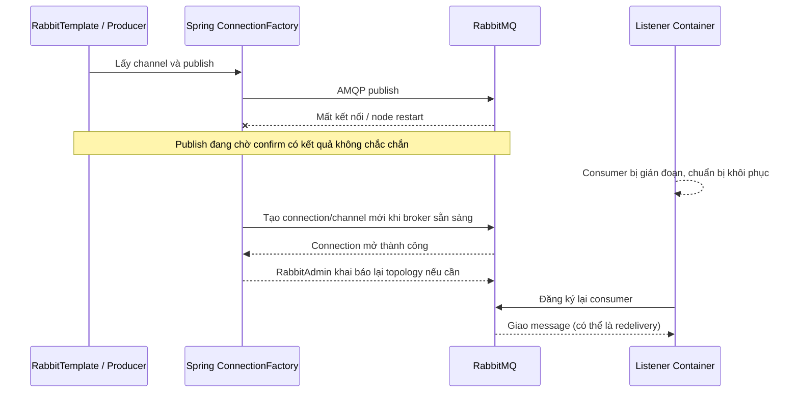

# Spring AMQP recovery và automatic recovery của RabbitMQ Java Client

## 1. Vấn đề: broker quay lại nhưng ứng dụng đã hoạt động bình thường chưa?

Trong một ứng dụng xử lý bất đồng bộ dùng **Spring AMQP**, `RabbitTemplate` gửi message đến RabbitMQ và `@RabbitListener` nhận message từ queue. Kết nối TCP có thể mất khi broker khởi động lại, node lỗi, mạng chập chờn, load balancer đóng kết nối hoặc heartbeat bị mất.

Sau khi RabbitMQ hoạt động trở lại, hệ thống cần giải quyết nhiều việc khác nhau:

1. Tạo lại kết nối TCP/AMQP và các channel có thể sử dụng.
2. Bảo đảm listener tiếp tục đăng ký consumer và nhận message.
3. Khôi phục exchange, queue, binding cần thiết nếu chúng không còn tồn tại.
4. Xác định message đã publish, đã xử lý nhưng chưa ack hoặc đang chờ confirm có thể bị mất/trùng hay không.
5. Phân biệt lỗi mạng tạm thời với lỗi cấu hình, quyền truy cập và lỗi protocol không thể tự sửa bằng reconnect.

**Điểm mấu chốt:** Spring AMQP đã có cơ chế **connection/channel/listener recovery** riêng. Trong khi đó, thư viện nền tảng **RabbitMQ Java Client** (`com.rabbitmq.client`) cũng có tính năng **automatic connection recovery** và **automatic topology recovery**. Hai cơ chế có phạm vi và vòng đời riêng; ứng dụng Spring AMQP thông thường nên để **Spring AMQP** chịu trách nhiệm phục hồi.

Sau bài này, bạn có thể giải thích cơ chế của từng tầng, cấu hình Spring Boot/Spring AMQP hợp lý, nhận diện trường hợp bật nhầm automatic recovery của Java Client, thử mất kết nối, và xây chiến lược giao nhận đáng tin cậy thay vì chỉ trông chờ reconnect.

## 2. Recovery là một chuỗi thao tác, không phải một công tắc

| Cấp phục hồi | Tình huống | Thành phần điển hình | Không giải quyết được |
| --- | --- | --- | --- |
| **Connection** | TCP socket/AMQP connection bị ngắt. | Spring `CachingConnectionFactory` hoặc Java Client `AutorecoveringConnection`. | Không chứng minh message đang gửi đã tới broker. |
| **Channel** | Channel mất cùng kết nối hoặc không còn dùng được. | Spring connection factory tạo channel mới; Java Client khôi phục channel khi connection recovery. | Không sửa lỗi khai báo tham số queue sai. |
| **Consumer** | Consumer `basic.consume` không còn hoạt động. | Spring listener container tạo lại consumer; Java Client topology recovery có thể tái đăng ký consumer. | Không hoàn tất tự động nghiệp vụ đang chạy khi đứt kết nối. |
| **Topology** | Exchange, queue, binding bị mất do broker restart/cấu hình auto-delete. | Spring `RabbitAdmin` hoặc Java Client topology recovery. | Không thể tạo lại message đã mất trong queue không durable. |
| **Delivery reliability** | Mất ack, confirm hoặc xảy ra redelivery. | Publisher confirms/returns, manual hoặc container ack, idempotency, retry/outbox. | Không thể đạt exactly-once chỉ bằng recovery. |

Một kết nối được mở lại chỉ xác nhận ứng dụng có thể giao tiếp với broker **ở thời điểm đó**. Nó không đủ để kết luận mọi tác vụ gửi/nhận trong khoảng mất kết nối đã được xử lý.

### Dòng thời gian minh họa



Sơ đồ là luồng khái niệm cho **Spring AMQP**, không mô tả Java Client automatic recovery đang chạy song song.

## 3. Spring AMQP phục hồi connection và consumer như thế nào?

### 3.1. `CachingConnectionFactory` quản lý tài nguyên AMQP

Spring AMQP cung cấp interface `org.springframework.amqp.rabbit.connection.ConnectionFactory`. Triển khai được dùng phổ biến là `CachingConnectionFactory`, bọc một `com.rabbitmq.client.ConnectionFactory` của RabbitMQ Java Client.

Thông thường, khi broker bị ngắt:

- Kết nối/channel cũ không còn dùng được; thao tác đang thực hiện có thể ném `AmqpException` hoặc exception từ tầng client.
- `CachingConnectionFactory` phát hiện tài nguyên không còn hợp lệ và **tạo kết nối/channel mới khi ứng dụng/container cần**. Đây là logic của Spring AMQP, không cần bật Java Client automatic recovery.
- `SimpleMessageListenerContainer` hoặc `DirectMessageListenerContainer` quản lý lại consumer tương ứng với kiểu container và chính sách recovery của nó.
- Nếu có `RabbitAdmin` tự khai báo và các `Declarable` hợp lệ, topology của ứng dụng được kiểm tra/khai báo lại khi kết nối được thiết lập.

`CachingConnectionFactory` còn cache channel để giảm chi phí mở mới thường xuyên. **Channel cache không phải bộ đệm lưu message chờ gửi khi mất mạng**; tăng `channelCacheSize` cũng không khắc phục message publish không rõ kết quả.

### 3.2. Listener container có lịch recovery riêng

Với `SimpleMessageListenerContainer`, khi consumer không thể tiếp tục vì sự cố có thể phục hồi, container thử khởi động lại theo `recoveryInterval` hoặc `recoveryBackOff`. Theo tài liệu Spring AMQP, mặc định thường là **5 giây giữa các lần thử** và có thể dùng `FixedBackOff` với số lần thử không giới hạn.

**Không nhầm các loại retry:**

| Loại retry | Đích khôi phục | Ví dụ cấu hình |
| --- | --- | --- |
| **Connection/consumer recovery** | Quay lại trạng thái consumer đang nghe queue sau khi broker/network gián đoạn. | `recoveryBackOff` của listener container. |
| **Message processing retry** | Chạy lại handler khi xử lý một message ném exception. | Retry interceptor, `RetryTemplate` ở consumer, retry queue. |
| **Publisher retry** | Thử publish lại khi send gặp exception. | Retry của `RabbitTemplate`/service/outbox. |
| **Broker dead-letter/retry routing** | Chuyển message lỗi qua DLX, TTL/retry queue rồi quay lại. | Queue arguments/policy, DLX/binding. |

Tăng retry xử lý message không giúp listener tự phục hồi kết nối nhanh hơn. Ngược lại, reconnect thành công không tự replay những publish operation đã thất bại.

### 3.3. `RabbitAdmin` khôi phục topology

`RabbitAdmin` có thể khai báo lại các bean Spring biểu diễn **exchange, queue và binding** khi có connection mới. Việc khai báo lại là **idempotent khi thuộc tính khai báo tương thích** với tài nguyên đã tồn tại; nó có thể thất bại với `PRECONDITION_FAILED - inequivalent arg` nếu cùng queue nhưng loại/arguments khác.

Những điểm cần lưu ý:

- Theo mặc định, tự khai báo áp dụng cho các `Declarable` được đăng ký trong Spring context, ví dụ `Queue`, `Exchange`, `Binding` và các phần tử trong `Declarables`. Topology được tạo tạm bên ngoài Spring context không mặc nhiên được `RabbitAdmin` quản lý để phục hồi.
- Cơ chế auto-declaration qua `RabbitAdmin` gắn với `CachingConnectionFactory` ở **`CacheMode.CHANNEL`** (mặc định); không nên giả định cùng cơ chế hoạt động khi đổi sang `CacheMode.CONNECTION`.
- Queue `durable` có thể sống qua broker restart nếu có điều kiện bền vững và cluster/quorum phù hợp; queue `exclusive`/`auto-delete` có thể mất và cần tái tạo theo lifecycle.
- Nếu queue bị xóa thủ công nhưng Spring bean vẫn khai báo, application có thể khai báo lại; điều đó không bảo đảm khôi phục **message cũ** trong queue đã bị mất.
- Tự động khai báo không thay thế quyền `configure`, `read`, `write` trên vhost. Thiếu quyền cần sửa ACL, không tăng số lần retry.

## 4. RabbitMQ Java Client automatic recovery làm gì?

Khi sử dụng trực tiếp `com.rabbitmq.client.ConnectionFactory` (không qua Spring AMQP), Java Client hỗ trợ hai chức năng:

1. **Automatic connection recovery**: khi phát hiện mất kết nối bất thường, client tìm cách tạo kết nối mới, khôi phục channel và một số thiết lập như `basic.qos`, publisher confirm mode, transaction mode, listeners.
2. **Automatic topology recovery**: dùng thông tin topology đã khai báo trên connection đó để khai báo lại exchange, queue, binding và đăng ký lại consumer.

Từ **RabbitMQ Java Client 4.0**, automatic connection recovery mặc định **bật**; topology recovery cũng mặc định bật khi automatic recovery được bật. Khoảng thử lại network mặc định **5 giây**, có thể đổi bằng `setNetworkRecoveryInterval(...)`. Đây là mặc định của **Java Client thuần**, không có nghĩa nó mặc định được kích hoạt khi chạy Spring AMQP.

Ví dụ dùng **Java Client trực tiếp**, chỉ để hiểu cơ chế:

```java
import com.rabbitmq.client.Connection;
import com.rabbitmq.client.ConnectionFactory;

public class RawRabbitMqClient {
    public static void main(String[] args) throws Exception {
        ConnectionFactory factory = new ConnectionFactory();
        factory.setHost("localhost");
        factory.setPort(5672);

        // Java Client thuần: bật rõ hai loại recovery.
        factory.setAutomaticRecoveryEnabled(true);
        factory.setTopologyRecoveryEnabled(true);
        factory.setNetworkRecoveryInterval(10_000); // 10 giây

        // Initial connection vẫn có thể ném lỗi nếu broker không sẵn sàng.
        Connection connection = factory.newConnection();
        try {
            var channel = connection.createChannel();
            channel.exchangeDeclare("demo.events", "direct", true);
            channel.queueDeclare("demo.jobs", true, false, false, null);
            channel.queueBind("demo.jobs", "demo.events", "jobs.created");

            // Ứng dụng thực tế sẽ duy trì connection/consumer lâu dài.
            // Không tự triển khai một vòng tái tạo consumer thứ hai song song.
        } finally {
            connection.close();
        }
    }
}
```

Đoạn code trên minh họa API cấu hình và khai báo. Nó **không tạo consumer đang chạy lâu dài**, và sẽ đóng connection sau phần minh họa. Khi xây ứng dụng thật bằng Java Client trực tiếp, phải duy trì vòng đời connection/consumer; các khai báo cần phục hồi phải nằm trong cache topology tương ứng của connection.

### Những giới hạn của Java Client automatic recovery

- **Không tự retry `newConnection()` lần đầu** nếu broker chưa sẵn sàng. Ứng dụng vẫn phải xử lý initial connection failure.
- **Không kích hoạt vì channel-level protocol exception** (ví dụ declare queue sai arguments hoặc publish tới exchange không tồn tại làm broker đóng channel). Đây thường là lỗi ứng dụng cần sửa.
- **Không phục hồi channel bị đóng tường minh hoặc đã đóng vì channel exception**.
- **Không lưu đệm publish khi connection đang mất**: publish trong lúc mất kết nối có thể bị từ chối hoặc đã ghi ra socket nhưng chưa tới broker.
- **Không bảo đảm message đang chờ ack sẽ không bị giao lại**. Sau recovery, delivery tag trên channel mới là một không gian khác; Java Client hỗ trợ ánh xạ delivery tag khi auto recovery nhưng stale ack có thể bị bỏ qua, nên consumer phải chịu được redelivery.
- Cache topology là **theo từng connection** và không tự nhìn thấy mọi thay đổi do connection khác hoặc quản trị viên thực hiện. Đặc biệt cần thận trọng với queue/exchange `auto-delete` hoặc TTL của queue.

Automatic recovery **không được kích hoạt cho mọi lần đóng kết nối**: việc ứng dụng chủ động gọi `close()` là hành động kết thúc vòng đời tài nguyên.

## 5. So sánh hai cơ chế và lựa chọn đúng với Spring AMQP

| Khía cạnh | Spring AMQP recovery | RabbitMQ Java Client automatic recovery |
| --- | --- | --- |
| API ứng dụng | `RabbitTemplate`, `@RabbitListener`, `CachingConnectionFactory`, `RabbitAdmin`. | `com.rabbitmq.client.ConnectionFactory`, `Connection`, `Channel`, `Consumer`. |
| Connection/channel | Spring quản lý tài nguyên và tạo mới khi cần. | Client thử reconnect và khôi phục channel sau lỗi mạng. |
| Consumer | Listener container điều phối start/restart. | Topology recovery có thể đăng ký lại consumer đã được khai báo trên connection. |
| Topology | `RabbitAdmin` khai báo Spring bean `Queue`/`Exchange`/`Binding`/`Declarables`. | Client dùng topology cache thuộc connection. |
| Chính sách thử lại | `recoveryBackOff` hoặc `recoveryInterval` tại container và logic connection factory. | `networkRecoveryInterval`/recovery delay handler của Java Client. |
| Mặc định khi dùng Spring AMQP chuẩn | Spring sở hữu recovery. | Spring **tắt automatic recovery** của Java Client. |
| Tình huống phù hợp | Ứng dụng Spring Boot/Spring AMQP thông thường. | Ứng dụng dùng Java Client trực tiếp và tự quản lý connection/consumer. |

**Quy tắc thực hành:** khi đã dùng Spring AMQP, hãy cấu hình recovery ở **Spring connection factory/listener container** và topology ở **RabbitAdmin**. Không bật thêm `setAutomaticRecoveryEnabled(true)` trên Java Client để “tăng độ an toàn”.

Spring AMQP từ các phiên bản 1.7.1 đã vô hiệu hóa automatic recovery của `amqp-client` theo mặc định. Khi tự tạo một `com.rabbitmq.client.ConnectionFactory` rồi truyền vào `CachingConnectionFactory`, lập trình viên cần kiểm tra và tắt thuộc tính này một cách tường minh. Theo tài liệu Spring AMQP, kể cả khi Java Client auto recovery bị bật, Spring thường đóng connection mà Java Client vừa recover để sử dụng cơ chế của Spring; sự chồng lấp có thể phát sinh `AutoRecoverConnectionNotCurrentlyOpenException` và những lần recovery khó dự đoán.

### Vì sao không nên có hai bộ phận cùng recovery?

Giả sử broker ngắt 10 giây:

```text
                         Broker đang down
                               |
             +-----------------+------------------+
             |                                    |
  Spring container muốn                    Java Client tự chờ
  tạo consumer/channel mới                khôi phục connection cũ
             |                                    |
             +--------> hai lịch recovery <-------+
                               |
                Spring có thể đóng connection
                vừa được Java Client recover
                               |
                  lỗi trong giai đoạn chuyển
                  tiếp, consumer gián đoạn lâu
```

Đây là nguy cơ được tài liệu Spring AMQP cảnh báo. Đừng viết một vòng reconnect thủ công hoặc tự `basicConsume(...)` ở ngoài listener container cho cùng consumer, vì có thể tạo nhiều consumer ngoài dự kiến hoặc xung đột consumer tag.

## 6. Cấu hình mẫu cho ứng dụng Spring Boot dùng Spring AMQP

Để chạy ví dụ, sử dụng `spring-boot-starter-amqp` cùng RabbitMQ broker. Các tên tài nguyên dưới đây dùng để kiểm thử riêng biệt.

### 6.1. Khai báo exchange, queue và binding bằng bean

```java
import org.springframework.amqp.core.BindingBuilder;
import org.springframework.amqp.core.Declarables;
import org.springframework.amqp.core.DirectExchange;
import org.springframework.amqp.core.Queue;
import org.springframework.amqp.core.QueueBuilder;
import org.springframework.context.annotation.Bean;
import org.springframework.context.annotation.Configuration;

@Configuration
public class RecoveryTopology {

    @Bean
    Declarables recoveryDeclarations() {
        DirectExchange exchange =
                new DirectExchange("recovery.events", true, false);
        Queue queue = QueueBuilder.durable("recovery.orders.q").build();

        return new Declarables(
                exchange,
                queue,
                BindingBuilder.bind(queue)
                        .to(exchange).with("orders.created")
        );
    }
}
```

Khi Spring Boot tạo `RabbitAdmin` tự động (cấu hình phổ biến khi có Spring AMQP và cơ chế auto declaration được bật), `RabbitAdmin` sẽ quản lý những `Declarables` này. Durable exchange/queue tăng khả năng tồn tại qua broker restart; muốn message bền vững còn cần **persistent delivery mode** và hạ tầng broker phù hợp. Durability **không** thay thế publisher confirms.

### 6.2. Điều chỉnh timeout và container recovery

Ví dụ một `application.yml`:

```yaml
spring:
  rabbitmq:
    host: localhost
    port: 5672
    username: guest
    password: guest
    connection-timeout: 5s
    requested-heartbeat: 20s
    listener:
      simple:
        acknowledge-mode: auto
        prefetch: 20
        concurrency: 2
        missing-queues-fatal: false
```

Các thông số có chức năng khác nhau:

- `connection-timeout`: thời gian chờ một lần thiết lập kết nối, không phải khoảng thời gian broker phải quay lại.
- `requested-heartbeat`: thương lượng AMQP heartbeat để hỗ trợ phát hiện connection không còn sống. Network middlebox, broker và scheduler có thể tác động tới thời gian phát hiện thực tế.
- `acknowledge-mode: auto`: container ack **sau khi listener thành công**, reject/nack khi xử lý thất bại theo chính sách; **không phải** RabbitMQ auto-ack ngay khi delivery.
- `prefetch` và `concurrency`: kiểm soát số message chưa ack và mức song song; khi redelivery, tác vụ có thể lặp, cần idempotency.
- `missing-queues-fatal: false`: cho phép `SimpleMessageListenerContainer` tiếp tục thử phục hồi trong một số trường hợp queue không có. **Không nên bật thiếu kiểm soát ở production** vì có thể che giấu việc deploy sai topology.

Nếu cần backoff recovery riêng cho listener, dùng factory có tên:

```java
import org.springframework.amqp.rabbit.config.SimpleRabbitListenerContainerFactory;
import org.springframework.amqp.rabbit.connection.ConnectionFactory;
import org.springframework.context.annotation.Bean;
import org.springframework.context.annotation.Configuration;
import org.springframework.util.backoff.FixedBackOff;

@Configuration
public class RecoveryListenerConfig {

    @Bean("recoveryListenerContainerFactory")
    SimpleRabbitListenerContainerFactory recoveryListenerContainerFactory(
            ConnectionFactory connectionFactory) {
        SimpleRabbitListenerContainerFactory factory =
                new SimpleRabbitListenerContainerFactory();
        factory.setConnectionFactory(connectionFactory);
        factory.setRecoveryBackOff(
                new FixedBackOff(5_000L, FixedBackOff.UNLIMITED_ATTEMPTS));
        factory.setMissingQueuesFatal(false);
        factory.setPrefetchCount(20);
        factory.setConcurrentConsumers(2);
        return factory;
    }
}
```

Không cấu hình cả `recoveryInterval` và `recoveryBackOff` cùng lúc vì đây là hai cách chọn lịch recovery thay thế cho nhau. Ví dụ đặt **5 giây cố định** để thuận tiện quan sát; không phải giá trị tối ưu cho mọi hệ thống. Trong ứng dụng nhiều instance, cân nhắc backoff có jitter ở những tầng hỗ trợ để tránh cùng dồn reconnect vào broker sau sự cố diện rộng.

### 6.3. Listener nghiệp vụ

```java
import org.springframework.amqp.rabbit.annotation.RabbitListener;
import org.springframework.stereotype.Component;

@Component
public class RecoveryOrderListener {

    @RabbitListener(
        queues = "recovery.orders.q",
        containerFactory = "recoveryListenerContainerFactory"
    )
    public void handle(String eventId) {
        // Demo: ứng dụng thật phải lưu eventId bằng một unique constraint
        // cùng transaction với thay đổi dữ liệu để chịu được redelivery.
        System.out.println("Received event: " + eventId);
    }
}
```

Nếu mất connection trong lúc listener đang xử lý, broker có thể không nhận được ack. Khi consumer trở lại, một message tương tự có thể được giao lại. Vì vậy code trên chỉ để **quan sát recovery**, chưa phải ví dụ nghiệp vụ idempotent hoàn chỉnh.

### 6.4. Trường hợp tự cung cấp RabbitMQ Java Client factory

Spring Boot thường đã tạo `CachingConnectionFactory` phù hợp; không cần bean dưới đây nếu không có yêu cầu tùy biến đặc biệt. Khi **chủ động** tạo raw client factory, nên tắt automatic recovery trước khi đưa cho Spring:

```java
import com.rabbitmq.client.ConnectionFactory;
import org.springframework.amqp.rabbit.connection.CachingConnectionFactory;
import org.springframework.context.annotation.Bean;
import org.springframework.context.annotation.Configuration;

@Configuration
public class ExplicitRabbitConnectionConfig {

    @Bean
    CachingConnectionFactory connectionFactory() {
        ConnectionFactory raw = new ConnectionFactory();
        raw.setHost("localhost");
        raw.setPort(5672);

        // Spring AMQP sẽ tự quản lý connection/channel recovery.
        raw.setAutomaticRecoveryEnabled(false);

        return new CachingConnectionFactory(raw);
    }
}
```

Chỉ dùng bean này khi muốn **thay thế** connection factory được auto-configure; cần cấu hình đầy đủ user, password, vhost, TLS, addresses, SSL/timeouts theo môi trường. Không khai báo đồng thời hai bean cùng trách nhiệm và cho rằng framework tự chọn đúng. Không nên đổi `raw.setAutomaticRecoveryEnabled(true)` trong cấu hình này.

## 7. Recovery không bảo đảm message đã gửi thành công

Giả sử producer gọi:

```java
rabbitTemplate.convertAndSend(
        "recovery.events", "orders.created", "event-1001");
```

Vào đúng lúc connection đứt:

- Có thể message **chưa được broker nhận** và producer gặp exception.
- Có thể broker **đã nhận** nhưng confirmation chưa về tới producer.
- Có thể message đến exchange nhưng **không route được** tới queue mong muốn.

**Reconnect không phân biệt được ba tình huống này và không tự phát lại message thất bại.** Nếu ứng dụng retry mù quáng, cùng một event có thể được publish hai lần.

Để cải thiện độ tin cậy, bật publisher confirms và returns:

```yaml
spring:
  rabbitmq:
    publisher-confirm-type: correlated
    publisher-returns: true
    template:
      mandatory: true
```

Trong ví dụ riêng có xử lý xác nhận, ta truyền một `CorrelationData` gắn với event ID:

```java
import java.util.concurrent.TimeUnit;
import org.springframework.amqp.rabbit.connection.CorrelationData;
import org.springframework.amqp.rabbit.core.RabbitTemplate;

public void publishAndCheck(RabbitTemplate rabbitTemplate, String eventId)
        throws Exception {
    CorrelationData correlation = new CorrelationData(eventId);
    rabbitTemplate.convertAndSend(
            "recovery.events", "orders.created", eventId, correlation);

    // Chỉ minh họa cách chờ confirm trong một luồng đồng bộ có timeout.
    CorrelationData.Confirm confirm =
            correlation.getFuture().get(5, TimeUnit.SECONDS);

    if (!confirm.isAck() || correlation.getReturned() != null) {
        throw new IllegalStateException(
                "Broker không xác nhận publish/route: " + eventId);
    }
}
```

Đoạn code giả định phiên bản Spring AMQP hỗ trợ `CorrelationData.getFuture()` và `getReturned()`, cùng các cấu hình confirms/returns nêu trên. Timeout hoặc exception không xác nhận “chắc chắn broker chưa nhận”; cần quản lý **unknown outcome** bằng retry có idempotency và durable outbox. Publisher confirm xác nhận broker xử lý publish theo mức bảo đảm tương ứng, **không** có nghĩa consumer đã xử lý nghiệp vụ thành công.

Với hệ thống có DB và RabbitMQ, **Transactional Outbox** cho phép ghi business data và bản ghi cần publish trong một DB transaction, sau đó publisher thử gửi lại có confirms. Consumer dùng `eventId`/unique key để tránh side effect trùng khi message redeliver hoặc publish lại.

## 8. Message đã giao nhưng chưa ack: redelivery sau recovery

Trong `AcknowledgeMode.AUTO`, Spring AMQP xử lý ack sau khi listener hoàn tất bình thường; trong `MANUAL`, ứng dụng tự gọi `basicAck`/`basicNack` trên delivery tag của channel hiện tại. Với connection bị mất:

1. Broker có thể chưa nhận ack từ consumer, dù business transaction trong DB đã commit.
2. Delivery ở channel cũ không còn nghĩa vụ ack an toàn sau khi channel mất.
3. RabbitMQ có thể giao lại message cho consumer sau recovery hoặc consumer khác, kèm cờ `redelivered` khi phù hợp.
4. Consumer phải chịu được **at-least-once delivery** và xử lý trùng.

Ví dụ bảo vệ bằng unique event ID trong PostgreSQL:

```sql
CREATE TABLE consumed_events (
    consumer_name VARCHAR(64) NOT NULL,
    event_id      VARCHAR(128) NOT NULL,
    processed_at  TIMESTAMPTZ NOT NULL DEFAULT now(),
    PRIMARY KEY (consumer_name, event_id)
);
```

```java
import org.springframework.jdbc.core.JdbcTemplate;
import org.springframework.stereotype.Service;
import org.springframework.transaction.annotation.Transactional;

@Service
public class IdempotentOrderService {
    private final JdbcTemplate jdbc;

    public IdempotentOrderService(JdbcTemplate jdbc) {
        this.jdbc = jdbc;
    }

    @Transactional
    public void process(String eventId) {
        int claimed = jdbc.update("""
            INSERT INTO consumed_events(consumer_name, event_id)
            VALUES ('order-recovery', ?)
            ON CONFLICT (consumer_name, event_id) DO NOTHING
            """, eventId);

        if (claimed == 0) {
            return; // Đã commit xử lý event này ở lần giao trước.
        }

        // Đặt cập nhật nghiệp vụ thực tế ở đây, cùng DB transaction.
        // Nếu thao tác SQL ném RuntimeException, marker cũng rollback.
    }
}
```

Ở listener thực tế, gọi `idempotentOrderService.process(eventId)` và để exception nổi lên khi DB thất bại; container chỉ ack sau khi transaction service trả về thành công. **Không** tự ack trước DB commit. Nếu có side effect bên ngoài DB (thanh toán, email), cần idempotency key hoặc outbox/workflow riêng vì DB transaction không rollback được tác vụ đã hoàn tất ở hệ thống khác.

`redelivered=true` và delivery tag **không** phải khóa chống trùng. Một producer có thể publish lại message với delivery tag mới và cờ `redelivered=false`; vẫn là cùng một sự kiện logic.

## 9. Lỗi kết nối, lỗi channel và lỗi topology không giống nhau

| Dấu hiệu | Nguyên nhân khả dĩ | Hướng điều tra/xử lý |
| --- | --- | --- |
| `AmqpConnectException`, connection refused, socket reset. | Broker/node không sẵn sàng, DNS, firewall, LB, TCP. | Kiểm tra network/port/endpoint và recovery logs; container retry đúng chính sách. |
| Heartbeat timeout, kết nối mất trong khi broker vẫn chạy. | Network chập chờn, GC pause, heartbeat hoặc middlebox. | Xem metrics client/broker, thời gian GC, network và heartbeat đã thương lượng. |
| `AutoRecoverConnectionNotCurrentlyOpenException` khi dùng Spring AMQP. | Raw Java Client automatic recovery bị bật, ứng dụng/`RabbitTemplate` tương tác với connection đang recover. | Kiểm tra custom raw factory; để Spring AMQP quản lý, tắt `automaticRecoveryEnabled`. |
| `PRECONDITION_FAILED - inequivalent arg`. | Queue/exchange đã tồn tại với thuộc tính khác. | Sửa topology/migration có kế hoạch; reconnect không thể thay đổi thuộc tính không tương thích. |
| `ACCESS_REFUSED` hoặc authentication failure. | Sai user/password/vhost/quyền. | Sửa credentials/permissions; retry mãi không giải quyết được. |
| Queue không tồn tại, consumer không start. | Chưa declare, sai vhost, `RabbitAdmin` không cấu hình hoặc queue bị xóa. | Kiểm tra Spring bean `Declarable`, RabbitAdmin, `missingQueuesFatal` và broker UI. |
| Consumer không lên dù connection “connected”. | Container dừng vì fatal error, thiếu queue, hoặc bị cancel. | Xem listener container state, consumer count, exception logs; kiểm tra topology/permissions. |
| Publish gọi thành công nhưng không thấy message. | Exchange/routing/binding sai hoặc publish chưa được xác nhận. | Bật correlated confirms và returns/mandatory; kiểm tra routing và queue. |
| Sau restart, message được xử lý hai lần. | Ack cũ mất dù DB đã commit, hoặc producer retry sau mất confirm. | Idempotent consumer, outbox và logging theo event ID. |

**Không nên biến mọi lỗi thành một vòng retry vô hạn.** Lỗi network tạm thời thường recover được; sai topology, permission, queue arguments hoặc schema cần can thiệp/sửa cấu hình.

## 10. Kịch bản kiểm thử recovery có thể lặp lại

Chuẩn bị RabbitMQ cục bộ hoặc môi trường tích hợp **không chứa dữ liệu production**; chạy ứng dụng với topology `recovery.events` → `recovery.orders.q` và một listener ở mục 6.

### Bài thử A: broker bị dừng và khởi động lại

1. Start RabbitMQ và ứng dụng; kiểm tra `recovery.orders.q` tồn tại, consumer đang kết nối.
2. Gửi `event-1001` từ `RabbitTemplate`; xác nhận listener nhận message.
3. Dừng broker bằng công cụ phù hợp với môi trường (Docker Compose, service manager, hoặc tắt RabbitMQ node kiểm thử).
4. Quan sát log Spring AMQP: consumer/channel gián đoạn, connection có thể không tạo được, container tiếp tục thử recovery theo `recoveryBackOff`.
5. Khởi động lại broker; theo dõi `RabbitAdmin` khai báo topology (nếu cần) và container đăng ký lại consumer.
6. Gửi `event-1002` khi broker ổn định; listener phải hoạt động trở lại **mà không cần gọi `basicConsume()` thủ công**.

Kết luận hợp lệ: cơ chế Spring recovery nối lại luồng nhận. **Không kết luận** mọi message đã gửi trong thời gian broker down đều được tự phục hồi.

### Bài thử B: publish trong thời gian broker down

1. Gửi một message khi broker không thể kết nối; bắt và log exception từ `RabbitTemplate`.
2. Với publisher confirms, mô phỏng mất kết nối ngay sau khi publish và trước khi confirm về. Kết quả có thể là **unknown**, vì message có thể đã tới broker.
3. Đưa message chưa rõ kết quả vào outbox/queue retry bền vững của ứng dụng, gửi lại có cùng `eventId` khi broker hoạt động.
4. Kiểm tra consumer chỉ áp dụng một lần nghiệp vụ dù nhận hai bản sao.

### Bài thử C: mất kết nối sau DB commit trước ack

1. Listener bắt đầu một DB transaction và commit xử lý event `event-1003`.
2. Dùng fault injection trong integration test để làm channel/connection mất trước khi broker nhận ack.
3. Sau khi consumer trở lại, message có thể redeliver; kiểm tra unique constraint ngăn cập nhật trùng.
4. Xem trạng thái bảng `consumed_events` và số lượng tác động nghiệp vụ, thay vì chỉ kiểm tra log “received”.

### Bài thử D: queue bị xóa/sai cấu hình

1. Trong môi trường thử nghiệm, xóa một queue có thể tạo lại và theo dõi khả năng `RabbitAdmin` tái khai báo.
2. Cố tạo queue cùng tên nhưng khác thuộc tính hoặc sử dụng user thiếu quyền: quan sát lỗi channel/authorization và xác nhận **recovery không tự sửa được**.
3. Kiểm tra hiệu ứng `missingQueuesFatal`; ở production, cần cảnh báo rõ khi queue thiết yếu không tồn tại.

## 11. Quan sát để biết recovery thật sự hoàn tất

Các nguồn dữ liệu hữu ích:

- **Spring logs/events:** lỗi từ `CachingConnectionFactory`, listener container, `RabbitAdmin`; event consumer failed/restarted/idle (tùy container và cấu hình).
- **RabbitMQ Management UI:** connections, channels, consumer count, queue depth, messages ready/unacked, publish/ack/nack rates.
- **Publisher confirms/returns:** số lượng confirm ack/nack, timeout, unroutable, message outcome không rõ và retry.
- **Application metrics:** độ dài hàng đợi outbox, duplicate rate, retry count, thời gian từ publish đến consume, thời gian service bị mất broker, số lần recovery.
- **`CachingConnectionFactory.getCacheProperties()`:** thông tin channel cache và connection giúp điều tra tình trạng sử dụng tài nguyên.

Trong log nên có `eventId`/`correlationId` và tên queue, consumer, broker endpoint để truy vết. Không dùng `eventId` làm metric label nếu dẫn tới cardinality quá lớn.

Cần theo dõi **điều kiện phục hồi hoàn chỉnh**: kết nối mới mở được, topology cần thiết có mặt, consumer count phù hợp, publish test có confirm và consumer xử lý được message. Chỉ thấy dòng “connected” không đủ để khẳng định hệ thống đã sẵn sàng phục vụ.

## 12. Các hiểu nhầm cần tránh

| Nhận định | Đánh giá đúng |
| --- | --- |
| “Java Client auto recovery mặc định bật, nên Spring AMQP cũng dùng nó.” | Không. Spring AMQP chủ động quản lý và thường tắt auto recovery của Java Client. |
| “Bật cả Spring recovery và Java auto recovery sẽ hồi phục nhanh hơn.” | Không bảo đảm, có thể tạo xung đột và exception trong lúc recovery. |
| “Listener đã reconnect, mọi message khi mất mạng đều được gửi lại.” | Sai. Publisher cần confirms, durable retry/outbox và xử lý unknown outcome. |
| “RabbitAdmin có thể khôi phục mọi dữ liệu của queue bị xóa.” | Sai. RabbitAdmin khai báo tài nguyên; nó không tạo lại message cũ đã mất. |
| “Mất kết nối sẽ luôn trigger Java Client automatic recovery.” | Không với initial connection failure, channel-level exception, hoặc đóng connection tường minh. |
| “Lỗi queue argument không tương thích có thể khắc phục bằng retry reconnect.” | Không. Phải sửa topology hoặc migration. |
| “Sau recovery, delivery tag cũ vẫn có thể được ack an toàn.” | Không nên. Delivery tag gắn với channel, consumer phải chịu được redelivery. |
| “Publisher confirms tương đương consumer đã xử lý xong.” | Không. Confirm phản ánh broker xử lý publish, còn ack consumer là bước khác. |

## 13. Câu hỏi tự đánh giá

1. Vì sao một ứng dụng Spring Boot có `@RabbitListener` thường **không cần** bật `com.rabbitmq.client.ConnectionFactory.setAutomaticRecoveryEnabled(true)`?
2. `RabbitAdmin` và listener container phục hồi **những tài nguyên khác nhau** như thế nào?
3. Broker dừng ngay sau khi producer gọi `convertAndSend(...)` nhưng trước confirm. Vì sao kết quả publish không thể xác định chắc chắn chỉ qua reconnect?
4. Java Client automatic recovery có tự retry `newConnection()` lần đầu thất bại không? Có tự sửa `PRECONDITION_FAILED` do queue arguments sai không?
5. Message xử lý DB thành công rồi connection mất trước ack. Làm thế nào ngăn side effect lặp sau recovery?
6. Vì sao không nên dùng `RetryTemplate` xử lý message như một giải pháp thay thế cho `recoveryBackOff` của container?
7. Tại sao một queue `auto-delete` có thể biến mất sau khi broker/consumer ngắt và cần được khai báo lại?

**Gợi ý đáp án:**

- (1) Spring có cơ chế recovery của `CachingConnectionFactory` và listener container; hai cơ chế cùng chạy có thể xung đột.
- (2) `RabbitAdmin` khai báo exchange/queue/binding; container tái tạo hoạt động consumer.
- (3) Message có thể đã được broker nhận nhưng confirm chưa về, hoặc chưa tới broker.
- (4) Không; initial connection failure và channel protocol error là các tình huống không tự được Java Client automatic recovery xử lý.
- (5) Sử dụng `eventId`/unique constraint và transaction DB; chấp nhận at-least-once redelivery.
- (6) Message retry xử lý lỗi nghiệp vụ, còn recoveryBackOff khởi động lại consumer sau lỗi vận hành.
- (7) `auto-delete` queue có thể bị broker xóa khi consumer cuối bị cancel/ngắt; bean `Declarable` và `RabbitAdmin` có thể giúp khai báo lại nếu cấu hình đúng.

## 14. Tổng kết

**Spring AMQP recovery** bao gồm phục hồi connection/channel, khởi động lại consumer qua listener container và khai báo lại topology bằng `RabbitAdmin`. **RabbitMQ Java Client automatic recovery** là cơ chế khác, hữu ích khi trực tiếp quản lý `Connection`/`Channel`/`Consumer` nhưng không nên bật chồng lên Spring AMQP thông thường.

Phục hồi kết nối chỉ là một phần của **độ tin cậy đầu cuối**. Khi có lỗi mạng, producer cần publisher confirms/returns và lưu bền vững yêu cầu gửi; consumer phải ack sau khi xử lý và chịu được redelivery bằng idempotency, transaction và DLQ/retry hợp lý. Hệ thống chỉ thật sự phục hồi khi topology, consumer và đường truyền message đều hoạt động ổn định trở lại.

## Tài liệu tham khảo

- [Spring AMQP — Connection and Resource Management](https://docs.spring.io/spring-amqp/reference/amqp/connections.html): `CachingConnectionFactory` và phần **RabbitMQ Automatic Connection/Topology Recovery**, lý do Spring tắt Java Client auto recovery.
- [Spring AMQP — Resilience: Recovering from Errors and Broker Failures](https://docs.spring.io/spring-amqp/reference/amqp/resilience-recovering-from-errors-and-broker-failures.html): kết nối lại, `RabbitAdmin` và cơ chế khai báo lại.
- [Spring AMQP — Message Listener Container Configuration](https://docs.spring.io/spring-amqp/reference/amqp/containerAttributes.html): `recoveryBackOff`, `recoveryInterval`, `missingQueuesFatal`, ack, prefetch.
- [Spring AMQP — AmqpTemplate: Publisher Confirms and Returns](https://docs.spring.io/spring-amqp/reference/amqp/template.html): confirms/returns với `RabbitTemplate`.
- [RabbitMQ — Java Client API Guide: Automatic Recovery from Network Failures](https://www.rabbitmq.com/client-libraries/java-api-guide#automatic-recovery-from-network-failures): connection/topology recovery, giới hạn và manual acknowledgment.
- [RabbitMQ — Consumer Acknowledgements and Publisher Confirms](https://www.rabbitmq.com/docs/confirms): khác biệt giữa ack consumer và confirm publisher, redelivery và độ tin cậy.
