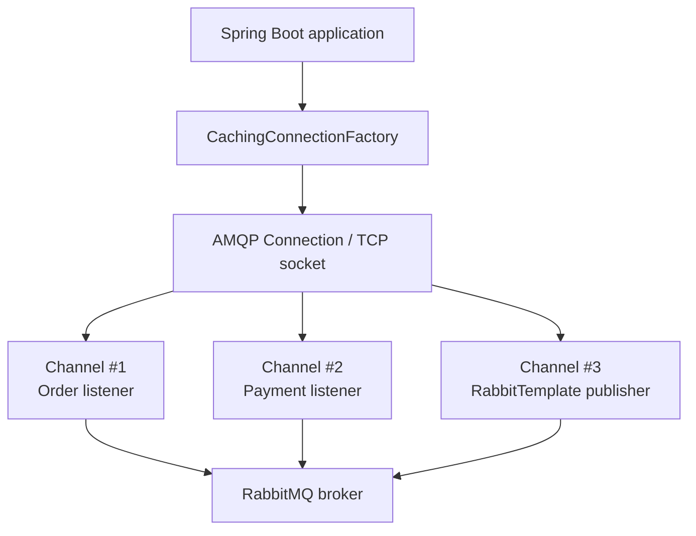
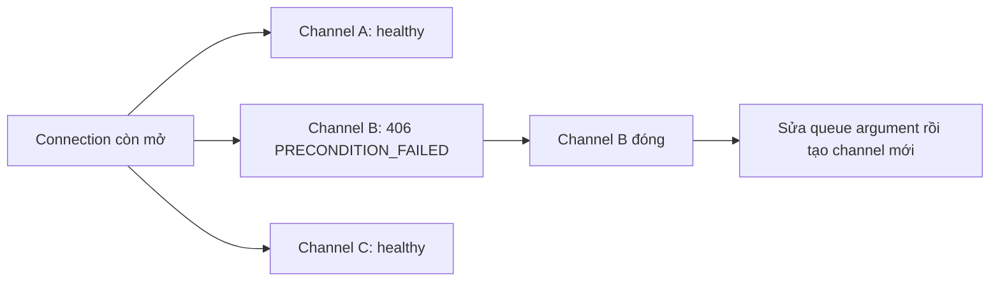
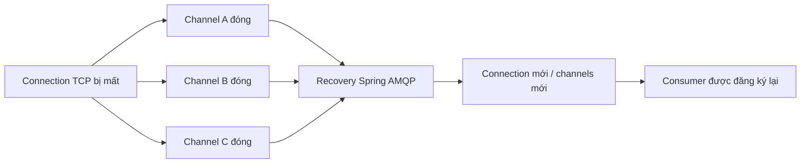
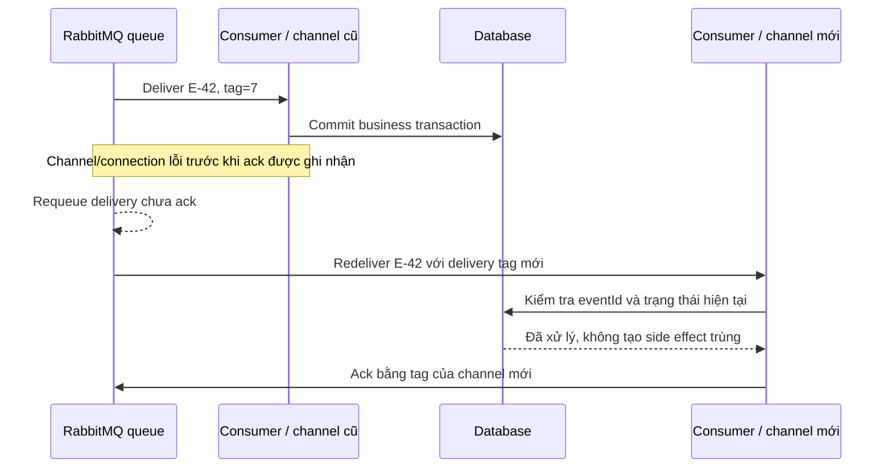
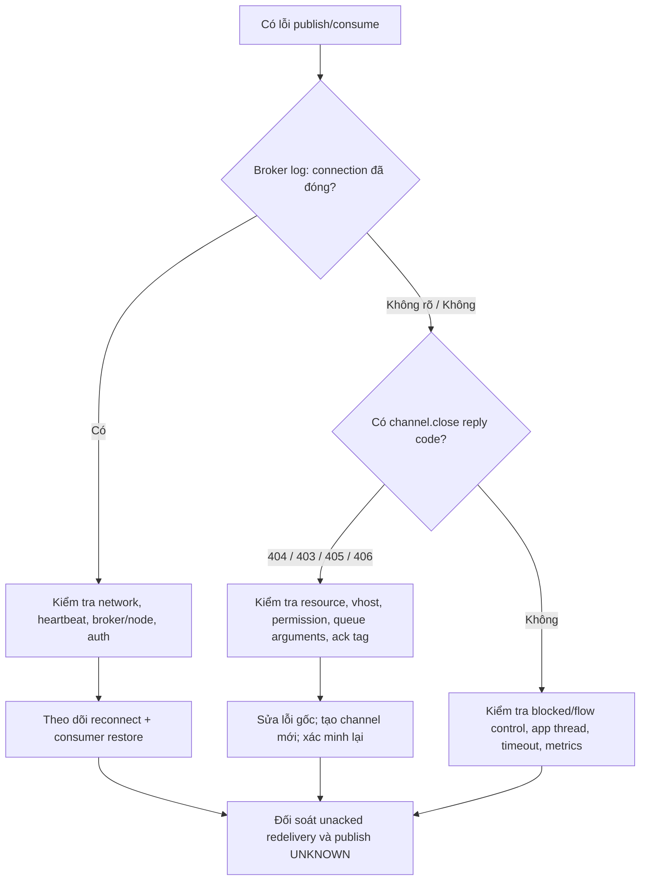

# Mất connection so với lỗi chỉ đóng một channel

> **Chương:** Phục hồi kết nối  
> **Module:** SPRING_AMQP — học tích hợp RabbitMQ với Spring AMQP bằng `RabbitTemplate`, `@RabbitListener`, exchange, queue, binding; thực hành định tuyến message, xác nhận giao nhận, retry, dead-letter, giao dịch và quan sát để xử lý bất đồng bộ đáng tin cậy.
>
> **Trọng tâm:** Phân biệt mất **TCP/AMQP connection** với **channel-level exception**; quan sát tác động lên consumer, publisher, acknowledgment và topology; hiểu vai trò phục hồi của Spring AMQP mà không che giấu lỗi cấu hình.

## 1. Mục tiêu học tập

Sau bài này, bạn có thể:

1. Mô tả quan hệ giữa RabbitMQ `Connection`, `Channel` và các listener/publisher hoạt động trên một ứng dụng Spring AMQP.
2. Phân biệt mất connection do mạng, broker restart, heartbeat timeout với lỗi chỉ khiến một channel bị đóng như `404 NOT_FOUND`, `406 PRECONDITION_FAILED`, `403 ACCESS_REFUSED`.
3. Nhận diện những tài nguyên bị ảnh hưởng ở từng phạm vi sự cố; xác định khi nào nên reconnect, khi nào cần sửa topology/permission/application.
4. Giải thích cách `CachingConnectionFactory`, listener container và `RabbitAdmin` phục hồi connection, channel, consumer và các khai báo AMQP.
5. Phân tích điều gì xảy ra với **unacked deliveries**, publisher confirms, message đang được publish và transaction khi kết nối hoặc channel biến mất.
6. Triển khai log/metric, kiểm thử lỗi có chủ đích và quy trình vận hành để phân biệt sự cố tạm thời với lỗi cấu hình cần can thiệp.

### Tình huống thực tế

Dịch vụ Spring Boot có hai consumer xử lý `PaymentConfirmed` và `OrderCreated`, đồng thời dùng `RabbitTemplate` để phát `ShipmentRequested`. Trong một ngày, hai sự cố xuất hiện:

- **Sự cố A:** RabbitMQ node restart. Mọi consumer trên connection tới node đó đều dừng nhận message; publisher xuất hiện lỗi kết nối.
- **Sự cố B:** Một module vô tình khai báo lại `orders.work.q` với TTL khác queue đã tồn tại. Broker trả `406 PRECONDITION_FAILED` và đóng channel thực hiện khai báo. Các channel khác trên cùng connection có thể vẫn chạy bình thường.

Nếu coi cả hai là “RabbitMQ mất kết nối, cứ retry” thì sẽ bỏ qua nguyên nhân của B và khiến channel bị mở/đóng lặp lại. Việc sửa đúng bắt đầu bằng phân loại **phạm vi lỗi**.

## 2. Connection và channel: quan hệ cha–con

AMQP 0-9-1 cho phép nhiều channel logic cùng sử dụng một TCP connection. Channel là đơn vị thực thi phần lớn lệnh như `basic.publish`, `basic.consume`, `basic.ack`, `queue.declare`, `exchange.declare` và `queue.bind`.



Sơ đồ chỉ là **một cách bố trí có thể có**. Spring AMQP có thể dùng publisher connection riêng, nhiều connection khi chọn chế độ cache khác, hoặc nhiều listener channels tùy cấu hình. Điểm cốt lõi vẫn là **một channel luôn thuộc một connection**.

| Thuộc tính | Connection | Channel |
|---|---|---|
| Bản chất | Kết nối AMQP chạy trên TCP/TLS giữa client và broker | Phiên logic AMQP 0-9-1 chạy bên trong connection |
| Chi phí | Handshake, authentication, TCP/TLS, heartbeat; chi phí lớn hơn channel | Nhẹ hơn, phù hợp tách hoạt động của nhiều consumer/publisher |
| Chứa tài nguyên | Có thể chứa nhiều channel | Có thể có consumer, delivery tag, publisher confirm sequence và AMQP transaction riêng |
| Bị đóng thì sao? | **Mọi channel thuộc connection cũng đóng** | Chỉ channel đó mất; connection và các channel còn lại có thể sống |
| Khôi phục | Thiết lập connection mới, khởi tạo lại channel/consumer cần thiết | Tạo channel mới và khởi tạo lại hoạt động; lỗi cấu hình gốc phải được sửa |
| Bằng chứng | Log socket/heartbeat/connection shutdown; broker connection biến mất | Log `channel.close`, reply code/text và channel shutdown reason |

### 2.1. Trường hợp chỉ một channel bị đóng



Một broker channel exception thường là lỗi giao thức hoặc yêu cầu không hợp lệ của **một channel**. Spring có thể lấy/tạo channel khác, nhưng việc thử lại cùng lệnh sai sẽ tiếp tục tạo lỗi mới.

### 2.2. Trường hợp connection bị đóng



Nếu RabbitMQ hoặc mạng chưa phục hồi, các lần tạo connection mới tiếp tục thất bại. Listener container thường có cơ chế retry khởi tạo lại consumer theo interval/backoff; producer gọi trực tiếp qua `RabbitTemplate` vẫn có thể nhận exception ở lần gọi hiện tại.

## 3. Phân loại lỗi theo dấu hiệu thực tế

### 3.1. Những nguyên nhân thường gây mất connection

| Sự kiện | Điều có thể xảy ra | Hướng điều tra |
|---|---|---|
| Broker restart, node crash, container RabbitMQ bị dừng | TCP connection bị cắt; mọi channel phía client trên connection đó không còn dùng được | Broker logs, node state, thời điểm restart, cluster/queue availability |
| Mất mạng, firewall/NAT cắt socket | Client có thể phát hiện qua I/O exception hoặc heartbeat timeout; connection đóng | Network metrics, socket/timeout, path tới broker, idle timeout |
| Heartbeat timeout | Một bên phát hiện peer không phản hồi trong thời gian heartbeat thỏa thuận | Heartbeat negotiated, CPU pause/GC, network saturation, packet loss |
| Authentication/vhost permission không hợp lệ | Handshake/connection.open không thành công hoặc bị broker từ chối | Username, vhost, auth mechanism, TLS, chính sách quyền |
| Lỗi giao thức nghiêm trọng ở cấp connection | Broker đóng connection; các channel cũng đóng | Reply code/text và broker logs; kiểm tra thư viện/client |
| Broker `connection.blocked` do memory/disk alarm | Publisher có thể bị chặn hoặc flow control, nhưng **chưa chắc connection đóng** | Kiểm tra `blocked`/`unblocked`, resource alarms, publish latency |

**Đừng suy diễn:** publisher bị timeout không mặc định đồng nghĩa TCP connection đã chết. RabbitMQ có thể đang áp dụng flow control hoặc resource alarm. Cũng đừng coi mọi lần network timeout là broker chưa nhận publish: kết quả publish có thể **không rõ ràng**.

### 3.2. Những lỗi thường chỉ đóng một channel

Theo mô hình lỗi AMQP 0-9-1, các lỗi “soft” phổ biến có thể làm broker gửi `channel.close`:

| Reply code | Ví dụ nguyên nhân | Điều cần sửa |
|---|---|---|
| `404 NOT_FOUND` | Publish tới exchange không tồn tại; bind vào queue/exchange không có; consume queue không có | Xác minh tên, vhost, thứ tự tạo và lifecycle của topology |
| `406 PRECONDITION_FAILED` | Declare queue đã tồn tại nhưng đổi `durable`, `autoDelete` hoặc `x-arguments`; ack delivery tag không hợp lệ | So sánh queue properties/arguments; sửa code hoặc quản lý migration; kiểm tra ack đúng channel |
| `403 ACCESS_REFUSED` | User không có quyền thao tác tài nguyên hoặc quyền thao tác cụ thể | Sửa permission vhost/resource và role; không retry vô hạn |
| `405 RESOURCE_LOCKED` | Dùng exclusive queue đang thuộc connection khác | Kiểm tra chủ sở hữu exclusive queue, lifecycle của connection cũ |

Các reply code trên là **ví dụ điển hình**, không phải danh sách toàn bộ lỗi AMQP. Broker gửi `channel.close` bất đồng bộ: lệnh gây lỗi có thể chưa ném exception ngay tại dòng Java đó. Exception có thể chỉ xuất hiện ở thao tác tiếp theo hoặc trong listener shutdown callback.

**Quan trọng với `406`:** Queue tồn tại không thể được redeclare với những thuộc tính không tương đương. Mở channel mới rồi thử lại **cùng khai báo sai** không sửa được điều kiện gốc; có thể tạo vòng lặp đóng channel và spam log.

### 3.3. Không phải lỗi nghiệp vụ nào cũng đóng channel

Ví dụ `@RabbitListener` nhận JSON không hợp lệ và ném exception. Trong trường hợp thông thường, listener container có thể reject/nack delivery theo policy và tiếp tục sử dụng channel. Một JSON parse error **không tự động** là AMQP protocol exception. Ngược lại, nếu code manual ack gửi `basicAck` với delivery tag sai, broker có thể coi là lỗi giao thức `406 PRECONDITION_FAILED` rồi đóng channel.

Vì vậy hãy phân biệt:

- **Business error:** exception do xử lý message, thường ứng dụng quyết định retry, reject hay DLQ.
- **Channel protocol error:** broker từ chối thao tác/điều kiện trên một channel; phải sửa lệnh, resource hoặc metadata.
- **Connection failure:** hạ tầng/handshake/đường truyền hoặc lỗi cấp connection; cần reconnect và tái khởi tạo các channel/consumer.

## 4. Delivery và acknowledgment khi connection/channel biến mất

RabbitMQ cấp một `deliveryTag` theo **channel nhận**. Tag này chỉ hợp lệ để ack/nack/reject trên **chính channel** đang sở hữu delivery đó.

Giả sử listener lấy event `E-42`, thực hiện cập nhật database thành công nhưng channel bị đóng trước khi broker nhận `basicAck`:



Đây là tình huống **at-least-once** điển hình. Một ack được gọi ở client nhưng không tới broker vẫn có thể dẫn tới redelivery. Nếu consumer không idempotent, sự kiện có thể tạo hiệu ứng hai lần.

| Khi lỗi xảy ra | Hệ quả đáng chú ý |
|---|---|
| Channel của một consumer đóng, còn delivery unacked | Những message chưa ack trên channel đó có thể được broker requeue; consumer khác có thể nhận lại |
| Connection đóng | **Tất cả** unacked deliveries trên các channel của connection có thể được requeue |
| Channel đóng ngay sau lúc gửi ack | Broker có thể đã hoặc chưa nhận ack; kết quả không được suy ra chỉ từ log gọi hàm |
| Có transaction DB đã commit trước khi mất ack | DB không tự rollback; cần idempotency để chặn side effect lặp |
| Manual ack dùng tag thuộc channel cũ sau recovery | Tag cũ không còn hợp lệ trên channel mới; có thể gây `unknown delivery tag` và đóng channel |

### 4.1. Đừng lưu và dùng lại delivery tag qua reconnect

Một anti-pattern:

```java
// SAI: không giữ Channel/deliveryTag của một delivery cũ rồi
// gọi ack sau khi listener đã chuyển sang connection mới.
long oldDeliveryTag = 7L;
Channel newChannel = obtainNewChannelSomehow();
newChannel.basicAck(oldDeliveryTag, false);
```

Đoạn code là **pseudocode minh họa lỗi**, không phải chương trình có thể biên dịch độc lập. RabbitMQ delivery tag thuộc channel, không phải ID toàn cục của message. Hãy để Spring AMQP container quản lý ack trong chế độ AUTO, hoặc với chế độ MANUAL thì ack/nack đúng delivery trên đúng channel trong thời gian nó còn hợp lệ.

### 4.2. Redelivery khác publish lại

`redelivered=true` là dấu hiệu broker đang redeliver một delivery trước đó; nó **không phải** số lần retry chính xác. Producer hoặc replay job có thể publish một message **mới** chứa cùng `eventId` với `redelivered=false`. Một consumer idempotent phải dựa vào khóa nghiệp vụ ổn định như `eventId`, không dựa vào flag redelivery.

`x-death` do broker bổ sung khi message bị dead-letter; channel đóng rồi requeue **không tự biến thành dead-letter**. Vì vậy, một message được giao lại sau connection loss có thể không xuất hiện trong DLQ và không tăng `x-death.count`.

## 5. Publisher khi mất connection hoặc chỉ mất channel

Publisher có các thời điểm khác nhau:

```text
P0  Ứng dụng gọi RabbitTemplate.send()
P1  Client gửi basic.publish lên channel
P2  Broker nhận/route message
P3  Broker phát publisher confirm (hoặc channel transaction commit)
P4  Ứng dụng nhận xác nhận

Connection/channel có thể mất ở bất kỳ điểm nào.
```

Nếu connection mất ở giữa P1–P4, producer có thể **không biết** message đã được broker nhận hay chưa. Gửi lại mù có thể tạo duplicate; không gửi lại có thể bỏ sót message. Publisher confirms giúp phát hiện một số kết quả thành công/thất bại, nhưng **timeout hoặc mất phản hồi là trạng thái UNKNOWN**, không đồng nghĩa broker chắc chắn chưa nhận.

### 5.1. Tình huống dễ nhầm

| Tình huống | Kết luận được phép | Không thể kết luận |
|---|---|---|
| `RabbitTemplate.send` ném `AmqpIOException`/`AmqpException` vì network | Lần publish hiện tại gặp lỗi và cần được đối soát | Message chắc chắn chưa tới broker |
| Publisher confirm ACK | Broker xác nhận publish theo cơ chế confirm | Consumer đã xử lý nghiệp vụ |
| Publisher confirm NACK | Broker không xác nhận publish thành công | Có thể tùy trạng thái cần đối soát hệ thống |
| Mandatory return (`basic.return`) | Publish không route được tới queue nào theo exchange/binding hiện tại | Chỉ cần confirm ACK là đủ bảo đảm routing |
| Confirm timeout | Không nhận được kết quả trong hạn | Publish chắc chắn thất bại và có thể replay vô điều kiện |
| `404 NOT_FOUND` khi publish tới exchange không tồn tại | Channel được broker đóng do lỗi resource | Mọi connection/consumer trong ứng dụng đều bị ngắt |

Nếu exchange không tồn tại, đó là lỗi channel chứ không phải hiện tượng broker connection outage. Nếu exchange tồn tại nhưng không có binding, broker có thể nhận publish rồi không route message; dùng `mandatory`/returns khi cần xác minh điều này.

### 5.2. Publisher confirms với Spring Boot

Ví dụ cấu hình **Spring Boot 3.x / Spring AMQP 3.x**:

```yaml
spring:
  rabbitmq:
    host: localhost
    port: 5672
    requested-heartbeat: 20s
    connection-timeout: 5s
    publisher-confirm-type: correlated
    publisher-returns: true
    template:
      mandatory: true
    cache:
      channel:
        size: 30
```

Các giá trị heartbeat, timeout và cache là **minh họa cho môi trường thử**; phải điều chỉnh theo broker, network, cluster, throughput và thread pool thực tế. Heartbeat được thương lượng với broker, không phải timer của riêng ứng dụng. Channel cache size mặc định là **số channel idle được giữ lại**, chưa chắc là giới hạn số channel đang mở; giới hạn chỉ có hiệu lực theo cấu hình checkout timeout/cache tương ứng.

### 5.3. Chờ confirm và kiểm tra returns cho một message

```java
import java.nio.charset.StandardCharsets;
import java.util.UUID;
import java.util.concurrent.TimeUnit;
import org.springframework.amqp.core.Message;
import org.springframework.amqp.core.MessageDeliveryMode;
import org.springframework.amqp.core.MessageProperties;
import org.springframework.amqp.rabbit.connection.CorrelationData;
import org.springframework.amqp.rabbit.core.RabbitTemplate;
import org.springframework.stereotype.Service;

@Service
public class ReliableEventPublisher {
    private final RabbitTemplate rabbitTemplate;

    public ReliableEventPublisher(RabbitTemplate rabbitTemplate) {
        this.rabbitTemplate = rabbitTemplate;
    }

    public void publish(String eventId, String jsonBody) throws Exception {
        MessageProperties props = new MessageProperties();
        props.setMessageId(UUID.randomUUID().toString());
        props.setContentType(MessageProperties.CONTENT_TYPE_JSON);
        props.setDeliveryMode(MessageDeliveryMode.PERSISTENT);
        props.setHeader("event-id", eventId);
        Message message = new Message(
            jsonBody.getBytes(StandardCharsets.UTF_8), props
        );

        CorrelationData correlation =
            new CorrelationData(UUID.randomUUID().toString());

        rabbitTemplate.send(
            "orders.events.x",
            "order.created",
            message,
            correlation
        );

        CorrelationData.Confirm confirm =
            correlation.getFuture().get(10, TimeUnit.SECONDS);
        if (!confirm.isAck()) {
            throw new IllegalStateException(
                "Broker NACK: " + confirm.getReason()
            );
        }
        if (correlation.getReturned() != null) {
            throw new IllegalStateException(
                "Unroutable: " +
                correlation.getReturned().getReplyText()
            );
        }
    }
}
```

Giả định exchange `orders.events.x` và binding `order.created` đã được khai báo. Với publisher confirms kiểu correlated và returns được bật đúng, Spring AMQP có thể gắn returned message vào `CorrelationData` trước khi hoàn tất confirm future.

**Cẩn thận:** Đoạn trên chỉ chứng minh kiểm soát publish ở cấp broker. Nếu `send()` hoặc `getFuture().get()` ném lỗi/timeout, ứng dụng phải đánh dấu outcome **UNKNOWN/FAILED tùy bằng chứng** và có chiến lược retry giới hạn, idempotency, audit. Hàm này không biến message publishing thành exactly-once. Khi phát sự kiện phải gắn với transaction DB, cân nhắc **transactional outbox** để không bỏ sót ý định gửi sự kiện sau DB commit.

## 6. Spring AMQP phục hồi những gì?

Spring AMQP hỗ trợ kết nối và nhận message bền bỉ qua ba lớp khác nhau:

1. **`CachingConnectionFactory`** quản lý connection/channel; khi connection chết, nó có thể cung cấp connection mới cho lần sử dụng tiếp theo và xử lý channel cache bị vô hiệu.
2. **Listener container** (`SimpleMessageListenerContainer` hoặc `DirectMessageListenerContainer`) giám sát consumer; khi sự cố không fatal, container thử khởi động lại consumer theo recovery interval/backoff hoặc monitor interval của loại container.
3. **`RabbitAdmin`** khai báo lại các `Exchange`, `Queue`, `Binding` được Spring quản lý khi connection được thiết lập lại, trong điều kiện và chế độ cache tương ứng.

Ba lớp này giải quyết **khía cạnh kết nối và topology**. Chúng không thể tự sửa queue argument sai, permission sai, JSON hỏng, thay đổi schema thiếu tương thích hoặc việc DB đã commit trước khi ack bị mất.

### 6.1. `CachingConnectionFactory` và channel cache

`CachingConnectionFactory` mặc định dùng `CacheMode.CHANNEL`: thường có **một shared connection proxy** và nhiều channel được cache theo nhu cầu. Các channel transactional và non-transactional có cache riêng. Vì thế trong một ứng dụng, channel đóng không mặc nhiên kéo connection chung xuống.

Đọc đúng ý nghĩa cấu hình:

| Thuộc tính | Hiệu quả | Điểm dễ hiểu sai |
|---|---|---|
| `spring.rabbitmq.cache.channel.size` | Số channel idle được cache | Không phải giới hạn cứng số channel đang chạy nếu không cấu hình checkout timeout |
| `channelCheckoutTimeout` > 0 | Khi áp dụng, kích hoạt giới hạn số channel sử dụng theo cache size và thời gian chờ nhận channel | Tăng đột ngột có thể gây `AmqpTimeoutException` do thiếu channel, không phải lỗi mất TCP |
| `CacheMode.CHANNEL` | Cache channel trên shared connection theo mặc định | Phù hợp với cơ chế tự khai báo topology của `RabbitAdmin` |
| `CacheMode.CONNECTION` | Có thể cache nhiều connection | Không hỗ trợ automatic declarations của RabbitAdmin theo cơ chế được tài liệu nêu; cần thiết kế topology management riêng |
| Publisher connection riêng | Có thể tách áp lực publish khỏi đường consume | Cần kiểm tra connection factory thực tế, không đoán từ một connection trong Management UI |

RabbitMQ khuyến nghị khi cần cách ly producer khỏi flow control, sử dụng connection riêng cho publisher và consumer. Nếu publish bị chặn do resource alarm, một connection chung có thể ảnh hưởng cả hoạt động khác. Việc tách kết nối giúp giảm tác động, nhưng không sửa được broker thiếu tài nguyên.

### 6.2. Spring AMQP và RabbitMQ Java client automatic recovery

RabbitMQ Java client có cơ chế **automatic connection/topology recovery** của riêng nó. Spring AMQP cũng có cơ chế phục hồi connection/channel, consumer và khai báo topology. Để tránh hai tầng tự phục hồi cạnh tranh nhau, Spring AMQP **mặc định tắt automatic recovery ở RabbitMQ Java client** khi nó quản lý underlying connection factory theo cấu hình thông thường.

Vì vậy, với ứng dụng Spring Boot dùng Spring AMQP, **không tùy tiện bật** `automaticRecoveryEnabled=true` trên `com.rabbitmq.client.ConnectionFactory` để “chữa” sự cố. Nếu dự án tự dựng client factory hoặc dùng raw RabbitMQ Java client song song, phải phân định rõ lớp nào sở hữu vòng đời connection/channel. Trong raw Java client, channel bị đóng do channel-level exception **không được tự động phục hồi** bởi cơ chế automatic connection recovery; ứng dụng cần sửa lỗi và tạo channel mới.

### 6.3. Listener container recovery: lỗi tạm thời khác lỗi fatal

Với `SimpleMessageListenerContainer`:

- Khi broker/network không sẵn sàng, consumer gặp lỗi non-fatal và container có thể thử khởi tạo lại theo `recoveryInterval` hoặc `recoveryBackoff`.
- Nếu queue không tồn tại khi khởi động, hành vi phụ thuộc `missingQueuesFatal`, số lần thử declaration và cấu hình container. Mặc định của SMLC thường xem thiếu toàn bộ queue là lỗi fatal lúc khởi động; chọn false khi thực sự chấp nhận queue được tạo muộn.
- Lỗi permission, topology mismatch hoặc cấu hình sai cần được sửa. Retry connection không thể biến một `406 PRECONDITION_FAILED` thành cấu hình hợp lệ.
- `DirectMessageListenerContainer` dùng cơ chế monitor/restart khác SMLC; không suy ra cùng interval cho mọi loại container.

**Không bật `missingQueuesFatal=false` vô điều kiện ở production.** Tùy yêu cầu, ứng dụng phải **fail fast** khi queue thiết yếu bị thiếu. Để false có thể hữu ích cho hạ tầng tạo queue động hoặc môi trường broker chưa khởi tạo, nhưng phải có alert nếu queue không được tạo sau một deadline hợp lý.

### 6.4. RabbitAdmin phục hồi topology nào?

Khi connection được tạo lại, `RabbitAdmin` có thể declare lại exchange, queue và binding được đăng ký là các **Spring declarable beans** (và các khai báo được framework quản lý theo cấu hình). Nó không phải công cụ tự phát hiện rồi sửa mọi queue trên broker.

Các giới hạn:

- Queue durable đã còn trên broker thường không cần tạo lại; declare lại phải **tương thích arguments** hiện hữu.
- Queue auto-delete/exclusive có lifecycle gắn với consumer/connection; khi connection mất queue có thể bị xóa và cần recreate đúng điều kiện.
- Queue/binding được tạo thủ công bằng tool bên ngoài hoặc lệnh runtime mà không được framework quản lý **không chắc được RabbitAdmin tái tạo**.
- Tài liệu Spring AMQP nêu automatic declarations với `RabbitAdmin` sử dụng `CacheMode.CHANNEL`, không mặc định hỗ trợ ở `CacheMode.CONNECTION`.
- RabbitAdmin không tự di chuyển message giữa các queue hoặc thay đổi các argument không tương thích của queue có dữ liệu.

## 7. Cấu hình và ví dụ Spring Boot 3.x

Các ví dụ dành cho Spring Boot 3.x, Spring AMQP RabbitMQ AMQP 0-9-1, Java 17+. Dùng `spring-boot-starter-amqp`; tạo broker RabbitMQ thử nghiệm, queue và exchange trong vhost có quyền phù hợp.

### 7.1. Topology đầy đủ để thử khôi phục

```java
import org.springframework.amqp.core.BindingBuilder;
import org.springframework.amqp.core.Declarables;
import org.springframework.amqp.core.DirectExchange;
import org.springframework.amqp.core.Queue;
import org.springframework.amqp.core.QueueBuilder;
import org.springframework.context.annotation.Bean;
import org.springframework.context.annotation.Configuration;

final class RecoveryAmqp {
    static final String WORK_X = "orders.events.x";
    static final String WORK_Q = "orders.work.q";
    static final String ROUTE = "order.created";
    static final String DLX = "orders.dead.x";
    static final String DLQ = "orders.dead.q";
    static final String DEAD_ROUTE = "order.failed";
    private RecoveryAmqp() {}
}

@Configuration
public class RecoveryTopology {
    @Bean
    Declarables recoveryDeclarations() {
        DirectExchange work = new DirectExchange(
            RecoveryAmqp.WORK_X, true, false
        );
        DirectExchange dead = new DirectExchange(
            RecoveryAmqp.DLX, true, false
        );
        Queue workQueue = QueueBuilder.durable(RecoveryAmqp.WORK_Q)
            .deadLetterExchange(RecoveryAmqp.DLX)
            .deadLetterRoutingKey(RecoveryAmqp.DEAD_ROUTE)
            .build();
        Queue deadQueue = QueueBuilder.durable(RecoveryAmqp.DLQ).build();

        return new Declarables(
            work, dead, workQueue, deadQueue,
            BindingBuilder.bind(workQueue)
                .to(work).with(RecoveryAmqp.ROUTE),
            BindingBuilder.bind(deadQueue)
                .to(dead).with(RecoveryAmqp.DEAD_ROUTE)
        );
    }
}
```

Đoạn code cung cấp các `Declarables` để Spring có thể tự khai báo qua `RabbitAdmin` khi ứng dụng được cấu hình đúng. Khi connection mất rồi phục hồi, broker vẫn cần có topology cho consumer/publisher; các queue durable/binding được quản lý giúp tái tạo khi cần. Với production, cân nhắc dùng RabbitMQ policy cho DLX thay vì hardcode queue arguments khi có khả năng thay đổi cấu hình về sau.

### 7.2. Connection, channel và listener recovery

```yaml
# application.yml — giá trị minh họa, phù hợp test chứ không phải SLA chung
spring:
  rabbitmq:
    host: localhost
    port: 5672
    virtual-host: /
    requested-heartbeat: 20s
    connection-timeout: 5s
    cache:
      channel:
        size: 30
    listener:
      type: simple
      simple:
        concurrency: 2
        prefetch: 5
        default-requeue-rejected: false
        missing-queues-fatal: true
```

Đối với ứng dụng Boot 3.x, các property trên nằm trong cấu hình AMQP 0-9-1. Đổi `missing-queues-fatal` sang false **chỉ** khi có thiết kế vận hành cho queue tạm chưa sẵn sàng; luôn ghi nhận cảnh báo missing queue. Nhiều message unacked do prefetch có thể được redeliver sau khi connection mất; tăng prefetch không tự nâng độ bền.

Nếu cần recovery interval riêng cho SMLC, cấu hình trên container/factory đúng phiên bản, ví dụ một container xây trực tiếp:

```java
import org.springframework.amqp.rabbit.connection.ConnectionFactory;
import org.springframework.amqp.rabbit.listener.SimpleMessageListenerContainer;
import org.springframework.context.annotation.Bean;
import org.springframework.context.annotation.Configuration;

@Configuration
class DedicatedRecoveryContainer {
    // Chỉ dùng dạng này khi có MessageListener bean riêng đã khai báo.
    // Nếu sử dụng @RabbitListener, hãy cấu hình factory tương ứng thay vì
    // tạo thêm một container đọc cùng queue không có chủ đích.
    // Phần dưới minh họa API setRecoveryInterval trực tiếp.
    static SimpleMessageListenerContainer example(
        ConnectionFactory factory
    ) {
        SimpleMessageListenerContainer container =
            new SimpleMessageListenerContainer(factory);
        container.setQueueNames(RecoveryAmqp.WORK_Q);
        container.setRecoveryInterval(5_000L);
        container.setMissingQueuesFatal(true);
        return container;
    }
}
```

Phương thức `example` chỉ minh họa các setter, **không đăng ký listener và không chạy container**. Ứng dụng dùng `@RabbitListener` nên cấu hình `SimpleRabbitListenerContainerFactory` thích hợp thay vì tạo container thứ hai cạnh tranh cùng queue.

### 7.3. Consumer có idempotency để chịu redelivery

Ví dụ consumer gọi service có transaction database và khóa deduplication. Giả định đã có bảng:

```sql
CREATE TABLE processed_events (
    consumer_name VARCHAR(64) NOT NULL,
    event_id VARCHAR(128) NOT NULL,
    processed_at TIMESTAMPTZ NOT NULL DEFAULT CURRENT_TIMESTAMP,
    PRIMARY KEY (consumer_name, event_id)
);

CREATE TABLE order_projection (
    order_id VARCHAR(64) PRIMARY KEY,
    status VARCHAR(32) NOT NULL
);
```

```java
import org.springframework.jdbc.core.JdbcTemplate;
import org.springframework.stereotype.Service;
import org.springframework.transaction.annotation.Transactional;

@Service
public class OrderProjectionService {
    private final JdbcTemplate jdbc;

    public OrderProjectionService(JdbcTemplate jdbc) {
        this.jdbc = jdbc;
    }

    @Transactional
    public void apply(String eventId, String orderId) {
        int inserted = jdbc.update(
            """
            INSERT INTO processed_events (consumer_name, event_id)
            VALUES (?, ?)
            ON CONFLICT DO NOTHING
            """,
            "order-projection", eventId
        );

        if (inserted == 0) {
            return; // Đã xử lý; redelivery không lặp tác dụng phụ.
        }

        jdbc.update(
            """
            INSERT INTO order_projection(order_id, status)
            VALUES (?, ?)
            ON CONFLICT (order_id)
              DO UPDATE SET status = EXCLUDED.status
            """,
            orderId, "CREATED"
        );
    }
}
```

```java
import com.fasterxml.jackson.databind.ObjectMapper;
import org.springframework.amqp.core.Message;
import org.springframework.amqp.rabbit.annotation.RabbitListener;
import org.springframework.amqp.rabbit.support.AmqpRejectAndDontRequeueException;
import org.springframework.stereotype.Component;

record OrderCreated(String eventId, String orderId) {}

@Component
public class OrderCreatedListener {
    private final ObjectMapper mapper;
    private final OrderProjectionService service;

    public OrderCreatedListener(
        ObjectMapper mapper,
        OrderProjectionService service
    ) {
        this.mapper = mapper;
        this.service = service;
    }

    @RabbitListener(queues = RecoveryAmqp.WORK_Q)
    public void onMessage(Message raw) {
        OrderCreated event;
        try {
            event = mapper.readValue(raw.getBody(), OrderCreated.class);
        } catch (Exception invalidJson) {
            throw new AmqpRejectAndDontRequeueException(
                "Invalid OrderCreated JSON", invalidJson
            );
        }

        if (event.eventId() == null || event.eventId().isBlank()
            || event.orderId() == null || event.orderId().isBlank()) {
            throw new AmqpRejectAndDontRequeueException(
                "Missing eventId/orderId"
            );
        }

        System.out.printf(
            "eventId=%s redelivered=%s%n",
            event.eventId(), raw.getMessageProperties().isRedelivered()
        );
        service.apply(event.eventId(), event.orderId());
    }
}
```

Ở chế độ ack tự động của listener container, khi `service.apply` hoàn tất bình thường, container gửi ack theo cấu hình. Nếu database đã commit nhưng channel mất trước khi ack tới broker, RabbitMQ có thể giao lại; khóa `(consumer_name,event_id)` chặn cập nhật trùng.

Đoạn ví dụ cố ý chỉ thực hiện side effect **trong cùng database**. Nếu listener gọi dịch vụ thanh toán hoặc gửi email, database marker không bao phủ hiệu ứng ngoài database; cần idempotency key ở dịch vụ đích hoặc outbox/inbox/đối soát phù hợp.

Nếu consumer ném exception nghiệp vụ, `default-requeue-rejected=false` giúp tránh requeue nóng và có thể chuyển message vào DLQ đã cấu hình. **Không** coi một lỗi mạng khiến channel chết là một lỗi JSON; lỗi connection/channel cần được chẩn đoán riêng.

## 8. Quan sát recovery bằng application events

Spring AMQP công bố sự kiện khi listener container gặp lỗi. `ListenerContainerConsumerFailedEvent` cung cấp lý do, mức `fatal` và exception. Một event này **không đủ** tự phân biệt chắc chắn “mất connection” hay “đóng một channel”; cần đối chiếu broker/client logs, số channel/connection bị ảnh hưởng và shutdown reason.

```java
import org.slf4j.Logger;
import org.slf4j.LoggerFactory;
import org.springframework.amqp.rabbit.listener.ListenerContainerConsumerFailedEvent;
import org.springframework.context.event.EventListener;
import org.springframework.stereotype.Component;

@Component
public class RabbitConsumerFailureLogger {
    private static final Logger log =
        LoggerFactory.getLogger(RabbitConsumerFailureLogger.class);

    @EventListener
    public void onConsumerFailed(ListenerContainerConsumerFailedEvent event) {
        log.warn(
            "Rabbit listener failed: fatal={} reason={} cause={}",
            event.isFatal(),
            event.getReason(),
            event.getThrowable() == null
                ? "<none>"
                : event.getThrowable().getClass().getName()
        );
    }
}
```

Tùy phiên bản Spring AMQP, listener container còn công bố các event về consumer start/restart, missing queue hoặc trạng thái idle. Một connection failure có thể gây **nhiều sự kiện trên nhiều consumer**, nên không được coi số event thất bại bằng số connection vật lý bị mất.

### 8.1. Thu thập dấu vết ở hai phía

| Nguồn | Thông tin cần lấy | Phục vụ quyết định |
|---|---|---|
| Application logs | Root cause exception, shutdown signal, channel number, connection name, listener ID, correlationId | Xác định lỗi channel protocol hay socket/connection |
| RabbitMQ logs | `channel.close` reply code/text, connection closed, authentication/heartbeat failure | Xác minh broker đã đóng phạm vi nào và tại sao |
| Management UI | Connections, channels per connection, consumers per queue, connection state/blocked | Đánh giá phạm vi ảnh hưởng |
| Queue metrics | `messages_ready`, `messages_unacknowledged`, redeliver, ack/nack, DLQ depth | Đánh giá backlog và duplicate sau recovery |
| Publisher audit | `eventId`, publish attempts, confirm ACK/NACK/timeout, return, retry ID | Đối soát trạng thái phát sự kiện không chắc chắn |
| Database/inbox | `eventId` đã commit, version nghiệp vụ, số duplicate bị từ chối | Kiểm tra side effect chỉ xảy ra đúng số lần mong muốn |

Trong Management UI, nếu **một connection biến mất**, tất cả channel thuộc nó cũng biến mất; nếu chỉ **một channel** biến mất mà connection vẫn hiển thị với các channel khác, nghi ngờ channel exception. Tuy nhiên trong một hệ thống có connection pool, publisher connection riêng hoặc nhiều replica, phải đối chiếu **đúng connection name/client instance**; không suy ra từ tổng đếm toàn cluster.

### 8.2. Trạng thái connection blocked không đồng nghĩa shutdown

Khi RabbitMQ gặp memory/disk alarm hoặc flow control, publish có thể chậm/bị chặn. Connection có thể ở trạng thái `blocked` nhưng vẫn tồn tại. Khả năng consumer/ack bị tác động phụ thuộc cách các hoạt động chia sẻ connection. Xử lý bằng cách kiểm tra broker resource alarm, độ sâu queue và tốc độ producer; không cố tạo thêm vô hạn connection chỉ để vượt cơ chế bảo vệ.

### 8.3. Các dấu hiệu cho thấy đang retry sai

- Log `406 PRECONDITION_FAILED` lặp mỗi vài giây: thường là topology mismatch cố định.
- Log `404 NOT_FOUND` lặp khi start listener: queue/exchange thiếu hoặc sai vhost; xác minh RabbitAdmin có khai báo đúng không.
- Publisher confirm timeout tăng nhưng TCP connection vẫn có: xem resource alarm, routing/confirm pipeline và broker load.
- Consumer restart liên tục, DLQ không tăng: có thể lỗi connection/channel, không phải message nghiệp vụ bị dead-letter.
- Số redelivery tăng sau broker restart: dấu hiệu các unacked deliveries được gửi lại, cần idempotency.

## 9. Quy trình điều tra: connection hay channel?



### Bước 1 — Định phạm vi

Từ một lỗi cụ thể, tìm chính xác connection name, channel number, queue, consumer tag và thời điểm xảy ra. Có bao nhiêu channel cùng đóng? Có mất TCP socket, `ShutdownSignalException` cấp connection, hay chỉ một channel phản hồi `channel.close`?

### Bước 2 — Phân biệt transient và persistent

- **Transient:** broker restart, network partition, node chưa sẵn sàng. Dùng recovery/backoff và theo dõi sức khỏe hạ tầng.
- **Persistent configuration:** queue arguments không tương đương, thiếu quyền, sai vhost, tên exchange sai. Sửa cấu hình/topology trước khi retry.
- **Uncertain publish outcome:** network mất giữa publish và confirm/commit. Cần đối soát eventId và hạn chế phát trùng.
- **Message business failure:** payload/logic lỗi. Dùng retry giới hạn, reject/DLQ, không “chữa” bằng tạo connection mới.

### Bước 3 — Kiểm tra người tiêu thụ và backlog

Sau reconnect, consumer có đăng ký lại không? Số consumer có phù hợp concurrency không? Queue có message ready/unacked bất thường không? Có redelivery spike không? Khi broker đang outage, queue không có consumer là triệu chứng bình thường; khi broker đã hồi phục mà không có consumer, mới tiếp tục tìm lỗi container/topology/permission.

### Bước 4 — Đối soát hiệu ứng nghiệp vụ

Publisher không nhận confirm không chứng minh broker chưa nhận. Consumer đã commit DB nhưng mất ack có thể nhận lại. Vì vậy chỉ xác nhận hồi phục hoàn toàn khi số event mong đợi được đối soát với producer audit, broker và consumer database; không chỉ nhìn trạng thái connection đã mở.

## 10. Kiểm thử lỗi có kiểm soát

Các thử nghiệm nên dùng **RabbitMQ riêng hoặc vhost/queue thử nghiệm**. Không dừng broker hay đổi queue arguments ở môi trường production để minh họa.

| Test | Tạo sự cố | Kỳ vọng |
|---|---|---|
| **T1 — Mất toàn bộ connection** | Restart broker/container RabbitMQ của môi trường test, hoặc đóng đúng connection test bằng Management UI | Các channel thuộc connection cũ đều mất; Spring tạo connection/channel mới, consumer được khởi động lại theo chính sách |
| **T2 — Channel 404** | Dùng một channel thử nghiệm publish tới exchange không tồn tại | Broker đóng channel với `404 NOT_FOUND`; connection và channel khác có thể vẫn hoạt động |
| **T3 — Channel 406** | Tạo queue test durable trước, rồi redeclare **cùng tên** nhưng khác `x-message-ttl` | Broker đóng channel thực hiện redeclare; thử lại cùng argument sai vẫn lỗi |
| **T4 — Không đủ quyền** | Dùng tài khoản/vhost test thiếu quyền thao tác resource | Nhận `ACCESS_REFUSED`/auth failure tùy điểm kiểm tra; sửa permission thay vì reconnect vô hạn |
| **T5 — Ack sai delivery tag** | Trong raw channel test, ack delivery tag không thuộc channel hoặc đã ack | Có thể nhận `406 PRECONDITION_FAILED` và channel bị đóng; message unacked khác có thể redeliver |
| **T6 — Consumer đang unacked rồi mất connection** | Giữ handler đang xử lý, đóng connection test | Delivery chưa ack có thể redeliver sau recovery; idempotency chặn side effect trùng |
| **T7 — Mất connection khi producer đang chờ confirm** | Cắt kết nối test giữa send và nhận confirm | Publish outcome có thể UNKNOWN; không suy ra chưa được broker nhận |
| **T8 — Queue auto-delete** | Khai báo queue auto-delete qua Spring beans rồi mất connection | Kiểm tra RabbitAdmin có tái khai báo sau recovery; consumer được đăng ký lại |
| **T9 — Lỗi xử lý JSON** | Gửi payload sai schema tới listener có reject/DLQ | Message được xử lý theo policy; connection không nhất thiết đóng |
| **T10 — Resource blocked** | Mô phỏng broker resource alarm có kiểm soát | Xác minh blocked/flow control khác connection shutdown; đo publish latency và recovery |

### 10.1. Ví dụ tạo channel error `404` trong môi trường thử

```java
import com.rabbitmq.client.Channel;
import com.rabbitmq.client.Connection;
import com.rabbitmq.client.ConnectionFactory;
import java.nio.charset.StandardCharsets;

// Đoạn minh họa độc lập với Spring; chạy CHỈ trên broker/vhost test.
ConnectionFactory factory = new ConnectionFactory();
factory.setHost("localhost");
try (Connection connection = factory.newConnection();
     Channel channel = connection.createChannel()) {
    channel.basicPublish(
        "missing.exchange.only.for.test",
        "some.key",
        null,
        "test".getBytes(StandardCharsets.UTF_8)
    );
    // Broker có thể gửi channel.close bất đồng bộ sau lệnh này.
    // Lệnh tiếp theo hoặc ShutdownListener có thể nhìn thấy lỗi 404.
}
```

Trong test thật, phải **ghi nhận shutdown reason/exception** và kiểm tra channel còn mở hay không sau khi broker phản hồi; việc `basicPublish` không ném lỗi ngay không có nghĩa broker chấp nhận publish. Có thể mở **channel khác trên cùng connection** và xác minh connection vẫn hoạt động.

### 10.2. Ví dụ tạo channel error `406` trong môi trường thử

```java
// Pseudocode Java client; dùng queue CÓ TÊN RIÊNG trong vhost test.
channel.queueDeclare("demo.channel.406.q", true, false, false, null);

Map<String, Object> conflictingArgs = Map.of(
    "x-message-ttl", 60000
);
// Cùng tên queue nhưng x-arguments khác => PRECONDITION_FAILED.
channel.queueDeclare(
    "demo.channel.406.q", true, false, false, conflictingArgs
);
```

Đoạn thứ hai có thể gây `406` và broker đóng channel. Sau đó cần tạo channel mới để tiếp tục hoạt động. **Không được** áp dụng vào queue production đang có dữ liệu. Lưu ý `Map` cần import `java.util.Map` nếu chuyển pseudocode thành chương trình Java.

### 10.3. Kiểm tra sau khi khôi phục

1. Connection mới xuất hiện ở broker; channel count/consumer count trở lại mức dự kiến.
2. Queue/exchange/binding có đủ, không có `404/406` liên tục sau khi reconnect.
3. Listener thực sự nhận và ack message **mới** lẫn redelivered message, có kiểm tra idempotency.
4. Publisher đã hoạt động trở lại; confirm ACK/returns ổn định và số event UNKNOWN được đối soát.
5. DLQ/retry backlog được xử lý đúng chính sách, không phát lại ồ ạt.
6. Độ trễ p95/p99, số connection/channel được mở mới và CPU/memory broker trở lại bình thường.

## 11. Hệ thống đáng tin cậy cần nhiều hơn tự reconnect

| Rủi ro | Reconnect có giải quyết không? | Cơ chế bổ sung |
|---|---|---|
| Broker outage làm consumer dừng nhận | **Có thể**, khi broker/network phục hồi và cấu hình đúng | Backoff, readiness/monitoring, queue durability |
| Channel 406 do queue argument sai | **Không** | Sửa topology, migration hoặc điều chỉnh policy |
| Channel 404 do exchange/queue không tồn tại | **Không tự động**, trừ khi topology được tái khai báo đúng | RabbitAdmin, infrastructure-as-code, quyền khai báo |
| Publisher không biết broker đã nhận chưa | **Không** | Publisher confirms, mandatory returns, eventId/audit, outbox |
| Consumer xử lý DB xong nhưng mất ack | **Không** | Idempotent consumer/inbox, transaction ngắn |
| Message lỗi nghiệp vụ bị gửi lặp | **Không** | Retry có giới hạn, DLQ và replay có kiểm soát |
| Broker flow control/resource alarm | **Không bằng cách mở thêm connection** | Giảm tải, xử lý backlog và resource capacity |
| Message bị route sai exchange/binding | **Không** | Kiểm tra topology, publisher returns, kiểm thử end-to-end |

### 11.1. Transaction và cửa sổ kết quả không chắc chắn

Nếu service vừa cập nhật DB vừa publish AMQP, network outage có thể xảy ra sau DB commit nhưng trước khi AMQP commit/confirm. Dù Spring AMQP có hỗ trợ phối hợp giao dịch bằng `channelTransacted=true`, đây vẫn là **best-efforts one-phase commit**, không phải distributed atomic transaction.

Với nghiệp vụ quan trọng, dùng **transactional outbox**: ghi business row và event intent trong **cùng DB transaction**, dispatcher publish với confirms/returns và retry; consumer xử lý idempotent. Dispatcher vẫn có thể publish trùng sau timeout, nên outbox không xóa nhu cầu deduplication.

### 11.2. Giới hạn và backoff

Một broker mới hồi phục có thể đồng thời nhận nhiều consumer start, publisher retries và requeued messages. Không nên cho các instance retry liên tục ở chu kỳ vài mili giây: hãy dùng exponential backoff/jitter nếu công cụ phù hợp, giới hạn số kết nối, concurrency và tốc độ replay; quan sát consumer capacity trước khi xả backlog.

Đừng dùng `@Retryable` hoặc retry template mà không phân loại exception: lỗi `404/406/403` do cấu hình thường không cần lặp nhiều lần, còn lỗi `AmqpIOException` do mất mạng có thể retry sau một khoảng thời gian. Với listener, phân biệt **consumer recovery interval** và **business-message retry** — đây là hai lớp xử lý khác nhau.

## 12. Bài thực hành tình huống và câu hỏi tự kiểm tra

**Tình huống:** Một Spring Boot application đang dùng `CachingConnectionFactory` với hai listener và một RabbitTemplate. Lúc 10:00, dashboard ghi nhận:

- Listener A mất kết nối, listener B cũng dừng; broker logs báo TCP connection lost.
- Ở 10:01, connection mới xuất hiện và hai consumer được đăng ký lại.
- Ở 10:03, publisher bắt đầu báo `406 PRECONDITION_FAILED - inequivalent arg 'x-message-ttl'`.
- Một số đơn hàng đã được ghi DB, nhưng số sự kiện ghi nhận ở downstream ít hơn.

**Yêu cầu:**

1. Xếp ba nhóm triệu chứng thành **connection failure**, **channel protocol error** và **publish outcome cần đối soát**.
2. Giải thích vì sao ở 10:00 cả hai listener dừng, nhưng ở 10:03 publisher có thể chỉ đóng một channel.
3. Chỉ ra cấu hình cần kiểm tra: `RabbitAdmin`, queue arguments, `CachingConnectionFactory`, listener recovery, publisher confirms/returns.
4. Thiết kế một bảng đối soát `eventId` giữa DB và consumer audit, chấp nhận rằng event mất phản hồi confirm có thể đã được broker nhận.
5. Đề xuất cách sửa lâu dài: điều chỉnh topology deployment, tách publisher connection nếu cần, outbox và idempotency.

### Câu hỏi tự kiểm tra

1. Nếu broker đóng **một channel** do `406`, các channel khác trên cùng TCP connection có bị đóng ngay không?
2. Khi một TCP connection đóng, điều gì xảy ra với các channel và unacked deliveries thuộc connection đó?
3. `Channel.basicAck(deliveryTag)` có được gọi trên channel mới bằng tag cũ không? Vì sao?
4. Vì sao `RabbitAdmin` có thể giúp khi một queue auto-delete biến mất sau connection loss nhưng không sửa được `x-arguments` không tương đương?
5. Nếu `RabbitTemplate.send` timeout trước confirm, có thể khẳng định broker chưa nhận message không?
6. Tại sao mặc định Spring AMQP thường không dùng automatic recovery của RabbitMQ Java client như lớp phục hồi chính?
7. Tại sao `missingQueuesFatal=false` có thể hữu ích cho queue được tạo muộn nhưng nguy hiểm nếu che giấu cấu hình sai ở production?
8. Tại sao kết nối “đã reconnect” không đủ chứng minh xử lý bất đồng bộ đã hồi phục đầy đủ?

## 13. Ghi nhớ

**Connection là nền tảng chứa nhiều channel; channel là phiên logic của các thao tác AMQP.** Khi connection mất, mọi channel thuộc nó đều bị ảnh hưởng; khi broker gửi `channel.close` do lỗi như `404` hoặc `406`, connection có thể vẫn sống và những channel khác vẫn hoạt động.

Spring AMQP hỗ trợ phục hồi connection/channel qua `CachingConnectionFactory`, khởi động lại consumer qua listener container và tái khai báo topology qua `RabbitAdmin`. Nhưng **reconnect không sửa được lỗi cấu hình**, cũng không xác nhận kết quả publish đã mất phản hồi hay ngăn side effect trùng sau redelivery. Vì thế, hãy theo dõi shutdown reason, phân biệt transient và persistent errors, quản lý retry/DLQ, và xây idempotency cùng đối soát end-to-end.

**Tài liệu tham khảo chính thức:**

- RabbitMQ — Channels (lifecycle, channel exceptions, delivery tag): https://www.rabbitmq.com/docs/channels
- RabbitMQ — Connections (heartbeat, flow control, blocked connections): https://www.rabbitmq.com/docs/connections
- RabbitMQ — Java Client API Guide (automatic recovery, channel errors): https://www.rabbitmq.com/client-libraries/java-api-guide
- RabbitMQ — Consumer Acknowledgements and Publisher Confirms: https://www.rabbitmq.com/docs/confirms
- Spring AMQP — Connection and Resource Management: https://docs.spring.io/spring-amqp/reference/amqp/connections.html
- Spring AMQP — Resilience: Recovering from Errors and Broker Failures: https://docs.spring.io/spring-amqp/reference/amqp/resilience-recovering-from-errors-and-broker-failures.html
- Spring AMQP — Message Listener Container Configuration: https://docs.spring.io/spring-amqp/reference/amqp/containerAttributes.html
- Spring AMQP — Consumer Events: https://docs.spring.io/spring-amqp/reference/amqp/receiving-messages/consumer-events.html
- Spring Boot — RabbitMQ/AMQP Configuration: https://docs.spring.io/spring-boot/reference/messaging/amqp.html
