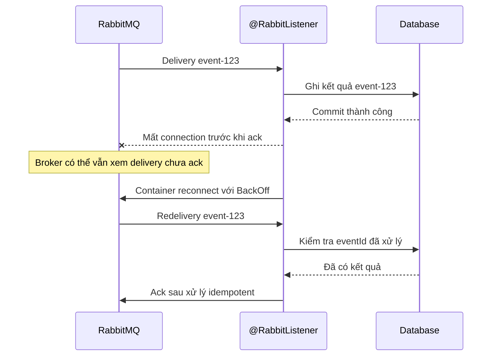

# Recovery interval, BackOff và giới hạn kết nối lại trong Spring AMQP

Khi RabbitMQ ngừng hoạt động vì bảo trì, mất mạng hoặc chuyển đổi node, consumer trong ứng dụng Spring AMQP có thể mất connection và channel đang sử dụng. Sau khi broker hoạt động trở lại, ứng dụng cần thiết lập lại consumer để tiếp tục đọc queue. Nếu hàng trăm instance cùng thử kết nối liên tục, chúng còn có thể làm broker vừa phục hồi bị quá tải.

Trong chương **Phục hồi kết nối** của **SPRING_AMQP**, hai khái niệm cần nắm chắc là:

- **Recovery interval**: khoảng nghỉ cố định giữa các lần container thử khôi phục consumer sau lỗi.
- **BackOff**: chiến lược quyết định khoảng nghỉ tiếp theo và thời điểm ngừng thử, chẳng hạn nghỉ cố định hoặc tăng dần theo cấp số nhân.

Chúng giúp kiểm soát tần suất thử lại của **listener container** khi kết nối/consumer gặp sự cố. Tuy nhiên, recovery không tự bảo đảm producer gửi lại message chưa được xác nhận, consumer tránh xử lý trùng, hay lỗi cấu hình được sửa. Muốn xử lý bất đồng bộ đáng tin cậy, cần thiết kế cùng với `RabbitTemplate`, `@RabbitListener`, publisher confirm, acknowledgement, retry và dead-letter.

## 1. Recovery nằm ở đâu trong luồng RabbitMQ?

Một ứng dụng thường có các thành phần:

```mermaid
flowchart LR
    P[Ứng dụng producer] --> T[RabbitTemplate]
    T --> CF[CachingConnectionFactory]
    CF --> B[(RabbitMQ)]
    B --> Q[Exchange, queue, binding]
    Q --> LC[Listener container]
    LC --> L[@RabbitListener]
    LC --> R[Recovery interval hoặc BackOff]
    R --> LC
```

`CachingConnectionFactory` quản lý việc tạo, dùng và cache các connection/channel theo cơ chế Spring AMQP. Listener container mở consumer, nhận delivery và gọi method `@RabbitListener`. Khi connection hoặc consumer bị gián đoạn, container có thể thử khôi phục theo chính sách recovery.

**Recovery không đồng nghĩa với việc phát lại nghiệp vụ.** Broker có thể giao lại message chưa ack sau khi connection cũ đóng; consumer phải chấp nhận khả năng nhận cùng sự kiện nhiều lần. Những message producer cố gửi trong lúc mất kết nối lại thuộc bài toán publish retry, publisher confirm và lưu sự kiện bền vững.

### Phân biệt các loại retry

| Loại | Sự cố kích hoạt | Công cụ liên quan | Giới hạn |
|---|---|---|---|
| **Connection/consumer recovery** | Consumer mất connection, không tạo được consumer, hoặc lỗi khởi động có thể phục hồi | `SimpleMessageListenerContainer`, `recoveryInterval`, `recoveryBackOff` | Không tự chạy lại tác vụ business đã hoàn thành |
| **Listener processing retry** | `@RabbitListener` ném exception khi xử lý một message | Retry advice, `RetryInterceptorBuilder` hoặc cấu hình listener retry | Không thay chiến lược reconnect đến RabbitMQ |
| **Producer publish retry** | `RabbitTemplate` gặp lỗi gửi, chẳng hạn broker tạm không kết nối được | Retry trên template, outbox, publisher confirms | Không thể suy ra retry là an toàn nếu publish đầu đã đến broker |
| **Broker redelivery** | Delivery chưa được ack mà channel/connection đóng hoặc message bị requeue | Ack/nack, RabbitMQ queue | Có thể tạo tác động nghiệp vụ lặp |
| **Dead-letter/replay** | Message xử lý lỗi và được đưa DLQ hoặc phát lại có chủ đích | DLX/DLQ, quy trình vận hành | Không tự sửa lỗi schema hay hệ thống ngoài |

Nhầm các tầng này có thể khiến việc bật `recoveryBackOff` được kỳ vọng sai là sẽ retry mọi HTTP call, hoặc biến mọi message lỗi thành một lần kết nối lại.

## 2. Recovery interval: chờ cố định giữa các lần khôi phục

Với `SimpleMessageListenerContainer`, có thể cấu hình thời gian chờ phục hồi bằng `setRecoveryInterval(long)`, đơn vị **mili giây**. Giá trị mặc định thường là khoảng **5.000 ms** khi không có cấu hình recovery khác; cần kiểm tra phiên bản Spring AMQP và thiết lập của ứng dụng thực tế.

Ví dụ:

```java
SimpleMessageListenerContainer container =
        new SimpleMessageListenerContainer(connectionFactory);

container.setQueueNames("orders.events");
container.setRecoveryInterval(5_000L); // 5 giây
```

Khi container cần khôi phục một consumer do lỗi có thể retry, nó nghỉ theo khoảng này trước lần thử tiếp theo. Đây **không phải** thời hạn kết nối TCP hay deadline của một lời gọi `RabbitTemplate.convertAndSend()`.

Chẳng hạn broker mất kết nối:

```text
T = 0s     Consumer phát hiện mất kết nối
T ≈ 5s    Thử tạo lại consumer
T ≈ 10s   Thử tiếp nếu chưa thành công
T ≈ 15s   Thử tiếp nếu chưa thành công
...
```

Lịch thực tế còn phụ thuộc thời gian phát hiện lỗi, TCP timeout, thời gian tạo connection, kiểm tra queue và hoạt động của thread. Con số trên chỉ mô tả **nhịp nghỉ dự kiến**, không phải lịch chính xác tới từng giây.

### Ưu điểm và hạn chế

- Cấu hình đơn giản, dễ dự đoán và thuận tiện cho hệ thống nhỏ.
- Khoảng quá ngắn có thể tạo nhiều connection attempt hoặc log lỗi khi broker ngừng lâu.
- Khoảng quá dài làm tăng thời gian consumer quay lại sau khi broker đã hoạt động.
- Cố định cùng một interval cho nhiều instance có thể khiến chúng đồng loạt thử kết nối; bản thân `setRecoveryInterval` không thêm jitter.
- Không giới hạn số lần thử nếu recovery tiếp tục vô hạn theo chính sách đang dùng.

## 3. BackOff: chiến lược điều chỉnh nhịp retry

Spring cung cấp interface `org.springframework.util.backoff.BackOff`. Mỗi chuỗi recovery dùng một `BackOffExecution` để lấy khoảng nghỉ tiếp theo bằng `nextBackOff()`. Khi trả về `BackOffExecution.STOP`, chuỗi thử lại theo chính sách đó đã hết ngân sách.

Hai triển khai thường dùng là:

| Triển khai | Cách tính | Khi phù hợp |
|---|---|---|
| `FixedBackOff` | Nghỉ cố định, có thể giới hạn số lần chờ/thử | Muốn khoảng nghỉ đều và giới hạn rõ ràng |
| `ExponentialBackOff` | Khoảng nghỉ tăng theo hệ số nhân, có thể giới hạn khoảng tối đa và tổng thời gian | Muốn giảm tần suất thử khi broker ngừng lâu |

Sơ đồ cho ví dụ exponential có khởi đầu 2 giây, hệ số 2 và trần 30 giây:

```text
Lần nghỉ:       1     2     3     4     5     6 ...
Thời gian:     2s    4s    8s   16s   30s   30s ...
```

**BackOff điều khiển khoảng chờ giữa những lần thử lại, không thay timeout của socket**. Nếu một lần kết nối thất bại mất 20 giây do network timeout, tổng thời gian người dùng quan sát có thể dài hơn nhiều so với các giá trị ở bảng.

Ngoài ra, các triển khai `FixedBackOff` và `ExponentialBackOff` thông thường không mặc định thêm jitter ngẫu nhiên. Khi có nhiều ứng dụng/replica, cần tính đến cách phân tán thời điểm khởi động, giãn tải ở hạ tầng hoặc chính sách tùy biến để hạn chế *thundering herd*.

## 4. Ví dụ Spring Boot: recovery bằng ExponentialBackOff

Ví dụ dùng **Spring Boot 3.x, Java 17+ và Spring AMQP**. Ứng dụng lắng nghe queue `demo.orders.events` trên một direct exchange, dùng BackOff tăng dần khi consumer cần khôi phục kết nối.

### 4.1. Dependency và kết nối

```groovy
dependencies {
    implementation 'org.springframework.boot:spring-boot-starter-amqp'
}
```

Ví dụ `application.yml` cho RabbitMQ đang chạy tại máy phát triển:

```yaml
spring:
  rabbitmq:
    host: localhost
    port: 5672
    username: guest
    password: guest
```

`guest/guest` là thông tin mặc định dùng cho môi trường RabbitMQ cục bộ; production cần tài khoản ứng dụng, cấu hình bảo mật/TLS và quản lý secret riêng.

### 4.2. Khai báo exchange, queue và binding

```java
import org.springframework.amqp.core.Binding;
import org.springframework.amqp.core.BindingBuilder;
import org.springframework.amqp.core.DirectExchange;
import org.springframework.amqp.core.Queue;
import org.springframework.amqp.core.QueueBuilder;
import org.springframework.context.annotation.Bean;
import org.springframework.context.annotation.Configuration;

@Configuration
public class OrdersTopology {
    public static final String EXCHANGE = "demo.orders.exchange";
    public static final String QUEUE = "demo.orders.events";
    public static final String ROUTING_KEY = "order.created";

    @Bean
    public DirectExchange ordersExchange() {
        return new DirectExchange(EXCHANGE);
    }

    @Bean
    public Queue ordersQueue() {
        return QueueBuilder.durable(QUEUE).build();
    }

    @Bean
    public Binding ordersBinding() {
        return BindingBuilder.bind(ordersQueue())
                .to(ordersExchange()).with(ROUTING_KEY);
    }
}
```

Queue durable cho phép khai báo queue tồn tại sau broker restart theo chính sách lưu trữ; muốn bảo đảm message bền vững còn cần chế độ lưu message, publisher confirm và thiết kế broker phù hợp. **Recovery chỉ tạo lại kết nối/consumer; nó không thể khôi phục dữ liệu đã bị mất khỏi broker.**

### 4.3. Tạo listener container factory chuyên cho recovery

```java
import org.springframework.amqp.rabbit.annotation.EnableRabbit;
import org.springframework.amqp.rabbit.config.SimpleRabbitListenerContainerFactory;
import org.springframework.amqp.rabbit.connection.ConnectionFactory;
import org.springframework.boot.autoconfigure.amqp.SimpleRabbitListenerContainerFactoryConfigurer;
import org.springframework.context.annotation.Bean;
import org.springframework.context.annotation.Configuration;
import org.springframework.util.backoff.ExponentialBackOff;

@Configuration
@EnableRabbit
public class OrdersListenerConfiguration {

    @Bean("recoveringOrdersFactory")
    public SimpleRabbitListenerContainerFactory recoveringOrdersFactory(
            ConnectionFactory connectionFactory,
            SimpleRabbitListenerContainerFactoryConfigurer configurer) {

        SimpleRabbitListenerContainerFactory factory =
                new SimpleRabbitListenerContainerFactory();
        configurer.configure(factory, connectionFactory);

        ExponentialBackOff backOff = new ExponentialBackOff(2_000L, 2.0);
        backOff.setMaxInterval(30_000L);

        factory.setRecoveryBackOff(backOff);
        factory.setConcurrentConsumers(2);
        factory.setPrefetchCount(10);
        return factory;
    }
}
```

Giải thích:

- `SimpleRabbitListenerContainerFactoryConfigurer` kế thừa các thiết lập được Spring Boot quản lý, sau đó ta điều chỉnh riêng factory này.
- `new ExponentialBackOff(2_000L, 2.0)` đặt khoảng nghỉ đầu tiên 2 giây, mỗi lần tăng gấp đôi.
- `setMaxInterval(30_000L)` đặt trần khoảng nghỉ ở 30 giây; các lần tiếp theo không tăng mãi.
- Không đặt `maxElapsedTime` nên chính sách exponential ở ví dụ này không chủ động giới hạn tổng thời gian theo lịch BackOff mặc định. **Phù hợp khi muốn listener tiếp tục thử phục hồi sau outage dài**, cùng với monitoring/alerting.
- `setConcurrentConsumers(2)` tạo hai consumer trong tình huống bình thường. Recovery của từng consumer không phải một bộ đếm retry chung cho cả ứng dụng.
- `setPrefetchCount(10)` chỉ kiểm soát số delivery chưa ack mà RabbitMQ có thể cấp cho mỗi consumer; nó **không giới hạn số lần reconnect**.

Chỉ gắn factory này cho những listener cần chính sách trên. Tên bean riêng tránh thay đổi ngoài ý muốn các listener khác sử dụng factory mặc định.

### 4.4. Viết listener và producer

```java
import org.springframework.amqp.rabbit.annotation.RabbitListener;
import org.springframework.stereotype.Component;

@Component
public class OrdersListener {

    @RabbitListener(
            id = "orders-recovery-listener",
            queues = OrdersTopology.QUEUE,
            containerFactory = "recoveringOrdersFactory")
    public void onOrderCreated(String eventId) {
        if (eventId == null || eventId.isBlank()) {
            throw new IllegalArgumentException("eventId trống");
        }

        // Demo: thay bằng xử lý nghiệp vụ idempotent có lưu trạng thái.
        System.out.println("Received order event: " + eventId);
    }
}
```

Producer:

```java
import org.springframework.amqp.rabbit.core.RabbitTemplate;
import org.springframework.stereotype.Service;

@Service
public class OrdersPublisher {
    private final RabbitTemplate rabbitTemplate;

    public OrdersPublisher(RabbitTemplate rabbitTemplate) {
        this.rabbitTemplate = rabbitTemplate;
    }

    public void sendOrderCreated(String eventId) {
        rabbitTemplate.convertAndSend(
                OrdersTopology.EXCHANGE,
                OrdersTopology.ROUTING_KEY,
                eventId);
    }
}
```

Đây là hai phía giao tiếp khác nhau: listener dùng `recoveringOrdersFactory` để điều khiển *consumer recovery*, còn producer dùng `RabbitTemplate`. Nếu broker đang không kết nối được, lời gọi `convertAndSend()` có thể ném exception. **BackOff của listener không tự lưu và gửi lại message mà producer chưa phát thành công.**

## 5. Giới hạn số lần thử với FixedBackOff

Không phải lúc nào thử mãi cũng phù hợp. Một số hệ thống muốn thử trong một khoảng ngắn, sau đó để bộ giám sát cảnh báo hoặc quy trình điều phối quyết định khi nào khởi động lại.

```java
import org.springframework.util.backoff.FixedBackOff;

// Khoảng chờ 5 giây; tối đa 12 lần trả về khoảng chờ retry
FixedBackOff limitedBackOff = new FixedBackOff(5_000L, 12L);

// Thay cấu hình exponential trong recoveringOrdersFactory bằng:
factory.setRecoveryBackOff(limitedBackOff);
```

Với `FixedBackOff`, tham số thứ hai là `maxAttempts` của **BackOffExecution**, nghĩa là số lần nó còn trả về một khoảng chờ trước khi trả `STOP`; không nên tự đồng nhất con số này với số lần TCP connect tuyệt đối trong mọi nhánh logic container.

Minh họa:

```text
Lấy khoảng chờ lần 1  -> 5 giây
Lấy khoảng chờ lần 2  -> 5 giây
...
Lấy khoảng chờ lần 12 -> 5 giây
Lần kế tiếp            -> BackOffExecution.STOP
```

### Khi đạt STOP thì sao?

`STOP` có nghĩa **chuỗi recovery hiện tại không còn khoảng nghỉ để tiếp tục thử**. Tùy nơi thực thi và phiên bản Spring AMQP, consumer/container sẽ đi vào nhánh kết thúc hoặc ngừng vòng phục hồi tương ứng. Không nên mặc định “RabbitMQ trở lại thì listener chắc chắn tự chạy” sau khi đã dùng chính sách hữu hạn.

Cần có cách phát hiện tình trạng không còn consumer hoạt động, cảnh báo và khởi động lại container hoặc triển khai lại sau khi xử lý nguyên nhân. Chính sách hữu hạn không phải là bộ đếm retry bền vững của toàn ứng dụng: khởi động lại container hoặc tạo một `BackOffExecution` mới có thể bắt đầu một chuỗi khác.

**Chọn theo vận hành:** nếu cần tự phục hồi sau một outage nhiều giờ mà không có operator, BackOff tiếp tục thử (với interval trần hợp lý) thường phù hợp hơn. Nếu môi trường yêu cầu fail-fast và người vận hành can thiệp, một giới hạn hữu hạn giúp làm rõ trạng thái sự cố nhưng đòi hỏi cơ chế phục hồi bên ngoài.

## 6. Giới hạn theo thời gian với ExponentialBackOff

`ExponentialBackOff` hỗ trợ `setMaxElapsedTime(...)` để ngừng đưa ra khoảng chờ khi ngân sách thời gian của chiến lược đã hết:

```java
import org.springframework.util.backoff.ExponentialBackOff;

ExponentialBackOff bounded = new ExponentialBackOff(2_000L, 2.0);
bounded.setMaxInterval(30_000L);
bounded.setMaxElapsedTime(5 * 60 * 1_000L); // Khoảng 5 phút

factory.setRecoveryBackOff(bounded);
```

Đây là giới hạn theo **lịch của BackOff**, không phải deadline cứng 5 phút bao gồm mọi thời gian thử kết nối, DNS lookup, TCP timeout, khởi tạo channel và declare queue. Việc khôi phục thực tế có thể kéo dài hơn. Sau `STOP`, vẫn cần kiểm tra container có consumer trở lại hay không và có bước can thiệp phù hợp.

### So sánh chiến lược

| Chính sách | Ví dụ | Ưu điểm | Rủi ro |
|---|---|---|---|
| Interval cố định, thử lâu dài | `setRecoveryInterval(5_000)` | Đơn giản, tự thử sau outage kéo dài | Tạo áp lực đều đặn khi broker lỗi lâu |
| FixedBackOff hữu hạn | `new FixedBackOff(5_000, 12)` | Có giới hạn nhịp thử | Cần giám sát/kích hoạt lại sau `STOP` |
| ExponentialBackOff có trần | 2s, 4s, 8s, 16s, 30s... | Giảm tần suất thử khi lỗi kéo dài | Khi broker hồi phục có thể phải chờ đến lần thử tiếp |
| ExponentialBackOff có giới hạn thời gian | Trần 30s, ngân sách khoảng 5 phút | Không thử vô hạn trong cùng chuỗi | Sau khi cạn ngân sách có thể cần phục hồi có chủ đích |

**Không cần gọi cả `setRecoveryInterval(...)` và `setRecoveryBackOff(...)` trên cùng factory.** Hãy chọn một chính sách và cấu hình rõ ràng. Việc đặt cả hai gây nhập nhằng về thứ tự setter và giá trị cuối cùng được dùng; trong các ví dụ này dùng `setRecoveryBackOff(...)`.

## 7. Connection factory và RabbitMQ Java client: tránh hai vòng recovery

RabbitMQ Java client cũng có cơ chế **automatic connection recovery** riêng. Trong các cấu hình Spring AMQP thông thường, Spring quản lý connection và listener recovery qua `CachingConnectionFactory` và listener container.

Không nên tự bật thêm automatic recovery của Java client trên connection factory bên dưới mà chưa hiểu rõ tương tác. Hai lớp cùng phục hồi có thể gây khó xác định ai tạo lại channel/consumer, thứ tự khai báo topology và lúc nào ứng dụng thực sự sẵn sàng nhận message.

Cần phân biệt:

1. **Tạo lại kết nối vật lý:** connection factory của Spring quản lý lúc ứng dụng cần giao tiếp với broker.
2. **Khôi phục consumer:** listener container có vòng lặp recovery riêng với khoảng nghỉ/BackOff.
3. **Khai báo lại topology:** `RabbitAdmin` có thể khai báo exchange, queue, binding theo cấu hình khi có connection phù hợp. Điều này phụ thuộc vào bean topology, auto-declare và quyền trên broker.
4. **Gửi lại message của producer:** phải được ứng dụng thiết kế riêng; reconnect không tự replay những message đã gửi lỗi hoặc nằm trong bộ nhớ.

Ví dụ, broker được khởi động lại nhưng queue mất do cấu hình không durable hoặc bị xóa thủ công. Connection mới có thể tạo được, song consumer vẫn thất bại khi subscribe queue chưa tồn tại. Cần sửa topology/quyền truy cập; tăng số lần retry không tự tạo ra queue khi ứng dụng không có cơ chế và quyền declare thích hợp.

## 8. Phân biệt lỗi tạm thời và lỗi cấu hình không tự lành

Không phải mọi lỗi đều nên kết nối lại vô hạn.

| Tình huống | Dấu hiệu | Phản ứng phù hợp |
|---|---|---|
| Broker restart hoặc node chuyển vai | Connection đóng, sau đó mở lại được | Để container recovery với BackOff và kiểm tra consumer/queue sau khi broker ổn định |
| Network partition hoặc DNS tạm lỗi | Connect/read timeout, connection reset | BackOff, giám sát outage; bảo đảm cấu hình timeout ở tầng mạng |
| Sai username/password hoặc credential hết hạn | Authentication failure lặp lại | Sửa secret/quyền; chỉ tăng interval không giải quyết nguyên nhân |
| TLS certificate không hợp lệ | Lỗi handshake/xác minh chứng thư | Sửa truststore/certificate, không retry vô hạn như lỗi thông thường |
| Queue không tồn tại hoặc quyền subscribe bị từ chối | Lỗi declare/consume | Xác minh queue, binding, vhost, permission và chính sách startup của container |
| RabbitMQ hết connection/channel quota | Tạo connection/channel bị từ chối | Giảm tải, chỉnh pool và quota hợp lý; BackOff chỉ giảm nhịp thử |
| Listener ném exception do payload lỗi | Broker vẫn kết nối bình thường | Retry xử lý message có giới hạn, reject hoặc DLQ; không biến thành kết nối lại |
| Producer mất kết nối khi publish | `RabbitTemplate` báo lỗi hoặc confirm không rõ | Producer retry theo chính sách riêng, xử lý trạng thái không xác định và idempotency |

Một số lỗi khởi động listener được Spring AMQP xem là **fatal** tùy phiên bản/cấu hình, ví dụ thiếu queue hoặc authentication failure. Các tùy chọn như `missingQueuesFatal`, `possibleAuthenticationFailureFatal` hoặc retry declaration có ngữ nghĩa riêng. **Không nên tắt fatal checks chỉ để giữ tiến trình sống** rồi giả định BackOff sẽ sửa được lỗi cấu hình.

Với ứng dụng phụ thuộc bắt buộc vào consumer, cần quyết định rõ trạng thái readiness: service có thể đang chạy HTTP nhưng không có consumer nào xử lý message. Một instance trả health “UP” cho tiến trình Java chưa chắc đã sẵn sàng thực hiện nghiệp vụ AMQP.

## 9. Recovery không đồng nghĩa với delivery đúng một lần

Giả sử listener ghi thành công vào cơ sở dữ liệu rồi broker mất kết nối **trước khi nhận được consumer ack**:



BackOff giúp consumer quay lại, nhưng **không quyết định sự kiện cũ có bị xử lý lặp hay không**. Ứng dụng cần:

- Đặt `eventId`/business key ổn định trong message.
- Dùng unique constraint, inbox table hoặc logic upsert để xử lý idempotent.
- Ack sau khi hoàn tất xử lý cần thiết theo chính sách của container.
- Khi gọi hệ thống ngoài, sử dụng idempotency key hoặc đối soát để tránh tác động lặp.
- Kiểm tra retry, dead-letter và cách phục hồi message chưa được xác nhận.

Đổi lại, nếu producer gửi message trong lúc broker vừa mất kết nối và không biết broker đã nhận publish hay chưa, gửi lại có thể tạo bản sao. Publisher confirm, returned-message callback, transactional outbox và consumer idempotency giải quyết các phần khác nhau của cùng vấn đề độ tin cậy đầu cuối.

## 10. Retry của RabbitTemplate là cấu hình khác

Giả sử producer gọi:

```java
rabbitTemplate.convertAndSend(
        OrdersTopology.EXCHANGE,
        OrdersTopology.ROUTING_KEY,
        "event-123");
```

Nếu broker đang mất kết nối, việc listener có `recoveryBackOff` không khiến câu lệnh này đợi broker phục hồi hoặc tự lưu message để gửi sau.

Trong Spring Boot, có thể cấu hình **retry ở mức thao tác của RabbitTemplate** (tùy phiên bản Boot và cách tạo bean):

```yaml
spring:
  rabbitmq:
    template:
      retry:
        enabled: true
        initial-interval: 1s
        multiplier: 2
        max-interval: 5s
        max-attempts: 3
```

Cấu hình trên chỉ minh họa retry có giới hạn cho thao tác gửi; không tự tạo hàng đợi lưu publish trong ứng dụng và không bảo đảm message không trùng. **Một lần publish có thể đã đến broker nhưng client bị mất connection trước khi nhận kết quả**. Nếu retry, consumer phải được thiết kế idempotent theo ID nghiệp vụ.

Khi dữ liệu trong database và sự kiện RabbitMQ cần nhất quán ngay cả lúc ứng dụng restart, cân nhắc **transactional outbox**: lưu sự kiện cùng database transaction, publisher nền gửi lại các outbox record chưa xác nhận, sử dụng confirms và đánh dấu gửi thành công. BackOff của listener không thay thế công việc của outbox publisher.

### Không nhầm với retry lỗi của listener

Một listener xử lý sai payload và ném exception sẽ gặp chính sách retry/requeue/dead-letter riêng. Ví dụ `spring.rabbitmq.listener.simple.retry.*` trong Spring Boot điều chỉnh retry của xử lý message ở listener, **khác** với `recoveryBackOff` dành cho consumer recovery. Nếu sử dụng DLQ, phải khai báo dead-letter exchange/queue, binding và chính sách requeue phù hợp; chỉ bật retry không tự tạo DLQ.

## 11. Giám sát trạng thái reconnect và phục hồi

Nên quan sát cả **ứng dụng** và **RabbitMQ broker**, vì một bên healthy không đồng nghĩa đầu kia hoạt động bình thường.

| Tín hiệu | Ý nghĩa |
|---|---|
| Connection mở/đóng, số lần connection failures | Phát hiện broker không sẵn sàng hoặc network chập chờn |
| Listener/container error log, recovery attempts | Biết có vòng phục hồi, khoảng nghỉ và nguyên nhân lỗi |
| Queue `consumer_count` | Đếm consumer thực sự đang đăng ký với broker; cần theo dõi so với mức mong đợi |
| Queue ready/unacked | Biết message đang chờ và message đã giao chưa ack |
| Độ trễ xử lý, throughput, thời gian queue tăng | Phát hiện backlog sau outage và năng lực bắt kịp |
| Publisher confirms/nacks/returns | Phát hiện đường gửi có lỗi độc lập với consumer recovery |
| DLQ depth, redelivery count, duplicate-skipped count | Đo hiệu ứng phụ sau reconnect và lỗi message |

Không nên chỉ dựa vào việc `ApplicationContext` đã start hoặc một method health trả “UP”. Sau giới hạn BackOff, listener có thể không còn consumer hoạt động dù tiến trình Java chưa dừng.

### Kiểm tra listener thông qua registry

`RabbitListenerEndpointRegistry` cho phép truy xuất listener container bằng `id` khai báo trên `@RabbitListener`:

```java
import org.springframework.amqp.rabbit.listener.MessageListenerContainer;
import org.springframework.amqp.rabbit.listener.RabbitListenerEndpointRegistry;
import org.springframework.stereotype.Component;

@Component
public class OrdersListenerMonitor {
    private final RabbitListenerEndpointRegistry registry;

    public OrdersListenerMonitor(RabbitListenerEndpointRegistry registry) {
        this.registry = registry;
    }

    public boolean containerRunning() {
        MessageListenerContainer container =
                registry.getListenerContainer("orders-recovery-listener");
        return container != null && container.isRunning();
    }
}
```

Giá trị `isRunning()` hữu ích để quan sát trạng thái vòng đời container, nhưng **chưa chứng minh chắc chắn broker đang có consumer đăng ký** hoặc message đang được xử lý. Nên kết hợp kiểm tra số consumer thực tế, logs và queue metrics.

Nếu vận hành dùng BackOff hữu hạn, có thể lập runbook kiểm tra broker, credentials, topology, sau đó chủ động start lại listener container khi nguyên nhân đã được xử lý. Tránh tạo vòng `start()` liên tục từ health check vì như vậy sẽ phá vỡ ý nghĩa giới hạn retry và có thể gây thác kết nối.

## 12. Thử nghiệm các tình huống mất kết nối

Để kiểm chứng recovery, cần integration test hoặc thử nghiệm trên RabbitMQ đang chạy. Chỉ gọi trực tiếp Java method `@RabbitListener` không kiểm tra việc tạo lại connection/channel.

### Kịch bản A: broker ngừng ngắn rồi hoạt động lại

1. Khởi động RabbitMQ, ứng dụng và listener; kiểm tra queue có consumer.
2. Gửi một message thử; xác nhận nó được xử lý.
3. Tạm ngừng RabbitMQ trong môi trường kiểm thử.
4. Quan sát lỗi connection và nhịp recovery; lưu thời điểm.
5. Khởi động RabbitMQ lại trước khi vượt ngân sách BackOff.
6. Xác minh listener đăng ký lại, nhận message tiếp và queue backlog giảm.

**Kỳ vọng:** consumer tự phục hồi khi loại lỗi có thể khôi phục, broker/permissions vẫn đúng và chính sách chưa STOP. Không kỳ vọng xử lý message đúng một lần nếu có delivery chưa ack trước outage.

### Kịch bản B: outage dài hơn giới hạn BackOff

Đặt ví dụ `FixedBackOff(5_000, 3)`. Ngừng RabbitMQ đủ lâu để chuỗi backoff chạm `STOP`. Sau khi broker hoạt động lại, quan sát listener có tự đăng ký hay cần can thiệp.

**Kỳ vọng:** ứng dụng có cảnh báo nếu consumer không hoạt động. Phải có runbook restart/recovery khi chính sách hữu hạn làm vòng retry kết thúc, thay vì chỉ chờ một message mới tự đánh thức consumer.

### Kịch bản C: đã ghi DB nhưng mất ack

Cho listener ghi một `eventId` rồi làm gián đoạn connection đúng cửa sổ trước ack (có thể dùng fault injection ở môi trường test). Sau reconnect, xác minh business record chỉ được ghi một lần dù broker redeliver.

**Kỳ vọng:** idempotency hoạt động, không nhân đôi tác động; không lấy số delivery làm số transaction business thành công.

### Kịch bản D: lỗi không tự lành

Thử username sai, vhost không đúng hoặc queue bị xóa, rồi quan sát thông báo lỗi. Khôi phục bằng cách sửa nguyên nhân và topology phù hợp; không coi việc tăng số lần retry là một giải pháp.

### Ma trận lỗi và kết quả

| Tình huống | Cần xác minh |
|---|---|
| Broker mất và trở lại sau vài giây | Listener khôi phục, không bị kẹt sau lỗi |
| Broker ngừng kéo dài | BackOff tăng theo lịch; số attempt không quá dồn dập |
| Đặt `maxAttempts` hữu hạn | Nhận diện `STOP`/consumer ngừng khôi phục và phát cảnh báo |
| Nhiều replica cùng kết nối lại | Không làm broker bị quá tải do đồng loạt retry |
| Message đang xử lý khi mất kết nối | Hành vi redelivery và idempotency đúng |
| RabbitTemplate gửi trong lúc offline | Xử lý publish failure/uncertain state độc lập với listener |
| Queue thiếu hoặc không có quyền | Lỗi cấu hình được quan sát và sửa, không che giấu |
| Queue có backlog sau reconnect | Throughput, prefetch, concurrency đủ để xử lý backlog có kiểm soát |

## 13. Cách lựa chọn thông số thực tế

Khi chọn chính sách recovery, hãy trả lời:

1. **Service phải tự phục hồi bao lâu?** Nếu outage kéo dài vài giờ vẫn cần tự quay lại, tránh một giới hạn dừng quá ngắn khi không có cơ chế restart khác.
2. **Có bao nhiêu replica và consumer?** Hàng chục instance × nhiều consumer có thể gây rất nhiều lần thử; nên tăng dần khoảng nghỉ và tránh đồng bộ nhịp thử khi có thể.
3. **Thời gian kết nối thất bại là bao lâu?** TCP/connection timeout làm tổng nhịp thử dài hơn `BackOff`, vì thế phải đo thay vì chỉ đọc cấu hình.
4. **Khi broker trở lại, ứng dụng cần phục hồi nhanh tới mức nào?** Trần interval càng lớn có thể làm thời gian chờ đến lần thử kế tiếp tăng lên.
5. **Nếu hết ngân sách thử thì ai khởi động lại?** Cần có monitoring, alerting, runbook hoặc cơ chế điều phối đáng tin cậy.
6. **Producer và consumer có chịu được message lặp/mất kết nối không?** Đảm bảo publisher confirms, outbox khi cần, ack/retry/DLQ và xử lý idempotent.

Một cấu hình ban đầu hợp lý cho ví dụ học tập là **ExponentialBackOff 2 giây, nhân đôi, trần 30 giây và tiếp tục thử**, với health/alerting đầy đủ. Giá trị sản xuất phải kiểm chứng bằng tải thực tế, khả năng chịu đựng của broker, SLO khôi phục và thời gian outage thường gặp.

### Câu hỏi tự kiểm tra

1. `recoveryInterval` khác `recoveryBackOff` như thế nào, và khi nào nên dùng mỗi cách?
2. `FixedBackOff(5_000, 12)` giới hạn điều gì? Vì sao không thể mặc định xem đó là 12 lần tạo TCP connection?
3. Khi `BackOffExecution.STOP` xuất hiện, vì sao cần quan sát số consumer thực tế và có runbook phục hồi?
4. Tại sao consumer reconnect thành công không có nghĩa producer đã gửi lại message lỗi?
5. Message đã ghi database nhưng bị mất consumer ack trước khi broker restart có thể dẫn đến tình huống gì?
6. Tại sao bật listener recovery không giúp sửa lỗi sai credential hoặc queue/binding thiếu?

**Ghi nhớ:** `recoveryInterval` điều chỉnh khoảng nghỉ cố định; `recoveryBackOff` điều chỉnh chiến lược tăng/giới hạn khoảng nghỉ và có thể trả `STOP`. Cả hai thuộc cơ chế **phục hồi consumer/container**, không thay publish retry, publisher confirm, retry xử lý message, DLQ hay idempotency. Hệ thống Spring AMQP đáng tin cậy cần vừa quay lại được sau outage, vừa xử lý đúng những message có thể bị giao lại hoặc gửi lại.
