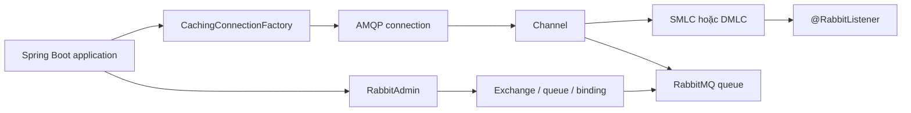
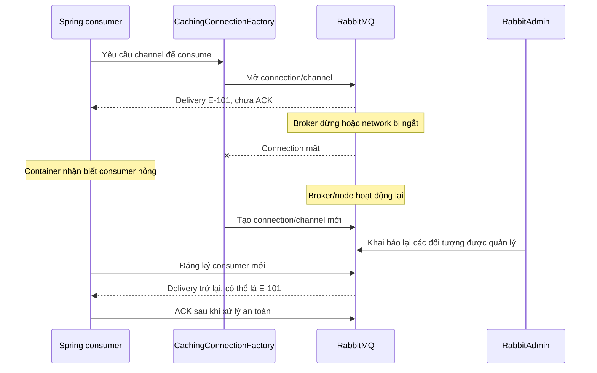

# Phục hồi consumer sau khi broker hoặc node khởi động lại

Khi RabbitMQ tạm dừng để bảo trì, một node khởi động lại hoặc mạng giữa Spring Boot và broker gián đoạn, consumer của `@RabbitListener` có thể mất connection, channel và đăng ký nhận message. Sau khi RabbitMQ hoạt động trở lại, hệ thống phải tạo kết nối mới, đăng ký lại consumer và xác minh queue vẫn tồn tại. Đồng thời, ứng dụng phải xử lý khả năng một message đã được thực thi nhưng ACK chưa được broker ghi nhận.

Bài học thuộc chương **Phục hồi kết nối** của module **SPRING_AMQP**. Nội dung kết hợp `RabbitTemplate`, `@RabbitListener`, exchange, queue, binding, consumer acknowledgement, retry, dead-letter và quan sát hệ thống để triển khai luồng xử lý bất đồng bộ đáng tin cậy.

**Điểm cần phân biệt:** *phục hồi kết nối* giúp consumer tiếp tục nhận message, *độ bền của queue/message* quyết định dữ liệu còn tồn tại sau lỗi, và *idempotency* bảo vệ nghiệp vụ khi message được giao lại. Không cơ chế nào tự thay thế hai cơ chế còn lại.

## 1. Mục tiêu học tập

Sau bài này, bạn có thể:

1. Giải thích điều gì xảy ra với connection, channel, consumer và message chưa ACK khi broker mất kết nối.
2. Phân biệt trách nhiệm của `CachingConnectionFactory`, listener container và `RabbitAdmin`.
3. Cấu hình SMLC với `recoveryInterval` hoặc `recoveryBackOff`; hiểu khác biệt với `monitorInterval` của DMLC.
4. Phân biệt broker không sẵn sàng với queue bị thiếu, quyền truy cập sai hoặc thuộc tính queue mâu thuẫn.
5. Xác định vai trò của durable queue, persistent message, publisher confirms và quorum queue khi node restart.
6. Theo dõi consumer event, queue depth, consumer count và thời gian phục hồi.
7. Thử nghiệm restart broker, redelivery và idempotent consumer mà không cần restart JVM.

## 2. Vòng đời connection và consumer

Một ứng dụng Spring AMQP điển hình có các lớp:



| Thành phần | Khi hệ thống bình thường | Khi kết nối bị mất |
| --- | --- | --- |
| `CachingConnectionFactory` | Cung cấp/cached connection và channel. | Không tiếp tục dùng connection/channel hỏng; tạo lại tài nguyên khi cần. |
| `SimpleMessageListenerContainer` (SMLC) | Quản lý consumer và gọi listener trên thread container. | Phát hiện consumer thất bại, thử khởi động consumer mới theo chính sách recovery. |
| `DirectMessageListenerContainer` (DMLC) | Quản lý consumer theo từng queue, dispatch trên RabbitMQ client thread. | Phát hiện consumer lỗi qua hoạt động giám sát và đăng ký lại. |
| `RabbitAdmin` | Khai báo queue, exchange, binding do ứng dụng quản lý. | Có thể khai báo lại topology khi connection được thiết lập lại. |
| RabbitMQ | Duy trì topology, message và trạng thái delivery. | Khôi phục dữ liệu được lưu bền vững theo loại queue/message và cấu hình replication. |
| Business listener | Thực thi nghiệp vụ; hoàn tất hoặc ném exception. | Có thể nhận message từng xử lý trước đó nếu ACK bị mất. |

Có ba việc khác nhau:

- **Connection recovery:** lấy lại đường truyền AMQP tới broker.
- **Consumer recovery:** mở channel/đăng ký consumer mới để tiếp tục nhận message.
- **Topology declaration:** bảo đảm exchange, queue, binding cần thiết vẫn hiện diện.



Sơ đồ mô tả các trách nhiệm; thời điểm cụ thể có thể khác tùy cơ chế listener, RabbitAdmin, trạng thái broker và loại queue. Việc listener hoạt động trở lại không chứng minh mọi message đã được bảo toàn.

## 3. Spring AMQP tự phục hồi connection như thế nào?

RabbitMQ Java client có cơ chế `automaticRecoveryEnabled` và topology recovery. Tuy nhiên Spring AMQP có cơ chế connection/channel/consumer recovery của riêng mình. Khi dùng `CachingConnectionFactory`, Spring AMQP thường **vô hiệu hóa automatic recovery của client** để tránh hai tầng cùng cố phục hồi những connection/channel giống nhau.

```text
Spring AMQP:
  CachingConnectionFactory -> quản lý connection và channel
  SMLC hoặc DMLC           -> quản lý consumer và restart
  RabbitAdmin              -> khai báo lại topology do nó quản lý
```

Vì vậy, không cần tự bật recovery ở `com.rabbitmq.client.ConnectionFactory` để phục hồi `@RabbitListener`. Cấu hình chồng chéo recovery có thể tạo hành vi khó dự đoán và không giải quyết được lỗi thiếu queue hoặc lỗi dữ liệu.

**Không giữ channel và deliveryTag cũ:** sau khi connection đóng, những channel cũ không còn dùng được. `deliveryTag` chỉ có ý nghĩa trên channel đã nhận delivery. ACK một tag cũ bằng channel mới có thể gây lỗi giao thức `unknown delivery tag`.

### Listener bất đồng bộ khác RabbitTemplate đồng bộ

Nếu consumer mất kết nối, listener container thường thử đăng ký lại khi lỗi **không fatal**. Nhưng một lời gọi `RabbitTemplate.convertAndSend(...)` thực hiện đúng lúc broker down có thể ném `AmqpException`. Framework không cam kết âm thầm gửi lại publish đã thất bại sau khi kết nối trở lại. Producer cần quyết định retry, xử lý trạng thái không chắc chắn và publisher confirms.

Lỗi nghiệp vụ khi listener đang có kết nối (ví dụ JSON không hợp lệ hoặc DB từ chối một cập nhật) là **message processing failure**, không phải một sự cố cần khôi phục connection. Trường hợp này phải xử lý bằng retry có giới hạn, reject, DLX/DLQ hoặc quarantine.

## 4. SMLC: recoveryInterval và recoveryBackOff

**`SimpleMessageListenerContainer`** thử khởi tạo lại consumer khi mất kết nối hoặc thất bại khởi động không fatal. Các thuộc tính cần biết:

| Thuộc tính | Ý nghĩa |
| --- | --- |
| `recoveryInterval` | Khoảng thời gian giữa các lần thử phục hồi consumer, đơn vị ms; mặc định thường **5.000 ms**. |
| `recoveryBackOff` | Chính sách backoff cho các lần thử; mặc định thông thường là `FixedBackOff`, không giới hạn, khoảng 5 giây. |
| `missingQueuesFatal` | Khi tất cả queue của listener bị thiếu, có coi là fatal không; SMLC mặc định **true**. |
| `possibleAuthenticationFailureFatal` | Điều khiển phản ứng với một số lỗi xác thực lúc khởi động; SMLC mặc định **true**. |
| `autoStartup` | Quyết định container tự start cùng ApplicationContext hay do ứng dụng kích hoạt. |

**`recoveryInterval` và `recoveryBackOff` là lựa chọn thay thế nhau**, không nên đặt đồng thời.

Khi broker chưa chạy vào lúc ứng dụng khởi động, SMLC có thể tiếp tục thử kết nối trong cơ chế recovery không fatal. Khi broker lên, nó có thể đăng ký consumer mà không cần restart ứng dụng. Nhưng broker đã hoạt động mà queue **không tồn tại** là một trường hợp khác, phụ thuộc `missingQueuesFatal`.

### 4.1 Factory SMLC minh họa

Giả định Spring Boot đã có `ConnectionFactory`, cùng dependency `spring-boot-starter-amqp`:

```java
import org.springframework.amqp.core.AcknowledgeMode;
import org.springframework.amqp.rabbit.config.SimpleRabbitListenerContainerFactory;
import org.springframework.amqp.rabbit.connection.ConnectionFactory;
import org.springframework.context.annotation.Bean;
import org.springframework.context.annotation.Configuration;

@Configuration
public class ResilientSimpleConfig {

    @Bean
    SimpleRabbitListenerContainerFactory resilientSimpleFactory(
            ConnectionFactory connectionFactory) {

        var factory = new SimpleRabbitListenerContainerFactory();
        factory.setConnectionFactory(connectionFactory);
        factory.setConcurrentConsumers(2);
        factory.setPrefetchCount(10);
        factory.setAcknowledgeMode(AcknowledgeMode.AUTO);

        // Khi consumer lỗi không fatal, thử lại khoảng mỗi 5 giây.
        factory.setRecoveryInterval(5_000L);

        // Chọn false chỉ nếu có trường hợp queue được provision trễ
        // và hệ thống thực sự muốn chờ queue xuất hiện.
        factory.setMissingQueuesFatal(false);

        // Lỗi xử lý message: reject không requeue theo mặc định.
        // Muốn giữ message lỗi phải khai báo dead-letter topology.
        factory.setDefaultRequeueRejected(false);

        return factory;
    }
}
```

Ý nghĩa:

- `setRecoveryInterval(5_000L)` không phải thời gian reconnect tối đa và không đảm bảo sẽ có consumer đúng sau 5 giây. Nó chỉ tham gia lịch thử lại.
- `setMissingQueuesFatal(false)` không **tự tạo queue**. Cần `RabbitAdmin` hoặc hạ tầng provision đúng tên queue.
- `setDefaultRequeueRejected(false)` áp dụng cho **lỗi xử lý listener**; nó **không ngăn** broker giao lại delivery chưa ACK nếu connection bất ngờ mất.
- Nếu nghiệp vụ có lỗi tạm thời, cần một retry policy riêng có backoff và giới hạn số lần trước khi dead-letter, thay vì reject mọi lỗi ngay lập tức.

### 4.2 Dùng backoff tăng dần

Có thể thay dòng `setRecoveryInterval(...)` bằng một `BackOff`:

```java
import org.springframework.util.backoff.ExponentialBackOff;

ExponentialBackOff backOff = new ExponentialBackOff();
backOff.setInitialInterval(1_000L);
backOff.setMultiplier(2.0);
backOff.setMaxInterval(30_000L);

// Gọi thay cho setRecoveryInterval:
factory.setRecoveryBackOff(backOff);
```

Đoạn này là ví dụ đặt bên trong quá trình tạo factory. `ExponentialBackOff` không tự thêm **jitter**. Khi nhiều pod cùng cố reconnect sau sự cố, cần xem xét retry có jitter hoặc giới hạn cấp hệ thống nếu muốn giảm hiện tượng mọi pod cùng tạo connection đồng loạt.

## 5. DMLC: monitorInterval khác recoveryInterval

**`DirectMessageListenerContainer`** quản lý consumer theo queue và sử dụng cơ chế giám sát để phát hiện/re-register consumer bị lỗi. Tùy chọn chính là `monitorInterval`, mặc định thường **10 giây** (có thể được điều chỉnh theo cấu hình khác).

| Yếu tố | SMLC | DMLC |
| --- | --- | --- |
| Cơ chế kiểm tra consumer | Vòng khởi động lại theo `recoveryInterval`/`recoveryBackOff`. | Task giám sát consumer theo `monitorInterval`. |
| Kích thước consumer | `concurrentConsumers` và có thể `maxConcurrentConsumers`. | `consumersPerQueue` cho từng queue. |
| `missingQueuesFatal` mặc định | **true**. | **false**. |
| Thread gọi listener | Thread container của SMLC. | RabbitMQ Java client dispatch thread. |
| Event riêng sau restart | Có `AsyncConsumerRestartedEvent`. | Có các consumer failure/consume OK event; không sử dụng event restart riêng của SMLC. |

Một factory DMLC **thay thế** cho factory ở mục 4:

```java
import org.springframework.amqp.core.AcknowledgeMode;
import org.springframework.amqp.rabbit.config.DirectRabbitListenerContainerFactory;
import org.springframework.amqp.rabbit.connection.ConnectionFactory;
import org.springframework.context.annotation.Bean;
import org.springframework.context.annotation.Configuration;

@Configuration
public class ResilientDirectConfig {

    @Bean
    DirectRabbitListenerContainerFactory resilientDirectFactory(
            ConnectionFactory connectionFactory) {

        var factory = new DirectRabbitListenerContainerFactory();
        factory.setConnectionFactory(connectionFactory);
        factory.setConsumersPerQueue(2);
        factory.setMonitorInterval(10_000L);
        factory.setPrefetchCount(10);
        factory.setMissingQueuesFatal(false);
        factory.setAcknowledgeMode(AcknowledgeMode.AUTO);
        return factory;
    }
}
```

Khi thử nghiệm, chỉ kích hoạt một listener nhận từ cùng queue để so sánh hai container. DMLC còn phụ thuộc **executor dispatch của RabbitMQ client**; consumer đã re-register nhưng số thread quá ít hoặc downstream chậm vẫn có thể khiến throughput thấp.

**Không áp dụng cơ chế SMLC vào DMLC:** DMLC không dùng min/max concurrent consumers để tự co giãn theo active/idle, cũng không lấy `recoveryInterval` làm điều khiển giám sát chính như SMLC.

## 6. RabbitAdmin: khai báo lại exchange, queue và binding

Listener mới không thể đọc một queue không có trên broker. `RabbitAdmin` khai báo các đối tượng AMQP được ứng dụng quản lý qua bean Spring. Việc khai báo thường diễn ra lazy khi connection được thiết lập; các declarable được quản lý có thể được khai báo lại sau connection failure.

Ví dụ khai báo topology có DLX:

```java
import org.springframework.amqp.core.Binding;
import org.springframework.amqp.core.BindingBuilder;
import org.springframework.amqp.core.DirectExchange;
import org.springframework.amqp.core.Queue;
import org.springframework.amqp.core.QueueBuilder;
import org.springframework.beans.factory.annotation.Qualifier;
import org.springframework.context.annotation.Bean;
import org.springframework.context.annotation.Configuration;
import org.springframework.amqp.rabbit.annotation.EnableRabbit;

@Configuration
@EnableRabbit
public class InventoryTopology {
    public static final String WORK_X = "inventory.events.x";
    public static final String WORK_Q = "inventory.reserve.q";
    public static final String WORK_KEY = "inventory.reserve";
    public static final String DEAD_X = "inventory.dead.x";
    public static final String DEAD_Q = "inventory.dead.q";
    public static final String DEAD_KEY = "inventory.failed";

    @Bean
    DirectExchange workExchange() {
        return new DirectExchange(WORK_X);
    }

    @Bean
    DirectExchange deadExchange() {
        return new DirectExchange(DEAD_X);
    }

    @Bean
    Queue workQueue() {
        return QueueBuilder.durable(WORK_Q)
                .deadLetterExchange(DEAD_X)
                .deadLetterRoutingKey(DEAD_KEY)
                .build();
    }

    @Bean
    Queue deadQueue() {
        return QueueBuilder.durable(DEAD_Q).build();
    }

    @Bean
    Binding workBinding(
            @Qualifier("workQueue") Queue queue,
            @Qualifier("workExchange") DirectExchange exchange) {
        return BindingBuilder.bind(queue)
                .to(exchange).with(WORK_KEY);
    }

    @Bean
    Binding deadBinding(
            @Qualifier("deadQueue") Queue queue,
            @Qualifier("deadExchange") DirectExchange exchange) {
        return BindingBuilder.bind(queue)
                .to(exchange).with(DEAD_KEY);
    }
}
```

Với Spring Boot AMQP auto-configuration, có thể đã có `RabbitAdmin` để tự khai báo các bean. Với cấu hình Spring thủ công, có thể cần bean:

```java
// Chỉ khai báo khi ứng dụng chưa có RabbitAdmin phù hợp.
@Bean
RabbitAdmin rabbitAdmin(ConnectionFactory connectionFactory) {
    return new RabbitAdmin(connectionFactory);
}
```

Giả định import `org.springframework.amqp.rabbit.core.RabbitAdmin`, `org.springframework.amqp.rabbit.connection.ConnectionFactory` và annotation `@Bean`.

### Những giới hạn của tự khai báo

- Mặc định admin chỉ quản lý **những đối tượng được khai báo làm bean/declarable** theo chính sách của nó. Queue tạo bằng lời gọi runtime tùy ý không tự bảo đảm sẽ được đăng ký lại.
- Auto-declaration mặc định của `RabbitAdmin` phụ thuộc `CachingConnectionFactory` ở **cache mode CHANNEL**; không giả định nó hoạt động tương tự khi chuyển sang `CONNECTION`.
- Khi có nhiều admin và conditional declarations, phải xác định đúng admin quản lý mỗi queue, exchange và binding.
- Nếu broker đã có queue cùng tên nhưng khác cấu hình như `durable`, `x-queue-type` hay argument bất biến, lệnh declare có thể bị broker từ chối với `PRECONDITION_FAILED`. Retry reconnect không sửa được mismatch.
- Queue bị xóa rồi được khai báo lại chỉ tạo ra **queue mới**; RabbitAdmin **không hồi phục message đã mất** từ queue cũ.

## 7. Giữ message qua restart: durable, persistent, confirms và quorum

Một hệ thống có consumer reconnect tốt vẫn có thể mất message nếu queue hoặc delivery không được cấu hình bền vững.

| Điều kiện | Điều gì được bảo vệ? | Giới hạn |
| --- | --- | --- |
| **Durable queue** | Metadata queue sống qua node restart theo thiết kế. | Message transient vẫn có thể mất. |
| **Persistent message** | Yêu cầu broker lưu message theo delivery mode tương ứng. | Chỉ message persistent trên queue durable chưa tự giải quyết mọi cửa sổ mất dữ liệu nếu không theo dõi confirms. |
| **Publisher confirms** | Producer có tín hiệu broker đã nhận trách nhiệm publish theo cơ chế của queue. | Confirm có thể mất trên đường về; gửi lại có thể tạo duplicate. |
| **Quorum queue** | Replication trên nhiều replica và leader election. | Cần quorum/replicas còn hoạt động; không đồng nghĩa chịu được mọi sự cố toàn cụm. |
| **Consumer ACK** | Broker biết consumer đã nhận trách nhiệm xử lý delivery. | ACK và DB COMMIT không atomic; mất ACK có thể gây redelivery. |

Publish persistent bằng `RabbitTemplate`:

```java
import org.springframework.amqp.core.MessageDeliveryMode;

// rabbitTemplate được Spring Boot/Spring AMQP cấu hình sẵn.
rabbitTemplate.convertAndSend(
    InventoryTopology.WORK_X,
    InventoryTopology.WORK_KEY,
    jsonPayload,
    message -> {
        message.getMessageProperties()
            .setDeliveryMode(MessageDeliveryMode.PERSISTENT);
        return message;
    }
);
```

**Lưu ý:** mặc định converter/template có thể đã dùng persistent delivery, nhưng ví dụ đặt tường minh để nói rõ điều kiện. Publisher nên dùng confirms, kiểm tra unroutable returns nếu cần và có chiến lược retry khi kết quả publish không chắc chắn. Khi retry **cùng sự kiện logic**, giữ ổn định `eventId` để consumer có thể chống trùng.

### Khởi động lại một node trong cluster

Phải phân biệt hai tình huống:

1. **Client kết nối trực tiếp vào node bị dừng:** TCP connection mất. Spring phải kết nối lại tới một địa chỉ còn hoạt động; do đó cần danh sách broker addresses hoặc load balancer phù hợp.
2. **Client vẫn kết nối một node khỏe, nhưng leader quorum queue ở node khác chết:** RabbitMQ có thể bầu leader mới và tạm ngừng delivery. Nếu kết nối của client vẫn còn, consumer **không nhất thiết** cần kết nối lại; broker tiếp tục phục vụ sau khi quorum queue hồi phục.

Queue classic không được nhân bản theo quorum chỉ vì cluster có nhiều node. Exclusive queue gắn với connection, không thể tồn tại khi connection sở hữu đã biến mất. Non-durable queue không được bảo đảm tồn tại qua node restart; queue auto-delete có thể mất khi điều kiện xóa xảy ra. Các queue này có thể được tạo lại nhưng message đã mất không tự quay về.

## 8. Message chưa ACK có thể được giao lại

Khi channel/connection đóng bất ngờ, RabbitMQ có thể requeue các delivery **chưa ACK**. Sau consumer recovery, một event cũ có thể xuất hiện lần nữa:

```text
t1 broker -> consumer: E-101 (chưa ACK)
t2 consumer: UPDATE database; COMMIT thành công
t3 connection mất trước khi ACK tới broker
t4 broker khôi phục; Spring đăng ký lại consumer
t5 broker -> consumer: E-101 lần nữa
t6 nếu nghiệp vụ không idempotent: database bị UPDATE lần hai
```

| Thời điểm sự cố | DB đã commit? | Broker đã nhận ACK? | Hành vi an toàn |
| --- | --- | --- | --- |
| Trước khi xử lý | Chưa | Chưa | Giao lại, xử lý như lần đầu. |
| Đang xử lý nhưng DB transaction chưa commit | Chưa | Chưa | Transaction rollback, xử lý lại. |
| **Sau COMMIT trước ACK** | **Đã** | **Chưa** | Giao lại nhưng idempotency khiến nghiệp vụ không thay đổi lần hai. |
| Sau khi ACK được broker nhận | Đã | Đã | Broker không tự redeliver delivery đó; producer vẫn có thể tạo message trùng. |

Cờ `redelivered=true` chỉ là dấu hiệu broker từng giao delivery, không chứng minh business effect đã xảy ra. `deliveryTag` chỉ có ý nghĩa theo channel, không thể dùng làm ID nghiệp vụ và không thể dùng lại trên channel mới.

Đối với `AcknowledgeMode.NONE`, broker xem message đã được ACK ngay khi giao theo cơ chế autoack; nếu tiến trình chết trước khi lưu dữ liệu, có nguy cơ mất message. Với `AcknowledgeMode.AUTO`, container ACK sau khi listener hoàn tất bình thường, còn exception được xử lý theo error handler và requeue/reject policy. Với `MANUAL`, ứng dụng phải ACK/NACK đúng channel và delivery tag của lần giao hiện tại.

## 9. Idempotent listener để an toàn qua reconnect

Ví dụ giữ mỗi `eventId` được xử lý tối đa một lần trong PostgreSQL. Một transaction phải vừa lưu marker vừa cập nhật nghiệp vụ; không commit marker trước nghiệp vụ.

Schema:

```sql
CREATE TABLE inventory (
    sku            TEXT PRIMARY KEY,
    reserved_units BIGINT NOT NULL DEFAULT 0
);

CREATE TABLE processed_events (
    consumer_name TEXT NOT NULL,
    event_id      TEXT NOT NULL,
    PRIMARY KEY (consumer_name, event_id)
);

INSERT INTO inventory(sku, reserved_units)
VALUES ('SKU-42', 0);
```

Payload:

```json
{
  "eventId": "E-101",
  "sku": "SKU-42",
  "units": 3
}
```

Service nghiệp vụ:

```java
import org.springframework.jdbc.core.JdbcTemplate;
import org.springframework.stereotype.Service;
import org.springframework.transaction.annotation.Transactional;

record ReservationEvent(String eventId, String sku, long units) {}

@Service
public class InventoryService {
    private static final String CONSUMER = "inventory-reserver";
    private final JdbcTemplate jdbc;

    public InventoryService(JdbcTemplate jdbc) {
        this.jdbc = jdbc;
    }

    @Transactional
    public void applyOnce(ReservationEvent event) {
        if (event.eventId() == null || event.eventId().isBlank()
                || event.sku() == null || event.sku().isBlank()
                || event.units() <= 0) {
            throw new IllegalArgumentException("Invalid event");
        }

        int claimed = jdbc.update(
            """
            INSERT INTO processed_events(consumer_name, event_id)
            VALUES (?, ?)
            ON CONFLICT (consumer_name, event_id) DO NOTHING
            """,
            CONSUMER, event.eventId()
        );

        if (claimed == 0) {
            return; // Đã xử lý event ID này, tránh tăng lần hai.
        }

        int rows = jdbc.update(
            """
            UPDATE inventory
            SET reserved_units = reserved_units + ?
            WHERE sku = ?
            """,
            event.units(), event.sku()
        );
        if (rows != 1) {
            // Toàn transaction rollback, gồm cả marker vừa insert.
            throw new IllegalStateException(
                "Unknown SKU: " + event.sku());
        }
    }
}
```

Listener dùng `resilientSimpleFactory` ở mục 4:

```java
import com.fasterxml.jackson.databind.ObjectMapper;
import org.springframework.amqp.core.Message;
import org.springframework.amqp.rabbit.annotation.RabbitListener;
import org.springframework.stereotype.Component;

@Component
public class InventoryListener {
    private final ObjectMapper mapper;
    private final InventoryService service;

    public InventoryListener(ObjectMapper mapper, InventoryService service) {
        this.mapper = mapper;
        this.service = service;
    }

    @RabbitListener(
        queues = InventoryTopology.WORK_Q,
        containerFactory = "resilientSimpleFactory")
    public void onEvent(Message message) throws Exception {
        ReservationEvent event = mapper.readValue(
            message.getBody(), ReservationEvent.class
        );
        service.applyOnce(event);
        // AUTO ACK sau khi listener kết thúc bình thường,
        // lúc đó transaction DB trong service đã commit.
    }
}
```

Đây là ví dụ minh họa; ứng dụng cần `spring-boot-starter-jdbc`, PostgreSQL driver, Jackson và topology RabbitMQ đã khai báo. Record `ReservationEvent` có thể đặt cùng package với service/listener hoặc chuyển sang file Java riêng trong dự án hoàn chỉnh.

**Sau khi DB commit mà ACK mất**, broker có thể giao lại event E-101; unique constraint khiến `claimed=0` và không cộng `reserved_units` lần thứ hai. Nếu update DB thất bại trước COMMIT, transaction rollback marker, lần giao lại vẫn có cơ hội xử lý.

Ví dụ mới chỉ chống trùng theo event ID, chưa kiểm tra cùng ID nhưng payload khác. Production nên lưu fingerprint/các trường bất biến và coi collision là lỗi dữ liệu. Với side effect bên ngoài DB (HTTP, thanh toán, phát message), dùng idempotency key ở đích, outbox hoặc giao thức phục hồi tương ứng.

## 10. Khi broker kết nối được nhưng consumer vẫn thất bại

| Lỗi hoặc triệu chứng | Giải thích có thể | Việc cần kiểm tra |
| --- | --- | --- |
| `Connection refused`, handshake timeout | Broker/port/DNS/TLS chưa sẵn sàng. | Endpoint, listener recovery, network, firewall. |
| `ACCESS_REFUSED` | Sai mật khẩu, vhost hoặc permission. | Cấu hình user/vhost và quyền configure/read/write. |
| `NOT_FOUND - no queue` | Queue chưa provision hoặc bị xóa. | Tên queue, `RabbitAdmin`, `missingQueuesFatal`, lifecycle auto-delete. |
| `PRECONDITION_FAILED` | Queue tồn tại nhưng arguments/durability/type khác khai báo. | Topology migration và policy; retry không tự sửa mismatch. |
| `RESOURCE_LOCKED` | Đang tranh queue exclusive thuộc connection khác. | Kiến trúc exclusive, số replica. |
| Queue có backlog nhưng consumer count = 0 | Container chưa start hoặc lỗi fatal. | Spring consumer events, log, startup status. |
| Consumer count > 0 nhưng business throughput = 0 | Prefetch/unacked, downstream chậm hoặc lỗi handler. | Queue ready/unacked, DB pool, listener latency. |

### Missing queues fatal khác broker downtime

SMLC mặc định `missingQueuesFatal=true` nếu tất cả queue cấu hình bị thiếu. Trên DMLC, mặc định thường là `false`. Việc đặt false có thể phù hợp khi queue được provision trễ, nhưng không nên dùng để che sai tên queue. Ứng dụng có thể chạy khỏe ở mức JVM trong khi **không có consumer nào nhận được message**.

`mismatchedQueuesFatal` là kiểm tra thuộc tính queue không nhất quán, không phải đồng nghĩa với missing queue. Khi admin không có quyền khai báo hoặc queue đã bị thay đổi arguments, cần sửa cấu hình/vận hành, không thể giải quyết chỉ bằng tăng chu kỳ reconnect.

## 11. Theo dõi recovery bằng Spring events

Spring AMQP phát các application event về vòng đời consumer. Ta có thể log lý do, mức độ fatal và lần khởi động lại:

```java
import org.springframework.amqp.rabbit.listener.AsyncConsumerRestartedEvent;
import org.springframework.amqp.rabbit.listener.ListenerContainerConsumerFailedEvent;
import org.springframework.context.event.EventListener;
import org.springframework.stereotype.Component;

@Component
public class ConsumerRecoveryEvents {

    @EventListener
    public void onConsumerFailed(ListenerContainerConsumerFailedEvent event) {
        System.err.printf(
            "consumer failure: reason=%s, fatal=%s, cause=%s%n",
            event.getReason(),
            event.isFatal(),
            event.getThrowable()
        );
    }

    @EventListener
    public void onConsumerRestarted(AsyncConsumerRestartedEvent event) {
        // Sự kiện restart consumer của SMLC.
        System.out.println("SMLC consumer restarted");
    }
}
```

Ngoài `ListenerContainerConsumerFailedEvent`, có thể quan sát:

| Event | Ý nghĩa |
| --- | --- |
| `AsyncConsumerStartedEvent` | Consumer mới đã start. |
| `AsyncConsumerRestartedEvent` | SMLC restart consumer sau failure. |
| `ConsumeOkEvent` | Broker xác nhận đăng ký consumer, kèm queue và consumer tag. |
| `MissingQueueEvent` | Phát hiện queue bị thiếu. |
| `ListenerContainerIdleEvent` | Listener nhàn rỗi qua ngưỡng thời gian; không chứng minh broker bị lỗi. |

Nếu container có nhiều consumer, một lỗi connection diện rộng có thể tạo nhiều failure event. **Không** coi số failure event là số lần broker restart.

Các chỉ số nên theo dõi: connection count, consumer count theo queue, số message ready/unacked, redelivery, NACK/DLQ, throughput business đã commit, thời gian từ failure đến consumer nhận lại, số duplicate được idempotency chặn, publisher confirms/returns và số lỗi fatal.

### Liveness và readiness

Liveness nên trả lời ứng dụng JVM có còn hoạt động không. Readiness cần trả lời instance có thể phục vụ workload dựa trên RabbitMQ không. Đừng để một lỗi broker ngắn làm orchestration liên tục kill và restart JVM, tăng tải kết nối trong lúc broker đang phục hồi. Một health check chỉ kiểm tra cổng HTTP chưa bảo đảm `@RabbitListener` đã đăng ký được vào queue. Đối với dịch vụ background consumer, nên có cảnh báo riêng khi broker đã khỏe nhưng queue quan trọng vẫn có consumer count bằng 0.

Heartbeat và connection timeout giúp phát hiện TCP connection chết; chúng không thay thế consumer recovery. Chọn thông số theo mạng thực tế để tránh timeout giả hoặc phát hiện gián đoạn quá muộn.

## 12. Thực hành dừng/bật RabbitMQ và kiểm tra tự phục hồi

Thử nghiệm trên broker hoặc virtual host dành riêng, không thực hiện restart trên production. Giữ volume dữ liệu RabbitMQ nếu muốn đánh giá message persistent qua restart.

### Bước 1. Chạy bình thường

- Khởi động broker và ứng dụng.
- Xác nhận `inventory.reserve.q` tồn tại, đúng binding và có consumer.
- Publish E-101; kiểm tra `reserved_units=3` và một marker trong `processed_events`.
- Quan sát queue ready/unacked và consumer count trước khi gây lỗi.

### Bước 2. Dừng broker

Nếu sử dụng Docker Compose với service tên `rabbitmq`:

```bash
docker compose ps rabbitmq
docker compose stop rabbitmq
```

Lúc broker down, Spring có thể phát failure event và lặp thử consumer recovery. Những lời gọi `RabbitTemplate` đồng bộ có thể ném `AmqpException`. Không cho rằng message gửi trong khoảng này đã được broker nhận nếu không có confirm phù hợp.

### Bước 3. Khởi động lại và quan sát

```bash
docker compose start rabbitmq
```

Kiểm tra broker sẵn sàng, connection trở lại, `RabbitAdmin` khai báo các đối tượng cần thiết và consumer count phục hồi. Publish thêm event E-102 và xác nhận listener nhận **mà không restart Spring Boot JVM**.

### Bước 4. Thử mất ACK

Trong một bản thử nghiệm riêng, cho listener dùng ACK thủ công và cố tình đóng connection **sau khi COMMIT DB nhưng trước ACK**. Sau recovery, broker có thể giao lại E-101. Xác minh `reserved_units` **không** tăng thêm vì marker eventId đã tồn tại.

| Thời điểm crash | Mong đợi |
| --- | --- |
| Trước transaction COMMIT | Dữ liệu rollback; message có thể được giao lại để xử lý. |
| Sau COMMIT, trước ACK | Message có thể được giao lại, nhưng idempotency bảo vệ DB khỏi cập nhật trùng. |
| Sau broker nhận ACK | Broker không tự giao lại delivery đó; vẫn có thể gặp event trùng do publisher gửi lại. |
| Queue transient bị xóa do restart | Message cũ không được bảo đảm; cần durable/persistent nếu yêu cầu dữ liệu bền. |

Đừng đưa mã cố tình mất ACK vào ứng dụng thực tế.

### Bước 5. So sánh SMLC với DMLC

Chạy cùng một listener, lần lượt đổi container factory:

- SMLC: `recoveryInterval=5_000ms`, quan sát failure/restarted event.
- DMLC: `monitorInterval=10_000ms`, quan sát failure/consume OK.
- Đối chiếu lúc broker bắt đầu nhận connection, lúc queue sẵn sàng và lúc message đầu tiên được xử lý thành công.

**Không kết luận** thời gian phục hồi luôn đúng 5 hoặc 10 giây. Lịch retry, kết nối TCP, declaration và thread scheduling đều ảnh hưởng.

### Bước 6. Thử cluster nhiều node

Nếu có cluster/quorum queue thử nghiệm, dừng riêng một node:

- Với client đang nối vào node chết, Spring cần reconnect tới endpoint khác còn hoạt động.
- Với client kết nối node khỏe nhưng quorum leader bị dừng, broker có thể bầu leader mới và delivery tạm dừng; client không nhất thiết phải disconnect.
- Kiểm tra số replica, quorum, queue type và confirms; cluster nhiều node không tự biến mọi queue thành replicated queue.

## 13. Những sai lầm thường gặp

| Sai lầm | Hệ quả | Cách xử lý |
| --- | --- | --- |
| Bật automatic recovery của RabbitMQ Java client cùng Spring rồi coi đó là giải pháp duy nhất. | Dễ tạo hai lớp recovery chồng chéo. | Dùng lifecycle recovery của Spring AMQP. |
| Giữ channel/delivery tag cũ để ACK sau reconnect. | Channel đóng hoặc unknown delivery tag. | ACK đúng channel/tag hiện tại; ưu tiên AUTO khi phù hợp. |
| Tăng `recoveryInterval` để chữa lỗi queue sai tên. | Queue vẫn thiếu. | Sửa topology và admin declaration. |
| Đặt `missingQueuesFatal=false` nhưng không có alert. | JVM chạy mà consumer mãi không đăng ký được. | Theo dõi consumer count và queue readiness. |
| Khai báo durable queue rồi mặc định message không thể mất. | Message transient/thiếu confirms hoặc queue không replicated vẫn có rủi ro. | Persistent delivery, confirms, replication thích hợp. |
| Dùng queue exclusive/auto-delete để giữ dữ liệu lâu dài. | Queue có thể biến mất khi connection mất. | Dùng durable, non-exclusive queue với hợp đồng phù hợp. |
| Nhầm lỗi nghiệp vụ với lỗi broker. | Retry vô hạn một message lỗi cố định. | Tách consumer reconnect và business retry/DLQ. |
| Không chống trùng sau DB COMMIT. | Redelivery có thể lặp side effect. | EventId ổn định, unique constraint/inbox, transaction. |
| Chỉ xem Actuator HTTP health. | Không nhận ra listener dừng hoặc consumer count = 0. | Giám sát consumer-level health. |
| Broker lên nhưng endpoint client chỉ trỏ tới node đã chết. | Không reconnect được qua cluster. | Dùng addresses/load balancer có health checks. |

## 14. Ghi nhớ cốt lõi

- **Spring AMQP** quản lý connection/channel và consumer recovery; `RabbitAdmin` quản lý topology được khai báo.
- **SMLC** dùng `recoveryInterval` hoặc `recoveryBackOff`, còn **DMLC** giám sát consumer theo `monitorInterval`; chúng không cùng một thuật toán.
- **Broker downtime, missing queue và lỗi permission/topology** là các loại sự cố khác nhau. Không dùng retry để che lỗi cấu hình.
- **Durable queue, persistent message, publisher confirms và quorum queue** quyết định mức bảo vệ dữ liệu; reconnect consumer tự nó không phục hồi message bị mất.
- **Message chưa ACK có thể được giao lại sau reconnect**. Hãy xử lý bằng idempotency và ACK đúng thời điểm.
- Luôn **kiểm chứng consumer đã nhận được message trở lại**, không chỉ nhìn log có một connection mới.

## Tài liệu tham khảo

- [Spring AMQP — Connection and Resource Management](https://docs.spring.io/spring-amqp/reference/amqp/connections.html): `CachingConnectionFactory`, automatic recovery và auto declaration.
- [Spring AMQP — Resilience: Recovering from Errors and Broker Failures](https://docs.spring.io/spring-amqp/reference/amqp/resilience-recovering-from-errors-and-broker-failures.html): listener restart, synchronous publish failures và RabbitAdmin.
- [Spring AMQP — Message Listener Container Configuration](https://docs.spring.io/spring-amqp/reference/amqp/containerAttributes.html): `recoveryInterval`, `recoveryBackOff`, `monitorInterval`, `missingQueuesFatal`.
- [Spring AMQP — Consumer Events](https://docs.spring.io/spring-amqp/reference/amqp/receiving-messages/consumer-events.html): failure/restart/consume events.
- [Spring AMQP — Configuring the Broker](https://docs.spring.io/spring-amqp/reference/amqp/broker-configuration.html): khai báo queue, exchange, binding và `RabbitAdmin`.
- [RabbitMQ — Reliability Guide](https://www.rabbitmq.com/docs/reliability): network/node failure, HA, data safety và redelivery.
- [RabbitMQ — Consumer Acknowledgements and Publisher Confirms](https://www.rabbitmq.com/docs/confirms): consumer ACK, producer confirms và các cửa sổ mất xác nhận.
- [RabbitMQ — Queues](https://www.rabbitmq.com/docs/queues): durability, exclusive queue và queue type.
