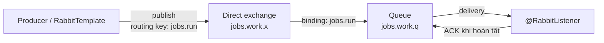
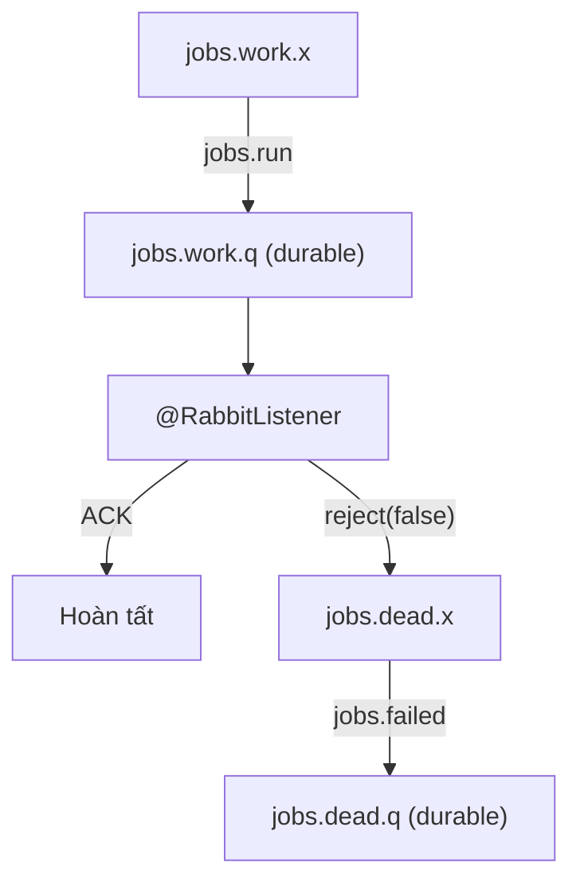

# Khai báo lại exchange, queue và binding khi cần

## 1. Tình huống: ứng dụng đã kết nối lại nhưng vẫn không nhận được message

Trong hệ thống dùng **Spring AMQP** và **RabbitMQ**, `RabbitTemplate` gửi message tới exchange; exchange dựa trên binding để định tuyến tới queue; `@RabbitListener` nhận và xử lý delivery từ queue. Khi broker khởi động lại hoặc kết nối mạng bị gián đoạn, ứng dụng có thể kết nối lại thành công nhưng vẫn gặp tình trạng:

- `@RabbitListener` liên tục báo **queue không tồn tại**.
- `RabbitTemplate` báo exchange không tồn tại, hoặc publish thành công nhưng message **không vào queue** do thiếu binding.
- Một queue tạm thời `exclusive`/`auto-delete` biến mất sau khi connection bị ngắt.
- Broker trả `PRECONDITION_FAILED` vì ứng dụng khai báo queue cùng tên nhưng thay đổi kiểu queue hoặc thuộc tính `x-message-ttl`.

Để phục hồi đúng, cần tách hai việc: **khôi phục kết nối/channel** và **khôi phục topology** (exchange, queue, binding). Trong Spring AMQP, `CachingConnectionFactory` hỗ trợ vòng đời kết nối; `RabbitAdmin` giúp khai báo các đối tượng hạ tầng phù hợp khi kết nối được thiết lập. Tuy nhiên, auto-declare chỉ áp dụng trong các điều kiện cụ thể và **không bảo đảm những message đã mất sẽ xuất hiện lại**.

Bài này thuộc chương **Phục hồi kết nối** của module `SPRING_AMQP`. Nội dung tập trung vào **khi nào cần khai báo lại exchange, queue và binding; cách Spring AMQP làm việc đó; trường hợp cần thao tác thủ công; và cách tránh thay đổi topology ngoài ý muốn khi hệ thống đang chạy**.

## 2. Định nghĩa topology và độ bền của từng thành phần

Một đường truyền tối thiểu:



Ba đối tượng cần khai báo có vai trò riêng:

| Đối tượng | Vai trò | Khi thiếu |
| --- | --- | --- |
| **Exchange** | Nhận publish và định tuyến theo loại exchange cùng routing key | Publish tới exchange chưa tồn tại thường bị broker từ chối và đóng channel |
| **Queue** | Lưu trữ message đã route cho tới khi được tiêu thụ/loại bỏ | Consumer không thể consume từ queue chưa tồn tại |
| **Binding** | Quy tắc nối exchange với queue hoặc exchange khác | Exchange tồn tại, queue tồn tại nhưng message không tới queue theo routing key mong muốn |

**Durable** là thuộc tính của exchange/queue: đối tượng được cấu hình để tồn tại qua broker restart. **Persistent** là thuộc tính delivery mode của message: hỗ trợ lưu message bền vững khi đi vào queue phù hợp. Chúng không thay thế nhau.

| Kiểu queue/exchange | Sau broker restart | Sau connection của client bị mất |
| --- | --- | --- |
| Durable exchange | Thông thường vẫn tồn tại | Vẫn tồn tại; không nhất thiết phải tạo lại |
| Durable, non-exclusive, non-auto-delete queue | Thông thường vẫn tồn tại | Vẫn tồn tại |
| Non-durable queue | Có thể bị xóa khi broker restart | Không tự biến mất chỉ vì một client ngắt nếu không có điều kiện khác |
| `exclusive=true` queue | Không dùng làm queue bền vững | Bị xóa khi **connection sở hữu** đóng hoặc mất |
| `auto-delete=true` queue | Không phải cơ chế bảo toàn lâu dài | Bị xóa sau khi đã có consumer và **consumer cuối** bị hủy; kết nối mất có thể kích hoạt |
| Binding | Phụ thuộc sự tồn tại của các đối tượng liên quan và trạng thái broker | Mất khi một endpoint bị xóa; cần tạo lại cùng queue/exchange |

Đặc biệt, **exchange và queue đều có thể tồn tại nhưng binding bị thiếu**. Không được kết luận topology đã phục hồi chỉ dựa vào kiểm tra queue có mặt trong Management UI.

### Khôi phục topology khác khôi phục message

Khai báo một queue cùng tên có thể tạo lại **đối tượng queue trống**; nó không mang những message từng nằm trong queue đã bị xóa trở về. Khi queue tạm thời bị xóa, các message còn lại trong queue đó thường cũng biến mất. Khi consumer mất kết nối trong lúc giữ delivery chưa ACK, broker có thể requeue message **nếu queue vẫn tồn tại**. Publisher confirm, consumer ACK, retry và idempotency vẫn cần được thiết kế riêng.

## 3. `RabbitAdmin` tự khai báo lại khi connection được thiết lập

Spring AMQP sử dụng `RabbitAdmin` (triển khai `AmqpAdmin`) để khai báo `Exchange`, `Queue`, `Binding` và các `Declarables` trong Spring `ApplicationContext`.

Với `CachingConnectionFactory` ở chế độ cache **`CHANNEL`** (mặc định), `RabbitAdmin`:

1. Đăng ký listener theo dõi việc tạo connection.
2. Khi connection đầu tiên tới broker được mở, tìm các hạ tầng cần khai báo trong context.
3. Gửi lệnh khai báo exchange, queue và binding tới broker.
4. Khi connection hỏng rồi được thiết lập lại, thực hiện việc khai báo lại những tài nguyên được quản lý phù hợp.

Quá trình này là **lazy**: bean `RabbitAdmin` tồn tại không có nghĩa lệnh khai báo đã được gửi khi broker vẫn chưa có kết nối. Trong Spring Boot có `spring-boot-starter-amqp`, cấu hình `spring.rabbitmq.dynamic=true` (mặc định) cho phép Boot tạo bean `AmqpAdmin` nếu phù hợp và chưa có bean do ứng dụng cung cấp.

```yaml
spring:
  rabbitmq:
    host: localhost
    port: 5672
    virtual-host: /
    dynamic: true
    listener:
      simple:
        acknowledge-mode: auto
```

> **Điều kiện quan trọng:** Spring AMQP tự khai báo theo cơ chế connection listener khi `CachingConnectionFactory` dùng `cacheMode=CHANNEL`. Nếu đổi sang cache mode `CONNECTION`, **không mặc nhiên kỳ vọng cơ chế auto-declare giống ví dụ này**. Cần xác minh cách quản lý topology cho cấu hình đó.

Spring AMQP đã có logic khôi phục connection/channel của mình. Không nên tự bật thêm cơ chế **automatic topology recovery của RabbitMQ Java client** chỉ để “chắc ăn”, vì hai cơ chế có thể chồng chéo. Với Spring Boot thông thường, hãy dùng `CachingConnectionFactory`, listener container và `RabbitAdmin` theo cơ chế do Spring quản lý.

### Khi RabbitAdmin **không** biết cần tạo gì?

```java
@RabbitListener(queues = "jobs.work.q")
public void receive(String jobId) {
    // Xử lý công việc
}
```

`@RabbitListener(queues = "...")` như trên chỉ **tham chiếu tên queue** để subscribe. Tên này **không tự tạo** các bean exchange, queue và binding trong context. Nếu broker chưa có queue hoặc chưa có binding, chỉ đặt tên queue trong annotation là chưa đủ.

Để `RabbitAdmin` chủ động quản lý topology, hãy **khai báo các bean hạ tầng** (hoặc dùng `@QueueBinding`/`queuesToDeclare` trong annotation khi phù hợp).

## 4. Ví dụ đầy đủ: một topology durable có thể khai báo lại

Giả sử hệ thống nhận yêu cầu tạo báo cáo. Producer dùng `jobs.work.x` với routing key `jobs.run`; listener đọc queue `jobs.work.q`. Khi message không thể xử lý và bị reject với `requeue=false`, nó có thể được dead-letter tới `jobs.dead.q`.

### 4.1. Khai báo bằng `Declarables`

```java
import org.springframework.amqp.core.BindingBuilder;
import org.springframework.amqp.core.Declarables;
import org.springframework.amqp.core.DirectExchange;
import org.springframework.amqp.core.Queue;
import org.springframework.amqp.core.QueueBuilder;
import org.springframework.context.annotation.Bean;
import org.springframework.context.annotation.Configuration;

@Configuration
public class JobsTopology {

    @Bean
    public Declarables jobsDeclarables() {
        DirectExchange workExchange =
                new DirectExchange("jobs.work.x", true, false);
        DirectExchange deadExchange =
                new DirectExchange("jobs.dead.x", true, false);

        Queue workQueue = QueueBuilder.durable("jobs.work.q")
                .deadLetterExchange("jobs.dead.x")
                .deadLetterRoutingKey("jobs.failed")
                .build();

        Queue deadQueue = QueueBuilder.durable("jobs.dead.q").build();

        return new Declarables(
                workExchange,
                deadExchange,
                workQueue,
                deadQueue,
                BindingBuilder.bind(workQueue)
                        .to(workExchange).with("jobs.run"),
                BindingBuilder.bind(deadQueue)
                        .to(deadExchange).with("jobs.failed")
        );
    }
}
```

`Declarables` cho phép đăng ký nhiều đối tượng AMQP trong một bean. Khi `RabbitAdmin` quét context, nó xử lý các đối tượng này và khai báo vào broker. Các exchange và queue trong ví dụ đều **durable**; khai báo lại cùng tên và cùng thuộc tính là thao tác an toàn về mặt khai báo topology.

Lộ trình:



Nếu đổi queue đang tồn tại từ **không có DLX** sang có `x-dead-letter-exchange`, RabbitMQ có thể báo lỗi không tương đương arguments. Đây là **thay đổi schema topology**, không phải một bước phục hồi kết nối thông thường. Nên cân nhắc RabbitMQ policies và kế hoạch migration thay vì ghi đè định nghĩa cũ một cách đột ngột.

### 4.2. Listener và producer

```java
import org.springframework.amqp.rabbit.annotation.RabbitListener;
import org.springframework.stereotype.Component;

@Component
public class JobsListener {

    @RabbitListener(queues = "jobs.work.q")
    public void handle(String jobId) {
        // Minh họa; triển khai thực tế cần lưu trạng thái nghiệp vụ
        // và có chiến lược idempotency theo jobId.
        System.out.println("Processing " + jobId);
    }
}
```

```java
import org.springframework.amqp.rabbit.core.RabbitTemplate;
import org.springframework.stereotype.Service;

@Service
public class JobsPublisher {
    private final RabbitTemplate rabbitTemplate;

    public JobsPublisher(RabbitTemplate rabbitTemplate) {
        this.rabbitTemplate = rabbitTemplate;
    }

    public void submit(String jobId) {
        rabbitTemplate.convertAndSend(
                "jobs.work.x", "jobs.run", jobId);
    }
}
```

Khi ứng dụng khởi động, connection được mở và `RabbitAdmin` có cơ hội khai báo topology trước/đồng thời với việc listener bắt đầu tiêu thụ. Nếu broker đang offline, ứng dụng có thể gặp lỗi khởi tạo listener hoặc publish; khi broker trở lại, cơ chế recovery/khai báo phụ thuộc trạng thái lifecycle và cấu hình container.

**Đừng hiểu thành bảo đảm gửi thành công:** Lệnh `convertAndSend(...)` trong ví dụ chỉ minh họa đường đi. Trong luồng quan trọng, cần cấu hình **publisher confirms**, `mandatory=true` và returned messages, xử lý kết quả publish không chắc chắn, đồng thời đặt `deliveryMode=PERSISTENT` cho message. Việc exchange/queue được khai báo lại **không gửi lại message mà producer chưa publish thành công**.

## 5. Ba kịch bản phục hồi khác nhau

### 5.1. Broker restart nhưng durable topology vẫn còn

Nếu broker restart bình thường và durable exchange/queue/binding vẫn được khôi phục từ metadata của broker, `RabbitAdmin` có thể gửi lại lệnh khai báo tương đương khi connection được lập lại. Broker thấy cùng tên/cùng thuộc tính và chấp nhận như thao tác idempotent.

```text
Trước restart:
  jobs.work.x ──jobs.run──> jobs.work.q

Broker restart:
  Kết nối cũ bị đóng; consumer tạm ngừng.

Sau restart:
  Broker nạp lại durable topology.
  CachingConnectionFactory tạo connection mới.
  RabbitAdmin khai báo topology đã định nghĩa trong Spring context.
  Listener container khôi phục consumer khi sẵn sàng.
```

Trong trường hợp này, **không cần xóa queue rồi tạo mới**. Xóa queue để “sửa lỗi” có thể xóa dữ liệu đang chờ.

### 5.2. Queue `exclusive`/`auto-delete` bị xóa

Giả sử một instance tạo queue nhận tín hiệu tạm thời, queue thuộc connection của nó. Khi connection mất, broker xóa queue và các binding đi kèm. Sau khi reconnect, chỉ khôi phục connection là **không đủ**: queue cần được tạo lại và binding phải có lại.

`RabbitAdmin` có thể làm việc này nếu queue và binding nằm trong các bean `Declarable` thuộc context. Với queue tạm thời, **`AnonymousQueue`** thường thuận tiện vì Spring đặt tên duy nhất tại thời điểm tạo bean và giữ tên đó trong vòng đời ứng dụng, giúp khôi phục sau reconnect mà không phải cập nhật mọi tham chiếu.

### 5.3. Queue bị xóa trong khi connection vẫn còn

Không phải lần nào queue biến mất cũng có một **connection mới**. Một quản trị viên có thể xóa queue bằng Management UI hoặc script trong khi ứng dụng vẫn kết nối.

`RabbitAdmin` không phải bộ giám sát liên tục mọi queue trên broker. Nếu không có sự kiện tạo connection mới, đừng kỳ vọng nó tự phát hiện và khôi phục ngay mọi topology vừa bị xóa. Listener container có một số cơ chế kiểm tra queue thiếu và khai báo lại khi khởi tạo/khôi phục consumer, nhưng điều đó phụ thuộc cấu hình, `RabbitAdmin` được chọn và trạng thái queue.

Khi cần can thiệp chủ động, có thể gọi `RabbitAdmin.initialize()` để khai báo lại những bean được admin quản lý (xem mục 7). Trước đó phải xác định **tại sao topology bị xóa**: nếu do deploy thay đổi hạ tầng có chủ đích, việc tự tạo lại có thể trái với kế hoạch migration.

## 6. Ví dụ queue tạm thời: `AnonymousQueue` và binding

Một instance cần nhận broadcast thông báo cấu hình nội bộ. Mỗi instance muốn một queue riêng và không yêu cầu giữ message khi instance đã ngừng.

```java
import org.springframework.amqp.core.AnonymousQueue;
import org.springframework.amqp.core.Binding;
import org.springframework.amqp.core.BindingBuilder;
import org.springframework.amqp.core.FanoutExchange;
import org.springframework.context.annotation.Bean;
import org.springframework.context.annotation.Configuration;

@Configuration
public class InstanceSignalTopology {

    @Bean
    public FanoutExchange instanceSignalExchange() {
        return new FanoutExchange("instances.signals.x", true, false);
    }

    @Bean
    public AnonymousQueue instanceSignalQueue() {
        return new AnonymousQueue();
    }

    @Bean
    public Binding instanceSignalBinding(
            AnonymousQueue instanceSignalQueue,
            FanoutExchange instanceSignalExchange) {
        return BindingBuilder.bind(instanceSignalQueue)
                .to(instanceSignalExchange);
    }
}
```

`AnonymousQueue` mặc định **non-durable, exclusive, auto-delete**, với tên được Spring tạo ra dạng `spring.gen-...`. Nếu application context vẫn sống và kết nối được thiết lập lại, `RabbitAdmin` có thể khai báo queue cùng tên cùng binding. Nếu application context **được tạo mới sau restart process**, một tên queue mới thường được sinh ra; đây là điều phù hợp cho hàng đợi tạm thời.

Nếu muốn listener tham chiếu bean này thay vì hard-code tên:

```java
import org.springframework.amqp.rabbit.annotation.RabbitListener;
import org.springframework.stereotype.Component;

@Component
public class InstanceSignalListener {
    @RabbitListener(queues = "#{instanceSignalQueue.name}")
    public void receive(String payload) {
        System.out.println("Signal: " + payload);
    }
}
```

Spring Expression Language lấy tên thực tế từ bean `instanceSignalQueue`. Đây là cách giúp listener sử dụng cùng tên queue mà `RabbitAdmin` khai báo. Đừng dùng queue `exclusive` để làm **work queue chung** cho nhiều instance: connection khác có thể bị từ chối truy cập với lỗi `RESOURCE_LOCKED`, và dữ liệu trong queue sẽ không được giữ khi connection sở hữu bị mất.

### `auto-delete` và `x-expires` không phải một

- `auto-delete=true`: queue thường bị xóa khi **consumer cuối rời đi** sau khi queue đã có ít nhất một consumer.
- `x-expires`: queue có thời gian hết hạn theo trạng thái **không sử dụng**, thường dùng để thu dọn các queue tạm.
- `x-message-ttl`: giới hạn thời gian sống của **message** nằm trong queue, không tự động xóa queue.

Đổi tùy tiện các argument của queue đã tồn tại có thể dẫn tới lỗi declare mismatch. Với topology động, nên thống nhất ai sở hữu tài nguyên và thời điểm xóa chúng.

## 7. Khi nào gọi `RabbitAdmin` thủ công?

Khai báo bean trong Spring context phù hợp với topology tương đối ổn định. Một số hệ thống phải khai báo queue ở runtime, ví dụ tạo queue tạm riêng cho một tenant. Lúc đó `AmqpAdmin` cung cấp các API trực tiếp:

```java
import org.springframework.amqp.core.AmqpAdmin;
import org.springframework.amqp.core.BindingBuilder;
import org.springframework.amqp.core.DirectExchange;
import org.springframework.amqp.core.Queue;
import org.springframework.amqp.core.QueueBuilder;
import org.springframework.stereotype.Service;

@Service
public class TenantTopologyService {
    private final AmqpAdmin admin;

    public TenantTopologyService(AmqpAdmin admin) {
        this.admin = admin;
    }

    public void declareTenantQueue(String tenantId) {
        // Chỉ chấp nhận các tenantId đã được xác thực và chuẩn hóa.
        if (!tenantId.matches("[a-zA-Z0-9_-]{1,32}")) {
            throw new IllegalArgumentException("Invalid tenantId");
        }

        String exchangeName = "tenant.jobs.x";
        String queueName = "tenant." + tenantId + ".jobs.q";
        String routingKey = "tenant." + tenantId + ".run";

        DirectExchange exchange =
                new DirectExchange(exchangeName, true, false);
        Queue queue = QueueBuilder.durable(queueName).build();

        admin.declareExchange(exchange);
        admin.declareQueue(queue);
        admin.declareBinding(
                BindingBuilder.bind(queue).to(exchange).with(routingKey));
    }
}
```

Đoạn mã trên **tạo hạ tầng ngay trên broker tại thời điểm gọi**. Nếu ứng dụng chỉ tạo một lần bằng các lệnh `admin.declare...` rồi sau đó connection bị ngắt, **mặc định `RabbitAdmin` chỉ khai báo lại các đối tượng có bean trong Spring context**; tài nguyên chỉ được khai báo thủ công thường **không tự được đăng ký để recover**.

Kể từ Spring AMQP 2.4, `RabbitAdmin` cung cấp tùy chọn:

```java
import org.springframework.amqp.rabbit.connection.ConnectionFactory;
import org.springframework.amqp.rabbit.core.RabbitAdmin;
import org.springframework.context.annotation.Bean;
import org.springframework.context.annotation.Configuration;

@Configuration
public class RabbitAdminConfiguration {

    @Bean
    public RabbitAdmin rabbitAdmin(ConnectionFactory connectionFactory) {
        RabbitAdmin admin = new RabbitAdmin(connectionFactory);
        admin.setRedeclareManualDeclarations(true);
        return admin;
    }
}
```

Khi `setRedeclareManualDeclarations(true)`, admin **theo dõi thêm các `Declarable` đã khai báo bằng API của chính admin đó** để khai báo lại khi connection được khôi phục. Phải dùng **cùng RabbitAdmin bean** cho các lệnh manual. Nếu ứng dụng đã có `RabbitAdmin` khác, cần xác định rõ bean nào được injection, tránh nhiều admin cùng quản lý hạ tầng ngoài ý muốn.

> **Đừng lạm dụng:** Lưu tất cả queue động trong bộ nhớ admin qua nhiều năm có thể khiến danh sách declarations tăng lớn. Queue tenant dài hạn thường hợp lý hơn khi quản lý bằng một registry/database hoặc hạ tầng provisioning riêng. Cần xóa declaration khỏi cơ chế khôi phục khi hạ tầng đã được hủy có chủ đích.

### Gọi lại các khai báo của bean bằng `initialize()`

Nếu cần khởi tạo lại topology từ danh sách bean đã cấu hình, có thể dùng:

```java
import org.springframework.amqp.rabbit.core.RabbitAdmin;
import org.springframework.stereotype.Service;

@Service
public class TopologyRepairService {
    private final RabbitAdmin admin;

    public TopologyRepairService(RabbitAdmin admin) {
        this.admin = admin;
    }

    public void repairManagedTopology() {
        admin.initialize();
    }
}
```

`initialize()` gửi lại các declaration mà admin quản lý tại thời điểm đó; nó không tự tạo lại message đã bị xóa, không bỏ qua kiểm tra sự tương đương thuộc tính của broker và không sửa được lỗi thiếu quyền. Chỉ nên gọi sau khi hiểu lý do topology bị mất; không gọi vô hạn trong một loop tạo tải lên broker.

Trong trường hợp có **nhiều connection factory**, **nhiều virtual host** hoặc **nhiều RabbitAdmin**, cần khai báo rõ admin nào có quyền quản lý đối tượng nào. Các đối tượng `Declarable` cho phép chỉ định admin được phép declare (`setAdminsThatShouldDeclare(...)`) hoặc tắt declaration tự động (`setShouldDeclare(false)`). Admin cũng có `explicitDeclarationsOnly` để chỉ quản lý những bean đã được chỉ định rõ. Đây là vấn đề sở hữu topology, không phải cơ chế retry message.

## 8. Thay đổi topology không phải phục hồi kết nối

Khai báo `queue.declare` hoặc `exchange.declare` với tên đã tồn tại **không có nghĩa broker ghi đè cấu hình cũ**. RabbitMQ kiểm tra sự tương đương thuộc tính:

```text
Lần deploy trước:
  queue jobs.work.q
  durable=true
  x-message-ttl: (không có)

Deploy mới:
  queue jobs.work.q
  durable=true
  x-message-ttl=60000

Kết quả có thể:
  channel error 406 PRECONDITION_FAILED
  inequivalent arg 'x-message-ttl' for queue 'jobs.work.q'
```

Một số thuộc tính dễ gây sai khác:

| Thuộc tính | Ví dụ thay đổi | Cách xử lý |
| --- | --- | --- |
| `durable`, `autoDelete`, `exclusive` | Từ queue durable sang exclusive cùng tên | Tạo tài nguyên mới hoặc migration có kiểm soát |
| `x-queue-type` | Từ classic sang quorum | Lập kế hoạch chuyển queue; không coi là restart repair |
| `x-message-ttl` hoặc `x-max-length` | Thêm/chỉnh giới hạn lưu message | Ưu tiên RabbitMQ policy nơi phù hợp; kiểm tra equivalence |
| DLX/routing key | Thêm `x-dead-letter-exchange` | Dùng policy hoặc migration, kiểm tra tác động tới message đang chờ |
| Exchange `type`/durability | Đổi direct sang topic cùng tên | Thay exchange với kế hoạch chuyển đổi phù hợp |
| Virtual host/permissions | Ứng dụng trỏ sang vhost khác | Khai báo đúng vhost và quyền; không xóa nhầm tài nguyên cũ |

Nếu `RabbitAdmin` gặp lỗi khai báo, mặc định nó có thể **ngừng phần khai báo tiếp theo**, khiến những queue phía sau cũng chưa được tạo. `RabbitAdmin#setIgnoreDeclarationExceptions(true)` hoặc tùy chọn tương ứng trên `Declarable` cho phép ghi log và tiếp tục, nhưng **không giải quyết mismatch**. Trong môi trường cần bảo đảm topology nhất quán, nên **để lỗi rõ ràng** và sửa cấu hình/hạ tầng thay vì bật ignore toàn cục để che sự cố.

Spring AMQP còn phát `DeclarationExceptionEvent` khi khai báo thất bại. Có thể dùng event này để ghi metric, cảnh báo và đối chiếu lỗi, nhưng không nên để ứng dụng tự xóa queue ngay khi thấy exception.

## 9. Không phải mọi “missing queue” đều do RabbitMQ chưa chạy

Khi listener không tìm thấy queue, hãy phân loại nguyên nhân trước:

| Triệu chứng | Khả năng | Xác minh |
| --- | --- | --- |
| `NOT_FOUND - no queue` | Chưa tạo queue; tạo trên sai virtual host; queue bị xóa | Kiểm tra vhost, danh sách queues và khai báo bean |
| `NOT_FOUND - no exchange` khi publish | Exchange chưa khai báo hoặc sai tên/vhost | Kiểm tra exchange và đường publish |
| Message không đến queue dù publish có thể được confirm | Sai/mất binding hoặc routing key | Kiểm tra exchange type, binding và `mandatory`/returns |
| `PRECONDITION_FAILED - inequivalent arg` | Queue/exchange hiện hữu có thuộc tính khác | So sánh định nghĩa trước/sau; chuẩn bị migration |
| `RESOURCE_LOCKED` | Một connection khác đang sở hữu exclusive queue | Kiểm tra `exclusive`, owner connection và tên queue |
| `ACCESS_REFUSED` / `403` | User RabbitMQ không có quyền configure/read/write hoặc vhost không đúng | Kiểm tra permissions của user và vhost |
| Reconnect lặp lại nhưng không có declarations | Không có `RabbitAdmin`, `dynamic=false`, bean không thuộc context, hoặc cache mode khác | Kiểm tra `AmqpAdmin` bean, cache mode và ownership |
| Queue tạo bằng `admin.declareQueue(...)` không phục hồi | Manual declaration không được theo dõi mặc định | Đưa vào bean managed hoặc cấu hình `redeclareManualDeclarations` |
| Queue đã trở lại nhưng message cũ không có | Queue tạm đã bị xóa hoặc message chưa được publish bền vững | Đối chiếu tuổi thọ queue, confirm và journal/log producer |

### Thứ tự kiểm tra khi điều tra

1. Xác nhận ứng dụng đang kết nối đúng **host, port, virtual host và RabbitMQ user**.
2. Kiểm tra `jobs.work.x`, `jobs.work.q` và binding `jobs.run` đều tồn tại **trong cùng vhost**.
3. Kiểm tra cấu hình thuộc tính queue/exchange với các bean đang deploy.
4. Xác nhận ứng dụng có `RabbitAdmin`, dùng `CachingConnectionFactory` phù hợp và có connection mới sau sự cố.
5. Kiểm tra log/event `DeclarationExceptionEvent`, lỗi `404 NOT_FOUND`, `403 ACCESS_REFUSED`, `406 PRECONDITION_FAILED`.
6. Chỉ khi rõ nguyên nhân mới chủ động `initialize()` hoặc khởi động lại listener; không xóa queue để thử ngẫu nhiên.

Nếu queue được quản lý bằng **IaC** (Terraform/operator/Helm/definitions import), hãy xác định nguồn cấu hình có thẩm quyền. Việc để Spring AMQP và công cụ IaC khai báo cùng một tên với thuộc tính khác nhau sẽ tạo ra lỗi tái diễn mỗi lần reconnect.

## 10. Listener container và việc khôi phục queue thiếu

Spring AMQP listener container có thể thử khởi tạo lại consumer khi kết nối bị mất. Ngoài ra, với một số queue tạm hoặc `auto-delete`, container có thể dùng `RabbitAdmin` khi **container khởi động** để khai báo lại queue thiếu. Cơ chế này khác với callback khai báo khi tạo connection.

Ví dụ cấu hình dành cho hệ thống có broker có thể khởi động chậm:

```yaml
spring:
  rabbitmq:
    listener:
      simple:
        missing-queues-fatal: false
```

Đặt `missing-queues-fatal=false` cho phép listener container **tiếp tục thử phục hồi** trong các tình huống queue chưa sẵn sàng thay vì coi queue thiếu là lỗi fatal ngay. Đây không phải chức năng tạo hạ tầng hoàn chỉnh: nếu **không có định nghĩa queue/binding** hoặc broker từ chối do permissions/mismatch, việc thử mãi chỉ lặp lại lỗi.

Trong cấu hình phức tạp có nhiều RabbitAdmin, listener container có thể cần **chỉ định admin đúng** để thực hiện khai báo lại queue tạm. Cần xem `autoDeclare`, `missingQueuesFatal` và các thuộc tính backoff/retry declaration của loại container đang dùng (`SimpleRabbitListenerContainer` hay `DirectMessageListenerContainer`) theo phiên bản Spring AMQP.

### Khi nào nên để hệ thống tự phục hồi?

**Hợp lý** khi broker tạm offline, kết nối được khôi phục, topology do ứng dụng quản lý và khai báo lại là tương đương.

**Cần can thiệp vận hành** khi queue đang có lỗi cấu hình, thiếu quyền, khác loại queue, thay đổi routing có chủ đích hoặc hệ thống đổi nguồn quản lý topology. Tự retry không thể biến một declaration sai thành hợp lệ.

## 11. Bài thực hành: quan sát khai báo lại sau sự cố

Chuẩn bị RabbitMQ (có management plugin nếu muốn quan sát UI), ứng dụng Spring Boot với `spring-boot-starter-amqp`, `JobsTopology`, `JobsListener`, `JobsPublisher` và các quyền RabbitMQ đủ để khai báo exchange, queue và binding.

**Bài A — Khởi chạy lần đầu**

1. Khởi động broker rồi ứng dụng.
2. Đợi ứng dụng mở connection. Mở Management UI, tìm `jobs.work.x`, `jobs.work.q`, `jobs.dead.x`, `jobs.dead.q`.
3. Xác nhận binding `jobs.work.x --jobs.run--> jobs.work.q` và `jobs.dead.x --jobs.failed--> jobs.dead.q`.
4. Gọi `jobsPublisher.submit("job-42")`; quan sát listener nhận và ACK.

**Bài B — Broker restart**

1. Giữ ứng dụng đang chạy, restart broker.
2. Quan sát log connection fail/reconnect và việc listener khôi phục consumer.
3. Kiểm tra durable topology còn đúng sau restart; gửi thêm `job-43`.
4. Nếu publish trong lúc mất kết nối, xử lý exception và kiểm tra kết quả publish trước khi retry, vì việc gọi lại có thể tạo duplicate khi xác nhận bị thất lạc.

**Bài C — Queue tạm bị xóa**

1. Bổ sung cấu hình `InstanceSignalTopology` cùng listener, khởi chạy ứng dụng.
2. Ghi lại tên `spring.gen-...` của queue tạm và binding.
3. Ngắt connection đang sở hữu queue rồi để Spring tạo connection mới.
4. Xác nhận queue tạm cùng tên được khai báo lại **khi application context vẫn còn sống**; kiểm tra binding `instances.signals.x` trở lại.
5. Restart hẳn process: một `AnonymousQueue` mới thường có tên khác, và không mang theo message cũ.

**Bài D — Queue bị xóa khi connection còn sống**

1. Trên môi trường thử nghiệm riêng, tạm dừng consumer rồi xóa **queue thử nghiệm không có dữ liệu cần giữ**.
2. Quan sát việc listener kiểm tra queue thiếu và khả năng khai báo lại khi container restart.
3. Nếu cần, dùng `TopologyRepairService.repairManagedTopology()` để gọi `RabbitAdmin.initialize()`, sau đó kiểm tra lại cả **queue và binding**.
4. Gửi một message mới và xác nhận đi đúng tuyến. Việc tạo lại queue không phục hồi các message đã bị xóa cùng queue.

**Bài E — Mismatch để hiểu `PRECONDITION_FAILED`**

1. Tạo `jobs.work.q` với TTL khác trong môi trường thử nghiệm.
2. Triển khai cấu hình Spring định nghĩa cùng tên nhưng giá trị TTL không tương đương.
3. Quan sát broker từ chối declaration và channel bị đóng.
4. Khôi phục **định nghĩa đúng hoặc dùng quy trình migration**, không xóa queue có dữ liệu chỉ để hết lỗi.

### Kiểm tra bằng CLI trên môi trường thử nghiệm

Nếu có quyền dùng RabbitMQ CLI trong container/broker:

```bash
rabbitmqctl list_queues -p / name durable auto_delete exclusive messages consumers
rabbitmqctl list_exchanges -p / name type durable auto_delete
rabbitmqctl list_bindings -p / source_name destination_name routing_key
```

Các lệnh này **đọc trạng thái broker**; chúng không tạo hoặc xóa queue. Với broker chạy trong Docker, cần thực hiện trong container RabbitMQ hoặc dùng giao diện quản trị tương ứng.

Theo dõi thêm số connection/channel, số consumer, `messages_ready`, `messages_unacknowledged`, log khai báo thất bại và tỷ lệ publisher return. Một topology được khai báo đủ vẫn có thể không hoạt động nếu không có consumer hoặc ứng dụng publish sai routing key.

## 12. Checklist khi đưa vào môi trường thật

| Quyết định | Kiểm tra cần làm |
| --- | --- |
| Ai sở hữu topology? | Chọn Spring `RabbitAdmin`, broker definitions hoặc IaC làm nguồn sự thật; tránh các định nghĩa mâu thuẫn |
| Queue có cần giữ dữ liệu khi restart? | Dùng durable queue/exchange; đặt message persistent và quản lý publisher confirm phù hợp |
| Queue có gắn với một instance không? | Cân nhắc `AnonymousQueue` nếu cần queue tạm; không áp dụng cho work queue chia sẻ |
| Có nhiều application instance không? | Thống nhất cùng định nghĩa queue; không dùng cùng tên exclusive queue giữa các connection |
| Có nhiều broker/vhost không? | Chọn đúng connection factory/admin và quyền quản lý từng nhóm `Declarable` |
| Có manual declarations không? | Bảo đảm re-declare bằng config hoặc bật `redeclareManualDeclarations` trên **cùng admin** |
| Có thay đổi TTL, DLX, queue type không? | Thiết kế migration/policy; không dựa vào tự khai báo lại để sửa mismatch |
| Có thể mất connection khi publish không? | Bắt exception, publisher confirm/return, retry có backoff và idempotency |
| Consumer có thể mất ACK không? | Kiểm tra duplicate/redelivery, ACK sau commit nghiệp vụ, DLQ khi hết retry |
| Phục hồi có được giám sát không? | Metric, log và cảnh báo cho declaration failure, topology thiếu, reconnect kéo dài |

## 13. Các hiểu nhầm thường gặp

1. **“Kết nối lại thành công nghĩa là exchange, queue và binding đã tồn tại.”** Không chắc: topology có thể đã bị xóa hoặc thiếu một binding.
2. **“Durable queue phải luôn được tạo mới sau broker restart.”** Không: durable queue thường tồn tại qua restart; khai báo lại tương đương nhằm đối chiếu topology, không phải yêu cầu xóa rồi tạo.
3. **“`@RabbitListener(queues = "...")` tự tạo queue.”** Không: annotation chỉ tham chiếu queue; muốn tự tạo phải có bean/`@QueueBinding`/`queuesToDeclare` hoặc cơ chế provisioning.
4. **“Mọi đối tượng tạo bằng `admin.declare...` đều được phục hồi mặc định.”** Không: manual declarations cần cơ chế theo dõi riêng hoặc được khai báo như bean.
5. **“Queue tạm được khôi phục thì message cũ cũng khôi phục.”** Không: queue bị xóa là mất nội dung của chính nó.
6. **“Cứ bật `ignoreDeclarationExceptions` thì RabbitMQ sẽ nhận cấu hình mới.”** Không: mismatch vẫn tồn tại và có thể bị che bởi log.
7. **“Không có binding thì publisher luôn báo lỗi.”** Không: một publish có thể được broker confirm dù không có queue nhận; cần `mandatory` và returned message khi muốn phát hiện unroutable.
8. **“`RabbitAdmin.initialize()` sửa được cả lỗi permissions và queue type.”** Không: nó gửi lệnh khai báo; broker vẫn kiểm tra quyền và sự tương đương thuộc tính.
9. **“Bật thêm auto-recovery của RabbitMQ Java client chắc chắn tốt hơn.”** Không: Spring đã có cơ chế recovery riêng; cấu hình trùng cần được đánh giá cẩn thận.
10. **“Khai báo lại exchange/queue là cách đảm bảo exactly-once.”** Không: xử lý delivery còn cần ACK, retry, DLQ và idempotency ở tầng nghiệp vụ.

## 14. Câu hỏi tự kiểm tra

1. Hãy phân biệt **khôi phục connection** và **khôi phục topology** sau khi RabbitMQ restart. `CachingConnectionFactory` và `RabbitAdmin` có vai trò gì?
2. Một durable queue có thể tồn tại qua broker restart nhưng consumer vẫn báo lỗi. Bạn cần kiểm tra những thành phần nào ngoài queue?
3. Vì sao `@RabbitListener(queues = "jobs.work.q")` không đủ để tạo exchange, queue và binding?
4. `RabbitAdmin` tự khai báo bean vào thời điểm nào? Cache mode nào của `CachingConnectionFactory` hỗ trợ cơ chế lazy auto-declaration này?
5. Khi mất connection, `AnonymousQueue` khác durable queue về vòng đời và dữ liệu như thế nào?
6. Một queue được tạo ở runtime qua `AmqpAdmin.declareQueue(...)` cần điều kiện gì để được `RabbitAdmin` khai báo lại sau reconnect?
7. Trong tình huống queue còn tồn tại nhưng binding bị thiếu, publisher confirm có đủ để khẳng định consumer sẽ nhận message không?
8. Vì sao thay `x-message-ttl` trong code có thể khiến broker báo `PRECONDITION_FAILED`? Nên sửa bằng migration hoặc policy ra sao?
9. Khi queue bị xóa trong lúc connection vẫn hoạt động, vì sao không thể chắc rằng `RabbitAdmin` lập tức khôi phục nó? Khi nào cân nhắc gọi `initialize()`?
10. Hãy lập kế hoạch kiểm thử lần lượt: mất broker, mất connection của queue tạm, thiếu binding, mismatch arguments và thiếu quyền configure.

**Ghi nhớ:** Khai báo lại exchange, queue và binding là **khôi phục topology**, không phải phục hồi message hay đảm bảo transaction. Với Spring AMQP, cách thuận tiện nhất là để `RabbitAdmin` quản lý các bean `Declarable` và khai báo lại khi kết nối được tái lập. Cần đặc biệt chú ý queue tạm, declaration tạo thủ công, sự tương đương thuộc tính, quyền RabbitMQ và việc kiểm tra **đầy đủ exchange → binding → queue** sau sự cố.

### Tài liệu tham khảo chính thức

- [Spring AMQP — Resilience: Recovering from Errors and Broker Failures](https://docs.spring.io/spring-amqp/reference/amqp/resilience-recovering-from-errors-and-broker-failures.html): kết nối lại và auto-declaration.
- [Spring AMQP — Configuring the Broker](https://docs.spring.io/spring-amqp/reference/amqp/broker-configuration.html): `RabbitAdmin`, `Declarables`, manual declaration, conditional declaration, mismatch và `redeclareManualDeclarations`.
- [Spring AMQP — Connection and Resource Management](https://docs.spring.io/spring-amqp/reference/amqp/connections.html): quan hệ giữa `CachingConnectionFactory` và recovery của Java client.
- [Spring AMQP — Asynchronous Consumer](https://docs.spring.io/spring-amqp/reference/amqp/receiving-messages/async-consumer.html): xử lý queue thiếu và `auto-delete` khi listener container khởi động.
- [RabbitMQ — Queues](https://www.rabbitmq.com/docs/queues): durable, exclusive, auto-delete, arguments và `PRECONDITION_FAILED`.
- [RabbitMQ — AMQP Concepts](https://www.rabbitmq.com/tutorials/amqp-concepts): exchange, queue, binding và quy tắc khai báo.
