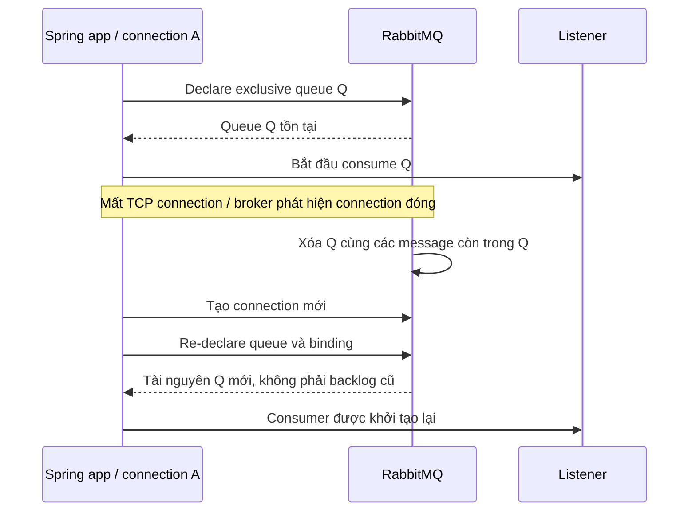
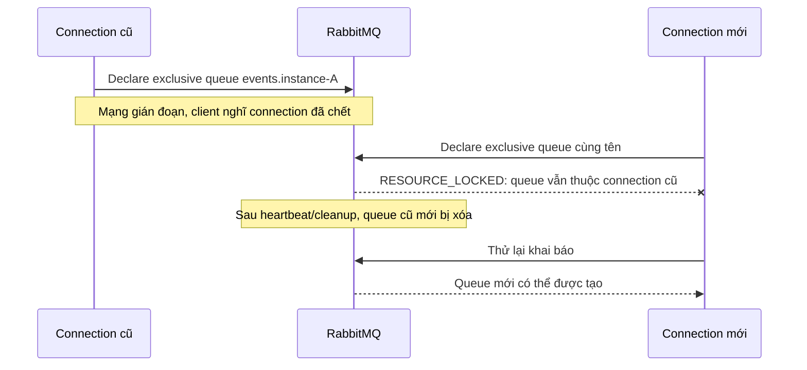
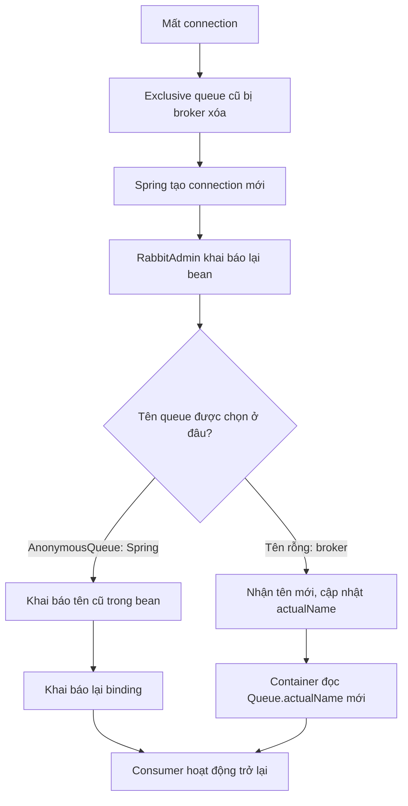

# Exclusive queue, AnonymousQueue và thay đổi tên sau phục hồi

> **Chương:** Phục hồi kết nối  
> **Công nghệ:** Spring AMQP, RabbitMQ  
> **Trọng tâm:** Vòng đời của queue độc quyền theo connection, cơ chế đặt tên của `AnonymousQueue`, sự khác biệt với queue **do broker tự đặt tên**, và cách cập nhật listener/binding khi kết nối được tái lập.

## 1. Tình huống: ứng dụng đã kết nối lại nhưng không nhận được message

Một dịch vụ Spring Boot dùng `RabbitTemplate` phát sự kiện qua RabbitMQ; mỗi instance tạo một queue tạm để `@RabbitListener` nhận những sự kiện dành riêng cho instance đó. Sau một lần broker restart hoặc đứt mạng, ứng dụng báo đã kết nối lại nhưng listener không nhận được dữ liệu. Quan sát RabbitMQ Management UI thấy queue cũ không còn tồn tại, hoặc xuất hiện queue mới với tên khác.

Vấn đề có thể nằm ở **vòng đời của exclusive queue**, ở **nguồn sinh tên queue**, hoặc ở việc **listener đang theo dõi tên cũ**. Spring AMQP có các cơ chế phục hồi connection, channel và topology, nhưng phải hiểu rõ chúng *không đồng nghĩa* một queue tạm đã bị broker xóa sẽ giữ lại các message cũ.

Sau bài này, bạn sẽ:

- Phân biệt `exclusive`, `autoDelete`, `durable` và trường hợp queue bị xóa khi connection đóng.
- Hiểu vì sao `AnonymousQueue` của Spring AMQP **không giống** một queue có tên sinh tại broker.
- Giải thích khi nào tên queue được giữ nguyên, khi nào đổi sau reconnect, và vai trò của `Queue.getActualName()`.
- Cấu hình `RabbitAdmin`, `@RabbitListener`, `SimpleMessageListenerContainer` và các binding phù hợp cho từng kiểu queue.
- Chẩn đoán `RESOURCE_LOCKED`, `NOT_FOUND`, lỗi race khi khôi phục, cũng như giới hạn về mất message và replay.

## 2. Hiểu đúng `exclusive`, `autoDelete` và `durable`

RabbitMQ phân biệt ba thuộc tính này; chúng có liên quan nhưng **không đồng nghĩa**:

| Thuộc tính | Ý nghĩa | Sự kiện ảnh hưởng |
| --- | --- | --- |
| `exclusive=true` | Queue thuộc về **connection đã khai báo** và chỉ connection đó có quyền truy cập theo quy tắc exclusive của RabbitMQ. | Khi connection sở hữu đóng hoặc mất hẳn, broker xóa queue. |
| `autoDelete=true` | Queue được xóa khi **consumer cuối cùng** hủy đăng ký hoặc biến mất, **sau khi queue đã từng có consumer**. | Không phải cơ chế xóa ngay lập tức chỉ vì chưa có consumer nào từ lúc tạo. |
| `durable=true` | Định nghĩa queue được thiết kế để tồn tại sau broker restart trong các điều kiện hỗ trợ. | Không có nghĩa message luôn được lưu bền vững; còn phụ thuộc delivery mode và loại queue. |

**`exclusive` ràng buộc theo connection, không phải theo channel, thread, bean hay tên ứng dụng.** Hai channel cùng dùng một RabbitMQ connection có thể truy cập queue đó; một connection độc lập của cùng ứng dụng không mặc nhiên có quyền truy cập. Nếu connection khác cố consume/purge queue đang bị khóa, broker có thể trả lỗi `RESOURCE_LOCKED` (AMQP reply code **405**).

Một exclusive queue là tài nguyên tạm gắn với connection, nên cấu hình hợp lý thường là:

```java
new Queue("temp.events", false, true, true);
// name = "temp.events"; durable=false; exclusive=true; autoDelete=true
```

Đây chỉ là minh họa constructor `Queue(name, durable, exclusive, autoDelete)`, **không phải cấu hình nên dùng với tên cố định `temp.events` trong production**. Tên cố định cho exclusive queue dễ gây tranh chấp/race lúc phục hồi.

Không nên cố tạo exclusive quorum queue hoặc giả định `exclusive + durable` sẽ giữ dữ liệu sau khi mất connection. Exclusive queue trong RabbitMQ là queue tạm, không phù hợp cho các tác vụ đòi hỏi backlog bền vững, chia sẻ bởi nhiều instance hoặc còn message sau reconnect.

### 2.1. Mất mạng không chỉ là “consumer tạm dừng”



Nếu connection chỉ gián đoạn ngắn nhưng broker **chưa kết luận connection đã đóng**, thời điểm xóa có thể phụ thuộc heartbeat, network và trạng thái broker. Khi broker đã xóa exclusive queue, phục hồi chỉ có thể **tạo queue mới** và đăng ký consumer lại; những message chỉ tồn tại trong queue cũ **không tự xuất hiện lại**.

## 3. Ba kiểu tên thường bị nhầm lẫn

Giả sử muốn tạo queue tạm độc quyền cho một instance:

| Cách khai báo | Ai chọn tên? | Tên lúc mới tạo | Sau mất connection rồi khai báo lại | Khi app restart |
| --- | --- | --- | --- | --- |
| `new Queue("orders.instance-1", false, true, true)` | Lập trình viên chọn tên tĩnh | `orders.instance-1` | Cố dùng **cùng tên**, có thể đụng queue cũ/chủ sở hữu khác. | Vẫn cùng tên nếu cấu hình không đổi. |
| `new AnonymousQueue()` | **Spring AMQP sinh tên tại phía ứng dụng** lúc tạo bean | Ví dụ `spring.gen-A1b2...` | `RabbitAdmin` dùng lại **cùng tên trong vòng đời bean**, nếu cấu hình tự khai báo phù hợp. | Bean mới thường có tên ngẫu nhiên **mới**. |
| `new Queue("", false, true, true)` | **RabbitMQ broker sinh tên** lúc `queue.declare` | Ví dụ `amq.gen-XYZ...`, phản ánh trong `actualName` | Broker thường trả **một tên mới**; `Queue.actualName` được cập nhật. | Lại sinh tên mới. |

**Điểm dễ sai nhất:** `AnonymousQueue` trong Spring AMQP **không phải** server-named queue. Tên của nó được Spring sinh **trước khi kết nối broker** và lưu trong bean `AnonymousQueue`. Khi connection mất, bean vẫn còn trong JVM, nên `RabbitAdmin` có thể tái khai báo queue **với chính tên ấy**. Ngược lại, khi truyền chuỗi rỗng `""` cho tên queue, broker chọn tên ở mỗi lần khai báo mới.

Tên mặc định của `AnonymousQueue` có tiền tố `spring.gen-` và phần ngẫu nhiên theo UUID được mã hóa Base64 URL-safe. Tên do broker sinh thường có tiền tố `amq.gen-`. **Đừng dùng tiền tố làm phép kiểm tra duy nhất**: cách đáng tin hơn là xem code tạo `Queue` và phân biệt `getName()`/`getActualName()`.

### 3.1. Minh họa tên theo dòng thời gian

```text
Thời điểm               AnonymousQueue của Spring           Queue có name="" do broker đặt
------------------------------------------------------------------------------------------------
T0: ứng dụng tạo bean    name=spring.gen-Fx7...               name="", actualName chưa có
T1: broker declare       spring.gen-Fx7...                     actualName=amq.gen-Q1...
T2: mất connection       queue vật lý bị xóa                 queue vật lý bị xóa
T3: kết nối mới          declare lại spring.gen-Fx7...       declare với name="" lần nữa
T4: declare thành công   tên vẫn spring.gen-Fx7...          actualName=amq.gen-R2... (đổi)
T5: restart ứng dụng     bean mới -> spring.gen-Kp9...       actualName mới do broker sinh
```

Đây là **sự ổn định của tên**, không phải sự sống còn của **message cũ**. Với cả hai loại queue exclusive, khi broker xóa queue vì connection mất, dữ liệu đang giữ trong queue đó có thể mất; các producer cũng có thể publish trong khoảng không có queue/binding.

## 4. Ví dụ A: `AnonymousQueue` và `@RabbitListener` phục hồi với tên ổn định

Ứng dụng Spring Boot có `spring-boot-starter-amqp` và RabbitMQ đang chạy. Ta khai báo `DirectExchange`, một `AnonymousQueue` và binding. Với Spring Boot thông thường, `RabbitAdmin` được auto-configure khi tính năng khai báo động bật (`spring.rabbitmq.dynamic=true`, giá trị mặc định trong cấu hình thường gặp). Nếu tự quản lý cấu hình Spring AMQP, cần đảm bảo tồn tại một `RabbitAdmin` phù hợp cho `ConnectionFactory` đang dùng.

### 4.1. Java Config

```java
import org.springframework.amqp.core.AnonymousQueue;
import org.springframework.amqp.core.Binding;
import org.springframework.amqp.core.BindingBuilder;
import org.springframework.amqp.core.DirectExchange;
import org.springframework.amqp.rabbit.annotation.EnableRabbit;
import org.springframework.context.annotation.Bean;
import org.springframework.context.annotation.Configuration;

@Configuration
@EnableRabbit
public class SessionEventsConfig {
    public static final String EXCHANGE = "demo.recovery.events";

    @Bean
    DirectExchange sessionEventsExchange() {
        return new DirectExchange(EXCHANGE);
    }

    @Bean
    AnonymousQueue sessionEventsQueue() {
        // Non-durable, exclusive, auto-delete; Spring sinh tên ngay khi tạo bean.
        return new AnonymousQueue();
    }

    @Bean
    Binding sessionEventsBinding(AnonymousQueue sessionEventsQueue,
                                 DirectExchange sessionEventsExchange) {
        return BindingBuilder.bind(sessionEventsQueue)
                .to(sessionEventsExchange)
                .with("session.ready");
    }
}
```

`BindingBuilder.bind(sessionEventsQueue)` lấy tên đã được Spring sinh trong bean, vì vậy exchange và binding có thể được ghép đúng **ngay cả trước khi broker sẵn sàng**. Sau reconnect, cùng các bean exchange/queue/binding được `RabbitAdmin` phát hiện và khai báo lại với tên queue như cũ.

### 4.2. Consumer và producer

```java
import org.springframework.amqp.rabbit.annotation.RabbitListener;
import org.springframework.stereotype.Component;

@Component
public class SessionEventsListener {
    @RabbitListener(queues = "#{sessionEventsQueue.name}")
    public void onSessionEvent(String event) {
        System.out.println("Received session event: " + event);
    }
}
```

SpEL `#{sessionEventsQueue.name}` trỏ đến thuộc tính `name` **ổn định trong vòng đời bean**. Listener không cần lưu bản sao tên vào cấu hình bên ngoài. Mỗi instance có `AnonymousQueue` riêng nên mỗi instance đang kết nối có thể nhận cùng một sự kiện được route tới binding của nó, phù hợp với mô hình nhận sự kiện phát tán đến từng instance còn sống.

```java
import org.springframework.amqp.rabbit.core.RabbitTemplate;
import org.springframework.stereotype.Component;

@Component
public class SessionEventsPublisher {
    private final RabbitTemplate rabbitTemplate;

    public SessionEventsPublisher(RabbitTemplate rabbitTemplate) {
        this.rabbitTemplate = rabbitTemplate;
    }

    public void announce(String payload) {
        rabbitTemplate.convertAndSend(
                SessionEventsConfig.EXCHANGE, "session.ready", payload);
    }
}
```

Trong ví dụ, dùng **một exchange/routing key ổn định**, không publish trực tiếp tới chuỗi `spring.gen-...`. Khi queue được tạo lại và binding được khôi phục, các publish **mới** được route đúng; các publish trong lúc queue chưa tồn tại vẫn có thể không đến nơi, tùy topology và cách producer xử lý unroutable messages.

### 4.3. Tùy chỉnh kiểu tên

Muốn đổi tiền tố, hãy **thay thế** bean `sessionEventsQueue()` ở mục 4.1 bằng phiên bản dưới đây (không tạo thêm một bean cùng loại nếu cấu hình đang tiêm theo kiểu `AnonymousQueue`):

```java
@Bean
AnonymousQueue sessionEventsQueue() {
    return new AnonymousQueue(
            new AnonymousQueue.Base64UrlNamingStrategy("demo.session-"));
}
```

Cơ chế trên **chỉ thay đổi định dạng của tên được sinh ngẫu nhiên**, không biến queue thành durable, không xóa `exclusive` và không giữ cùng tên qua lần tạo bean mới. Tên sinh phải duy nhất giữa các instance; nếu dùng tên cố định giống nhau cho nhiều queue độc quyền sẽ dễ phát sinh `RESOURCE_LOCKED`.

## 5. Ví dụ B: broker-named queue và `Queue.actualName` thay đổi sau phục hồi

Khi dùng `new Queue("", false, true, true)`, RabbitMQ chỉ biết tên queue sau khi xử lý lệnh khai báo. Spring AMQP giữ cả **tên khai báo** (`name`, vẫn là chuỗi rỗng) và **tên thực tế** (`actualName`, do broker trả về). Sau khi connection mất và khai báo lại, `actualName` có thể đổi thành tên mới.

### 5.1. Cấu hình container với chính `Queue` object

```java
import java.nio.charset.StandardCharsets;
import org.springframework.amqp.core.MessageListener;
import org.springframework.amqp.core.Queue;
import org.springframework.amqp.rabbit.connection.ConnectionFactory;
import org.springframework.amqp.rabbit.listener.SimpleMessageListenerContainer;
import org.springframework.beans.factory.annotation.Qualifier;
import org.springframework.context.annotation.Bean;
import org.springframework.context.annotation.Configuration;

@Configuration
public class BrokerNamedDemoConfig {
    @Bean("brokerNamedQueue")
    Queue brokerNamedQueue() {
        return new Queue("", false, true, true);
    }

    @Bean
    SimpleMessageListenerContainer brokerNamedContainer(
            ConnectionFactory connectionFactory,
            @Qualifier("brokerNamedQueue") Queue queue) {
        SimpleMessageListenerContainer container =
                new SimpleMessageListenerContainer(connectionFactory);

        // Phải truyền Queue object, KHÔNG truyền tên hiện tại.
        container.setQueues(queue);
        // Khi khôi phục, container có thể tìm queue cũ trước khi admin khai báo mới.
        container.setMissingQueuesFatal(false);

        container.setMessageListener((MessageListener) message -> {
            String body = new String(message.getBody(), StandardCharsets.UTF_8);
            System.out.println("Broker-named event: " + body);
        });
        return container;
    }
}
```

**Hai dòng cấu hình không thể bỏ qua trong mô hình này:**

```java
container.setQueues(queue);
container.setMissingQueuesFatal(false);
```

`setQueues(Queue...)` giữ **tham chiếu đến bean Queue**, cho phép container đọc `actualName` mới khi broker đặt lại tên. `setQueueNames(queue.getActualName())` chỉ truyền **một chuỗi tại thời điểm khởi tạo**; sau reconnect chuỗi đó có thể thành tên queue đã bị xóa. Tương tự, `@RabbitListener(queues = "#{brokerNamedQueue.actualName}")` là một cấu hình **không nên mặc định coi là tự đổi theo reconnect** vì expression có thể đã được đánh giá lúc khởi tạo endpoint. Với broker-named queue, ưu tiên mô hình `setQueues(queue)` được Spring AMQP tài liệu hóa.

`missingQueuesFatal=false` cho phép container tiếp tục thử khởi tạo khi queue chưa sẵn có do race giữa reconnect/restart listener và `RabbitAdmin` khai báo queue mới. Nó **không tự sửa binding bị lỗi** hay bù lại message đã mất.

**Lưu ý:** Trong ví dụ dùng tên broker sinh, không cấu hình sẵn một binding bằng một chuỗi tên cũ. RabbitMQ tự binding mỗi queue vào **default exchange** (`""`) theo routing key bằng chính tên queue thực tế. Khi cần tạo binding với exchange nghiệp vụ, phải bảo đảm khai báo lại binding tham chiếu tới **tên queue mới**, theo đúng lifecycle của `RabbitAdmin` và container.

### 5.2. Sử dụng `actualName` thay vì lưu cứng tên cũ

```java
public void sendToCurrentInstance(RabbitTemplate template, Queue queue,
                                  String payload) {
    String currentQueueName = queue.getActualName();
    if (currentQueueName == null || currentQueueName.isBlank()) {
        throw new IllegalStateException("Queue has not been declared yet");
    }

    // Chỉ dùng cho demo; production nên định tuyến qua exchange ổn định.
    template.convertAndSend("", currentQueueName, payload);
}
```

Trong đoạn minh họa, `queue` là bean `brokerNamedQueue`. Việc gọi `getActualName()` **mỗi lần cần tên đích** tốt hơn cache một tên `amq.gen-...` từ trước reconnect. Tuy nhiên vẫn có race giữa lúc đọc tên và lúc publish: queue có thể biến mất ngay sau đó. Nếu cần phát hiện message không route được, phải cấu hình publisher returns/`mandatory` và xử lý kết quả. Không nên gửi lệnh nghiệp vụ quan trọng tới một exclusive queue tạm như một điểm lưu trữ lâu dài.

### 5.3. So sánh `name` với `actualName`

```text
Queue q = new Queue("", false, true, true);

Ban đầu:         q.getName() = ""
                 q.getActualName() = "" (chưa có tên broker)

Sau khai báo 1:  q.getName() = ""
                 q.getActualName() = "amq.gen-AAA..."

Sau reconnect:   q.getName() = ""
                 q.getActualName() = "amq.gen-BBB..."  // đã cập nhật
```

Chỉ số `getActualName()` có ý nghĩa **sau khi `RabbitAdmin` đã khai báo thành công**. Không thiết kế logic đọc tên queue ở constructor trước khi connection được thiết lập. Với `AnonymousQueue`, `name` đã có ngay từ lúc tạo bean và không cần dựa vào tên broker sinh.

## 6. Vì sao tên exclusive queue cố định có thể gây race khi recovery?

Giả sử dịch vụ dùng tên tĩnh `events.instance-A`:



Khi client reconnect nhanh hơn tốc độ broker phát hiện connection cũ đã mất, queue có thể vẫn **thuộc connection cũ**. Khai báo lại tên cố định trên connection mới dẫn tới `RESOURCE_LOCKED`. Nếu nhiều instance dùng cùng tên, xung đột còn kéo dài suốt thời gian cả hai connection cùng tồn tại. Ngoài ra, khai báo một queue đã có nhưng khác `durable`, `exclusive`, `autoDelete` hoặc các arguments quan trọng có thể phát sinh `PRECONDITION_FAILED` (**406**) do thuộc tính không tương đương.

RabbitMQ thường khuyên dùng tên do broker sinh cho exclusive queue để tránh xung đột kiểu này. Tài liệu Spring AMQP lại khuyên dùng `AnonymousQueue` **trong phạm vi Spring-managed topology** vì tên đã biết lúc wiring bean và được giữ khi tái khai báo. Hai khuyến nghị phản ánh **hai ưu tiên khác nhau**:

- **Broker-named:** Tránh tranh chấp tên sau khi kết nối mới được tạo; đổi tên sau reconnect là hành vi bình thường phải xử lý.
- **Spring `AnonymousQueue`:** Dễ ghép bean/SpEL/binding và giữ tên trong cùng vòng đời ứng dụng; có thể vẫn gặp race rất ngắn khi tên cũ chưa được broker giải phóng, nên cần recovery/retry thích hợp.

Không có lựa chọn nào làm exclusive queue trở thành bền vững; mục tiêu là **phục hồi subscriber**, không phải **giữ backlog cũ**.

## 7. `RabbitAdmin` khôi phục topology như thế nào?

Trong hệ thống Spring AMQP, phục hồi thường diễn ra theo các bước:

1. `CachingConnectionFactory` phát hiện lỗi và lần sử dụng tiếp theo tạo connection/channel mới theo cơ chế Spring.
2. `RabbitAdmin` theo dõi sự kiện kết nối và khai báo lại các **bean exchange, queue, binding** phù hợp trong `ApplicationContext`.
3. Listener container khởi động lại việc consume; nó phải trỏ tới queue mới/đúng tên, hoặc đợi khai báo hoàn tất.
4. Producer gửi thông điệp mới theo exchange/routing key; phải xử lý publish thất bại hoặc unroutable trong thời gian topology chưa sẵn sàng.



**Điều kiện cần kiểm tra:** `RabbitAdmin` chỉ tự re-declare những declarable được Spring quản lý phù hợp. Mặc định, các lần gọi `rabbitAdmin.declareQueue(...)` tùy ý trong mã runtime **không chắc được tự khôi phục** như các bean. Từ Spring AMQP 2.4, `RabbitAdmin` hỗ trợ `redeclareManualDeclarations` nếu thực sự muốn ghi nhớ và tái khai báo các khai báo thủ công; cần quản lý vòng đời/xóa tài nguyên và phiên bản thư viện.

Auto-declaration thông thường dựa trên `CachingConnectionFactory` với cache mode **`CHANNEL`** (mặc định). Nếu ứng dụng chuyển sang `CacheMode.CONNECTION`, không được mặc định kỳ vọng cơ chế tự khai báo topology của `RabbitAdmin` hoạt động y như cấu hình mặc định, nhất là đối với tài nguyên phụ thuộc connection.

### 7.1. Đừng bật chồng hai tầng auto-recovery một cách tùy tiện

Thư viện RabbitMQ Java client có cơ chế automatic connection/topology recovery, nhưng **Spring AMQP đã cung cấp cơ chế riêng** cùng với listener containers và `RabbitAdmin`. Spring thường vô hiệu automatic recovery ở client gốc để tránh những cuộc đua giữa hai tầng khôi phục. Nếu tạo `com.rabbitmq.client.ConnectionFactory` thủ công rồi đưa vào `CachingConnectionFactory`, hãy tuân theo cách quản lý recovery được Spring khuyến nghị thay vì bật lại client auto-recovery mà không kiểm chứng.

Việc khai báo lại thành công **không đồng nghĩa** yêu cầu publish lúc mất kết nối được tự replay hoặc request/reply đang chờ được tiếp tục. `RabbitTemplate` có thể ném exception khi gửi, publisher confirm có thể chưa có kết quả, consumer có thể redeliver ở queue bền vững khác; mỗi luồng cần chính sách retry và idempotency riêng.

## 8. Reply queue: tác động của thay đổi tên tới request/reply

Trong mô hình RPC qua RabbitMQ, requester có thể gắn địa chỉ reply trong message property `replyTo`. Nếu reply queue là server-named queue `amq.gen-AAA...`, rồi connection của requester mất:

```text
t0  Requester khai báo reply queue: amq.gen-AAA
t1  Requester gửi request M, replyTo = amq.gen-AAA
t2  Requester mất connection; broker xóa amq.gen-AAA
t3  Requester reconnect; reply queue mới = amq.gen-BBB
t4  Responder xử lý xong M, gửi reply tới amq.gen-AAA (tên cũ)
t5  Reply có thể không route được / bị loại bỏ; requester cũ không còn đợi M
```

Đổi `actualName` chỉ giúp **các request mới** sử dụng queue mới. Nó **không sửa lại** thuộc tính `replyTo` đã nằm trong request cũ trên broker. Tương tự, queue `AnonymousQueue` có thể được tái tạo cùng tên nhưng mất khoảng thời gian giữa lúc bị xóa và tái khai báo; reply gửi vào khoảng đó vẫn có thể mất.

`RabbitTemplate` mặc định thường ưu tiên cơ chế **Direct Reply-To** khi broker hỗ trợ; đây không phải một reply queue bền vững và không giải quyết vấn đề mất reply khi requester mất connection. Với yêu cầu nghiệp vụ quan trọng, cần định nghĩa `replyTimeout`, `correlationId`/`operationId`, xử lý trạng thái **UNKNOWN**, kiểm tra kết quả tại hệ thống đích và tránh retry mù. Nếu reply cần bền vững, thiết kế một reply queue phù hợp (không phải exclusive temporary queue) cùng cơ chế correlation và lưu trạng thái riêng.

## 9. Quan sát, chẩn đoán và thử nghiệm recovery

### 9.1. Triệu chứng thường gặp

| Triệu chứng | Nguyên nhân khả dĩ | Bước kiểm tra |
| --- | --- | --- |
| Listener báo queue `NOT_FOUND` (**404**) sau reconnect | Container vẫn dùng tên broker-generated cũ, queue mới chưa khai báo hoặc khai báo thất bại. | Với broker-named queue, kiểm tra `setQueues(queue)` và `Queue.getActualName()` sau khi admin declare. |
| `RESOURCE_LOCKED` (**405**) | Connection khác đang sở hữu exclusive queue, hoặc connection cũ chưa được broker giải phóng. | Kiểm tra kiểu tên, connection đang mở và race trong recovery; tránh tên cố định dùng chung. |
| `PRECONDITION_FAILED` (**406**) khi declare | Thuộc tính queue hiện có không tương đương với thuộc tính mới. | So sánh durable/exclusive/autoDelete/arguments; không sửa ngầm queue đang sống. |
| Queue có tên đúng nhưng không có dữ liệu | Binding chưa được khôi phục, routing key sai hoặc message gửi khi queue vắng mặt. | Kiểm tra exchange/binding, publisher returns, số publish và route sau reconnect. |
| Tên `spring.gen-...` thay đổi giữa hai lần chạy app | `AnonymousQueue` bean được tạo mới sau restart. | Đây là hành vi bình thường; không lưu tên vào cấu hình bền vững. |
| Tên `amq.gen-...` thay đổi sau reconnect | Dùng broker-named queue (name `""`). | Theo dõi `actualName` mới, không cache old name; container phải dùng `Queue` object. |
| Có listener nhưng message cũ mất | Queue exclusive đã bị broker xóa khi connection chết. | Cần queue durable và kiến trúc khác nếu muốn bảo quản backlog. |

`RabbitMQ Management UI` có thể cho thấy queue mới xuất hiện, consumers và bindings; song nếu queue tạm được tạo rồi xóa nhanh, một ảnh chụp UI đơn lẻ dễ bỏ sót. Nên ghi log **queue bean name**, tên thực tế `actualName`, thời điểm reconnect, tên exchange, routing key, consumer count và exception code. Không ghi nội dung nhạy cảm của message vào log.

### 9.2. Kịch bản kiểm thử có kiểm soát

1. Tạo một ứng dụng demo với `AnonymousQueue` ở mục 4 và một ứng dụng khác với broker-named queue ở mục 5, dùng queue/exchange riêng.
2. Ghi lại tên queue và kiểm tra listener thực sự đang consume trước khi gây lỗi.
3. Chủ động đóng **connection của ứng dụng demo** hoặc restart RabbitMQ trong môi trường thử nghiệm, không can thiệp broker sản xuất.
4. Chờ quá trình tái kết nối/khai báo/đăng ký consumer hoàn tất, rồi ghi lại tên và binding.
5. Với `AnonymousQueue`, đối chiếu tên cũ/mới **trong cùng JVM** (dự kiến giống nhau nếu khai báo lại thành công); với broker-named queue, đối chiếu `actualName` (dự kiến đổi).
6. Publish một message **mới sau recovery** và kiểm tra listener nhận được; đồng thời ghi nhận message trước khi disconnect có thể không còn.
7. Lặp lại khi chạy hai instance và khi có tranh chấp tên cố định để nhận diện `RESOURCE_LOCKED`; không kết luận chỉ dựa vào việc app đã log "connection recovered".

### 9.3. Những metric nên quan sát

- **Connection/container:** số lần reconnect, thời gian từ mất connection đến consumer active, lỗi declare/redeclare, số lần khởi tạo consumer, consumer count.
- **Topology:** số queue tạm theo instance, sự tồn tại của binding, `actualName` hiện tại, trường hợp queue bị xóa bất ngờ, queue không có consumer.
- **Gửi:** publisher confirms/returns, `NO_ROUTE`, retry publish, khoảng thời gian gửi khi không có queue.
- **Nghiệp vụ:** message/event bị bỏ lỡ trong downtime, tốc độ đồng bộ lại trạng thái, số request RPC timeout, idempotency và khối lượng replay.

**Một hệ thống có thể phục hồi kết nối rất nhanh nhưng vẫn mất event.** Đo thời gian recovery là cần thiết nhưng không đủ; phải đo thêm số message được khôi phục hoặc bỏ lỡ so với yêu cầu nghiệp vụ.

## 10. Quyết định dùng loại queue nào?

| Nhu cầu | Cách chọn thường phù hợp | Lý do |
| --- | --- | --- |
| Nhận thông báo best-effort cho mỗi instance đang hoạt động (cache invalidation cục bộ, event tức thời) | `AnonymousQueue` + exchange + binding khai báo bằng bean. | Mỗi instance có tên tạm riêng; wiring dễ và reconnect được Spring quản lý. |
| Muốn broker tạo tên ngẫu nhiên ở mỗi lần kết nối; đã có logic cập nhật container theo `actualName` | Broker-named queue + `setQueues(queue)`. | Tránh tên cố định và chấp nhận thay đổi tên sau recovery. |
| Nhiều worker chia tải từ một backlog, cần giữ message qua consumer restart | **Durable, non-exclusive queue** đặt tên ổn định. | Queue không bị xóa chỉ vì một consumer/connection rời đi. |
| Gửi yêu cầu RPC với phản hồi nhanh nhưng chấp nhận mất reply khi requester disconnect | Direct Reply-To hoặc reply queue tạm đúng thiết kế. | Độ trễ thấp; cần timeout/correlation và xử lý UNKNOWN. |
| Cần bảo đảm không bỏ sót event trong lúc instance tạm offline | Queue bền vững hoặc lưu event ở nguồn và hỗ trợ replay. | Exclusive/auto-delete queue không bảo quản backlog sau khi bị xóa. |

**Nguyên tắc thiết kế:** Chỉ dùng exclusive queue khi dữ liệu trong queue đúng là *connection/session-scoped và có thể tái tạo hoặc bỏ qua*. Nếu cần bảo đảm giao nhận đầu cuối, phải phối hợp topology phù hợp với publisher confirms, consumer acknowledgements, retry, dead-letter, idempotency và quan sát trạng thái — những cơ chế này không thể thay thế bằng việc chỉ bật reconnect.

## 11. Tóm tắt những điều dễ nhớ sai

| Nhận định sai | Kết luận đúng |
| --- | --- |
| “Exclusive queue chỉ riêng cho bean Java, nên reconnect vẫn được quyền dùng.” | Exclusive ràng buộc theo **RabbitMQ connection**. Connection mới là chủ thể khác. |
| “`autoDelete` và `exclusive` có cùng điều kiện xóa.” | Exclusive bị xóa khi connection sở hữu đóng; auto-delete phụ thuộc vòng đời consumer sau khi từng có consumer. |
| “`AnonymousQueue` là tên broker sinh nên mỗi reconnect đổi tên.” | Spring sinh tên cho `AnonymousQueue`; **cùng bean trong cùng app** thường khai báo lại với tên cũ. |
| “`new Queue("", false, true, true)` có tên ổn định như `AnonymousQueue`.” | Đây là **broker-named queue**; `actualName` thường thay đổi khi khai báo lại. |
| “`setQueueNames(queue.getActualName())` tự cập nhật sau reconnect.” | Đây là một chuỗi được chụp tại thời điểm cấu hình; với broker-named queue nên dùng `setQueues(queue)`. |
| “`missingQueuesFatal=false` làm Spring tạo ra mọi queue bị mất.” | Nó cho phép container tiếp tục thử khi queue thiếu; vẫn cần admin/topology đúng và quyền declare. |
| “Admin đã khai báo lại queue thì message cũ chắc vẫn còn.” | Queue exclusive cũ đã bị xóa thì backlog cũ cũng có thể mất; queue mới không phải dữ liệu cũ. |
| “Bật cả Java client auto-recovery và Spring recovery sẽ an toàn hơn.” | Hai cơ chế có thể tranh nhau; Spring AMQP thường nên quản lý recovery của chính nó. |

## 12. Kết luận

**Exclusive queue** thuộc về một RabbitMQ connection và có thể biến mất khi connection đó chết. `AnonymousQueue` của **Spring AMQP** là queue non-durable, exclusive, auto-delete **được Spring sinh tên**, nhờ đó các bean exchange, binding và listener có thể dùng cùng tên khi framework tái khai báo sau reconnect. Một **broker-named queue** tạo với `new Queue("", false, true, true)` lại được RabbitMQ sinh tên; sau recovery, `Queue.actualName` có thể đổi và listener container phải giữ tham chiếu tới **`Queue` object** qua `setQueues(queue)` để theo đúng tên mới, kết hợp `missingQueuesFatal(false)` nhằm chịu được race khai báo.

Sự phục hồi thành công của connection, queue và consumer **không khôi phục message đã mất** trong exclusive queue cũ. Hãy chọn `AnonymousQueue`/broker-named cho dữ liệu tạm gắn với instance; dùng queue bền vững không exclusive và cơ chế replay khi nghiệp vụ yêu cầu độ tin cậy đầu cuối.

### Tài liệu tham khảo

- [Spring AMQP — Configuring the Broker / `AnonymousQueue`](https://docs.spring.io/spring-amqp/reference/amqp/broker-configuration.html): tên do Spring sinh, naming strategy, quy tắc tự khai báo và khôi phục auto-delete queue.
- [Spring AMQP — Containers and Broker-Named Queues](https://docs.spring.io/spring-amqp/reference/amqp/containers-and-broker-named-queues.html): `Queue.actualName`, `setQueues(queue)`, `missingQueuesFatal(false)` và thay đổi tên sau reconnect.
- [Spring AMQP — Connection and Resource Management](https://docs.spring.io/spring-amqp/reference/amqp/connections.html): quản lý connection, channel và phạm vi auto-recovery của Spring.
- [Spring AMQP — Resilience: Recovering from Errors and Broker Failures](https://docs.spring.io/spring-amqp/reference/amqp/resilience-recovering-from-errors-and-broker-failures.html): `RabbitAdmin` khôi phục exchange/queue/binding khi connection bị gián đoạn.
- [RabbitMQ — Queues](https://www.rabbitmq.com/docs/queues): exclusive queue, auto-delete, server-named queue, `RESOURCE_LOCKED` và race khi recovery.
