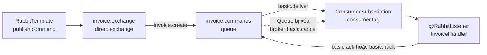
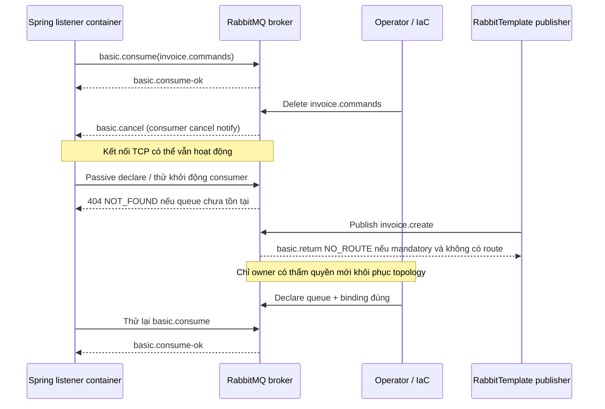

# Consumer bị broker hủy và xử lý queue biến mất

Trong một ứng dụng Spring AMQP, `@RabbitListener` có thể đang nhận message bình thường thì **RabbitMQ chủ động hủy consumer**. Một nguyên nhân điển hình là queue mà consumer đang đọc bị xóa. Lúc này **kết nối TCP tới broker có thể vẫn còn mở**, nhưng subscription không còn tồn tại. Nếu hệ thống chỉ kiểm tra rằng ứng dụng còn chạy hoặc RabbitMQ còn kết nối, sự cố có thể không được phát hiện kịp thời.

Chủ đề **Consumer bị broker hủy và xử lý queue biến mất** thuộc chương **Phục hồi kết nối** của module `SPRING_AMQP`. Bài học tập trung vào mối liên hệ giữa `@RabbitListener`, listener container, `RabbitAdmin`, `RabbitTemplate`, exchange, queue, binding, consumer acknowledgement và cơ chế phục hồi sau lỗi. Mục tiêu là biết **cái gì có thể tự khôi phục, cái gì cần vận hành can thiệp và dữ liệu nào không thể lấy lại chỉ bằng reconnect**.

Sau bài học, bạn có thể:

- Phân biệt **broker-initiated `basic.cancel`**, ứng dụng tự `basic.cancel`, **channel bị đóng**, **connection bị mất** và **queue bị thiếu ngay từ startup**.
- Giải thích tác động của việc queue bị xóa tới consumer đang chạy, message đang chờ và message đã được giao.
- Cấu hình `SimpleRabbitListenerContainerFactory` với `missingQueuesFatal`, recovery interval và mô hình quản lý topology phù hợp.
- Dùng `RabbitAdmin` để khai báo lại queue/exchange/binding khi **được phép**, đồng thời tránh tự tái tạo queue bị xóa có chủ đích.
- Theo dõi `MissingQueueEvent`, `ListenerContainerConsumerFailedEvent`, `ConsumeOkEvent`, kiểm chứng khôi phục và ngăn mất/nhân đôi nghiệp vụ.

## 1. Consumer là một subscription, không chỉ là một kết nối

Khi `@RabbitListener(queues = "invoice.commands")` hoạt động, Spring AMQP dùng listener container đăng ký một hoặc nhiều **consumer subscription** trên queue `invoice.commands`. Mỗi subscription có **consumer tag** để broker và client nhận diện.



Một **connection** có thể chứa nhiều **channel**, và trên một channel có thể có các consumer đăng ký. Broker hủy **một consumer** không đồng nghĩa toàn bộ connection đã mất. Việc ứng dụng gửi được heartbeat hoặc publish trên một channel khác **không chứng minh listener vẫn còn subscription hợp lệ**.

### Các trạng thái dễ nhầm

| Sự kiện | Dấu hiệu giao thức | Connection/channel | Ý nghĩa cần xử lý |
| --- | --- | --- | --- |
| Ứng dụng chủ động ngừng consumer | Client gửi `basic.cancel`; broker trả `basic.cancel-ok` | Có thể vẫn mở | Ngừng có chủ đích, không tự động coi là sự cố |
| Broker chủ động hủy consumer | Broker gửi `basic.cancel` bất đồng bộ nếu client hỗ trợ consumer-cancel-notify | **Có thể vẫn mở** | Subscription mất; cần xác định vì sao rồi khôi phục nếu hợp lệ |
| Consume queue không tồn tại | `basic.consume`/passive declare có thể dẫn đến lỗi channel `404 NOT_FOUND` | Channel liên quan bị đóng | Kiểm tra topology; tạo queue hợp lệ hoặc chờ owner khôi phục |
| Tham số declare không khớp queue có sẵn | Lỗi `406 PRECONDITION_FAILED` | Channel thường bị đóng | Sửa lệch queue type/durable/arguments, không retry vô hạn |
| Mất mạng/broker restart | TCP/AMQP connection không dùng được | Connection và channel cũ mất | Khôi phục connection, channel, topology và consumer |
| Consumer xử lý nghiệp vụ ném exception | Listener container xử lý exception theo ack/retry policy | Không nhất thiết mất subscription | Đây là lỗi xử lý message, cần phân biệt với hủy consumer |

RabbitMQ mở rộng AMQP 0-9-1 bằng **consumer cancel notification**: client khai báo capability `consumer_cancel_notify=true` để broker có thể gửi `basic.cancel` bất đồng bộ khi consumer mất ngoài ý muốn (ví dụ queue bị xóa hoặc queue trở nên không sẵn sàng). RabbitMQ Java client chính thức hỗ trợ capability này theo mặc định.

Trong Java client thuần có callback `Consumer.handleCancel(consumerTag)`, khác với `handleCancelOk` cho yêu cầu hủy từ phía client. Khi dùng **Spring AMQP**, nên quan sát và điều khiển qua listener container/các Spring application events; không tự đăng ký thêm Java-client recovery loop cạnh tranh với Spring container.

## 2. Queue biến mất ảnh hưởng gì đến dữ liệu?

Hãy xét queue `invoice.commands` chứa ba loại message:

| Trạng thái trước sự cố | Sau khi queue bị xóa | Cần làm gì? |
| --- | --- | --- |
| Message còn **ready** trong queue | **Mất khỏi queue đã xóa** | Tìm nguồn phát/outbox/backup nghiệp vụ để có khả năng tái tạo |
| Message đang **unacked** bởi consumer | Không thể dựa vào queue cũ để redeliver khi queue đã bị xóa | Kiểm tra trạng thái nghiệp vụ, khôi phục từ nguồn sự kiện nếu cần |
| Message đã **ACK** trước đó | Đã ra khỏi queue từ trước | Dựa vào dữ liệu nghiệp vụ đã commit |
| Producer đang publish trong lúc binding/queue không còn | Message có thể **unroutable** và bị loại nếu không có cơ chế kiểm soát | Bật publisher confirms/returns, `mandatory`, outbox/retry |
| Queue mới cùng tên được tạo lại | **Queue mới không có lịch sử message cũ** | Khai báo lại binding và phát lại có kiểm soát nếu cần |

**Durable queue không miễn nhiễm với lệnh xóa.** `durable=true` bảo vệ định nghĩa queue qua restart theo điều kiện thông thường; nó không biến thao tác delete thành một hoạt động có thể hoàn tác. `persistent message` cũng không giúp khôi phục những message đã bị xóa cùng queue.

### 2.1. Hủy consumer chưa chắc làm requeue delivery đang bay

Khi **chỉ hủy consumer**, RabbitMQ không tự động requeue hay xóa tất cả delivery đã giao nhưng chưa ack; delivery đang bay vẫn phải được xử lý theo lifecycle của **channel**. Đóng channel thường làm broker requeue những delivery chưa ack **nếu queue của chúng vẫn tồn tại**.

Vì thế:

1. **Consumer bị hủy nhưng queue vẫn tồn tại:** còn khả năng xử lý in-flight delivery/đóng channel và redelivery, tùy trạng thái channel.
2. **Queue đã bị xóa:** không có queue cũ để đặt lại message; phải xử lý khả năng mất dữ liệu, không hứa rằng việc tạo lại queue sẽ phục hồi message.
3. **Connection mất khi queue vẫn tồn tại:** những delivery chưa ack có thể được broker giao lại sau khi consumer phục hồi; side effect đã commit có thể lặp nếu không idempotent.

**Không dùng `consumerTag` hay `deliveryTag` làm khóa nghiệp vụ.** Chúng thay đổi qua lần đăng ký/đường delivery. Cần giữ `eventId` hoặc `commandId` ổn định trong message và database.

## 3. Các nguyên nhân làm consumer bị hủy

Queue không chỉ biến mất do operator chạy lệnh delete. Một số nguyên nhân liên quan:

| Nguyên nhân | Ví dụ | Hướng điều tra |
| --- | --- | --- |
| Operator/IaC xóa queue | Đổi tên queue, xóa queue cũ khi deploy | Audit log/quy trình thay đổi topology; ai sở hữu queue? |
| Queue `auto-delete` | Consumer cuối cùng hủy subscription hoặc mất kết nối | Kiểm tra queue flags và cách ứng dụng tạo lại |
| Queue `exclusive` | Connection sở hữu queue đóng hoặc mất | Mỗi instance nên có queue riêng; không tái sử dụng tên cố định sai cách |
| Queue có thời hạn `x-expires` | Queue không còn được dùng đủ lâu nên broker tự xóa | Kiểm tra TTL chính sách, khả năng idle hợp lệ |
| Queue trong cluster tạm không sẵn sàng | Sự cố node/leader/quorum | Kiểm tra health, queue type, replica/quorum trước khi “sửa” |
| Quyền/vhost hoặc declaration sai | Ứng dụng chuyển vhost, thiếu quyền hoặc khai báo argument không tương thích | Phân biệt `ACCESS_REFUSED`, `NOT_FOUND`, `PRECONDITION_FAILED` |
| Thay đổi subscription có chủ đích | Deploy ngừng nghe queue cũ | Cập nhật container/`@RabbitListener`, không hồi sinh queue đã bỏ |

**Không đồng nhất “queue tạm không sẵn sàng” với “queue đã bị xóa”.** Với quorum queue, mất quorum làm queue không thể phục vụ bình thường; khi hạ tầng phục hồi, cùng queue có thể trở lại. Trong trường hợp delete thực sự, bản sao queue cũ không tự xuất hiện khi broker reconnect.

Queue `auto-delete` được thiết kế cho tài nguyên tạm. Nếu dùng nó cho những đơn hàng cần lưu đến khi xử lý xong, việc consumer cuối mất kết nối có thể khiến queue biến mất ngoài ý muốn. Với workload quan trọng, dùng **durable queue có vòng đời được quản lý rõ ràng**; với queue phản hồi tạm thời, dùng tên do broker sinh/`AnonymousQueue` theo cơ chế phù hợp để tránh tranh chấp tên khi reconnect.

## 4. Một vòng sự cố thực tế và phản ứng đúng

Giả sử `invoice.commands` thuộc bộ topology do một ứng dụng Spring AMQP quản lý:



Sơ đồ trên minh họa **một trình tự có thể xảy ra**, không cam kết sự kiện RabbitAdmin, retry hoặc producer callback luôn đến theo cùng một thứ tự. Với `RabbitAdmin` và auto-declaration được bật, ứng dụng có thể khởi tạo lại queue/binding ngay trong lúc listener recovery. Ngược lại, nếu topology do operator quản lý, listener có thể chờ đến khi owner thực hiện khôi phục.

**Tại sao reconnect TCP không giải quyết tất cả?** Nếu connection vẫn khỏe nhưng consumer bị hủy, một health check chỉ chạy `connection.isOpen()` vẫn có thể báo xanh. Cần biết **queue có tồn tại, consumer subscription đã đăng ký và luồng message nghiệp vụ có tiến triển**.

## 5. Spring AMQP thực hiện recovery ở những lớp nào?

Trong ứng dụng Spring AMQP thông thường, trách nhiệm được chia như sau:

| Thành phần | Trách nhiệm | Giới hạn |
| --- | --- | --- |
| `CachingConnectionFactory` | Quản lý/cấp phát connection và channel, hỗ trợ tái kết nối khi connection mất | Không tự biết DB của consumer đã commit hay chưa |
| `SimpleMessageListenerContainer` (SMLC) | Khởi tạo, giám sát, thử phục hồi consumer; kiểm tra queue khi bắt đầu/recovery | Cần queue đúng để đăng ký thành công |
| `DirectMessageListenerContainer` (DMLC) | Giám sát consumer trực tiếp và phục hồi theo cơ chế riêng (ví dụ `monitorInterval`) | Không áp dụng máy móc toàn bộ thuộc tính retry dành riêng SMLC |
| `RabbitAdmin` | Khai báo topology được quản lý bằng Spring beans và tái khai báo trong những tình huống phù hợp | Không khôi phục message cũ bị xóa; không tự xử lý thay đổi schema queue |
| `RabbitTemplate` | Publish và quản lý publisher confirms/returns nếu được bật | Publish không bảo đảm listener đã xử lý hay queue còn đúng binding |
| `@RabbitListener` | Chạy business handler khi consumer nhận delivery | Không được gọi khi subscription đã mất |

Spring AMQP xử lý việc phục hồi consumer ở **listener container**. Khi container nhận broker cancellation, nó có thể cố gắng phục hồi; nếu chỉ một vài queue trong danh sách bị thiếu, container có thể tiếp tục xử lý queue còn tồn tại rồi thử lại queue bị thiếu. Đó là hành vi khác với ứng dụng chỉ có một queue và toàn bộ subscription đều mất.

Không bật chồng **automatic recovery của RabbitMQ Java client** lên cơ chế recovery do Spring AMQP quản lý mà không hiểu rõ tác động: có thể xuất hiện hai hệ thống cùng tái tạo consumer/topology. Trong ứng dụng Spring AMQP thông thường, dùng các thành phần Spring để quản lý recovery.

## 6. Hiểu `missingQueuesFatal`, retry và `autoDeclare`

Đây là hai quyết định độc lập:

1. **Queue không có, ứng dụng có nên fail fast hoặc tiếp tục chờ?** → `missingQueuesFatal`.
2. **Ai được phép tạo lại queue/exchange/binding?** → `RabbitAdmin`, topology beans và `autoDeclare`.

### 6.1. `missingQueuesFatal=true`

Với **SMLC**, mặc định `missingQueuesFatal=true`. Nếu không có queue nào trong danh sách listener sẵn sàng sau các lần kiểm tra/retry ở startup, đây là lỗi nghiêm trọng có thể làm quá trình khởi tạo context thất bại. Nếu các queue bị mất khi container đang chạy, sau những lần thử lại không thành công container có thể dừng.

Cách này phù hợp khi **thiếu queue là lỗi triển khai** và cần ứng dụng báo lỗi rõ thay vì chạy ở trạng thái không xử lý được công việc. Nó không phải tính năng bảo toàn message.

### 6.2. `missingQueuesFatal=false`

Khi đặt `false`, SMLC có thể đi vào chế độ **recovery** nếu queue chưa có và tiếp tục thử theo `recoveryInterval`/`recoveryBackOff` sau các vòng passive declaration thất bại. Điều này phù hợp nếu queue được cấp phát muộn hoặc vận hành muốn ứng dụng **chờ topology được khôi phục**.

Tuy nhiên, `false` **không tạo queue**, **không hồi sinh message đã bị xóa** và **không đồng nghĩa service đang sẵn sàng**. Nếu queue thiếu vĩnh viễn, listener có thể tiếp tục thử mãi trong khi API health của ứng dụng vẫn hoạt động.

### 6.3. Các tham số khác

| Thuộc tính | Vai trò | Ghi chú |
| --- | --- | --- |
| `declarationRetries` | Số lần thử lại khi passive queue declaration thất bại | Giá trị mặc định thường là 3 retry sau lần đầu (tổng 4 lần) |
| `failedDeclarationRetryInterval` | Khoảng cách giữa các lần thử passive declare | SMLC thường mặc định 5 giây |
| `recoveryInterval` / `recoveryBackOff` | Nhịp thử khởi tạo lại consumer sau lỗi không fatal | SMLC; chọn theo SLA, tránh retry dồn dập |
| `retryDeclarationInterval` | Khi listener cấu hình nhiều queue và một số queue còn thiếu, khoảng chờ kiểm tra lại queue thiếu | SMLC; thường mặc định 60 giây |
| `autoDeclare` | Cho container yêu cầu `RabbitAdmin` khai báo lại topology liên quan khi phát hiện queue thiếu | Cần đúng admin và quyền; có thể làm tái tạo queue ngoài dự kiến |
| `mismatchedQueuesFatal` | Kiểm tra cấu hình queue broker có phù hợp với khai báo được quản lý | Phát hiện sai lệch; không tự chuyển classic thành quorum |
| `monitorInterval` | Chu kỳ theo dõi/phục hồi consumer của DMLC | Không phải `recoveryInterval` của SMLC |

Các giá trị mặc định và điều kiện áp dụng có thể thay đổi theo Spring AMQP version/container. Khi triển khai, kiểm tra bằng chính version của ứng dụng; không dùng các tham số SMLC như thể chúng đều có cùng ý nghĩa trên DMLC.

## 7. Ví dụ A: ứng dụng sở hữu topology và cho phép khai báo lại

Trong môi trường học tập hoặc một service **có quyền sở hữu** queue của mình, có thể khai báo exchange, queue và binding làm Spring beans. `RabbitAdmin` được cấu hình đúng sẽ khai báo các đối tượng và hỗ trợ tái khai báo khi phát hiện thiếu.

```java
import org.springframework.amqp.core.Binding;
import org.springframework.amqp.core.BindingBuilder;
import org.springframework.amqp.core.DirectExchange;
import org.springframework.amqp.core.Queue;
import org.springframework.amqp.core.QueueBuilder;
import org.springframework.context.annotation.Bean;
import org.springframework.context.annotation.Configuration;

@Configuration
public class InvoiceTopology {
    @Bean
    DirectExchange invoiceExchange() {
        return new DirectExchange("invoice.exchange", true, false);
    }

    @Bean
    Queue invoiceCommands() {
        return QueueBuilder.durable("invoice.commands").build();
    }

    @Bean
    Binding invoiceCommandsBinding(Queue invoiceCommands,
                                   DirectExchange invoiceExchange) {
        return BindingBuilder.bind(invoiceCommands)
                .to(invoiceExchange)
                .with("invoice.create");
    }
}
```

Spring Boot với `spring-boot-starter-amqp` thường cung cấp `RabbitAdmin` nếu auto-declaration được bật và không bị cấu hình vô hiệu hóa. Ví dụ này có **durable queue**, **durable exchange** và binding rõ ràng.

Nếu queue bị xóa, việc khai báo lại có thể làm consumer hoạt động trở lại, nhưng **queue mới rỗng**, những message trước đó đã bị xóa không xuất hiện. Cần bảo vệ publish trong khoảng không có route bằng publisher returns/confirms và outbox nếu không chấp nhận mất command.

### 7.1. Cấu hình listener container chờ phục hồi

```java
import org.springframework.amqp.core.AcknowledgeMode;
import org.springframework.amqp.rabbit.config.SimpleRabbitListenerContainerFactory;
import org.springframework.amqp.rabbit.connection.ConnectionFactory;
import org.springframework.context.annotation.Bean;
import org.springframework.context.annotation.Configuration;

@Configuration
public class InvoiceListenerConfig {
    @Bean("invoiceListenerFactory")
    SimpleRabbitListenerContainerFactory invoiceListenerFactory(
            ConnectionFactory connectionFactory) {
        SimpleRabbitListenerContainerFactory factory =
                new SimpleRabbitListenerContainerFactory();
        factory.setConnectionFactory(connectionFactory);
        factory.setMissingQueuesFatal(false);
        factory.setRecoveryInterval(10_000L);
        factory.setPrefetchCount(20);
        factory.setConcurrentConsumers(1);
        factory.setAcknowledgeMode(AcknowledgeMode.MANUAL);
        return factory;
    }
}
```

**Tại sao chọn `missingQueuesFatal=false` trong ví dụ này?** Nếu queue đang được một tiến trình có thẩm quyền tạo lại, container có thể tiếp tục chờ và thử đăng ký consumer mà không yêu cầu restart toàn bộ ứng dụng. Với một queue nghiệp vụ mà **thiếu queue là lỗi không thể chấp nhận**, có thể chọn `true` để fail fast và báo deployment lỗi.

`setPrefetchCount(20)` làm tăng số delivery có thể chưa ack; khi channel đóng, những delivery unacked có thể được giao lại nếu queue vẫn tồn tại. Điều này yêu cầu idempotency trong handler.

### 7.2. Listener xác nhận sau commit nghiệp vụ

```java
import java.io.IOException;
import com.rabbitmq.client.Channel;
import org.springframework.amqp.core.Message;
import org.springframework.amqp.rabbit.annotation.RabbitListener;
import org.springframework.dao.TransientDataAccessException;
import org.springframework.stereotype.Component;

@Component
public class InvoiceCommandsListener {
    private final InvoiceService service;

    public InvoiceCommandsListener(InvoiceService service) {
        this.service = service;
    }

    @RabbitListener(id = "invoice-command-listener",
                    queues = "invoice.commands",
                    containerFactory = "invoiceListenerFactory")
    public void handle(Message message, Channel channel)
            throws IOException {
        long tag = message.getMessageProperties().getDeliveryTag();
        String eventId = message.getMessageProperties().getMessageId();

        try {
            if (eventId == null || eventId.isBlank()) {
                channel.basicReject(tag, false);
                return;
            }
            // Service khác bean, @Transactional và idempotent theo eventId.
            service.createInvoiceOnce(eventId, message.getBody());
            channel.basicAck(tag, false);  // Chỉ sau DB commit
        } catch (TransientDataAccessException ex) {
            channel.basicNack(tag, false, true); // Demo; cần backoff
        } catch (InvalidInvoiceCommandException ex) {
            channel.basicReject(tag, false);    // DLQ nếu có DLX
        }
    }
}
```

`InvoiceService` và `InvalidInvoiceCommandException` là các thành phần **cần được ứng dụng triển khai**. `createInvoiceOnce` phải ghi thay đổi nghiệp vụ và khóa idempotency trong **cùng database transaction**, rồi mới trả kết quả. Không nên dựa vào `redelivered` để quyết định có trùng hay không.

Ví dụ này minh họa thứ tự ack; trong môi trường thật cần chiến lược retry có **giới hạn, backoff và dead-letter**, cùng xử lý ngoại lệ ngoài các nhánh đã liệt kê. `basicNack(..., requeue=true)` lặp liên tục có thể gây hot loop.

Khi queue còn tồn tại nhưng consumer bị mất connection ngay sau khi database commit và trước broker nhận `basicAck`, message có thể được redeliver. Idempotency giúp không tạo hóa đơn thứ hai. **Khi queue đã bị xóa**, chỉ idempotency không thể tái tạo message chưa xử lý: phải có nguồn phục hồi/upstream outbox nếu cần bảo đảm đầu cuối.

## 8. Ví dụ B: topology do hạ tầng sở hữu, ứng dụng chỉ chờ

Trong hệ thống nhiều team dùng chung broker, **operator hoặc IaC** có thể là chủ sở hữu exchange/queue/binding. Khi đó ứng dụng không nên vô tình tạo lại một queue mà operator đã xóa có chủ đích, vì điều này có thể che giấu lỗi migration hoặc khai báo topology sai.

Thiết kế tương ứng:

1. Định nghĩa `invoice.commands`, `invoice.exchange` và binding trong RabbitMQ definitions/IaC của platform.
2. Ứng dụng **không khai báo** ba thành phần đó thành `Queue`/`Exchange`/`Binding` beans cho `RabbitAdmin` tự tái khai báo.
3. Cấu hình listener container để **không tự declare lại topology**, nhưng có thể tiếp tục retry passive declaration nếu được phép.
4. Readiness/alert báo rằng consumer chưa subscribe được, để owner kiểm tra nguyên nhân và khôi phục bằng IaC.

Ví dụ điều chỉnh factory ở mục 7 khi **không có topology beans do ứng dụng quản lý**:

```java
@Bean("externallyManagedInvoiceFactory")
SimpleRabbitListenerContainerFactory externallyManagedInvoiceFactory(
        ConnectionFactory connectionFactory) {
    SimpleRabbitListenerContainerFactory factory =
            new SimpleRabbitListenerContainerFactory();
    factory.setConnectionFactory(connectionFactory);
    factory.setMissingQueuesFatal(false);
    factory.setRecoveryInterval(10_000L);
    factory.setAcknowledgeMode(AcknowledgeMode.MANUAL);
    factory.setContainerCustomizer(container ->
            container.setAutoDeclare(false));
    return factory;
}
```

Đoạn này là một phương thức `@Bean` riêng trong `@Configuration` với các import tương tự mục 7. Nó tạo factory **khác**; để sử dụng, chuyển `containerFactory` của `@RabbitListener` sang `"externallyManagedInvoiceFactory"`. Việc đặt `autoDeclare=false` trên container **không tự vô hiệu hóa một `RabbitAdmin` độc lập** đang tự khai báo các topology beans khác trong cùng context: ứng dụng cũng cần quản lý rõ quyền khai báo và các bean tương ứng.

**Không bật `missingQueuesFatal=false` chỉ để làm health check xanh.** Nếu consumer không còn khả năng xử lý việc, cần báo tình trạng degraded/not-ready ở đúng service, dù HTTP server hoặc một connection tới RabbitMQ vẫn hoạt động.

### Khi nào cần fail fast?

Nếu queue bắt buộc phải có từ trước và không có bên nào dự kiến tạo trễ, chọn **`missingQueuesFatal=true`** để deployment fail sớm thường dễ vận hành hơn. Nếu dùng retry vô thời hạn, phải có alert và readiness phản ánh subscriber thực sự. Không có một lựa chọn đúng cho mọi service.

## 9. Quan sát lifecycle qua Spring application events

Spring AMQP phát các event từ listener container. Những event hữu ích cho chủ đề này:

| Event | Khi nào hữu ích? | Không nên suy diễn |
| --- | --- | --- |
| `MissingQueueEvent` | Container phát hiện queue được cấu hình không tồn tại | Không chỉ rõ queue bị ai xóa hay có bao nhiêu message mất |
| `ListenerContainerConsumerFailedEvent` | Consumer gặp lỗi, chứa reason, throwable, cờ fatal | Không phải mọi failure đều là queue deletion |
| `ConsumeOkEvent` | Broker xác nhận subscription mới, có queue và consumer tag | Không chứng minh đã xử lý message nghiệp vụ |
| `AsyncConsumerRestartedEvent` (SMLC) | Consumer được khởi động lại sau lỗi | Không đồng nghĩa message đã được khôi phục |
| `ListenerContainerIdleEvent` | Listener không nhận message trong khoảng theo dõi | Không đủ để chứng minh queue bị mất; có thể đơn giản là không có message |

Ví dụ tạo logging/metrics sự kiện:

```java
import org.slf4j.Logger;
import org.slf4j.LoggerFactory;
import org.springframework.amqp.rabbit.listener.ConsumeOkEvent;
import org.springframework.amqp.rabbit.listener.ListenerContainerConsumerFailedEvent;
import org.springframework.amqp.rabbit.listener.MissingQueueEvent;
import org.springframework.context.event.EventListener;
import org.springframework.stereotype.Component;

@Component
public class InvoiceConsumerEvents {
    private static final Logger log =
            LoggerFactory.getLogger(InvoiceConsumerEvents.class);

    @EventListener
    public void onMissingQueue(MissingQueueEvent event) {
        log.error("RabbitMQ queue missing: {}", event.getQueue());
        // Tăng metric rabbit_consumer_missing_queue_total
    }

    @EventListener
    public void onConsumerFailure(
            ListenerContainerConsumerFailedEvent event) {
        log.error("Rabbit consumer failed; fatal={}, reason={}",
                event.isFatal(), event.getReason(), event.getThrowable());
        // Ghi nhận consumer failure; cần phân loại nguyên nhân.
    }

    @EventListener
    public void onSubscribe(ConsumeOkEvent event) {
        log.info("Rabbit consumer subscribed: queue={}, tag={}",
                event.getQueue(), event.getConsumerTag());
        // Có subscription; tiếp tục kiểm tra tiến độ nghiệp vụ.
    }
}
```

Các event này giúp tìm kiếm dấu hiệu sự cố nhưng **không phải một nguồn chân lý duy nhất cho readiness**. Một event `ConsumeOkEvent` có thể đến trước một lần hủy mới, và ứng dụng có thể chạy nhiều container/instance. Muốn phản ánh trạng thái hiện tại, phải kết hợp quan sát từ listener container, broker và metrics theo thời gian.

**Cảnh báo quan trọng:** đừng gửi email/chat trực tiếp mỗi lần recovery retry; có thể tạo hàng nghìn cảnh báo trùng. Hãy gom metric, đặt ngưỡng thời gian và chọn cách cảnh báo theo dịch vụ/queue.

## 10. Publisher có thể mất message khi queue tạm biến mất

Ngay cả khi consumer phục hồi tốt, phía producer vẫn có thể publish giữa lúc queue bị xóa và lúc binding được khôi phục:

```text
Thời điểm T0: queue invoice.commands tồn tại
Thời điểm T1: queue bị xóa, binding tới queue biến mất
Thời điểm T2: RabbitTemplate publish invoice.create
Thời điểm T3: broker nhận publish nhưng không có queue nhận
Thời điểm T4: queue/binding được khai báo lại

Message gửi tại T2 KHÔNG tự xuất hiện ở queue mới tại T4.
```

Với `RabbitTemplate`, cần bật **publisher confirms/returns** và `mandatory=true` nếu muốn phát hiện thông điệp không route trong topology thông thường:

```yaml
spring:
  rabbitmq:
    publisher-confirm-type: correlated
    publisher-returns: true
```

```java
@Bean("invoicePublisher")
RabbitTemplate invoicePublisher(ConnectionFactory connectionFactory) {
    RabbitTemplate template = new RabbitTemplate(connectionFactory);
    template.setMandatory(true);
    return template;
}
```

Đoạn `@Bean` thứ hai nằm trong một `@Configuration`; các import cần thiết là `RabbitTemplate`, `ConnectionFactory` và `Bean`.

**Publisher confirm `ack=true` không đồng nghĩa message đã được route tới queue.** Nếu exchange xử lý publish thành công nhưng không có binding phù hợp, broker có thể gửi `basic.return NO_ROUTE` (khi `mandatory=true`) rồi vẫn confirm ACK. Khi exchange không tồn tại, thường gặp lỗi channel khác với `NO_ROUTE`.

Nếu phải bảo đảm không mất tác vụ khi queue mất tạm thời, dùng **transactional outbox** hoặc nguồn sự kiện bền vững phía producer và chỉ đánh dấu hoàn tất khi đã nhận confirm hợp lệ, kiểm tra return. Nếu kết quả publish không rõ do timeout/mất connection, có thể phải retry cùng `eventId`; consumer phải **idempotent** để tránh thực hiện hai lần.

**Alternate exchange** có thể định tuyến message sang nơi khác khi không có route chính, vì vậy không thấy return không nhất thiết chứng minh đã vào đúng queue nghiệp vụ. Cần kiểm tra binding và topology mong đợi.

## 11. Quy trình xử lý sự cố queue biến mất

Thay vì chỉ restart ứng dụng, thực hiện chẩn đoán theo thứ tự:

1. **Xác nhận đối tượng đang mất:** queue tên gì, vhost nào, listener container nào, instance nào, consumer tag nào? So sánh timestamp `MissingQueueEvent`/`ConsumerFailedEvent` và broker log.
2. **Kiểm tra trạng thái broker:** queue có thật sự bị xóa hay chỉ không sẵn sàng? Xem loại queue (classic/quorum), replica/quorum, node, connection/channel, quyền truy cập và các lỗi `404`/`403`/`406`.
3. **Xác định chủ sở hữu topology:** ứng dụng `RabbitAdmin`, platform/IaC hay một dịch vụ khác? Trước khi tạo queue mới, kiểm tra có thao tác migration/xóa chủ đích hay không.
4. **Kiểm tra exchange và binding:** queue tồn tại nhưng chưa được bind lại có thể khiến producer vẫn gửi message không tới queue. Xác minh routing key, vhost và permissions.
5. **Khôi phục theo quy trình được phê duyệt:** nếu queue thật sự cần tồn tại, tái tạo đúng type/durable/arguments/policies, exchange và binding. Nếu chỉ không sẵn sàng do mất quorum, khôi phục quorum thay vì tạo queue trùng tên.
6. **Xác nhận consumer subscription:** xem `basic.consume-ok`/`ConsumeOkEvent`, số consumer tại broker, trạng thái listener container và một message thử end-to-end.
7. **Đối soát message:** kiểm tra outbox, message unconfirmed, event ID, DLQ và database kết quả. Những message đã mất cùng queue cần được **phát lại có kiểm soát** từ nguồn lưu trữ thích hợp nếu có.
8. **Đóng sự cố bằng kết quả nghiệp vụ:** xác minh tác vụ mới/đã tồn đọng được xử lý, không có duplicate gây side effect và alert trở về bình thường.

Lệnh kiểm tra gợi ý trên một RabbitMQ thử nghiệm hoặc môi trường có quyền đọc phù hợp:

```bash
# Liệt kê queue kèm số consumer và backlog ở vhost "/".
rabbitmqctl list_queues -p / name type durable consumers messages_ready messages_unacknowledged

# Liệt kê consumer đang đăng ký.
rabbitmqctl list_consumers -p /

# Kiểm tra exchange/binding trong UI RabbitMQ Management:
# Exchanges -> invoice.exchange; Queues -> invoice.commands.
```

**Không dùng lệnh xóa queue trên production để kiểm tra recovery.** Trong môi trường test cô lập có dữ liệu giả, bạn có thể mô phỏng xóa queue rồi khôi phục topology; việc xóa queue là thao tác mất dữ liệu của chính queue đó.

## 12. Thực hành: quan sát broker cancel, queue missing và tự phục hồi

Chuẩn bị một RabbitMQ development instance, ứng dụng Spring Boot có `spring-boot-starter-amqp`, topology và listener ở mục 7, cùng publisher có confirms/returns ở mục 10. Dùng message chứa `eventId` để kiểm tra duplicate.

### Kịch bản A — Broker xóa queue khi consumer đang chạy

1. Gửi vài message thử và xác minh `@RabbitListener` xử lý thành công.
2. Trong **môi trường thử nghiệm**, xóa `invoice.commands` từ Management UI hoặc công cụ quản trị, không xóa exchange `invoice.exchange`.
3. Quan sát broker phát `basic.cancel` nếu client hỗ trợ consumer cancellation notifications. Spring listener có thể báo failure/missing queue và bắt đầu recovery tùy cấu hình.
4. Trong lúc queue thiếu, publish một command với `mandatory=true`; kiểm tra callback return/confirm. **Không mong command tự có trong queue sau khi tạo lại**.
5. Để `RabbitAdmin` khai báo lại hoặc tạo lại queue và binding bằng IaC tùy **mô hình sở hữu** của bài thử.
6. Xác nhận `ConsumeOkEvent`, queue có consumer và publish command mới end-to-end thành công.

**Đầu ra kỳ vọng:** listener có thể phục hồi subscription khi topology đúng, nhưng dữ liệu nằm trong queue cũ đã bị xóa không quay lại. Nếu cần phục hồi tác vụ, phát lại từ outbox hoặc nguồn có thể kiểm toán, theo event ID ổn định.

### Kịch bản B — Queue chưa tồn tại lúc startup

1. Tắt auto-declaration hoặc dùng mô hình topology external trong môi trường test.
2. Đảm bảo queue `invoice.commands` chưa được tạo.
3. Với `missingQueuesFatal=true`, quan sát hành vi fail fast sau retry khi không có queue khả dụng.
4. Với `missingQueuesFatal=false`, quan sát container tiếp tục retry và ứng dụng không được báo ready cho nghiệp vụ nhận command.
5. Tạo queue, exchange/binding đúng; đợi listener đăng ký và xử lý thử message mới.

**Đầu ra kỳ vọng:** hai cờ khác nhau ở **chiến lược khởi động/phục hồi**, không thay đổi nguyên tắc message đã bị xóa không thể lấy lại chỉ bằng reconnect.

### Kịch bản C — Có hai queue, chỉ một queue biến mất

Nếu một listener container đang nghe `queue-A` và `queue-B`, hãy thử xóa riêng `queue-B` trong môi trường test. Spring AMQP có thể tiếp tục phục vụ queue còn hoạt động và thử khôi phục queue thiếu. Quan sát số consumer theo từng queue và `retryDeclarationInterval`.

**Đầu ra kỳ vọng:** phân biệt **dịch vụ degraded một phần** với **toàn bộ worker ngừng xử lý**. Đừng kiểm tra chỉ tổng số consumer của ứng dụng.

### Kịch bản D — Broker/connection restart nhưng queue durable vẫn tồn tại

1. Dùng durable queue và persistent messages trong môi trường test, có broker hỗ trợ restart an toàn.
2. Ngắt kết nối, quan sát reconnect và tạo lại consumer subscription.
3. Kiểm tra các delivery unacked được giao lại khi channel cũ mất; event ID ngăn side effect trùng.
4. So sánh với kịch bản **queue bị delete** để thấy hai hành vi phục hồi dữ liệu khác nhau.

**Đầu ra kỳ vọng:** kết nối và consumer có thể phục hồi khi queue còn tồn tại; message đã commit nghiệp vụ nhưng ack bị mất có thể redeliver. Trong khi đó, xóa queue thật sự tạo mất dữ liệu cũ ở queue.

## 13. Giám sát và cảnh báo: “Connected” chưa đủ

| Nhóm | Chỉ báo | Vì sao quan trọng |
| --- | --- | --- |
| Broker topology | Queue tồn tại đúng vhost, type, durable và binding | Phát hiện delete/sai deploy |
| Subscription | Consumer count theo queue, `ConsumeOkEvent`, consumer failed/missing queue | Biết listener thực sự đang đăng ký |
| Connection/channel | Số lần reconnect, channel close code `404`/`403`/`406`, heartbeat | Phân biệt mất mạng với topology sai |
| Publisher | Returned `NO_ROUTE`, confirm NACK/unknown, outbox pending | Tránh mất command trong khoảng queue không tồn tại |
| Delivery | `messages_ready`, `messages_unacknowledged`, redelivery rate, DLQ depth | Theo dõi backlog và duplicate sau recovery |
| Nghiệp vụ | Event ID chưa có kết quả sau SLA, duplicate bị chặn, số invoice thiếu | Đo thành công đầu cuối |

Các metric nội bộ có thể được đặt tên theo quy ước của tổ chức, chẳng hạn `rabbit_consumer_missing_queue_total`, `rabbit_consumer_restarts_total`, `rabbit_consumer_subscribed`, `outbox_oldest_pending_seconds`. Đây là **gợi ý tên metric do ứng dụng tự định nghĩa**, không mặc định có sẵn trong RabbitMQ.

Tình huống cần alert gấp: consumer count của một queue quan trọng bằng 0 lâu hơn ngưỡng, trong khi producer vẫn publish hoặc outbox pending tăng. Ngược lại, consumer count dương vẫn chưa chứng minh listener hoàn tất nghiệp vụ: có thể listener kẹt transaction hoặc liên tục retry cùng poison message.

Nên sử dụng **readiness phản ánh khả năng phục vụ workload**: service xử lý queue chỉ ready khi những subscription bắt buộc đang hoạt động và đường xử lý dữ liệu sẵn sàng, theo tiêu chí do hệ thống định nghĩa. Điều này phải được đánh giá riêng với liveness (process còn sống). Chỉ dựa vào kết nối RabbitMQ còn mở sẽ bỏ sót broker-initiated cancellation.

## 14. Các lỗi vận hành thường gặp

| Sai lầm | Hậu quả | Cách làm phù hợp |
| --- | --- | --- |
| “Connection vẫn mở nên consumer vẫn ổn” | Broker có thể đã hủy subscription | Theo dõi consumer/queue theo lifecycle events và broker |
| “Reconnect là đủ để hồi sinh queue” | Queue bị xóa không tự trở lại nếu không được declare | Xác định owner; restore topology đúng quyền |
| “Durable queue bị xóa thì message vẫn còn” | Message ở queue đã delete có thể mất | Outbox/source of truth, reconciliation và replay |
| “`missingQueuesFatal=false` nghĩa là tự tạo queue” | Listener retry mãi nhưng queue không xuất hiện | Phân biệt recovery policy với `RabbitAdmin` |
| “Luôn cho RabbitAdmin tự tạo lại mọi queue” | Có thể che giấu thao tác xóa/migration có chủ đích | Chọn ownership rõ; auto-declare chỉ khi được phép |
| “Tạo lại queue cùng tên khôi phục message cũ” | Queue mới rỗng | Phát lại từ nguồn bền vững nếu có |
| “`basic.cancel` luôn làm requeue unacked” | In-flight delivery không tự được requeue chỉ do cancel | Xem channel lifecycle; ack/reject/close đúng |
| “Bật retries rất nhanh là recover tốt” | Log/CPU cao; broker bị tăng tải khi đang lỗi | Backoff, alert, giới hạn ở từng lớp |
| “Publisher confirm ACK nghĩa là có consumer” | Exchange có thể nhận publish dù không route | Returns/mandatory và topology check |
| “RabbitAdmin có thể đổi queue type trên queue cũ” | Mismatch `406 PRECONDITION_FAILED` | Migrate có kế hoạch, không redeclare khác arguments |

## 15. Các nguyên tắc cần ghi nhớ

1. **Broker hủy consumer là sự kiện của subscription**; không nhất thiết mất connection. Phát hiện từ consumer lifecycle và quan sát queue, không chỉ ping TCP.
2. **Queue biến mất là sự cố topology hoặc vòng đời queue.** Xác định queue bị xóa thật, tạm không sẵn sàng hay lỗi quyền/configuration trước khi sửa.
3. **Recovery của listener và recovery của dữ liệu là hai việc khác nhau.** Tái đăng ký consumer/khai báo lại queue chỉ phục hồi khả năng nhận message **tương lai**.
4. **Quản lý ownership của topology rõ ràng.** App-owned queue có thể dùng `RabbitAdmin`; infra-owned queue cần quy trình IaC/operator và container chờ nếu phù hợp.
5. **Dùng `missingQueuesFatal` đúng mục tiêu.** Fail fast cho cấu hình bắt buộc; retry có alert/readiness nếu queue có thể xuất hiện muộn.
6. **Ngăn mất command khi queue thiếu bằng publisher confirms/returns và outbox.** Vắng binding có thể khiến publish không route dù broker vẫn confirm ACK.
7. **Chống side effect trùng bằng idempotent consumer.** Sau connection/channel recovery, delivery đã commit nhưng ack chưa đến broker có thể được phát lại.

## 16. Câu hỏi tự kiểm tra

1. Vì sao RabbitMQ có thể hủy một consumer trong khi connection TCP của ứng dụng vẫn hoạt động?
2. `basic.cancel` do broker gửi khác gì với `basic.cancel` do ứng dụng gửi và `basic.cancel-ok`?
3. Khi một queue durable bị operator xóa, tạo lại queue cùng tên có khôi phục các message cũ không? Vì sao?
4. Nếu consumer bị hủy nhưng channel vẫn mở, có thể mặc định mọi delivery chưa ack đều bị requeue ngay không?
5. `missingQueuesFatal=false` có tự động khai báo queue trở lại không? Cần thành phần và quyền nào nếu muốn tái khai báo?
6. Tại sao mô hình topology do IaC quản lý nên cẩn thận với `RabbitAdmin` tự redeclare?
7. Một producer publish trong khoảng queue và binding đã mất. Vì sao publisher confirm `ack=true` không đủ để đảm bảo command tới queue?
8. Các event `MissingQueueEvent` và `ConsumeOkEvent` giúp nhận biết điều gì? Vì sao chúng chưa chứng minh nghiệp vụ đã hoàn tất?
9. Sau khi broker reconnect và giao lại một message đã làm database commit trước khi consumer chết, cách nào ngăn tạo hóa đơn lần hai?
10. Làm thế nào để phân biệt queue bị xóa thật với quorum queue tạm không sẵn sàng?

## Tài liệu tham khảo

- [RabbitMQ — Consumer Cancel Notification](https://www.rabbitmq.com/docs/consumer-cancel): broker-initiated `basic.cancel` và capability `consumer_cancel_notify`.
- [RabbitMQ — Consumers](https://www.rabbitmq.com/docs/consumers): vòng đời subscription, `basic.consume`, consumer cancel, in-flight delivery và recovery.
- [RabbitMQ — Queues](https://www.rabbitmq.com/docs/queues): queue durability, auto-delete, exclusive queues, queue expiration.
- [RabbitMQ — Reliability Guide](https://www.rabbitmq.com/docs/reliability): connection failure, message redelivery và consumer recovery.
- [RabbitMQ — Consumer Acknowledgements and Publisher Confirms](https://www.rabbitmq.com/docs/confirms): ack/nack, publisher confirm, redelivery.
- [Spring AMQP — Listener Container Queues](https://docs.spring.io/spring-amqp/reference/amqp/listener-queues.html): queue bị thiếu, consumer cancel, danh sách queue động.
- [Spring AMQP — Message Listener Container Configuration](https://docs.spring.io/spring-amqp/reference/amqp/containerAttributes.html): `missingQueuesFatal`, `autoDeclare`, retry và recovery của SMLC/DMLC.
- [Spring AMQP — Configuring the Broker](https://docs.spring.io/spring-amqp/reference/amqp/broker-configuration.html): `RabbitAdmin`, auto-declaration, queue/exchange/binding và manual declarations.
- [Spring AMQP — Consumer Events](https://docs.spring.io/spring-amqp/reference/amqp/receiving-messages/consumer-events.html): `MissingQueueEvent`, `ListenerContainerConsumerFailedEvent`, `ConsumeOkEvent`.
- [Spring AMQP — Resilience: Recovering from Errors and Broker Failures](https://docs.spring.io/spring-amqp/reference/amqp/resilience-recovering-from-errors-and-broker-failures.html): recovery của listener container và connection.
