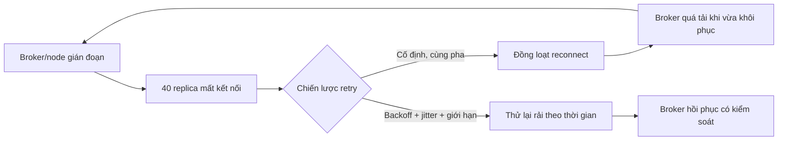
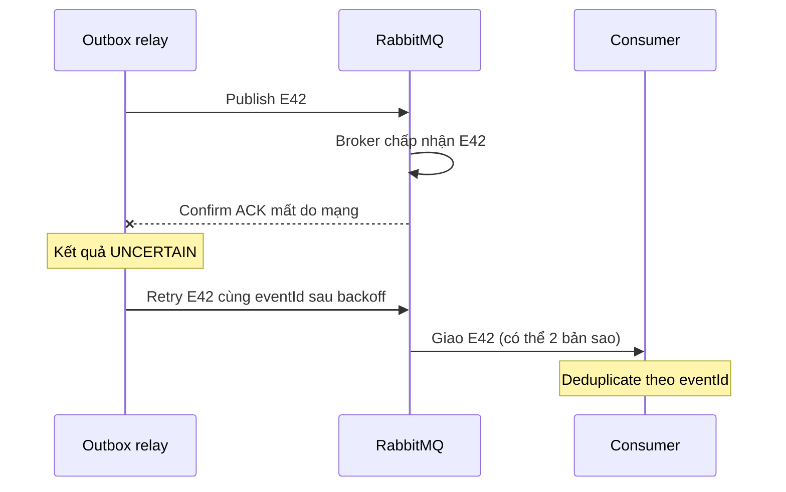

# Điều phối retry để tránh đồng loạt kết nối lại quá mức

> **Chương:** Phục hồi kết nối. **Phạm vi:** ứng dụng **SPRING_AMQP** kết nối RabbitMQ, dùng `RabbitTemplate` gửi message và `@RabbitListener` nhận message qua exchange, queue và binding. Bài tập trung vào cách điều phối **retry khi broker/kết nối gián đoạn** để nhiều instance không đồng thời tấn công lại RabbitMQ, đồng thời giữ được tính tin cậy của publish, acknowledgement, retry và dead-letter.

## 1. Vấn đề: reconnect storm và thundering herd

Giả sử hệ thống có 40 replica xử lý đơn hàng. Mỗi replica có nhiều consumer trên `orders.jobs`; mọi replica đều mất kết nối khi một node RabbitMQ khởi động lại. Nếu tất cả retry theo chu kỳ cố định 5 giây, lịch kết nối lại có thể trùng nhau:

```text
T = 00s : Broker gặp sự cố; 40 replica cùng mất kết nối
T = 05s : 40 replica cùng thử reconnect
T = 10s : 40 replica cùng thử reconnect
T = 15s : Broker vừa mở lại; 40 replica cùng reconnect,
           mở channel, declare topology, tạo consumer và lấy message
```

Đây là **thundering herd**: rất nhiều client cùng thực hiện việc tốn tài nguyên ngay lúc broker còn đang hồi phục. Tác hại không chỉ là nhiều TCP connection: mỗi connection có thể kéo theo TLS handshake, xác thực, mở channel, kiểm tra/khai báo exchange–queue–binding, đăng ký consumer, nạp prefetch và tăng đột biến số message giao đến ứng dụng.

**Reconnect storm** cũng có thể phát sinh trong một instance nếu code tự tạo nhiều `ConnectionFactory`, liên tục gọi `newConnection()` theo vòng lặp hoặc lồng nhiều tầng retry mà không có giới hạn.



Mục tiêu là **giảm số lần thử vô ích**, **phân tán các lần thử**, và **giữ mức tải tái kết nối trong giới hạn**. Không phải cứ retry càng nhanh thì dịch vụ phục hồi càng nhanh: khi broker đang thiếu tài nguyên, retry quá nhiều có thể kéo dài sự cố.

## 2. Xác định đúng tầng đang thực hiện recovery

Trước khi thêm retry, cần biết ai đang sở hữu việc phục hồi. Với Spring AMQP thông thường, việc khôi phục consumer khác với retry một lệnh publish và hoàn toàn khác retry message nghiệp vụ.

| Tầng | Thành phần | Khi nào hoạt động? | Điều phải tránh |
| --- | --- | --- | --- |
| Kết nối/channel của Spring | `CachingConnectionFactory` và thành phần sử dụng connection | Connection cũ không còn dùng được; tạo lại khi cần | Mỗi thao tác tự tạo một physical connection |
| Khôi phục consumer | `SimpleMessageListenerContainer` (SMLC) | Consumer không thể khởi động hoặc bị gián đoạn do lỗi không fatal | Tất cả container lặp lại với cùng chu kỳ, không có jitter |
| Theo dõi consumer trực tiếp | `DirectMessageListenerContainer` (DMLC) | Kiểm tra consumer lỗi qua chu kỳ monitor | Nhầm `recoveryBackOff` của SMLC với lịch monitor của DMLC |
| Auto-recovery của RabbitMQ Java client thuần | `com.rabbitmq.client.ConnectionFactory` | Khi ứng dụng tự dùng Java client và bật auto-recovery | Bật thêm cơ chế trùng với Spring AMQP mà không hiểu tương tác |
| Retry khi producer publish | `RabbitTemplate`/`RetryTemplate` hoặc outbox relay | Send lỗi, thiếu publisher confirm, timeout | Retry nóng, duplicate publish, mất trạng thái chưa rõ |
| Retry khi consumer xử lý thất bại | Listener error handler, retry advice, requeue, DLQ | Message đã giao nhưng nghiệp vụ lỗi | Gọi mọi lỗi xử lý message là “lỗi kết nối” |

Spring AMQP có cơ chế recovery riêng. Khi dùng `CachingConnectionFactory` thông thường, framework **mặc định vô hiệu hóa automatic recovery của RabbitMQ Java client bên dưới** để tránh hai cơ chế tranh nhau phục hồi. `RabbitAdmin` có thể khai báo lại những topology bean (`Queue`, `Exchange`, `Binding`) phù hợp khi có kết nối mới. Vì vậy, không nên tự bật `setAutomaticRecoveryEnabled(true)` trên factory bên dưới như một bước “sửa reconnect” mặc định.

Đối với **RabbitMQ Java client dùng trực tiếp** (không đi qua Spring AMQP), automatic recovery thường được bật mặc định từ Java client 4.0; khi đó `setNetworkRecoveryInterval(...)` hoặc `setRecoveryDelayHandler(...)` thuộc cơ chế **khác**. Ví dụ cấu hình ở bài này dùng Spring AMQP SMLC, không trộn với client auto-recovery.

### SMLC và DMLC xử lý khác nhau

| Đặc tính | SMLC | DMLC |
| --- | --- | --- |
| Cách listener chạy | Consumer invoker thread do container quản lý | Callback trên RabbitMQ client thread |
| Khôi phục consumer lỗi không fatal | Theo `recoveryInterval` hoặc `recoveryBackOff` | Theo `monitorInterval` và cơ chế monitor của container |
| Mặc định cần chú ý | `recoveryInterval=5000 ms` hoặc `FixedBackOff` tương đương, thử lại không giới hạn | Điều chỉnh chu kỳ monitor và số `consumersPerQueue` phù hợp |
| Điểm đặt jitter minh họa trong bài | Custom `BackOff` qua `setRecoveryBackOff(...)` | Không sao chép nguyên cấu hình SMLC; cần thiết kế monitor/startup và phối hợp nhiều replica |

Theo tài liệu Spring AMQP, `recoveryInterval` và `recoveryBackOff` là **hai lựa chọn loại trừ nhau**. Không cấu hình đồng thời rồi mong một giá trị sẽ cộng thêm giá trị kia. Các khoảng chờ này áp dụng cho **khởi động lại consumer sau lỗi không fatal**; chúng không bảo đảm mọi đường gọi kết nối, mọi listener type và mọi request publish đều sẽ chịu cùng chính sách.

## 3. Vì sao fixed interval vẫn gây đồng bộ pha?

Giả sử mọi replica khởi động lúc 09:00:00 và nhận cùng lỗi lúc đó. Nếu đều dùng `recoveryInterval=5000`, thời điểm retry giống nhau:

| Lần thử sau lỗi | Replica A | Replica B | Replica C |
| ---: | --- | --- | --- |
| 1 | 09:00:05 | 09:00:05 | 09:00:05 |
| 2 | 09:00:10 | 09:00:10 | 09:00:10 |
| 3 | 09:00:15 | 09:00:15 | 09:00:15 |
| 4 | 09:00:20 | 09:00:20 | 09:00:20 |

**Exponential backoff** làm các lần thử thưa dần:

```text
cap(n) = min(maxDelay, initialDelay × 2^n)
```

Nhưng nếu tất cả client có cùng `initialDelay` và đồng hồ bắt đầu gần nhau, **chỉ tăng theo cấp số nhân vẫn giữ đồng bộ pha**. **Jitter** thêm thành phần ngẫu nhiên độc lập cho mỗi chu kỳ của mỗi client:

```text
Equal jitter:
  cap(n) = min(maxDelay, initialDelay × 2^n)
  wait(n) ~ Uniform(cap(n)/2, cap(n))

Full jitter:
  wait(n) ~ Uniform(0, cap(n))
```

Với kết nối broker, **equal jitter** thường là điểm bắt đầu dễ kiểm soát vì tránh rất nhiều lần chờ gần 0, trong khi vẫn rải tải. Ví dụ `initialDelay=5 giây` và `maxDelay=60 giây`:

| Chu kỳ thất bại | Trần backoff | Khoảng đợi do equal jitter |
| ---: | ---: | ---: |
| 1 | 5 giây | 2,5–5 giây |
| 2 | 10 giây | 5–10 giây |
| 3 | 20 giây | 10–20 giây |
| 4 | 40 giây | 20–40 giây |
| 5 trở đi | 60 giây | 30–60 giây |

Đây là **các khoảng có thể lấy mẫu**, không phải lịch chính xác hay SLA. Đặt `maxDelay` giúp retry không bị giãn vô hạn khi broker khôi phục; phân phối và giá trị cụ thể phải được đo bằng fault injection.

Một chiến lược thực tế thường kết hợp:

1. **Exponential backoff có trần** để giảm áp lực khi broker vẫn lỗi.
2. **Jitter độc lập** giữa các replica, consumer và lần thử để phá đồng bộ pha.
3. **Giới hạn số kết nối/consumer khởi động cùng lúc** ở từng instance và ở tầng rollout/orchestrator.
4. **Phân loại lỗi fatal** để không retry vô tận khi cần can thiệp cấu hình.
5. **Theo dõi sức khỏe/khôi phục từng bước**, tránh cho hàng chục consumer hoạt động ồ ạt sau khi kết nối trở lại.

## 4. Triển khai BackOff có jitter cho SMLC

Spring Framework cung cấp interface `BackOff` và `BackOffExecution` trong package `org.springframework.util.backoff`. Mỗi lần gọi `start()` phải tạo trạng thái độc lập cho một chuỗi retry. Ví dụ sau dùng thuật toán **equal jitter**, giữ khoảng trễ từ 2,5 đến 60 giây và tiếp tục retry khi lỗi vẫn được container xem là non-fatal.

```java
import java.util.concurrent.ThreadLocalRandom;
import org.springframework.util.backoff.BackOff;
import org.springframework.util.backoff.BackOffExecution;

public final class EqualJitterBackOff implements BackOff {
    private final long initialDelayMs;
    private final long maxDelayMs;

    public EqualJitterBackOff(long initialDelayMs, long maxDelayMs) {
        if (initialDelayMs < 1 || maxDelayMs < initialDelayMs
                || maxDelayMs == Long.MAX_VALUE) {
            throw new IllegalArgumentException("Invalid backoff bounds");
        }
        this.initialDelayMs = initialDelayMs;
        this.maxDelayMs = maxDelayMs;
    }

    @Override
    public BackOffExecution start() {
        return new BackOffExecution() {
            private long capMs = initialDelayMs;

            @Override
            public long nextBackOff() {
                long currentCap = capMs;
                // Double safely, then cap. No unbounded integer exponent.
                capMs = currentCap > maxDelayMs / 2
                    ? maxDelayMs
                    : Math.min(maxDelayMs, currentCap * 2);

                long minDelay = Math.max(1, currentCap / 2);
                // Long inclusive upper bound; maxDelayMs != Long.MAX_VALUE.
                return ThreadLocalRandom.current()
                    .nextLong(minDelay, currentCap + 1);
            }
        };
    }
}
```

Ở đây một `EqualJitterBackOff` object có thể được dùng cho nhiều container vì mỗi lần `start()` tạo `BackOffExecution` với biến `capMs` riêng. `ThreadLocalRandom` tránh dùng một nguồn random seed cố định trên mọi replica. Ví dụ không trả `BackOffExecution.STOP`; điều này có chủ ý cho lỗi **tạm thời**. Lỗi cấu hình/permanent phải được phân loại ở tầng khác để dừng retry và báo động.

### Gắn vào listener container factory

Đoạn sau minh họa Spring Boot + `spring-boot-starter-amqp`, với `SimpleRabbitListenerContainerFactory` chuyên dùng cho queue đơn hàng:

```java
import org.springframework.amqp.core.AcknowledgeMode;
import org.springframework.amqp.rabbit.config.SimpleRabbitListenerContainerFactory;
import org.springframework.amqp.rabbit.connection.ConnectionFactory;
import org.springframework.context.annotation.Bean;
import org.springframework.context.annotation.Configuration;

@Configuration(proxyBeanMethods = false)
public class RecoveryListenerConfig {

    @Bean("ordersListenerFactory")
    SimpleRabbitListenerContainerFactory ordersListenerFactory(
            ConnectionFactory connectionFactory) {

        SimpleRabbitListenerContainerFactory factory =
            new SimpleRabbitListenerContainerFactory();
        factory.setConnectionFactory(connectionFactory);
        factory.setConcurrentConsumers(2);
        factory.setMaxConcurrentConsumers(4);
        factory.setPrefetchCount(8);
        factory.setAcknowledgeMode(AcknowledgeMode.AUTO);

        // Thay thế recoveryInterval cố định bằng BackOff + jitter.
        factory.setRecoveryBackOff(
            new EqualJitterBackOff(5_000, 60_000));
        return factory;
    }
}
```

```java
import org.springframework.amqp.rabbit.annotation.RabbitListener;
import org.springframework.stereotype.Component;

@Component
public class OrdersListener {
    private final OrderService orderService;

    public OrdersListener(OrderService orderService) {
        this.orderService = orderService;
    }

    @RabbitListener(
        id = "orders",
        queues = "orders.jobs",
        containerFactory = "ordersListenerFactory")
    public void handle(String orderId) {
        orderService.process(orderId);
        // AUTO ack: chỉ khi method hoàn tất thành công.
    }
}
```

`OrderService` là thành phần nghiệp vụ do ứng dụng cung cấp. Cấu hình trên dành cho **SMLC** và giả định queue `orders.jobs` có sẵn hoặc được Spring AMQP khai báo phù hợp. Khi dùng `AcknowledgeMode.AUTO`, exception nghiệp vụ vẫn cần chính sách retry/DLQ riêng; `setRecoveryBackOff` không tự biến lỗi xử lý message thành retry có delay.

**Lưu ý về max concurrency:** `MaxConcurrentConsumers=4` có thể giúp tăng xử lý sau khi broker trở lại, nhưng khi chạy 40 replica có thể có tối đa khoảng 160 consumer cho listener này. Hãy tính tổng toàn cluster và điều chỉnh theo năng lực broker, database, downstream. Chỉ giới hạn số consumer trong từng replica mà bỏ qua tổng số replica vẫn có thể gây tải đột biến.

### Khi dùng DMLC thay vì SMLC

`DirectMessageListenerContainer` dùng `consumersPerQueue` và `monitorInterval`; retry consumer lỗi dựa trên cơ chế monitor. Với DMLC, **không sao chép một cách máy móc** `factory.setRecoveryBackOff(new EqualJitterBackOff(...))` và nghĩ đó là cơ chế giải quyết toàn bộ reconnect storm. Hãy kiểm tra cách container DMLC được khởi chạy/monitor ở đúng phiên bản đang sử dụng, giảm mức concurrency ban đầu, tổ chức startup lệch pha theo replica, và giám sát tốc độ kết nối mới thực tế.

## 5. Không tạo tầng automatic recovery trùng lặp

Khi dùng Spring AMQP:

- Dùng **`CachingConnectionFactory`** do framework/Boot quản lý. Tránh gọi `new com.rabbitmq.client.ConnectionFactory().newConnection()` cho từng request.
- Để **listener container** chịu trách nhiệm khởi động lại consumer. Tránh đặt một vòng `while(true)` bên ngoài rồi liên tục `stop/start` container khi đã có cơ chế recovery.
- Để **`RabbitAdmin`** phụ trách khai báo lại topology dưới các điều kiện Spring AMQP hỗ trợ; đừng để mọi worker đồng thời declare topology thủ công theo chu kỳ ngắn.
- Giữ retry của `RabbitTemplate` và retry ứng dụng trong một **ngân sách tổng thể**. Một lần gọi đã retry ba lần trong template mà lại được gọi từ outbox relay có retry riêng sẽ nhân số lần thử và độ trễ.

**Phân biệt:** `spring.rabbitmq.listener.simple.retry.enabled` (Spring Boot) điều khiển retry **khi listener xử lý message bị exception**, không phải lịch reconnect TCP của SMLC. Tương tự, `RetryTemplate` gắn vào `RabbitTemplate` áp dụng cho lời gọi gửi/nhận khi gặp exception; nó không thay `recoveryBackOff` cho consumer.

Việc tăng hoặc giảm `channelCacheSize` chỉ điều chỉnh caching channel phù hợp, không phải một thuật toán backoff. Cũng không nên dùng `Thread.sleep(...)` trong `@RabbitListener` khi broker mất kết nối: listener không nên tự chịu trách nhiệm tái kết nối, và việc sleep giữ thread xử lý bận.

## 6. Phân loại lỗi trước khi cho phép retry liên tục

**Retry vô hạn chỉ hợp lý với lỗi có cơ hội tự phục hồi.** Nếu broker từ chối quyền truy cập hoặc queue có khai báo không tương thích, cứ mỗi vài giây kết nối lại không giúp hệ thống thành công, còn làm đầy log và tăng tải broker.

| Tình huống | Ví dụ tín hiệu | Chiến lược phù hợp |
| --- | --- | --- |
| Sự cố mạng tạm thời | TCP timeout, connection reset, mất heartbeat | Retry có backoff + jitter, alert nếu vượt ngưỡng thời gian |
| Broker đang restart/rolling upgrade | Socket/connection bị đóng, broker chưa sẵn sàng | Retry phân tán, kiểm soát concurrency và startup |
| Node/endpoint tạm thời không truy cập được | DNS/route lỗi nhất thời, một node trong cluster down | Dùng endpoint/địa chỉ được cấu hình và retry có giới hạn tải |
| Username/password sai | Authentication failure, `ACCESS_REFUSED` | **Không** retry vô tận; báo lỗi cấu hình/secret và sửa nguyên nhân |
| Không có quyền vào vhost/queue | Permission failure | Báo lỗi cho vận hành; retry chỉ sau khi cấu hình được sửa |
| Queue đã tồn tại nhưng argument khác | `PRECONDITION_FAILED` (inequivalent arg) | Sửa topology/khai báo; retry kết nối không giải quyết |
| Queue bị xóa và không tự tạo lại được | Passive queue declaration thất bại | Xác minh chủ sở hữu topology; tùy chính sách, fail fast hoặc phục hồi sau khi queue được tạo lại |
| Listener ném lỗi dữ liệu | Validation error, message format sai | Tách retry nghiệp vụ, dead-letter; **không** reconnect để “sửa” message |
| Consumer cạnh tranh exclusive queue | Không lấy được quyền exclusive | Quy tắc phục hồi consumer phụ thuộc thiết lập container; điều tra owner của queue |

Spring AMQP có những cấu hình mang ý nghĩa vận hành:

- `missingQueuesFatal`: khi không có queue cấu hình nào tồn tại ở thời điểm khởi động, **mặc định có thể gây lỗi khởi tạo**. Khi đặt `false`, SMLC có thể tiếp tục chế độ recovery; điều này phù hợp nếu queue được provision bất đồng bộ, nhưng che khuất lỗi topology nếu dùng bừa.
- `possibleAuthenticationFailureFatal`: với SMLC mặc định thiên về fail startup khi có lỗi xác thực khả nghi. Không đặt `false` chỉ để khiến ứng dụng “trông có vẻ chạy” trong lúc mật khẩu sai.
- `mismatchedQueuesFatal`: phát hiện queue declaration bất tương thích. Đây là vấn đề cấu hình, không phải điều nên giải quyết bằng retry nhanh.

**Readiness phải phản ánh vai trò dịch vụ.** Nếu thành phần có nhiệm vụ duy nhất là consume RabbitMQ thì readiness có thể gắn với khả năng tiêu thụ message. Nếu ứng dụng vừa phục vụ HTTP vừa consume, chỉ mất RabbitMQ chưa chắc đồng nghĩa toàn bộ HTTP không dùng được. Đừng cấu hình **liveness** phụ thuộc trực tiếp vào RabbitMQ rồi liên tục restart pod: mỗi restart có thể tạo thêm sóng reconnect lớn hơn.

## 7. Điều phối trên nhiều instance: jitter thôi chưa đủ

Giả sử chạy `R=40` replica, mỗi replica có `C=4` consumer. Nếu broker vừa phục hồi, có thể xuất hiện tới **160 consumer mới**, chưa tính publisher connection, admin channel và các listener khác.

Tổng nhu cầu được quyết định bởi:

```text
Consumers toàn cluster ≈ Σ (replica_i × consumers_per_replica_i)
In-flight (unacked) lý thuyết ≈ Σ (consumers_i × prefetch_i)
```

Đây không phải số connection vật lý: **nhiều consumer/channel có thể chia sẻ một physical connection** qua `CachingConnectionFactory`. Vì vậy phải quan sát riêng **connection**, **channel** và **consumer** thay vì đồng nhất chúng.

Một phương án điều phối khi broker vừa khôi phục:

1. **Tự phục hồi theo backoff + jitter** để tránh mọi replica retry cùng giây.
2. **Giữ concurrency ban đầu nhỏ** (ví dụ 1–2 consumer/instance). Chỉ tăng khi broker và downstream có đủ headroom; với SMLC có thể đặt `concurrentConsumers` thấp hơn `maxConcurrentConsumers`.
3. **Rolling restart hoặc rollout có nhịp** ở orchestration layer để không khởi động đồng thời nhiều pod/app instance. Ví dụ cấu hình chiến lược rollout từng phần và điều chỉnh `maxSurge`/`maxUnavailable` theo yêu cầu sẵn sàng, thay vì restart toàn cluster cùng lúc.
4. **Dùng connection pooling/caching hợp lý**. Không cấp một connection mới cho mỗi message hoặc mỗi retry callback; kiểm soát physical connections, channels và giới hạn trên broker.
5. **Giới hạn công việc sau khi kết nối lại**: prefetch vừa phải, executor hữu hạn, timeout hợp lý và rate limit khi gọi DB/HTTP downstream. Nếu hàng đợi đang tích lũy hàng triệu message, tạo lại 160 consumer với prefetch 250 có thể đẩy quá nhiều message đang unacked vào JVM.
6. **Phân tán thao tác tái khai báo topology**: để Spring `RabbitAdmin` khai báo các bean cần thiết; nếu tổ chức có hàng trăm ứng dụng khai báo cùng topology, cân nhắc chủ sở hữu khai báo tập trung để giảm contention và lỗi bất tương đương.

Không có một API `setRecoveryBackOff` duy nhất nào áp trần số attempt TCP toàn **cluster**. Chính sách trong một process chỉ giảm tải trong phạm vi process/container đó. Nếu yêu cầu giới hạn cụm nghiêm ngặt, cần thêm điều phối rollout, giới hạn ở gateway/connection proxy hoặc cơ chế admission phù hợp với hạ tầng.

### Ví dụ ngân sách tải sau recovery

Giả sử ứng dụng có 20 instance, mỗi instance 2 consumer, `prefetch=10`. Sau khi broker hồi phục:

| Đại lượng | Giá trị minh họa | Hệ quả |
| --- | ---: | --- |
| Consumer ban đầu | 20 × 2 = 40 | Tối đa khoảng 40 listener đồng bộ chạy nghiệp vụ |
| Message unacked có thể được cấp | 40 × 10 = 400 | Broker có thể giao tối đa khoảng 400 message chưa ack |
| Tăng lên 8 consumer/instance | 20 × 8 = 160 | Tài nguyên listener/downstream cần chịu tải gấp 4 |
| Giữ prefetch=10 khi tăng consumer | 160 × 10 = 1.600 | Có thể làm heap, DB và downstream quá tải |

Các con số trên là **giới hạn lý thuyết**, không phải giá trị luôn xảy ra. Bài học chính là: **retry kết nối thành công** có thể lập tức dẫn đến **bão hòa khi xử lý backlog**. Để hệ thống ổn định, phải coi recovery là quá trình hai giai đoạn: **phục hồi kết nối**, rồi **phục hồi thông lượng có kiểm soát**.

## 8. Phân biệt reconnect với publish retry và trạng thái chưa rõ

Nếu producer dùng `RabbitTemplate.convertAndSend(...)` khi kết nối bị lỗi, lời gọi có thể ném `AmqpException`. Nhưng ngay cả khi producer gặp timeout hoặc mất kết nối sau khi gửi bytes, từ phía client **không thể luôn kết luận broker chưa nhận message**.



Khi dùng thông điệp quan trọng, chiến lược an toàn là:

- **Transactional outbox** ghi event cùng business data trong một DB transaction; relay có thể tiếp tục sau restart.
- **Publisher confirms** và `mandatory returns` giúp phân biệt broker ACK, broker NACK, không route được và **không nhận được kết quả**.
- Nếu kết quả không rõ, giữ event trong trạng thái như `UNCERTAIN`, retry có backoff + jitter và **giữ nguyên `eventId`**.
- **Consumer idempotent** kiểm tra event ID trong cùng transaction với side effect nghiệp vụ, để publish lại không gây thanh toán/trừ kho hai lần.

Không nên đặt tầng retry của `RabbitTemplate`, tầng retry HTTP request, outbox poller và retry container cùng chạy mỗi 100 ms. Các tầng này có thể nhân số request theo cấp số nhân. Đặt **mỗi tầng một mục tiêu riêng**, tổng retry budget, deadline và giám sát riêng:

| Retry loop | Tác vụ chịu trách nhiệm | Giới hạn |
| --- | --- | --- |
| Consumer recovery | Khởi động lại consumer/kết nối nhận | Backoff có jitter, retry non-fatal, alert khi lâu |
| Publisher transient retry | Thử lại publish thất bại trong một lời gọi | Số attempt nhỏ, timeout ngắn, không block quá lâu |
| Outbox retry | Gửi event sau khi network/broker hồi phục | Lịch bền vững trong DB, exponential backoff + jitter, idempotency |
| Business retry | API/DB nghiệp vụ bị lỗi | Phân loại transient/permanent, tối đa số lần, DLQ |

**Đừng coi retry reconnect đã thay thế retry message.** Khi network đứt, broker có thể giao lại message mà consumer chưa kịp ack. Ứng dụng đã ghi DB nhưng ACK bị mất vẫn có thể nhận lại; idempotency là yêu cầu độc lập với chất lượng recovery.

## 9. Heartbeat và timeout ảnh hưởng trực tiếp đến sóng retry

Hệ thống cần phát hiện kết nối hỏng đủ nhanh để phục hồi, nhưng không nên biến một đợt network jitter ngắn thành hàng loạt đóng/mở connection.

| Tham số | Vai trò | Nguy cơ khi đặt sai |
| --- | --- | --- |
| RabbitMQ requested heartbeat | Giúp phát hiện peer không còn phản hồi | Quá thấp có thể false positive khi scheduler/GC/network chậm |
| TCP/connect timeout | Giới hạn thời gian một lần tạo connection | Quá dài giữ hàng loạt thread chờ; quá ngắn tăng fail/retry |
| Listener recovery backoff | Khoảng nghỉ giữa các lần restart consumer không fatal | Quá ngắn gây storm; quá dài làm tăng thời gian hồi phục |
| Prefetch và consumer concurrency | Giới hạn số message cấp sau khi kết nối thành công | Quá lớn tạo tải spike khi backlog nhiều |
| Publisher confirm timeout | Mốc đánh giá publish có kết quả rõ hay chưa | Quá ngắn làm tăng `UNCERTAIN`, dẫn đến publish lại |
| DB/HTTP deadline | Bảo vệ downstream sau recovery | Không giới hạn có thể làm các worker bị treo |

Ví dụ Spring Boot cấu hình kết nối:

```yaml
spring:
  rabbitmq:
    host: rabbitmq.internal
    port: 5672
    requested-heartbeat: 30s
    connection-timeout: 5s
```

Các giá trị chỉ mang tính **khởi điểm để đo đạc**; không có một heartbeat/timeout tối ưu cho mọi môi trường. Thời điểm phát hiện disconnect, thời gian retry, readiness và timeout publish phải được chọn cùng nhau. Cần tính cả TLS handshake, proxy/load balancer, RTT và quãng dừng GC trong môi trường thực tế.

**Không đặt heartbeat cực thấp để “phục hồi càng sớm càng tốt”.** Phát hiện lỗi quá nhạy có thể khiến một khoảng giật mạng vài giây thành nhiều connection bị đóng đồng loạt, kích hoạt đúng cơn bão reconnect mà ta muốn tránh.

## 10. Topology recovery và giao nhận message sau reconnect

Khi kết nối RabbitMQ phục hồi, các thành phần Spring AMQP có thể cần mở channel, tái đăng ký consumer và khai báo lại topology. `RabbitAdmin` hỗ trợ **auto-declare những `Exchange`/`Queue`/`Binding` được khai báo dưới dạng bean** và thỏa điều kiện quản lý thích hợp; nó không tự khám phá/tái tạo mọi queue mà ứng dụng nào đó từng tạo thủ công.

Ví dụ Spring bean cho topology:

```java
import org.springframework.amqp.core.Binding;
import org.springframework.amqp.core.BindingBuilder;
import org.springframework.amqp.core.DirectExchange;
import org.springframework.amqp.core.Queue;
import org.springframework.amqp.core.QueueBuilder;
import org.springframework.context.annotation.Bean;
import org.springframework.context.annotation.Configuration;

@Configuration(proxyBeanMethods = false)
class OrderTopology {
    @Bean
    DirectExchange ordersExchange() {
        return new DirectExchange("orders.events");
    }

    @Bean
    Queue ordersJobsQueue() {
        return QueueBuilder.durable("orders.jobs").build();
    }

    @Bean
    Binding ordersJobsBinding(Queue ordersJobsQueue,
                              DirectExchange ordersExchange) {
        return BindingBuilder
            .bind(ordersJobsQueue)
            .to(ordersExchange)
            .with("created");
    }
}
```

**Điều kiện:** bean `RabbitAdmin`/auto-configuration của Spring Boot phải thực sự được bật. Topology phải tương thích với các queue/exchange đã có; broker có thể đóng channel khi khai báo lại cùng tên với argument không tương đương (`PRECONDITION_FAILED`). Ở mẫu trên, `ordersJobsBinding(...)` nhận đúng các bean `Queue`/`DirectExchange` qua tham số, phù hợp với `@Configuration(proxyBeanMethods = false)`.

### Ack/redelivery là phần không thể bỏ qua

Khi connection bị đóng trước khi broker nhận consumer ACK, message chưa ack có thể được đưa lại vào queue và giao cho consumer khác. Nếu listener đã kịp ghi database nhưng ACK chưa tới broker, cùng message có thể được xử lý lần thứ hai. Tương tự, producer thấy exception sau `convertAndSend` không chứng minh publish chưa tới broker.

Vì vậy:

1. ACK sau khi thao tác nghiệp vụ hoàn tất và commit phù hợp (với `AcknowledgeMode.AUTO` của container, listener phải ném lỗi nếu nghiệp vụ không thành công).
2. Gắn `messageId`/`eventId` ổn định để consumer chống trùng.
3. Đặt retry có giới hạn và DLQ cho lỗi xử lý message; đừng cho một poison message vô hạn quay trở lại ngay lúc broker vừa phục hồi.
4. Quan sát redelivery và message unacked sau recovery, không chỉ số connection mở lại.

**Tính chính xác:** các ví dụ trong bài hướng đến mô hình **at-least-once**, không phải exactly-once end-to-end. Backoff và jitter bảo vệ tài nguyên, còn publisher confirms, ack và idempotency bảo vệ tính đúng đắn của message.

## 11. Quan sát và cảnh báo trong quá trình phục hồi

Để biết retry có đang gây bão hay không, đừng chỉ nhìn log `Connection refused`. Cần quan sát **tốc độ thử kết nối**, **mức tải lên broker**, **số consumer phục hồi thành công** và **thời gian khôi phục tính từ lúc broker khỏe lại**.

| Thành phần | Chỉ số/tín hiệu nên quan sát | Câu hỏi cần trả lời |
| --- | --- | --- |
| RabbitMQ broker | Connections opened/closed mỗi giây, channels, active consumers | Có sóng tăng đột biến connection/channels ngay khi broker lên? |
| RabbitMQ broker | Erlang processes, memory, CPU, connection handshake errors | Broker có thực sự đang đủ khả năng nhận lại tải? |
| Spring ConnectionFactory | Lỗi tạo connection, connection open/close, channel checkout timeout | Ứng dụng đang fail ở bước nào? |
| Listener container | `ListenerContainerConsumerFailedEvent`, số consumer active, thời gian start/restart | Retry có lặp quá nhanh? Các instance có cùng pha? |
| Message flow | Queue ready/unacked, publish/confirm rate, consumer ACK/redelivery | Sau reconnect, throughput tăng ổn định hay gây downstream overload? |
| Publisher | Confirm ACK/NACK/timeout, mandatory return, số event `UNCERTAIN` | Có mất kết quả publish và phát lại nhiều không? |
| Downstream | JDBC pool active, HTTP timeout, p95/p99 latency, thread/heap | Backlog sau recovery có làm DB/API nghẽn? |

Spring AMQP phát event khi consumer gặp lỗi. Có thể bắt `ListenerContainerConsumerFailedEvent` để log hoặc tăng counter cho mỗi failure:

```java
import org.slf4j.Logger;
import org.slf4j.LoggerFactory;
import org.springframework.amqp.rabbit.listener.ListenerContainerConsumerFailedEvent;
import org.springframework.context.event.EventListener;
import org.springframework.stereotype.Component;

@Component
public class RabbitRecoveryEventLogger {
    private static final Logger log =
        LoggerFactory.getLogger(RabbitRecoveryEventLogger.class);

    @EventListener
    public void onConsumerFailure(ListenerContainerConsumerFailedEvent event) {
        if (event.isFatal()) {
            log.error("Rabbit consumer stopped: {}", event.getReason(),
                      event.getThrowable());
        } else {
            log.warn("Rabbit consumer recovery: {}", event.getReason(),
                     event.getThrowable());
        }
    }
}
```

Một lỗi kết nối toàn hệ thống có thể làm **nhiều consumer cùng phát event**. Vì vậy số event không bằng số TCP connection lỗi và cũng không bằng số reconnect attempt thực sự. Nếu tính metric, đặt nhãn có cardinality thấp (service, container ID, fatal flag), **không** dùng message ID, exception message nguyên văn hoặc địa chỉ socket ngẫu nhiên làm tag.

### Dấu hiệu hệ thống bị reconnect storm

- Có nhiều đỉnh **connection creation rate** cách đều nhau 5 giây.
- Các instance ghi lỗi network gần như cùng timestamp, rồi cùng nhận `consumer started`.
- Broker vừa lên nhưng CPU/connection handshake tăng cao, consumer liên tục tạo rồi mất.
- Chỉ số lỗi DB/HTTP downstream tăng **sau** khi RabbitMQ đã phục hồi và backlog được đẩy ra quá nhanh.
- Số `redelivered` và publish retry tăng, trong khi throughput xử lý nghiệp vụ không tăng tương ứng.

Sử dụng dashboard theo khoảng thời gian đủ nhỏ để nhìn thấy đỉnh, nhưng không gán nhãn quá chi tiết. Khi thấy storm, điều chỉnh recovery backoff, concurrency, tốc độ rollout và downstream capacity; không chỉ tăng timeout để làm log bớt xuất hiện.

## 12. Bài thực hành: mô phỏng 6 replica cùng mất kết nối

**Mục tiêu:** đo mức độ đồng bộ pha và thời gian phục hồi khi dùng fixed interval so với exponential backoff + jitter. Không cần ngay lập tức kiểm thử trên 40 replica; một cụm thí nghiệm gồm vài instance đủ thể hiện hiện tượng.

### Chuẩn bị

- RabbitMQ thử nghiệm với Management UI; một exchange `orders.events`, queue durable `orders.jobs` và binding routing key `created` như ở mục 10.
- Sáu instance Spring Boot cùng dùng `@RabbitListener` trên queue đó. Mỗi instance cấu hình `concurrentConsumers=2`, `maxConcurrentConsumers=2`, `prefetch=8` để dễ đo.
- Hai cấu hình so sánh: **A** dùng `factory.setRecoveryInterval(5000)`; **B** dùng `factory.setRecoveryBackOff(new EqualJitterBackOff(5000, 60000))`. Chỉ chọn **một** trong hai ở mỗi lượt thí nghiệm.
- Công cụ theo dõi thời điểm consumer failure/start, connection rate của broker và backlog. Cho publisher tạo một số message có `messageId` ổn định; consumer dùng idempotency trong thử nghiệm có side effect.

### Quy trình

1. Khởi động cùng lúc sáu instance với cấu hình **A**. Kiểm tra số consumer thực tế và nhịp xử lý khi broker khỏe.
2. Làm broker **không thể kết nối tạm thời** bằng fault injection hoặc restart node trong môi trường cô lập; giữ đủ lâu để phát sinh ít nhất ba lượt retry.
3. Ghi timestamp của các lần `consumer failed` và các lần kết nối được tạo; khôi phục broker và quan sát độ dốc connection rate.
4. Lặp lại với cấu hình **B**. Ghi các khoảng retry được phân tán như thế nào, độ cao các đỉnh và thời gian từ lúc broker sẵn sàng tới khi consumer trở lại ổn định.
5. Tiếp tục tạo backlog khi broker down. Sau khi kết nối lại, quan sát queue ready/unacked, active consumer, JDBC/HTTP latency; thử tăng prefetch và concurrency để thấy tải hậu recovery.
6. Cho một consumer ghi DB thành công rồi mất connection trước ACK. Đảm bảo message được xử lý lại **không** tạo side effect trùng.

### Bảng ghi kết quả

| Quan sát | Fixed 5 giây | Equal jitter 5–60 giây | Kết luận |
| --- | --- | --- | --- |
| Khoảng cách giữa các lần retry của từng instance | Ghi từ log | Ghi từ log | Có rải đều hơn không? |
| Đỉnh connection open/giây | Đo | Đo | Jitter có hạ peak không? |
| Thời gian tới khi 12 consumer hoạt động trở lại | Đo | Đo | Có đánh đổi tốc độ phục hồi không? |
| Queue unacked cao nhất sau recovery | Đo | Đo | Có đẩy quá nhiều message vào consumer không? |
| Tỷ lệ lỗi DB/HTTP downstream | Đo | Đo | Downstream có bị ảnh hưởng khi phục hồi? |
| Message xử lý trùng về nghiệp vụ | Đo theo event ID | Đo theo event ID | Idempotency có hoạt động không? |

**Không đặt kỳ vọng rằng jitter luôn nhanh hơn fixed interval trong một lần thử.** Jitter có thể làm một số instance chờ lâu hơn; mục tiêu chính là giảm **sự đồng bộ gây quá tải** trên toàn hệ thống. Đánh giá trên nhiều lần chạy và đo percentile/đỉnh thay vì chỉ một timestamp.

### Thử nghiệm bổ sung để phát hiện giới hạn

| Thay đổi | Điều cần kiểm tra |
| --- | --- |
| Mật khẩu sai hoặc thiếu quyền | Hệ thống phân loại lỗi cấu hình/fatal, không che giấu bằng retry vô hạn |
| Queue không tồn tại | `missingQueuesFatal` và owner của topology phản ứng đúng |
| Broker khôi phục nhưng DB chậm | Consumer concurrency/prefetch có bảo vệ DB không |
| Publisher gửi lúc broker down | Outbox event còn để gửi lại; không có mất event âm thầm |
| Publisher mất confirm | Event được phân loại chưa rõ, retry cùng ID, consumer không xử lý trùng |
| Nhiều pod cùng restart | Jitter/rollout có làm giảm kết nối mở cùng lúc không |
| Chuyển SMLC sang DMLC | Các phép đo monitor/reconnect khác, không áp nguyên tham số SMLC |

## 13. Checklist khi vận hành

| Câu hỏi kiểm tra | Quyết định cần rõ |
| --- | --- |
| Ai sở hữu recovery? | Spring AMQP hay raw RabbitMQ client? Tránh hai cơ chế tự phục hồi trùng nhau |
| Listener container type? | SMLC dùng `recoveryBackOff`; DMLC kiểm soát theo cơ chế monitor |
| Retry có đồng bộ pha? | Có exponential backoff và jitter độc lập theo client/attempt |
| Có trần retry load? | Giới hạn consumer, connection, startup concurrency, batch và prefetch |
| Có lỗi cần fail fast? | Authentication, permission, queue argument bất tương đương |
| Heartbeat/timeout phù hợp? | Đủ phát hiện lỗi nhưng không tạo false disconnect hàng loạt |
| Topology phục hồi đúng? | `RabbitAdmin` và bean queue/exchange/binding, không khai báo xung đột |
| Publisher có chắc chắn giao message? | Publisher confirms + outbox; timeout được coi là kết quả chưa rõ |
| Consumer có xử lý lại an toàn? | Ack sau thành công, idempotency, retry hữu hạn và DLQ |
| Sau khi broker khỏe lại thì sao? | Tăng tải theo năng lực broker/downstream, theo dõi backlog |
| Có bằng chứng đo lường? | Connection rate, consumer failures, time-to-recover, duplicate và p95/p99 |

## 14. Tài liệu tham khảo chính thức

- [Spring AMQP — Connection and Resource Management](https://docs.spring.io/spring-amqp/reference/amqp/connections.html): `CachingConnectionFactory`, tự phục hồi của Spring AMQP và `RabbitAdmin`.
- [Spring AMQP — Message Listener Container Configuration](https://docs.spring.io/spring-amqp/reference/amqp/containerAttributes.html): `recoveryInterval`, `recoveryBackOff`, `missingQueuesFatal`, consumer/prefetch.
- [Spring AMQP — SimpleRabbitListenerContainerFactory API](https://docs.spring.io/spring-amqp/docs/3.2.3/api/org/springframework/amqp/rabbit/config/SimpleRabbitListenerContainerFactory.html): setter `setRecoveryBackOff` và cấu hình SMLC.
- [Spring AMQP — Consumer Events](https://docs.spring.io/spring-amqp/reference/amqp/receiving-messages/consumer-events.html): `ListenerContainerConsumerFailedEvent` và các sự kiện vòng đời listener.
- [Spring AMQP — Resilience: Recovering from Errors and Broker Failures](https://docs.spring.io/spring-amqp/reference/amqp/resilience-recovering-from-errors-and-broker-failures.html): recovery kết nối, listener, topology.
- [RabbitMQ — Java Client API Guide, Automatic Recovery](https://www.rabbitmq.com/client-libraries/java-api-guide): cơ chế recovery trong raw Java client và giới hạn khi mất mạng.
- [RabbitMQ — Reliability Guide](https://www.rabbitmq.com/docs/reliability): connection failure, publisher confirms, consumer acknowledgement và redelivery.
- [Spring AMQP — RabbitTemplate](https://docs.spring.io/spring-amqp/reference/amqp/template.html): `RetryTemplate` cho lời gọi RabbitTemplate và publisher confirms.
- [Spring Boot — AMQP](https://docs.spring.io/spring-boot/reference/messaging/amqp.html): Spring Boot auto-configuration cho RabbitMQ và listener container.

**Ghi nhớ:** khi hàng chục replica cùng mất kết nối, **retry có exponential backoff nhưng không có jitter vẫn có thể đồng bộ pha**. Trên Spring AMQP, hãy xác định đúng container và cơ chế recovery, dùng **backoff có jitter**, phân loại lỗi, giới hạn concurrency/prefetch, phối hợp rollout và giữ publisher/consumer **idempotent**. Broker hồi phục kết nối chỉ là bước đầu; cần tiếp tục phục hồi **lưu lượng xử lý** theo năng lực hệ thống.
