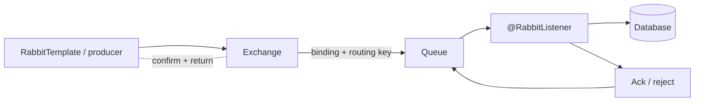
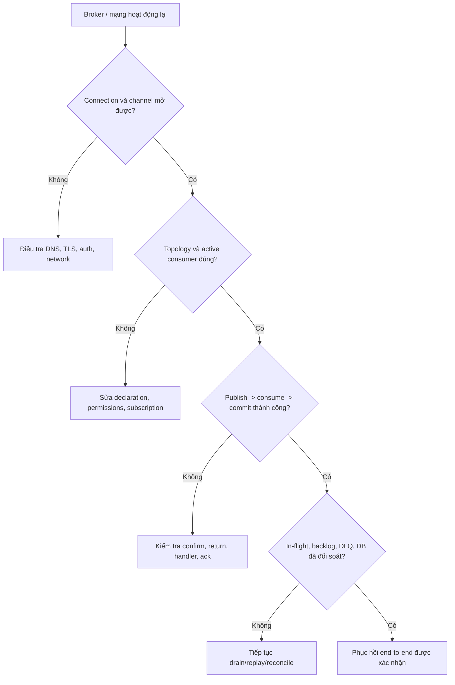
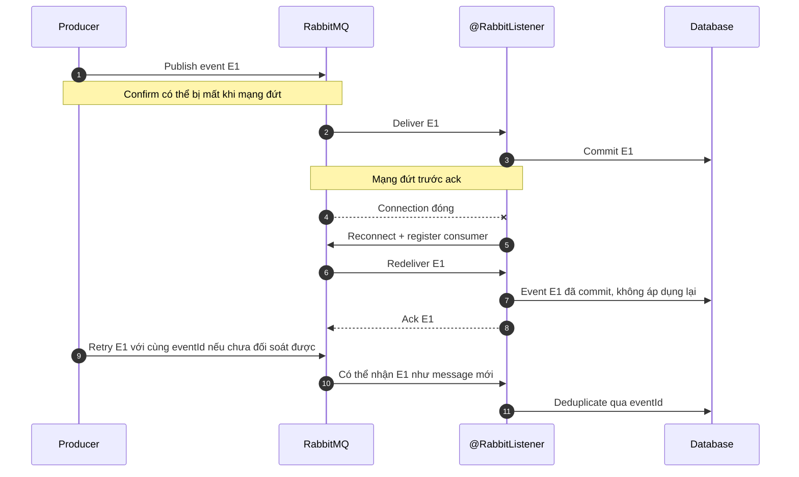

# Kiểm chứng trạng thái ứng dụng sau khi phục hồi

## 1. Kết nối lại không đồng nghĩa hệ thống đã phục hồi

Trong chương **Phục hồi kết nối** của **Spring AMQP**, RabbitMQ có thể bị restart, mất mạng, hoặc thay đổi node trong cluster. Spring AMQP thường giúp tạo lại connection/channel và khởi động lại consumer, nhưng **ứng dụng hoạt động đúng sau phục hồi** là yêu cầu rộng hơn việc socket đã mở.

Ví dụ, service Đơn hàng dùng `RabbitTemplate` phát `OrderPaid` qua một exchange, queue và binding; `@RabbitListener` ghi kết quả vào database. Trong lúc lỗi:

1. Publisher gửi request nhưng mất kết nối trước khi nhận confirm: **không biết chắc** broker đã nhận message.
2. Consumer commit dữ liệu nhưng mất kết nối trước khi broker nhận ack: message **có thể được giao lại**.
3. Ứng dụng nối lại broker nhưng binding không đúng: message mới **không đến queue đích**.
4. Listener container báo đang chạy, nhưng consumer chưa đăng ký lại hoặc liên tục lỗi.
5. Trạng thái memory, DB, DLQ hoặc outbox không còn đồng nhất với các message đang tồn đọng.

Mục tiêu của bài là kiểm chứng **connection, topology, consumer, publisher, in-flight delivery, trạng thái nghiệp vụ và khả năng quan sát**, rồi xây kịch bản thử lỗi tái hiện được.



## 2. Một ma trận xác nhận cho từng lớp phục hồi

| Lớp | Câu hỏi phải trả lời | Bằng chứng phù hợp | Bằng chứng chưa đủ |
|---|---|---|---|
| Connection/channel | Ứng dụng mở được connection/channel tới đúng virtual host? | Health check broker, quan sát lỗi kết nối hiện tại | Log “connected” từ trước sự cố |
| Topology | Exchange, queue, binding, queue arguments và quyền có đúng? | Khai báo/passive check hoặc API quản trị so với cấu hình mong đợi | Mở được socket AMQP |
| Consumer | Listener đã đăng ký lại và đang nhận message? | Consumer count thực tế, lifecycle event, message xử lý sau sự cố | Chỉ `container.isRunning()` |
| Publisher | Message mới đến đúng queue? | Publisher confirms **cùng** publisher returns/routing verification | `RabbitTemplate.send(...)` không ném lỗi |
| Delivery dở dang | Những message chưa ack đã redeliver hoặc được đối soát? | `ready`, `unacked`, redelivery, event ID và trạng thái database | Không thấy exception sau reconnect |
| Nghiệp vụ | Không mất việc, không tạo side effect trùng? | Unique business ID, idempotency, reconciliation | Đếm số lần listener được gọi |
| Vận hành | Tốc độ xử lý đã bắt kịp và DLQ được kiểm soát? | Backlog age, drain rate, DLQ, latency p95/p99 | Một probe trả HTTP 200 |

Hệ thống có thể phục hồi ở một lớp nhưng chưa đạt lớp tiếp theo. Ví dụ kết nối đã trở lại, listener hoạt động, song 10.000 message còn chờ trong queue: phục hồi về **kết nối** đã xong, phục hồi **dịch vụ nghiệp vụ** có thể chưa đạt SLA.



## 3. Spring AMQP phục hồi những thành phần nào?

`CachingConnectionFactory` quản lý connection/channel; listener container quản lý consumer. Khi connection bị mất, container có cơ chế khôi phục kết nối và đăng ký consumer theo cấu hình. `RabbitAdmin` có thể hỗ trợ khai báo lại topology do Spring quản lý khi ứng dụng có quyền khai báo và cơ chế auto-declaration phù hợp.

**Không mặc định bật đồng thời automatic connection recovery của RabbitMQ Java client và recovery do Spring AMQP quản lý** mà chưa đối chiếu tài liệu của phiên bản sử dụng. Với `CachingConnectionFactory` và listener containers, Spring AMQP đã có cơ chế điều phối vòng đời.

### 3.1. Các giới hạn quan trọng

- **Connection trở lại** không bảo đảm lệnh publish đang thực hiện lúc mất mạng đã thành công. Với publisher confirm timeout, trạng thái là **UNKNOWN**, không nhất thiết là thất bại.
- **Channel trước sự cố không còn được coi là hợp lệ**: không giữ channel reference tự quản lý để dùng qua reconnect.
- **Consumer registration** có thể chậm hơn việc connection mở lại; container running chưa chắc có active consumer thực trên broker.
- **Topology có thể không phục hồi** nếu thiếu quyền, không có `RabbitAdmin`, queue đã bị xóa hoặc queue arguments khác với khai báo.
- **Message chưa ack** có thể được broker redeliver sau khi connection cũ bị đóng/phát hiện đã chết; đó là hành vi bình thường trong thiết kế at-least-once.

### 3.2. Hai cửa sổ lỗi đáng kiểm tra nhất



Một message bị redeliver vì **consumer chưa ack** và một message được publish lại vì **publisher không nhận confirm** có thể mang cùng nghiệp vụ. Flag `redelivered` không phát hiện được tất cả bản sao; chỉ **eventId/operationId ổn định** kết hợp dữ liệu bền mới có tác dụng deduplicate.

## 4. Ví dụ Spring Boot: tạo đường đi có thể kiểm chứng

Demo dùng Spring AMQP, PostgreSQL và Actuator. Payload minh họa là `eventId|accountId|delta`. Worker cập nhật số dư chỉ **một lần cho mỗi eventId**, ngay cả khi broker giao lại sau reconnect. Ví dụ nhằm minh họa xác nhận sau sự cố, không phải một hệ thống tài chính đầy đủ.

### 4.1. Dependency và cấu hình

```xml
<dependency>
    <groupId>org.springframework.boot</groupId>
    <artifactId>spring-boot-starter-amqp</artifactId>
</dependency>
<dependency>
    <groupId>org.springframework.boot</groupId>
    <artifactId>spring-boot-starter-jdbc</artifactId>
</dependency>
<dependency>
    <groupId>org.springframework.boot</groupId>
    <artifactId>spring-boot-starter-actuator</artifactId>
</dependency>
```

Thêm driver PostgreSQL và DataSource phù hợp. `application.yml` ví dụ:

```yaml
spring:
  rabbitmq:
    host: localhost
    port: 5672
    username: guest
    password: guest
    connection-timeout: 5s
    requested-heartbeat: 15s
    publisher-confirm-type: correlated
    publisher-returns: true
    template:
      mandatory: true
  datasource:
    url: jdbc:postgresql://localhost:5432/demo
    username: ${DB_USER:demo}
    password: ${DB_PASSWORD:demo}
management:
  endpoint:
    health:
      probes:
        enabled: true
```

Tài khoản `guest` chỉ dành cho bài thực hành local theo chính sách mặc định của RabbitMQ. Production cần tài khoản/virtual host riêng, TLS, phân quyền và secrets. Timeout/heartbeat là giá trị minh họa, cần hiệu chỉnh theo môi trường.

`publisher-confirm-type=correlated` hỗ trợ đối chiếu publish confirm theo correlation; `publisher-returns` kết hợp `mandatory` để nhận biết message unroutable. **Confirm ack** là broker đã xác nhận publish, **không khẳng định consumer xử lý**. Với message unroutable, confirm vẫn có thể ack và returns chỉ ra rằng message không đến queue.

### 4.2. Exchange, queue, binding và đường dead-letter

```java
import org.springframework.amqp.core.Binding;
import org.springframework.amqp.core.BindingBuilder;
import org.springframework.amqp.core.DirectExchange;
import org.springframework.amqp.core.Queue;
import org.springframework.amqp.core.QueueBuilder;
import org.springframework.beans.factory.annotation.Qualifier;
import org.springframework.context.annotation.Bean;
import org.springframework.context.annotation.Configuration;

@Configuration
public class RecoveryTopology {
    public static final String EXCHANGE = "recovery.demo.exchange";
    public static final String QUEUE = "recovery.demo.events";
    public static final String ROUTING_KEY = "recovery.event";
    public static final String DLX = "recovery.demo.dlx";
    public static final String DLQ = "recovery.demo.failed";
    public static final String DLQ_KEY = "recovery.failed";

    @Bean DirectExchange recoveryExchange() {
        return new DirectExchange(EXCHANGE, true, false);
    }
    @Bean DirectExchange recoveryDlx() {
        return new DirectExchange(DLX, true, false);
    }
    @Bean Queue recoveryQueue() {
        return QueueBuilder.durable(QUEUE)
                .deadLetterExchange(DLX)
                .deadLetterRoutingKey(DLQ_KEY)
                .build();
    }
    @Bean Queue recoveryDlq() {
        return QueueBuilder.durable(DLQ).build();
    }
    @Bean Binding recoveryBinding(
            @Qualifier("recoveryQueue") Queue recoveryQueue,
            @Qualifier("recoveryExchange") DirectExchange recoveryExchange) {
        return BindingBuilder.bind(recoveryQueue)
                .to(recoveryExchange).with(ROUTING_KEY);
    }
    @Bean Binding recoveryDeadBinding(
            @Qualifier("recoveryDlq") Queue recoveryDlq,
            @Qualifier("recoveryDlx") DirectExchange recoveryDlx) {
        return BindingBuilder.bind(recoveryDlq)
                .to(recoveryDlx).with(DLQ_KEY);
    }
}
```

Với `RabbitAdmin` hoạt động và quyền khai báo đúng, Spring có thể tạo topology cho các bean trên khi ứng dụng kết nối. Tuy nhiên queue đã tồn tại nhưng **queue type, DLX hoặc arguments khác** có thể gây lỗi redeclare (`PRECONDITION_FAILED`). Không coi auto-declare là cơ chế migration topology an toàn.

Queue `durable` giúp định nghĩa queue tồn tại qua broker restart; message durability còn phụ thuộc delivery mode, publisher confirms, queue type và cấu hình broker. DLQ phải được giám sát riêng; queue chính trống không chứng minh tất cả công việc đã được hoàn tất.

### 4.3. Publisher: kiểm tra confirm và return

```java
import java.nio.charset.StandardCharsets;
import java.util.concurrent.TimeUnit;
import org.springframework.amqp.core.Message;
import org.springframework.amqp.core.MessageBuilder;
import org.springframework.amqp.core.MessageProperties;
import org.springframework.amqp.rabbit.connection.CorrelationData;
import org.springframework.amqp.rabbit.core.RabbitTemplate;
import org.springframework.stereotype.Service;

@Service
public class RecoveryEventPublisher {
    private final RabbitTemplate template;

    public RecoveryEventPublisher(RabbitTemplate template) {
        this.template = template;
    }

    public void publish(String eventId, String accountId, long delta)
            throws Exception {
        if (eventId == null || eventId.isBlank()
                || accountId == null || accountId.isBlank()
                || eventId.contains("|") || accountId.contains("|")) {
            throw new IllegalArgumentException("Invalid event metadata");
        }

        String payload = eventId + "|" + accountId + "|" + delta;
        Message message = MessageBuilder
                .withBody(payload.getBytes(StandardCharsets.UTF_8))
                .setContentType(MessageProperties.CONTENT_TYPE_TEXT_PLAIN)
                .setMessageId(eventId)
                .build();
        CorrelationData correlation = new CorrelationData(eventId);

        template.send(RecoveryTopology.EXCHANGE,
                RecoveryTopology.ROUTING_KEY, message, correlation);

        CorrelationData.Confirm confirm =
                correlation.getFuture().get(5, TimeUnit.SECONDS);
        if (!confirm.isAck()) {
            throw new IllegalStateException(
                    "Publish was not confirmed: " + confirm.getReason());
        }
        if (correlation.getReturned() != null) {
            throw new IllegalStateException(
                    "Unroutable message: " + eventId);
        }
    }
}
```

Đoạn code chờ confirm tối đa 5 giây để minh họa; production có thể theo dõi future/callback bất đồng bộ và giới hạn số publish đang chờ. Nếu `get(...)` timeout hoặc connection chết, **không kết luận message chắc chắn chưa tới broker**. Lưu event trong outbox hoặc storage bền, đối soát và retry bằng **cùng eventId** để consumer không tạo tác dụng phụ trùng.

`CorrelationData.getReturned()` có ý nghĩa khi bật publisher returns và mandatory như cấu hình. Cả confirms và returns không thay thế bằng chứng **database đã commit**.

### 4.4. Consumer: commit nghiệp vụ idempotent trước khi ack

Dữ liệu mẫu trong PostgreSQL:

```sql
CREATE TABLE ledger_accounts (
    account_id VARCHAR(100) PRIMARY KEY,
    balance    BIGINT NOT NULL DEFAULT 0
);

CREATE TABLE processed_events (
    event_id     VARCHAR(100) PRIMARY KEY,
    account_id   VARCHAR(100) NOT NULL,
    delta        BIGINT NOT NULL,
    processed_at TIMESTAMPTZ NOT NULL DEFAULT NOW()
);

INSERT INTO ledger_accounts(account_id, balance)
VALUES ('acct-1', 1000)
ON CONFLICT (account_id) DO NOTHING;
```

```java
import java.util.List;
import org.springframework.jdbc.core.JdbcTemplate;
import org.springframework.stereotype.Service;
import org.springframework.transaction.annotation.Transactional;

record LedgerEvent(String eventId, String accountId, long delta) {
    static LedgerEvent parse(String raw) {
        String[] fields = raw.split("\\|", -1);
        if (fields.length != 3 ||
                fields[0].isBlank() || fields[1].isBlank()) {
            throw new IllegalArgumentException("Invalid event payload");
        }
        return new LedgerEvent(
                fields[0], fields[1], Long.parseLong(fields[2]));
    }
}

@Service
public class LedgerEventService {
    private final JdbcTemplate jdbc;
    public LedgerEventService(JdbcTemplate jdbc) {
        this.jdbc = jdbc;
    }

    @Transactional
    public void applyOnce(LedgerEvent event) {
        int inserted = jdbc.update(
                "INSERT INTO processed_events(event_id, account_id, delta) " +
                "VALUES (?, ?, ?) ON CONFLICT(event_id) DO NOTHING",
                event.eventId(), event.accountId(), event.delta());

        if (inserted == 0) {
            List<LedgerEvent> prior = jdbc.query(
                    "SELECT event_id, account_id, delta FROM processed_events " +
                    "WHERE event_id = ?",
                    (rs, row) -> new LedgerEvent(
                            rs.getString(1), rs.getString(2), rs.getLong(3)),
                    event.eventId());
            if (prior.isEmpty() || !prior.get(0).equals(event)) {
                throw new IllegalStateException("EVENT_ID_CONFLICT");
            }
            return; // Message trùng: không cộng/trừ balance thêm lần nữa.
        }

        int updated = jdbc.update(
                "UPDATE ledger_accounts SET balance = balance + ? " +
                "WHERE account_id = ?",
                event.delta(), event.accountId());
        if (updated != 1) {
            throw new IllegalStateException("UNKNOWN_ACCOUNT");
        }
    }
}
```

```java
import org.springframework.amqp.rabbit.annotation.RabbitListener;
import org.springframework.stereotype.Component;

@Component
public class RecoveryEventListener {
    private final LedgerEventService service;
    public RecoveryEventListener(LedgerEventService service) {
        this.service = service;
    }

    @RabbitListener(id = "recoveryEventConsumer",
            queues = RecoveryTopology.QUEUE)
    public void handle(String raw) {
        service.applyOnce(LedgerEvent.parse(raw));
        // Transaction DB đã commit khi lời gọi service trả về.
        // Sau đó listener kết thúc để container ack theo AUTO mode.
    }
}
```

Cả việc ghi `processed_events` và cập nhật balance phải **cùng một database transaction**. Sau khi commit nhưng trước khi ack, broker có thể redeliver; unique `event_id` đảm bảo không cập nhật balance lần nữa. Nếu cùng ID nhưng payload khác, code báo lỗi xung đột, không âm thầm bỏ qua.

Đây là ví dụ phục hồi, chưa khai báo retry policy trong listener. Production phải phân biệt lỗi format, lỗi business và lỗi kết nối tạm thời; retry có giới hạn với backoff, dùng DLQ cho message không thể xử lý, tránh requeue vô hạn. Với side effect ra ngoài database (email, HTTP, thanh toán), cần idempotency ở hệ thống đích, outbox/inbox hoặc đối soát.

## 5. Các phép kiểm chứng sau recovery

Một hệ thống nên kết hợp **control plane** (kết nối và topology), **data plane** (publish/consume), **business plane** (trạng thái bền).

### 5.1. Kiểm chứng connection, topology và listener

- Xác minh broker node/cluster, DNS, TLS, virtual host, quyền đọc/ghi và quyền khai báo exchange/queue.
- Kiểm tra exchange, queue, binding, DLX/DLQ, arguments và loại queue thực tế khớp topology kỳ vọng.
- Xem số consumer **trên broker** của tất cả queue quan trọng, không chỉ queue vừa thử nghiệm.
- Đối chiếu listener lifecycle events, lỗi startup, channel close, `PRECONDITION_FAILED` và consumer restart.
- Kiểm tra listener đã đăng ký lại, số consumer mong đợi và tốc độ xử lý message mới.

Spring AMQP cung cấp `RabbitListenerEndpointRegistry` để lấy container theo ID. Ví dụ kiểm tra một **tín hiệu ban đầu**:

```java
import org.springframework.amqp.rabbit.listener.MessageListenerContainer;
import org.springframework.amqp.rabbit.listener.RabbitListenerEndpointRegistry;
import org.springframework.stereotype.Component;

@Component
public class ListenerLifecycleProbe {
    private final RabbitListenerEndpointRegistry registry;
    public ListenerLifecycleProbe(RabbitListenerEndpointRegistry registry) {
        this.registry = registry;
    }

    public boolean containerRunning() {
        MessageListenerContainer container =
                registry.getListenerContainer("recoveryEventConsumer");
        return container != null && container.isRunning();
    }
}
```

`isRunning()` chỉ báo trạng thái lifecycle của container trong Spring, **không phải bằng chứng** đã có active consumer hoặc handler đã xử lý được message. Phải so với consumer count của broker, lỗi runtime và canary end-to-end.

### 5.2. Kiểm chứng publish và consume thật

1. Sinh `eventId` duy nhất; lưu thời điểm gửi, exchange, routing key, queue kỳ vọng.
2. Publish và đối chiếu **confirm cùng returned message**. Nếu confirm timeout, ghi nhận `UNKNOWN`.
3. Chờ dấu hoàn tất `eventId` trong database và metric consumer; đo publish-to-commit latency.
4. Nếu cần, thử gửi lại **cùng eventId**: listener có thể được gọi lại nhưng không được áp dụng side effect lần hai.
5. Xác minh DLQ không có bản sao lỗi và message không đứng mãi ở `unacked`.

Với production, **không đưa canary giả vào queue chứa thao tác khách hàng** nếu nó có thể gây side effect. Nên dùng môi trường staging cô lập hoặc canary flow có nhận diện riêng và kết quả kiểm chứng an toàn. Một canary queue riêng cũng **không chứng minh** binding của queue nghiệp vụ đúng; cần kết hợp kiểm tra topology của tuyến quan trọng.

### 5.3. Đối soát message dở dang

Sau reconnect, một số message có thể đang ở các trạng thái khác nhau:

| Trạng thái trước lỗi | Điều có thể xảy ra sau reconnect | Kiểm chứng cần có |
|---|---|---|
| Publisher chưa nhận confirm | Publish có thể đã hoặc chưa đến broker | Outbox/event ID, confirms/returns, lịch sử xử lý |
| Message đã enqueue nhưng chưa consume | Còn trong queue bền khi broker phục hồi đúng cấu hình | `ready`, tuổi message, tốc độ xử lý |
| Worker đã nhận nhưng chưa ack | Broker có thể redeliver | `redelivery`, idempotency, DB state |
| Worker commit DB nhưng ack thất lạc | Side effect đã có, message có thể lặp | Unique event ID, transaction, không áp dụng lại |
| Message bị reject/DLQ | Không còn ở queue chính | DLQ depth, cause, replay có kiểm soát |
| Producer chết trước khi thực sự publish | Broker không có message | Outbox bền và relay retry |

**Queue chính trống không chứng minh không mất việc**: phải kiểm tra `unacked`, DLQ, database và outbox. Với hệ thống có yêu cầu thứ tự theo aggregate, còn phải đối chiếu `sequence`/version, không chỉ số lượng sự kiện đã commit.

## 6. Readiness, liveness và định nghĩa “phục hồi xong”

| Loại kiểm tra | Trả lời câu hỏi | Lưu ý |
|---|---|---|
| **Liveness** | Process còn hoạt động, không bị deadlock nghiêm trọng? | Broker tạm thời ngắt không phải lúc nào cũng nên restart process |
| **Readiness** | Service có đáp ứng được hợp đồng khi nhận traffic mới? | Phụ thuộc service có phải publish ngay hay có outbox bền |
| **RabbitMQ health** | Có thể truy cập broker ở mức cơ bản? | Không chứng minh binding, listener hay DB state |
| **Consumer health** | Broker có active consumer và throughput trở lại? | Phải quan sát broker/metrics ngoài `isRunning()` |
| **End-to-end canary** | Message đi qua đường cần bảo vệ và commit được? | Thiết kế probe không gây side effect production |
| **Backlog recovery** | Hàng đợi và DLQ đang được xử lý phù hợp SLO? | Cần đo độ trễ, queue age, drain rate và lỗi |

Spring Boot Actuator có thể cung cấp health indicator cho RabbitMQ khi có auto-configuration thích hợp. Muốn readiness xét cả listener, topology và tác dụng phụ nghiệp vụ, cần **custom health indicator / readiness logic** và cấu hình nhóm health theo mục tiêu, không chỉ dựa vào Rabbit health mặc định.

Một API HTTP **phải publish ngay** mới thực hiện được yêu cầu có thể cần từ chối traffic khi RabbitMQ unavailable. Một API ghi dữ liệu và **transactional outbox** bền vững có thể vẫn chấp nhận yêu cầu nếu hợp đồng cho phép publish trễ. Với service chỉ consume, restart vì broker gián đoạn có thể tạo thêm vòng lặp kết nối không cần thiết.

**Gợi ý tiêu chí recovery đo được** cho tuyến quan trọng:

1. Connection ổn định trong cửa sổ quan sát do SLO quy định.
2. Topology khớp hợp đồng; broker có active consumer trên queue mong đợi.
3. Canaries end-to-end liên tiếp hoàn tất và có kết quả bền.
4. Không có publisher returns, DLQ hoặc redelivery tăng bất thường.
5. Backlog đang giảm đúng tốc độ mục tiêu, message chưa xác định có phương án đối soát.

Không sao chép ngưỡng số lượng canary hay thời gian ổn định như một giá trị cố định cho mọi hệ thống; phải căn cứ SLO, tải và tác động nghiệp vụ.

## 7. Thực hành fault injection: chứng minh recovery thay vì chỉ ping broker

Thực hiện **chỉ ở local/staging cô lập** với RabbitMQ, PostgreSQL và ứng dụng demo. Có thể dùng Docker Compose nếu môi trường có service tên `rabbitmq`. Các lệnh dưới đây là hướng dẫn người học chạy, không phải kết quả đo đã thực hiện.

### 7.1. Baseline trước khi thử lỗi

1. Khởi động broker, DB và ứng dụng. Xác minh exchange, queue, binding, DLX/DLQ và consumer count.
2. Publish `evt-001|acct-1|100` qua `RecoveryEventPublisher` và đợi confirm/commit.
3. Kiểm tra balance từ 1000 thành **1100**, bảng `processed_events` có đúng một dòng `evt-001`.
4. Publish lại **cùng ID và payload**, balance phải vẫn là **1100**. Publish lại cùng ID nhưng delta khác phải báo conflict.
5. Ghi metrics nền: connections/channels, consumer count, `ready`/`unacked`, DLQ depth, p95 latency và duplicate count.

### 7.2. Test A — Restart RabbitMQ

```bash
# Chỉ dùng trong môi trường test Docker Compose.
docker compose stop rabbitmq
docker compose start rabbitmq
```

Trong thời gian dừng, ghi nhận publish error và listener disconnect. Sau khi broker chạy lại:

- Kiểm tra connection/channel và consumer đã đăng ký trở lại ở **đúng queue**.
- Publish một event mới, đối chiếu confirm/return và kết quả DB.
- Kiểm tra exchange, binding, DLQ và các queue/consumer khác trong service.
- Kiểm tra event cũ còn tồn đọng đã được xử lý hoặc đưa vào luồng đối soát.

### 7.3. Test B — Consumer đã commit nhưng chưa ack

1. Dùng fault injection để dừng consumer **sau DB commit và trước broker ack**.
2. Đợi broker phát hiện connection đã đóng rồi khởi động listener lại.
3. Quan sát broker có thể redeliver cùng message.
4. Xác nhận chỉ có **một eventId** và một lần cộng `delta` trong DB.
5. Kiểm tra `unacked` quay về mức bình thường và DLQ không tăng do thiếu idempotency.

Flag `redelivered` là tín hiệu hữu ích khi broker giao lại message chưa ack, nhưng **không nhận diện được retry publish do producer**. Deduplicate phải dựa vào `eventId`, không dựa vào flag hay delivery tag.

### 7.4. Test C — Mất publisher confirm

1. Dùng proxy mạng hoặc fault injection để ngắt đường truyền **sau publish nhưng trước khi ứng dụng nhận confirm**.
2. Ghi trạng thái publish là `UNKNOWN`; không sinh event ID mới.
3. Đối chiếu outbox và `processed_events` trước khi quyết định retry.
4. Gửi lại cùng `eventId` nếu hợp đồng yêu cầu; xác nhận handler không áp dụng side effect lần hai.

Một lệnh stop broker thông thường không bảo đảm cắt đúng cửa sổ mất confirm. Không dùng timeout làm bằng chứng broker chưa nhận message.

### 7.5. Test D — Connection khỏe nhưng routing sai

Thay routing key thành giá trị không có binding trong môi trường thử nghiệm, vẫn giữ `mandatory=true`:

- Broker có thể **confirm ack** vì đã nhận publish.
- Message có thể được **return** dưới dạng unroutable.
- Listener không có callback, dù connection health báo up.

Điều này chứng minh tại sao xác nhận recovery cần kiểm tra **return + confirm + topology**, không chỉ ping hay publish không lỗi.

### 7.6. Test E — Drain backlog sau reconnect

Tạm ngừng consumer, để producer tiếp tục gửi các event vào queue bền; sau đó bật lại consumer và đo:

```text
Backlog ban đầu:             10.000 message
Tốc độ đến mới:                500 message/s
Tốc độ xử lý sau phục hồi:     800 message/s
Tốc độ giảm backlog:          300 message/s
Thời gian drain lý tưởng:     10.000 / 300 ≈ 33,3 giây
```

Đây là phép tính **giả định** trong điều kiện tốc độ ổn định, không phải số liệu thực đo. Nếu throughput xử lý không vượt ingress rate, backlog **không thể tự giảm**. Đo queue age, `ready`, `unacked`, redelivery, CPU/DB bottleneck, không chỉ container running.

### 7.7. Test F — Poison message và DLQ

Tạo một message sai schema hoặc account ID không tồn tại trong hệ thống **đã cấu hình retry và DLQ**:

1. Phân biệt lỗi format vĩnh viễn với lỗi database tạm thời.
2. Giới hạn retry/backoff, tránh vòng lặp requeue nóng.
3. Xác nhận DLQ chứa message/metadata phục vụ điều tra, không bị bỏ qua chỉ vì queue chính trống.
4. Sau khi khắc phục, replay giữ nguyên event ID và kiểm tra idempotency.

Đối với nghiệp vụ buộc giữ thứ tự theo `sequence`, replay event cũ phải kiểm tra version/gap trước khi áp dụng.

## 8. Bảng chẩn đoán sau khi reconnect

| Hiện tượng | Nguyên nhân khả dĩ | Cách kiểm chứng |
|---|---|---|
| Health up nhưng listener không nhận | Consumer chưa subscribe lại hoặc thiếu binding | Consumer count, queue bindings, listener lifecycle, canary |
| `isRunning()==true` nhưng broker có 0 consumer | Container retry sau lỗi queue/auth/channel | Kiểm tra broker, log `PRECONDITION_FAILED` và consumer restart |
| Publish không ném lỗi nhưng queue trống | Unroutable, chưa có confirm, nhầm exchange/key | Publisher returns, confirms, routing key và binding |
| Event bị áp dụng hai lần sau restart | DB commit trước ack hoặc publisher retry đổi ID | Unique event ID, transaction và outbox |
| Consumer gọi lại cùng event sau reconnect | Redelivery của message chưa ack | Xác nhận side effect được deduplicate, ack khi đã kiểm chứng |
| DLQ tăng khi broker hồi | Payload/schema lỗi hoặc dependency chưa sẵn sàng | Phân loại lỗi, chặn replay mù quáng, sửa nguyên nhân |
| `ready` tăng dù connection đã hoạt động | Consumer không chạy hoặc xử lý chậm hơn ingress | Consumer count, lag, DB/CPU, throughput |
| Queue redeclare gặp `PRECONDITION_FAILED` | Queue type/arguments khác cấu hình hiện tại | Kiểm tra topology và migration, không xóa queue tùy tiện |
| Probe pass nhưng nghiệp vụ vẫn lỗi | Probe không đi qua tuyến nghiệp vụ hoặc chưa kiểm tra DB | Kiểm chứng publish-consume-commit và reconciliation |

## 9. Quan sát và cảnh báo cần có

| Nhóm | Metric và log | Dấu hiệu cảnh báo |
|---|---|---|
| Connection | Connection/channel close, recovery attempt, reconnect duration | Reconnect lặp liên tục hoặc vượt SLA |
| Topology | Declare error, missing binding, permissions, publish returns | Message unroutable tăng, queue biến mất |
| Publisher | Confirm ack/nack/timeout, confirm latency, pending publishes | Nack/timeout tăng hoặc xác nhận quá chậm |
| Consumer | Consumer count, restart/error, handler latency | 0 consumer trên queue quan trọng hoặc consumer lỗi liên tục |
| Delivery | `ready`, `unacked`, deliver/ack rate, redelivery | Backlog không giảm sau sự cố |
| Nghiệp vụ | Unique events committed, duplicate, conflict, business lag | Số việc hoàn tất giảm hoặc side effect trùng |
| Retry/DLQ | Retry attempts, DLQ count/age, failed replay | DLQ tăng hoặc tồn tại quá lâu |

Gắn `eventId`, `correlationId` (nếu có RPC), queue, routing key và trace context vào logs/traces với kiểm soát dữ liệu nhạy cảm. Phân biệt **attempt** và **unique operation**: 100 callback có thể là nhiều lần xử lý của chỉ 10 event ID.

## 10. Sai lầm thường gặp

**Sai lầm 1 — Gộp liveness và readiness.** Broker ngắt tạm không có nghĩa process Java cần restart. Readiness phản ánh khả năng nhận traffic theo hợp đồng; liveness tập trung vào sức khỏe tiến trình.

**Sai lầm 2 — Coi publisher confirm là xác nhận nghiệp vụ hoàn tất.** Confirm không thay thế consumer ack hay kết quả database đã commit.

**Sai lầm 3 — Coi timeout là chắc chắn thất bại.** Publish hoặc RPC timeout có thể để lại kết quả **chưa xác định**. Retry giữ nguyên business ID và đối soát.

**Sai lầm 4 — Không xử lý redelivery.** Mất ack sau DB commit có thể giao lại message. Idempotency bền là lớp bảo vệ.

**Sai lầm 5 — Chỉ nhìn queue chính trống.** Message còn có thể nằm ở `unacked`, DLQ, outbox hoặc đã bị mất trước publish nếu không có cơ chế lưu bền.

**Sai lầm 6 — Tin rằng auto-declaration sửa mọi topology.** Sai argument, DLX hay quyền có thể khiến recovery thất bại; cần quy trình quản lý topology.

**Sai lầm 7 — Chỉ thử reconnect bằng ping.** Ping không chứng minh publisher confirms, consumer, redelivery và side effect nghiệp vụ hoạt động đúng.

## 11. Câu hỏi và bài tập tự kiểm tra

1. Vì sao `RabbitListenerEndpointRegistry.getListenerContainer(id).isRunning()` không đủ chứng minh queue đang được consume? Nêu thêm hai phép kiểm chứng.
2. Worker commit DB rồi chết trước ack. Vì sao broker có thể giao lại và bảng `processed_events` ngăn side effect trùng thế nào?
3. Publisher nhận confirm ack nhưng consumer không thấy message. Hãy kiểm tra `mandatory`, returns, routing key và binding.
4. Khi publisher timeout trước confirm, có thể chắc chắn broker chưa nhận message không? Retry cần giữ nguyên những trường nào?
5. Vì sao queue `ready=0` không đủ khẳng định đã xử lý hết? Cần kiểm tra DB, outbox, `unacked` và DLQ ra sao?
6. So sánh readiness của HTTP API bắt buộc publish ngay với API có transactional outbox.
7. Thiết kế fault injection cho cửa sổ **DB commit trước broker ack** và định nghĩa bằng chứng recovery thành công.
8. Consumer sau phục hồi xử lý 500 message/s trong khi producer gửi 700 message/s. Backlog có thể giảm không? Đề xuất cách điều tra.

## 12. Tài liệu tham khảo

- [Spring AMQP Reference — Connections and Resource Management](https://docs.spring.io/spring-amqp/reference/amqp/connections.html): `CachingConnectionFactory` và vòng đời connection.
- [Spring AMQP Reference — Listener Container Configuration](https://docs.spring.io/spring-amqp/reference/amqp/containerAttributes.html): consumer recovery, acknowledgement và container lifecycle.
- [Spring AMQP Reference — Resilience](https://docs.spring.io/spring-amqp/reference/amqp/resilience-recovering-from-errors-and-broker-failures.html): khôi phục sau lỗi RabbitMQ, retry và xử lý exception.
- [Spring AMQP Reference — Publisher Confirms and Returns](https://docs.spring.io/spring-amqp/reference/amqp/publisher-confirms-returns.html): xác nhận publish và trả message không route được.
- [RabbitMQ — Consumer Acknowledgements and Publisher Confirms](https://www.rabbitmq.com/docs/confirms): giới hạn của ack và confirm.
- [RabbitMQ — Reliability Guide](https://www.rabbitmq.com/docs/reliability): message recovery và các cửa sổ lỗi.

**Ghi nhớ:** Kết nối RabbitMQ trở lại chỉ là **bước đầu**. Trong Spring AMQP cần xác minh topology, consumer, publisher confirms/returns, message đang dở, retry/DLQ và kết quả database. Xử lý bất đồng bộ đáng tin cậy đòi hỏi **idempotency, lưu trạng thái bền, đối soát sau timeout và observability end-to-end**, kể cả khi mọi component đều báo “connected”.
