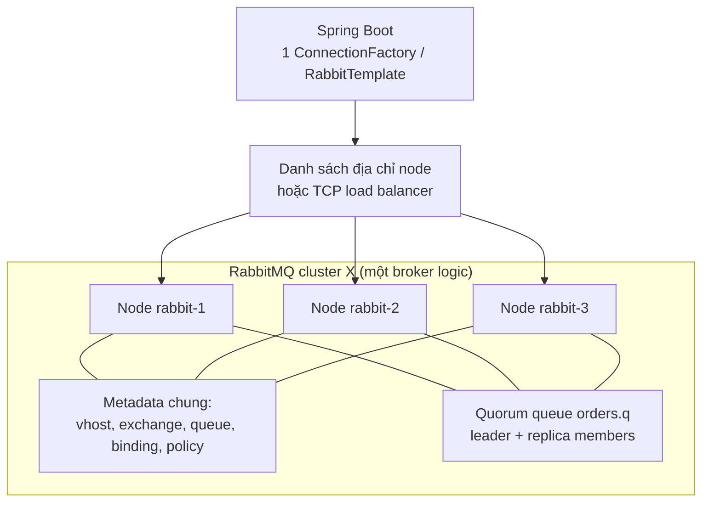
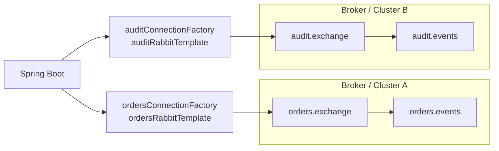
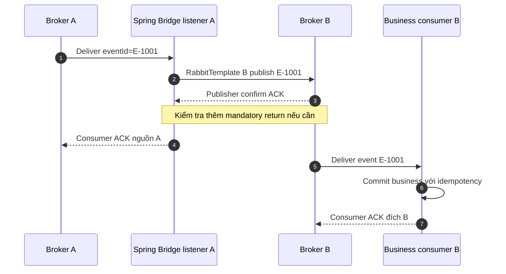

# Phân biệt cluster RabbitMQ với nhiều broker độc lập

## 1. Cùng có nhiều máy chủ, nhưng hai mô hình rất khác nhau

Trong ứng dụng **Spring AMQP**, có thể gặp hai cấu hình nhìn qua khá giống nhau:

- Một `RabbitTemplate` kết nối đến các địa chỉ `rabbit-1:5672`, `rabbit-2:5672` và `rabbit-3:5672`.
- Hai `RabbitTemplate`: một gửi vào RabbitMQ phục vụ đơn hàng, một gửi vào RabbitMQ phục vụ audit.

Trường hợp thứ nhất thường là **nhiều node trong một RabbitMQ cluster**; trường hợp thứ hai thường là **nhiều broker hoặc cluster độc lập**. Sự khác biệt không nằm ở số máy mà ở **phạm vi chia sẻ topology, dữ liệu message, kết nối và trách nhiệm xác nhận giao nhận**.

**RabbitMQ cluster** là nhiều RabbitMQ node cùng tham gia **một hệ thống broker logic**. Các node chia sẻ thông tin định nghĩa như virtual host, exchange, queue, binding, user và policy. Ứng dụng có thể kết nối vào các node khác nhau để sử dụng cùng namespace của cluster, nhưng dữ liệu message có nhân bản hay không còn tùy **loại queue** và cấu hình.

**Nhiều broker độc lập** là hai hay nhiều hệ thống RabbitMQ **không tham gia cùng cluster**. Mỗi broker có topology, message, user, connection, ACK/NACK, DLQ và trạng thái vận hành riêng. Để message từ broker A sang broker B phải có thành phần **forwarding/replication có chủ đích**, như Shovel, Federation, một bridge ứng dụng hoặc một relay phát từ outbox.

Chủ đề thuộc chương **Nhiều broker và khách hàng** của module **SPRING_AMQP**: sử dụng `RabbitTemplate`, `@RabbitListener`, exchange, queue, binding, publisher confirms, consumer acknowledgments, retry, dead-letter, giao dịch và quan sát để xây dựng xử lý bất đồng bộ đáng tin cậy.

### Mục tiêu học tập

Sau bài học, bạn sẽ biết cách:

1. Phân biệt **cluster node**, **broker độc lập** và **virtual host**.
2. Giải thích rõ cluster chia sẻ gì, và vì sao không phải queue nào cũng có replica trên mọi node.
3. Dùng **một `ConnectionFactory` với nhiều endpoint** khi kết nối một cluster.
4. Dùng **nhiều `ConnectionFactory`, `RabbitTemplate` và listener factory** khi làm việc với các broker độc lập.
5. Chọn cluster, quorum queue, Shovel, Federation hoặc bridge theo phạm vi chịu lỗi và mục tiêu tích hợp.
6. Xử lý publisher confirm, consumer ACK, retry, DLQ, idempotency và chuyển đổi broker khi gặp lỗi.

## 2. Mô hình A: một RabbitMQ cluster gồm nhiều node



Trong cluster, một exchange tên `orders.exchange` nằm trong virtual host `/orders` là **một đối tượng logic**. App kết nối vào node nào thuộc cùng cluster và đúng vhost thì vẫn làm việc với topology tương ứng. Khi queue leader nằm trên node khác, RabbitMQ xử lý đường chuyển tiếp trong nội bộ cluster.

Một **TCP connection AMQP cụ thể** chỉ kết nối tới **một node tại một thời điểm**. Có ba địa chỉ trong cấu hình client không có nghĩa một connection tự phát bản sao của message tới ba node.

### 2.1. Cluster chia sẻ metadata, nhưng lưu message theo loại queue

| Thành phần | Được chia sẻ trong cluster? | Lưu ý |
|---|---|---|
| Exchange, binding, queue definition | Có, trong namespace của vhost | Khai báo ở một node có thể sử dụng qua node khác |
| Virtual host, user, permission, policy | Có, ở cấp cluster | Không suy rằng hai cluster độc lập có chung quyền |
| Consumer connection và channel | Không; connection gắn với node đang kết nối | Mất connection cần reconnect/recovery |
| Payload nằm trong classic queue | **Không tự sao chép đến mọi node** | Khả dụng phụ thuộc node giữ queue |
| Payload trong quorum queue | Có cơ chế replication giữa các member theo Raft | Phải còn đa số member theo thiết kế |
| Publisher confirm và delivery tag | Thuộc từng luồng/channel giao tiếp | Không phải trạng thái toàn cục có thể đem sang broker khác |

Cần tránh kết luận “cluster có ba node nên mỗi message có ba bản sao”. Điều đó **không đúng** với classic queue và cũng không đúng khi quorum queue không được triển khai với ba member phân bố trên ba node.

### 2.2. Classic queue, quorum queue và stream

**Classic queue** trên RabbitMQ hiện đại không được nhân bản chỉ vì tồn tại cluster. Nếu node lưu queue đó gặp sự cố, queue có thể không khả dụng cho đến khi node hoặc dữ liệu cần thiết phục hồi. Cơ chế classic mirrored queues đời cũ không nên được coi là bảo đảm mặc định của RabbitMQ mới.

**Quorum queue** sử dụng replication theo thuật toán Raft. Quorum queue có **3 member** thường cần còn ít nhất **2 member có thể phối hợp** để đạt majority. Nếu chỉ còn một member, queue không còn quorum cần thiết để tiếp tục phục vụ theo mô hình này. Các replica cần trải trên các failure domain thích hợp; ba bản sao trên cùng cơ sở hạ tầng dễ lỗi đồng thời không đem lại mức chịu lỗi như mong muốn.

**RabbitMQ Stream** có cơ chế lưu trữ, retention và replication riêng, phục vụ log/event stream với mục tiêu sử dụng khác queue truyền thống. Không dùng ngữ nghĩa classic/quorum queue để suy diễn toàn bộ hành vi stream.

| Tiêu chí | Classic queue | Quorum queue |
|---|---|---|
| Nhân bản message tự động chỉ vì clustering | Không | Có, theo số member và cấu hình của quorum queue |
| Điểm chịu lỗi | Phụ thuộc node giữ queue | Phụ thuộc quorum và phân bố member |
| Thứ tự và redelivery | Vẫn chịu ảnh hưởng consumer, retry, requeue | Vẫn cần kiểm soát consumer, retry, redelivery |
| Chi phí | Thường nhẹ hơn cho một số workload | Thêm chi phí replica, I/O, đồng thuận |
| Phù hợp | Nhu cầu queue không bắt buộc replication kiểu quorum | Nhu cầu queue bền vững, chịu mất node trong giới hạn quorum |

**Cluster membership không đồng nghĩa queue availability.** Một node còn mở cổng 5672 chưa chứng minh quorum queue có leader, đủ majority, không bị disk alarm và vẫn publish/consume được.

### 2.3. Khi một node bị lỗi

Giả sử app kết nối vào `rabbit-1` và node này dừng:

1. Kết nối TCP hiện tại bị mất; publisher và listener container phải phục hồi kết nối qua endpoint còn khả dụng.
2. Các delivery chưa ACK có thể được broker giao lại; consumer phải xử lý idempotent.
3. Các publish đang chờ confirm có thể ở trạng thái **không biết broker đã nhận hay chưa**; producer retry phải chịu được duplicate.
4. Một quorum queue vẫn có thể hoạt động nếu còn đủ majority và có thể bầu/duy trì leader; classic queue chỉ ở node chết có thể không sẵn sàng.
5. App phải kiểm tra khả năng xử lý **đúng queue nghiệp vụ**, thay vì chỉ kiểm tra node nào còn ping được.

Vì vậy **node failover** trong cluster và **business recovery** là hai vấn đề khác nhau.

## 3. Mô hình B: nhiều RabbitMQ broker độc lập



Broker A và broker B có thể là hai server riêng lẻ hoặc **hai cluster riêng**, mỗi cluster có nhiều node. Điểm quyết định là **không có cluster membership chung**:

- Exchange `orders.exchange` trên A khác exchange cùng tên trên B.
- Queue `orders.events` trên A không tự chứa các message từ queue cùng tên trên B.
- Việc tạo queue, binding, DLX, vhost, policy và user trên A không tạo chúng trên B.
- Publisher confirm của A không xác nhận B đã tiếp nhận publish.
- Consumer ACK một delivery trên A không thể được sử dụng để ACK delivery của B.
- B có thể hoạt động khi A chết, nhưng **không tự tiếp quản backlog** của A.

### 3.1. Những lý do hợp lý để dùng nhiều broker độc lập

| Nhu cầu | Vì sao cần tách broker | Cần xây thêm |
|---|---|---|
| Cách ly tài nguyên | Message đơn hàng quan trọng không cạnh tranh tài nguyên với audit | Connection pool, quota, retry và metrics riêng |
| Phân quyền tổ chức | Đối tác có RabbitMQ riêng, ứng dụng có RabbitMQ nội bộ | TLS, credential, vhost, contract message |
| Nhiều vùng địa lý | Dịch vụ hoạt động gần database/consumer ở từng vùng | Cơ chế chuyển event nếu có luồng liên vùng |
| Disaster recovery | Có một hệ thống dự phòng ở failure domain khác | Chuyển dữ liệu, chuyển traffic, RPO/RTO |
| Di trú hệ thống | Đồng bộ broker cũ sang broker mới từng giai đoạn | Bridge, đối soát, xử lý duplicate |
| Active-active theo customer | Mỗi nhóm customer thuộc một broker | Quy tắc ownership, version, rebalance |

Nhiều broker có thể tăng mức cách ly, nhưng cũng tăng phạm vi cấu hình và các cửa sổ lỗi cần xử lý.

## 4. So sánh hai kiến trúc

| Đặc điểm | Nhiều node trong một cluster | Nhiều broker độc lập |
|---|---|---|
| Số hệ thống broker logic | Một | Hai hoặc nhiều |
| Metadata exchange/queue/binding | Dùng chung trong cluster | Riêng từng broker |
| Queue trùng tên trong cùng vhost | Là một queue logic | Là các queue khác nhau |
| Dữ liệu queue | Theo vị trí queue leader/replica, tùy loại queue | Nằm tại broker sở hữu queue |
| Replication | Theo tính năng của loại queue, ví dụ quorum | **Không có tự động** giữa hai broker |
| Cấu hình kết nối Spring AMQP | Thường một connection factory với nhiều node endpoint | Mỗi broker có connection factory riêng |
| Tự động chuyển message giữa hai hệ thống | Nội bộ cluster định tuyến tới queue | Phải dùng Shovel/Federation/bridge/relay |
| Publisher confirm, consumer ACK | Trong phạm vi kết nối/channel của cluster | Từng broker độc lập |
| Phù hợp failure domain | Thường cùng hạ tầng có kết nối node ổn định | Có thể độc lập theo datacenter/region |
| Vận hành | Theo dõi membership, quorum, queue replica | Theo dõi nhiều hệ thống và đường liên broker |

**Cách xác minh:** dùng RabbitMQ Management UI hoặc `rabbitmqctl cluster_status` trên từng node để xem membership. Nếu cả ba node nằm trong cùng danh sách cluster, đó là một cluster; nếu mỗi broker có membership riêng, chúng là những cluster/broker độc lập. Tên DNS, tên exchange hoặc số IP **không chứng minh cluster membership**.

## 5. Spring Boot: một ConnectionFactory cho nhiều node trong cùng cluster

Ví dụ cluster có ba node, cùng vhost `/orders`:

```yaml
spring:
  rabbitmq:
    addresses: rabbit-1.internal:5672,rabbit-2.internal:5672,rabbit-3.internal:5672
    virtual-host: /orders
    username: ${RABBIT_USERNAME}
    password: ${RABBIT_PASSWORD}
    publisher-confirm-type: correlated
    publisher-returns: true
    template:
      mandatory: true
    listener:
      simple:
        acknowledge-mode: auto
        prefetch: 10
```

Đây là các thuộc tính Spring Boot thông thường. Spring Boot tạo kết nối từ danh sách endpoint của **cùng một hệ thống broker logic**. Các thông tin authentication và virtual host phải đúng với cluster được dùng.

Ví dụ producer không cần biết queue leader nằm trên node nào:

```java
import org.springframework.amqp.rabbit.core.RabbitTemplate;
import org.springframework.stereotype.Service;

@Service
public class OrderPublisher {
    private final RabbitTemplate rabbitTemplate;

    public OrderPublisher(RabbitTemplate rabbitTemplate) {
        this.rabbitTemplate = rabbitTemplate;
    }

    public void publish(String orderId) {
        rabbitTemplate.convertAndSend(
                "orders.exchange",
                "order.created",
                orderId);
    }
}
```

Publisher gửi vào exchange thuộc cluster; RabbitMQ phân phối message theo binding. Việc cấu hình nhiều địa chỉ có nghĩa client có lựa chọn kết nối/reconnect, **không phát cùng message ba lần**.

### 5.1. Các giới hạn của failover kết nối

- Một connection dài hạn vẫn gắn vào một node; khi node mất, Spring AMQP cần thời gian phục hồi và có thể làm gián đoạn listener.
- Publisher confirm bị mất không chứng minh publish thất bại. Broker có thể đã nhận rồi nhưng TCP chết trước khi gửi confirm về producer.
- Message chưa ACK khi connection đóng có thể được giao lại; không coi callback xử lý xong mà chưa ACK là exactly-once.
- Đổi sang node thứ hai không thể khôi phục một classic queue chỉ tồn tại trên node đã hỏng.
- Load balancer chỉ cân bằng/chọn node endpoint, **không thay thế** queue replication hoặc quy tắc quorum.

Vì vậy cần kiểm thử **reconnect** và **queue availability** riêng, đồng thời dùng publisher confirms/returns, idempotency và retry có giới hạn.

## 6. Spring Boot: nhiều ConnectionFactory cho các broker độc lập

Giả sử Broker A xử lý đơn hàng và Broker B xử lý audit. Mỗi bên có thể là cluster của riêng mình.

### 6.1. Các property do ứng dụng tự định nghĩa

```yaml
app:
  brokers:
    orders:
      addresses: orders-rmq-1:5672,orders-rmq-2:5672
      virtual-host: /orders
      username: ${ORDERS_RABBIT_USER}
      password: ${ORDERS_RABBIT_PASSWORD}
    audit:
      addresses: audit-rmq-1:5672,audit-rmq-2:5672
      virtual-host: /audit
      username: ${AUDIT_RABBIT_USER}
      password: ${AUDIT_RABBIT_PASSWORD}
```

**Các key `app.brokers.*` không phải thuộc tính Spring Boot tự cấu hình sẵn hai connection factory**. Ứng dụng phải đọc chúng và tạo bean tương ứng. `orders-rmq-1/2` giả định thuộc cluster A; `audit-rmq-1/2` thuộc cluster B.

### 6.2. Tạo hai CachingConnectionFactory

```java
import org.springframework.amqp.rabbit.connection.CachingConnectionFactory;
import org.springframework.beans.factory.annotation.Value;
import org.springframework.context.annotation.Bean;
import org.springframework.context.annotation.Configuration;
import org.springframework.context.annotation.Primary;

@Configuration
public class MultiBrokerConnections {

    @Bean("ordersConnectionFactory")
    @Primary
    CachingConnectionFactory ordersConnectionFactory(
            @Value("${app.brokers.orders.addresses}") String addresses,
            @Value("${app.brokers.orders.username}") String username,
            @Value("${app.brokers.orders.password}") String password,
            @Value("${app.brokers.orders.virtual-host}") String vhost) {
        return connectionFactory(addresses, username, password, vhost);
    }

    @Bean("auditConnectionFactory")
    CachingConnectionFactory auditConnectionFactory(
            @Value("${app.brokers.audit.addresses}") String addresses,
            @Value("${app.brokers.audit.username}") String username,
            @Value("${app.brokers.audit.password}") String password,
            @Value("${app.brokers.audit.virtual-host}") String vhost) {
        return connectionFactory(addresses, username, password, vhost);
    }

    private static CachingConnectionFactory connectionFactory(
            String addresses, String user, String password, String vhost) {
        CachingConnectionFactory cf = new CachingConnectionFactory();
        cf.setAddresses(addresses);
        cf.setUsername(user);
        cf.setPassword(password);
        cf.setVirtualHost(vhost);

        // Theo dõi xác nhận publisher riêng cho mỗi broker.
        cf.setPublisherConfirmType(
                CachingConnectionFactory.ConfirmType.CORRELATED);
        cf.setPublisherReturns(true);
        return cf;
    }
}
```

Hai factory tạo **hai nhóm kết nối/channel độc lập**. `@Primary` ở đây chỉ là lựa chọn bean mặc định của Spring khi có injection không chỉ rõ tên. Nó không gộp kết nối tới hai broker. Với đường nghiệp vụ quan trọng, vẫn nên chọn bean bằng `@Qualifier`.

Ở production, cấu hình riêng cho TLS, heartbeat, timeout, connection name, cache/channel limits và credential của mỗi broker. Không dùng mật khẩu ghi trực tiếp trong source.

### 6.3. Tạo hai RabbitTemplate và hai listener factory

```java
import org.springframework.amqp.core.AcknowledgeMode;
import org.springframework.amqp.rabbit.config.SimpleRabbitListenerContainerFactory;
import org.springframework.amqp.rabbit.connection.ConnectionFactory;
import org.springframework.amqp.rabbit.core.RabbitTemplate;
import org.springframework.beans.factory.annotation.Qualifier;
import org.springframework.context.annotation.Bean;
import org.springframework.context.annotation.Configuration;

@Configuration
public class MultiBrokerMessaging {

    @Bean("ordersRabbitTemplate")
    RabbitTemplate ordersTemplate(
            @Qualifier("ordersConnectionFactory") ConnectionFactory cf) {
        RabbitTemplate template = new RabbitTemplate(cf);
        template.setMandatory(true);
        return template;
    }

    @Bean("auditRabbitTemplate")
    RabbitTemplate auditTemplate(
            @Qualifier("auditConnectionFactory") ConnectionFactory cf) {
        RabbitTemplate template = new RabbitTemplate(cf);
        template.setMandatory(true);
        return template;
    }

    @Bean("ordersListenerFactory")
    SimpleRabbitListenerContainerFactory ordersListenerFactory(
            @Qualifier("ordersConnectionFactory") ConnectionFactory cf) {
        return newListenerFactory(cf);
    }

    @Bean("auditListenerFactory")
    SimpleRabbitListenerContainerFactory auditListenerFactory(
            @Qualifier("auditConnectionFactory") ConnectionFactory cf) {
        return newListenerFactory(cf);
    }

    private static SimpleRabbitListenerContainerFactory newListenerFactory(
            ConnectionFactory cf) {
        SimpleRabbitListenerContainerFactory factory =
                new SimpleRabbitListenerContainerFactory();
        factory.setConnectionFactory(cf);
        factory.setAcknowledgeMode(AcknowledgeMode.AUTO);
        factory.setPrefetchCount(10);
        return factory;
    }
}
```

### 6.4. Gửi và nhận trên đúng broker

```java
import org.springframework.amqp.rabbit.core.RabbitTemplate;
import org.springframework.beans.factory.annotation.Qualifier;
import org.springframework.stereotype.Service;

@Service
public class SeparateBrokerPublisher {
    private final RabbitTemplate ordersTemplate;
    private final RabbitTemplate auditTemplate;

    public SeparateBrokerPublisher(
            @Qualifier("ordersRabbitTemplate") RabbitTemplate ordersTemplate,
            @Qualifier("auditRabbitTemplate") RabbitTemplate auditTemplate) {
        this.ordersTemplate = ordersTemplate;
        this.auditTemplate = auditTemplate;
    }

    public void publishOrder(String orderId) {
        // Default exchange: queue orders.events trên Broker A.
        ordersTemplate.convertAndSend("", "orders.events", orderId);
    }

    public void publishAudit(String auditText) {
        // Default exchange: queue audit.events trên Broker B.
        auditTemplate.convertAndSend("", "audit.events", auditText);
    }
}
```

```java
import org.springframework.amqp.rabbit.annotation.RabbitListener;
import org.springframework.stereotype.Component;

@Component
public class SeparateBrokerConsumers {

    @RabbitListener(
            queues = "orders.events",
            containerFactory = "ordersListenerFactory")
    public void onOrder(String orderId) {
        // Xử lý và commit theo hợp đồng nghiệp vụ.
    }

    @RabbitListener(
            queues = "audit.events",
            containerFactory = "auditListenerFactory")
    public void onAudit(String auditText) {
        // Ghi audit bền vững trước khi trả về thành công.
    }
}
```

Đoạn ví dụ giả định các queue đã được **provision đúng ở từng broker**. Nếu dùng `RabbitAdmin` để khai báo queue/exchange/binding tự động, cần cấu hình **admin riêng** và **giới hạn declarable** cho từng broker (ví dụ `adminsThatShouldDeclare` và `explicitDeclarationsOnly`), tránh việc các admin cùng khai báo mọi bean topology trên tất cả broker.

Trong ứng dụng đa broker, cần kiểm tra auto-configuration của Spring Boot để không vô tình dùng `RabbitAdmin` hoặc listener factory mặc định trỏ về primary connection. Nếu bỏ `containerFactory` khỏi annotation listener audit, listener có thể dùng broker A chỉ vì A là lựa chọn mặc định.

**Điểm phân biệt:** Một `RabbitTemplate` được nối với **một ConnectionFactory**, vì vậy **routing key không tự chọn broker đích**. Code gọi `ordersTemplate` để gửi tới A và `auditTemplate` để gửi tới B. Exchange/binding chỉ định tuyến **bên trong broker đã chọn**.

## 7. Virtual host không tương đương broker độc lập

Một cluster có thể có vhost `/orders` và `/audit`:

```text
Cluster X
  /orders
    orders.exchange -> orders.events
  /audit
    audit.exchange -> audit.events
```

Hai vhost là hai **namespace logic** với queue, exchange, binding và quyền riêng. Nhưng chúng vẫn cùng chia sẻ node và các tài nguyên cluster. Do đó:

| Mô hình | Tách namespace | Tách failure domain vật lý |
|---|---|---|
| Hai queue trong một vhost | Mỗi queue có tên riêng | Không đảm bảo |
| Hai vhost trên cùng cluster | Có | Không; vẫn cùng cluster |
| Hai connection factory tới cùng cluster | Có thể khác vhost/user | Không tự tạo broker mới |
| Hai cluster độc lập ở hạ tầng riêng | Có | Có thể tách, phụ thuộc thiết kế triển khai |

Nếu hai vhost có cùng queue tên `orders.events`, chúng vẫn là hai queue logic khác nhau. `ConnectionFactory.setVirtualHost(...)` quyết định namespace mà client truy cập; **cùng cluster** vẫn không làm queue hai vhost chia sẻ message.

## 8. Khi nào dùng cluster, Shovel, Federation hoặc bridge?

Cluster chủ yếu giải quyết **nhiều node của một broker logic**. Các mô hình độc lập cần cơ chế riêng để **trao đổi message giữa broker**.

| Công nghệ/mô hình | Hành vi cơ bản | Khi chọn | Giới hạn |
|---|---|---|---|
| **RabbitMQ cluster** | Node cùng quản lý một broker logic; queue có cơ chế HA theo loại | Mở rộng node, phân bố kết nối, HA theo topology | Không tạo một cluster DR độc lập; phân vùng mạng và quorum vẫn là vấn đề |
| **Shovel** | Đọc message ở một broker rồi publish sang broker khác theo cấu hình | Chuyển message, migration, nối broker qua ranh giới mạng | Cần theo dõi forward/ACK, retry, duplicate và backlog |
| **Federation** | Liên kết exchange/queue giữa broker theo cơ chế federation | Phân phối message giữa broker độc lập, kể cả liên vùng | Không làm hai broker chia sẻ metadata như cluster |
| **Bridge Spring AMQP** | `@RabbitListener` đọc A, `RabbitTemplate` publish B | Cần biến đổi schema, lọc, enrich, logic doanh nghiệp | Không có transaction nguyên tử chung giữa A và B |
| **Outbox relay đa đích** | Lưu ý định gửi trong DB, publish theo từng destination | Sự kiện phải đến nhiều broker với trạng thái audit được | Mỗi đích có ACK/timeout riêng; cần idempotency |

**Shovel và Federation không biến các broker độc lập thành cùng cluster.** Cơ chế trao đổi message giữa chúng vẫn có trễ, trạng thái lỗi và chính sách delivery; không nên gọi đó là “replication nhất quán của toàn bộ cluster”.

### 8.1. Vòng đời của bridge ứng dụng



Có ba cửa sổ lỗi quan trọng:

1. **ACK A trước khi có xác nhận B:** nếu bridge crash, A đã loại delivery nhưng B chưa nhận. Đây là nguy cơ mất message.
2. **B confirm thành công rồi bridge crash trước ACK A:** A có thể redeliver; bridge publish thêm lần nữa, B có thể nhận event **trùng**.
3. **B timeout/connection mất trước confirm:** kết quả publish có thể không xác định; B có thể đã nhận hoặc chưa.

Kết luận thiết kế: bridge nên **chỉ hoàn tất delivery nguồn sau khi chuyển giao đích được xác nhận đúng theo contract**, đồng thời dùng event ID ổn định và consumer idempotent để chịu duplicate. Một hệ thống đòi hỏi không thất lạc lâu dài còn cần kho trạng thái bền vững/outbox, retry và đối soát.

### 8.2. ACK nguồn và ACK đích là hai giao thức độc lập

Mỗi delivery có `deliveryTag` trong phạm vi **channel nhận message**. Channel A không ACK được delivery trên B; channel B không ACK được delivery trên A.

Đối với bridge:

- Listener của A nhận delivery qua `ordersConnectionFactory`.
- `auditRabbitTemplate` publish B qua `auditConnectionFactory`.
- Publisher confirm/return của B trả về bridge.
- Bridge xác nhận delivery nguồn **trên channel A** khi đạt điều kiện chuyển giao.
- Consumer của B xử lý và tự ACK **delivery ở B**.

Nếu bridge dùng `AcknowledgeMode.AUTO` mà gọi `auditTemplate.convertAndSend(...)` rồi **trả về ngay**, việc Spring ACK A có thể xảy ra trước khi B phát confirm. Để tránh ACK sớm, hãy chờ kết quả publish/return phù hợp hoặc dùng mô hình async completion và acknowledgment có kiểm soát. Việc đợi confirm trên consumer thread có chi phí; với tải lớn cần thiết kế relay bền vững và backpressure.

## 9. Node failover khác broker failover và disaster recovery

### 9.1. Khi một node trong cluster dừng

Ứng dụng có thể thử chuyển kết nối sang node còn sống. Tuy nhiên, phải kiểm tra queue còn khả dụng không, message chưa ACK sẽ ra sao, và publish đang chờ confirm có thể bị lặp không.

Ví dụ quorum queue 3 member mất 1 member nhưng còn 2 member hoạt động có thể tiếp tục được phục vụ sau khi vai trò leader ổn định. Nếu mất quá số member cho phép, dù app kết nối tới một node còn sống, queue vẫn không có quorum.

### 9.2. Khi Broker A độc lập dừng

Broker B còn sống **không đủ** để tiếp quản công việc A. Muốn chuyển producer/consumer từ A sang B phải chuẩn bị:

- Queue/exchange/binding, policy, DLX, user và permission của workload A ở B.
- Quy trình di chuyển hoặc tái tạo các message **đã xác nhận ở A nhưng chưa xử lý**.
- Cơ chế xử lý event chưa được xác nhận bởi A, ví dụ outbox.
- Quy tắc ownership/partition key để không có hai consumer xử lý cùng aggregate đồng thời ở A/B.
- Cơ chế version và idempotency khi hai phía có thể nhận cùng event.
- Kế hoạch quay lại A sau khi phục hồi, bao gồm backlog ở cả hai bên.

Nếu chỉ sửa địa chỉ connection factory từ A sang B, event cũ có thể còn nằm ở A trong khi event mới vào B. Điều này tạo nguy cơ mất thứ tự hoặc bỏ sót công việc.

### 9.3. RPO, RTO và failure domain

Với giải pháp disaster recovery, phải định nghĩa rõ:

- **RPO:** lượng dữ liệu tối đa có thể mất hoặc cần đối soát sau sự cố.
- **RTO:** thời gian mục tiêu để phục hồi luồng xử lý.
- **Nguồn sự thật:** DB/outbox, event store hoặc hệ thống nào có thể tái tạo message.
- **Cơ chế phát lại:** event ID ổn định, version, replay theo thứ tự, chống trùng.
- **Sự độc lập hạ tầng:** node/broker có cùng nguồn điện, storage hoặc network failure domain không.

Có nhiều broker độc lập **không tự đảm bảo RPO bằng 0 hoặc exactly-once**. Đặc tính đó phụ thuộc vào cách chuyển giao, lưu dữ liệu và đối soát.

## 10. Publisher confirm, consumer ACK, retry và DLQ theo từng broker

| Tín hiệu | Phạm vi | Không có nghĩa |
|---|---|---|
| Publisher confirm ACK từ A | Publish tới broker/cluster A | Broker B nhận hoặc consumer A/B đã xử lý |
| Publisher return từ A | Publish không được định tuyến theo điều kiện return tại A | Broker B hoặc DB nghiệp vụ bị lỗi |
| Consumer ACK từ A | Delivery trên channel của A | Consumer của B đã xử lý |
| Consumer NACK/reject từ A | Delivery trên A; requeue/reject theo cấu hình của A | Message lỗi tự xuất hiện trên DLQ của B |
| Publisher confirm ACK từ B | Publish tới B | A đã ACK delivery nguồn |
| Transaction DB consumer B | Ghi dữ liệu B đã commit | ACK B chắc chắn đã tới broker |

Một lệnh publisher confirm ACK chỉ cho biết broker đã chấp nhận publish theo ngữ nghĩa confirm và topology tương ứng. Nếu message không route được tới queue, positive confirm vẫn có thể xuất hiện. Để phát hiện unroutable khi phù hợp, bật `mandatory=true` và publisher returns; kiểm tra cả hai.

### 10.1. Một event, hai destination

Giả sử ứng dụng phát `E-1001` tới A và B:

```text
E-1001 -> Broker A: publisher confirm ACK
E-1001 -> Broker B: timeout
```

Đừng gán một trạng thái tổng `SENT` cho cả hai. Nên ghi riêng:

| eventId | destination | state |
|---|---|---|
| `E-1001` | `orders-A` | `CONFIRMED` |
| `E-1001` | `audit-B` | `PENDING_OR_UNKNOWN` |

Khi B hoạt động lại, relay retry tới B bằng **cùng eventId**. Do timeout có thể xảy ra sau khi B nhận được message, consumer B phải idempotent.

### 10.2. Retry và dead-letter cũng riêng từng broker

`basicNack(deliveryTag, false, false)` yêu cầu không requeue delivery; nó chỉ được chuyển vào DLQ **nếu queue nguồn tại đúng broker có DLX/routing phù hợp**. Có DLQ `orders.dead` trên B không giúp message bị reject ở A tự động tới đó.

Một retry xảy ra trong listener ở A, broker redelivery ở A, producer publish lại lên B và bridge retry từ A sang B là **bốn tình huống khác nhau**. Hãy quản lý số lần thử và giới hạn cuối cùng. Retry không có backoff hay idempotency có thể gây vòng lặp nóng hoặc side effect trùng.

### 10.3. Sự cố giữa commit DB và ACK

Consumer B có thể commit dữ liệu thành công rồi mất connection trước khi ACK. Khi broker redeliver event, consumer mới phải nhận ra event ID đã xử lý. Áp dụng **transaction + unique key/idempotency** trong DB; khi nghiệp vụ tạo event để gửi tiếp, dùng **transactional outbox**. Không thể dùng RabbitMQ ACK để làm transaction nguyên tử chung với DB của ứng dụng hoặc broker khác.

## 11. Độ tin cậy khi chuyển message giữa broker

Khi source và destination độc lập, nguyên tắc hữu ích là coi mỗi chặng như một ranh giới xác nhận:

```text
Business DB commit
  -> event được lưu bền vững (outbox)
  -> publish Broker A + confirm/return A
  -> delivery A
  -> chuyển giao sang Broker B + confirm/return B
  -> ACK delivery nguồn A
  -> delivery B
  -> consumer B commit DB với idempotency
  -> ACK delivery B
```

Không có một confirm/ACK duy nhất bao trùm toàn bộ chuỗi này. Mỗi lần crash giữa hai mốc có thể tạo **message chưa biết đã được gửi hay chưa** hoặc **duplicate**. Thiết kế phải phân biệt:

- **At-most-once:** chấp nhận mất message để tránh gửi lại; thường không phù hợp tác vụ nghiệp vụ quan trọng.
- **At-least-once:** ưu tiên không bỏ sót, chấp nhận redelivery và xử lý trùng bằng idempotency.
- **Exactly-once end-to-end:** không tự đạt được bằng cluster, publisher confirms hoặc ACK. Muốn side effect chỉ xảy ra một lần cần một hợp đồng nghiệp vụ cụ thể cùng lưu trạng thái/transaction/idempotency.

Nếu luồng có event theo version của cùng order/customer, còn cần **ownership key** và kiểm soát thứ tự: hai broker độc lập không tự gộp thứ tự publish của `O-1001:v1` ở A với `O-1001:v2` ở B.

## 12. Bảo mật và quan sát trong kiến trúc nhiều broker

### 12.1. Tài nguyên và danh tính kết nối

- Dùng tên bean rõ ràng như `ordersRabbitTemplate` và `auditListenerFactory`; tránh tiêm nhầm primary broker.
- Tách user/credential, vhost, quyền declare/read/write, certificate và chính sách network cho từng broker khi cần.
- Dùng TLS khi kết nối qua mạng không tin cậy; bảo vệ password trong secret manager/biến môi trường.
- Giới hạn channel cache, connection, pool, prefetch và concurrency riêng từng workload.
- Nếu broker B chậm, không để tất cả thread xử lý order trên A bị block do đợi publish B: dùng timeout, worker pool cách ly, backpressure hoặc outbox relay.

### 12.2. Theo dõi cluster

| Phạm vi | Thước đo gợi ý |
|---|---|
| Node | Up/down, connection/channel count, memory alarm, disk alarm, network/CPU |
| Cluster | Membership, network partition, inter-node communication |
| Quorum queue | Leader, member placement, majority availability, replication health |
| Queue | `messages_ready`, `messages_unacknowledged`, consumer count |
| Client | Reconnect, publisher confirm timeout/NACK, return, redelivery, listener error |

Một node đang mở AMQP port nhưng chịu disk/memory alarm có thể không đáp ứng được publish đúng SLA. Kiểm tra theo **queue và nghiệp vụ**, không chỉ theo socket.

### 12.3. Theo dõi liên broker

- Số event đang chờ forward và độ trễ A → B.
- Số confirm ACK, NACK, returns, timeout **theo broker**.
- Backlog và lỗi ở Shovel, Federation hoặc bridge.
- Chênh lệch event ID/sequence đã xác nhận giữa nguồn và đích.
- Tỷ lệ duplicate/late event, số lần replay, gap theo aggregate.
- DLQ và retry theo nguồn A/B; cảnh báo failure của từng destination.

Log nên có `eventId`, `sourceBroker`, `destinationBroker`, exchange, routing key, queue, attempt, publish confirm/return, trạng thái consumer và `traceId`. Không log credential hoặc payload nhạy cảm.

## 13. Tình huống lỗi và cách kiểm tra

| Hiện tượng | Nguyên nhân thường gặp | Bước đầu xử lý |
|---|---|---|
| Kết nối được node thứ hai nhưng không đọc được queue | Classic queue ở node đã mất, hoặc quorum queue thiếu majority | Kiểu queue, leader, members, cluster health |
| Mất node rồi consumer xử lý lại message | Delivery cũ chưa ACK được ghi nhận | Transaction, idempotency, redelivery |
| Publisher confirm ACK nhưng queue đích không có message | Không route được hoặc gửi nhầm broker | Mandatory return, bean/template, binding |
| Queue cùng tên ở hai host có số message khác nhau | Hai broker độc lập hoặc khác vhost | Cluster membership và virtual host |
| Listener audit đọc sai nguồn | Thiếu `containerFactory` hoặc `@Qualifier` | Kiểm tra connection factory của listener |
| RabbitAdmin tạo topology ở cả A và B | Declarable không giới hạn admin | Cấu hình admin và target declarables |
| Broker B chết làm ứng dụng A bị nghẽn | Thread chung block khi gửi/đợi B | Timeout, executor isolation, outbox |
| Bridge mất message | ACK A trước khi confirm publish B | Đường ACK/confirm, retry, đối soát |
| Bridge gửi trùng | B nhận rồi, bridge chưa ACK A | Event ID, consumer idempotency |
| DR chuyển sang B nhưng một số order bị đảo trạng thái | Backlog A còn, message mới B đã xử lý | Ownership, aggregate version, replay |
| DLQ B không chứa message lỗi từ A | DLX chỉ hoạt động ở A | Kiểm tra DLX/binding và forwarding riêng |

## 14. Bài thực hành

### Bài 1 — Xác định cluster membership

Tạo ba RabbitMQ node trong cùng cluster trên môi trường thử nghiệm. Kiểm tra membership bằng `rabbitmqctl cluster_status` hoặc Management UI. Kết nối Spring Boot qua `spring.rabbitmq.addresses`, publish và consume vào cùng topology qua các node khác nhau.

**Kỳ vọng:** exchange và queue là những đối tượng logic chung, không xuất hiện thành ba bản độc lập chỉ vì client có ba endpoint.

### Bài 2 — Classic queue và quorum queue khi mất node

Tạo một classic queue và một quorum queue đủ ba member được phân bố trên ba node. Dừng node thích hợp trên môi trường thử nghiệm, quan sát leader/member và khả năng publish/consume của từng queue.

**Kỳ vọng:** hiểu rằng độ sẵn sàng của queue phụ thuộc loại queue và quorum, không chỉ vào việc cluster còn ít nhất một node.

### Bài 3 — Hai broker độc lập với cùng queue name

Tạo Broker A và Broker B độc lập, mỗi broker có queue `demo.events`. Publish một message tới A.

**Kỳ vọng:** B không tự có message. Dùng template kết nối B để publish message khác và chứng minh hai queue cùng tên là hai đối tượng khác nhau.

### Bài 4 — Cấu hình nhiều ConnectionFactory

Dùng `MultiBrokerConnections` và `MultiBrokerMessaging` ở mục 6. Tạo queue `orders.events` trên A và `audit.events` trên B, gửi hai message.

**Kỳ vọng:** đúng listener và đúng broker nhận từng message. Thử bỏ `containerFactory` của audit để nhận diện lỗi chọn bean mặc định.

### Bài 5 — Forward có publisher confirm

Xây bridge từ A sang B. Chỉ ACK delivery nguồn A sau khi có publisher confirm ACK và không có return từ B. Chủ động làm B mất kết nối trước confirm rồi cho bridge retry.

**Kỳ vọng:** bridge không coi việc chuyển giao đã thành công khi B chưa xác nhận. Mô phỏng crash sau confirm B nhưng trước ACK A và ghi nhận khả năng duplicate.

### Bài 6 — Theo dõi sự kiện nhiều destination

Tạo bảng outbox delivery gồm `eventId`, `destination`, `state`, `attempt` và `confirmedAt`. Cho A confirm ACK trong khi B timeout.

**Kỳ vọng:** A là `CONFIRMED`, B còn pending/unknown. Retry B với cùng event ID và xác minh không áp dụng side effect hai lần.

### Bài 7 — Hai vhost có phải hai broker không?

Tạo `/orders` và `/audit` trên cùng cluster. Tạo một queue cùng tên trong hai vhost, kết nối vào mỗi vhost bằng credential hợp lệ.

**Kỳ vọng:** queue và namespace tách biệt, nhưng cluster membership và failure domain vẫn chung.

### Bài 8 — Lập kế hoạch disaster recovery

Giả lập Broker A bị mất toàn bộ trong khi B còn chạy. Liệt kê topology phải chuẩn bị, backlog cần di chuyển, cách xác định event đã commit và quy tắc tránh xử lý song song cùng aggregate ở hai broker.

**Kỳ vọng:** có kịch bản RPO/RTO và replay/ownership rõ ràng, không chỉ thay hostname.

## 15. Câu hỏi tự kiểm tra

1. Vì sao ba node RabbitMQ trong cùng cluster vẫn được xem là **một** broker logic?
2. RabbitMQ clustering có tự tạo ba bản sao của mọi classic queue khi có ba node không?
3. Một quorum queue ba member cần tối thiểu bao nhiêu member hoạt động để có majority?
4. Hai broker độc lập có exchange cùng tên có chia sẻ message không?
5. Vì sao một `RabbitTemplate` không tự lựa chọn Broker B khi routing key mang tên `audit.events`?
6. Khi có hai connection factory, vai trò của `@Qualifier` và `containerFactory` là gì?
7. Vhost khác nhau trên cùng cluster có tạo ra hai failure domain vật lý không?
8. Shovel và Federation có biến hai broker thành cùng một cluster không?
9. Vì sao bridge nên đợi confirm từ B trước khi ACK delivery của A? Tại sao vẫn có duplicate?
10. Nếu publisher timeout trên Broker B, có thể khẳng định B chưa nhận event không?
11. Vì sao chuyển traffic từ Broker A sang B mà không chuyển backlog có thể làm trạng thái nghiệp vụ sai?
12. Publisher confirm, consumer ACK và commit database ở hai broker có tạo thành một transaction nguyên tử không?

## Ghi nhớ

- **Cluster RabbitMQ** là một broker logic nhiều node: dùng chung topology/metadata nhưng **không tự nhân bản mọi message**; loại queue và quorum quyết định khả năng chịu lỗi.
- **Nhiều broker độc lập** là nhiều broker logic: exchange, queue, message, user, confirm, consumer ACK và DLQ đều riêng theo từng broker.
- Trong Spring AMQP, **một cluster thường dùng một ConnectionFactory với nhiều endpoint**; nhiều broker độc lập dùng **nhiều ConnectionFactory, RabbitTemplate và listener factory** với tên rõ ràng.
- **Shovel, Federation, bridge hoặc outbox relay** chuyển message liên broker nhưng không biến các broker thành cùng cluster và không tự tạo exactly-once.
- Khi chuyển dữ liệu hay failover, phải bảo vệ **publisher confirm/returns, consumer ACK đúng lúc, idempotency, retry có giới hạn, DLQ, event version, outbox và đối soát**.

## Tài liệu tham khảo

- [RabbitMQ — Clustering Guide](https://www.rabbitmq.com/docs/clustering)
- [RabbitMQ — Quorum Queues](https://www.rabbitmq.com/docs/quorum-queues)
- [RabbitMQ — Classic Queues](https://www.rabbitmq.com/docs/classic-queues)
- [RabbitMQ — Consumer Acknowledgements and Publisher Confirms](https://www.rabbitmq.com/docs/confirms)
- [RabbitMQ — Shovel](https://www.rabbitmq.com/docs/shovel)
- [RabbitMQ — Federation](https://www.rabbitmq.com/docs/federation)
- [Spring AMQP — Connections](https://docs.spring.io/spring-amqp/reference/amqp/connections.html)
- [Spring AMQP — Multiple Broker Support](https://docs.spring.io/spring-amqp/reference/amqp/multi-rabbit.html)
