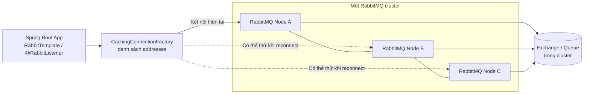

# Cấu hình nhiều địa chỉ kết nối và lựa chọn node

## 1. Bài toán: một ứng dụng, nhiều điểm kết nối RabbitMQ

Trong chương **Nhiều broker và khách hàng** của module **SPRING_AMQP**, ta sử dụng `RabbitTemplate` để publish, `@RabbitListener` để consume, cùng exchange, queue và binding để định tuyến công việc bất đồng bộ. Một ứng dụng chỉ cấu hình `host: rabbit-1` có nguy cơ gián đoạn khi chính node đó restart hoặc mạng tới node bị lỗi, dù những node khác trong cluster vẫn đang hoạt động.

RabbitMQ cho phép ứng dụng biết **nhiều địa chỉ kết nối**:

```text
rabbit-1.internal:5672
rabbit-2.internal:5672
rabbit-3.internal:5672
```

Khi tạo kết nối, client có thể thử node khác nếu endpoint được chọn không truy cập được. Với Spring AMQP, danh sách này được quản lý bởi `CachingConnectionFactory`, thường thông qua thuộc tính `spring.rabbitmq.addresses` của Spring Boot.

Cần phân biệt hai mô hình:

- **Nhiều node thuộc cùng một cluster:** các node là những điểm vào một RabbitMQ cluster, chia sẻ metadata về exchanges, queues, bindings. Việc kết nối qua node khác có thể giúp vượt qua lỗi node đầu vào. Tính sẵn sàng của **dữ liệu queue** vẫn phụ thuộc loại queue, replication và quorum.
- **Nhiều broker/cluster độc lập:** mỗi hệ thống có queue và dữ liệu riêng. Một danh sách addresses trộn cả hai cluster **không tự đồng bộ message** và có thể khiến ứng dụng đọc hoặc ghi nhầm môi trường.

**Mục tiêu bài học:** cấu hình danh sách địa chỉ, hiểu cách client chọn node và tái kết nối, biết giới hạn của failover, phân biệt nhiều cluster, và kiểm thử độ tin cậy khi gửi/nhận message qua các node RabbitMQ.

## 2. Hiểu đúng các tầng kết nối và định tuyến



| Lớp | Công cụ | Chức năng |
| --- | --- | --- |
| Điểm truy cập | `host:port`, DNS, TCP load balancer | Xác định endpoint để mở kết nối TCP/TLS |
| Kết nối AMQP | RabbitMQ Java client, `CachingConnectionFactory` | Thử địa chỉ, xác thực, mở và cache connection/channel |
| Định tuyến broker | Exchange, queue, binding, vhost | Xác định message đến queue nào; broker xử lý tuyến tới queue leader |
| Phục hồi | Spring listener container, reconnect, retry | Tiếp tục hoạt động sau lỗi kết nối |
| Độ tin cậy nghiệp vụ | Publisher confirms/returns, ack, DLQ, idempotency | Giảm thất lạc và xử lý an toàn khi delivery được lặp lại |

**Ba điều không nên nhầm:**

1. Cấu hình ba địa chỉ **không** đồng nghĩa mỗi message được round-robin qua ba node. `CachingConnectionFactory` giữ và tái sử dụng connection/channel còn tốt.
2. Kết nối tới node B **không** có nghĩa queue leader nằm trên B. Broker có thể định tuyến nội bộ giữa các node.
3. Có ba node trong cluster **không** bảo đảm mọi queue có ba bản sao. Cần kiểm tra loại queue (ví dụ quorum queue), replication và trạng thái quorum; thuộc tính `durable` chỉ là một phần của độ bền.

## 3. Spring Boot: cấu hình danh sách địa chỉ

Với dependency `spring-boot-starter-amqp`, cấu hình thông dụng là:

```yaml
spring:
  rabbitmq:
    addresses: "rabbit-1.internal:5672,rabbit-2.internal:5672,rabbit-3.internal:5672"
    username: app_messaging
    password: ${RABBITMQ_PASSWORD}
    virtual-host: "/orders"
    connection-timeout: 5s
    requested-heartbeat: 30s
```

Giải thích:

- `addresses`: các endpoint RabbitMQ client có thể thử. Với mô hình HA cluster, các endpoint nên thuộc **cùng cluster** và cùng mục đích nghiệp vụ.
- `username`/`password`: xác thực AMQP; ví dụ sử dụng biến môi trường để tránh đưa secret thẳng vào repository.
- `virtual-host`: phạm vi namespace của exchange, queue, binding. Các node được chọn cần hỗ trợ cùng vhost và quyền tương ứng.
- `connection-timeout`: timeout cho việc thiết lập kết nối TCP tới một endpoint. Giá trị không bảo đảm tổng thời gian tìm một node hoạt động luôn bằng đúng 5 giây.
- `requested-heartbeat`: heartbeat AMQP được thỏa thuận với broker để phát hiện kết nối hỏng; quá nhỏ có thể gây nhầm khi mạng chập chờn.

**Khi dùng `addresses`, hãy coi đó là nguồn chọn endpoint chính** thay vì đồng thời dựa vào `spring.rabbitmq.host` và `spring.rabbitmq.port`. Port `5672` thường dành cho AMQP thường; `15672` là cổng web quản trị RabbitMQ, không phải AMQP.

Nếu cluster bật TLS, cần thêm cấu hình `spring.rabbitmq.ssl.*`, cổng AMQPS thích hợp (thường 5671), certificate và hostname verification. **Đổi port một mình không tự bật TLS.** Các endpoint trong cùng danh sách phải thống nhất chính sách bảo mật/vhost hoặc được cấu hình đúng cho từng endpoint theo khả năng phiên bản sử dụng.

### 3.1. Khi ứng dụng có nhiều replica

Giả sử 10 instance cùng cấu hình A, B, C. Nếu mọi connection đều ưu tiên A và sống lâu, A có thể nhận nhiều kết nối hơn B, C. Việc client có cơ chế thay đổi thứ tự thử địa chỉ giúp phân phối **kết nối mới**, nhưng không đồng nghĩa phân phối **message theo từng lần publish**.

Một process có thể tạo hơn một connection tùy việc dùng listener container, publisher connection, cache mode và cách cấu hình ứng dụng. Cần quan sát số connection thực tế ở mỗi node, không dựa vào giả định “mỗi application = một connection”.

## 4. Lựa chọn node và AddressShuffleMode

Spring AMQP có tùy chọn `AddressShuffleMode` để quyết định cách thử danh sách địa chỉ khi tạo connection. Khả năng sử dụng enum/setter và giá trị mặc định phải được kiểm tra theo **phiên bản Spring AMQP thực tế**.

| Chế độ | Cách hiểu thực hành | Kịch bản |
| --- | --- | --- |
| `NONE` | Thử theo thứ tự liệt kê đã khai báo | Muốn ưu tiên node/endpoint gần ứng dụng nhất, sau đó thử node kế tiếp |
| `RANDOM` | Trộn thứ tự địa chỉ khi thử tạo connection | Muốn nhiều application instance không cùng dồn vào điểm vào đầu tiên |
| `INORDER` | Luân phiên điểm bắt đầu theo thứ tự đã liệt kê giữa các lần tạo connection | Muốn phân bố điểm vào theo chu kỳ trong phạm vi client |

Bảng nói về **thứ tự thử node khi connection được mở**. Nó không quyết định queue leader, chiến lược xử lý message, hay health check chạy thường xuyên trên mọi node.

### 4.1. Java configuration cho CachingConnectionFactory

Khi cần kiểm soát shuffle mode, có thể tạo connection factory chủ động:

```java
import org.springframework.amqp.rabbit.connection.AbstractConnectionFactory;
import org.springframework.amqp.rabbit.connection.CachingConnectionFactory;
import org.springframework.context.annotation.Bean;
import org.springframework.context.annotation.Configuration;

@Configuration
class ClusterConnectionConfig {

    @Bean
    CachingConnectionFactory rabbitConnectionFactory() {
        CachingConnectionFactory cf = new CachingConnectionFactory();

        cf.setAddresses(
                "rabbit-1.internal:5672,rabbit-2.internal:5672,rabbit-3.internal:5672");
        cf.setUsername("app_messaging");
        cf.setPassword(System.getenv("RABBITMQ_PASSWORD"));
        cf.setVirtualHost("/orders");

        cf.setAddressShuffleMode(
                AbstractConnectionFactory.AddressShuffleMode.RANDOM);

        return cf;
    }
}
```

**Quan trọng:** khi tự tạo bean `ConnectionFactory`, Spring Boot có thể không còn áp dụng đầy đủ các thuộc tính tự cấu hình của nó lên bean này. Trong production phải thiết lập/kiểm tra lại TLS, timeout, heartbeat, publisher confirms, cache và metrics. Nếu không cần kiểm soát shuffle mode, cấu hình bằng `spring.rabbitmq.addresses` thường đơn giản hơn.

### 4.2. Điều gì xảy ra khi node ưu tiên bị lỗi?

Ví dụ dùng `NONE` với A, B, C:

1. Tạo connection, thử A; nếu A sẵn sàng, client kết nối tới A.
2. Nếu A không kết nối được, client có thể tiếp tục thử B, rồi C theo quy tắc tạo connection.
3. Khi A bị lỗi sau khi ứng dụng đã kết nối, channel/connection hiện tại bị gián đoạn, Spring AMQP/container thực hiện nỗ lực khôi phục.
4. Nếu kết nối mới thiết lập được qua B, application có thể hoạt động tiếp qua B.
5. Khi A phục hồi, connection đang hoạt động ổn định ở B **không tự động phải ngắt** chỉ để quay về A.

Trình tự và khoảng gián đoạn thực tế chịu ảnh hưởng bởi timeout, heartbeat, network stack, retry/backoff, container và phiên bản client. Không đưa ra cam kết “failover bằng 0 ms” chỉ vì có nhiều địa chỉ.

## 5. Ví dụ publisher và consumer trên cùng cluster

Spring Boot thường cấu hình `RabbitTemplate` và listener container sử dụng connection factory đã cấu hình. Ta chỉ cần khai báo topology và phương thức xử lý.

### 5.1. Exchange, queue và binding

```java
import org.springframework.amqp.core.Binding;
import org.springframework.amqp.core.BindingBuilder;
import org.springframework.amqp.core.DirectExchange;
import org.springframework.amqp.core.Queue;
import org.springframework.amqp.core.QueueBuilder;
import org.springframework.context.annotation.Bean;
import org.springframework.context.annotation.Configuration;

@Configuration
class OrdersMessagingConfig {

    @Bean
    DirectExchange ordersExchange() {
        return new DirectExchange("orders.x", true, false);
    }

    @Bean
    Queue ordersWorkQueue() {
        return QueueBuilder.durable("orders.work").build();
    }

    @Bean
    Binding ordersWorkBinding(Queue ordersWorkQueue,
                              DirectExchange ordersExchange) {
        return BindingBuilder.bind(ordersWorkQueue)
                .to(ordersExchange)
                .with("order.work");
    }
}
```

Ví dụ dùng queue durable thông thường để minh họa topology. Nó **không tự thiết lập quorum queue**; với yêu cầu HA node phải thiết kế loại queue/replication phù hợp và kiểm thử khi mất node hoặc leader.

### 5.2. Gửi message bằng RabbitTemplate

```java
import org.springframework.amqp.rabbit.core.RabbitTemplate;
import org.springframework.stereotype.Service;

@Service
class OrdersPublisher {
    private final RabbitTemplate template;

    OrdersPublisher(RabbitTemplate template) {
        this.template = template;
    }

    public void submit(String orderId) {
        template.convertAndSend("orders.x", "order.work", orderId);
    }
}
```

### 5.3. Nhận message bằng @RabbitListener

```java
import org.springframework.amqp.rabbit.annotation.RabbitListener;
import org.springframework.stereotype.Component;

@Component
class OrdersWorker {

    @RabbitListener(queues = "orders.work")
    public void process(String orderId) {
        // Thay bằng service nghiệp vụ có transaction và idempotency.
        System.out.println("Processing: " + orderId);
    }
}
```

Với listener đồng bộ và `AcknowledgeMode.AUTO` của Spring, container ack khi method kết thúc thành công. Nếu service xử lý thất bại và ném exception, container áp dụng chính sách reject/nack/requeue; **Spring AUTO khác RabbitMQ auto-ack** (trong Spring tương ứng `NONE`).

Nếu node đang kết nối đột ngột mất:

- Consumer có thể ngừng nhận trong khoảng reconnect; các delivery **chưa ack** có thể được broker đưa lại để phân phối sau khi channel/connection đóng.
- Nếu consumer đã commit database nhưng chưa ack, message có thể được giao lại. Cần khóa nghiệp vụ hoặc inbox/unique constraint để xử lý **idempotent**.
- Publisher có thể nhận lỗi I/O hoặc mất kết quả confirm; phải phân biệt message chưa gửi và message có thể đã được broker nhận nhưng confirm thất lạc.

**Nhiều địa chỉ chỉ giải quyết một phần availability của kết nối**, không tự tạo exactly-once processing.

## 6. Tránh trộn nhiều cluster độc lập vào một danh sách

Giả sử có một cluster `orders` ở khu vực A và một cluster `analytics` ở khu vực B. Nếu cả hai **độc lập**:

```yaml
# Sai về mặt thiết kế nếu hai địa chỉ thuộc hai cluster độc lập
spring:
  rabbitmq:
    addresses: "orders-cluster-node:5672,analytics-cluster-node:5672"
```

Kết nối ban đầu có thể vào cluster orders nhưng reconnect sau đó lại tới analytics, nơi `orders.work` không tồn tại hoặc có dữ liệu khác. RabbitMQ sẽ **không nhân bản queue và message qua hai cluster chỉ vì chúng có tên trong cùng `addresses`**.

### 6.1. Hai ConnectionFactory cho hai cluster

Khi ứng dụng chủ động làm việc với **hai cluster độc lập**, tách biệt client của từng cluster:

```java
import org.springframework.amqp.rabbit.connection.CachingConnectionFactory;
import org.springframework.amqp.rabbit.connection.ConnectionFactory;
import org.springframework.amqp.rabbit.config.SimpleRabbitListenerContainerFactory;
import org.springframework.amqp.rabbit.core.RabbitTemplate;
import org.springframework.beans.factory.annotation.Qualifier;
import org.springframework.context.annotation.Bean;
import org.springframework.context.annotation.Configuration;

@Configuration
class MultiClusterRabbitConfig {

    private static CachingConnectionFactory createFactory(
            String addresses, String user, String password) {
        var cf = new CachingConnectionFactory();
        cf.setAddresses(addresses);
        cf.setUsername(user);
        cf.setPassword(password);
        cf.setVirtualHost("/");
        return cf;
    }

    @Bean("ordersConnectionFactory")
    CachingConnectionFactory ordersConnectionFactory() {
        return createFactory("orders-1:5672,orders-2:5672",
                "orders_app", System.getenv("ORDERS_RABBIT_PASSWORD"));
    }

    @Bean("analyticsConnectionFactory")
    CachingConnectionFactory analyticsConnectionFactory() {
        return createFactory("analytics-1:5672,analytics-2:5672",
                "analytics_app", System.getenv("ANALYTICS_RABBIT_PASSWORD"));
    }

    @Bean("ordersRabbitTemplate")
    RabbitTemplate ordersRabbitTemplate(
            @Qualifier("ordersConnectionFactory") ConnectionFactory cf) {
        return new RabbitTemplate(cf);
    }

    @Bean("analyticsListenerFactory")
    SimpleRabbitListenerContainerFactory analyticsListenerFactory(
            @Qualifier("analyticsConnectionFactory") ConnectionFactory cf) {
        var factory = new SimpleRabbitListenerContainerFactory();
        factory.setConnectionFactory(cf);
        factory.setConcurrentConsumers(2);
        return factory;
    }
}
```

Sử dụng đúng tên bean:

```java
import org.springframework.amqp.rabbit.annotation.RabbitListener;
import org.springframework.amqp.rabbit.core.RabbitTemplate;
import org.springframework.beans.factory.annotation.Qualifier;
import org.springframework.stereotype.Component;

@Component
class CrossClusterClient {
    private final RabbitTemplate ordersTemplate;

    CrossClusterClient(
            @Qualifier("ordersRabbitTemplate") RabbitTemplate ordersTemplate) {
        this.ordersTemplate = ordersTemplate;
    }

    void publish(String orderId) {
        ordersTemplate.convertAndSend("orders.x", "order.created", orderId);
    }

    @RabbitListener(
        queues = "analytics.work",
        containerFactory = "analyticsListenerFactory")
    public void consumeAnalyticsJob(String jobId) {
        // Công việc thuộc analytics cluster.
    }
}
```

Khi có nhiều `ConnectionFactory`, mọi injection mặc định cần được giải quyết rõ ràng bằng `@Qualifier`, `@Primary` hoặc bean riêng. Đảm bảo exchange/queue/binding được khai báo trên **đúng cluster/virtual host**, chẳng hạn thông qua các `RabbitAdmin` gắn với factory phù hợp; không để một `RabbitAdmin` tự khai báo nhầm topology vào cả hai nơi.

Đây là ví dụ tách kết nối, **không phải replication liên cluster**. Nếu cần chuyển message giữa clusters, nghiên cứu RabbitMQ Federation/Shovel hoặc relay dựa trên outbox và idempotency. Hai `RabbitTemplate` riêng cũng không đem lại transaction nguyên tử xuyên cluster.

## 7. Chọn node qua địa chỉ trực tiếp, DNS hay load balancer?

| Mô hình | Ưu điểm | Giới hạn cần đo |
| --- | --- | --- |
| **Danh sách địa chỉ trực tiếp** | Client biết nhiều node và tự thử điểm vào khác | Khi thay node phải cập nhật cấu hình; phân phối phụ thuộc chính sách chọn và thời điểm reconnect |
| **Một TCP load balancer** | Endpoint đơn giản, có health check tại hạ tầng | LB phải có HA; TCP session dài, TLS và idle timeout cần phù hợp |
| **Tên DNS với nhiều bản ghi** | Dễ thay endpoint theo service discovery | DNS cache/TTL và cách Java client resolve ảnh hưởng chuyển node |

AMQP sử dụng **connection tương đối dài hạn**. Một TCP load balancer nên giữ một connection gắn với backend trong suốt phiên; không thể đổi node giữa một connection mà không làm nó gián đoạn. DNS hoặc LB không tự bảo đảm queue đang sẵn sàng nếu queue leader/quorum gặp lỗi.

Một số ứng dụng muốn ưu tiên node trong cùng availability zone. Cách chọn node gần ứng dụng có thể giảm network RTT, nhưng queue leader có thể nằm ở zone khác. Việc node nhận kết nối còn sống cũng không có nghĩa quorum queue có đủ replica để xử lý mọi thao tác.

### Chọn dựa trên queue leader được không?

Thông thường client chỉ cần kết nối tới node khả dụng trong cluster. RabbitMQ có thể định tuyến thao tác tới queue leader. **Không nên tự viết logic cố gắng kết nối trực tiếp vào leader của từng queue** trừ khi đã có lý do vận hành rõ, hiểu cơ chế chuyển leader và có hệ thống quản lý topology thích hợp. Leader có thể thay đổi khi node lỗi; cố định một host theo leader cũ dễ làm cấu hình giòn.

## 8. Phục hồi sau khi mất kết nối: giới hạn bảo đảm

### 8.1. Các tình huống điển hình

| Tình huống | Tác động | Hướng xử lý |
| --- | --- | --- |
| Node đầu tiên trong addresses bị tắt trước startup | Nỗ lực mở connection tới node đó thất bại | Thử node khác; đo timeout và số lần thử |
| Node đang kết nối bị restart | Channel/connection hiện tại đóng | Spring AMQP/container reconnect và khôi phục consumer; quan sát khoảng gián đoạn |
| Broker nhận publish nhưng confirm bị mất | Publisher không biết chắc publish thành công | Dùng stable event/message ID và retry có kiểm soát |
| Consumer commit DB rồi mất kết nối trước ack | Delivery có thể được phát lại | Idempotency, unique constraint hoặc inbox trong transaction |
| Toàn bộ node không thể truy cập | Không tạo được connection | Producer cần lưu ý định nghiệp vụ (outbox) nếu không được mất sự kiện |
| Node còn accept TCP nhưng quorum không đủ | Một số queue không phục vụ được | Kiểm tra queue type/leader/quorum, không chỉ health TCP |
| Sai username/vhost/TLS | Handshake hoặc xác thực thất bại | Sửa thông tin cấu hình, không trông chờ address shuffle giải quyết |

Spring AMQP có cơ chế quản lý connection và listener container recovery. Không tự ý ghép thêm automatic recovery của RabbitMQ Java client vào cùng tầng mà chưa kiểm tra tương tác theo phiên bản, tránh hai cơ chế cùng khôi phục channel/consumer.

### 8.2. Publisher confirms và returns

Khi cần phân biệt broker xác nhận publish và trường hợp message không được định tuyến, cấu hình:

```yaml
spring:
  rabbitmq:
    publisher-confirm-type: correlated
    publisher-returns: true
    template:
      mandatory: true
```

Khi publish với `CorrelationData`, ứng dụng có thể theo dõi confirm theo API phù hợp với version:

```java
import org.springframework.amqp.rabbit.connection.CorrelationData;
import org.springframework.amqp.rabbit.core.RabbitTemplate;
import org.springframework.stereotype.Service;

@Service
class ReliableOrderPublisher {
    private final RabbitTemplate template;

    ReliableOrderPublisher(RabbitTemplate template) {
        this.template = template;
    }

    void publishEvent(String eventId, String orderId) {
        template.convertAndSend(
                "orders.x", "order.work", orderId,
                message -> {
                    message.getMessageProperties().setMessageId(eventId);
                    return message;
                },
                new CorrelationData(eventId)
        );
    }
}
```

Ví dụ dùng **`eventId` làm input**, để các lần retry của cùng event tái sử dụng ID. Đoạn code khởi tạo confirm tracking; vẫn cần cấu hình xử lý callback/future và message returns theo phiên bản đang dùng. Không kết luận thành công chỉ vì `convertAndSend` return; publisher confirm cũng **không** chứng minh consumer đã xử lý và commit nghiệp vụ.

Nếu publish quan trọng không thể bị mất khi toàn bộ cluster tắt, dùng **transactional outbox** lưu event ở DB, relay gửi lại khi broker phục hồi. Do relay có thể publish trùng, consumer cần idempotent theo event ID/business key.

### 8.3. Retry, acknowledgments và dead-letter

Phía consumer, chế độ `AcknowledgeMode.AUTO` của Spring ack sau khi listener đồng bộ xử lý thành công. Nếu transaction DB đã commit nhưng ack không tới broker, message có thể được giao lại; không được thực hiện side effect lặp.

Nếu listener ném exception:

- Lỗi tạm thời nên đi qua retry có giới hạn và backoff, tránh vòng requeue nóng.
- Lỗi dữ liệu không sửa được nên được reject không requeue và đưa vào DLQ đã cấu hình.
- Cần theo dõi redelivery, số lần xử lý trùng và dead-letter; tăng số địa chỉ kết nối **không** thay thế chiến lược retry/DLQ.
- Nếu dùng queue chỉ có một bản dữ liệu trên node gặp lỗi, danh sách địa chỉ không khôi phục được message đã mất. Phải thiết kế loại queue và cơ chế HA phù hợp.

## 9. Quan sát kết nối và kiểm thử chuyển node

### 9.1. Biết ứng dụng đang nối tới node nào

Theo dõi cả **cấu hình dự kiến** và **kết nối thực tế**:

- RabbitMQ Management/CLI: connections, channels, consumers trên từng node, tên client, source IP, connection state.
- Ứng dụng: log reconnect, connection closed, authentication/TLS errors, publish exceptions, listener startup failures và recovery duration.
- Broker: health của queue leader/quorum, unacked messages, queue depth, publish/deliver/ack rates, blocked connections, memory/disk alarms.
- Nghiệp vụ: số event unique thành công, trùng, retry, gửi DLQ, thời gian xử lý p95/p99, thời gian gián đoạn.

Có thể đặt **connection name** để phân biệt app, môi trường, replica và loại client trên dashboard RabbitMQ. Không dùng mật khẩu hoặc dữ liệu nhạy cảm trong connection name/metric labels.

### 9.2. Kịch bản diễn tập

| Thử nghiệm | Tiêu chí kiểm tra |
| --- | --- |
| Tắt node A trước khi chạy app | Ứng dụng thử node còn sống, có thể publish/consume đúng cluster |
| Dừng node đang có connection | Phát hiện lỗi, reconnect, khoảng dừng xử lý và publisher confirm chưa hoàn tất |
| Dừng node khi consumer đang xử lý DB | Message chưa ack redeliver an toàn, không gây side effect lặp |
| Cho A hoạt động trở lại | Connection khỏe ở B không cần bị đổi ngẫu nhiên, app tiếp tục hoạt động |
| Dừng node giữ queue leader | Quorum/queue type có bảo đảm yêu cầu? thời gian failover và latency |
| Tăng số replica ứng dụng | Phân bố connections theo node, áp lực channels và throughput nội bộ |
| Sai TLS/vhost/credentials ở một endpoint | Nhìn rõ failure thay vì nhầm với lỗi routing |
| Chặn mạng tới mọi node | Producer xử lý outbox/retry, consumer dừng an toàn, có alert |
| Phát lại event sau reconnect | Idempotency giữ kết quả nghiệp vụ chỉ áp dụng một lần |

Nên ghi **thời gian bắt đầu lỗi, kết nối lại, độ sâu queue, message thành công/trùng/DLQ và latency p99**. Một bài test “ứng dụng còn chạy” chưa chứng minh publish và consume phục hồi đúng.

## 10. Những lỗi thiết kế phổ biến

**Xem addresses là bộ cân bằng tải message.** Các connection được cache và sống lâu; thứ tự thử node chỉ phát huy khi tạo/reconnect connection. Traffic tới queue leader còn được broker định tuyến nội bộ.

**Trộn node thuộc hai cluster độc lập.** Khi failover, ứng dụng có thể tìm thấy topology khác hoặc đọc dữ liệu khác, không có replication tự động.

**Cho rằng mọi queue trong cluster có replica.** Durable queue và cluster membership không tự quyết định replication; cần kiểm tra quorum queue/kiểu queue và cấu hình thực tế.

**Chỉ kiểm tra cổng TCP.** Node có thể nhận kết nối nhưng queue không sẵn sàng vì leader/quorum hoặc lỗi permission/vhost.

**Retry publish với message ID mới.** Mất confirm có thể là tình huống “broker đã nhận, confirm thất lạc”; retry cần giữ ID ổn định để consumer không áp dụng nghiệp vụ hai lần.

**Đặt port quản trị 15672 vào AMQP addresses.** Đây thường là HTTP Management API, không phải AMQP listener.

**Giữ timeouts quá dài hoặc quá ngắn mà không đo.** Quá dài làm chậm phát hiện node lỗi; quá ngắn làm tăng reconnect không cần thiết ở mạng chập chờn.

**Quên cấu hình khi tự tạo ConnectionFactory.** Custom bean có thể bỏ qua các property mà Boot từng tự thiết lập: TLS, confirms, timeouts, connection cache.

**Không thử chuyển node thực tế.** Thành công trên laptop với một broker không chứng minh hệ thống có thể phục hồi ở production với các node khác.

## 11. Checklist triển khai thực tế

1. Xác nhận các địa chỉ trong **một danh sách** thuộc cùng cluster và cùng virtual host/mục đích nghiệp vụ.
2. Chọn cấu hình `spring.rabbitmq.addresses` hoặc custom `CachingConnectionFactory`; kiểm soát thứ tự thử node nếu cần.
3. Kiểm tra phiên bản Spring AMQP khi sử dụng `AddressShuffleMode`; không phụ thuộc hành vi mặc định chưa xác minh.
4. Phân biệt endpoint client và queue leader; thiết kế replication/quorum phù hợp với SLA mất node.
5. Khi có nhiều cluster độc lập, tạo các `ConnectionFactory`, `RabbitTemplate`, listener factory và `RabbitAdmin` riêng với qualifier rõ ràng.
6. Cấu hình heartbeat, connection timeout, TLS, xác thực và monitoring.
7. Thiết lập publisher confirms/returns, retry/outbox, message ID ổn định khi nghiệp vụ quan trọng.
8. Sử dụng consumer acknowledgment, idempotency, retry có giới hạn và DLQ.
9. Quan sát phân phối connection theo node, latency, reconnect, queue health và unacked/redelivery.
10. Diễn tập tắt node, chuyển leader, mất mạng, tăng replica và đo thời gian phục hồi thực tế.

Một danh sách nhiều địa chỉ giúp Spring AMQP **tìm điểm vào RabbitMQ khác khi cần mở kết nối**, nhưng khả năng xử lý bất đồng bộ đáng tin cậy đến từ việc kết hợp đúng cấu trúc cluster, queue, routing, xác nhận giao nhận, retry, dead-letter và idempotency.

## Tài liệu tham khảo

- [Spring AMQP Reference — Connecting to RabbitMQ](https://docs.spring.io/spring-amqp/reference/amqp/connections.html): `CachingConnectionFactory`, địa chỉ kết nối và cơ chế cluster.
- [Spring AMQP API — AbstractConnectionFactory](https://docs.spring.io/spring-amqp/api/org/springframework/amqp/rabbit/connection/AbstractConnectionFactory.html): danh sách addresses và điều khiển `AddressShuffleMode`.
- [Spring Boot Reference — RabbitMQ](https://docs.spring.io/spring-boot/reference/messaging/amqp.html): cấu hình Spring Boot, `RabbitTemplate`, `@RabbitListener`.
- [RabbitMQ — Clustering](https://www.rabbitmq.com/docs/clustering): node, routing, partition và giới hạn của cluster.
- [RabbitMQ — Quorum Queues](https://www.rabbitmq.com/docs/quorum-queues): leader, replication và quorum.
- [RabbitMQ — Consumer Acknowledgements and Publisher Confirms](https://www.rabbitmq.com/docs/confirms): ack, confirms và redelivery.
