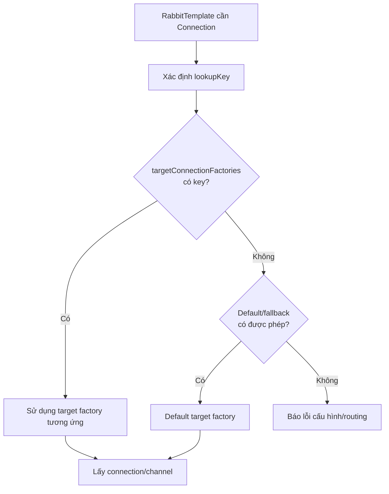

# `AbstractRoutingConnectionFactory` và chọn đích kết nối theo ngữ cảnh trong Spring AMQP

## 1. Vấn đề: một ứng dụng làm việc với nhiều RabbitMQ broker

Trong module **SPRING_AMQP**, ứng dụng thường dùng `RabbitTemplate` để gửi message, `@RabbitListener` để nhận và exchange, queue, binding để định tuyến. Khi triển khai hệ thống lớn, một ứng dụng có thể cần gửi thông điệp tới nhiều **RabbitMQ broker, cluster hoặc virtual host**:

- Tenant ở khu vực **east** cần gửi sự kiện tới RabbitMQ east; tenant ở **west** cần tới RabbitMQ west.
- Hai hệ thống có cùng tên queue `orders.in` nhưng queue nằm ở **hai broker/vhost độc lập**.
- Một dịch vụ tổng hợp cần chọn broker dựa trên loại dữ liệu hoặc tenant đã xác thực.
- Một tác vụ phải ghi nhận đúng broker được lựa chọn và chịu được lỗi mạng, retry hoặc redelivery.

Nếu mọi nơi tự tạo kết nối hoặc tự lựa chọn `RabbitTemplate` khác nhau, logic định tuyến dễ phân tán và khó kiểm soát. Spring AMQP có **`AbstractRoutingConnectionFactory`**: một connection factory đại diện, chọn **connection factory đích** từ `lookupKey` khi cần tạo/lấy connection.

**Mục tiêu:** hiểu cách `AbstractRoutingConnectionFactory` hoạt động; cấu hình `SimpleRoutingConnectionFactory` cho hai broker; chọn đích qua context hoặc message header; phối hợp với listener, `RabbitAdmin`, retry và publisher confirms; kiểm thử các tình huống sai hoặc thiếu lookup key.

### Sơ đồ tổng quan

```mermaid
flowchart TB
    P["OrderPublisher<br/>lookupKey = east / west"] --> RT["RabbitTemplate"]
    RT --> RC["SimpleRoutingConnectionFactory"]
    RC -->|"east"| EC["CachingConnectionFactory east"]
    RC -->|"west"| WC["CachingConnectionFactory west"]
    EC --> EB["RabbitMQ east<br/>vhost /orders"]
    WC --> WB["RabbitMQ west<br/>vhost /orders"]
    EB --> EQ["orders.in (east)"]
    WB --> WQ["orders.in (west)"]
    EQ --> EL["@RabbitListener east"]
    WQ --> WL["@RabbitListener west"]
```



Hai queue `orders.in` ở hình trên chỉ **trùng tên**. Chúng thuộc hai namespace tách biệt: publish tới east không tự tạo bản sao ở west.

## 2. Routing connection factory khác routing message như thế nào?

`AbstractRoutingConnectionFactory` thuộc package `org.springframework.amqp.rabbit.connection`. Nó triển khai interface `ConnectionFactory`, giữ một bản đồ `lookupKey -> target ConnectionFactory` và chọn target khi được yêu cầu cung cấp connection.

| Thành phần | Quyết định | Ví dụ |
| --- | --- | --- |
| `AbstractRoutingConnectionFactory` | Chọn broker/vhost nào để kết nối. | `east` → `eastConnectionFactory`. |
| `CachingConnectionFactory` | Quản lý connection và channel tới một target cụ thể. | `localhost:5672`, vhost `/orders`. |
| `RabbitTemplate` | Publish tới exchange/routing key **trên broker đã chọn**. | Exchange `orders.events`, routing key `orders.created`. |
| RabbitMQ exchange + binding | Định tuyến message tới queue **trong cùng broker/vhost**. | Binding đưa message vào `orders.in`. |
| `@RabbitListener` container | Đăng ký consumer tới queue trên một target connection. | Consumer riêng trên east hoặc west. |
| `RabbitAdmin` | Declare exchange/queue/binding ở broker được cấu hình. | Chỉ khai báo queue east qua `eastAdmin`. |

Điều quan trọng: routing connection factory **không tự đồng bộ message giữa các broker** và **không tự chuyển broker khi một target lỗi**. Nếu chỉ cần truy cập nhiều node của **một cluster RabbitMQ**, cấu hình nhiều địa chỉ qua `CachingConnectionFactory.setAddresses(...)` thường đúng mục đích hơn. Routing connection factory phù hợp khi **lựa chọn đích theo nghiệp vụ**.

### Cơ chế tra cứu



`SimpleRoutingConnectionFactory` là triển khai có sẵn của lớp cơ sở này. Nó dùng `SimpleResourceHolder` để đọc lookup key **gắn với thread hiện tại**. Bạn không phải subclass `AbstractRoutingConnectionFactory` nếu chỉ cần cách chọn theo thread.

## 3. Chọn lookup key và chính sách fallback

Giả sử ứng dụng chỉ cho phép hai key nội bộ: `east` và `west`. Đây là tên logic, **không phải hostname hay thông tin xác thực nhận trực tiếp từ client**.

| Lookup key | Đích | Kết quả mong đợi |
| --- | --- | --- |
| `east` | Factory east | Publish tới east. |
| `west` | Factory west | Publish tới west. |
| `north` | Không có | Ném exception, không gửi lạc sang broker khác. |
| `null` hoặc không đặt context | Không có | Ném exception nếu không khai báo default. |

Ba cấu hình cần phân biệt:

- `setTargetConnectionFactories(Map<Object, ConnectionFactory>)` đăng ký target map.
- `setDefaultTargetConnectionFactory(cf)` tạo đích dự phòng khi có tình huống fallback hợp lệ.
- `setLenientFallback(boolean)`: mặc định là `true`. Với `false`, key **khác null** mà không tồn tại sẽ gây `IllegalStateException`; key **null** vẫn có thể sử dụng default nếu đã đặt.

Với hệ thống nhiều tenant hoặc vùng dữ liệu cần cách ly, nên **fail-closed**: không đặt default và cấu hình `setLenientFallback(false)`. Lỗi gửi nhầm broker thường nguy hiểm hơn việc một lần publish bị từ chối rõ ràng.

## 4. Cấu hình Spring Boot với hai target

Ví dụ dùng Spring Boot, Java 17+ và dependency `spring-boot-starter-amqp`. Các lớp Spring AMQP trong bài thuộc tầng **AMQP 0-9-1 (`spring-rabbit`)**. Địa chỉ, user, vhost và password phải cấu hình theo môi trường.

### 4.1. Khai báo thông tin kết nối

```yaml
# application.yml — đừng đưa mật khẩu thật vào source control.
app:
  rabbit:
    east:
      host: localhost
      port: 5672
      username: east_app
      password: ${RABBIT_EAST_PASSWORD}
      virtual-host: /orders
    west:
      host: localhost
      port: 5673
      username: west_app
      password: ${RABBIT_WEST_PASSWORD}
      virtual-host: /orders
```

Hai port chỉ để minh họa hai RabbitMQ instance cục bộ. Trong production nên quản lý password/TLS qua secret manager và cấp quyền tối thiểu trên từng vhost.

### 4.2. Tạo hai `CachingConnectionFactory`

```java
package example.multibroker;

import org.springframework.amqp.rabbit.connection.CachingConnectionFactory;
import org.springframework.beans.factory.annotation.Value;
import org.springframework.context.annotation.Bean;
import org.springframework.context.annotation.Configuration;

@Configuration
public class BrokerTargets {

    @Bean("eastConnectionFactory")
    CachingConnectionFactory east(
            @Value("${app.rabbit.east.host}") String host,
            @Value("${app.rabbit.east.port}") int port,
            @Value("${app.rabbit.east.username}") String user,
            @Value("${app.rabbit.east.password}") String password,
            @Value("${app.rabbit.east.virtual-host}") String vhost) {
        return createTarget(host, port, user, password, vhost);
    }

    @Bean("westConnectionFactory")
    CachingConnectionFactory west(
            @Value("${app.rabbit.west.host}") String host,
            @Value("${app.rabbit.west.port}") int port,
            @Value("${app.rabbit.west.username}") String user,
            @Value("${app.rabbit.west.password}") String password,
            @Value("${app.rabbit.west.virtual-host}") String vhost) {
        return createTarget(host, port, user, password, vhost);
    }

    private CachingConnectionFactory createTarget(
            String host, int port, String user, String password, String vhost) {
        CachingConnectionFactory cf = new CachingConnectionFactory(host);
        cf.setPort(port);
        cf.setUsername(user);
        cf.setPassword(password);
        cf.setVirtualHost(vhost);
        cf.setPublisherConfirmType(
                CachingConnectionFactory.ConfirmType.CORRELATED);
        cf.setPublisherReturns(true);
        return cf;
    }
}
```

Mỗi target có connection/channel cache và vòng đời riêng. Không sửa host/vhost trên cùng factory theo từng message; đặt mục tiêu kết nối cố định và để routing factory lựa chọn giữa chúng.

**Lưu ý nhiều bean:** khi có nhiều `ConnectionFactory`, mã inject theo kiểu chung có thể bị ambiguous. Dùng `@Qualifier`, cấu hình template, admin và listener container **tường minh**. Nếu ứng dụng dùng Spring Boot auto-configuration, hãy kiểm tra các bean tự tạo còn phù hợp khi thêm nhiều factory.

### 4.3. Tạo `SimpleRoutingConnectionFactory` và `RabbitTemplate`

```java
package example.multibroker;

import java.util.HashMap;
import java.util.Map;
import org.springframework.amqp.rabbit.connection.ConnectionFactory;
import org.springframework.amqp.rabbit.connection.ConnectionFactoryContextWrapper;
import org.springframework.amqp.rabbit.connection.SimpleRoutingConnectionFactory;
import org.springframework.amqp.rabbit.core.RabbitTemplate;
import org.springframework.beans.factory.annotation.Qualifier;
import org.springframework.context.annotation.Bean;
import org.springframework.context.annotation.Configuration;

@Configuration
public class RoutingSetup {

    @Bean("routingConnectionFactory")
    SimpleRoutingConnectionFactory routingConnectionFactory(
            @Qualifier("eastConnectionFactory") ConnectionFactory east,
            @Qualifier("westConnectionFactory") ConnectionFactory west) {
        Map<Object, ConnectionFactory> targets = new HashMap<>();
        targets.put("east", east);
        targets.put("west", west);

        SimpleRoutingConnectionFactory routing =
                new SimpleRoutingConnectionFactory();
        routing.setTargetConnectionFactories(targets);
        routing.setLenientFallback(false);
        // Không đặt default: thiếu key thì từ chối publish.
        return routing;
    }

    @Bean("routedRabbitTemplate")
    RabbitTemplate routedRabbitTemplate(
            @Qualifier("routingConnectionFactory")
            SimpleRoutingConnectionFactory routing) {
        RabbitTemplate template = new RabbitTemplate(routing);
        template.setMandatory(true);
        return template;
    }

    @Bean
    ConnectionFactoryContextWrapper brokerContext(
            @Qualifier("routingConnectionFactory")
            SimpleRoutingConnectionFactory routing) {
        return new ConnectionFactoryContextWrapper(routing);
    }
}
```

Hai target trong ví dụ bật **publisher confirms và returns với cùng chế độ**. Spring AMQP có kiểm tra tính nhất quán các thuộc tính này giữa các target. Từ phiên bản hỗ trợ `setConsistentConfirmsReturns(false)`, ứng dụng có thể chủ động tắt validation nếu thực sự cần cấu hình khác nhau, nhưng phải hiểu và xử lý đúng sự khác biệt trong kết quả publish.

## 5. Cách A: route bằng `ConnectionFactoryContextWrapper`

`ConnectionFactoryContextWrapper` là tiện ích Spring AMQP 2.3+ chạy `Runnable` hoặc `Callable` trong scope có gắn lookup key. Nó tự dọn context khi kết thúc kể cả khi code ném lỗi.

```java
package example.multibroker;

import java.util.Set;
import org.springframework.amqp.rabbit.connection.ConnectionFactoryContextWrapper;
import org.springframework.amqp.rabbit.core.RabbitTemplate;
import org.springframework.beans.factory.annotation.Qualifier;
import org.springframework.stereotype.Service;

@Service
public class OrderPublisher {
    private static final Set<String> ALLOWED = Set.of("east", "west");
    private final RabbitTemplate template;
    private final ConnectionFactoryContextWrapper context;

    public OrderPublisher(
            @Qualifier("routedRabbitTemplate") RabbitTemplate template,
            ConnectionFactoryContextWrapper context) {
        this.template = template;
        this.context = context;
    }

    public void publish(String brokerKey, String eventId) {
        if (!ALLOWED.contains(brokerKey)) {
            throw new IllegalArgumentException(
                    "Broker không hợp lệ: " + brokerKey);
        }
        context.run(brokerKey, () ->
                template.convertAndSend("", "orders.in", eventId));
    }
}
```

Gọi:

```java
publisher.publish("east", "EVENT-1001");
publisher.publish("west", "EVENT-2001");
```

Mỗi lệnh gửi vào **default exchange** `""` trên broker đã chọn, routing key `orders.in`. Trên mỗi broker phải có queue `orders.in` tồn tại. Cách route này không cần tạo hai `RabbitTemplate` khác nhau cho producer.

**Giới hạn:** `context.run` chỉ bảo đảm bind/unbind lookup key, không tự bảo đảm message đã được broker persist/route hoặc consumer đã xử lý. Muốn giao nhận đáng tin cậy, vẫn phải dùng confirms/returns, retry có giới hạn và idempotency.

### 5.1. Cách thủ công bằng `SimpleResourceHolder`

Nếu không dùng wrapper, có thể bind trực tiếp:

```java
import org.springframework.amqp.rabbit.connection.ConnectionFactory;
import org.springframework.amqp.rabbit.connection.SimpleResourceHolder;

ConnectionFactory routing = template.getConnectionFactory();
SimpleResourceHolder.bind(routing, "east");
try {
    template.convertAndSend("", "orders.in", "EVENT-1002");
} finally {
    SimpleResourceHolder.unbind(routing);
}
```

Khóa `bind` là **đối tượng routing connection factory**, còn `"east"` là **giá trị lookup key**. Không đảo ngược hai tham số. `SimpleResourceHolder.bind(...)` không cho phép ghi đè giá trị đang bind cho cùng khóa; khi cần scope lồng nhau có thể dùng `push`/`pop` hoặc wrapper có quản lý scope phù hợp.

**Luôn unbind trong `finally`.** Nếu bỏ quên, một thread trong web server/executor có thể tái sử dụng key của request trước và gửi message của tenant mới sang sai broker.

### 5.2. Ngữ cảnh thread không tự đi qua `@Async` hoặc `CompletableFuture`

`SimpleRoutingConnectionFactory` dùng ThreadLocal. Khi chuyển sang worker thread hoặc Reactor scheduler, context ở thread ban đầu không tự theo sang.

```java
import java.util.concurrent.CompletableFuture;

// SAI: task có thể chạy sau khi wrapper đã unbind ở thread gốc.
context.run("east", () ->
        CompletableFuture.runAsync(() ->
                template.convertAndSend("", "orders.in", "EVENT-X")));

// ĐÚNG: mang brokerKey như dữ liệu, bind trên thread thực sự publish.
CompletableFuture.runAsync(() ->
        context.run("east", () ->
                template.convertAndSend("", "orders.in", "EVENT-X")));
```

Khi dùng Reactor, hãy coi `ThreadLocal` khác với Reactor Context và xác định rõ thread thực thi thao tác RabbitMQ. Không đặt một biến `currentBroker` kiểu static mutable làm ngữ cảnh toàn cục vì request đồng thời có thể đè lên nhau.

## 6. Cách B: chọn broker qua SpEL selector của `RabbitTemplate`

`RabbitTemplate` hỗ trợ hai thuộc tính:

- `sendConnectionFactorySelectorExpression`: đánh giá khi **send/sendAndReceive**, root object là `org.springframework.amqp.core.Message` gửi đi.
- `receiveConnectionFactorySelectorExpression`: đánh giá khi **receive/receiveAndReply**, root object là **queue name**.

Nếu kết quả biểu thức trả `lookupKey`, template có thể dùng nó để chọn target trên `AbstractRoutingConnectionFactory`. Điều này giúp route theo message header mà không cần bind context thủ công.

### 6.1. Cấu hình selector lấy header `brokerKey`

```java
import org.springframework.amqp.rabbit.connection.SimpleRoutingConnectionFactory;
import org.springframework.amqp.rabbit.core.RabbitTemplate;
import org.springframework.beans.factory.annotation.Qualifier;
import org.springframework.context.annotation.Bean;
import org.springframework.context.annotation.Configuration;
import org.springframework.expression.spel.standard.SpelExpressionParser;

@Configuration
public class HeaderRoutingConfig {
    @Bean("headerRoutedRabbitTemplate")
    RabbitTemplate template(
            @Qualifier("routingConnectionFactory")
            SimpleRoutingConnectionFactory routing) {
        RabbitTemplate template = new RabbitTemplate(routing);
        template.setMandatory(true);
        template.setSendConnectionFactorySelectorExpression(
                new SpelExpressionParser().parseExpression(
                        "messageProperties.headers['brokerKey']"));
        return template;
    }
}
```

Publish qua bean `headerRoutedRabbitTemplate`:

```java
// brokerKey đã được validate bằng allowlist phía server.
String brokerKey = "west";
headerRoutedRabbitTemplate.convertAndSend(
        "", "orders.in", "EVENT-2002", message -> {
            message.getMessageProperties().setHeader("brokerKey", brokerKey);
            return message;
        });
```

Header được gắn **trước khi template cần chọn connection**. Không chỉ đặt broker key trong DTO rồi giả định Spring tự đọc DTO để route. Nếu SpEL trả `null`, template quay lại cơ chế routing thông thường của factory, ví dụ context ThreadLocal; nếu không có context/default trong ví dụ này thì publish sẽ thất bại.

Nếu header đến từ nguồn bên ngoài, không được dùng trực tiếp làm quyền chọn broker. Phải xác thực tenant và ánh xạ sang key nội bộ do server kiểm soát.

### 6.2. Selector receive và trường hợp queue trùng tên

Với `receiveConnectionFactorySelectorExpression`, root là queue name. Có thể viết biểu thức lựa chọn theo **tên queue** khi tên đủ để nhận biết đích:

```java
template.setReceiveConnectionFactorySelectorExpression(
        new SpelExpressionParser().parseExpression(
                "#root == 'east.orders.in' ? 'east' : 'west'"));
```

Đây chỉ là mẫu minh họa logic SpEL. Với **hai broker cùng queue name `orders.in`**, tên queue không đủ thông tin để phân biệt: nên dùng wrapper/context hoặc hai template/factory tường minh. Không dùng biểu thức có nhánh mặc định dẫn vào west khi nhận queue name không hợp lệ trong môi trường cách ly tenant.

## 7. `@RabbitListener` và đích kết nối cho consumer

Consumer phải kết nối broker, mở channel và đăng ký `basic.consume` **trước khi** nhận message. Vì vậy `@RabbitListener` **không thể đọc header trong một message chưa đến để quyết định trước đó nó phải kết nối broker nào**.

Với hai broker có cùng queue name `orders.in`, hướng triển khai dễ bảo trì là tạo **hai listener container factory**, mỗi factory dùng target trực tiếp.

### 7.1. Listener container factory riêng

```java
package example.multibroker;

import org.springframework.amqp.core.AcknowledgeMode;
import org.springframework.amqp.rabbit.config.SimpleRabbitListenerContainerFactory;
import org.springframework.amqp.rabbit.connection.ConnectionFactory;
import org.springframework.beans.factory.annotation.Qualifier;
import org.springframework.context.annotation.Bean;
import org.springframework.context.annotation.Configuration;

@Configuration
public class MultiBrokerListenersConfig {
    @Bean("eastListenerFactory")
    SimpleRabbitListenerContainerFactory eastFactory(
            @Qualifier("eastConnectionFactory") ConnectionFactory east) {
        return factory(east);
    }

    @Bean("westListenerFactory")
    SimpleRabbitListenerContainerFactory westFactory(
            @Qualifier("westConnectionFactory") ConnectionFactory west) {
        return factory(west);
    }

    private SimpleRabbitListenerContainerFactory factory(ConnectionFactory cf) {
        SimpleRabbitListenerContainerFactory f =
                new SimpleRabbitListenerContainerFactory();
        f.setConnectionFactory(cf);
        f.setAcknowledgeMode(AcknowledgeMode.AUTO);
        f.setConcurrentConsumers(1);
        f.setPrefetchCount(10);
        return f;
    }
}
```

```java
package example.multibroker;

import org.springframework.amqp.rabbit.annotation.RabbitListener;
import org.springframework.stereotype.Component;

@Component
public class RegionListeners {
    @RabbitListener(
            queues = "orders.in", containerFactory = "eastListenerFactory")
    public void onEast(String eventId) {
        System.out.println("EAST: " + eventId);
    }

    @RabbitListener(
            queues = "orders.in", containerFactory = "westListenerFactory")
    public void onWest(String eventId) {
        System.out.println("WEST: " + eventId);
    }
}
```

Hai listener kết nối hai namespace RabbitMQ khác nhau. Trong `AcknowledgeMode.AUTO`, Spring AMQP ack sau khi listener thành công; khi listener lỗi, nack/requeue/dead-letter phụ thuộc chính sách container và broker. `AUTO` không phải broker auto-ack ngay lúc giao message.

### 7.2. Nếu thật sự dùng routing factory cho listener

Spring AMQP cũng hỗ trợ `RoutingConnectionFactory` trên listener container. Khi đó key được tạo từ **danh sách tên queue** (kể cả dấu ngoặc vuông), ví dụ:

```text
setQueueNames("orders.in")       -> "[orders.in]"
lookupKeyQualifier = "east"      -> "east[orders.in]"
lookupKeyQualifier = "west"      -> "west[orders.in]"
```

`AbstractMessageListenerContainer.setLookupKeyQualifier(...)` thêm tiền tố để phân biệt hai container nghe **queue trùng tên ở hai broker**. Muốn dùng dạng này, phải đăng ký target keys `east[orders.in]` và `west[orders.in]` (khác key `east`/`west` của producer), sau đó cấu hình qualifier trên container tương ứng.

Ở bài thực hành, dùng **target trực tiếp tại container factory** như mục 7.1 để tránh nhầm key và dễ quan sát. Không giả định key ThreadLocal được bind từ HTTP request sẽ điều khiển container listener chạy trong thread độc lập.

## 8. `RabbitAdmin`: khai báo topology đúng broker

Routing đúng khi publish chưa đủ nếu exchange/queue/binding lại được declare sai broker. Khi có nhiều `RabbitAdmin` trong một Spring context, mặc định mỗi admin có thể xử lý các bean `Declarable` mà nó nhìn thấy.

Đối với ứng dụng đa broker, dùng:

- `RabbitAdmin.setExplicitDeclarationsOnly(true)`: admin chỉ declare các resource được gán rõ ràng.
- `Queue`/`Exchange`/`Binding.setAdminsThatShouldDeclare(admin)`: ràng buộc tài nguyên với admin được phép.

### 8.1. Hai admin và hai queue cùng tên

```java
package example.multibroker;

import org.springframework.amqp.core.Queue;
import org.springframework.amqp.core.QueueBuilder;
import org.springframework.amqp.rabbit.connection.ConnectionFactory;
import org.springframework.amqp.rabbit.core.RabbitAdmin;
import org.springframework.beans.factory.annotation.Qualifier;
import org.springframework.context.annotation.Bean;
import org.springframework.context.annotation.Configuration;

@Configuration
public class MultiBrokerAdminConfig {

    @Bean("eastAdmin")
    RabbitAdmin eastAdmin(
            @Qualifier("eastConnectionFactory") ConnectionFactory east) {
        RabbitAdmin admin = new RabbitAdmin(east);
        admin.setExplicitDeclarationsOnly(true);
        return admin;
    }

    @Bean("westAdmin")
    RabbitAdmin westAdmin(
            @Qualifier("westConnectionFactory") ConnectionFactory west) {
        RabbitAdmin admin = new RabbitAdmin(west);
        admin.setExplicitDeclarationsOnly(true);
        return admin;
    }

    @Bean("eastOrdersQueue")
    Queue eastQueue(@Qualifier("eastAdmin") RabbitAdmin admin) {
        Queue queue = QueueBuilder.durable("orders.in").build();
        queue.setAdminsThatShouldDeclare(admin);
        return queue;
    }

    @Bean("westOrdersQueue")
    Queue westQueue(@Qualifier("westAdmin") RabbitAdmin admin) {
        Queue queue = QueueBuilder.durable("orders.in").build();
        queue.setAdminsThatShouldDeclare(admin);
        return queue;
    }
}
```

Mỗi admin sử dụng **target connection factory trực tiếp**, không dùng context routing. Khi cần direct/topic exchange, hãy gán declaring admin **cho cả exchange, queue và binding**. Một binding declare trên broker sai sẽ không được sửa bằng cách route `RabbitTemplate` cho đúng.

`@RabbitListener(queues = "orders.in")` giả định queue đã tồn tại; ví dụ trên cung cấp bean `Queue` và `RabbitAdmin` để auto-declare theo kết nối. Các tiện ích **multi-broker support** của Spring AMQP 2.3+ còn hỗ trợ khai báo qua `queuesToDeclare`/`bindings` trong cấu hình multi-rabbit tương ứng. Cơ chế đó khác `queues` chỉ tham chiếu tên queue có sẵn; không nên dùng hai hình thức như thể chúng tự động tương đương.

## 9. Ngữ cảnh routing và giao dịch: các ranh giới phải rõ

### 9.1. Lookup key được áp dụng khi lấy connection/channel

Routing thường quyết định đích khi framework yêu cầu connection/channel. Nếu transaction đang có tài nguyên RabbitMQ gắn với thread, việc đổi key ngay giữa transaction **không bảo đảm** lệnh tiếp theo sẽ lấy connection mới trên broker khác.

```java
// Hai thao tác bên dưới là hai lệnh publish riêng biệt,
// KHÔNG phải một transaction atomic trên hai broker:
context.run("east", () ->
        template.convertAndSend("", "orders.in", "EVENT-E"));
context.run("west", () ->
        template.convertAndSend("", "orders.in", "EVENT-W"));
```

Không dùng `@Transactional` hoặc `channelTransacted=true` rồi kỳ vọng rollback trên east sẽ rollback cả west. Nếu phải phát sự kiện đến nhiều broker đáng tin cậy, hãy dùng một **durable outbox**/workflow có trạng thái, lưu target key cùng event ID, publish mỗi đích với confirm và xử lý duplicate ở consumer.

### 9.2. Không biến routing thành failover ngẫu nhiên

Nếu east down, `SimpleRoutingConnectionFactory` sẽ **không tự ý chuyển key east sang west**. Việc đổi đích khi lỗi có thể phá vỡ ranh giới tenant, ordering và nguồn dữ liệu. Chỉ failover xuyên broker nếu hệ thống có replication/đồng bộ dữ liệu và quy tắc chuyển vùng đã được thiết kế. Với failover giữa node cùng cluster, cấu hình địa chỉ node trên target CachingConnectionFactory thích hợp hơn.

### 9.3. Validate broker key ở đầu vào đáng tin cậy

Không dùng chuỗi hostname, vhost, username hoặc key tự do do người gửi cung cấp. Thay vào đó, xác thực tenant rồi tra cứu một ánh xạ **tenant → brokerKey** do ứng dụng quản lý; chỉ key trong allowlist mới được dùng. Giữ password trong secret manager và không in ra log/header.

## 10. Publisher confirms, retry và độ tin cậy trên từng broker

`RabbitTemplate.convertAndSend(...)` không có nghĩa consumer đã hoàn tất nghiệp vụ. Khi mạng hỏng vào thời điểm publish, broker có thể **đã nhận** message dù producer chưa thấy confirm, hoặc message chưa đến broker. Retry thiếu idempotency có thể tạo duplicate.

Với mỗi broker cần:

1. **Correlated publisher confirms**: theo dõi broker xác nhận publish; **publisher returns + mandatory** để quan sát trường hợp unroutable.
2. **Retry có giới hạn/backoff**: giữ nguyên `eventId` và **targetBrokerKey** khi gửi lại; không tự chuyển đích do timeout.
3. **Transactional Outbox** nếu sự kiện phát sinh từ DB transaction: lưu payload, event ID và broker key trong một transaction DB; publisher đọc outbox và phát qua routing factory.
4. **Idempotent consumer**: nếu broker đã nhận message trước khi publisher mất confirm, lần gửi lại có thể tạo bản sao; dùng unique event ID/dấu vết xử lý, transaction và ack sau thành công.
5. **DLX/DLQ và quan sát theo broker**: cấu hình riêng queue, retry, DLQ, permissions, queue depth, messages unacked, publisher confirm timeout và tốc độ redelivery.

Routing factory không tự mang exchange/queue/binding qua broker khác. Cùng tên routing key ở east và west có thể đến hai topology khác nhau; vì vậy cần kiểm chứng cấu hình từng target.

## 11. Thực hành và kiểm thử

Chuẩn bị hai RabbitMQ instance/vhost trong môi trường thử nghiệm, cấu hình quyền cho user và tạo topology theo mục 8. Dùng Management UI riêng của từng broker để kiểm tra.

### 11.1. Đúng đích khi publish

```java
publisher.publish("east", "EVENT-E-1");
publisher.publish("west", "EVENT-W-1");
```

Kỳ vọng:

| Broker | Queue | Listener nhận |
| --- | --- | --- |
| east | `orders.in` | `onEast` nhận `EVENT-E-1`. |
| west | `orders.in` | `onWest` nhận `EVENT-W-1`. |

Chỉ thấy log “sent” chưa đủ. Quan sát connections, vhost, queue, số consumer, publisher confirm và delivery trên cả hai Management UI.

### 11.2. Key sai/thiếu phải thất bại

```java
publisher.publish("north", "INVALID-KEY");

// Nếu không có context, và routing factory không có default:
routedRabbitTemplate.convertAndSend("", "orders.in", "NO-CONTEXT");
```

Lệnh đầu bị `OrderPublisher` từ chối bởi allowlist. Lệnh thứ hai không có lookup key/target nên phải báo lỗi; quan sát không broker nào nhận message.

### 11.3. Exception không để sót context

```java
try {
    context.run("east", () -> {
        throw new IllegalStateException("Lỗi giả lập");
    });
} catch (IllegalStateException expected) {
    // Wrapper đã unbind trong finally.
}

publisher.publish("west", "EVENT-W-AFTER-ERROR");
```

`EVENT-W-AFTER-ERROR` phải tới west. Kiểm thử này quan trọng nếu ứng dụng chạy trên executor/thread pool.

### 11.4. Broker east tạm thời mất kết nối

1. Dừng broker east trong môi trường thử nghiệm.
2. Gửi sự kiện tới east; ghi lại exception/confirm timeout hoặc trạng thái không rõ kết quả.
3. Gửi sự kiện khác tới west; west vẫn hoạt động nếu connection của nó khỏe.
4. Khôi phục east, quan sát listener và admin khai báo lại topology theo cấu hình.
5. Retry sự kiện east qua cơ chế bền vững và xác minh duplicate được xử lý idempotent.

Đừng kết luận rằng reconnect tự động gửi lại toàn bộ message publish đã thất bại. Routing connection factory chỉ chọn factory, không làm **buffer/replay** message.

### 11.5. Queue cùng tên trên hai broker

Kiểm tra cả hai broker có `orders.in` riêng, cùng tên nhưng không chia sẻ message. Xóa queue thử nghiệm ở west rồi quan sát `westAdmin` khai báo lại khi connection khởi tạo/phục hồi (nếu cấu hình, quyền và auto-declare cho phép); `eastAdmin` không được khai báo tài nguyên west. Nếu xảy ra `PRECONDITION_FAILED` do queue arguments khác, phải sửa cấu hình/migration chứ không tăng số lần reconnect.

## 12. Lỗi thường gặp và hướng xử lý

| Hiện tượng | Nguyên nhân thường gặp | Hướng xử lý |
| --- | --- | --- |
| Message gửi nhầm broker sau request khác. | Không unbind ThreadLocal, thread pool tái sử dụng key cũ. | Dùng `ConnectionFactoryContextWrapper` hoặc `finally`. |
| `IllegalStateException`: không tìm thấy target. | Key không được bind, đánh máy sai hoặc map không có entry. | Validate allowlist, kiểm tra `lenientFallback`/default và binding. |
| Listener dùng routing factory nhưng không tìm ra target. | Container lookup key có dạng `[queue]`/qualifier, khác key producer. | Dùng target trực tiếp hoặc khai báo key tương ứng. |
| Cả hai `RabbitAdmin` đều tạo mọi queue. | Không đặt `explicitDeclarationsOnly`/declaring admins. | Cấu hình admin scoped cho từng tài nguyên. |
| Ứng dụng fail lúc khởi tạo routing factory. | Target không nhất quán publisher confirms/returns. | Đồng bộ cấu hình hoặc xử lý có chủ đích bằng API phù hợp. |
| `@Async` publish không có brokerKey. | ThreadLocal không được truyền sang thread mới. | Truyền brokerKey như tham số, bind trong worker thread. |
| east down nhưng dữ liệu chuyển sang west. | Có fallback không kiểm soát. | Fail-closed, lưu target trong outbox. |
| Consumer không thấy message dù producer nhận confirm. | Routing key/binding sai hoặc confirm không phản ánh xử lý nghiệp vụ. | Theo dõi returns, queue depth, consumer ack và DLQ. |
| Đăng ký hai listener cùng tên queue nhưng một broker không có consumer. | `containerFactory` trỏ nhầm target. | Dùng `@Qualifier`/tên factory rõ ràng; kiểm tra Management UI. |
| `queues` của `@RabbitListener` không tự khai báo queue. | Dùng tên queue mà chưa tạo topology hợp lệ. | Tạo `Queue`/`RabbitAdmin` hoặc dùng hỗ trợ multi-rabbit auto-declaration đúng kiểu. |

## 13. Câu hỏi tự kiểm tra

1. `AbstractRoutingConnectionFactory` khác `DirectExchange` ở tầng nào?
2. Trong `SimpleResourceHolder.bind(routing, "east")`, vì sao tham số đầu là **routing factory**?
3. Khi `lenientFallback=false`, key `north` không khớp sẽ ra sao? Key `null` có thể fallback khi nào?
4. Tại sao một `@RabbitListener` không thể đọc payload của message để quyết định **trước đó** nó phải mở connection tới broker nào?
5. Hai listener tiêu thụ queue tên `orders.in` ở hai broker cần cấu hình gì khác nhau?
6. Tại sao phải gán cả exchange/queue/binding cho từng `RabbitAdmin`?
7. Vì sao context thread ban đầu không tự có trong một `CompletableFuture.runAsync`?
8. Nếu east không hoạt động, có nên tự đổi key thành west để gửi cho xong không?
9. Tại sao một transaction RabbitMQ không bảo đảm hai publish trên hai broker cùng commit?

**Gợi ý đáp án:** (1) factory route chọn broker/vhost, exchange route trong broker/vhost; (2) nó là khóa của resource ThreadLocal, `east` là giá trị lookup; (3) key không có target gây lỗi, key null có thể dùng default nếu được cấu hình; (4) consumer phải kết nối và đăng ký trước khi nhận message; (5) target `ConnectionFactory` và `containerFactory` riêng; (6) tránh declare sai broker; (7) ThreadLocal theo thread; (8) chỉ khi có chính sách failover/replication hợp lệ; (9) không có distributed atomic transaction xuyên hai RabbitMQ broker.

## 14. Tổng kết

`AbstractRoutingConnectionFactory` giúp Spring AMQP chọn kết nối theo **lookup key** mà ứng dụng định nghĩa. `SimpleRoutingConnectionFactory` lấy key từ `SimpleResourceHolder`; `ConnectionFactoryContextWrapper` giúp bind/unbind an toàn, còn SpEL selector trong `RabbitTemplate` cho phép route theo message hoặc queue. Với consumer, thường nên gắn `@RabbitListener` vào **container factory của từng broker**; nếu dùng routing factory tại container phải khai báo key/qualifier đúng format. `RabbitAdmin` cần được giới hạn phạm vi khai báo theo broker.

Routing connection factory chỉ giải quyết **chọn đích kết nối**. Một hệ thống xử lý bất đồng bộ đáng tin cậy vẫn cần validate broker key, fail-closed, publisher confirms/returns, retry/outbox đúng target, consumer idempotent và quan sát từng RabbitMQ broker/vhost.

## Tài liệu tham khảo

- [Spring AMQP — Connection and Resource Management: Routing Connection Factory](https://docs.spring.io/spring-amqp/reference/amqp/connections.html): lookup key, `SimpleRoutingConnectionFactory`, `SimpleResourceHolder`, SpEL selector và listener container.
- [Spring AMQP — Multiple Broker (or Cluster) Support](https://docs.spring.io/spring-amqp/reference/amqp/multi-rabbit.html): nhiều broker, `ConnectionFactoryContextWrapper` và cấu hình listener/admin.
- [Spring AMQP — Configuring the Broker: Conditional Declaration](https://docs.spring.io/spring-amqp/reference/amqp/broker-configuration.html): `RabbitAdmin`, `explicitDeclarationsOnly`, `setAdminsThatShouldDeclare`.
- [Spring AMQP — `AbstractRoutingConnectionFactory` Javadoc](https://docs.spring.io/spring-amqp/docs/3.2.x/api/org/springframework/amqp/rabbit/connection/AbstractRoutingConnectionFactory.html): target map, default, fallback và consistency checks.
- [Spring AMQP — `SimpleResourceHolder` Javadoc](https://docs.spring.io/spring-amqp/docs/3.2.x/api/org/springframework/amqp/rabbit/connection/SimpleResourceHolder.html): `bind`, `unbind`, `push`, `pop`.
- [Spring AMQP — `ConnectionFactoryContextWrapper` Javadoc](https://docs.spring.io/spring-amqp/docs/3.2.x/api/org/springframework/amqp/rabbit/connection/ConnectionFactoryContextWrapper.html): `run`/`call` theo scope.
- [RabbitMQ — Consumer Acknowledgements and Publisher Confirms](https://www.rabbitmq.com/docs/confirms): confirm, return, consumer ack và giới hạn về bảo đảm giao nhận.
