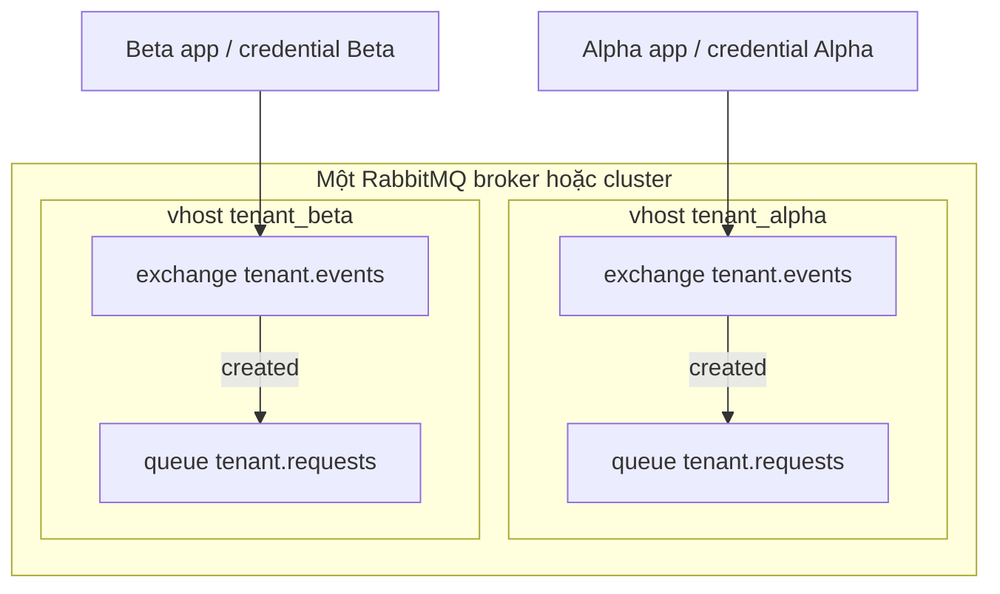
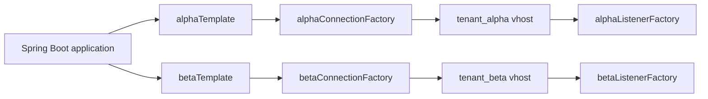
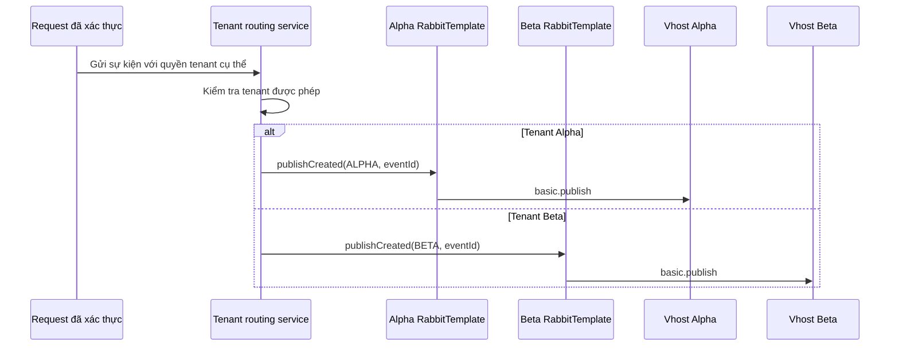

# Cô lập khách hàng bằng virtual host, tài khoản hoặc broker trong Spring AMQP

Một nền tảng phục vụ nhiều khách hàng (multi-tenant) có thể dùng RabbitMQ để nhận yêu cầu, phát sự kiện và xử lý công việc qua `RabbitTemplate`, `@RabbitListener`. Nếu mọi khách hàng đều dùng cùng exchange, queue và tài khoản RabbitMQ, một cấu hình sai có thể khiến ứng dụng đọc nhầm message, gửi message sang sai khách hàng hoặc khiến hàng đợi của một khách hàng làm ảnh hưởng đến khách hàng khác.

Trong chương **Nhiều broker và khách hàng** của **SPRING_AMQP**, ba biện pháp cô lập cần phân biệt là:

1. **Virtual host (vhost):** tạo namespace riêng cho exchange, queue, binding và permission.
2. **Tài khoản và quyền truy cập:** giới hạn một ứng dụng/khách hàng được kết nối tới vhost nào, và được cấu hình, publish, consume tài nguyên nào.
3. **Broker hoặc cluster riêng:** tách hạ tầng RabbitMQ để tăng cô lập tài nguyên, vùng ảnh hưởng sự cố và quyền quản trị.

Các cách này có thể dùng kết hợp. Một kiến trúc thường dùng là **mỗi khách hàng có vhost riêng, user riêng**, còn các khách hàng đòi hỏi mức cô lập cao hơn được bố trí trên broker/cluster riêng. Bài học làm rõ các mức bảo vệ thực sự, giới hạn của từng cách và cách cấu hình nhiều `ConnectionFactory` trong Spring AMQP mà không nối nhầm tenant.

## 1. Cần cô lập những gì?

Giả sử nền tảng phục vụ khách hàng **Alpha** và **Beta**. Mỗi khách hàng có sự kiện tạo đơn và worker xử lý:

```text
Alpha: order.created -> xử lý đơn của Alpha
Beta : order.created -> xử lý đơn của Beta
```

Những yêu cầu thường gặp:

| Khía cạnh | Câu hỏi cần giải quyết | Cơ chế RabbitMQ liên quan |
|---|---|---|
| **Dữ liệu và định tuyến** | Worker Alpha có thể đọc queue Beta không? | Vhost, queue/exchange, binding, permission |
| **Quyền truy cập** | Credential Alpha có thể publish hoặc tạo queue của Beta không? | User, quyền theo vhost và tên tài nguyên |
| **Tài nguyên** | Queue Beta tăng đột biến có làm broker Alpha chậm đi không? | Giới hạn, giám sát, broker/cluster riêng |
| **Sự cố** | Một broker mất kết nối ảnh hưởng bao nhiêu khách hàng? | Phân vùng hạ tầng, recovery, failover |
| **Quản trị** | Ai được tạo user, đổi policy hoặc xem thông tin vận hành? | User tags, quyền quản trị, phân quyền hạ tầng |
| **Nghiệp vụ** | Message của Alpha có thể làm code cập nhật dữ liệu Beta không? | Kiểm tra tenant ở ứng dụng, database authorization, idempotency |

**Cô lập ở RabbitMQ chỉ bảo vệ phần message broker.** Một ứng dụng dùng đúng vhost Alpha vẫn có thể ghi nhầm database Beta nếu code định tuyến dữ liệu sai. Vì vậy cần kiểm tra tenant ở cả tầng nhận yêu cầu, chọn kết nối, xử lý payload và truy cập dữ liệu nghiệp vụ.

## 2. Virtual host là ranh giới namespace và quyền

RabbitMQ vhost là một **không gian tên logic**. Exchange, queue và binding trong `tenant_alpha` khác với exchange, queue và binding cùng tên trong `tenant_beta`.

Ví dụ cả hai vhost cùng có:

```text
Exchange: tenant.events
Queue:    tenant.requests
Binding:  routing key = created
```

Chúng vẫn là những tài nguyên khác nhau. Một message publish đến exchange `tenant.events` bên vhost Alpha không tự xuất hiện trong queue cùng tên của vhost Beta.



Một connection AMQP được tạo với **một virtual host cụ thể**. Ứng dụng không chuyển vhost bằng cách đổi routing key hoặc header của message đang gửi. Muốn làm việc với vhost khác, cần connection được cấu hình cho vhost đó và có credential hợp lệ.

### Vhost bảo vệ những gì?

- Tách tên exchange, queue và binding: cùng tên không gây xung đột giữa hai vhost.
- Quyền `configure`, `write`, `read` được kiểm tra **trong phạm vi từng vhost**.
- Consumer của vhost này không tự subscribe được queue ở vhost khác.
- Các khai báo topology như queue, exchange, binding được thực hiện trong vhost của connection tạo chúng.

### Vhost không bảo vệ những gì?

- **CPU, RAM, đĩa, network và tài nguyên của node/cluster** vẫn được chia sẻ. Một tenant tạo backlog lớn có thể làm tăng áp lực lên broker dùng chung.
- Sự cố broker, disk alarm hoặc network partition có thể ảnh hưởng đồng thời nhiều vhost.
- Vhost không thay thế phân quyền quản trị broker, hệ thống secret hoặc việc cách ly database.
- RabbitMQ không tự chuyển message qua các vhost. Muốn liên thông phải xây cầu nối có chủ đích (ví dụ Shovel/Federation hoặc ứng dụng chuyển tiếp) và kiểm soát quyền của nó.

Vhost là ranh giới tốt để **cô lập định tuyến và phân quyền logic**, nhưng chưa phải một biên tài nguyên vật lý độc lập.

## 3. User, permission và giới hạn của cách chia sẻ vhost

RabbitMQ user là một danh tính được cấu hình trên broker/cluster. **User và vhost không phải một-một về mặt kỹ thuật**: một user có thể được cấp quyền trên nhiều vhost, và một vhost có thể có nhiều user.

Quyền AMQP thông dụng được gán theo ba nhóm biểu thức chính quy:

| Quyền | Tác dụng điển hình |
|---|---|
| `configure` | Khai báo, xóa hoặc thay đổi tài nguyên như queue/exchange theo quy tắc permission |
| `write` | Publish tới exchange và thực hiện một số thao tác ghi/liên kết cần quyền tương ứng |
| `read` | Đọc/consume từ queue và những thao tác đọc cần quyền tương ứng |

Những quyền này gắn với **tên tài nguyên**, không phải một bộ lọc bảo mật đọc `tenantId` trong JSON body. Các thao tác binding có kiểm tra quyền phù hợp với cả tài nguyên nguồn và đích; khi cấp quyền cần kiểm tra cả use case publish, consume và declare topology.

### 3.1. Vhost riêng + user riêng: lựa chọn cơ bản

Ví dụ các bước provisioning khi hai user đã được tạo an toàn:

```bash
rabbitmqctl add_vhost tenant_alpha
rabbitmqctl add_vhost tenant_beta

# Giả định app_alpha và app_beta đã được cấp tài khoản/secret riêng.
# Ba regex lần lượt là configure, write, read.
rabbitmqctl set_permissions -p tenant_alpha app_alpha \
  '^tenant\..*' '^tenant\..*' '^tenant\..*'
rabbitmqctl set_permissions -p tenant_beta app_beta \
  '^tenant\..*' '^tenant\..*' '^tenant\..*'

rabbitmqctl list_user_permissions app_alpha
rabbitmqctl list_user_permissions app_beta
```

Lệnh `set_permissions` minh họa quy tắc cho các tài nguyên được đặt tên bắt đầu bằng `tenant.`. Các tài nguyên minh họa `tenant.events` và `tenant.requests` phù hợp quy tắc này. Khi triển khai, nên để pipeline quản lý secret/IaC tạo user, khai báo vhost và cấp quyền; tránh truyền mật khẩu thật trực tiếp trên command line hoặc lưu trong tài liệu.

Một yêu cầu bảo mật quan trọng là **không cấp app_alpha quyền trên tenant_beta**. Nếu username hoặc secret của Alpha bị lộ, kẻ sử dụng credential ấy không thể tự động truy cập Beta chỉ vì hai vhost nằm trên cùng broker.

Trong môi trường production, nhiều hệ thống còn phân biệt:

- **Provisioning identity**: có quyền `configure` cần thiết để tạo exchange, queue và binding.
- **Runtime identity**: chỉ có quyền `write` hoặc `read` phù hợp với nhiệm vụ publish/consume khi topology đã được tạo sẵn.

Nếu ứng dụng dùng `RabbitAdmin` để tự khai báo tài nguyên, credential dùng cho admin phải có quyền `configure` thích hợp. Không thể vừa vô hiệu hoàn toàn quyền declare của runtime vừa kỳ vọng chính runtime tự tạo exchange/queue bằng `RabbitAdmin`.

### 3.2. Nhiều user trong cùng một vhost

Cũng có thể đặt Alpha và Beta trong một vhost, tách bằng tên:

```text
alpha.events, alpha.requests
beta.events,  beta.requests
```

Rồi cấp regex tương ứng cho từng user. Cách này có thể hữu ích khi cần ít vhost, nhưng **phức tạp hơn về quản trị quyền**:

- Các ứng dụng có đặc quyền rộng `.*` có thể vô tình truy cập tài nguyên của tenant khác.
- Những queue/exchange dùng chung, default exchange, bindings và hệ thống topology tự động cần được xét trong cả ba quyền.
- Tên tài nguyên do khách hàng điều khiển trực tiếp dễ tạo lỗi quy ước hoặc làm biểu thức quyền không còn khớp ý định.
- Một cấu hình sai ở chung vhost có thể tạo thêm binding làm sai đường định tuyến.

Không nên xem tiền tố tên queue là một biên bảo mật nếu mọi service cùng dùng **một user được cấp quyền rộng**. Khi cần tách khách hàng theo quyền, vhost riêng kết hợp user riêng thường dễ kiểm tra và vận hành hơn.

### 3.3. Quản trị viên là một phạm vi khác

RabbitMQ có cơ chế user tags và quyền quản trị. Một ứng dụng bình thường không cần quyền quản trị broker chỉ để gửi/nhận message. Đặc quyền quản trị cần được cấp theo nhiệm vụ và kiểm soát riêng.

Không sử dụng cùng credential quản trị cho mọi tenant. Nếu một user có quyền trên nhiều vhost hoặc có quyền quản trị quá rộng, **vhost không còn là biên truy cập cho chính danh tính đó**.

## 4. Khi nào cần broker hoặc cluster riêng?

Nếu nhu cầu vượt quá cô lập định tuyến, cần xem xét **mỗi tenant một RabbitMQ deployment riêng**, hoặc phân tenant vào các nhóm broker/cluster có chính sách vận hành riêng.

| Mô hình | Cô lập định tuyến/quyền | Cô lập tài nguyên và sự cố | Chi phí và độ phức tạp |
|---|---|---|---|
| Cùng vhost, nhiều user và regex | Phụ thuộc cấu hình ACL chặt chẽ | Rất thấp | Ít hạ tầng; dễ cấp nhầm quyền |
| **Mỗi tenant một vhost + user** | Tốt ở cấp namespace và permission | Vẫn dùng chung tài nguyên broker/cluster | Phải quản lý nhiều vhost, user, connection |
| Nhiều broker/cluster, mỗi nhóm tenant vài vhost | Tốt nếu cấp quyền đúng | Tốt hơn giữa các nhóm độc lập | Thêm chi phí vận hành, routing và quan sát |
| **Mỗi tenant một broker/cluster riêng** | Rất rõ ràng nếu hạ tầng tách biệt | Mạnh nhất trong các lựa chọn này | Tốn tài nguyên, backup, HA và vận hành |

Lưu ý RabbitMQ **cluster** không đơn giản là nhiều node độc lập: các node trong cùng cluster chia sẻ nhiều thành phần cấu hình và trạng thái logic. Việc đặt client vào hai node khác nhau **của cùng cluster** không tương đương hai broker/cluster cô lập hoàn toàn. Nếu mục tiêu là ranh giới lỗi và tài nguyên mạnh, nên cân nhắc deployment/cluster độc lập.

Những tình huống thường khiến phải tách broker/cluster:

- Một khách hàng có lưu lượng, queue backlog hoặc yêu cầu lưu trữ vượt trội.
- Cần SLO, kế hoạch bảo trì, vùng triển khai hoặc hạn mức tài nguyên riêng.
- Cần tách tác động của sự cố vận hành và nâng cấp phiên bản RabbitMQ.
- Chính sách dữ liệu, hợp đồng hoặc yêu cầu an toàn buộc có ranh giới hạ tầng mạnh.

Ngay cả deployment riêng vẫn phải thiết kế HA, backup, bảo mật, quota và xác nhận giao nhận phù hợp. “Broker riêng” không tự làm message thành exactly-once hoặc loại bỏ lỗi ứng dụng.

## 5. Spring AMQP: cô lập bằng nhiều ConnectionFactory

Trong ứng dụng Spring Boot thường có một `ConnectionFactory` và một `RabbitTemplate` mặc định. Khi xử lý nhiều tenant ở các vhost hoặc broker khác nhau, nên tạo **mỗi đích AMQP một `CachingConnectionFactory` riêng**, sau đó gắn từng `RabbitTemplate` và listener container factory vào đúng connection factory.

Ví dụ dưới đây dùng:

- Vhost `tenant_alpha`, user `app_alpha`.
- Vhost `tenant_beta`, user `app_beta`.
- Cùng tên exchange `tenant.events`, queue `tenant.requests`, routing key `created` ở **mỗi vhost**.
- Cùng máy RabbitMQ trong demo. Đổi host/port của một tenant nếu dùng broker riêng.



### 5.1. Dependency và cấu hình

Với Gradle:

```groovy
dependencies {
    implementation 'org.springframework.boot:spring-boot-starter-amqp'
}
```

Ví dụ `application.yml`:

```yaml
app:
  amqp:
    alpha:
      host: localhost
      port: 5672
      virtual-host: tenant_alpha
      username: app_alpha
      password: ${AMQP_ALPHA_PASSWORD}
    beta:
      host: localhost
      port: 5672
      virtual-host: tenant_beta
      username: app_beta
      password: ${AMQP_BETA_PASSWORD}
```

Hai biến môi trường phải được cấp bằng secret manager hoặc cơ chế phù hợp. Không dùng chung `guest/guest` cho multi-tenant production. Nếu mỗi tenant có broker riêng, thêm TLS, certificate verification, timeout, DNS, credential và cấu hình kết nối theo hạ tầng của từng tenant.

### 5.2. Khai báo hai ConnectionFactory và RabbitTemplate

```java
import org.springframework.amqp.rabbit.connection.CachingConnectionFactory;
import org.springframework.amqp.rabbit.connection.ConnectionFactory;
import org.springframework.amqp.rabbit.core.RabbitTemplate;
import org.springframework.beans.factory.annotation.Qualifier;
import org.springframework.beans.factory.annotation.Value;
import org.springframework.context.annotation.Bean;
import org.springframework.context.annotation.Configuration;

@Configuration
public class TenantConnectionConfig {

    @Bean("alphaConnectionFactory")
    public CachingConnectionFactory alphaConnectionFactory(
            @Value("${app.amqp.alpha.host}") String host,
            @Value("${app.amqp.alpha.port}") int port,
            @Value("${app.amqp.alpha.virtual-host}") String virtualHost,
            @Value("${app.amqp.alpha.username}") String username,
            @Value("${app.amqp.alpha.password}") String password) {
        return newFactory(host, port, virtualHost, username, password);
    }

    @Bean("betaConnectionFactory")
    public CachingConnectionFactory betaConnectionFactory(
            @Value("${app.amqp.beta.host}") String host,
            @Value("${app.amqp.beta.port}") int port,
            @Value("${app.amqp.beta.virtual-host}") String virtualHost,
            @Value("${app.amqp.beta.username}") String username,
            @Value("${app.amqp.beta.password}") String password) {
        return newFactory(host, port, virtualHost, username, password);
    }

    private static CachingConnectionFactory newFactory(
            String host, int port, String vhost,
            String username, String password) {
        CachingConnectionFactory factory =
                new CachingConnectionFactory(host, port);
        factory.setVirtualHost(vhost);
        factory.setUsername(username);
        factory.setPassword(password);
        return factory;
    }

    @Bean("alphaTemplate")
    public RabbitTemplate alphaTemplate(
            @Qualifier("alphaConnectionFactory") ConnectionFactory factory) {
        return new RabbitTemplate(factory);
    }

    @Bean("betaTemplate")
    public RabbitTemplate betaTemplate(
            @Qualifier("betaConnectionFactory") ConnectionFactory factory) {
        return new RabbitTemplate(factory);
    }
}
```

Ở ví dụ này, mỗi template có connection factory và vhost cố định. **Không gửi yêu cầu của Beta bằng `alphaTemplate`** rồi hy vọng routing key hoặc header `tenantId=beta` sẽ khiến RabbitMQ chuyển sang vhost Beta.

Khi đã khai báo nhiều `ConnectionFactory` và `RabbitTemplate`, các bean Spring Boot khác có thể không suy ra được một bean mặc định duy nhất. Mọi điểm injection nên dùng `@Qualifier` rõ ràng; chỉ đặt `@Primary` nếu ứng dụng thực sự có một tenant mặc định được quy định và kiểm soát. Khi tự tạo factory như trên, phải cấu hình các tính năng connection timeout, TLS, metrics và publisher confirms cho **từng** factory theo yêu cầu, thay vì giả định mọi thuộc tính `spring.rabbitmq.*` được áp dụng tự động.

### 5.3. RabbitAdmin phải khai báo topology ở đúng vhost

`RabbitAdmin` dùng connection factory của nó để khai báo exchange, queue, binding. Nếu có hai admin mà đều auto-declare mọi bean topology, các tài nguyên có thể được khai báo vào sai vhost hoặc bị lặp không mong muốn.

Một cách kiểm soát là bật **explicit declarations only** cho từng admin và đánh dấu tài nguyên thuộc admin nào:

```java
import org.springframework.amqp.core.Binding;
import org.springframework.amqp.core.BindingBuilder;
import org.springframework.amqp.core.Declarables;
import org.springframework.amqp.core.DirectExchange;
import org.springframework.amqp.core.Queue;
import org.springframework.amqp.core.QueueBuilder;
import org.springframework.amqp.rabbit.connection.ConnectionFactory;
import org.springframework.amqp.rabbit.core.RabbitAdmin;
import org.springframework.beans.factory.annotation.Qualifier;
import org.springframework.context.annotation.Bean;
import org.springframework.context.annotation.Configuration;

@Configuration
public class TenantTopologyConfig {
    public static final String EXCHANGE = "tenant.events";
    public static final String QUEUE = "tenant.requests";
    public static final String ROUTING_KEY = "created";

    @Bean("alphaAdmin")
    public RabbitAdmin alphaAdmin(
            @Qualifier("alphaConnectionFactory") ConnectionFactory factory) {
        return admin(factory);
    }

    @Bean("betaAdmin")
    public RabbitAdmin betaAdmin(
            @Qualifier("betaConnectionFactory") ConnectionFactory factory) {
        return admin(factory);
    }

    private static RabbitAdmin admin(ConnectionFactory factory) {
        RabbitAdmin admin = new RabbitAdmin(factory);
        admin.setExplicitDeclarationsOnly(true);
        return admin;
    }

    @Bean("alphaTopology")
    public Declarables alphaTopology() {
        return topologyFor("alphaAdmin");
    }

    @Bean("betaTopology")
    public Declarables betaTopology() {
        return topologyFor("betaAdmin");
    }

    private static Declarables topologyFor(String adminName) {
        DirectExchange exchange = new DirectExchange(EXCHANGE);
        Queue queue = QueueBuilder.durable(QUEUE).build();
        Binding binding = BindingBuilder.bind(queue)
                .to(exchange).with(ROUTING_KEY);

        exchange.setAdminsThatShouldDeclare(adminName);
        queue.setAdminsThatShouldDeclare(adminName);
        binding.setAdminsThatShouldDeclare(adminName);

        return new Declarables(exchange, queue, binding);
    }
}
```

`setExplicitDeclarationsOnly(true)` yêu cầu admin chỉ khai báo những tài nguyên gắn với nó; `setAdminsThatShouldDeclare(...)` ghi rõ quyền sở hữu khai báo. Vì vậy, dù hai bộ topology có **tên RabbitMQ giống nhau**, mỗi `RabbitAdmin` vẫn làm việc trong vhost của mình.

**Lưu ý bảo mật:** ví dụ cho phép app tự khai báo topology nên app user cần permission `configure` phù hợp. Với production muốn giảm đặc quyền runtime, có thể tạo topology trước bằng pipeline/IaC có credential riêng; lúc đó thay đổi chiến lược khai báo của `RabbitAdmin` cho phù hợp và để consumer/publisher dùng credential hạn chế hơn.

### 5.4. Hai listener container factory độc lập

`@RabbitListener` chọn container factory bằng tên bean. Container factory dùng connection factory riêng sẽ tạo consumer bên vhost tương ứng:

```java
import org.springframework.amqp.rabbit.annotation.EnableRabbit;
import org.springframework.amqp.rabbit.config.SimpleRabbitListenerContainerFactory;
import org.springframework.amqp.rabbit.connection.ConnectionFactory;
import org.springframework.beans.factory.annotation.Qualifier;
import org.springframework.context.annotation.Bean;
import org.springframework.context.annotation.Configuration;

@Configuration
@EnableRabbit
public class TenantListenerConfig {

    @Bean("alphaListenerFactory")
    public SimpleRabbitListenerContainerFactory alphaListenerFactory(
            @Qualifier("alphaConnectionFactory") ConnectionFactory factory) {
        return listenerFactory(factory);
    }

    @Bean("betaListenerFactory")
    public SimpleRabbitListenerContainerFactory betaListenerFactory(
            @Qualifier("betaConnectionFactory") ConnectionFactory factory) {
        return listenerFactory(factory);
    }

    private static SimpleRabbitListenerContainerFactory listenerFactory(
            ConnectionFactory factory) {
        SimpleRabbitListenerContainerFactory result =
                new SimpleRabbitListenerContainerFactory();
        result.setConnectionFactory(factory);
        result.setConcurrentConsumers(2);
        result.setPrefetchCount(10);
        return result;
    }
}
```

Hai listener cùng lắng nghe tên queue `tenant.requests` nhưng **ở hai vhost khác nhau**:

```java
import org.springframework.amqp.rabbit.annotation.RabbitListener;
import org.springframework.stereotype.Component;

@Component
public class TenantListeners {

    @RabbitListener(
            id = "alpha-orders",
            queues = TenantTopologyConfig.QUEUE,
            containerFactory = "alphaListenerFactory")
    public void processAlpha(String eventId) {
        // Kiểm tra và ghi trạng thái nghiệp vụ trong phạm vi tenant Alpha.
        System.out.println("Alpha event: " + eventId);
    }

    @RabbitListener(
            id = "beta-orders",
            queues = TenantTopologyConfig.QUEUE,
            containerFactory = "betaListenerFactory")
    public void processBeta(String eventId) {
        // Kiểm tra và ghi trạng thái nghiệp vụ trong phạm vi tenant Beta.
        System.out.println("Beta event: " + eventId);
    }
}
```

Nếu hai method trên dùng **cùng** connection factory và cùng queue thật, chúng sẽ trở thành competing consumers, tức RabbitMQ phân phối message giữa các method. Việc dùng hai factory khác vhost giúp chúng đọc hai queue hoàn toàn độc lập.

### 5.5. Chọn đúng template ở phía gửi

Đặt việc chọn tenant ở một lớp rõ ràng, dựa trên thông tin tenant đã **xác thực và được cấp quyền**, không lấy trực tiếp bất kỳ chuỗi `tenantId` nào trong message body để đổi sang credential khác:

```java
import org.springframework.amqp.rabbit.core.RabbitTemplate;
import org.springframework.beans.factory.annotation.Qualifier;
import org.springframework.stereotype.Service;

@Service
public class TenantEventPublisher {
    private final RabbitTemplate alphaTemplate;
    private final RabbitTemplate betaTemplate;

    public TenantEventPublisher(
            @Qualifier("alphaTemplate") RabbitTemplate alphaTemplate,
            @Qualifier("betaTemplate") RabbitTemplate betaTemplate) {
        this.alphaTemplate = alphaTemplate;
        this.betaTemplate = betaTemplate;
    }

    public void publishCreated(Tenant tenant, String eventId) {
        if (eventId == null || eventId.isBlank()) {
            throw new IllegalArgumentException("eventId trống");
        }
        RabbitTemplate template = switch (tenant) {
            case ALPHA -> alphaTemplate;
            case BETA -> betaTemplate;
        };

        template.convertAndSend(
                TenantTopologyConfig.EXCHANGE,
                TenantTopologyConfig.ROUTING_KEY,
                eventId);
    }

    public enum Tenant { ALPHA, BETA }
}
```

Ví dụ gọi `publishCreated(Tenant.ALPHA, "evt-123")` sẽ gửi đến exchange `tenant.events` trong vhost Alpha; `publishCreated(Tenant.BETA, "evt-456")` gửi đến exchange cùng tên trong vhost Beta. Code nhận tenant hợp lệ từ tầng nghiệp vụ có xác thực; enum chỉ giới hạn những đích ứng dụng đã đăng ký.

Đây là ví dụ dùng `SimpleMessageConverter` với payload String. Nếu gửi DTO/JSON, cần cấu hình converter tương thích trên template và listener của mỗi tenant, cùng với version schema và contract lỗi.

## 6. Nhiều broker: thay đổi gì trong code?

Về mặt Spring AMQP, **vhost ở cùng broker và vhost ở broker khác đều được lựa chọn qua `ConnectionFactory`**. Nếu Beta chuyển sang broker độc lập, thay `host`/`port`, TLS, credential và `virtual-host` của `betaConnectionFactory`; template, admin và listener factory Beta vẫn dùng bean này.

Tuy nhiên, chuyển broker có những việc hạ tầng không tự giải quyết:

- Exchange, queue, binding, policies, users và quyền phải được khai báo đúng ở broker/cluster đích.
- Queue cũ và queue mới không tự đồng bộ message chỉ vì có cùng tên.
- In-flight và message chưa ack có thể cần quy trình drain, cutover hoặc phục hồi; đối soát trạng thái nghiệp vụ là bắt buộc với tác vụ quan trọng.
- Việc producer đổi đích trong lúc vẫn còn message gửi tới broker cũ có thể tạo khoảng trống hoặc bản sao nếu thiếu kế hoạch chuyển đổi.
- DLQ, publisher confirms và quy trình replay phải được tính tới khi di chuyển.

Không nên tạo một cơ chế “tự động thử broker khác khi publish lỗi” cho dữ liệu khách hàng nếu broker dự phòng chưa được thiết kế để chứa **cùng topology, dữ liệu và trạng thái**. Việc failover ngẫu nhiên sang broker khác có thể khiến tenant mất dấu message hoặc xử lý trùng.

## 7. Không trộn quyền AMQP với danh tính nghiệp vụ

RabbitMQ user xác thực **connection**; nó không tự xác thực từng trường trong payload. Một message có:

```json
{
  "tenantId": "beta",
  "eventId": "evt-123",
  "orderId": "ORD-55"
}
```

không có nghĩa người gửi được phép thao tác với Beta. Nếu message đến qua connection hoặc queue Alpha, consumer Alpha phải kiểm tra hợp đồng tenant; không được tự dùng `tenantId=beta` để cập nhật DB Beta.

Các biện pháp bổ sung:

1. **Định tuyến theo tenant đã xác thực:** lớp API/service xác minh tenant được phép trước khi chọn `RabbitTemplate`.
2. **Ràng buộc listener với tenant rõ ràng:** listener Alpha chỉ thực thi logic và truy cập dữ liệu Alpha; không lấy tenant từ payload làm nguồn quyền duy nhất.
3. **Dữ liệu có khóa duy nhất theo tenant:** ví dụ unique key `(tenant_id, event_id)` khi nhiều tenant dùng chung database, giúp chống nhầm ID và hỗ trợ idempotency.
4. **Header chỉ dùng làm metadata:** header `tenantId`, `correlationId` hoặc `messageId` phục vụ quan sát nhưng không mặc định là chứng cứ xác thực.
5. **Nếu có dữ liệu nhạy cảm:** áp dụng TLS, quản lý credential, audit quyền và chính sách lưu giữ phù hợp.

Một sơ đồ vận hành đúng:



Nếu ứng dụng chạy với hàng nghìn tenant, tạo sẵn hàng nghìn `CachingConnectionFactory` có thể tiêu tốn connection, channel, listener thread và bộ nhớ. Khi đó cần thiết kế quản lý lifecycle, giới hạn số kết nối và chiến lược phân bổ tenant theo broker/vhost; không tạo connection factory mới cho mỗi HTTP request.

## 8. Publisher confirm, ack, retry và dead-letter theo từng tenant

Cô lập tenant không làm mất những quy tắc độ tin cậy cơ bản của RabbitMQ.

| Giai đoạn | Điều cần làm |
|---|---|
| Publish | Cấu hình publisher confirm trên **đúng connection factory**; dùng `CorrelationData` nếu theo dõi từng publish |
| Định tuyến | Xác minh exchange/queue/binding trong **đúng vhost**; cân nhắc mandatory/returns để phát hiện unroutable publish |
| Consumer | Cấu hình ack phù hợp; chỉ xác nhận thành công khi đã hoàn tất xử lý cần thiết |
| Retry | Giới hạn retry và backoff theo đặc điểm tenant; phân biệt lỗi xử lý message với lỗi connection |
| Dead-letter | Tạo DLX/DLQ đúng trong vhost tenant; message không tự chuyển sang DLQ của vhost khác |
| Idempotency | Sử dụng khóa nghiệp vụ bao gồm tenant khi cần; chống tác động lặp sau redelivery hoặc retry |
| Recovery | Mỗi listener container có chính sách reconnect/BackOff; một broker mất kết nối không nên khiến code chuyển nhầm message sang tenant khác |

Nếu cấu hình publisher confirms, hãy lưu ý `RabbitTemplate.convertAndSend()` trả về không có nghĩa broker hoặc consumer đã xử lý xong. Confirm `ack` chỉ xác nhận broker xử lý publish; consumer ack và kết quả nghiệp vụ là các bước khác.

Ngay cả khi Alpha và Beta có vhost riêng, cả hai vẫn có thể chịu tác động từ một broker bị quá tải. Hãy áp dụng mức hạn chế tải, quota hoặc broker riêng khi một tenant có lưu lượng lớn; cần kiểm tra các giới hạn của phiên bản RabbitMQ và hạ tầng đang dùng.

## 9. Kiểm tra phân quyền và cô lập thực tế

Không nên chỉ kiểm tra hai phương thức Java riêng lẻ. Cần thử **kết nối thật với RabbitMQ**, bao gồm trường hợp được phép và không được phép.

| Tình huống | Kết quả mong đợi |
|---|---|
| Alpha publish `tenant.events` trong `tenant_alpha` | Chỉ consumer Alpha nhận message |
| Beta publish cùng tên exchange trong `tenant_beta` | Chỉ consumer Beta nhận message |
| Kết nối dùng `app_alpha` vào `tenant_beta` | Bị từ chối khi chưa được cấp permission trên Beta |
| User Alpha thử consume queue Beta qua connection Alpha | Không thể truy cập queue Beta, dù trùng tên tài nguyên |
| Runtime user thiếu `configure` nhưng app tự declare queue | Declare thất bại; cần quyền phù hợp hoặc provisioning riêng |
| Sửa nhầm `containerFactory` Beta thành Alpha | Integration test phát hiện nhận sai vhost hoặc cạnh tranh queue |
| Hai admin cùng khai báo topology | Chỉ admin được gán mới khai báo vào vhost tương ứng |
| Broker chung bị quá tải | Cả hai tenant có thể bị ảnh hưởng; không giả định vhost là ranh giới tài nguyên |
| Broker Beta độc lập bị mất kết nối | Alpha vẫn hoạt động khi hạ tầng Alpha thực sự độc lập |
| Producer bị timeout rồi retry | Không có tác động lặp nhờ event ID/idempotency |
| Message lỗi bị đưa DLQ | Kiểm tra DLQ thuộc đúng vhost và không làm lộ payload khách hàng khác |

Có thể dùng RabbitMQ Management UI/API và các lệnh như `rabbitmqctl list_vhosts`, `rabbitmqctl list_permissions -p tenant_alpha`, `rabbitmqctl list_user_permissions app_alpha` để kiểm tra. Các metric/queue list cần luôn được gắn nhãn **vhost** hoặc broker; chỉ nhìn queue name không đủ khi hai vhost có tài nguyên cùng tên.

## 10. Quan sát và vận hành nhiều khách hàng

Một hệ thống có nhiều connection, listener container và vhost cần biết **tenant nào đang gặp lỗi** thay vì một metric chung cho cả ứng dụng:

- Broker/cluster endpoint, vhost, queue, consumer count, queue depth và số message unacked.
- Số lần publish, publisher confirm `ack/nack`, returned message và độ trễ publish theo tenant.
- Listener throughput, retry, dead-letter, redelivery và tỷ lệ xử lý lỗi theo tenant.
- Số connection/channel mở, pool/channel cache và lỗi authentication/permission.
- Dấu hiệu một tenant chiếm quá nhiều memory, disk hoặc gây backlog lớn.
- Kết quả phục hồi sau broker restart, chuyển đổi credential và thay đổi topology.

Để giám sát có thể mở rộng, cần kiểm soát cardinality của các nhãn metric nếu số tenant rất lớn; log phải loại bỏ mật khẩu, access token và payload nhạy cảm. Mỗi lần cấp quyền hoặc chuyển tenant sang broker khác nên được audit.

### Runbook khi một tenant không nhận được message

1. Kiểm tra **đúng broker, vhost và credential** mà `RabbitTemplate` dùng.
2. Xác nhận exchange, queue, binding và routing key ở **cùng vhost đó**.
3. Kiểm tra `@RabbitListener(containerFactory=...)` và số consumer của queue.
4. Kiểm tra quyền `configure/write/read` và lỗi declare/publish/consume.
5. Xem publisher confirm/return, queue ready/unacked, exception và DLQ để xác định message đang ở bước nào.
6. Nếu chuyển broker hoặc khôi phục message, đối soát event ID và trạng thái nghiệp vụ trước khi replay.

Không nên khắc phục lỗi bằng cách gán `.*` trên mọi vhost cho tất cả user: cách này có thể che giấu lỗi cấu hình đồng thời làm mất ý nghĩa cô lập quyền.

## 11. Chọn kiến trúc theo yêu cầu

| Bối cảnh | Thiết kế gợi ý | Điểm cần đánh đổi |
|---|---|---|
| Ít tenant, yêu cầu phân quyền rõ, tải vừa | **Vhost riêng + user riêng** trong một broker/cluster | Chia sẻ tài nguyên; phải quản lý provisioning |
| Một vài tenant có tải hoặc SLO cao | Dùng broker/cluster riêng cho các tenant đó | Tăng chi phí nhưng giảm vùng ảnh hưởng |
| Nhiều tenant nhỏ, ngân sách tài nguyên hạn chế | Nhóm tenant theo phân khúc và áp dụng ACL có kiểm chứng | Cần đánh giá rủi ro dùng chung vhost/connection |
| Tenant có yêu cầu quản trị hoặc lưu trữ độc lập | Deployment/cluster riêng, credential và vận hành riêng | Quản lý HA, backup, nâng cấp và monitoring riêng |
| Một service cần đọc từ broker A, publish sang broker B | Hai `ConnectionFactory` cùng hai template/container factory tách biệt | Không có giao dịch ACID xuyên hai broker; cần outbox và idempotency nếu nghiệp vụ yêu cầu |

### Câu hỏi tự kiểm tra

1. Hai queue tên `tenant.requests` ở hai virtual host khác nhau có phải cùng một queue không?
2. Nếu đã tạo hai user riêng nhưng cả hai đều được cấp `.*` trên cùng vhost, mức cô lập thực sự là gì?
3. Vhost riêng có ngăn tenant Beta gây áp lực CPU hoặc disk lên broker dùng chung không?
4. Trong Spring AMQP, tại sao phải gắn `RabbitTemplate`, `RabbitAdmin` và `@RabbitListener` vào đúng `ConnectionFactory`?
5. Vì sao không nên cho `RabbitAdmin` của Alpha tự khai báo topology của Beta?
6. Nếu chuyển Beta sang broker mới, queue và message cũ có tự đi theo không? Cần kiểm tra những gì?
7. Vì sao header `tenantId` trong message không đủ để xác minh quyền truy cập dữ liệu nghiệp vụ?

**Ghi nhớ:** **virtual host cô lập namespace, tài khoản và permission cô lập quyền truy cập, broker/cluster riêng tăng cô lập tài nguyên và sự cố**. Trong Spring AMQP, mỗi đích tenant cần connection factory, template, listener factory và cấu hình topology khớp nhau. Kiểm tra định tuyến, giới hạn quyền, producer confirms, consumer ack, retry, dead-letter và idempotency theo từng tenant để việc xử lý nhiều khách hàng vừa an toàn vừa đáng tin cậy.
