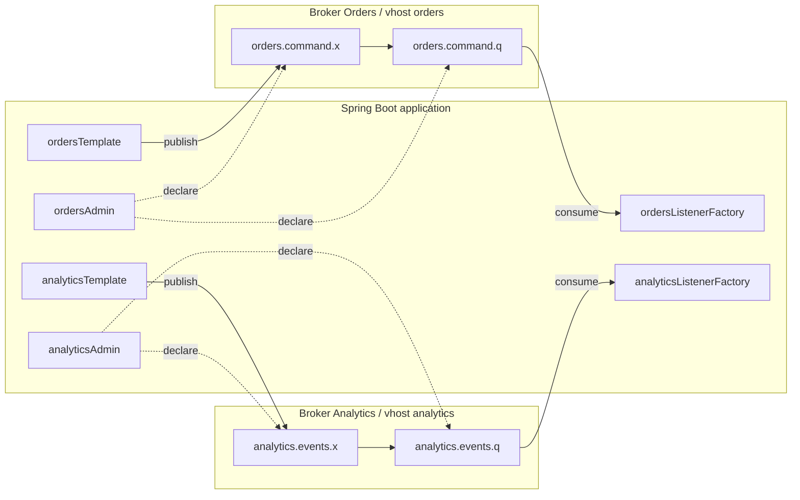
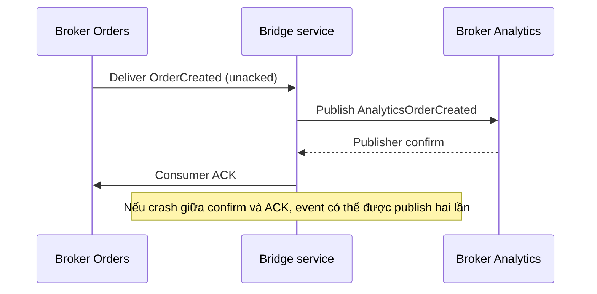

# RabbitAdmin phụ trách khai báo đúng tập tài nguyên

## 1. Vì sao cần chỉ định rõ RabbitAdmin trong ứng dụng có nhiều broker?

Khi ứng dụng **Spring AMQP** chỉ kết nối một RabbitMQ broker, ta thường khai báo `DirectExchange`, `Queue` và `Binding` thành Spring beans, rồi để `RabbitAdmin` tạo chúng. `RabbitTemplate` gửi message đến exchange; `@RabbitListener` xử lý message từ queue. Cách này khá đơn giản vì các thành phần đều dùng cùng một `ConnectionFactory`.

Vấn đề xuất hiện khi ứng dụng dùng **nhiều RabbitMQ broker, nhiều virtual host hoặc nhiều kết nối được quản lý độc lập**. Chẳng hạn:

- Broker **Orders** nhận lệnh tạo đơn hàng ở `orders.command.q`.
- Broker **Analytics** nhận sự kiện thống kê ở `analytics.events.q`.
- Ứng dụng cần publish hoặc consume từ cả hai broker, nhưng **mỗi RabbitAdmin chỉ được khai báo những tài nguyên thuộc broker của nó**.

Nếu cấu hình hai `RabbitAdmin` mà không quy định quyền sở hữu tài nguyên, mỗi admin có thể tìm thấy cùng các bean exchange/queue/binding trong `ApplicationContext` và **thử khai báo toàn bộ** lên broker mà nó quản lý. Hệ quả là những queue không mong muốn xuất hiện ở broker khác, va chạm tên, lỗi thiếu quyền hoặc lỗi khai báo bất tương thích.

Bài thuộc chương **Nhiều broker và khách hàng** của module `SPRING_AMQP`. Trọng tâm là phân chia trách nhiệm của `RabbitAdmin`, gắn từng tập `Declarable` vào đúng admin, cấu hình `RabbitTemplate` và listener container đúng kết nối, rồi xác minh topology thực tế trên broker.

> **Nguyên tắc:** `RabbitAdmin` quyết định **nơi khai báo topology**; `RabbitTemplate` quyết định **nơi publish**; `@RabbitListener` thông qua listener container factory quyết định **nơi consume**. Ba tuyến cấu hình này cần nhất quán, nhưng là ba trách nhiệm riêng.

## 2. Một topology, ba quyết định độc lập

Mỗi exchange, queue và binding thuộc **một virtual host cụ thể trên một broker cụ thể**. Cùng tên `orders.command.q` có thể tồn tại ở hai virtual host độc lập và là **hai queue khác nhau**. RabbitMQ không tự chuyển message giữa hai broker chỉ vì exchange hoặc queue trùng tên.



| Thành phần Spring AMQP | Được gắn với | Nhiệm vụ | Lỗi khi chọn sai |
| --- | --- | --- | --- |
| `ConnectionFactory` | Địa chỉ broker, credentials, virtual host | Tạo kết nối/channel đến đích | Truy cập nhầm broker/vhost |
| `RabbitAdmin` | Một `ConnectionFactory` | Khai báo exchange/queue/binding mà admin được giao | Topology xuất hiện sai môi trường hoặc thiếu ở môi trường đúng |
| `RabbitTemplate` | Một `ConnectionFactory` | Publish, request/reply và các thao tác AMQP phía client | Gửi message sang broker khác với nơi queue tồn tại |
| `RabbitListenerContainerFactory` | Một `ConnectionFactory` | Tạo container cho `@RabbitListener` | Listener tìm queue ở broker sai |
| `Declarable` | Tên exchange/queue/binding và admin được phép khai báo | Mô tả tài nguyên cần được tạo | Một tài nguyên bị mọi admin khai báo ngoài ý muốn |

Một ứng dụng có thể có **hai broker vật lý**, hoặc **một broker với hai vhost**. Trong cả hai trường hợp, cấu hình nhiều `ConnectionFactory`/`RabbitAdmin` có thể phù hợp vì mỗi vhost là phạm vi namespace và permissions riêng.

## 3. RabbitAdmin mặc định quét các Declarable như thế nào?

`RabbitAdmin` triển khai `AmqpAdmin`. Khi hoạt động cùng `CachingConnectionFactory` ở cache mode `CHANNEL`, admin có thể tự khai báo các Spring beans đại diện cho `Exchange`, `Queue`, `Binding` và những đối tượng được nhóm trong `Declarables` khi một connection được tạo, cũng như khi kết nối bị mất và được khôi phục.

Thông thường ứng dụng chỉ có **một admin** nên khai báo tất cả các bean này là hợp lý. Nhưng khi có **nhiều RabbitAdmin**, behavior mặc định cần được kiểm soát:

```text
ApplicationContext:
  - ordersAdmin       --> Broker Orders
  - analyticsAdmin    --> Broker Analytics
  - orders.command.x
  - orders.command.q
  - analytics.events.x
  - analytics.events.q

Nếu không đặt phạm vi khai báo:
  ordersAdmin có thể thử declare cả analytics.events.*
  analyticsAdmin có thể thử declare cả orders.command.*
```

Đối với bài toán này, Spring AMQP cung cấp ba cơ chế phối hợp:

1. `Declarable#setAdminsThatShouldDeclare(...)`: ghi rõ **admin nào được phép khai báo** một exchange, queue hoặc binding.
2. `RabbitAdmin#setExplicitDeclarationsOnly(true)`: yêu cầu admin chỉ tự khai báo các đối tượng được **chỉ định đích danh** cho chính nó.
3. `Declarable#setShouldDeclare(false)`: loại một khai báo khỏi cơ chế **auto-declaration** khi hạ tầng được quản lý bằng cách khác.

### Cách hiểu `setAdminsThatShouldDeclare`

Khi khai báo:

```java
ordersQueue.setAdminsThatShouldDeclare("ordersAdmin");
```

ta đang nói: **`ordersAdmin` là admin được chỉ định cho queue này**. `analyticsAdmin` không nên tạo nó. Danh sách admin có thể chứa **tên bean hoặc tham chiếu admin**; dùng tên bean thường giúp cấu hình topology độc lập với thứ tự tạo bean.

Điều này phải được áp dụng cho **cả exchange, queue lẫn binding**. Chỉ gắn queue vào đúng admin, nhưng quên gắn binding, có thể dẫn tới binding được admin khác thử khai báo trong khi endpoint không tồn tại.

### Vì sao còn cần `explicitDeclarationsOnly=true`?

Khi `explicitDeclarationsOnly=false` (mặc định), một `RabbitAdmin` vẫn có thể khai báo các `Declarable` **không chỉ định admin nào**. Với hai admin, chỉ cần một bean mới quên gắn `setAdminsThatShouldDeclare` là nguy cơ khai báo chéo trở lại.

Đặt `explicitDeclarationsOnly=true` trên **cả hai admin** nghĩa là:

```text
ordersAdmin:
  chỉ declare Declarable gắn rõ "ordersAdmin"

analyticsAdmin:
  chỉ declare Declarable gắn rõ "analyticsAdmin"

Declarable không chỉ định admin:
  không được hai admin này tự khai báo
```

Đây là cấu hình hữu ích khi yêu cầu phân quyền nghiêm ngặt. Nhưng cũng có mặt trái: **quên gắn admin thì tài nguyên sẽ không được khai báo**, dẫn tới lỗi `NOT_FOUND` ở listener/publisher. Vì vậy cần kiểm tra topology sau khi triển khai.

## 4. Cấu hình hoàn chỉnh: hai ConnectionFactory, hai RabbitAdmin

Ví dụ dùng Spring Boot, Java 17 và `spring-boot-starter-amqp`. Hai vhost/broker phải được chuẩn bị trước; tài khoản RabbitMQ cần quyền tương ứng. Các tên và địa chỉ dưới đây chỉ là ví dụ, có thể thay bằng hai broker độc lập hoặc hai vhost trên một cluster.

### 4.1. Khai báo cấu hình kết nối riêng

```yaml
# application.yml
app:
  rabbit:
    orders:
      host: rabbit-orders.internal
      port: 5672
      username: orders_app
      password: ${RABBIT_ORDERS_PASSWORD}
      vhost: orders
    analytics:
      host: rabbit-analytics.internal
      port: 5672
      username: analytics_app
      password: ${RABBIT_ANALYTICS_PASSWORD}
      vhost: analytics
```

`RABBIT_ORDERS_PASSWORD` và `RABBIT_ANALYTICS_PASSWORD` là **biến môi trường**, không lưu secret vào Git. Nếu chạy TLS, cần thêm cấu hình SSL, trust store và cổng của môi trường thực.

Ta tạo hai `CachingConnectionFactory` độc lập. Việc định nghĩa thủ công hai factory cũng có nghĩa không nên mặc định kỳ vọng toàn bộ auto-configuration `spring.rabbitmq.*` của Spring Boot được áp dụng giống nhau cho cả hai; hãy cấu hình riêng những thuộc tính cần thiết.

```java
import org.springframework.amqp.rabbit.connection.CachingConnectionFactory;
import org.springframework.amqp.rabbit.connection.ConnectionFactory;
import org.springframework.beans.factory.annotation.Value;
import org.springframework.context.annotation.Bean;
import org.springframework.context.annotation.Configuration;

@Configuration
public class MultiBrokerConnections {

    @Bean("ordersConnectionFactory")
    public ConnectionFactory ordersConnectionFactory(
            @Value("${app.rabbit.orders.host}") String host,
            @Value("${app.rabbit.orders.port}") int port,
            @Value("${app.rabbit.orders.username}") String username,
            @Value("${app.rabbit.orders.password}") String password,
            @Value("${app.rabbit.orders.vhost}") String vhost) {
        return create(host, port, username, password, vhost);
    }

    @Bean("analyticsConnectionFactory")
    public ConnectionFactory analyticsConnectionFactory(
            @Value("${app.rabbit.analytics.host}") String host,
            @Value("${app.rabbit.analytics.port}") int port,
            @Value("${app.rabbit.analytics.username}") String username,
            @Value("${app.rabbit.analytics.password}") String password,
            @Value("${app.rabbit.analytics.vhost}") String vhost) {
        return create(host, port, username, password, vhost);
    }

    private CachingConnectionFactory create(
            String host,
            int port,
            String username,
            String password,
            String vhost) {
        CachingConnectionFactory factory =
                new CachingConnectionFactory(host, port);
        factory.setUsername(username);
        factory.setPassword(password);
        factory.setVirtualHost(vhost);
        return factory;
    }
}
```

Hai factory này là những nguồn kết nối độc lập. Nếu một broker mất kết nối, consumer của broker đó sẽ chịu ảnh hưởng; consumer của broker kia vẫn có thể chạy nếu hạ tầng tương ứng còn hoạt động. Không nên coi việc một factory reconnect thành công là bằng chứng factory còn lại đã phục hồi.

### 4.2. Tạo RabbitAdmin có trách nhiệm tách biệt

```java
import org.springframework.amqp.rabbit.connection.ConnectionFactory;
import org.springframework.amqp.rabbit.core.RabbitAdmin;
import org.springframework.beans.factory.annotation.Qualifier;
import org.springframework.context.annotation.Bean;
import org.springframework.context.annotation.Configuration;

@Configuration
public class MultiBrokerAdmins {

    @Bean("ordersAdmin")
    public RabbitAdmin ordersAdmin(
            @Qualifier("ordersConnectionFactory")
                    ConnectionFactory connectionFactory) {
        RabbitAdmin admin = new RabbitAdmin(connectionFactory);
        admin.setExplicitDeclarationsOnly(true);
        return admin;
    }

    @Bean("analyticsAdmin")
    public RabbitAdmin analyticsAdmin(
            @Qualifier("analyticsConnectionFactory")
                    ConnectionFactory connectionFactory) {
        RabbitAdmin admin = new RabbitAdmin(connectionFactory);
        admin.setExplicitDeclarationsOnly(true);
        return admin;
    }
}
```

`@Qualifier` tránh tình trạng Spring không biết phải inject `ConnectionFactory` nào khi có hai bean cùng kiểu. Hai `RabbitAdmin` đều nhận cấu hình `explicitDeclarationsOnly=true` để không tự tạo những `Declarable` chưa có chủ.

Nếu ứng dụng đồng thời có một `RabbitAdmin` thứ ba với cấu hình mặc định, admin thứ ba vẫn có thể khai báo các bean **không được gắn admin**. Vì vậy cần kiểm tra *toàn bộ* admin trong context, không chỉ hai bean minh họa.

### 4.3. Gắn ownership cho exchange, queue và binding

Tạo `Declarables` cho broker Orders:

```java
import org.springframework.amqp.core.Binding;
import org.springframework.amqp.core.BindingBuilder;
import org.springframework.amqp.core.Declarable;
import org.springframework.amqp.core.Declarables;
import org.springframework.amqp.core.DirectExchange;
import org.springframework.amqp.core.Queue;
import org.springframework.amqp.core.QueueBuilder;
import org.springframework.amqp.core.TopicExchange;
import org.springframework.context.annotation.Bean;
import org.springframework.context.annotation.Configuration;

@Configuration
public class MultiBrokerTopology {

    @Bean("ordersTopology")
    public Declarables ordersTopology() {
        DirectExchange exchange =
                new DirectExchange("orders.command.x", true, false);
        Queue queue = QueueBuilder.durable("orders.command.q").build();
        Binding binding = BindingBuilder.bind(queue)
                .to(exchange).with("order.create");

        assignAdmin("ordersAdmin", exchange, queue, binding);
        return new Declarables(exchange, queue, binding);
    }

    @Bean("analyticsTopology")
    public Declarables analyticsTopology() {
        TopicExchange exchange =
                new TopicExchange("analytics.events.x", true, false);
        Queue queue = QueueBuilder.durable("analytics.events.q").build();
        Binding binding = BindingBuilder.bind(queue)
                .to(exchange).with("events.#");

        assignAdmin("analyticsAdmin", exchange, queue, binding);
        return new Declarables(exchange, queue, binding);
    }

    private static void assignAdmin(
            String beanName, Declarable... declarations) {
        for (Declarable declaration : declarations) {
            declaration.setAdminsThatShouldDeclare(beanName);
        }
    }
}
```

Lưu ý rằng `Declarables` là **đối tượng gom nhóm**. Thuộc tính admin được gắn vào **từng** `DirectExchange`, `TopicExchange`, `Queue` và `Binding` mà nó chứa, không chỉ gắn một nhãn lên bean `Declarables`.

| Bean hạ tầng | Broker/vhost đích | Admin được phép khai báo |
| --- | --- | --- |
| `orders.command.x` (direct) | Orders / `orders` | `ordersAdmin` |
| `orders.command.q` | Orders / `orders` | `ordersAdmin` |
| Binding `order.create` | Orders / `orders` | `ordersAdmin` |
| `analytics.events.x` (topic) | Analytics / `analytics` | `analyticsAdmin` |
| `analytics.events.q` | Analytics / `analytics` | `analyticsAdmin` |
| Binding `events.#` | Analytics / `analytics` | `analyticsAdmin` |

Không có binding trực tiếp giữa exchange trên broker Orders và queue trên broker Analytics. Mỗi binding tồn tại **nội bộ một vhost**. Nếu muốn chuyển sự kiện qua broker, cần một thành phần **đọc và publish lại**, hoặc cơ chế bridge/replication được cấu hình rõ.

### 4.4. Tạo RabbitTemplate và listener container factory đúng broker

```java
import org.springframework.amqp.rabbit.config.SimpleRabbitListenerContainerFactory;
import org.springframework.amqp.rabbit.connection.ConnectionFactory;
import org.springframework.amqp.rabbit.core.RabbitTemplate;
import org.springframework.beans.factory.annotation.Qualifier;
import org.springframework.context.annotation.Bean;
import org.springframework.context.annotation.Configuration;

@Configuration
public class MultiBrokerClients {

    @Bean("ordersTemplate")
    public RabbitTemplate ordersTemplate(
            @Qualifier("ordersConnectionFactory") ConnectionFactory cf) {
        return new RabbitTemplate(cf);
    }

    @Bean("analyticsTemplate")
    public RabbitTemplate analyticsTemplate(
            @Qualifier("analyticsConnectionFactory") ConnectionFactory cf) {
        return new RabbitTemplate(cf);
    }

    @Bean("ordersListenerFactory")
    public SimpleRabbitListenerContainerFactory ordersListenerFactory(
            @Qualifier("ordersConnectionFactory") ConnectionFactory cf) {
        SimpleRabbitListenerContainerFactory factory =
                new SimpleRabbitListenerContainerFactory();
        factory.setConnectionFactory(cf);
        factory.setConcurrentConsumers(2);
        factory.setPrefetchCount(10);
        return factory;
    }

    @Bean("analyticsListenerFactory")
    public SimpleRabbitListenerContainerFactory analyticsListenerFactory(
            @Qualifier("analyticsConnectionFactory") ConnectionFactory cf) {
        SimpleRabbitListenerContainerFactory factory =
                new SimpleRabbitListenerContainerFactory();
        factory.setConnectionFactory(cf);
        factory.setConcurrentConsumers(1);
        factory.setPrefetchCount(20);
        return factory;
    }
}
```

Đừng sử dụng một `RabbitTemplate` duy nhất để gửi vào cả hai broker theo cách ngầm định. Mỗi template trong ví dụ được cấu hình với factory rõ ràng. Với các ứng dụng cần **chọn broker theo runtime**, Spring AMQP có `RoutingConnectionFactory`, nhưng việc chọn kết nối để gửi **không tự thay đổi ownership của những `Declarable`**. Bài này dùng hai template riêng để việc kiểm tra tuyến gửi đơn giản.

### 4.5. Listener và producer sử dụng bean được chỉ định

```java
import org.springframework.amqp.rabbit.annotation.RabbitListener;
import org.springframework.stereotype.Component;

@Component
public class MultiBrokerListeners {

    @RabbitListener(
            id = "ordersConsumer",
            queues = "orders.command.q",
            containerFactory = "ordersListenerFactory")
    public void processOrder(String orderId) {
        System.out.println("Create order " + orderId);
    }

    @RabbitListener(
            id = "analyticsConsumer",
            queues = "analytics.events.q",
            containerFactory = "analyticsListenerFactory")
    public void processAnalytics(String event) {
        System.out.println("Analytics event " + event);
    }
}
```

```java
import org.springframework.amqp.rabbit.core.RabbitTemplate;
import org.springframework.beans.factory.annotation.Qualifier;
import org.springframework.stereotype.Service;

@Service
public class MultiBrokerPublisher {
    private final RabbitTemplate ordersTemplate;
    private final RabbitTemplate analyticsTemplate;

    public MultiBrokerPublisher(
            @Qualifier("ordersTemplate") RabbitTemplate ordersTemplate,
            @Qualifier("analyticsTemplate") RabbitTemplate analyticsTemplate) {
        this.ordersTemplate = ordersTemplate;
        this.analyticsTemplate = analyticsTemplate;
    }

    public void createOrder(String orderId) {
        ordersTemplate.convertAndSend(
                "orders.command.x", "order.create", orderId);
    }

    public void sendAnalyticsEvent(String event) {
        analyticsTemplate.convertAndSend(
                "analytics.events.x", "events.order.created", event);
    }
}
```

`@RabbitListener(queues = "...")` **không mặc nhiên khai báo** queue đó. Trong ví dụ, queue và binding được tạo qua `MultiBrokerTopology`. Thuộc tính `containerFactory` chỉ định đúng broker để **consume**; nó không thay thế việc gắn các khai báo vào đúng `RabbitAdmin`.

Với message quan trọng, hãy cấu hình **publisher confirms và returns trên từng connection factory** cùng chính sách retry/idempotency phù hợp. Những lời gọi `convertAndSend` rút gọn ở trên minh họa tuyến gửi, chưa tự chứng minh broker đã lưu message và queue đã nhận được.

## 5. Trường hợp dùng khai báo ngay trên `@RabbitListener`

Spring AMQP còn hỗ trợ `@RabbitListener(queuesToDeclare = ...)` hoặc `@RabbitListener(bindings = @QueueBinding(...))` để sinh khai báo queue/exchange/binding từ annotation. Khi chỉ có một admin, cách này thuận tiện. Nhưng trong ứng dụng nhiều admin, cần xác định **admin tạo tài nguyên** đồng thời với **factory dùng để consume**.

Ví dụ một queue phụ dành cho Orders:

```java
import org.springframework.amqp.rabbit.annotation.Queue;
import org.springframework.amqp.rabbit.annotation.RabbitListener;
import org.springframework.stereotype.Component;

@Component
public class OrdersAuditListener {

    @RabbitListener(
            queuesToDeclare = @Queue(
                    name = "orders.audit.q",
                    durable = "true"),
            admin = "ordersAdmin",
            containerFactory = "ordersListenerFactory")
    public void audit(String payload) {
        System.out.println("Orders audit: " + payload);
    }
}
```

`admin = "ordersAdmin"` áp dụng cho **khai báo do annotation yêu cầu**; `containerFactory = "ordersListenerFactory"` định hướng **listener tới broker Orders**. `queuesToDeclare` minh họa khai báo queue trong default exchange, không tự tạo custom exchange/binding cho một routing key tùy biến. Nếu cần cả exchange và binding, dùng `@QueueBinding` hoặc cấu hình `Declarables` rõ ràng.

Không khai báo lại `orders.command.q` bằng annotation với thuộc tính khác định nghĩa trong `MultiBrokerTopology`, vì broker sẽ kiểm tra sự tương đương của queue arguments và có thể báo `PRECONDITION_FAILED`.

## 6. Những sai sót dễ xuất hiện khi có nhiều RabbitAdmin

| Sai sót | Biểu hiện | Cách sửa |
| --- | --- | --- |
| Cả hai admin dùng mặc định `explicitDeclarationsOnly=false` | Exchange/queue không mong muốn xuất hiện ở cả hai broker | Bật explicit mode và gắn admin cho **mọi** `Declarable` |
| Chỉ gắn admin cho queue nhưng quên exchange/binding | Queue tồn tại nhưng publish không route hoặc admin khai báo sai tài nguyên | Gắn ownership cho đủ bộ exchange, queue, binding |
| `ordersTemplate` inject nhầm analytics factory | Publish tới broker có exchange không tồn tại | Kiểm tra `@Qualifier` trên template và target vhost |
| `@RabbitListener` quên `containerFactory` | Container mặc định có thể dùng broker sai hoặc không tìm được factory mặc định | Gắn factory cụ thể trong annotation |
| Khai báo annotation nhưng quên `admin` | Tài nguyên sinh từ annotation có thể được khai báo bởi admin sai hoặc không được tạo | Chỉ định `admin` và container factory cùng broker |
| Tài nguyên không gắn admin với explicit mode | `RabbitAdmin` không auto-declare tài nguyên đó | Kiểm tra danh sách declarations và admin được chỉ định |
| Hai bean `RabbitAdmin` cùng trỏ một vhost, tên queue có arguments khác | Lỗi `406 PRECONDITION_FAILED` | Chỉ định một nguồn topology có thẩm quyền; migration/policy khi đổi thuộc tính |
| Queue tồn tại nhưng binding sai | Publisher có thể confirm ACK nhưng consumer không nhận gì | Kiểm tra exchange type, routing key và binding **trong đúng vhost** |
| User chỉ có quyền `read/write`, thiếu `configure` | RabbitAdmin thất bại với `ACCESS_REFUSED` | Cấp quyền configure đúng tài nguyên hoặc để IaC quản lý topology |
| Quên rằng hai vhost tách biệt | Tìm queue ở vhost `/` thay vì `orders` | Kiểm tra đúng host, vhost và username khi điều tra |

### Đừng dùng `ignoreDeclarationExceptions` để che lỗi ownership

`RabbitAdmin` cho phép cấu hình `setIgnoreDeclarationExceptions(true)`, và một số declaration có thể tùy chỉnh cách xử lý exception. Nhưng bật ignore không làm một exchange xuất hiện ở broker đúng, không tạo lại binding bị sai và không sửa queue đang có thuộc tính không tương đương. Trong môi trường cần topology nhất quán, nên để lỗi khai báo nổi lên để xác định admin và cấu hình gây lỗi.

Nếu xuất hiện `DeclarationExceptionEvent`, hãy ghi rõ **admin bean**, địa chỉ broker/vhost, resource name và loại exception để chẩn đoán. Không tự động xóa queue có dữ liệu chỉ để khôi phục từ một lỗi declare mismatch.

## 7. Tương tác với Spring Boot auto-configuration

Spring Boot thường tự cấu hình `ConnectionFactory`, `RabbitTemplate`, `AmqpAdmin` và listener factory khi chỉ có một kết nối RabbitMQ. Khi ứng dụng định nghĩa **nhiều `ConnectionFactory` beans**, không nên giả định Spring Boot sẽ tự suy ra một broker “đúng” cho mọi template/admin.

Quy tắc thực hành:

1. Tạo `ConnectionFactory` cho từng broker/vhost với **bean name rõ ràng**.
2. Tạo `RabbitAdmin`, `RabbitTemplate`, `RabbitListenerContainerFactory` tương ứng, inject bằng `@Qualifier`.
3. Quy định ownership `Declarable` và bật `explicitDeclarationsOnly` trên các admin chịu trách nhiệm.
4. Nếu muốn cấu hình mặc định `@RabbitListener` hoặc `RabbitTemplate`, chỉ dùng `@Primary` sau khi xác định rõ **broker mặc định**, tránh để annotation cũ vô tình chạy trên broker sai.
5. Kiểm tra mọi bean do framework/auto-configuration tạo thêm để tránh một `RabbitAdmin` không kiểm soát cùng khai báo tài nguyên.

**Một trường hợp có chủ đích khác:** nhiều Spring application dùng **cùng một broker/vhost** và cùng một topology. Khi đó mỗi ứng dụng có thể khai báo lại cùng exchange/queue/binding với thuộc tính **tương đương**, hoặc chỉ một dịch vụ/IaC quản lý hạ tầng trong khi các ứng dụng khác dùng tài nguyên đã được provision. `explicitDeclarationsOnly` phù hợp để chỉ rõ trách nhiệm theo team/module dù broker chung.

## 8. Khai báo thủ công và khôi phục sau mất kết nối

### 8.1. Auto-declaration xảy ra khi nào?

Với `CachingConnectionFactory` ở cache mode `CHANNEL`, `RabbitAdmin` đăng ký callback để khai báo những bean phù hợp khi connection được tạo. Khi kết nối bị ngắt rồi được tái lập, admin có thể gửi lại các declaration được quản lý.

Khai báo một tài nguyên đang tồn tại với **cùng tên và thuộc tính tương đương** thường là thao tác idempotent. Nhưng nếu `orders.command.q` đã đổi `x-queue-type`, TTL, DLX hoặc durability ở broker, khai báo lại có thể lỗi `PRECONDITION_FAILED`. Đó là **thay đổi topology**, không phải sự cố kết nối; cần migration hoặc policy phù hợp.

Với nhiều admin, việc khôi phục cũng phải giữ ownership:

```text
Broker Orders reconnect:
  ordersAdmin --> declare orders.command.x
              --> declare orders.command.q
              --> declare binding order.create
  analyticsAdmin --> không thay đổi Broker Orders

Broker Analytics reconnect:
  analyticsAdmin --> declare analytics.events.x
                  --> declare analytics.events.q
                  --> declare binding events.#
  ordersAdmin --> không thay đổi Broker Analytics
```

Đừng dùng `RabbitAdmin.initialize()` trên cả hai admin mỗi khi **một** broker có sự cố. Nếu cần sửa topology một broker có chủ đích, gọi đúng admin được phân công và xác minh nguyên nhân trước khi thao tác.

### 8.2. `RabbitAdmin.initialize()` trong trường hợp cần thiết

```java
import org.springframework.amqp.rabbit.core.RabbitAdmin;
import org.springframework.beans.factory.annotation.Qualifier;
import org.springframework.stereotype.Service;

@Service
public class BrokerTopologyRepair {
    private final RabbitAdmin ordersAdmin;
    private final RabbitAdmin analyticsAdmin;

    public BrokerTopologyRepair(
            @Qualifier("ordersAdmin") RabbitAdmin ordersAdmin,
            @Qualifier("analyticsAdmin") RabbitAdmin analyticsAdmin) {
        this.ordersAdmin = ordersAdmin;
        this.analyticsAdmin = analyticsAdmin;
    }

    public void repairOrders() {
        ordersAdmin.initialize();
    }

    public void repairAnalytics() {
        analyticsAdmin.initialize();
    }
}
```

`initialize()` gửi lại các khai báo **thuộc quyền quản lý của admin**, không phục hồi những message đã bị xóa và không cấp thêm quyền RabbitMQ. Khi tài nguyên bị xóa trong lúc connection còn mở, đây có thể là thao tác can thiệp chủ động sau khi điều tra. Không nên gọi lặp vô hạn nếu broker đang từ chối declaration vì thiếu permission hoặc khác arguments.

### 8.3. Declarable tạo thủ công có tự được khai báo lại?

Một lệnh trực tiếp như:

```java
ordersAdmin.declareQueue(
        new org.springframework.amqp.core.Queue("orders.temporary.q", true));
```

tạo queue **ngay lúc gọi**, nhưng đối tượng queue này không nhất thiết là bean trong `ApplicationContext`. Theo mặc định, cơ chế tự quét Spring beans của `RabbitAdmin` **không ghi nhớ mọi resource được tạo thủ công**. Khi thực sự cần khôi phục những manual declarations, Spring AMQP có tùy chọn:

```java
ordersAdmin.setRedeclareManualDeclarations(true);
```

Tùy chọn này phải được cấu hình trên **chính RabbitAdmin thực hiện lệnh declare** (thường khi xây bean, trước khi sử dụng). Không gọi trên admin của broker khác. Nếu hạ tầng động có vòng đời dài và số lượng lớn, hãy xem xét registry/provisioning riêng thay vì tích lũy vô hạn manual declarations trong bộ nhớ.

### 8.4. `setShouldDeclare(false)` khi tài nguyên do IaC quản lý

Nếu một nhóm queue do RabbitMQ definitions, Terraform hoặc operator quản lý, ứng dụng có thể giữ bean mô tả tài nguyên nhưng **không tự khai báo**:

```java
Queue externalQueue =
        QueueBuilder.durable("orders.external-managed.q").build();
externalQueue.setShouldDeclare(false);
```

Khi đó phía provisioning phải tạo queue trước khi listener subscribe. `setShouldDeclare(false)` không cấp cho listener khả năng tiêu thụ queue chưa tồn tại. Đừng bật `shouldDeclare(false)` cho mọi bean chỉ để tránh lỗi sai ownership; điều đó có thể làm việc triển khai khó phát hiện thiếu topology.

## 9. RabbitAdmin không truyền message giữa hai broker

`RabbitAdmin` là **công cụ quản lý topology**, không phải router chuyển message xuyên broker. Hai broker độc lập không thể gắn trực tiếp `BindingBuilder.bind(queueOnBrokerB).to(exchangeOnBrokerA)` chỉ bằng một lời gọi Java thông thường, vì một binding được khai báo **trong chính vhost của một broker**.

Nếu yêu cầu là nhận `OrderCreated` từ Orders rồi phát `AnalyticsOrderCreated` sang Analytics, có thể triển khai một **bridge consumer**:



Bridge sử dụng **hai connection factory** (một để nhận, một để gửi), publisher confirms, cơ chế xử lý unroutable và idempotency ở đầu nhận. Không thể commit message trên Orders và publish trên Analytics **nguyên tử** chỉ bằng một `@Transactional` thông thường. Khi cần bảo đảm giao sự kiện quan trọng, cân nhắc outbox hoặc quy trình đối soát/replay có ID bền vững.

RabbitMQ cũng có những cơ chế kết nối broker như Federation hoặc Shovel cho các nhu cầu phù hợp. Chúng cần được thiết kế và vận hành riêng; việc chia đúng `RabbitAdmin` chỉ giải quyết câu hỏi **ai khai báo tài nguyên ở đâu**.

## 10. Quy trình xác minh đúng tập tài nguyên

Sau khi khởi chạy ứng dụng và tạo các connection, kiểm tra **cả hai broker hoặc virtual host**. RabbitMQ Management UI cho phép chọn vhost khi xem exchanges, queues, bindings và connections.

| Kiểm tra | Broker Orders | Broker Analytics |
| --- | --- | --- |
| Exchange bắt buộc | `orders.command.x` | `analytics.events.x` |
| Queue bắt buộc | `orders.command.q` | `analytics.events.q` |
| Binding bắt buộc | `order.create` | `events.#` |
| Exchange của broker còn lại | **Không có** `analytics.events.x` do ứng dụng này tạo | **Không có** `orders.command.x` do ứng dụng này tạo |
| Queue của broker còn lại | **Không có** `analytics.events.q` do ứng dụng này tạo | **Không có** `orders.command.q` do ứng dụng này tạo |
| Consumer dùng đúng factory | `ordersListenerFactory` | `analyticsListenerFactory` |

Để xác nhận bằng CLI trên môi trường có quyền truy cập RabbitMQ:

```bash
# Chạy với kết nối/credentials phù hợp ở từng RabbitMQ node.
rabbitmqctl list_exchanges -p orders name type durable
rabbitmqctl list_queues -p orders name durable consumers messages
rabbitmqctl list_bindings -p orders source_name destination_name routing_key

rabbitmqctl list_exchanges -p analytics name type durable
rabbitmqctl list_queues -p analytics name durable consumers messages
rabbitmqctl list_bindings -p analytics source_name destination_name routing_key
```

Nếu đây là **hai broker vật lý**, chạy các lệnh tương ứng trên từng node/broker; không thể dùng một `rabbitmqctl` đang kết nối node Orders để đọc trạng thái của một broker hoàn toàn độc lập chỉ bằng cách thay `-p`.

Quan sát thêm **log declaration**, `DeclarationExceptionEvent`, số connection/channel theo broker, consumer count, publisher returns, publisher confirm nack và backlog. Log ứng dụng nên có **logical broker name**, vhost, tên exchange/queue/routing key cùng correlation ID; tránh ghi password hoặc thông tin nhạy cảm.

### Bốn tình huống thực hành

**Tình huống A — Cấu hình đúng**

1. Khởi động hai RabbitMQ broker/vhost đã chuẩn bị.
2. Khởi động Spring Boot với cấu hình mục 4.
3. Xác nhận mỗi broker có đúng exchange/queue/binding của nó.
4. Gọi `createOrder("ORD-42")` và `sendAnalyticsEvent("OrderCreated:ORD-42")`.
5. Kiểm tra mỗi listener chỉ nhận từ queue/broker tương ứng.

**Tình huống B — Quên gắn admin cho một binding**

1. Trong môi trường thử nghiệm riêng, bỏ `setAdminsThatShouldDeclare` của binding Analytics.
2. Vì `analyticsAdmin.explicitDeclarationsOnly=true`, binding có thể không được tạo.
3. Producer publish với routing key `events.order.created`; exchange/queue vẫn tồn tại nhưng queue không nhận message nếu không có binding khác phù hợp.
4. Khôi phục ownership cho binding và kiểm tra lại.

**Tình huống C — Quên giới hạn admin**

1. Trong môi trường thử nghiệm, tắt `setExplicitDeclarationsOnly(true)` trên một admin.
2. Thêm một queue bean không chỉ định admin.
3. Kiểm tra admin đó có thể khai báo queue vào broker/vhost của nó dù queue thuộc module khác.
4. Bật lại explicit mode và chỉ định ownership rõ ràng.

**Tình huống D — Một broker tạm mất kết nối**

1. Cho Orders offline, giữ Analytics online.
2. Quan sát listener/producer Orders báo lỗi hoặc chờ reconnect, trong khi Analytics vẫn có thể hoạt động.
3. Khôi phục Orders, xác nhận `ordersAdmin` khai báo/đối chiếu topology của Orders.
4. Xác nhận Analytics không bị khai báo thêm đối tượng của Orders.
5. Thử publish trong khoảng mất mạng và xử lý kết quả không chắc chắn bằng confirm, retry và idempotency; không giả định gọi lại luôn an toàn với nghiệp vụ có side effect.

## 11. Checklist triển khai

| Câu hỏi | Quy tắc |
| --- | --- |
| Có bao nhiêu namespace RabbitMQ? | Xác định rõ broker và virtual host, không suy từ tên queue |
| Ai tạo connection? | Một factory được cấu hình đúng credentials/vhost cho mỗi namespace cần quản lý |
| Ai khai báo tài nguyên? | Chỉ định RabbitAdmin có ownership rõ ràng |
| Làm sao tránh khai báo chéo? | `setAdminsThatShouldDeclare` trên từng Declarable và `explicitDeclarationsOnly=true` trên các admin |
| Ai publish? | Inject đúng RabbitTemplate bằng `@Qualifier` |
| Ai consume? | `@RabbitListener(containerFactory = "...")` đúng broker |
| Tài nguyên do annotation tạo? | Kiểm tra `admin = "..."` và listener factory |
| Tài nguyên do IaC tạo? | Tránh khai báo mâu thuẫn; `shouldDeclare=false` khi ứng dụng không sở hữu |
| Queue động khai báo thủ công? | Cân nhắc `redeclareManualDeclarations` trên đúng admin hoặc registry provisioning |
| Broker reconnect? | Kiểm tra auto-declaration, durable topology và declaration errors ở đúng broker |
| Publish và DB transaction? | Publisher confirms/returns, idempotency, outbox khi cần; không kỳ vọng hai broker commit nguyên tử |
| Bảo mật và vận hành? | Quyền configure/read/write tối thiểu theo vhost, secret riêng, metrics theo broker |

## 12. Câu hỏi tự kiểm tra

1. Một ứng dụng có `ordersAdmin` và `analyticsAdmin`; vì sao chỉ tạo hai `ConnectionFactory` chưa đủ để ngăn khai báo topology chéo?
2. `Declarable#setAdminsThatShouldDeclare("ordersAdmin")` khác với `RabbitAdmin#setExplicitDeclarationsOnly(true)` như thế nào? Vì sao nên dùng cả hai trong ví dụ?
3. Vì sao phải đặt admin cho **cả exchange, queue và binding**, kể cả khi ba đối tượng đang nằm chung một bean `Declarables`?
4. Nếu `@RabbitListener` dùng `ordersListenerFactory` nhưng `RabbitTemplate` gửi sang Analytics, hành vi nào có thể xảy ra? Có phải RabbitAdmin sẽ tự định tuyến message về Orders không?
5. Một exchange và một queue đều tồn tại trên Broker Analytics nhưng publish không đến queue. Bạn kiểm tra những thành phần nào?
6. Nếu `RabbitAdmin` trên broker Orders gặp lỗi `PRECONDITION_FAILED` khi khai báo queue, tại sao bật `ignoreDeclarationExceptions` không phải giải pháp sửa topology?
7. Tại sao `@RabbitListener(queuesToDeclare = ...)` trong ứng dụng nhiều admin nên chỉ định cả `admin` và `containerFactory`?
8. Điều gì xảy ra nếu bean queue được đặt `setShouldDeclare(false)` nhưng không có IaC tạo queue trước khi listener bắt đầu?
9. Vì sao cần cấu hình `redeclareManualDeclarations` trên **chính** admin đã gọi `declareQueue(...)`?
10. Viết kế hoạch kiểm thử cho hai broker khi Orders bị ngắt mạng mà Analytics vẫn chạy. Các metric nào xác nhận hai nhánh hoạt động độc lập?
11. Một bridge nhận message từ broker A, publish sang broker B rồi ACK A. Nếu bridge chết sau khi B confirm nhưng trước ACK A thì sao? Cần bảo vệ dữ liệu nghiệp vụ bằng cơ chế nào?

**Ghi nhớ:** Trong ứng dụng Spring AMQP đa broker/vhost, **`RabbitAdmin` chịu trách nhiệm khai báo đúng tập tài nguyên**; `RabbitTemplate` và listener container factory được cấu hình **độc lập để gửi/nhận đúng nơi**. Dùng `setAdminsThatShouldDeclare(...)` trên từng exchange, queue và binding, kết hợp `setExplicitDeclarationsOnly(true)` trên các admin để kiểm soát ownership, sau đó xác minh topology và luồng message trên từng broker.

### Tài liệu tham khảo chính thức

- [Spring AMQP — Configuring the Broker](https://docs.spring.io/spring-amqp/reference/amqp/broker-configuration.html): `RabbitAdmin`, `Declarables`, conditional declaration, nhiều admin và explicit declarations.
- [Spring AMQP — Connection and Resource Management](https://docs.spring.io/spring-amqp/reference/amqp/connections.html): `CachingConnectionFactory`, connection factory và phục hồi kết nối.
- [Spring AMQP — Annotation-driven Listener Endpoints](https://docs.spring.io/spring-amqp/reference/amqp/receiving-messages/async-annotation-driven/enable.html): `@RabbitListener`, `admin`, listener container factory.
- [Spring AMQP — AmqpTemplate](https://docs.spring.io/spring-amqp/reference/amqp/template.html): `RabbitTemplate` và cách dùng connection factory.
- [Spring Boot — AMQP](https://docs.spring.io/spring-boot/reference/messaging/amqp.html): auto-configuration và cấu hình RabbitMQ.
