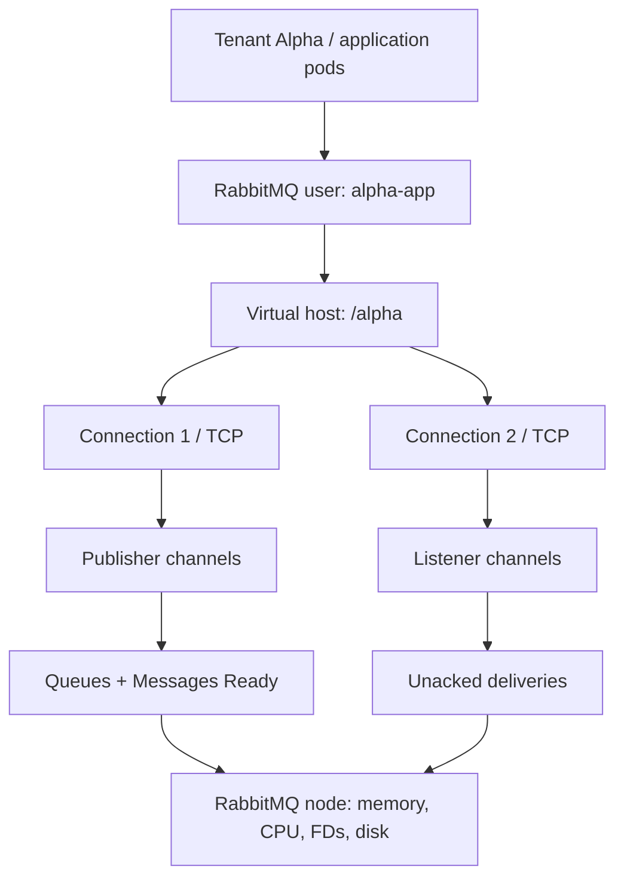
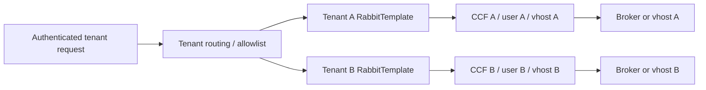

# Giới hạn số connection, channel và tài nguyên theo khách hàng

> **Chương:** Nhiều broker và khách hàng  
> **Module:** SPRING_AMQP — học tích hợp RabbitMQ với Spring AMQP bằng `RabbitTemplate`, `@RabbitListener`, exchange, queue và binding; thực hành định tuyến message, xác nhận giao nhận, retry, dead-letter, giao dịch và quan sát hệ thống để xây dựng xử lý bất đồng bộ đáng tin cậy.
>
> **Trọng tâm:** Thiết kế **resource budget** cho từng khách hàng (tenant) hoặc từng ứng dụng RabbitMQ client, phân biệt giới hạn của broker với giới hạn đặt trong Spring AMQP, và kiểm soát tài nguyên cả khi hệ thống scale hoặc gặp lỗi.

## 1. Mục tiêu học tập

Sau bài này, bạn có thể:

1. Phân biệt **business tenant** với **AMQP client**, user, virtual host, TCP connection, AMQP channel, consumer và message chưa ack.
2. Cấu hình giới hạn RabbitMQ theo **user**, **vhost**, **connection**, **node**, đồng thời nhận biết giới hạn nào không phải quota theo tenant.
3. Hiểu đúng `CachingConnectionFactory` của Spring AMQP: channel cache, channel checkout timeout, connection cache và publisher connection.
4. Ước lượng số connection/channel/consumer cần thiết khi triển khai nhiều pod, nhiều broker hoặc nhiều tenant.
5. Giảm ảnh hưởng của một tenant gửi quá nhanh, giữ nhiều unacked message hoặc tạo quá nhiều queue bằng backpressure, bounded concurrency, prefetch và định tuyến phù hợp.
6. Quan sát quota, chẩn đoán khi bị từ chối mở connection/channel và thực hành kiểm thử giới hạn một cách an toàn.

### Tình huống xuyên suốt

Một nền tảng SaaS có ba khách hàng: **Alpha**, **Beta** và **Gamma**. Cả ba sử dụng dịch vụ Kotlin/Java chạy Spring Boot, phát sự kiện đơn hàng bằng `RabbitTemplate` và nhận message bằng `@RabbitListener`. Alpha tăng từ 2 lên 30 replica; mỗi replica mở nhiều connection, listener và publisher channel. Nếu không có giới hạn, Alpha có thể chiếm tài nguyên node RabbitMQ, tăng số file descriptor, Erlang process và bộ nhớ, khiến Beta/Gamma bị ảnh hưởng.

Mục tiêu là đặt ngân sách tài nguyên rõ ràng, tăng tải tới đâu đo được tới đó, và để hệ thống từ chối/giảm tải có kiểm soát khi vượt quota. **Quota bảo vệ broker; nó không tự giải quyết tính công bằng trong xử lý nghiệp vụ hoặc độ tin cậy của message.**

## 2. “Khách hàng” được nhận diện ở tầng nào?

Từ “client/khách hàng” có thể chỉ hai đối tượng khác nhau:

- **RabbitMQ client:** một tiến trình hoặc một thư viện mở AMQP connection bằng một tài khoản RabbitMQ.
- **Business tenant:** một tổ chức hoặc người dùng trả phí của hệ thống SaaS; nhiều tenant có thể cùng sử dụng **một** RabbitMQ username/connection.

RabbitMQ kiểm soát quota theo danh tính kỹ thuật như user và vhost. Broker **không tự biết** header `tenantId` trong một event thuộc doanh nghiệp nào để áp dụng quota connection/channel của tenant đó.

| Mô hình | RabbitMQ phân biệt tenant được không? | Hậu quả thiết kế |
|---|---|---|
| Một RabbitMQ user + vhost cho mọi tenant | Không ở lớp quota kết nối/user/vhost | Phải dùng quota ứng dụng theo `tenantId`, tách luồng và theo dõi cẩn thận |
| Một user riêng cho mỗi tenant, chung vhost | Có thể giới hạn connection/channel theo user | Các queue/exchange và quyền trong vhost vẫn là tài nguyên chia sẻ |
| Một vhost + user riêng cho mỗi tenant | Có giới hạn connections/queues trên vhost và user | Cách ly topology và quyền tốt hơn; nhiều vhost có chi phí vận hành |
| Broker/cluster riêng cho nhóm tenant | Tách biệt hạ tầng mạnh hơn | Chi phí cao, cần cấu hình, monitoring và triển khai riêng |

Nếu hệ thống dùng 100 tenant nhưng tất cả dùng username `shared-service`, một lệnh `set_user_limits shared-service` sẽ giới hạn **tổng ứng dụng**. Nó không phải 100 quota độc lập. Muốn áp giới hạn theo tenant thật, cần mapping danh tính một-một hoặc **application rate/concurrency limiter**.

## 3. Tài nguyên được tiêu thụ ở những lớp nào?



| Đơn vị | Khi tăng lên | Mối nguy |
|---|---|---|
| **Connection** | Thêm TCP/TLS socket, heartbeat, authentication, file descriptor, bộ nhớ | Connection storm, broker/máy khách hết FD hoặc memory |
| **Channel** | Thêm session logic AMQP, state broker/client, consumer/confirm bookkeeping | Channel leak, chạm `channel_max`, tạo/đóng channel liên tục |
| **Consumer** | Thêm xử lý song song và số delivery đang chạy | DB/HTTP downstream quá tải, hiệu ứng mất thứ tự |
| **Prefetch** | Cho phép mỗi consumer giữ thêm unacked deliveries | Tốn bộ nhớ, tăng thời gian recovery và redelivery khi crash |
| **Queue / stream** | Thêm state, replicas, metadata và disk | Quá nhiều queue, replication overhead, quản trị khó |
| **Message rate / payload** | Tăng network, heap, disk I/O, queue backlog | Broker disk/memory alarm, publisher blocked, latency tăng |
| **Retry / DLQ** | Message được xử lý hoặc lưu lại nhiều lần | Retry storm, backlog và storage tăng vượt dự toán |

**Một connection có thể chứa nhiều channel**; một channel có thể có consumer hoặc publisher activity. `deliveryTag` và publisher-confirm sequence gắn với channel, không phải định danh toàn cục. Một connection đóng sẽ ảnh hưởng tất cả channel thuộc connection đó, nhưng một channel lỗi không nhất thiết đóng connection.

## 4. Giới hạn có sẵn ở RabbitMQ

Hãy đặt giới hạn ở nhiều lớp; mỗi lớp bảo vệ một phạm vi khác nhau.

| Lớp giới hạn | Ví dụ cấu hình | Phạm vi thật | Điều không bao phủ |
|---|---|---|---|
| **Per-user** | `max-connections` | Tổng connection dùng cùng RabbitMQ username | Không tách tenant nếu nhiều tenant dùng chung user |
| **Per-user** | `max-channels` | Tổng channel mở qua **mọi connection** của user | Không phải số channel tối đa **trên mỗi connection** |
| **Per-vhost** | `max-connections` | Tổng connection vào một virtual host | Các connection của cùng user vào vhost khác |
| **Per-vhost** | `max-queues` | Số queue/stream có thể khai báo trong vhost | Không phải tổng byte/message trong queue |
| **Per-connection** | Channel maximum do broker/client thỏa thuận | Tổng channel được mở trong một connection | Tổng số connection hoặc channel của user |
| **Per-node** | Connection/channel ceilings, resource alarms | Bảo vệ node RabbitMQ | Công bằng giữa các tenant đang chia sẻ node |
| **Per-queue** | `max-length`, `max-length-bytes`, TTL, policy | Backlog/tuổi message ở một queue theo cơ chế queue | Tổng dung lượng tất cả queue của tenant, tốc độ publish theo tenant |
| **Application** | Semaphore, rate limiter, queue admission, concurrency | Theo `tenantId` do ứng dụng xác thực | Không thay broker guardrail khi client khác kết nối trực tiếp |

RabbitMQ còn có các giới hạn protocol khác, như kích thước message tối đa và consumer acknowledgment timeout. Giá trị mặc định và tên tham số broker có thể khác giữa phiên bản RabbitMQ; đối chiếu tài liệu đúng version đang chạy trước khi thay `rabbitmq.conf`.

### 4.1. Per-user limits: tổng theo RabbitMQ username

Trên phiên bản RabbitMQ hỗ trợ user limits, quản trị viên có thể đặt:

```bash
# Ví dụ chạy trên shell của host quản trị RabbitMQ, không phải trong Java.
# Trước hết phải tạo user alpha_app và quyền phù hợp.
rabbitmqctl set_user_limits alpha_app '{"max-connections": 8, "max-channels": 64}'

# Kiểm tra giới hạn có hiệu lực.
rabbitmqctl list_user_limits alpha_app

# Khi cần bỏ giới hạn channel, dùng thao tác clear riêng.
rabbitmqctl clear_user_limits alpha_app max-channels
```

Giới hạn **`max-channels` áp dụng cho tổng channel trên tất cả connection của user**, khác với giới hạn channel của một connection. Ví dụ một user có bốn connection, mỗi connection mở 20 channel thì tổng là 80; sẽ vượt quota 64 dù từng connection chưa vượt channel maximum riêng. Chọn quota có tính đến số replica và mọi connection publisher/consumer liên quan.

Các giá trị trong ví dụ chỉ để minh họa; phải lập budget dựa trên tải đo được và có khoảng dự phòng. Không dùng tài khoản `guest` hoặc admin làm username chung của nhiều tenant production. Quyền `configure`, `write`, `read` nên giới hạn tới các exchange/queue phù hợp với nhiệm vụ của tenant.

**Lưu ý về giá trị xóa giới hạn:** Các phiên bản/CLI có thể có cách diễn giải giá trị 0/âm khác nhau tùy loại giới hạn; để gỡ một user limit đã đặt, dùng `clear_user_limits` rõ ràng theo tài liệu của broker. Đừng đồng loạt đặt `0` mà chưa kiểm tra semantics của loại quota.

### 4.2. Per-vhost limits: giới hạn connection và số queue

```bash
# Vhost và permission phải tồn tại trước khi chạy.
rabbitmqctl set_vhost_limits -p /alpha '{"max-connections": 10}'
rabbitmqctl set_vhost_limits -p /alpha '{"max-queues": 50}'

rabbitmqctl list_vhost_limits -p /alpha
```

Ở đây, `/alpha` là tên vhost, không phải đường dẫn filesystem. Ví dụ này giới hạn tối đa 10 connection trong vhost và 50 queue/stream theo cách RabbitMQ đếm tài nguyên của phiên bản đó.

**Per-vhost `max-queues` không phải quota dung lượng byte**. Một queue chứa hàng triệu message vẫn có thể gây disk pressure dù tổng số queue chỉ bằng 1. Ngoài queue-count, cần giới hạn backlog/TTL, chiến lược DLQ, quota ứng dụng và giám sát lưu lượng.

Một user có thể được cấp quyền vào nhiều vhost; giới hạn user và vhost áp dụng đồng thời. Connection chỉ được thiết lập khi tất cả giới hạn liên quan còn chỗ. Không tính hai quota như hai phần ngân sách có thể cộng thêm nhau.

### 4.3. Giới hạn số channel trên từng connection

AMQP 0-9-1 thương lượng số channel tối đa khi mở connection. Spring Boot 3.x hỗ trợ property:

```yaml
spring:
  rabbitmq:
    requested-channel-max: 32
```

Đây là **số channel tối đa phía client yêu cầu trong quá trình thương lượng cho một connection**, không phải quota tổng trên toàn bộ application hay tenant. Broker cũng có cấu hình giới hạn channel trên connection; giá trị được thương lượng không thể vượt mức broker cho phép. Không xem `requested-channel-max` như một cách giới hạn memory của toàn cluster.

RabbitMQ 4.2 và một số phiên bản trước dùng tên cấu hình broker `channel_max`; tài liệu ở những bản mới có thể dùng `max_channels_per_connection`. **Kiểm tra tài liệu của đúng RabbitMQ version** trước khi ghi tham số vào `rabbitmq.conf`; không chép nguyên hai tên vào một cấu hình và kỳ vọng chúng đồng nghĩa.

### 4.4. Giới hạn cấp node và cảnh báo tài nguyên

RabbitMQ có các ngưỡng connection/channel ở cấp node và các ngưỡng memory/disk, file descriptor, message size. Ví dụ hệ thống có giới hạn user rất cao nhưng node chỉ chịu được một tổng lượng nhỏ hơn, thì node vẫn có thể quá tải.

Khi broker phát hiện memory/disk alarm, publisher có thể bị **connection.blocked**/flow control: đây không phải lỗi kết nối đã đóng. Mở thêm connection hoặc retry vô hạn không tạo thêm tài nguyên cho broker. Cần giảm tốc phát, xử lý backlog và điều chỉnh dung lượng cluster.

## 5. CachingConnectionFactory: cache không mặc định là quota

Spring AMQP cung cấp `CachingConnectionFactory` (CCF) để tái sử dụng channel/connection. Mặc định trong `CacheMode.CHANNEL`, ứng dụng thường tái sử dụng một connection cho nhiều channel hoạt động. Nếu publisher connection được cấu hình riêng, số connection thực tế có thể lớn hơn một.

### 5.1. Hai cấu hình tưởng giống nhưng khác hoàn toàn

**Chỉ đặt cache size:**

```yaml
spring:
  rabbitmq:
    cache:
      channel:
        size: 16
```

`size=16` **chỉ xác định số channel idle có thể được giữ lại** trong cache theo mặc định. Khi nhiều thread cần channel cùng lúc, CCF vẫn có thể tạo thêm channel đang dùng, miễn broker cho phép. Do đó, chỉ chỉnh `cache.channel.size` không đủ để chặn channel leak hoặc giới hạn số request publisher đồng thời.

**Đặt cache size kèm checkout timeout:**

```yaml
spring:
  rabbitmq:
    requested-channel-max: 32
    cache:
      channel:
        size: 16
        checkout-timeout: 2s
```

Khi `checkout-timeout > 0`, Spring AMQP sử dụng `cache.channel.size` như **giới hạn số channel có thể mượn/mở trên một connection**. Nếu đã dùng hết 16 và không trả lại channel kịp trong 2 giây, caller có thể nhận `AmqpTimeoutException`. Đây là **backpressure tại ứng dụng**, không phải dấu hiệu RabbitMQ down.

Trong ví dụ, client yêu cầu tối đa 32 channel/connection từ broker, nhưng CCF còn chủ động áp giới hạn 16. Với nhiều connection hoặc connection factory khác nhau, giới hạn được áp dụng theo từng factory/connection tương ứng; không tự suy ra “tối đa 16 channel trên toàn hệ thống”.

### 5.2. Phân biệt cache mode

| CCF mode | Hành vi điển hình | Sử dụng khi nào |
|---|---|---|
| `CacheMode.CHANNEL` | Một shared connection, cache nhiều channel; thông thường là mặc định | Phần lớn Spring Boot ứng dụng gửi/nhận message |
| `CacheMode.CONNECTION` | Cache nhiều connection và channel; có `connectionCacheSize`, `connectionLimit` | Khi thiết kế thật sự cần nhiều connection riêng |

Với `CacheMode.CONNECTION`:

- `connectionCacheSize` là số connection idle có thể được cache; nó **không tự là trần connection cứng**.
- `connectionLimit` kết hợp `channelCheckoutTimeout` giúp giới hạn số connection đang dùng và thời gian chờ nhận connection.
- Theo tài liệu Spring AMQP, `RabbitAdmin` **không hỗ trợ automatic declarations với `CacheMode.CONNECTION`** theo cách thông thường; phải có chiến lược quản lý topology phù hợp.

Đừng bật `CacheMode.CONNECTION` chỉ vì ứng dụng có nhiều tenant. Việc tạo CCF/connection riêng cho hàng nghìn tenant có thể khiến broker gánh số TCP connection quá lớn. Cần lựa chọn theo yêu cầu cách ly, tải thực tế và ngân sách node.

### 5.3. Channel cho consumer và publisher

Listener container giữ các channel dùng để consume/ack; `RabbitTemplate` mượn channel để publish. Với confirm, reply, transacted channel hoặc publisher connection riêng, những channel đó có thể có vòng đời khác nhau. Khi tính quota hãy cộng **tất cả** chứ không chỉ đếm consumer của một queue.

Giới hạn quá thấp có thể làm consumer/publisher tranh nhau channel và gây timeout dù broker còn tài nguyên. Hãy kiểm tra `CachingConnectionFactory.getCacheProperties()`, cache high-water marks, số channel thực tế trên RabbitMQ và lỗi checkout timeout; không đặt `size=1` theo thói quen cho mọi workload.

## 6. Sizing: ngân sách resource cho mỗi tenant

Hãy bắt đầu bằng số pod/replica và số consumer/publisher thực tế.

Ví dụ minh họa tenant Alpha có:

- 3 replica Spring Boot;
- mỗi replica có 1 consumer connection và 1 publisher connection riêng;
- mỗi replica chạy 4 consumer channels, tối đa 8 publisher channels và tối đa 2 channel dùng cho admin/tiện ích khi phát sinh.

Ngân sách gần đúng:

| Thành phần | Phép tính | Mức dự kiến |
|---|---|---:|
| Connections | 3 replica × 2 connections | 6 |
| Consumer channels | 3 × 4 | 12 |
| Publisher channels | 3 × 8 | 24 |
| Admin/utility channels | 3 × 2 | 6 |
| **Tổng channels** | 12 + 24 + 6 | **42** |
| Giới hạn per-user gợi ý để thử | Dự trù cao hơn mức đo được | 8 connections / 60 channels |

Các số là **bài toán sizing**, không phải giá trị khuyến nghị chung. Trên thực tế publisher connection riêng có thể phát sinh theo cấu hình CCF, và nếu broker/ứng dụng mở channel cho admin hoặc listener khác, cần đo rồi điều chỉnh. Quota 60 channel cho user chỉ có ích nếu **tổng channel trên mọi connection của cùng user** không vượt mức này.

### 6.1. Prefetch và tổng số message đang chờ ack

Giả sử 3 replica, mỗi replica 4 consumer và mỗi consumer có `prefetch=10`. Khi broker cấp đủ delivery, hệ thống có thể giữ xấp xỉ:

```text
Maximum outstanding deliveries (gần đúng)
  = replicas × consumersPerReplica × prefetch
  = 3 × 4 × 10
  = 120 unacked messages
```

Nếu body mỗi message trung bình 200 KiB, riêng body của 120 message đã xấp xỉ 23,4 MiB, chưa tính metadata, object, message converter, buffers và replicas khác. Tăng `prefetch`/`concurrency` tác động tới **tổng memory, độ trễ xử lý và redelivery burst** sau reconnect.

RabbitMQ áp dụng prefetch theo semantics AMQP và implementation broker; Spring Boot `listener.simple.prefetch` là giới hạn delivery chưa ack cho consumer trong ví dụ. Không sử dụng phép tính trên như một trần bộ nhớ chính xác: consumer có thể cấp phát nhiều object và xử lý thêm tác vụ bất đồng bộ.

### 6.2. Đặt quota có chừa headroom cho phục hồi

Nếu quota connections vừa đúng số kết nối lúc bình thường, các đợt rolling deployment có thể có **pod cũ chưa thoát hoàn toàn và pod mới đã khởi động**, dẫn tới vượt ngưỡng. Cần:

1. Dự trù peak replicas, connection riêng cho publisher và số người vận hành/health-check connections cần thiết.
2. Đo channel high-water mark trong tải cao và thời gian recovery.
3. Chừa khoảng dự phòng để rolling restart, graceful shutdown và failover.
4. Kiểm tra quota user và vhost, channel maximum per connection và trần node **cùng lúc**.
5. Kiểm thử burst có kiểm soát để biết dịch vụ bị từ chối ở lớp nào trước tiên.

## 7. Ví dụ Spring Boot 3.x: giới hạn một ứng dụng client

Ví dụ application sử dụng AMQP 0-9-1, Spring Boot 3.x, RabbitMQ. Cấu hình dưới đây dành cho **một RabbitMQ user/vhost**:

```yaml
spring:
  rabbitmq:
    host: localhost
    port: 5672
    virtual-host: /alpha
    username: alpha_app
    password: "<from-secret-manager>"
    requested-channel-max: 32
    requested-heartbeat: 20s
    connection-timeout: 5s
    cache:
      connection:
        mode: channel
      channel:
        size: 16
        checkout-timeout: 2s
    publisher-confirm-type: correlated
    publisher-returns: true
    template:
      mandatory: true
    listener:
      type: simple
      simple:
        concurrency: 2
        max-concurrency: 4
        prefetch: 10
        default-requeue-rejected: false
```

**Ý nghĩa các lớp giới hạn:**

- Broker quyết định user/vhost được phép mở bao nhiêu connection và channel tổng cộng.
- `requested-channel-max: 32` yêu cầu giới hạn trên từng connection trong thương lượng AMQP.
- Spring CCF `size=16` với `checkout-timeout=2s` giới hạn số channel mượn được trên mỗi connection/factory tương ứng.
- `max-concurrency: 4` giới hạn lượng listener có thể scale trong `SimpleRabbitListenerContainer`; `prefetch: 10` giới hạn delivery chưa ack cho mỗi consumer.
- Publisher confirms và returns giúp xác nhận publish và phát hiện unroutable, **không tự điều tiết tốc độ publish**. Nếu mỗi request HTTP đều gọi `convertAndSend` đồng thời, phải thêm giới hạn ở tầng ingress/publisher.

Các giá trị 16, 32, 2 giây, 4 consumer chỉ là bài học mẫu. Trong sản xuất, secret phải nằm ngoài repository và cần chọn values theo đo tải thực tế. Chọn `default-requeue-rejected=false` khi đã có DLX/DLQ phù hợp để không làm mất message lỗi hoặc tạo requeue nóng.

## 8. Nhiều broker hoặc tenant: tách ConnectionFactory có chủ đích

Nếu hai tenant có RabbitMQ vhost hoặc broker riêng, cần **ConnectionFactory**, `RabbitTemplate` và listener container factory tương ứng. Không dùng một `RabbitTemplate` mặc định rồi tin rằng truyền header `tenantId` sẽ tự chọn đúng broker/vhost.



### 8.1. Khai báo connection riêng cho tenant A

Ví dụ Java dưới đây tạo một connection factory cho tenant A. Với tenant B, tạo bean tương tự nhưng dùng thuộc tính/vhost, credentials và limits tương ứng. Mọi secret được đọc từ cấu hình môi trường đã bảo vệ.

```java
import org.springframework.amqp.rabbit.connection.CachingConnectionFactory;
import org.springframework.amqp.rabbit.connection.ConnectionFactory;
import org.springframework.amqp.rabbit.core.RabbitTemplate;
import org.springframework.beans.factory.annotation.Qualifier;
import org.springframework.context.annotation.Bean;
import org.springframework.context.annotation.Configuration;
import org.springframework.core.env.Environment;

@Configuration(proxyBeanMethods = false)
public class TenantARabbitConfig {

    @Bean("tenantAConnectionFactory")
    CachingConnectionFactory tenantAConnectionFactory(Environment env) {
        var factory = new CachingConnectionFactory(
            env.getRequiredProperty("tenants.alpha.rabbit.host")
        );
        factory.setPort(Integer.parseInt(
            env.getRequiredProperty("tenants.alpha.rabbit.port")
        ));
        factory.setVirtualHost(
            env.getRequiredProperty("tenants.alpha.rabbit.vhost")
        );
        factory.setUsername(
            env.getRequiredProperty("tenants.alpha.rabbit.username")
        );
        factory.setPassword(
            env.getRequiredProperty("tenants.alpha.rabbit.password")
        );

        factory.setChannelCacheSize(12);
        factory.setChannelCheckoutTimeout(2_000);
        factory.setPublisherConfirmType(
            CachingConnectionFactory.ConfirmType.CORRELATED
        );
        factory.setPublisherReturns(true);
        factory.setConnectionNameStrategy(
            ignored -> "order-service/tenant-alpha"
        );
        return factory;
    }

    @Bean("tenantARabbitTemplate")
    RabbitTemplate tenantARabbitTemplate(
        @Qualifier("tenantAConnectionFactory") ConnectionFactory factory
    ) {
        RabbitTemplate template = new RabbitTemplate(factory);
        template.setMandatory(true);
        return template;
    }
}
```

**Điểm cần chú ý:** Việc tự tạo CCF thay vì dùng Boot auto-configuration nghĩa là bạn phải **tự cấu hình** các thuộc tính cần thiết như timeout, heartbeat, publisher confirms, routing và monitoring; không mặc định tất cả property `spring.rabbitmq.*` sẽ được áp lên bean do bạn tự tạo. Với nhiều bean `ConnectionFactory`, Spring Boot có thể không tự chọn được một mặc định; dùng `@Qualifier` và cấu hình `RabbitAdmin`/topology per broker một cách minh bạch.

### 8.2. Listener dành riêng cho tenant A

```java
import org.springframework.amqp.rabbit.config.SimpleRabbitListenerContainerFactory;
import org.springframework.amqp.rabbit.connection.ConnectionFactory;
import org.springframework.beans.factory.annotation.Qualifier;
import org.springframework.context.annotation.Bean;
import org.springframework.context.annotation.Configuration;

@Configuration(proxyBeanMethods = false)
class TenantAListenerConfig {
    @Bean("tenantAListenerContainerFactory")
    SimpleRabbitListenerContainerFactory tenantAListenerContainerFactory(
        @Qualifier("tenantAConnectionFactory") ConnectionFactory connection
    ) {
        var factory = new SimpleRabbitListenerContainerFactory();
        factory.setConnectionFactory(connection);
        factory.setConcurrentConsumers(2);
        factory.setMaxConcurrentConsumers(2);
        factory.setPrefetchCount(8);
        factory.setDefaultRequeueRejected(false);
        return factory;
    }
}
```

```java
import org.springframework.amqp.core.Message;
import org.springframework.amqp.rabbit.annotation.RabbitListener;
import org.springframework.stereotype.Component;

@Component
class TenantAOrderListener {
    private final TenantAOrderService service;

    TenantAOrderListener(TenantAOrderService service) {
        this.service = service;
    }

    @RabbitListener(
        queues = "alpha.orders.q",
        containerFactory = "tenantAListenerContainerFactory"
    )
    public void onMessage(Message raw) {
        service.processIdempotently(raw);
    }
}
```

`TenantAOrderService` là service nghiệp vụ tự xây, dùng `eventId` để chống xử lý trùng và chỉ hoàn tất sau khi transaction cần thiết đã commit. Cần khai báo `alpha.orders.q` trên đúng broker/vhost A (bằng RabbitAdmin cho A hoặc topology IaC phù hợp). Nếu gửi/nhận ở tenant B, cấu hình riêng tương tự, không dùng nhầm bean A.

### 8.3. Tránh tạo connection factory cho từng request

Một anti-pattern là tạo `new CachingConnectionFactory()` hoặc raw AMQP connection mỗi lần nhận HTTP request của tenant. Với tải cao, kết nối/TLS handshake tăng rất nhanh, khó thu hồi và dễ vượt user/vhost limits.

Nếu tenant thay đổi động:

- Dùng một registry giới hạn số tenant connection factories **đang hoạt động**; lifecycle rõ (khởi tạo, dùng, release, đóng).
- Không đóng connection factory đang có listener/publisher chạy; cần graceful shutdown và xử lý in-flight.
- Tạo quota tenant **trước** khi mở tài nguyên mới; có eviction policy và audit, tránh churn do eviction liên tục.
- Với hàng nghìn tenant nhỏ, cân nhắc dùng connection chung + **application quotas theo tenantId**, hoặc partition tenants vào broker/vhost theo nhóm; đây là quyết định capacity và cách ly, không có đáp án chung.
- Bảo vệ tenant routing từ danh tính người dùng đã xác thực. Không dùng một header `tenant-id` tự khai báo từ bên ngoài để cấp quyền truy cập vhost của tenant khác.

## 9. Backpressure và fairness ở tầng ứng dụng

Quota connection/channel không tự giới hạn số message/giây. Một tenant có đúng **một** channel vẫn có thể publish rất nhanh và làm queue đầy. Muốn tránh một tenant làm nghẽn hệ thống, cần hạn chế cả **publish rate**, **in-flight**, **message size**, **queue backlog**, **consumer work** và retry.

### 9.1. Giới hạn concurrent publish trong ứng dụng

Ví dụ sau dùng Java `Semaphore` để giới hạn 8 publish đang chờ confirm trong **một instance**. Đây là ví dụ một process; trong hệ thống nhiều pod, muốn quota chung cho tenant cần distributed limiter hoặc ingress tập trung.

```java
import java.nio.charset.StandardCharsets;
import java.util.UUID;
import java.util.concurrent.Semaphore;
import java.util.concurrent.TimeUnit;
import org.springframework.amqp.core.Message;
import org.springframework.amqp.core.MessageDeliveryMode;
import org.springframework.amqp.core.MessageProperties;
import org.springframework.amqp.rabbit.connection.CorrelationData;
import org.springframework.amqp.rabbit.core.RabbitTemplate;
import org.springframework.beans.factory.annotation.Qualifier;
import org.springframework.stereotype.Service;

@Service
public class TenantAPublisher {
    private final RabbitTemplate rabbit;
    private final Semaphore inFlight = new Semaphore(8, true);

    public TenantAPublisher(
        @Qualifier("tenantARabbitTemplate") RabbitTemplate rabbit
    ) {
        this.rabbit = rabbit;
    }

    public void publish(String eventId, String json) throws Exception {
        if (!inFlight.tryAcquire(500, TimeUnit.MILLISECONDS)) {
            throw new IllegalStateException("Tenant A publish quota busy");
        }

        try {
            var props = new MessageProperties();
            props.setContentType(MessageProperties.CONTENT_TYPE_JSON);
            props.setDeliveryMode(MessageDeliveryMode.PERSISTENT);
            props.setMessageId(eventId);
            props.setHeader("event-id", eventId);
            Message message = new Message(
                json.getBytes(StandardCharsets.UTF_8), props
            );
            CorrelationData correlation =
                new CorrelationData(UUID.randomUUID().toString());

            rabbit.send("alpha.events.x", "order.created", message, correlation);

            CorrelationData.Confirm confirm =
                correlation.getFuture().get(10, TimeUnit.SECONDS);
            if (!confirm.isAck()) {
                throw new IllegalStateException(
                    "Broker NACK: " + confirm.getReason()
                );
            }
            if (correlation.getReturned() != null) {
                throw new IllegalStateException(
                    "Unroutable: " +
                    correlation.getReturned().getReplyText()
                );
            }
        } finally {
            inFlight.release();
        }
    }
}
```

Đoạn trên giả định factory có **correlated publisher confirms**, `publisherReturns=true` và template `mandatory=true` (đã cấu hình ở mục 8). Các exchange/binding phải tồn tại. Khi confirm timeout hoặc kết nối mất, publish có thể có **kết quả không rõ**; không gửi lại vô điều kiện. Cần eventId ổn định, audit, retry có giới hạn và idempotent consumer.

**Phân biệt các quota:** semaphore=8 kiểm soát số lời gọi đồng thời đang chờ confirm, **không phải giới hạn 8 message/giây**. Nếu mỗi publish hoàn tất trong 5 ms, nhiều message vẫn có thể được gửi trong một giây. Để có rate cap, dùng token bucket/leaky bucket ở tầng ứng dụng/API gateway; với nhiều replica, quota tổng phải có trạng thái phân tán hoặc cơ chế cấp phép phù hợp.

### 9.2. Consumer concurrency, prefetch và downstream pool

Đặt giới hạn consumer bằng `@RabbitListener` container factory:

```yaml
spring:
  rabbitmq:
    listener:
      simple:
        concurrency: 2
        max-concurrency: 4
        prefetch: 10
        default-requeue-rejected: false
```

Đây là **giới hạn cho một listener container/application instance**, không phải toàn bộ tenant có nhiều replica. Nếu service chạy 10 replica, tổng consumer có thể cao hơn nhiều. Ngoài concurrency broker, cần giới hạn HTTP/DB connection pool, thread pool, số task async đang chạy và transaction duration.

Nếu consumer xử lý lâu, `prefetch=100` có thể giữ nhiều message ở client, làm queue mất cân bằng và tăng burst redelivery khi pod chết. Giảm prefetch giúp kiểm soát in-flight, nhưng quá thấp có thể làm throughput giảm. Chọn bằng benchmark, đo cả success rate và latency.

### 9.3. Quota số lượng và dung lượng message trong queue

Với queue phù hợp, có thể đặt policy `max-length`/`max-length-bytes` và overflow behavior. Nhưng một policy chạm giới hạn có thể làm **drop, dead-letter hoặc reject publish** tùy cấu hình queue và phiên bản. Không đặt queue length nhỏ rồi tưởng dữ liệu sẽ tự được lưu ở đâu đó.

Một ví dụ minh họa về chính sách queue backlog:

```bash
# Áp vào queue có tên bắt đầu bằng alpha.work. trong vhost /alpha.
# Thử trên vhost/queue thử nghiệm và kiểm tra overflow semantics.
rabbitmqctl set_policy -p /alpha alpha-backlog '^alpha[.]work[.]' \
  '{"max-length":10000,"overflow":"reject-publish"}' --apply-to queues
```

Policy trên dành cho **queue**, không phải quota tổng theo user. Kết quả `reject-publish` và publisher confirm phải được xử lý rõ ràng ở producer; không nhầm với backpressure bằng cách chặn TCP. RabbitMQ có khác biệt giữa classic/quorum queue và các phiên bản về `overflow`, nên thử tính năng đúng loại queue đang dùng.

### 9.4. Retry/DLQ cũng phải nằm trong ngân sách

Nếu tenant đẩy 1000 message lỗi/giây vào DLQ, queue xử lý chính có thể không quá tải nhưng DLQ vẫn tăng dung lượng. Hãy đặt deadline lưu trữ, retry budget, dead-letter monitoring và quy trình phát lại có kiểm soát. Không dùng `basicNack(requeue=true)` vô hạn làm limiter: nó chỉ khiến message được giao lặp, tiêu tốn tài nguyên mà không giúp broker ổn định.

## 10. Triệu chứng khi đụng quota và cách chẩn đoán

| Triệu chứng | Lớp nghi ngờ | Kiểm tra |
|---|---|---|
| Connection mới bị broker từ chối, các connection cũ còn chạy | Per-user/per-vhost connection limit, node limit hoặc authentication | `list_user_limits`, `list_vhost_limits`, connection count, broker logs |
| Mở channel mới lỗi nhưng TCP connection vẫn hoạt động | Per-user max-channels, per-connection channel maximum, channel-level protocol error | Channel count theo user/connection, shutdown reply code |
| `AmqpTimeoutException` khi mượn channel | `CachingConnectionFactory` checkout limit hoặc pool contention | `channelCacheSize`, `channelCheckoutTimeout`, high-water mark, active channels |
| `403 ACCESS_REFUSED` | Permission/resource ACL, đôi khi khác lỗi quota | Vhost, configure/read/write permissions, broker logs |
| `406 PRECONDITION_FAILED` | Declare queue/exchange/binding không tương thích hoặc ack sai tag | So sánh topology arguments, deliveryTag và channel |
| Consumer backlog tăng, publisher vẫn gửi được | Consumer concurrency/prefetch/downstream limit hoặc queue blockage | `messages_ready`, `unacked`, handler latency, DB pool |
| Publisher bị blocked, publish latency tăng mạnh | Memory/disk resource alarm hoặc flow control | Management blocked state, memory, disk, queue length |
| Nhiều connection/channel biến mất rồi mở lại liên tục | Connection churn, channel leak, restart/redeploy, TLS/network | Client connection name, close reason, new/open rates |
| Queue declare bị từ chối | Per-vhost `max-queues`, permission hoặc tên trùng arguments | Vhost limits, queue count, reply code |

Không quy mọi timeout thành “broker bị lỗi”: khi `checkout-timeout` là 2 giây, một publisher thiếu channel ở **phía ứng dụng** có thể timeout dù RabbitMQ hoàn toàn khỏe. Ngược lại, kết nối vẫn mở không chứng minh broker có tài nguyên để xử lý publish kịp thời.

## 11. Quan sát và cảnh báo theo tenant

### 11.1. Câu hỏi dashboard cần trả lời

1. **Ai dùng tài nguyên?** Connection/channel count theo RabbitMQ user, vhost, application instance và broker node.
2. **Tài nguyên còn bao nhiêu?** Số đang dùng so với user/vhost/node/channel limits và headroom cần cho deployment.
3. **Tốc độ thay đổi?** Connections opened/closed, channels created/closed mỗi phút; dấu hiệu leak/churn.
4. **Hệ thống đang làm được việc?** Publish/confirm rate, messages ready/unacked, consumer ack/nack/redelivery và throughput theo tenant.
5. **Đang bị chặn ở đâu?** RabbitMQ blocked connection, checkout timeout, semaphore rejection, HTTP 429, DB connection pool exhaustion.
6. **Có mất an toàn dữ liệu không?** Publisher confirm timeout/return, DLQ backlog, expired/rejected messages, duplicate processed events.

### 11.2. Công cụ và lệnh vận hành

```bash
# Xem user/vhost quotas đã cấu hình.
rabbitmqctl list_user_limits alpha_app
rabbitmqctl list_vhost_limits -p /alpha

# Xem connection và channel thực tế.
rabbitmqctl list_connections name user vhost channels
rabbitmqctl list_channels

# Xem consumer trong một vhost.
rabbitmqctl list_consumers -p /alpha
```

Các lệnh yêu cầu quyền quản trị phù hợp. Trường và cú pháp `rabbitmqctl` có thể khác chút ít theo phiên bản; dùng `rabbitmqctl help <command>` để xác nhận ở môi trường thật. RabbitMQ Management UI/HTTP API/Prometheus cũng cung cấp số lượng connection/channel, queue metrics và tình trạng resource alarm.

Spring AMQP `CachingConnectionFactory.getCacheProperties()` trả các số liệu như channel cache size, idle channels và high-water mark, tùy cache mode. Theo dõi high-water mark thường xuyên chạm giới hạn để xác định nên tăng capacity, giảm concurrency hay xử lý channel giữ quá lâu. Đừng tự động tăng quota khi nguyên nhân là connection leak.

**Cardinality:** RabbitMQ username/vhost có thể dùng làm dimension khi số lượng được quản lý; còn `eventId`, `messageId`, user session hay request ID không nên làm label metric do cardinality quá cao. Lưu các định danh này trong structured log/tracing và bảo vệ quyền truy cập.

### 11.3. Gợi ý ngưỡng cảnh báo

| Tín hiệu | Ví dụ ngưỡng cảnh báo thử nghiệm | Cần phản ứng |
|---|---|---|
| Connection per user/vhost | Dùng trên 80% quota liên tục | Xem pod scale, connection churn, dự phòng deployment |
| Channel high-water mark | Chạm giới hạn checkout nhiều lần | Kiểm tra channel leak, parallelism, timeout |
| Quota rejections | Bất kỳ đợt tăng đáng kể nào | Phân biệt config lỗi với traffic hợp lệ tăng |
| Retry/confirm timeout | Cao hơn baseline | Giảm tốc publish, kiểm tra broker và network |
| DLQ/backlog age | Vượt SLA nghiệp vụ | Điều tra lỗi, không replay tự động ồ ạt |
| Blocked connections | Xuất hiện trong giờ cao điểm | Kiểm tra memory/disk alarm và queue backlog |

80% là **mức cảnh báo ví dụ**, không phải ngưỡng RabbitMQ mặc định hay cam kết SLA. Cảnh báo nên có thời gian duy trì để tránh nhiễu vì burst ngắn và phải phân biệt peak hợp lệ trong rolling deployment với connection leak kéo dài.

## 12. Bài thực hành: quota per-user, vhost và Spring CCF

Thực hiện trong **RabbitMQ thử nghiệm**, với user/vhost test riêng; không áp quota thấp lên broker production đang phục vụ tenant thật.

### 12.1. Chuẩn bị topology

1. Tạo RabbitMQ user `alpha_app`, vhost `/alpha` và quyền thích hợp trên vhost đó.
2. Tạo work exchange, queue và binding; gửi payload nhỏ có `eventId` và `tenantId` nội bộ.
3. Chạy một Spring Boot instance với CCF mặc định; ghi số connection/channel thực tế.
4. Bật publisher confirms và returns; kiểm tra đường đi thành công trước khi gây lỗi quota.

### 12.2. Thử theo từng lớp giới hạn

| Thử nghiệm | Cách thực hiện | Kết quả cần quan sát |
|---|---|---|
| **T1 — User connections** | Set `max-connections` nhỏ hơn số connection muốn mở | Connection mới bị từ chối, connection cũ có thể tiếp tục; xác định broker response |
| **T2 — User channels** | Set `max-channels` thấp rồi tăng concurrency có kiểm soát | Channel mới bị giới hạn trên **tổng channel của user** |
| **T3 — Vhost connections** | Set `max-connections` ở `/alpha` | Chạm quota vhost dù user còn quota lớn hơn |
| **T4 — Vhost queues** | Set `max-queues` nhỏ, thử tạo queue mới ở vhost test | Bị từ chối khai báo thêm; không ảnh hưởng queue đã tồn tại theo cách bất ngờ |
| **T5 — Per-connection channel max** | Giảm `requested-channel-max` và mở nhiều channel trên một connection | Chạm negotiated channel limit, không đồng nghĩa toàn user hết channel |
| **T6 — CCF chỉ cache** | `size=4`, `checkout-timeout=0`, tạo 8 tác vụ mượn channel | Có thể mở hơn 4 channel đang dùng; size chỉ là cache |
| **T7 — CCF có checkout limit** | `size=4`, `checkout-timeout=1s`, giữ 4 channel rồi yêu cầu thêm | Caller chờ và có thể nhận `AmqpTimeoutException` |
| **T8 — Consumer prefetch** | 2 consumers, prefetch=10, handler trì hoãn có kiểm soát | Unacked có thể tăng, mức thực phụ thuộc broker/delivery |
| **T9 — Publisher rate** | Gửi burst từ 2 replica cùng tenant | Local semaphore per instance không tương đương quota toàn tenant |
| **T10 — Reconnect** | Restart broker test khi consumer còn unacked | Consumer phục hồi, message có thể redeliver; kiểm tra idempotency |
| **T11 — DLQ và overflow** | Gây retry storm/queue backlog ở vhost test có policy | Quan sát overflow action, rejected/dead-letter và disk |
| **T12 — Multi-tenant isolation** | Làm tenant A đạt quota, tenant B gửi/nhận bình thường | Tenant B vẫn hoạt động trong budget riêng; theo dõi cả giới hạn node dùng chung |

### 12.3. Báo cáo sau test

Ghi rõ các trường:

```text
tenant / RabbitMQ username / vhost / broker version
replica count / connection count / channel count
connection limit / user channel limit / channel max per connection
CCF channelCacheSize / channelCheckoutTimeout
consumer count / prefetch / unacked / queue ready
publish request rate / confirms / returned / timeouts
quota rejects / channel close reason / DLQ and overflow outcomes
database or downstream success / duplicate side effects
```

Tách riêng **tài nguyên đã cấp**, **đang sử dụng**, **còn khả dụng** và **số tác vụ nghiệp vụ thành công**. Một quota hoạt động đúng có thể chủ động từ chối kết nối, nhưng service vẫn phải có cách xử lý request lỗi và trả thông báo rõ ràng/đưa job vào queue bền vững nếu hợp đồng nghiệp vụ yêu cầu.

## 13. Tình huống vận hành: tenant tăng tải đột biến

Giả sử tenant Alpha có:

- per-user `max-connections=8`, `max-channels=64`;
- vhost `/alpha` giới hạn `max-connections=10` và `max-queues=50`;
- Spring Boot 3 replica, mỗi replica khoảng 2 connection, 14 channel lúc peak;
- workload bình thường 100 message/giây nhưng đột ngột tăng 10 lần.

**Phân tích:**

1. Ba replica với tổng khoảng 6 connection và 42 channel vẫn chưa chạm user quota. Tuy nhiên message rate tăng 10 lần có thể làm queue backlog lớn và broker I/O/consumer pool quá tải **trước khi chạm quota connections**.
2. Nếu autoscaler tăng từ 3 lên 6 replica mà mỗi replica mở 2 connection, tổng dự kiến ~12 connection: có thể bị từ chối bởi `max-connections=8` của user (vhost limit 10 cũng trở thành giới hạn), kể cả node còn RAM.
3. Tăng user quota lên 1000 mà không đo node capacity không giải quyết nguyên nhân và có thể làm Alpha cạnh tranh dữ dội với Beta/Gamma.
4. Phương án thực tế là **giới hạn incoming publish rate**, tăng consumer capacity có đo lường, giới hạn prefetch/in-flight, giám sát DLQ, và chỉ mở quota connection/channel khi dự toán tài nguyên và headroom chứng minh cần thiết.

**Câu hỏi tự kiểm tra:**

1. Nếu 30 business tenant dùng cùng username `saas_app`, `max-connections=10` có tạo 10 connection riêng cho mỗi tenant không?
2. `CachingConnectionFactory.setChannelCacheSize(16)` có mặc định chặn mở channel thứ 17 không?
3. Khác nhau giữa `max-channels` của user và `requested-channel-max` của một connection là gì?
4. Vì sao một tenant chỉ có một connection vẫn có thể làm broker đầy disk?
5. Khi `AmqpTimeoutException` xuất hiện lúc checkout channel nhưng broker connections bình thường, bạn điều tra ở đâu?
6. Nếu quota local của mỗi pod là 8 in-flight, chạy 10 pod có được xem là quota toàn tenant bằng 8 không?
7. Tại sao cần giữ khoảng dự phòng quota khi rolling deployment?
8. Nếu publish timeout sau khi gửi message, có được phát lại vô điều kiện không?

## 14. Ghi nhớ và tài liệu tham khảo

Giới hạn tài nguyên RabbitMQ cần được **xếp lớp**: broker đặt quota theo **user/vhost/connection/node**, Spring AMQP quản lý **connection/channel cache và checkout limit**, listener điều chỉnh **consumer concurrency/prefetch**, còn ứng dụng kiểm soát **rate và in-flight theo business tenant**. Chỉ khi phân biệt được những lớp này, bạn mới tránh được hai lỗi đối lập: để một khách hàng làm cạn tài nguyên và đặt quota quá thấp khiến các luồng nghiệp vụ hợp lệ liên tục bị từ chối.

Với hệ thống nhiều broker hoặc tenant, hãy map danh tính và vhost tường minh, dùng connection factories có vòng đời kiểm soát, theo dõi connection/channel count cùng publisher confirms, retry/DLQ và idempotency. Một hệ thống chịu tải tốt là hệ thống **đo được tài nguyên, có backpressure và khôi phục được kết quả nghiệp vụ**, chứ không chỉ mở được nhiều connection.

**Tài liệu chính thức:**

- RabbitMQ — Per-user Resource Limits: https://www.rabbitmq.com/docs/user-limits
- RabbitMQ — Virtual Hosts and Limits: https://www.rabbitmq.com/docs/vhosts
- RabbitMQ — Limits and Timeouts: https://www.rabbitmq.com/docs/limits
- RabbitMQ — Connections: https://www.rabbitmq.com/docs/connections
- RabbitMQ — Channels: https://www.rabbitmq.com/docs/channels
- RabbitMQ — Consumer Prefetch: https://www.rabbitmq.com/docs/consumer-prefetch
- RabbitMQ — Queue Length Limit: https://www.rabbitmq.com/docs/maxlength
- RabbitMQ — Consumer Acknowledgements and Publisher Confirms: https://www.rabbitmq.com/docs/confirms
- Spring AMQP — Connection and Resource Management: https://docs.spring.io/spring-amqp/reference/amqp/connections.html
- Spring AMQP — Listener Container Configuration: https://docs.spring.io/spring-amqp/reference/amqp/containerAttributes.html
- Spring Boot 3.5 — Application Properties (RabbitMQ): https://docs.spring.io/spring-boot/3.5/appendix/application-properties/
