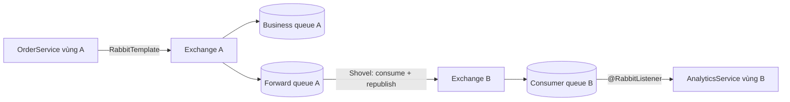
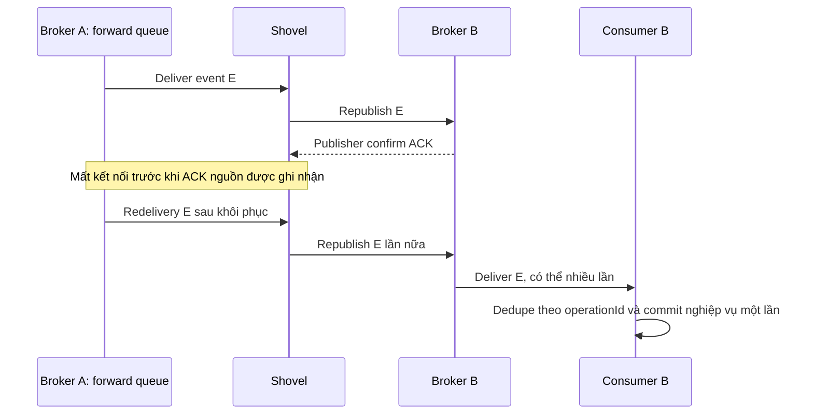

# Đánh giá Shovel/Federation như cơ chế broker ngoài phạm vi RabbitTemplate

> **Chương:** Nhiều broker và khách hàng  
> **Công nghệ:** Spring AMQP, RabbitMQ  
> **Trọng tâm:** Khi nào cần **Shovel** hoặc **Federation** để kết nối các RabbitMQ broker/cluster, hai cơ chế này khác việc ứng dụng gửi bằng `RabbitTemplate` như thế nào, và những bảo đảm giao nhận nào vẫn thuộc trách nhiệm của ứng dụng.

## 1. Bài toán: hai cụm RabbitMQ, một luồng sự kiện

Giả sử dịch vụ đặt hàng chạy ở vùng **A**, còn dịch vụ phân tích chạy ở vùng **B**. Hai vùng có RabbitMQ riêng, không muốn ghép thành một cluster vì độ trễ mạng, quyền vận hành và tính độc lập khi xảy ra sự cố. `OrderService` dùng `RabbitTemplate` gửi sự kiện `order.paid` vào exchange ở A; phía B cần nhận sự kiện để cập nhật báo cáo.

Có ít nhất ba hướng tiếp cận:

1. **Ứng dụng tự gửi sang B**: cấu hình thêm `ConnectionFactory`/`RabbitTemplate` trỏ đến broker B, rồi ứng dụng quyết định gửi, retry và đối soát từng publish.
2. **RabbitMQ Shovel**: một tiến trình plugin ở tầng broker **consume từ nguồn rồi republish đến đích**, không cần thay đổi code producer mỗi lần mở thêm đường chuyển.
3. **RabbitMQ Federation**: broker B thiết lập **upstream** tới A, sử dụng liên kết và policy để nhận luồng exchange hoặc chia sẻ thông điệp queue theo nhu cầu.

Hai plugin sau **không phải API của Spring AMQP**. `RabbitTemplate` không tự bật Shovel/Federation, cũng không tạo chúng bằng `convertAndSend()`. Ngược lại, khi plugin đã được quản trị viên cấu hình, code ứng dụng thường vẫn publish/consume với `RabbitTemplate` và `@RabbitListener` như bình thường, chỉ kết nối đến broker của vùng mình.

**Câu hỏi quyết định:** bạn muốn ứng dụng **chủ động xuất bản sang nhiều broker**, muốn một **đường chuyển message xác định từ queue nguồn sang đích**, hay muốn **federate luồng exchange/queue giữa các broker độc lập**?

### Mục tiêu học tập

Sau bài này, bạn sẽ phân biệt vai trò của `RabbitTemplate`, Shovel, Federation Exchange và Federation Queue; thiết kế topology với exchange, queue và binding; biết cách cấu hình minh họa Shovel/Federation ở RabbitMQ; hiểu ack/confirm, điều kiện phát sinh trùng hoặc mất message; và xây checklist kiểm thử, bảo mật, quan sát cho luồng liên broker.

## 2. Ranh giới: Spring AMQP làm gì và broker plugin làm gì?



Trong sơ đồ này, `RabbitTemplate` chỉ gửi vào **exchange A**. Nó không biết `Forward queue A`, Shovel hay broker B có đang hoạt động. Một plugin trên RabbitMQ thay mặt hệ thống vận hành **cầu nối liên broker**. Phía B nhận message từ queue B bằng listener thông thường.

| Tầng | Thành phần | Trách nhiệm chính | Không nên kỳ vọng |
| --- | --- | --- | --- |
| Ứng dụng gửi | `RabbitTemplate`, `ConnectionFactory` | Serialize, publish đến exchange/routing key đã chọn; xử lý confirm/return, nghiệp vụ và idempotency. | Tự khám phá/federate tất cả broker từ một publish thông thường. |
| Broker A | Exchange, queue, binding | Định tuyến/lưu message theo topology; giao cho consumer hoặc Shovel. | Tự chuyển message sang RabbitMQ B nếu chưa cấu hình cơ chế liên broker. |
| Shovel | RabbitMQ Shovel plugin | Consume từ nguồn, publish tới đích, quản lý kết nối/ack giữa hai đầu. | Thực thi transaction DB hoặc bảo đảm exactly-once business effect. |
| Federation | RabbitMQ Federation plugin | Kết nối upstream/downstream, truyền message qua federated exchange/queue theo policy. | Đồng bộ mọi queue, replay mọi message lịch sử hoặc biến hai cluster thành một cluster thống nhất. |
| Ứng dụng nhận | `@RabbitListener` | Deserialize, ghi database, ack/retry/DLQ theo nghiệp vụ. | Broker bảo vệ các side effect khỏi xử lý trùng nếu không có idempotency. |

Nếu cả hai broker nằm trong **cùng một RabbitMQ cluster**, client có thể cấu hình nhiều địa chỉ node để failover kết nối. Đó là bài toán **node connectivity/failover** của *một cluster* và **khác** cầu nối giữa *hai cluster độc lập*. Shovel/Federation giải quyết luồng message giữa các broker/cluster hoặc virtual host, không thay thế replication của quorum queue trong một cluster.

## 3. Shovel: message pump từ nguồn sang đích

**Shovel** là plugin RabbitMQ hoạt động giống một consumer kiêm publisher: nó kết nối tới broker nguồn, lấy message, publish lại tới broker đích và quyết định lúc nào xác nhận message nguồn. Một Shovel có thể nối các broker ở nhiều vùng, hai vhost hoặc các endpoint AMQP được hỗ trợ tùy phiên bản/cấu hình.

```text
Broker A                           Shovel                           Broker B

exchange A --> forward.queue --> consume --> publish/confirm --> exchange B
                                      |                              |
                                      +-- ack nguồn theo ack-mode     +--> queue B
```

### 3.1. Shovel lấy message từ queue là **consume**, không phải nhân bản queue

Nếu cấu hình Shovel consume trực tiếp queue nghiệp vụ `orders.work` đang có `@RabbitListener`, Shovel và listener sẽ trở thành **competing consumers**. Một message có thể bị Shovel lấy đi thay vì được dịch vụ A xử lý. Đây là lỗi topology rất dễ gặp.

Muốn **vừa xử lý tại A, vừa chuyển một bản đến B**, hãy tạo **queue forwarding riêng** và binding nó vào cùng exchange:

```text
                             +--> orders.local.queue   --> @RabbitListener tại A
RabbitTemplate --> orders.events
                             +--> orders.bridge.queue  --> Shovel --> orders.events tại B
```

Hai queue được exchange định tuyến **độc lập** theo binding. Shovel có thể drain `orders.bridge.queue` mà không giành message của consumer nội bộ. Ngược lại, nếu mục tiêu là **di chuyển** backlog từ queue A sang B và A không cần xử lý, Shovel có thể consume queue nguồn được chỉ định mà không cần một queue forwarding khác.

### 3.2. Ba chế độ ack quan trọng

| Shovel `ack-mode` | Khi nào ack ở nguồn? | Đánh đổi |
| --- | --- | --- |
| `on-confirm` | **Sau khi broker đích xác nhận lần publish**. | Phù hợp cho luồng cần an toàn dữ liệu hơn; có thể phát sinh **duplicate** nếu đích đã nhận nhưng ack nguồn bị mất. |
| `on-publish` | Sau khi đã publish sang đích mà **chưa chờ confirm**. | Có cửa sổ mất message nếu đích không nhận/lưu được, vì nguồn đã ack. |
| `no-ack` | Consumer Shovel dùng automatic acknowledgement ở nguồn. | Nhanh nhưng có thể mất message nếu Shovel chết trước khi gửi đến đích. |

`on-confirm` là lựa chọn mặc định được tài liệu RabbitMQ mô tả cho Shovel. Nó hỗ trợ **at-least-once transfer trong những điều kiện vận hành thích hợp**, không phải exactly-once delivery. Ví dụ broker B đã confirm nhưng liên kết Shovel → A đứt trước ack nguồn: A giao lại, Shovel publish lần nữa và B nhận bản sao. Publisher confirms cũng không thay thế việc kiểm tra **routing tại B**: cần khai báo đúng exchange và binding/queue đích, đồng thời giám sát thông điệp không có đích route.

### 3.3. Dynamic Shovel và Static Shovel

- **Dynamic Shovel:** định nghĩa bằng runtime parameter hoặc Management API/UI; có thể tạo, sửa, xóa trong lúc broker chạy; phù hợp khi vận hành tập trung, thay đổi tuyến truyền và triển khai qua definitions.
- **Static Shovel:** khai báo trong cấu hình broker; thích hợp một số môi trường quản trị bằng file nhưng thay đổi thường gắn với vòng đời cấu hình/deployment.

Trong bài này ưu tiên **dynamic Shovel** cho ví dụ vận hành. **Đừng đặt bí mật kết nối thật vào Git hoặc tài liệu**: URIs chứa mật khẩu có thể hiện trong runtime parameters, log, API quản trị hoặc công cụ backup. Dùng tài khoản riêng, cơ chế quản lý secret và TLS do hạ tầng cung cấp.

## 4. Ví dụ A: Spring AMQP phát message để Shovel chuyển qua vùng B

Giả sử hai RabbitMQ độc lập:

- **A (nguồn):** `rabbit-a.internal:5672`.
- **B (đích):** `rabbit-b.internal:5672`.

Mỗi broker có virtual host và quyền truy cập được cấu hình sẵn. Các hostname chỉ mang tính minh họa, không phải broker đang chạy thực tế.

### 4.1. Producer Spring Boot ở A: tạo hai queue độc lập

Dependency cần có: `spring-boot-starter-amqp`. Spring Boot sử dụng cấu hình `spring.rabbitmq.*` để kết nối broker A.

```yaml
spring:
  rabbitmq:
    host: rabbit-a.internal
    port: 5672
    virtual-host: /
    # username/password lấy từ secret manager hoặc biến môi trường.
```

Topology tại A:

```java
import org.springframework.amqp.core.Binding;
import org.springframework.amqp.core.BindingBuilder;
import org.springframework.amqp.core.DirectExchange;
import org.springframework.amqp.core.Queue;
import org.springframework.amqp.core.QueueBuilder;
import org.springframework.context.annotation.Bean;
import org.springframework.context.annotation.Configuration;

@Configuration
public class RegionATopology {
    public static final String EXCHANGE = "orders.events";
    public static final String LOCAL_QUEUE = "orders.region-a.work";
    public static final String BRIDGE_QUEUE = "orders.bridge.to-region-b";

    @Bean
    DirectExchange ordersExchange() {
        return new DirectExchange(EXCHANGE);
    }

    @Bean
    Queue regionALocalQueue() {
        return QueueBuilder.durable(LOCAL_QUEUE).build();
    }

    @Bean
    Queue regionABridgeQueue() {
        return QueueBuilder.durable(BRIDGE_QUEUE).build();
    }

    @Bean
    Binding localBinding() {
        return BindingBuilder.bind(regionALocalQueue())
                .to(ordersExchange()).with("order.paid");
    }

    @Bean
    Binding bridgeBinding() {
        return BindingBuilder.bind(regionABridgeQueue())
                .to(ordersExchange()).with("order.paid");
    }
}
```

Khi `RabbitTemplate` publish một message `order.paid`, exchange A route đến **cả hai queue**. Shovel sẽ chỉ consume `orders.bridge.to-region-b`; listener nội bộ ở A có queue riêng. Nên dùng durable queues và persistent messages phù hợp với yêu cầu dữ liệu, đồng thời đánh giá loại queue (ví dụ quorum queue khi cần replication) theo SLA của từng cluster.

### 4.2. Publisher vẫn là `RabbitTemplate` thông thường

```java
import org.springframework.amqp.core.MessageDeliveryMode;
import org.springframework.amqp.rabbit.core.RabbitTemplate;
import org.springframework.stereotype.Service;

@Service
public class OrderEventPublisher {
    private final RabbitTemplate rabbitTemplate;

    public OrderEventPublisher(RabbitTemplate rabbitTemplate) {
        this.rabbitTemplate = rabbitTemplate;
    }

    public void publishPaid(String operationId, long orderId) {
        rabbitTemplate.convertAndSend(
                RegionATopology.EXCHANGE,
                "order.paid",
                operationId + "|" + orderId,
                message -> {
                    message.getMessageProperties().setMessageId(operationId);
                    message.getMessageProperties().setDeliveryMode(
                            MessageDeliveryMode.PERSISTENT);
                    return message;
                });
    }
}
```

Đây là ví dụ truyền payload tối giản; trong production hãy dùng JSON/Avro/Protobuf và schema/version phù hợp. `operationId` được giữ ổn định qua retry, không phát sinh UUID mới mỗi lần gửi lại một ý định nghiệp vụ. Code này **không gọi broker B** và không cần import bất kỳ class `Shovel` nào.

### 4.3. Consumer ở B: queue đích với binding của riêng B

Để Shovel republish vào exchange `orders.events` trên B, **exchange phải tồn tại tại B** và queue B phải được bind trước khi truyền message. Ứng dụng nhận có thể khai báo topology theo cách Spring AMQP thông thường:

```java
import org.springframework.amqp.core.Binding;
import org.springframework.amqp.core.BindingBuilder;
import org.springframework.amqp.core.DirectExchange;
import org.springframework.amqp.core.Queue;
import org.springframework.amqp.core.QueueBuilder;
import org.springframework.context.annotation.Bean;
import org.springframework.context.annotation.Configuration;

@Configuration
public class RegionBTopology {
    public static final String EXCHANGE = "orders.events";
    public static final String QUEUE = "orders.region-b.analytics";

    @Bean
    DirectExchange regionBOrdersExchange() {
        return new DirectExchange(EXCHANGE);
    }

    @Bean
    Queue regionBAnalyticsQueue() {
        return QueueBuilder.durable(QUEUE).build();
    }

    @Bean
    Binding regionBAnalyticsBinding() {
        return BindingBuilder.bind(regionBAnalyticsQueue())
                .to(regionBOrdersExchange()).with("order.paid");
    }
}
```

Trên instance chạy ở B, `spring.rabbitmq.host` trỏ tới RabbitMQ B. Ví dụ consumer:

```java
import org.springframework.amqp.rabbit.annotation.RabbitListener;
import org.springframework.stereotype.Component;

@Component
public class RegionBAnalyticsListener {
    @RabbitListener(queues = RegionBTopology.QUEUE)
    public void onPaid(String payload) {
        // Production: parse event, transaction + inbox/idempotency,
        // rồi chỉ trả về sau khi cập nhật dữ liệu đã commit.
        System.out.println("Analytics received: " + payload);
    }
}
```

`@RabbitListener` không quan tâm message đến queue B qua ứng dụng local, Shovel hay Federation. Nhưng **nó vẫn phải idempotent** nếu việc ghi analytics là side effect quan trọng, vì cả việc publish ở nguồn, chuyển qua liên kết và broker delivery đều có thể lặp.

### 4.4. Khai báo Shovel trên broker quản lý tuyến chuyển

Ví dụ lệnh **Bash** cho môi trường thử nghiệm, dùng RabbitMQ CLI trên broker nơi plugin Shovel chạy. **Không thực thi các lệnh này trên môi trường sản xuất nếu chưa có quyền quản trị**:

```bash
# Bật plugin trên broker chạy Shovel (theo quy trình vận hành của cluster).
rabbitmq-plugins enable rabbitmq_shovel rabbitmq_shovel_management

# Dynamic Shovel: consume từ queue A, republish đến exchange B.
rabbitmqctl set_parameter shovel orders-to-region-b '{
  "src-protocol": "amqp091",
  "src-uri": "amqp://rabbit-a.internal:5672/%2f",
  "src-queue": "orders.bridge.to-region-b",
  "dest-protocol": "amqp091",
  "dest-uri": "amqp://rabbit-b.internal:5672/%2f",
  "dest-exchange": "orders.events",
  "dest-exchange-key": "order.paid",
  "ack-mode": "on-confirm",
  "reconnect-delay": 5,
  "src-prefetch-count": 100
}'
```

Đây là **cấu hình minh họa cho AMQP 0-9-1**. URI không kèm credentials sẽ dùng hành vi đăng nhập mặc định của RabbitMQ client; tài khoản `guest` thường không được phép truy cập từ xa. Trong triển khai thực, cấp tài khoản riêng cho hai đầu, bảo mật secrets và cấu hình `amqps://`/CA phù hợp. Nếu môi trường dùng PowerShell/Windows, cú pháp quoting cho JSON khác Bash; xem tài liệu RabbitMQ tương ứng.

Ý nghĩa các thuộc tính:

| Thuộc tính | Ý nghĩa |
| --- | --- |
| `src-uri`, `dest-uri` | Hai endpoint RabbitMQ; có thể thuộc hai cluster, hai vhost hoặc hai network khác nhau. |
| `src-queue` | Queue A mà Shovel **consume**. Phải có queue sẵn hoặc topology declaration đúng cấu hình. |
| `dest-exchange`, `dest-exchange-key` | Exchange và routing key để **republish** tại B. Exchange đích phải tồn tại và có binding hợp lệ. |
| `ack-mode: on-confirm` | Chờ xác nhận publish ở đích trước khi ack message nguồn. |
| `src-prefetch-count` | Giới hạn số delivery chưa ack đang được Shovel giữ; ảnh hưởng throughput và memory. |
| `reconnect-delay` | Thời gian chờ giữa các lần thử kết nối lại khi link lỗi. |

Một Shovel chỉ định `src-queue` **không tạo thêm bản sao queue nguồn**. Khi hoạt động, nó làm giảm số lượng message ở `orders.bridge.to-region-b` thông qua consume/ack. Nếu B bị lỗi, backlog thường tích lại ở queue forward tại A trong phạm vi độ bền và sức chứa của queue A. Nếu thiếu disk/memory hoặc áp queue length limit, vẫn có nguy cơ chặn publish, drop/dead-letter tùy chính sách.

## 5. Federation: liên kết upstream và downstream theo policy

**Federation** cũng hoạt động ở tầng RabbitMQ broker nhưng có semantics khác Shovel. Một broker/cluster **downstream** khai báo một hay nhiều endpoint **upstream** và áp policy trên các exchange/queue muốn liên kết. Federation quản lý kết nối và truyền message **không buộc producer Spring mở nhiều connection**.

```text
  Cluster A (upstream)                           Cluster B (downstream)

  producer -- RabbitTemplate --> orders.events  --federation link--> orders.events
                                                                  |
                                                         orders.region-b.analytics
                                                                  |
                                                             @RabbitListener
```

**Chiều dễ nhầm:** policy Federation được cấu hình trên **downstream B**, nhưng luồng message thường đi **từ upstream A sang B**. "Upstream" chỉ nguồn mà link của B kết nối tới, không nói B là phía gửi.

### 5.1. Exchange Federation: sao chép luồng có chọn lọc

Khi B federate exchange `orders.events` với exchange cùng tên ở A:

- Binding ở B quyết định những kiểu message mà ứng dụng B quan tâm. Federation có thể **truyền thông tin binding ngược lên A** và chuyển những message phù hợp, bất đồng bộ.
- Federation có thể dùng queue nội bộ ở A để đệm thông điệp liên kết; đây là **cơ chế plugin quản lý**, không phải queue forward do ứng dụng tạo như ví dụ Shovel.
- Message phù hợp được chuyển tới exchange federated ở B rồi route tới queue B theo binding B. Các queue độc lập tại A vẫn có thể nhận message như bình thường: đây là **copy luồng exchange**, không phải Shovel giành message từ queue nghiệp vụ.
- Khi B chưa có binding phù hợp hoặc link/binding chưa được thiết lập, **không thể mặc định có lịch sử event để replay**. Việc đồng bộ binding là bất đồng bộ và có độ trễ hội tụ.

Exchange Federation dùng được cho kiến trúc **region A phát sự kiện, nhiều region B/C tiêu thụ một phần sự kiện**. Nhưng nó không sao chép toàn bộ RabbitMQ topology, không đảm bảo publisher ở A có một transaction đa cluster, và không thể federate default exchange (tên `""`).

### 5.2. Queue Federation: kéo message đến nơi có consumer cần dùng

Queue Federation khác exchange federation:

- Một queue ở downstream có thể lấy message từ **queue upstream cùng logic** khi **downstream đã hết message local, có consumer đang cần message và queue upstream có message dư**.
- Đây là mô hình hỗ trợ **phân tán khả năng tiêu thụ của một logical queue** giữa các broker, không phải sao chép một event đến mọi region.
- Message có thể **di chuyển** giữa các queue; không giả định mọi queue được federate sẽ giữ cùng một bản message. Thứ tự có thể thay đổi nếu message đi qua các tuyến khác nhau.
- Queue Federation không phải cơ chế replication quorum queue hoặc backup hoàn chỉnh. Khi có nhiều luồng queue federation/chồng với exchange federation, có thể xuất hiện hành vi duplicate/điều hướng khó dự đoán; cần thiết kế, thử nghiệm riêng.

Nếu mục tiêu là **A và B đều phải độc lập xử lý mọi event** thì xem xét **Exchange Federation** hoặc Shovel từ queue forwarding riêng. Nếu mục tiêu là **worker ở B lấy bớt backlog của A** khi không có đủ consumer tại A, Queue Federation có thể phù hợp hơn.

## 6. Ví dụ B: cấu hình Exchange Federation A → B

Trong ví dụ này, producer A tiếp tục dùng `RegionATopology.EXCHANGE` và `OrderEventPublisher` ở mục 4. Broker B cũng có exchange `orders.events` cùng loại và queue `orders.region-b.analytics` được binding theo `order.paid`. **Không cần queue `orders.bridge.to-region-b` nếu dùng Federation thay Shovel**; có thể bỏ queue forwarding khi đã chọn dứt khoát cơ chế Federation, tránh chuyển trùng.

Để ví dụ dễ đọc, giả định quản trị viên chạy các lệnh sau trên **cluster B (downstream)** bằng shell kiểu Bash:

```bash
# Chạy tại B; plugin cần được bật trên các node thích hợp.
rabbitmq-plugins enable rabbitmq_federation rabbitmq_federation_management

# Khai báo nguồn A. Exchange upstream mặc định có cùng tên exchange ở B.
rabbitmqctl set_parameter federation-upstream region-a '{
  "uri": "amqp://rabbit-a.internal:5672/%2f",
  "ack-mode": "on-confirm",
  "reconnect-delay": 5
}'

# Chỉ federation exchange tên orders.events ở B.
rabbitmqctl set_policy orders-from-region-a '^orders\.events$' \
  '{"federation-upstream":"region-a"}' --apply-to exchanges
```

**Lưu ý:** các ví dụ CLI là hướng dẫn cấu hình, không phải lệnh được bài học tự chạy. `--apply-to exchanges` rất quan trọng: chọn đúng loại resource; policy không khớp exchange thì link không xuất hiện. Với nhiều upstream, RabbitMQ hỗ trợ upstream sets và những lựa chọn khác; tránh gộp nhiều upstream/route khi chưa có yêu cầu, vì bản sao có thể đến cùng downstream qua nhiều đường.

Luồng trong thí nghiệm:

1. B tạo federated exchange `orders.events` và queue/binding `order.paid`.
2. Plugin Federation ở B kết nối upstream A và triển khai liên kết/binding tương ứng.
3. A dùng `RabbitTemplate` publish `order.paid` như cũ.
4. Consumer tại B dùng `@RabbitListener(queues = "orders.region-b.analytics")` như cũ.
5. Nếu ngắt kết nối giữa A và B, quan sát liên kết federation, buffer và thời gian phục hồi; không suy đoán B đã nhận mọi message chỉ vì producer A được confirm.

**Khác biệt cốt lõi với Shovel:** không có `src-queue` do ứng dụng chủ động cung cấp cho Federation Exchange; plugin tạo/quản lý cơ chế liên kết phù hợp với binding ở downstream. Với Shovel, người vận hành chọn **queue nguồn cụ thể** và **đích republish cụ thể**, dễ điều khiển tuyến di chuyển cố định.

## 7. Bảng đánh giá: chọn `RabbitTemplate`, Shovel hay Federation?

| Tiêu chí | Nhiều `RabbitTemplate` ở app | Shovel | Exchange Federation | Queue Federation |
| --- | --- | --- | --- | --- |
| Tầng thực thi | Ứng dụng Java/Spring. | Plugin RabbitMQ. | Plugin RabbitMQ. | Plugin RabbitMQ. |
| Dữ liệu đầu vào | App quyết định mỗi publish. | Message từ queue (hoặc nguồn exchange qua queue tạm theo cấu hình Shovel). | Luồng message của upstream exchange khớp các binding downstream. | Message từ upstream queue khi downstream cần. |
| Hướng cơ bản | Do code app chọn. | Nguồn → đích được định nghĩa rõ. | Upstream exchange → downstream exchange. | Upstream queue → downstream queue khi có nhu cầu tiêu thụ. |
| Sao chép hay chia tải? | Do logic app quyết định. | **Di chuyển** message đã consume; muốn copy thì tạo queue nguồn riêng. | **Copy luồng** exchange tới downstream quan tâm. | Chia sẻ backlog/khả năng tiêu thụ, không broadcast. |
| Quản lý topology | Code/deployment app. | Tham số/cấu hình của Shovel; exchange/queue đích vẫn cần đúng. | Upstream parameter + policy trên downstream. | Upstream parameter + policy trên downstream. |
| Giảm coupling ứng dụng với liên broker | Không; app biết nhiều broker. | Có; ứng dụng gửi vào broker local. | Có; producer không cần biết downstream. | Có; consumer dùng queue local. |
| Điều khiển transform nội dung | Dễ thêm logic nghiệp vụ trong app. | Chỉ có cấu hình chuyển/metadata được plugin hỗ trợ; không thay thế xử lý domain. | Giữ semantics routing; không phải pipeline transform nghiệp vụ. | Không dùng cho transform nghiệp vụ. |
| Rủi ro duplicate | Retry nhiều endpoint/timeout. | Có thể lặp khi đích confirm nhưng nguồn chưa ack. | Có thể trùng do đường đi, retry/link topology. | Có thể trùng hoặc đổi thứ tự trong kiến trúc liên vùng. |
| Độ phù hợp | Publish có điều kiện riêng theo nghiệp vụ, cần API/transform. | Migration, drain backlog, relay queue có chủ đích, bridge liên vhost/cluster. | Phân phối một luồng exchange đến các vùng độc lập. | Worker liên vùng dùng chung backlog khi có nhu cầu. |

**Một nguyên tắc thực dụng:** chọn **một cơ chế chịu trách nhiệm chính cho cùng tuyến message**. Nếu ứng dụng vừa dual-publish trực tiếp sang B, vừa có Shovel và Exchange Federation chuyển cùng sự kiện A → B, thì B có thể nhận nhiều bản **hoàn toàn hợp lệ theo topology**. Idempotency ở B bảo vệ business side effect nhưng không giải quyết chi phí và độ phức tạp vận hành của một tuyến chuyển trùng lặp.

## 8. Reliability đầu cuối: đường truyền liên broker không phải exactly-once

Đối với Shovel `on-confirm`, xem tình huống:



Chính việc **đợi confirm** giúp giảm khả năng mất sự kiện khi đích gặp sự cố, nhưng làm xuất hiện một khoảng **chưa biết nguồn đã ack chưa**. Thiết kế đáng tin cậy thường ưu tiên at-least-once transfer và **idempotent consumer** hơn là bỏ ack để cố tránh duplicate.

Tương tự, Federation liên kết các broker qua mạng bất đồng bộ, nên cần kiểm thử khi upstream/downstream tách mạng, đổi leader hoặc connection timeout. Exchange federation cũng có thời gian đồng bộ binding; không nên khẳng định nó sẽ bắt được các sự kiện đã phát **trước khi** liên kết và binding tồn tại. Với Queue Federation, chuyển queue có thể làm thay đổi thứ tự và TTL/tính chất chính sách của message khi chuyển giữa queue.

### 8.1. Ranh giới phải kiểm tra riêng

| Ranh giới | Bằng chứng hữu ích | Không chứng minh |
| --- | --- | --- |
| Producer → A | Publisher confirms và mandatory returns ở A. | B đã nhận hoặc xử lý nghiệp vụ. |
| A queue → Shovel → B | Shovel status, ack-mode, unacked/backlog, confirm tại đích. | Consumer B đã commit database. |
| A exchange → Federation → B | Federation links, binding, queue depth tại B và dữ liệu test. | Mọi event cũ sẽ được replay. |
| B queue → consumer | `@RabbitListener`, acknowledgement, retry/DLQ, database transaction. | Không có duplicate side effect nếu thiếu idempotency. |

Nếu nguồn dữ liệu đã commit trong database A nhưng publisher crash trước `RabbitTemplate.convertAndSend()`, Shovel/Federation **không thể chuyển một sự kiện chưa từng xuất hiện trong RabbitMQ**. Khi đó cần transactional outbox tại ứng dụng A hoặc một cơ chế phát sự kiện bền vững tương đương.

### 8.2. Dedupe tại B vẫn là bắt buộc đối với nghiệp vụ quan trọng

Một thiết kế gọn là giữ `operationId` trong payload/header đi xuyên tuyến A → B. Consumer B xử lý trong cùng DB transaction:

```sql
CREATE TABLE processed_events (
    consumer_name VARCHAR(80) NOT NULL,
    operation_id VARCHAR(100) NOT NULL,
    PRIMARY KEY (consumer_name, operation_id)
);
```

```text
BEGIN DB TRANSACTION
  INSERT processed_events(consumer_name, operation_id)
    -- unique constraint: nếu đã có thì bỏ qua side effect
  UPDATE business_projection ...
COMMIT
-- Chỉ sau khi service method commit mới trả thành công để container ack.
```

Đặt deduplication marker và business update trong **cùng một transaction**; tránh lối `SELECT exists` rồi ghi độc lập vì sẽ race khi nhiều consumer cùng nhận một event. Nếu gọi API ngoài DB transaction, cần downstream idempotency key hoặc quy trình đối soát vì local DB transaction không thể rollback email/payment đã gửi.

## 9. Rủi ro topology, thứ tự và vòng lặp

### 9.1. Vòng lặp qua nhiều đường bridge

Một cấu hình sai có thể tạo vòng lặp:

```text
 A.orders.events -- Shovel A->B --> B.orders.events
        ^                                |
        +------- Shovel B->A ------------+
```

Nếu cả hai bên lại bind queue forwarding theo cùng routing key, message có thể bị gửi qua lại vô hạn, làm queue depth tăng nhanh và phát sinh duplicate. Với Exchange Federation, plugin có cơ chế hạn chế vòng lặp bằng metadata/`max-hops`, nhưng **không biến mọi topology nhiều đường thành không có duplicate**; hai tuyến khác nhau vẫn có thể chuyển cùng event đến B.

**Phòng ngừa:** ghi rõ một chiều luồng, cấu hình exchange/routing key/queue đích tách biệt, kiểm soát `max-hops` khi dùng Federation, tránh bind ngược vào queue bridging, và chạy thử một event có ID dễ trace. Trong Shovel, có thể bật metadata chuyển tiếp theo tùy chọn phù hợp phiên bản để quan sát hành trình; đừng dùng header này thay thế business `operationId`.

### 9.2. Không hứa thứ tự hoàn hảo qua hai broker

Ngay cả khi producer A publish A1 rồi A2, thứ tự business effect ở B có thể thay đổi bởi nhiều Shovel links, nhiều consumer, prefetch, retry, redelivery, routing, federation đa tuyến hoặc TTL. Nếu yêu cầu sequence theo `orderId`, hãy đưa version/sequence vào event và thiết kế consumer kiểm tra thứ tự theo **khóa nghiệp vụ**, hoặc phân vùng xử lý phù hợp.

Thay đổi chính sách queue theo từng vùng cũng tạo khác biệt: queue type, TTL, max length, DLX và replication của A không được “kế thừa” nguyên vẹn chỉ vì message đi qua Shovel/Federation. Với Queue Federation, TTL có thể bắt đầu tính lại khi message chuyển sang queue khác; cần rà soát SLA thời gian lưu và độ trễ sự kiện.

## 10. Bảo mật, quyền truy cập và phân tách vận hành

Các kết nối liên broker là kết nối **network thật**, có quyền đọc queue nguồn và publish ở đích. Hãy xem chúng như một tài khoản ứng dụng đặc quyền rõ ràng, không phải một kênh nội bộ mặc định an toàn.

- **TLS:** dùng `amqps://` và xác minh certificate/hostname; không tắt peer verification chỉ để vượt lỗi kết nối.
- **Least privilege:** cấp account riêng cho Shovel/Federation với quyền read/consume queue nguồn, write/publish exchange đích và quyền configure topology nếu plugin cần khai báo resource.
- **Secrets:** tránh lưu URI có mật khẩu trong source, ví dụ đào tạo, log hoặc ticket. Runtime parameters/definitions có thể chứa thông tin nhạy cảm; giới hạn quyền đọc và có quy trình rotate.
- **Vhost isolation:** chính sách, parameters, queue và exchange thường gắn theo vhost. Dùng đúng URI vhost và theo dõi quyền khác nhau giữa A/B.
- **Operational ownership:** xác định ai quản lý plugin, topology, restart, alerts, disaster recovery và việc thay đổi route. Code `RabbitTemplate` không phải nơi cấu hình policy Federation.
- **Cross-region data:** đánh giá quy định dữ liệu/PII và độ trễ mạng; không bridge mọi exchange nếu chỉ cần một nhóm event.

Đối với triển khai nhiều node, cấu hình plugin nhất quán trên các node thích hợp theo khuyến nghị RabbitMQ; kiểm tra cách Shovel/Federation link được phân bổ và failover khi một node dừng. Có thể dùng nhiều URI endpoint của cùng cluster để tăng khả năng reconnect, nhưng **không gộp các cluster độc lập như một cluster duy nhất bằng cách đưa nhiều URI vào một upstream tùy tiện**.

## 11. Observability: nhìn thấy luồng A → B thay vì chỉ nhìn broker local

| Triệu chứng | Chẩn đoán cần làm | Hướng xử lý |
| --- | --- | --- |
| A queue forwarding tăng liên tục, B không thấy event | Shovel link stopped, credentials, firewall, exchange đích thiếu, policy/resource limit tại B. | Kiểm tra Shovel status, reconnect logs, queue depth, xác nhận topology B. |
| A producer confirm thành công nhưng B không có message | B không có binding, Federation policy không match, link chưa hội tụ, sai vhost/routing key. | Kiểm tra exchange/queue/binding ở B và Federation link; phát event thử sau khi link running. |
| Queue nghiệp vụ A thiếu message sau khi bật Shovel | Shovel consume **cùng queue** với consumer A. | Tạo queue forwarding riêng và binding vào exchange A. |
| B nhận nhiều bản một `operationId` | At-least-once redelivery, nhiều đường bridge, dual-publish hoặc loop. | Kiểm tra topology và inbox dedupe, trace event ID trên mọi hop. |
| Link up nhưng latency tăng mạnh | Link bị giới hạn bandwidth/prefetch, B chậm confirm, queue disk pressure. | Đo backlog age, publish/confirm/ack throughput, cân nhắc tuning. |
| Sau khôi phục xuất hiện thiếu một khoảng event | Binding federation chưa hoạt động khi event phát, queue nguồn mất/đầy, publisher không retry, retention không đủ. | Kiểm tra thời điểm link/binding, outbox, message retention và yêu cầu replay. |
| DLQ B tăng | Consumer nhận nhưng lỗi schema/DB; không nhất thiết liên quan lỗi bridge. | Chẩn đoán consumer B, retry policy và DLQ. |

Không chỉ đo trạng thái "running". Các chỉ số hữu ích gồm **source backlog, tuổi message lâu nhất, link throughput, unacked, reconnect count, destination routing/queue depth, consumer lag, duplicate ratio, DLQ và thời gian end-to-end theo event ID**. Với queue chuyển tiếp, tốc độ Shovel consume lớn không chứng minh consumer B đã commit side effect.

### 11.1. Ma trận kiểm thử tối thiểu

1. **Đường bình thường:** Publish một `order.paid` ở A; xác minh queue local A và queue B đều nhận đúng theo thiết kế; không có đường bridge trùng.
2. **B mất kết nối:** Giữ publisher A chạy; quan sát Shovel nguồn backlog hoặc Federation link mất/khôi phục. Kiểm tra capacity khi downtime kéo dài.
3. **Đích confirm rồi Shovel chưa ack nguồn:** Gây lỗi/restart trong môi trường test; dự kiến có thể nhận duplicate ở B và kiểm tra dedupe business.
4. **Sai routing key hoặc exchange thiếu:** Thử với topology demo, kiểm tra error/return/status; không suy `ack-mode: on-confirm` là bảo đảm consumer B sẽ nhận được.
5. **Policy Federation không match:** Xác nhận link không tự xuất hiện; sửa pattern và kiểm tra bind sau khi link chạy.
6. **Hai đường bridge cùng hoạt động:** Cố ý cấu hình trong môi trường cô lập để thấy duplicate/loop risk; sau đó loại bỏ đường thừa.
7. **Consumer B crash sau DB commit trước ack:** Xác minh redelivery không tạo thêm side effect nhờ idempotency.

Thực hiện fault injection **chỉ trên broker thử nghiệm**, không thay đổi chính sách hoặc ngắt mạng trên cluster sản xuất. Các thử nghiệm phải kiểm tra **kết quả dữ liệu nghiệp vụ cuối cùng**, không chỉ việc một message xuất hiện trong log.

## 12. Checklist quyết định và tổng kết

Trước khi chọn công nghệ, hãy tự trả lời:

1. **Tuyến dữ liệu:** Cần chuyển có chủ đích từ một queue, copy một luồng exchange sang region khác hay cho worker ở nơi khác kéo backlog khi cần?
2. **Sở hữu logic:** Việc xuất bản sang nhiều broker là một quyết định nghiệp vụ (chọn vùng, transform, API riêng) hay chỉ là plumbing hạ tầng?
3. **Độ bền:** Backlog được giữ ở đâu khi một đầu mất kết nối? Có publisher confirms/returns, durable topology, queue capacity và cách replay khi nguồn chưa publish không?
4. **Bản sao:** Ai chịu trách nhiệm idempotency khi source ack/confirm bị mất hoặc topology có nhiều đường?
5. **Vận hành:** Ai quản lý plugins, upstream parameters, policy, TLS, credentials, monitoring, retry và thay đổi route?

**Kết luận:** `RabbitTemplate` là **API gửi message từ ứng dụng Spring tới broker đã chọn**. **Shovel** là một **message pump** do RabbitMQ vận hành, thường consume từ queue rồi republish tới broker khác; phù hợp bridge/migration/forwarding có đường đi rõ ràng. **Federation** là một **liên kết upstream/downstream** theo policy, phù hợp phân phối luồng exchange liên vùng hoặc chia sẻ nguồn cung message giữa federated queues. Cả hai giúp tách trách nhiệm chuyển tiếp khỏi ứng dụng, nhưng **không thay thế** transaction nghiệp vụ, publisher confirms/consumer acknowledgements, idempotency, retry, DLQ và quan sát hệ thống đầu cuối.

### Tài liệu tham khảo

- [RabbitMQ — Shovel Plugin](https://www.rabbitmq.com/docs/shovel): mô hình consume/republish và hành vi phục hồi kết nối.
- [RabbitMQ — Configuring Dynamic Shovels](https://www.rabbitmq.com/docs/shovel-dynamic): `src-queue`, `dest-exchange`, `ack-mode`, reconnect và runtime parameters.
- [RabbitMQ — Federation Plugin](https://www.rabbitmq.com/docs/federation): upstream/downstream, policy và liên kết giữa các cluster.
- [RabbitMQ — Federated Exchanges](https://www.rabbitmq.com/docs/federated-exchanges): binding propagation, exchange linking và giới hạn replay.
- [RabbitMQ — Federated Queues](https://www.rabbitmq.com/docs/federated-queues): nhu cầu consumer, chuyển message giữa queue và lưu ý thứ tự/TTL.
- [RabbitMQ — Federation Reference](https://www.rabbitmq.com/docs/federation-reference): các tham số/policy, `ack-mode`, `max-hops` và upstream sets.
- [Spring AMQP — RabbitTemplate](https://docs.spring.io/spring-amqp/reference/amqp/sending-messages.html): gửi message từ ứng dụng, xác nhận publish và xử lý lỗi gửi.
