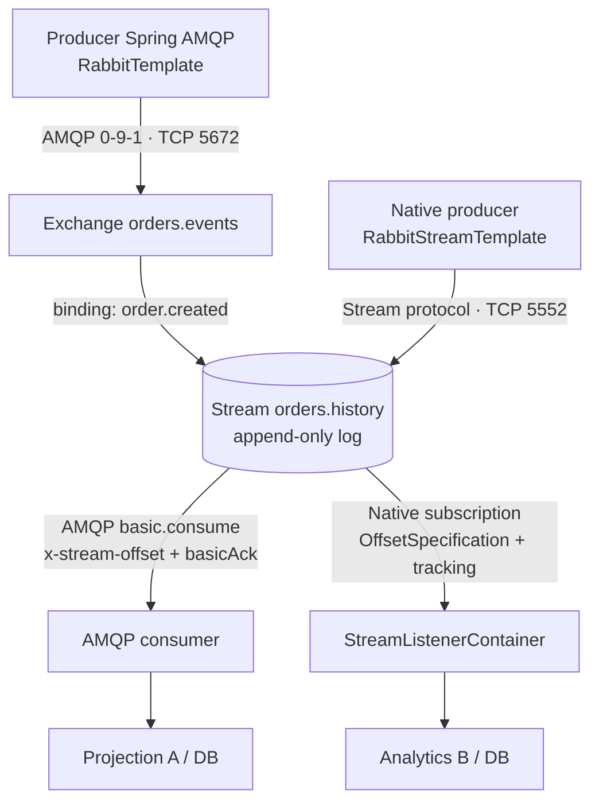
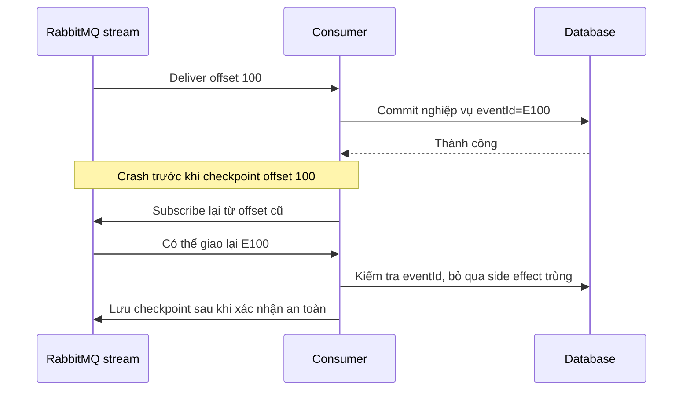

# Phân biệt truy cập stream qua AMQP với native Stream protocol

RabbitMQ Streams lưu message trong một **append-only log** có tính bền vững và cơ chế đọc **không xóa message sau khi consumer xử lý**. Nhiều consumer có thể đọc lại cùng dữ liệu từ các vị trí khác nhau, miễn là dữ liệu vẫn còn trong khoảng retention. Điều khiến người mới dễ nhầm là **cùng một stream có thể được truy cập qua hai con đường**:

1. **AMQP 0-9-1**: dùng các thành phần quen thuộc của Spring AMQP như `RabbitTemplate`, exchange, binding và consumer AMQP; stream được khai báo như queue có `x-queue-type=stream`.
2. **Native RabbitMQ Stream protocol**: dùng thư viện Stream Java client hoặc tích hợp `spring-rabbit-stream` với `RabbitStreamTemplate` và `StreamListenerContainer`; giao thức này được tối ưu cho log, offset tracking và thông lượng cao.

Hai cách truy cập **cùng kiểu dữ liệu stream của RabbitMQ**, nhưng **không có cùng API, semantics xác nhận, tính năng hay cổng mạng**. Chọn sai cách thường dẫn đến các giả định không đúng: nghĩ rằng `basicAck` xóa message khỏi stream, nghĩ rằng mọi AMQP consumer đều có checkpoint bền vững, hoặc nghĩ rằng AMQP 0-9-1 tự hỗ trợ publishing deduplication và super streams như native client.

Bài học thuộc chương **RabbitMQ Streams** của module `SPRING_AMQP`. Mục tiêu là đặt kiến thức `RabbitTemplate`, `@RabbitListener`, exchange/queue/binding và các nguyên tắc retry, xác nhận giao nhận, quan sát hệ thống vào đúng bối cảnh của stream.

## 1. Một stream, hai đường truy cập



Trong sơ đồ, cổng `5672` và `5552` là các **cổng TCP mặc định không TLS**; cấu hình triển khai thực tế có thể khác. Plugin native cần được bật và network phải cho phép kết nối cổng stream. Không có quy tắc bắt buộc rằng producer và consumer phải cùng giao thức: một producer AMQP có thể ghi vào stream mà consumer native đọc, hoặc ngược lại.

Ví dụ xuyên suốt:

- Producer gửi `OrderCreated` đến exchange `orders.events` theo routing key `order.created`.
- Stream `orders.history` lưu liên tục các sự kiện đơn hàng.
- Dịch vụ **projection** đọc sự kiện để cập nhật màn hình đơn hàng.
- Dịch vụ **analytics** đọc lại cùng log để tính báo cáo, thậm chí bắt đầu từ ngày trước đó.

Không cần tạo hai bản sao queue để mỗi dịch vụ có luồng dữ liệu riêng như cách fan-out trên classic queue. **Mỗi consumer có thể chọn offset đọc riêng**, trong giới hạn dữ liệu chưa hết hạn retention.

## 2. Điểm khác biệt nền tảng: stream không hoạt động như queue thông thường

| Đặc tính | Classic/quorum queue thông thường | RabbitMQ stream |
| --- | --- | --- |
| Cách lưu | Queue phục vụ xử lý và thường tiến tới rỗng khi đã ack | Log chỉ thêm vào; các message cũ được giữ đến khi hết retention |
| Khi consumer xác nhận | Delivery được loại khỏi tập cần xử lý; message cuối cùng không còn trong queue | Consumer xác nhận hoặc theo dõi tiến độ; **message không bị xóa do ack** |
| Đọc lại dữ liệu đã xử lý | Thường phải publish lại/từ nguồn khác | Có thể subscribe từ offset cũ còn được lưu |
| Nhiều nhóm đọc độc lập | Thường cần nhiều queue/binding theo nhóm | Có thể dùng nhiều consumer theo vị trí đọc độc lập trên cùng stream |
| Giới hạn dữ liệu | TTL, max-length, dead-letter tùy queue | Retention theo tuổi/kích thước, áp dụng theo segment |
| Độ bền | Tùy loại queue và delivery mode | Stream luôn durable và lưu dữ liệu trên đĩa |
| Thứ tự | Phụ thuộc queue, cạnh tranh consumer, requeue | Có thứ tự trong **một stream/partition**; hoàn tất xử lý vẫn do ứng dụng quyết định |

**Retention không phải TTL thông thường.** Khi stream đạt giới hạn tuổi hoặc dung lượng, RabbitMQ có thể loại **các segment cũ** dù một consumer đang chạy chậm và chưa xử lý xong. Vì vậy cần giám sát **consumer lag** và đặt retention đủ lớn cho thời gian khôi phục/replay.

**Offset không phải delivery tag.** Offset đánh dấu vị trí trong log; delivery tag của AMQP là định danh delivery trong **một channel**, được dùng cho `basicAck`. Không dùng delivery tag để checkpoint tiến độ của ứng dụng qua nhiều lần kết nối.

## 3. Bảng so sánh AMQP 0-9-1 và native Stream protocol

| Tiêu chí | Stream qua AMQP 0-9-1 | Stream qua native protocol |
| --- | --- | --- |
| Kết nối | AMQP connection/channel, mặc định `5672` | Stream `Environment`/producer/consumer, mặc định `5552` |
| API Spring | `RabbitTemplate`, AMQP consumer/listener container | `RabbitStreamTemplate`, `StreamListenerContainer`, `StreamRabbitListenerContainerFactory` |
| Publish | Thường gửi tới **exchange + routing key**, exchange định tuyến vào stream | Thường chỉ định **stream name** trực tiếp; super stream có routing theo partition |
| Xác nhận gửi | AMQP publisher confirms; returns nếu `mandatory` và không route | Confirmation/status qua Stream client; `RabbitStreamTemplate` trả `CompletableFuture<Boolean>` |
| Chọn điểm bắt đầu đọc | Consumer argument `x-stream-offset`: `first`, `last`, `next`, offset số, timestamp... | `OffsetSpecification` và cấu hình consumer client |
| Xác nhận khi đọc | Consumer phải dùng manual ack và QoS; ack giúp cấp lại credit, **không xóa log** | Offset tracking/checkpoint theo chiến lược native; `Context.storeOffset()` khi dùng manual tracking |
| Offset lưu trên broker theo consumer | Không có khả năng offset-tracking riêng của Stream plugin; ứng dụng tự lưu vị trí nếu cần | Có built-in server-side offset tracking theo consumer name, hoặc lưu bên ngoài |
| Publisher deduplication theo publishing ID | Không hỗ trợ cơ chế dedup native này | Hỗ trợ với **producer name + publishing ID** |
| Super streams, native SAC | Không có API/tính năng native tương đương qua core AMQP 0-9-1 | Hỗ trợ tính năng stream chuyên biệt |
| Mục tiêu | Tận dụng hạ tầng AMQP/Spring AMQP hiện có; nhu cầu stream cơ bản | Thông lượng cao, replay, consumer tracking, super streams và tối ưu chuyên biệt |

Đây là so sánh **hai giao thức truy cập stream**, không phải so sánh AMQP 0-9-1 với RabbitMQ Streams như hai broker khác nhau. Dữ liệu vẫn nằm trong RabbitMQ và có thể đọc từ cả hai hướng.

### Chọn cách nào?

Chọn **AMQP 0-9-1** nếu ứng dụng đang dùng `RabbitTemplate`/exchange/binding, chỉ cần publish vào stream hoặc consume với offset được chỉ định rõ, và thông lượng ở mức đáp ứng được SLA.

Chọn **native Stream protocol** nếu bài toán cần đọc lượng lớn dữ liệu, checkpoint trên broker, native deduplication, super streams, Single Active Consumer trên stream hoặc các tối ưu streaming chuyên biệt.

Không đưa stream vào thiết kế chỉ để thay một classic queue xử lý tác vụ đơn giản: mô hình retention/replay, lag, offset và failure recovery có chi phí vận hành khác.

## 4. Chuẩn bị stream và topology dùng chung

Một stream được khai báo trên RabbitMQ bằng AMQP với queue argument **`x-queue-type=stream`**. Queue type phải xác định tại **thời điểm declare**; không thể dùng policy để đổi một classic queue có sẵn thành stream.

Với Spring AMQP, có thể tạo một `Queue` dạng stream, direct exchange và binding:

```java
import org.springframework.amqp.core.Binding;
import org.springframework.amqp.core.BindingBuilder;
import org.springframework.amqp.core.DirectExchange;
import org.springframework.amqp.core.Queue;
import org.springframework.amqp.core.QueueBuilder;
import org.springframework.context.annotation.Bean;
import org.springframework.context.annotation.Configuration;

@Configuration
public class OrdersStreamTopology {

    @Bean
    DirectExchange ordersEventsExchange() {
        return new DirectExchange("orders.events", true, false);
    }

    @Bean
    Queue ordersHistoryStream() {
        return QueueBuilder.durable("orders.history")
                .stream() // x-queue-type = stream
                .withArgument("x-max-age", "7D")
                .build();
    }

    @Bean
    Binding ordersHistoryBinding(Queue ordersHistoryStream,
                                 DirectExchange ordersEventsExchange) {
        return BindingBuilder.bind(ordersHistoryStream)
                .to(ordersEventsExchange)
                .with("order.created");
    }
}
```

`RabbitAdmin` có thể tự khai báo các beans này khi ứng dụng mở **AMQP connection**, nếu Spring Boot/admin đang được cấu hình phù hợp. **Nếu ứng dụng chỉ dùng native Stream protocol**, không nên mặc định rằng việc tạo `Queue` bean sẽ kích hoạt `RabbitAdmin`: hãy provision trước bằng IaC/management hoặc cấu hình `StreamAdmin`.

Ví dụ phần sau giả định stream `orders.history` đã tồn tại, hoặc đã được tạo bằng cấu hình trên. Muốn dùng cả hai đường truy cập đồng thời, nên có **một nguồn khai báo topology rõ ràng**, tránh hai service cùng khai báo một queue với các argument khác nhau và gây `PRECONDITION_FAILED`.

### Cấu hình retention

| Tham số | Vai trò | Ghi chú |
| --- | --- | --- |
| `x-max-age` / policy `max-age` | Giữ dữ liệu tối đa theo tuổi, ví dụ `7D` | Độ chính xác phụ thuộc việc dọn segment, không phải TTL từng message |
| `x-max-length-bytes` / policy `max-length-bytes` | Giới hạn dung lượng giữ lại | Stream vẫn có thể chứa dữ liệu của segment còn lại |
| `x-stream-max-segment-size-bytes` | Chỉnh cỡ segment, ảnh hưởng lưu trữ/retention | Nên quyết định khi tạo stream theo tài liệu phiên bản broker |
| `x-initial-cluster-size` | Số replica ban đầu khi khai báo stream | Phải phù hợp kích thước cluster và mục tiêu chịu lỗi |

Retention quá ngắn sẽ khiến consumer chậm **không còn offset cũ để replay**. Khi thay đổi retention hoặc replication, phải theo dõi khả năng phục hồi và dung lượng đĩa, không chỉ throughput.

## 5. Đường AMQP: publish bằng RabbitTemplate

Sau khi stream có binding `orders.events`/`order.created`, publisher không cần API Stream riêng:

```java
import org.springframework.amqp.core.MessageDeliveryMode;
import org.springframework.amqp.rabbit.core.RabbitTemplate;
import org.springframework.stereotype.Service;

@Service
public class AmqpOrderPublisher {
    private final RabbitTemplate rabbitTemplate;

    public AmqpOrderPublisher(RabbitTemplate rabbitTemplate) {
        this.rabbitTemplate = rabbitTemplate;
    }

    public void publish(String eventId, String body) {
        rabbitTemplate.convertAndSend(
            "orders.events", "order.created", body,
            message -> {
                message.getMessageProperties().setMessageId(eventId);
                message.getMessageProperties()
                        .setDeliveryMode(MessageDeliveryMode.PERSISTENT);
                return message;
            });
    }
}
```

`MessageDeliveryMode.PERSISTENT` ở đây phù hợp thói quen dùng AMQP, nhưng stream **luôn lưu bền vững**; delivery mode không biến stream thành classic queue hay ảnh hưởng đến việc ack xóa message.

Để biết broker đã chấp nhận lần publish, cần bật publisher confirms. Nếu muốn phát hiện message không định tuyến vào stream vì binding sai, kết hợp returns và `mandatory=true`:

```yaml
spring:
  rabbitmq:
    publisher-confirm-type: correlated
    publisher-returns: true
```

```java
// Khi cấu hình một RabbitTemplate riêng cho gửi event:
rabbitTemplate.setMandatory(true);
// Đăng ký ConfirmCallback/ReturnsCallback hoặc dùng CorrelationData
// để xử lý trạng thái ACK, NACK, RETURN và UNKNOWN theo từng publish.
```

Phân biệt: **confirm `ack=true` chưa đủ chứng minh message đã route tới stream**; một publish `NO_ROUTE` có thể vẫn nhận confirm ACK. Nếu broker nhận message nhưng kết nối producer mất trước khi confirm tới client, kết quả cũng có thể là **UNKNOWN**; retry phải có event ID ổn định và xử lý idempotent ở phía đọc.

**Native publishing deduplication theo producer name/publishing ID không được kích hoạt chỉ bằng `messageId` hoặc `CorrelationData` trên `RabbitTemplate` AMQP.** Đây là khác biệt thực tế quan trọng giữa hai đường gửi.

## 6. Đường AMQP: consume với x-stream-offset

Không giống classic queue thường lấy message đang ready, consumer AMQP đọc stream phải xác định **vị trí bắt đầu** bằng consumer argument `x-stream-offset` nếu cần đọc lại dữ liệu.

| Giá trị `x-stream-offset` | Hành vi mong đợi |
| --- | --- |
| `first` | Bắt đầu ở message đầu tiên **còn được giữ** trong stream |
| `last` | Bắt đầu ở **chunk** cuối cùng đã ghi; không nhất thiết đúng một message cuối |
| `next` hoặc không truyền | Chỉ nhận message xuất hiện sau khi subscription bắt đầu |
| Offset số, ví dụ `5000` | Bắt đầu từ offset tương ứng nếu còn trong retention; nếu vượt phạm vi, broker điều chỉnh về biên khả dụng |
| Timestamp hoặc khoảng thời gian | Bắt đầu gần mốc thời gian do broker xác định; ranh giới chunk có thể khiến nhận vài message sớm hơn |

**Bẫy khi thử nghiệm:** nếu subscribe vào stream đã có 10 message nhưng không cấu hình `x-stream-offset`, consumer có thể không đọc được 10 message cũ vì mặc định là vị trí `next`. Đây không phải lỗi routing.

### Ví dụ RabbitMQ Java AMQP client

Spring AMQP sử dụng RabbitMQ Java client bên dưới. Đoạn Java AMQP 0-9-1 sau cho thấy chính xác consumer arguments, QoS và ack:

```java
import java.io.IOException;
import java.nio.charset.StandardCharsets;
import java.util.Map;

import com.rabbitmq.client.Channel;
import com.rabbitmq.client.Connection;
import com.rabbitmq.client.ConnectionFactory;

public class AmqpStreamReader {
    public void run() throws Exception {
        ConnectionFactory factory = new ConnectionFactory();
        factory.setHost("localhost");

        // Trong ứng dụng thật, giữ connection/channel trong lifecycle
        // của service và đóng chúng khi shutdown.
        Connection connection = factory.newConnection();
        Channel channel = connection.createChannel();
        channel.basicQos(100); // Stream AMQP cần prefetch > 0.

        channel.basicConsume(
            "orders.history",
            false, // manual ACK bắt buộc với AMQP stream consumer
            Map.of("x-stream-offset", "first"),
            (consumerTag, delivery) -> {
                long tag = delivery.getEnvelope().getDeliveryTag();
                String payload = new String(
                        delivery.getBody(), StandardCharsets.UTF_8);

                processIdempotently(payload); // Commit nghiệp vụ trước ACK.
                channel.basicAck(tag, false);
            },
            consumerTag -> {
                // Ghi log/cảnh báo và xử lý vòng đời subscription.
            }
        );
    }

    private void processIdempotently(String payload) throws IOException {
        // Thay bằng giao dịch DB + unique event ID của ứng dụng.
        System.out.println(payload);
    }
}
```

Đây là ví dụ làm rõ **giao thức AMQP**, không thay thế hoàn toàn vòng đời consumer của Spring. Với ứng dụng thực tế nên chọn một trong các container được Spring AMQP quản lý khi phù hợp; cần cấu hình consumer arguments tương ứng trên container nếu muốn offset khởi đầu khác mặc định. Không trộn vòng recovery của Java client với listener container Spring mà không kiểm soát.

**Khác biệt quan trọng:** ở stream, `basicAck` được dùng như **credit/flow control** để broker tiếp tục giao message theo prefetch; nó **không xóa record khỏi log**, cũng **không tự tạo checkpoint bền vững cho consumer name** theo cơ chế native Stream plugin. Nếu ứng dụng cần tiếp tục từ vị trí chính xác sau restart, hãy lưu offset/progress phù hợp ở ngoài rồi truyền offset đó khi subscribe lại, hoặc chọn native Stream protocol.

**Không nhầm thứ tự:** ACK của một delivery trên channel khác với offset message. Nếu consumer AMQP crash sau commit DB nhưng trước ACK, có thể phải xử lý lại một đoạn khi subscribe từ offset đã checkpoint. Dùng **idempotency theo event ID**, không dùng delivery tag làm identity nghiệp vụ.

## 7. Đường native: client, cổng và thành phần Spring AMQP

RabbitMQ Stream protocol là giao thức nhị phân chuyên biệt cho stream, được cung cấp qua plugin `rabbitmq_stream`. Cổng mặc định là `5552` (không TLS); nếu môi trường dùng TLS, phải cấu hình endpoint và xác thực tương ứng.

Spring AMQP tích hợp Stream Java client thông qua module **`spring-rabbit-stream`**, cung cấp:

- `RabbitStreamTemplate` để publish đến stream bằng native producer.
- `StreamListenerContainer` và `StreamRabbitListenerContainerFactory` cho consumer, có thể gắn với `@RabbitListener`.
- `StreamAdmin` để provision stream khi ứng dụng vận hành theo native-only hoặc cần các tính năng quản trị stream.
- `ProducerCustomizer`, `ConsumerCustomizer` để cấu hình tên, vị trí đọc, tracking strategy và các tính năng cụ thể của Stream Java client.

Đây là **API khác** với `RabbitTemplate`/`SimpleRabbitListenerContainerFactory`. Không thể chỉ đổi tên port trong `spring.rabbitmq.host` rồi kỳ vọng `RabbitTemplate` tự nói Stream protocol.

### Phụ thuộc và Environment

Với Maven, khai báo module stream có **version tương thích với Spring AMQP/Spring Boot** đang dùng (nếu đã dùng dependency management thì không gắn version thủ công):

```xml
<dependency>
    <groupId>org.springframework.amqp</groupId>
    <artifactId>spring-rabbit-stream</artifactId>
</dependency>
```

Một cấu hình Java cơ bản của native `Environment`:

```java
import com.rabbitmq.stream.Environment;
import org.springframework.context.annotation.Bean;
import org.springframework.context.annotation.Configuration;

@Configuration
public class NativeStreamConnectionConfig {
    @Bean(destroyMethod = "close")
    Environment streamEnvironment() {
        return Environment.builder()
                .host("localhost")
                .port(5552)
                .build();
    }
}
```

Trong Spring Boot, tùy phiên bản starter và auto-configuration, có thể cấu hình `Environment` qua các thuộc tính `spring.rabbitmq.stream.*` thay vì tự tạo bean. Ví dụ trên minh họa rõ **endpoint riêng**. Thực tế cần bổ sung credentials, TLS, lựa chọn node/leader/replica và giới hạn connection theo môi trường triển khai.

## 8. Native publishing: RabbitStreamTemplate và confirmation

Producer native gắn trực tiếp với stream name, không cần truyền exchange/routing key trong mỗi lần gọi:

```java
import com.rabbitmq.stream.Environment;
import org.springframework.rabbit.stream.producer.RabbitStreamTemplate;
import org.springframework.context.annotation.Bean;
import org.springframework.context.annotation.Configuration;

@Configuration
public class NativeStreamPublisherConfig {
    @Bean
    RabbitStreamTemplate ordersStreamTemplate(Environment environment) {
        RabbitStreamTemplate template =
                new RabbitStreamTemplate(environment, "orders.history");
        template.setProducerCustomizer((name, builder) ->
                builder.name("orders-service-producer"));
        return template;
    }
}
```

Sau đó publish và xử lý kết quả **bất đồng bộ**:

```java
import java.util.concurrent.CompletableFuture;
import org.springframework.rabbit.stream.producer.RabbitStreamTemplate;

public class NativeOrderPublisher {
    private final RabbitStreamTemplate template;

    public NativeOrderPublisher(RabbitStreamTemplate template) {
        this.template = template;
    }

    public CompletableFuture<Boolean> publish(String payload) {
        return template.convertAndSend(payload);
    }
}
```

`CompletableFuture<Boolean>` phản ánh kết quả confirmation ở phía native stream producer. Production phải xử lý cả `false` lẫn lỗi hoàn tất future, timeout, mất kết nối và trạng thái gửi không chắc chắn. **Future hoàn tất thành công không đồng nghĩa analytics consumer đã cập nhật DB.**

### Native publishing deduplication

Stream plugin có cơ chế loại bớt các publish trùng dựa trên **producer name** và **publishing ID**. Producer phải dùng tên ổn định và bảo đảm publishing ID được quản lý nhất quán qua các lần retry/restart; chỉ đặt một UUID ngẫu nhiên mới cho mọi lần retry **không** giúp broker nhận ra cùng lần publish.

Tên producer trong ví dụ là bước đầu để cấu hình tính năng này; **chỉ đặt `builder.name(...)` chưa đủ để coi ứng dụng đã có quy trình dedup an toàn**. Cần xác định ai cấp ID, cách lưu tiến độ ID, cách khôi phục và giới hạn đảm bảo theo phiên bản client/plugin.

Đây là cơ chế dedup ở **chặng producer → stream**, không loại trừ việc consumer xử lý trùng khi checkpoint bị mất hoặc replay thủ công. Idempotent consumer vẫn cần thiết.

## 9. Native consumption: OffsetSpecification và storeOffset()

Với native stream consumer, ứng dụng chọn offset bằng `OffsetSpecification`, chẳng hạn `first()`, `last()`, `next()` hoặc `offset(long)`. Khác với AMQP 0-9-1, client native có khả năng **lưu offset tracking trên broker** khi cấu hình consumer name/tracking strategy.

Ví dụ Spring AMQP sử dụng một stream listener native:

```java
import com.rabbitmq.stream.Environment;
import com.rabbitmq.stream.OffsetSpecification;
import org.springframework.amqp.rabbit.listener.RabbitListenerContainerFactory;
import org.springframework.rabbit.stream.listener.StreamListenerContainer;
import org.springframework.rabbit.stream.config.StreamRabbitListenerContainerFactory;
import org.springframework.context.annotation.Bean;
import org.springframework.context.annotation.Configuration;

@Configuration
public class NativeStreamListenerConfig {
    @Bean("nativeOrdersFactory")
    RabbitListenerContainerFactory<StreamListenerContainer>
            nativeOrdersFactory(Environment environment) {
        StreamRabbitListenerContainerFactory factory =
                new StreamRabbitListenerContainerFactory(environment);
        factory.setNativeListener(true);
        factory.setConsumerCustomizer((id, builder) ->
                builder.name("analytics-orders-consumer")
                        .offset(OffsetSpecification.first())
                        .manualTrackingStrategy());
        return factory;
    }
}
```

Listener sử dụng `Message` của **Stream Java client**, không phải `org.springframework.amqp.core.Message`:

```java
import com.rabbitmq.stream.Message;
import com.rabbitmq.stream.MessageHandler.Context;
import org.springframework.amqp.rabbit.annotation.RabbitListener;
import org.springframework.stereotype.Component;

@Component
public class NativeOrdersAnalyticsListener {
    private final AnalyticsService analytics;

    public NativeOrdersAnalyticsListener(AnalyticsService analytics) {
        this.analytics = analytics;
    }

    @RabbitListener(id = "analytics-orders",
                    queues = "orders.history",
                    containerFactory = "nativeOrdersFactory")
    public void onMessage(Message message, Context context) {
        // AnalyticsService là service ứng dụng tự triển khai.
        // Phải commit + chống duplicate trước khi lưu checkpoint.
        analytics.processOnce(message);
        context.storeOffset();
    }
}
```

`AnalyticsService` là thành phần nghiệp vụ cần được triển khai (transaction, event ID, logging, retry). Đây là ví dụ **manual tracking**, trong đó code gọi `storeOffset()` **sau khi xử lý nghiệp vụ thành công**. Nếu store offset **trước khi commit DB**, consumer restart có thể bỏ qua message chưa hoàn tất. Nếu DB commit nhưng crash trước `storeOffset()`, message có thể được đọc lại; dùng idempotency.

**Cảnh báo về khởi động lại:** ví dụ cấu hình `OffsetSpecification.first()` cố tình minh họa replay từ đầu. Khi triển khai tiến trình liên tục, phải lựa chọn cách **phục hồi từ offset đã lưu** theo tên consumer/chiến lược native client (hoặc offset từ kho ngoài), rồi quyết định bắt đầu tại đó hay offset kế tiếp theo semantics thực tế. Đừng giả định rằng chỉ có lời gọi `storeOffset()` sẽ tự ghi đè mọi lựa chọn `first()` ở lần subscribe tiếp theo.

Trong `StreamRabbitListenerContainerFactory`, phần lớn thuộc tính annotation `@RabbitListener` quen thuộc với AMQP container, như `concurrency`, **không có cùng tác dụng**. Các thuộc tính annotation chủ yếu được hỗ trợ cho stream listener gồm `id`, `queues`, `autoStartup` và `containerFactory`; một native stream listener gắn với **một stream name**. Nếu cần phân vùng/parallelism, dùng cấu hình native/super stream thay vì giả định `@RabbitListener(concurrency = "...")` là đủ.

## 10. Offset tracking, ACK và idempotency: ranh giới đảm bảo

Hãy xét consumer đọc event ở offset 100:



**Checkpoint không phải transaction phân tán với database.** Dù dùng `basicAck` qua AMQP hay `storeOffset()` qua native, có thể tồn tại khoảng:

1. Xử lý nghiệp vụ đã commit nhưng chưa lưu tiến độ đọc → **duplicate khi replay**.
2. Lưu tiến độ trước khi commit → **bỏ sót tác vụ sau crash**.

Giải pháp thực dụng là commit dữ liệu nghiệp vụ cùng marker dedup (`eventId`) trong một transaction, rồi mới cập nhật progress/offset. Nếu cần phục hồi thật chính xác, có thể lưu **business state + last applied offset** trong cùng database transaction; khi khởi động consumer, dùng offset đã lưu để subscribe lại và vẫn xử lý duplicate an toàn.

Với hai consumer độc lập (**analytics** và **projection**), lưu tiến độ theo **consumer identity** hoặc nhóm nghiệp vụ. Không chia sẻ checkpoint nếu hai hệ thống cần xử lý cùng event theo mục đích khác nhau.

### AMQP ACK và native checkpoint khác nhau như thế nào?

| Tình huống | AMQP trên stream | Native stream |
| --- | --- | --- |
| Đã xử lý một message | `basicAck` cấp lại credit cho consumer | Theo tracking strategy, có thể `storeOffset()` |
| Record đã bị xóa khỏi stream? | **Không** | **Không** |
| Broker tự nhớ bền vững tiến độ consumer? | Không nhờ `basicAck`; cần giải pháp ngoài | Có tính năng offset tracking phía Stream plugin |
| Restart consumer | Truyền lại `x-stream-offset` hoặc khôi phục progress ngoài | Dùng consumer identity + chiến lược restore offset thích hợp |
| Xử lý lại để xây projection | Tạo subscription từ offset cũ còn retention | Đặt `OffsetSpecification` phù hợp |

Đừng gọi `basicNack(requeue=false)` rồi kỳ vọng stream hỗ trợ đường **dead-letter exchange** như classic/quorum queue. **Streams không hỗ trợ DLX/poison-message handling kiểu queue truyền thống.** Cần thiết kế retry/skip/quarantine ở application hoặc topic/stream khác và lưu tiến độ có chủ đích.

## 11. Những tính năng native nên biết trước khi chọn giao thức

### 11.1. Super streams và phân vùng

Một **super stream** là logical stream được chia thành nhiều stream partition, giúp mở rộng publish/consume và duy trì thứ tự **trong từng partition**. Native client hỗ trợ routing, đọc và các cơ chế như Single Active Consumer cho nhóm/partition tùy cấu hình. AMQP 0-9-1 có thể publish vào topology exchange/binding của super stream, nhưng khả năng native client điều phối super stream **không tương đương** với việc chỉ dùng `RabbitTemplate`.

Ví dụ sự kiện cùng `orderId` phải giữ đúng thứ tự:

```text
partition = stableHash(orderId) % N
orders.super.stream
  ├─ orders.partition-0
  ├─ orders.partition-1
  └─ orders.partition-2

Mọi event của một orderId đi cùng partition.
Các orderId khác nhau có thể được đọc song song.
```

**Không có thứ tự toàn cục trên mọi partition.** Khi đổi số partition hoặc chiến lược routing, cần kế hoạch chuyển đổi để tránh event mới của cùng `orderId` vượt qua event cũ đang chờ ở partition khác.

### 11.2. Single Active Consumer trên stream

Native Stream protocol hỗ trợ cơ chế single active consumer (với consumer group/name theo API tương ứng) để chỉ một consumer chủ động đọc một partition tại một thời điểm, các consumer dự phòng có thể takeover. Đây không có nghĩa mọi event được commit exactly once; checkpoint và idempotency vẫn cần.

Đừng lấy cấu hình **`x-single-active-consumer` của classic/quorum queue** rồi giả định áp dụng giống hệt với một stream đọc qua AMQP core. Kiểm tra đúng tính năng theo **loại queue, protocol và phiên bản**.

### 11.3. Tối ưu throughput

Native Stream protocol giảm overhead so với đường AMQP 0-9-1 cho workload log lớn, có hỗ trợ batching/sub-entry batching và nén theo khả năng client. Đổi lại, cần quản trị endpoint stream riêng, replication/leader locality, tên producer/consumer và offset tracking.

**Không có con số throughput tuyệt đối áp dụng mọi cụm.** Kết quả phụ thuộc kích thước message, số replica, disk I/O, retention, network, batch, số consumer và vị trí node kết nối. Phải benchmark trên cấu hình thực tế.

## 12. Hai đường truy cập vẫn phải cùng tuân thủ độ tin cậy đầu cuối

| Khoảng lỗi | AMQP 0-9-1 path | Native path | Cơ chế bảo vệ |
| --- | --- | --- | --- |
| DB producer commit nhưng chưa publish | `RabbitTemplate` chưa gọi hoặc lỗi trước gửi | Native producer cũng chưa gửi | Transactional outbox |
| Mất kết nối trước xác nhận publish | Confirm có thể chưa đến, trạng thái UNKNOWN | Confirmation future/callback chưa rõ | Retry có kiểm soát; event ID ổn định |
| Message không route do binding sai | `mandatory` + returns phát hiện lỗi thường gặp | Native producer chọn stream trực tiếp, lỗi stream/metadata theo native client | Kiểm tra topology và monitoring |
| Consumer xử lý nhưng crash trước progress | Có thể replay từ offset cũ | Có thể replay từ checkpoint cũ | Idempotent transaction |
| Consumer nghỉ dài hơn retention | Offset cũ có thể không còn | Offset cũ có thể không còn | Đặt retention theo SLA và cảnh báo lag |
| Message lỗi nghiệp vụ vĩnh viễn | Không dựa vào DLX của stream | Không dựa vào DLX của stream | Quarantine/retry app-level, log và quy trình replay |
| Hai instance xử lý cùng event | Có thể tạo duplicate side effect | Cũng có thể | Unique event ID/consumer identity, idempotency |

**Stream không đồng nghĩa exactly-once processing.** Native producer dedup và native offset tracking giảm một số lớp rủi ro, nhưng giao dịch database, side effect bên ngoài và checkpoint vẫn cần được phối hợp. Với API thanh toán/email, dùng idempotency key ở hệ thống đích hoặc quy trình reconciliation.

## 13. Quan sát và vận hành

Ngoài metrics broker quen thuộc (connection, publisher confirms, memory/disk), stream cần thêm các chỉ số khác:

- **Độ trễ producer:** gửi → confirmation; tỷ lệ lỗi/timeout/unknown, hiệu quả retry/dedup và số bản ghi outbox pending.
- **Consumer progress:** offset cao nhất đang có trên stream, offset đã xử lý của từng consumer, **lag = head offset − progress offset** và tuổi message chưa xử lý.
- **Retention và storage:** kích thước stream, tốc độ tăng log, segment, max-age/max-length-bytes, số giờ còn lại trước khi consumer tụt khỏi khoảng retention.
- **Replica/leader:** tình trạng replica, quorum, leader placement, network tới endpoint native `5552`, độ trễ khi failover.
- **Nghiệp vụ:** số event áp dụng thành công, duplicate bị chặn, exception, retry/quarantine và mức độ cập nhật của projection.

Đừng coi `messages_ready` của stream như backlog cần được ACK để queue rỗng. Vì log không xóa message khi consumer xác nhận, cần **offset progress/lag theo từng consumer** để đo liệu từng subscriber đang theo kịp.

Khi dùng native protocol trong cluster, hướng kết nối tới node phù hợp có thể tác động đáng kể đến thông lượng. Kiểm tra **Stream Client Connections** để cấu hình metadata, leader/replica locality và load balancer. Chỉ mở cổng stream chưa bảo đảm đường dữ liệu đã tối ưu.

## 14. Bài thực hành đối chiếu hai giao thức

Hãy dùng môi trường RabbitMQ thử nghiệm có stream `orders.history`. Đảm bảo cổng AMQP `5672` và native Stream `5552` sẵn sàng theo cấu hình thực tế. Các bước sau không yêu cầu xóa dữ liệu production.

1. **Tạo topology:** khai báo stream `orders.history` với `x-queue-type=stream`, exchange `orders.events` và binding `order.created`. Xác nhận queue type bằng Management UI.
2. **Gửi qua AMQP:** dùng `RabbitTemplate.convertAndSend(...)` gửi 10 event có `eventId`. Quan sát publisher confirms và kiểm tra routing; cố tình đổi routing key trên môi trường test để thấy `NO_ROUTE` nếu bật returns/mandatory.
3. **Đọc AMQP từ đầu:** tạo AMQP consumer với `x-stream-offset=first`, `basicQos(100)`, `basicAck`. Xác nhận consumer đọc được 10 event cũ, ACK không làm xóa log.
4. **Đọc AMQP từ next:** tạo subscription mới với `x-stream-offset=next`. Kiểm tra nó chỉ nhận những event publish **sau** lúc subscribe.
5. **Đọc native:** dùng `StreamRabbitListenerContainerFactory` nhận lại 10 event từ `OffsetSpecification.first()`. Đây là một consumer riêng, không làm mất dữ liệu của consumer AMQP.
6. **Checkpoint/crash:** cho analytics commit nghiệp vụ rồi dừng trước `storeOffset()`. Khởi động lại từ checkpoint cũ; xác minh idempotency ngăn lặp side effect.
7. **Retention:** giảm retention trên stream test, quan sát dữ liệu cũ bị loại theo segment. Kiểm tra một consumer quá chậm không thể replay từ offset đã bị loại.
8. **Đánh giá throughput:** gửi các payload cùng kích thước qua cả hai đường, ghi thời gian confirmation, throughput, CPU/disk/network và độ trễ consumer. So sánh với cùng độ bền/replica để kết luận công bằng.

### Kết quả mong đợi

| Thử nghiệm | Kết quả quan sát hợp lý |
| --- | --- |
| Gửi bằng RabbitTemplate, đọc bằng native | Nhận được cùng event còn trong log, sau chuyển đổi format thích hợp |
| Gửi native, đọc AMQP | Có thể đọc qua AMQP stream consumer khi stream và encoding tương thích |
| AMQP ACK tất cả event | Log vẫn còn đến khi hết retention |
| AMQP thiếu `x-stream-offset` | Mặc định bắt đầu ở `next`, không tự đọc backlog cũ |
| Native `storeOffset()` sau commit | Có checkpoint native; crash giữa commit và checkpoint vẫn có nguy cơ replay |
| Một consumer chậm hơn retention | Không bảo đảm đọc lại dữ liệu đã bị dọn |

## 15. Checklist lựa chọn giao thức

| Câu hỏi | Nếu câu trả lời là “có” |
| --- | --- |
| Ứng dụng đang dùng exchange/binding và chỉ cần xuất sự kiện vào log? | Có thể bắt đầu từ `RabbitTemplate` AMQP |
| Consumer cần replay từ offset/timestamp đơn giản? | AMQP `x-stream-offset` có thể đủ nếu tự quản lý tiến độ |
| Cần checkpoint trên broker theo consumer name? | Ưu tiên native Stream protocol |
| Cần publisher dedup theo producer name/publishing ID? | Cần native client và quản lý publishing ID đúng |
| Cần super stream và parallelism theo partition? | Ưu tiên native Stream protocol |
| Muốn một task queue đơn giản với retry/DLX truyền thống? | Xem xét classic/quorum queue thay vì stream |
| Có nhiều consumer đọc lại sự kiện cùng lúc? | Stream phù hợp; thiết kế progress riêng cho mỗi consumer |
| Không thể chấp nhận mất event vì retention quá ngắn? | Đặt retention/SLA/alert hợp lý hoặc lưu nguồn dữ liệu bền vững khác |

## 16. Câu hỏi tự kiểm tra

1. Tại sao một stream vẫn có thể được khai báo như queue và bind vào exchange, nhưng lại không mang semantics xóa message sau ACK như classic queue?
2. `basicAck` của AMQP stream consumer có xóa record khỏi stream không? Nếu không, vai trò của nó là gì?
3. Nếu stream có 10.000 message từ trước và AMQP consumer không truyền `x-stream-offset`, consumer có đọc 10.000 message cũ không?
4. Vì sao `x-stream-offset=last` không nên được hiểu đơn giản là “đúng một message cuối”?
5. Điểm khác biệt giữa `CorrelationData` của `RabbitTemplate` và producer name/publishing ID của native stream dedup là gì?
6. Vì sao `RabbitStreamTemplate.convertAndSend` trả future thành công chưa chứng minh database của analytics đã commit?
7. Khi nào nên dùng `StreamAdmin` thay cho việc trông chờ `RabbitAdmin` tự khai báo queue bean?
8. Nếu consumer native đã commit dữ liệu ở offset 100 nhưng chết trước `storeOffset()`, khi restart cần phòng tránh điều gì?
9. Tại sao ứng dụng muốn đọc lại lịch sử 90 ngày phải chọn retention và giám sát lag phù hợp?
10. Nếu một sự kiện cần DLQ và retry theo lỗi nghiệp vụ, nên làm gì khi nguồn dữ liệu là stream?

## Tài liệu tham khảo

- [RabbitMQ — Streams and Superstreams](https://www.rabbitmq.com/docs/streams): khai báo `x-queue-type=stream`, `x-stream-offset`, QoS/ACK, retention, thứ tự và các giới hạn stream.
- [RabbitMQ — Stream Plugin](https://www.rabbitmq.com/docs/stream): giao thức native, plugin và các client hỗ trợ.
- [RabbitMQ — RabbitMQ Core vs Stream Plugin](https://www.rabbitmq.com/docs/stream-core-plugin-comparison): đối chiếu offset tracking, deduplication, super streams, throughput và cổng kết nối.
- [RabbitMQ — Stream Client Connections](https://www.rabbitmq.com/docs/stream-connections): kết nối tới node/replica phù hợp và tối ưu dữ liệu.
- [RabbitMQ — Consumer Acknowledgements and Publisher Confirms](https://www.rabbitmq.com/docs/confirms): phạm vi xác nhận publish và xử lý delivery.
- [Spring AMQP — Using the RabbitMQ Stream Plugin](https://docs.spring.io/spring-amqp/reference/stream.html): `RabbitStreamTemplate`, `StreamListenerContainer`, `StreamAdmin` và stream listener với `@RabbitListener`.
- [Spring Boot — AMQP](https://docs.spring.io/spring-boot/reference/messaging/amqp.html): hỗ trợ auto-configuration và các thuộc tính stream trong Spring Boot.
