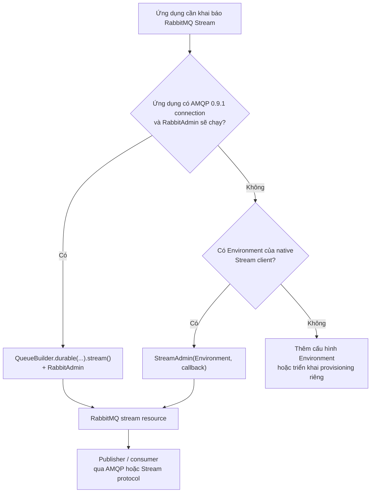

# Khai báo stream bằng QueueBuilder hoặc StreamAdmin theo cách kết nối

## 1. Bài toán: cùng một RabbitMQ Stream, hai đường khai báo

Trong chương **RabbitMQ Streams** của module **SPRING_AMQP**, chúng ta tích hợp RabbitMQ bằng `RabbitTemplate`, `@RabbitListener`, exchange, queue, binding và các cơ chế xác nhận, retry, dead-letter, theo dõi. Khi ứng dụng chuyển từ queue công việc thông thường sang **stream**, vấn đề đầu tiên là: **ai sẽ tạo stream trên broker, và việc tạo đó đi qua kết nối nào?**

Spring AMQP hỗ trợ hai phương án chính:

- **`QueueBuilder.durable(name).stream()` + `RabbitAdmin`:** khai báo một queue có kiểu `stream` qua **AMQP 0.9.1**. Phù hợp khi ứng dụng có kết nối AMQP (ví dụ `RabbitTemplate`, `SimpleMessageListenerContainer`, `DirectMessageListenerContainer`).
- **`StreamAdmin` + `com.rabbitmq.stream.Environment`:** khai báo bằng **RabbitMQ Stream protocol**. Phù hợp khi ứng dụng chỉ dùng `RabbitStreamTemplate`/`StreamListenerContainer`, không mở kết nối AMQP truyền thống, hoặc cần nhiều tùy chọn stream từ native client.

**Cùng là một tài nguyên stream trong RabbitMQ**, nhưng hai con đường khởi tạo có **giao thức, dependency và thời điểm kích hoạt admin khác nhau**. Nếu chọn nhầm, bạn có thể thấy ứng dụng khởi động thành công mà stream chưa tồn tại, hoặc listener/producer không tìm được stream cần dùng.

> **Quy tắc nhanh:** Có luồng AMQP hoạt động và `RabbitAdmin` → dùng `QueueBuilder.stream()`. Chỉ sử dụng native Stream client hoặc cần cấu hình nâng cao → dùng `StreamAdmin`. Khi sử dụng cả hai, phải có **một nguồn sở hữu cấu hình** để tránh khai báo chồng chéo.

## 2. RabbitMQ Stream là gì?

RabbitMQ Stream là một **log append-only**: publisher ghi message nối tiếp vào log; consumer đọc theo **offset**, có thể bắt đầu ở vị trí đã lưu hoặc đọc lại một khoảng lịch sử còn được retention giữ. Việc một consumer đọc message **không xóa** message khỏi stream như cách phổ biến ở work queue kiểu classic/quorum.

Điều này phù hợp cho:

- Ghi sự kiện hoạt động, audit log, event streaming.
- Nhiều nhóm consumer độc lập cùng đọc một lịch sử.
- Reprocessing sau thay đổi logic nghiệp vụ.
- Thông lượng lớn, dữ liệu được giữ theo thời gian/kích thước.

Stream **không phải** lựa chọn mặc định cho mọi queue: xử lý công việc một lần với retry/DLQ theo semantics queue thông thường vẫn có thể phù hợp hơn với **quorum queue** hoặc classic queue tùy yêu cầu.

| Thuộc tính | Queue công việc thông thường | RabbitMQ Stream |
| --- | --- | --- |
| Lưu trữ | Hàng chờ message; ack thường cho phép broker loại message khỏi queue | Log append-only; dữ liệu được giữ cho đến khi chính sách retention xóa các đoạn cũ |
| Theo dõi tiến độ | Consumer acknowledgment / trạng thái delivery | Offset hoặc cơ chế tracking của stream consumer; người đọc có thể phát lại |
| Nhiều nhóm độc lập đọc lịch sử | Cần thiết kế thêm exchange/queue riêng | Có thể đọc cùng stream từ offset riêng |
| Giới hạn dung lượng | TTL, queue length, các chính sách tương ứng | `max-age`, `max-length-bytes`, segment size |
| Giao thức | Thường AMQP 0.9.1 cổng 5672 | Có thể truy cập bằng AMQP 0.9.1 hoặc native Stream protocol cổng thường 5552 |

Một stream khi được khai báo bằng AMQP vẫn là **queue type `stream`**, có thể bind vào exchange. Đó không phải cùng semantics với queue type `classic` chỉ vì cả hai đều dùng lớp `Queue` trong Spring.

## 3. Chọn admin theo kết nối: sơ đồ quyết định



Bảng so sánh:

| Tiêu chí | `QueueBuilder.stream()` + `RabbitAdmin` | `StreamAdmin` |
| --- | --- | --- |
| Giao thức khai báo | AMQP 0.9.1 qua `ConnectionFactory` | Native RabbitMQ Stream protocol qua `Environment` |
| Client/factory | `CachingConnectionFactory`/`RabbitAdmin` | `com.rabbitmq.stream.Environment`/`StreamAdmin` |
| Port thường dùng | `5672` (AMQP), `5671` khi TLS | `5552` (Stream), `5551` khi TLS |
| Tạo khi nào | `RabbitAdmin` quét declarables khi **AMQP connection được mở** và admin được phép khai báo | `StreamAdmin` là `SmartLifecycle`, chạy callback trong quá trình khởi động lifecycle |
| Cấu hình cơ bản | `QueueBuilder.durable(name).stream().build()` | `creator.stream(name).create()` |
| Cấu hình nâng cao | Queue arguments của AMQP, bind exchange và các declarable AMQP | API `StreamCreator`: `maxAge`, `maxLengthBytes`, `maxSegmentSizeBytes`, một số tùy chọn stream khác |
| Tình huống lý tưởng | App hỗn hợp AMQP + stream; đã có `RabbitAdmin` | App chỉ có `RabbitStreamTemplate`, `StreamListenerContainer` hoặc muốn quản lý theo Stream protocol |
| Điểm dễ lỗi | Không có AMQP connection mở → admin chưa kích hoạt | Không có native `Environment`, thiếu plugin/port Stream, lỗi discovery topology |

### Mốc phiên bản

- Spring AMQP **2.4** đưa vào hỗ trợ ban đầu cho RabbitMQ Stream Java client và có `QueueBuilder.stream()`.
- Lớp `StreamAdmin` (package `org.springframework.rabbit.stream.support`) có từ **Spring AMQP 2.4.13**. Nếu dự án đang ở 2.4.0–2.4.12, không thể dùng nguyên ví dụ với lớp này.
- Để dùng native Stream client trong Spring AMQP, thêm dependency **`org.springframework.amqp:spring-rabbit-stream`** cùng phiên bản Spring AMQP mà dự án đã quản lý. RabbitMQ Java Stream client là phần phụ thuộc của tích hợp này.
- Kiểm tra dependency tree thực tế trước khi sao chép mã; Spring Boot có thể quản lý version thông qua BOM. Tên starter/auto-configuration có thể khác giữa các thế hệ Spring Boot.

## 4. Điều kiện phía RabbitMQ trước khi khai báo

Dù dùng cách nào, RabbitMQ phải hỗ trợ **stream queue type**. Nếu dùng native Stream protocol, broker cần bật **RabbitMQ Stream plugin** và mở Stream listener.

Ví dụ ở môi trường phát triển:

```bash
rabbitmq-plugins enable rabbitmq_stream
```

Về port:

| Tài nguyên | Port mặc định thường gặp | Khi nào cần |
| --- | ---: | --- |
| AMQP 0.9.1 | 5672 | `RabbitTemplate`, `RabbitAdmin`, `QueueBuilder` qua AMQP |
| AMQP TLS | 5671 | AMQP qua TLS nếu broker bật listener TLS |
| Native Stream protocol | 5552 | `Environment`, `StreamAdmin`, `RabbitStreamTemplate` |
| Native Stream TLS | 5551 | Stream protocol qua TLS nếu broker bật listener TLS |
| RabbitMQ Management | 15672 | Giao diện quản trị; không phải AMQP/Stream protocol |

**Đừng trỏ `Environment` tới 5672** hoặc `CachingConnectionFactory` tới 5552. Đây là hai wire protocols khác nhau. Việc bật Stream plugin phục vụ native protocol; khai báo kiểu queue stream bằng AMQP chịu điều kiện hỗ trợ queue type của phiên bản broker.

Quyền truy cập cũng quan trọng: user/vhost phải có quyền tạo queue/stream; native Stream client phải nhìn thấy các node được broker thông báo trong metadata. Khi chạy container/Kubernetes, chỉ publish port 5552 của một node mà không giải quyết địa chỉ node khác có thể làm native producer/consumer thất bại sau bước discovery leader/replica.

## 5. Cách A: QueueBuilder.stream() và RabbitAdmin qua AMQP

### 5.1. Khai báo stream bằng bean Queue

Khi ứng dụng đã dùng kết nối AMQP, khai báo queue type `stream` rất ngắn:

```java
import org.springframework.amqp.core.Queue;
import org.springframework.amqp.core.QueueBuilder;
import org.springframework.context.annotation.Bean;
import org.springframework.context.annotation.Configuration;

@Configuration
public class AmqpStreamDeclaration {

    @Bean
    Queue auditEventsStream() {
        return QueueBuilder.durable("audit.events.stream")
                .stream()
                .build();
    }
}
```

`QueueBuilder.stream()` bổ sung queue argument tương đương **`x-queue-type=stream`**. Spring cung cấp một `Queue` bean là **định nghĩa cần khai báo**; bean này tự nó không mở kết nối và không gửi `queue.declare` tới broker.

Để broker thực sự tạo stream, cần **`RabbitAdmin` đang hoạt động** với AMQP `ConnectionFactory`. Trong ứng dụng Spring Boot với `spring-boot-starter-amqp` thuộc thế hệ Boot hỗ trợ starter này, `AmqpAdmin` thường được tự cấu hình nếu điều kiện auto-configuration thỏa mãn. Nếu cấu hình Spring AMQP thủ công, có thể tạo:

```java
import org.springframework.amqp.rabbit.connection.ConnectionFactory;
import org.springframework.amqp.rabbit.core.RabbitAdmin;
import org.springframework.context.annotation.Bean;

@Bean
RabbitAdmin rabbitAdmin(ConnectionFactory amqpConnectionFactory) {
    return new RabbitAdmin(amqpConnectionFactory);
}
```

**Điểm quan trọng:** `RabbitAdmin` khai báo các `Queue`, `Exchange`, `Binding` bean khi **AMQP connection được mở** (theo cấu hình admin). Nếu ứng dụng **chỉ dùng native Stream protocol**, không có hoạt động nào khiến AMQP connection được tạo, thì chỉ thêm `QueueBuilder.stream()` có thể chưa tạo tài nguyên trên broker. Đó chính là lý do Spring AMQP đề xuất `StreamAdmin` cho app stream-only.

### 5.2. Gắn stream vào exchange và routing key

Vì stream vẫn là queue type của RabbitMQ, nó có thể được bind vào exchange bằng AMQP:

```java
import org.springframework.amqp.core.Binding;
import org.springframework.amqp.core.BindingBuilder;
import org.springframework.amqp.core.DirectExchange;
import org.springframework.amqp.core.Queue;
import org.springframework.amqp.core.QueueBuilder;
import org.springframework.beans.factory.annotation.Qualifier;
import org.springframework.context.annotation.Bean;
import org.springframework.context.annotation.Configuration;

@Configuration
public class AuditStreamTopology {

    @Bean
    DirectExchange auditExchange() {
        return new DirectExchange("audit.x", true, false);
    }

    @Bean
    Queue auditStream() {
        return QueueBuilder.durable("audit.events.stream")
                .stream()
                .build();
    }

    @Bean
    Binding auditBinding(
            @Qualifier("auditStream") Queue auditStream,
            @Qualifier("auditExchange") DirectExchange exchange) {
        return BindingBuilder.bind(auditStream)
                .to(exchange)
                .with("audit.created");
    }
}
```

Đây là **cấu hình hoàn chỉnh thay thế** ví dụ Queue-only ở phần 5.1; trong một ứng dụng chỉ định nghĩa **một bean sở hữu `audit.events.stream`** (không kích hoạt hai cấu hình khai báo trùng).

Publisher AMQP có thể gửi qua exchange:

```java
import org.springframework.amqp.rabbit.core.RabbitTemplate;
import org.springframework.stereotype.Service;

@Service
public class AuditAmqpPublisher {

    private final RabbitTemplate rabbitTemplate;

    public AuditAmqpPublisher(RabbitTemplate rabbitTemplate) {
        this.rabbitTemplate = rabbitTemplate;
    }

    public void publish(String eventJson) {
        rabbitTemplate.convertAndSend(
                "audit.x",
                "audit.created",
                eventJson
        );
    }
}
```

`RabbitTemplate` dùng AMQP kết nối tới exchange; stream nhận message nhờ binding. **Cơ chế đọc lại từ offset** và khả năng quản lý consumer hiệu quả nhất khi dùng native Stream client cần được cấu hình riêng, không suy ra từ mỗi `@RabbitListener` kiểu queue truyền thống.

### 5.3. Cấu hình retention ngay khi khai báo bằng QueueBuilder

Stream là log được giữ theo chính sách retention, vì vậy nên đặt giới hạn dung lượng/thời gian để tránh chiếm đầy đĩa:

```java
@Bean
Queue auditStreamWithRetention() {
    return QueueBuilder.durable("audit.events.stream")
            .stream()
            .withArgument("x-max-age", "24h")
            .withArgument("x-max-length-bytes", 2L * 1024 * 1024 * 1024)
            .withArgument("x-stream-max-segment-size-bytes", 128L * 1024 * 1024)
            .build();
}
```

Các tham số:

- `x-max-age`: tuổi giữ dữ liệu tối đa theo cú pháp thời lượng mà RabbitMQ hỗ trợ, ví dụ `24h`.
- `x-max-length-bytes`: giới hạn tổng dung lượng stream tính theo byte.
- `x-stream-max-segment-size-bytes`: kích thước segment file, ảnh hưởng thời điểm và độ hạt của việc xóa dữ liệu cũ.

**Chỉ dùng bean ở phần 5.3 thay cho bean `auditStream()` ở 5.2**, không đăng ký hai bean khai báo cùng tên stream với tham số khác nhau. Stream retention xóa theo **segment**, nên giới hạn tuổi/kích thước không nhất thiết được thực thi chính xác đến từng message hoặc từng byte; broker có thể giữ nhiều hơn ngưỡng ngắn hạn đến khi segment rollover.

Đặc biệt:

- **`QueueBuilder.maxLength(...)`** mô tả số lượng message trong queue theo semantics queue truyền thống; **không dùng** để thay cho retention theo dung lượng của stream. Với stream hãy chỉ rõ `x-max-length-bytes` nếu muốn giữ tối đa theo byte.
- `x-queue-type=stream` là thuộc tính được quyết định lúc khai báo; không thể đổi một queue classic/quorum đang tồn tại thành stream bằng cách sửa bean rồi restart.
- Nếu thay các argument bất biến/không tương thích của queue đang tồn tại, broker có thể trả **`PRECONDITION_FAILED`** do tham số khai báo không tương đương. Cần có kế hoạch migration và chính sách retention qua broker policy nếu thuộc tính đó hỗ trợ policy.

## 6. Cách B: StreamAdmin và Environment qua native Stream protocol

Khi ứng dụng chỉ phát/đọc bằng `RabbitStreamTemplate` và `StreamListenerContainer`, nên khai báo trực tiếp bằng `StreamAdmin` thay vì chờ một AMQP connection được mở.

### 6.1. Tạo native Environment

`Environment` là điểm vào của RabbitMQ Stream Java client, quản lý connection, stream metadata, producer và consumer. Một ứng dụng thường dùng một `Environment` cho một cluster, sau đó đóng khi shutdown.

Ví dụ Spring Bean cho môi trường thực hành (cần dependency `spring-rabbit-stream` tương thích):

```java
import com.rabbitmq.stream.Environment;
import org.springframework.context.annotation.Bean;
import org.springframework.context.annotation.Configuration;

@Configuration
public class NativeStreamConnectionConfig {

    @Bean(destroyMethod = "close")
    Environment streamEnvironment() {
        return Environment.builder()
                .host("localhost")
                .port(5552)
                .username("guest")
                .password("guest")
                .virtualHost("/")
                .build();
    }
}
```

`guest/guest` dùng ở đây **chỉ để minh họa môi trường local**; RabbitMQ mặc định hạn chế truy cập remote bằng tài khoản `guest`. Production cần dùng user riêng, secret management, TLS và các địa chỉ node thực tế.

Nếu dùng Spring Boot phiên bản có **auto-configuration của Stream Environment**, có thể tận dụng bean `Environment` được Boot tạo và tùy chỉnh bằng các property/bean được hỗ trợ, thay vì đăng ký thủ công hai bean cạnh tranh. Đọc tài liệu theo **phiên bản Boot đang dùng**, bởi tên starter và property cấu hình Stream protocol có thể thay đổi.

### 6.2. Khai báo bằng StreamAdmin

Đây là dạng do Spring AMQP khuyến nghị:

```java
import com.rabbitmq.stream.ByteCapacity;
import com.rabbitmq.stream.Environment;
import java.time.Duration;
import org.springframework.context.annotation.Bean;
import org.springframework.context.annotation.Configuration;
import org.springframework.rabbit.stream.support.StreamAdmin;

@Configuration
public class NativeStreamDeclaration {

    @Bean
    StreamAdmin streamAdmin(Environment env) {
        return new StreamAdmin(env, creator -> {
            creator.stream("audit.events.stream")
                    .maxAge(Duration.ofHours(24))
                    .maxLengthBytes(ByteCapacity.GB(2))
                    .maxSegmentSizeBytes(ByteCapacity.MB(128))
                    .create();
        });
    }
}
```

Giải thích:

- `new StreamAdmin(env, callback)` nhận `Environment` đã được cấu hình và callback dùng `StreamCreator`.
- `creator.stream(name)` chọn tên tài nguyên stream.
- `maxAge`, `maxLengthBytes`, `maxSegmentSizeBytes` xác định retention và segment size thông qua native API.
- `create()` yêu cầu RabbitMQ tạo stream; theo RabbitMQ Stream client, thao tác **idempotent khi tên và cấu hình tương thích với stream đã tồn tại**.
- `StreamAdmin` triển khai `SmartLifecycle` và có thể tự chạy trong vòng đời Spring application; có thể điều chỉnh `autoStartup`/`phase` nếu có lý do điều phối startup rõ ràng.

**Mốc phiên bản:** `StreamAdmin` có từ **Spring AMQP 2.4.13**. Nếu ứng dụng dùng 2.4 trước mốc này, có thể khai báo bằng native `Environment.streamCreator()` với lifecycle tự quản lý hoặc nâng phiên bản phù hợp. Không giả định lớp này có trong mọi bản 2.4.

### 6.3. Tạo stream hoàn toàn bằng native client khi không dùng StreamAdmin

Trong một ứng dụng đã tự quản lý lifecycle của `Environment`, bạn có thể gọi trực tiếp:

```java
environment.streamCreator()
        .stream("audit.events.stream")
        .maxAge(Duration.ofHours(24))
        .create();
```

Tuy nhiên, đoạn trên tự nó không đảm bảo được gọi **đúng thời điểm** trong Spring application. `StreamAdmin` tích hợp phần provisioning vào vòng đời bean một cách rõ ràng, thường dễ quản lý hơn.

### 6.4. Producer và listener native để kiểm chứng đường kết nối

Ví dụ cấu hình `RabbitStreamTemplate` trực tiếp gửi vào stream mà không cần exchange/binding AMQP:

```java
import com.rabbitmq.stream.Environment;
import org.springframework.context.annotation.Bean;
import org.springframework.context.annotation.Configuration;
import org.springframework.rabbit.stream.producer.RabbitStreamTemplate;

@Configuration
class NativeStreamMessagingConfig {

    @Bean
    RabbitStreamTemplate auditStreamTemplate(Environment env) {
        return new RabbitStreamTemplate(env, "audit.events.stream");
    }
}
```

Service gửi:

```java
import java.util.concurrent.CompletableFuture;
import org.springframework.rabbit.stream.producer.RabbitStreamTemplate;
import org.springframework.stereotype.Service;

@Service
class AuditStreamPublisher {
    private final RabbitStreamTemplate template;

    AuditStreamPublisher(RabbitStreamTemplate template) {
        this.template = template;
    }

    CompletableFuture<Boolean> publish(String eventJson) {
        return template.convertAndSend(eventJson);
    }
}
```

`convertAndSend` trả về `CompletableFuture<Boolean>` để ứng dụng theo dõi kết quả publish qua native client. **Không được mặc định coi việc gọi method là đã commit nghiệp vụ**: xử lý future thất bại và retry với message/event ID ổn định khi cần.

Listener:

```java
import com.rabbitmq.stream.Environment;
import org.springframework.amqp.rabbit.listener.RabbitListenerContainerFactory;
import org.springframework.context.annotation.Bean;
import org.springframework.context.annotation.Configuration;
import org.springframework.rabbit.stream.config.StreamRabbitListenerContainerFactory;
import org.springframework.rabbit.stream.listener.StreamListenerContainer;

@Configuration
class NativeStreamListenerConfig {

    @Bean("nativeStreamListenerFactory")
    RabbitListenerContainerFactory<StreamListenerContainer> nativeFactory(
            Environment env) {
        return new StreamRabbitListenerContainerFactory(env);
    }
}
```

```java
import org.springframework.amqp.rabbit.annotation.RabbitListener;
import org.springframework.stereotype.Component;

@Component
class AuditStreamConsumer {

    @RabbitListener(
            queues = "audit.events.stream",
            containerFactory = "nativeStreamListenerFactory")
    public void onEvent(String payload) {
        // Phần nghiệp vụ: xác thực, ghi nhận, chống trùng nếu cần.
        System.out.println("Event: " + payload);
    }
}
```

**Ràng buộc đáng nhớ của Stream listener:** `StreamRabbitListenerContainerFactory` sử dụng `Environment` của native client. Không nên gán các kỳ vọng từ `SimpleRabbitListenerContainerFactory` như prefetch, ack/requeue hay `concurrency` của `@RabbitListener` sang stream container mà không kiểm tra tài liệu version đang dùng. Stream có **offset, tracking và replay** riêng; các thuộc tính annotation hỗ trợ hạn chế hơn container AMQP truyền thống.

Ví dụ chỉ chứng minh **đường khai báo và kết nối**; ứng dụng thật cần thiết kế vị trí bắt đầu đọc (`first`/`next`/`last`/offset lưu), tracking, idempotency, xử lý lỗi và quan sát consumer.

## 7. Hai hình thức khai báo có cần dùng đồng thời không?

**Thông thường không.** Bạn nên xác định một bên làm **chủ sở hữu provisioning** cho mỗi stream.

Ví dụ app vừa có:

```java
@Bean
Queue auditStream() {
    return QueueBuilder.durable("audit.events.stream")
            .stream()
            .withArgument("x-max-age", "12h")
            .build();
}
```

vừa có:

```java
@Bean
StreamAdmin streamAdmin(Environment env) {
    return new StreamAdmin(env, creator ->
            creator.stream("audit.events.stream")
                    .maxAge(Duration.ofHours(24))
                    .create());
}
```

Hai bên đang tuyên bố **hai retention khác nhau cho cùng stream**. Nếu stream được tạo bởi một bên trước, bên còn lại có thể gặp lỗi không tương thích khi khai báo. Chọn **một cấu hình duy nhất**, hoặc tách ownership: ví dụ hạ tầng quản lý stream còn ứng dụng chỉ publish/consume.

### 7.1. Quy tắc phối hợp producer/consumer khác giao thức

| Khai báo bằng | Publish bằng | Consume bằng | Có thể? | Điểm cần nhớ |
| --- | --- | --- | --- | --- |
| `QueueBuilder.stream()` / AMQP | `RabbitTemplate` / AMQP | Stream client / native | Có | Stream đã tồn tại và port 5552 sẵn sàng; consumer dùng offset |
| `StreamAdmin` / native | `RabbitStreamTemplate` / native | Stream client / native | Có | Không cần AMQP connection chỉ để tạo stream |
| `StreamAdmin` / native | `RabbitTemplate` / AMQP tới exchange | Stream client / native | Có, khi có exchange/binding AMQP phù hợp | `StreamAdmin` tạo stream nhưng **không tự tạo binding AMQP** |
| `QueueBuilder.stream()` / AMQP | `RabbitStreamTemplate` / native | Stream client / native | Có | Chỉ khi `RabbitAdmin` đã chạy và khai báo stream thật sự |
| `QueueBuilder.stream()` / AMQP nhưng không có AMQP connection | Native producer | Native consumer | Không bảo đảm | Queue bean tồn tại trong Spring nhưng stream có thể chưa được khai báo trên broker |

Không nhầm lẫn giữa **“đường khai báo”** và **“đường gửi message”**: có thể tạo stream qua AMQP nhưng gửi native, hoặc tạo qua native rồi gửi AMQP (nếu routing được cấu hình). Tuy nhiên, cần đảm bảo thống nhất tên, vhost, quyền và trạng thái broker.

## 8. Sự khác nhau giữa queue arguments và StreamCreator

| Mục đích | AMQP / `QueueBuilder` | Native / `StreamCreator` |
| --- | --- | --- |
| Chọn queue type | `.stream()` ⇒ `x-queue-type=stream` | `.stream("audit.events.stream").create()` |
| Giữ tối đa 24 giờ | `.withArgument("x-max-age", "24h")` | `.maxAge(Duration.ofHours(24))` |
| Giới hạn khoảng 2 GiB | `.withArgument("x-max-length-bytes", 2147483648L)` | `.maxLengthBytes(ByteCapacity.GB(2))` |
| Segment khoảng 128 MiB | `.withArgument("x-stream-max-segment-size-bytes", 134217728L)` | `.maxSegmentSizeBytes(ByteCapacity.MB(128))` |
| Tùy chọn mở rộng | `withArgument(key, value)` nếu broker hỗ trợ | Các method do RabbitMQ Stream Java client cung cấp |
| Binding với exchange | `BindingBuilder` + `RabbitAdmin` | Là thao tác AMQP riêng; `StreamAdmin` không thay thế việc khai báo binding |

**Lưu ý về đơn vị:** kiểu `ByteCapacity.GB(2)` biểu diễn dung lượng theo API của native client; khi so sánh với số byte cụ thể ở AMQP cần kiểm tra chính xác cách thư viện tính đơn vị. Không lấy ví dụ “2 GB” và “2 GiB” làm chứng minh các giá trị hoàn toàn bằng nhau nếu chưa kiểm tra conversion.

**Retention không đồng nghĩa xác nhận tiêu thụ:** offset cho phép consumer nhớ vị trí đọc, nhưng dữ liệu đã vượt retention có thể bị xóa ngay cả khi một consumer chưa kịp xử lý. Nếu cần lưu lâu để phục vụ nghiệp vụ, xác định RPO, độ trễ consumer, tốc độ phát và budget lưu trữ.

### 8.1. Khi stream đã tồn tại với kiểu khác

Giả sử trước đó có queue tên `audit.events.stream` nhưng loại `classic`. Thêm `.stream()` vào cấu hình rồi restart **không nâng cấp queue này thành stream**. Queue type được xác định khi khai báo; broker có thể trả lỗi kiểu `PRECONDITION_FAILED` hoặc tương đương.

Cách xử lý:

1. Xác minh loại queue hiện tại và dữ liệu đang có.
2. Tạo stream mới với tên riêng (ví dụ `audit.events.v2.stream`).
3. Thiết kế việc chuyển publisher, consumer, routing, retention và dữ liệu tồn.
4. Chuyển traffic có kiểm soát, kiểm thử dữ liệu và độ trễ.
5. Chỉ xóa tài nguyên cũ khi đã xác minh migration và chính sách lưu trữ.

Không xóa một queue/stream production chỉ để giải quyết lỗi khai báo, vì điều đó có thể làm mất dữ liệu không thể khôi phục.

## 9. Độ tin cậy khi stream được tạo và sử dụng

### 9.1. Lúc startup

`RabbitAdmin` và `StreamAdmin` khác nhau về lifecycle:

- `RabbitAdmin` thường khai báo khi **AMQP connection được mở**. Với ứng dụng chỉ dùng native client, bean Queue có thể tồn tại mà broker chưa tạo stream.
- `StreamAdmin` thực hiện provisioning qua `Environment` và callback trong lifecycle Spring. Nếu broker chưa sẵn sàng, việc startup có thể gặp exception theo chính sách và phiên bản. Không nên ngầm tin rằng consumer native tự tạo stream thay admin.
- Khi triển khai đồng thời nhiều replica, nhiều instance cùng khai báo **cùng cấu hình** cần được kiểm tra tính idempotent và cách xử lý racing. Nếu mỗi instance có tùy chọn retention khác nhau, khó tránh lỗi startup.

Trong production, một số tổ chức chọn **provisioning tách khỏi application startup** (infrastructure as code, deployment job, RabbitMQ definitions), sau đó ứng dụng chỉ xác minh stream tồn tại. Cách này giúp tránh tình trạng một phiên bản app cũ và mới cùng tranh nhau chỉnh topology.

### 9.2. Khi publish và consume

- **Publisher confirm** (AMQP) hoặc kết quả native publish cho biết trạng thái publish ở lớp broker/client; **không** chứng minh consumer đã áp dụng nghiệp vụ.
- **Offset/stream consumer tracking** cho phép consumer nhớ và phát lại vị trí đọc. Việc lưu offset và commit DB thường **không có transaction phân tán tự động**: crash sau commit DB nhưng trước lưu offset có thể khiến cùng event được xử lý lại.
- Dùng **eventId/business key + idempotent consumer** cho nghiệp vụ quan trọng. Ví dụ bảng inbox/unique constraint được commit cùng cập nhật DB để giảm tác dụng lặp.
- **Retry/DLQ** của work queue AMQP và **replay/offset** của stream có semantics khác. Không tự động gắn giả định `basicNack(requeue=true)` và dead-letter behavior của queue thường cho native stream consumer.
- **Retention** là giới hạn lưu trữ log; khi consumer chạy chậm hơn tốc độ xóa segment, lịch sử cần đọc có thể không còn. Theo dõi offset lag và oldest retained offset.

### 9.3. Nếu broker/cluster có nhiều node

Native Stream client cần tới **stream leader/replica** theo metadata; client `Environment` có thể thử địa chỉ node và nhận gợi ý node từ broker. Với Docker/Kubernetes hay load balancer, cần bảo đảm **địa chỉ được broker quảng bá** có thể kết nối từ nơi chạy client hoặc cấu hình address resolver phù hợp.

Có nhiều địa chỉ port 5552 **không tự nhân bản dữ liệu**, cũng không bảo đảm stream có quorum khả dụng sau khi mất node. Cần xét loại stream, replica count, node placement và phần dung lượng disk.

## 10. Cách kiểm chứng hai phương án

### 10.1. Kiểm chứng cách A (AMQP + RabbitAdmin)

1. Bật broker hỗ trợ stream queue type; cấu hình AMQP `localhost:5672`.
2. Chạy ứng dụng có `QueueBuilder.durable("audit.events.stream").stream()` và `RabbitAdmin`.
3. **Đảm bảo AMQP connection thực sự mở** — ví dụ `RabbitTemplate` hoặc listener AMQP khởi chạy; chỉ chạy native client không đủ để kích hoạt RabbitAdmin.
4. Dùng RabbitMQ Management hoặc CLI xem queue `audit.events.stream` có **type = stream** và arguments tương ứng.
5. Bind stream vào exchange, gửi một sự kiện bằng `RabbitTemplate`; kiểm tra stream đã nhận dữ liệu.
6. Dừng AMQP connection, thử lại để quan sát thời điểm `RabbitAdmin` tái khai báo theo lifecycle; không kết luận app sẵn sàng chỉ vì có Queue bean.

### 10.2. Kiểm chứng cách B (native + StreamAdmin)

1. Bật `rabbitmq_stream` plugin và native listener cổng 5552; cấu hình `Environment` đúng credentials/vhost.
2. Chạy ứng dụng **không cần tạo AMQP connection**, có `StreamAdmin` cùng callback `creator.stream(...).create()`.
3. Kiểm tra stream đã xuất hiện trên broker, type đúng và retention đúng.
4. Publish một event bằng `RabbitStreamTemplate` rồi consume bằng `StreamRabbitListenerContainerFactory`.
5. Kiểm thử offset: đọc lại từ vị trí chỉ định, restart consumer và theo dõi tracking (nếu đã cấu hình).
6. Ngắt native port hoặc làm node leader không khả dụng trong môi trường thử nghiệm; quan sát connect/discovery/recovery và chính sách xử lý publish lỗi.

**Không chạy đồng thời hai bài kiểm chứng vào cùng tên stream với retention khác nhau.** Dùng tên stream thử nghiệm riêng hoặc thiết lập cùng cấu hình để kết luận chính xác.

### 10.3. Ma trận triệu chứng

| Triệu chứng | Nguyên nhân thường gặp | Cách kiểm tra |
| --- | --- | --- |
| Có `Queue` bean nhưng broker không có stream | `RabbitAdmin` chưa được kích hoạt vì chưa có AMQP connection | Xem lifecycle kết nối/khai báo; chọn `StreamAdmin` nếu app stream-only |
| `StreamAdmin` không kết nối được | Plugin native chưa bật, sai port 5552, TLS, username/vhost | Kiểm tra Stream listener, logs, network policy và credentials |
| Lỗi queue type inequivalent | Queue cùng tên đã được khai báo classic/quorum | Xác nhận queue type hiện tại; migration sang tên mới |
| Retention không giống mong muốn | Tùy chọn hai admin khác nhau hoặc segment chưa rollover | Kiểm tra arguments/policy và size/age của segment |
| `RabbitStreamTemplate` gửi thất bại | Stream chưa tạo, sai name/vhost hoặc metadata leader không truy cập được | Xác minh create lifecycle, topology và network |
| `RabbitTemplate` gửi nhưng stream không có dữ liệu | Thiếu exchange/binding hoặc routing key sai | Kiểm tra topology AMQP và publisher returns |
| Consumer native không đọc từ đầu | Offset mặc định không phải offset mong muốn | Cấu hình offset lúc tạo consumer và tracking |
| Consumer đọc lại event cũ sau restart | Offset chưa được lưu trước crash | Idempotency và kiểm tra chiến lược offset tracking |
| Lỗi từ hai instance khi deploy | Hai cấu hình khai báo khác nhau hoặc chạy song song với policy xung đột | Giao một owner quản lý provisioning |

## 11. Checklist lựa chọn trong dự án

1. **Phân biệt đường kết nối:** AMQP 0.9.1 qua `ConnectionFactory`/`RabbitAdmin` hay Stream protocol qua `Environment`?
2. Nếu app có **AMQP connection thật sự được mở**, chọn `QueueBuilder.durable(...).stream()` với `RabbitAdmin` để tận dụng bean declarables và binding.
3. Nếu app **chỉ dùng native Stream components**, chọn `StreamAdmin` (Spring AMQP **2.4.13+**) cùng `Environment` để provisioning không phụ thuộc AMQP connection.
4. Bảo đảm RabbitMQ hỗ trợ stream queue và bật Stream plugin, mở port native khi dùng native protocol.
5. Chọn **một nguồn sở hữu cấu hình** stream; không tạo hai định nghĩa cùng tên với retention khác nhau.
6. Khai báo retention (`maxAge`, `maxLengthBytes`, segment size) theo dung lượng và thời gian replay; đo offset lag, đĩa và số segment.
7. Nếu publish bằng `RabbitTemplate` qua exchange, khai báo **binding** tương ứng; `StreamAdmin` không tự tạo AMQP exchange/binding.
8. Kiểm tra queue type bất biến; cần đổi từ classic/quorum sang stream thì **migration**, không đổi tại chỗ.
9. Xác định khi nào consumer bắt đầu đọc, cách lưu offset, xử lý replay, xác nhận và idempotency.
10. Đọc lại trạng thái broker khi startup và thử nghiệm failover, publisher errors, offset recovery, retention xóa dữ liệu cũ.

**Kết luận:** `QueueBuilder.stream()` và `StreamAdmin` đều tạo RabbitMQ Stream, nhưng **không cùng đường khai báo**. `QueueBuilder` phụ thuộc `RabbitAdmin` và hoạt động của kết nối AMQP; `StreamAdmin` dùng trực tiếp `Environment`/Stream protocol, thích hợp cho ứng dụng thuần stream và các lựa chọn cấu hình chuyên sâu. Chọn đúng cách kết nối sẽ giúp stream được provision nhất quán, producer/consumer hoạt động đúng và hệ thống xử lý bất đồng bộ có thể quan sát, phục hồi và phát lại an toàn.

## Tài liệu tham khảo

- [Spring AMQP — Using the RabbitMQ Stream Plugin](https://docs.spring.io/spring-amqp/reference/stream.html): `QueueBuilder.stream()`, `RabbitAdmin` và `StreamAdmin`, native Stream template/listener.
- [Spring AMQP — QueueBuilder API](https://docs.spring.io/spring-amqp/docs/3.1.x/api/org/springframework/amqp/core/QueueBuilder.html): method `stream()` có từ 2.4, queue arguments.
- [Spring AMQP — StreamAdmin API](https://docs.spring.io/spring-amqp/docs/3.1.x/api/org/springframework/rabbit/stream/support/StreamAdmin.html): constructor, `SmartLifecycle` và mốc 2.4.13.
- [RabbitMQ — Streams and Superstreams](https://www.rabbitmq.com/docs/streams): queue type `stream`, `x-max-age`, `x-max-length-bytes`, retention, AMQP access.
- [RabbitMQ — Stream Plugin](https://www.rabbitmq.com/docs/stream): native protocol listener, port 5552 và kích hoạt plugin.
- [RabbitMQ Stream Java Client — Reference](https://rabbitmq.github.io/rabbitmq-stream-java-client/stable/htmlsingle/): `Environment`, `StreamCreator`, retention, create semantics và offset tracking.
