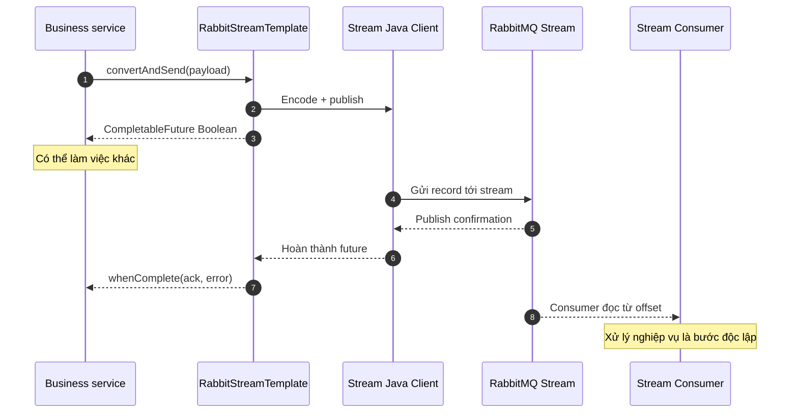
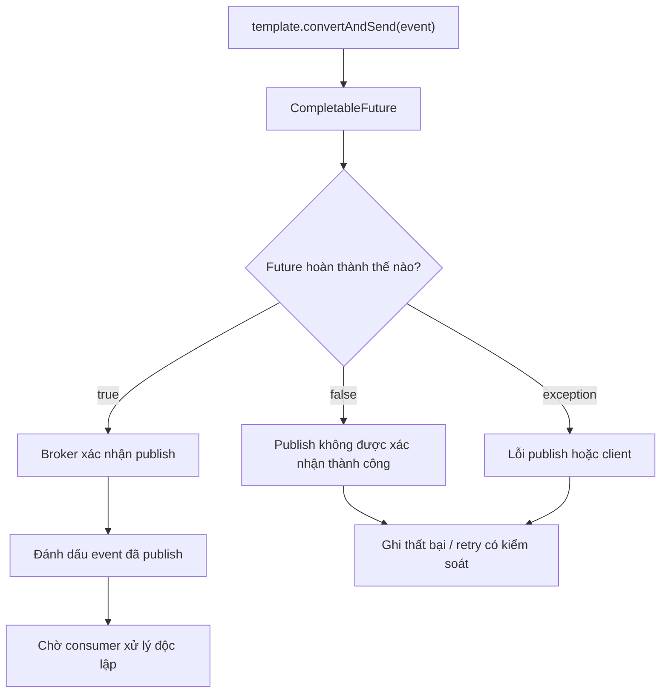
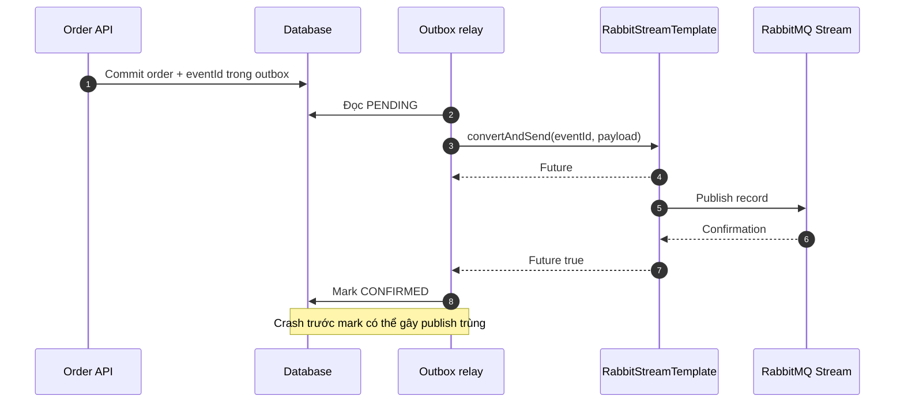

# RabbitStreamTemplate và gửi thông điệp bất đồng bộ

## 1. Vì sao RabbitMQ Streams có RabbitStreamTemplate riêng?

Trong module **SPRING_AMQP**, chúng ta đã quen gửi message bằng `RabbitTemplate`, sử dụng **exchange, routing key, queue, binding** và nhận bằng `@RabbitListener`. RabbitMQ còn có **Streams**: một kiểu lưu trữ **append-only log** tối ưu cho nhiều message, lưu giữ theo **retention** và cho phép consumer đọc lại dữ liệu từ **offset**. Spring AMQP cung cấp `RabbitStreamTemplate` để producer gửi trực tiếp bằng **RabbitMQ Stream protocol**.

Ví dụ, hệ thống thương mại điện tử muốn lưu chuỗi sự kiện `OrderCreated`, `OrderPaid`, `OrderShipped` để phân tích, phát lại hoặc xây projection. Producer cần gửi nhanh mà không khóa thread trong lúc đợi broker xác nhận đã tiếp nhận dữ liệu. `RabbitStreamTemplate.convertAndSend(...)` trả về `CompletableFuture<Boolean>` để ứng dụng quan sát kết quả publish **bất đồng bộ**.

Bài này tập trung vào **gửi thông điệp bất đồng bộ**. Sau khi học, bạn cần:

- Phân biệt stream với queue AMQP truyền thống và hiểu vì sao `RabbitStreamTemplate` cần `Environment` của stream client.
- Khởi tạo stream, `RabbitStreamTemplate`, gửi payload bằng `convertAndSend`, `send` và native stream `Message`.
- Dùng `CompletableFuture<Boolean>` xử lý **confirm true**, **confirm false**, exception và publish có kết quả chưa rõ.
- Phân biệt broker đã xác nhận publish với consumer đã xử lý nghiệp vụ thành công.
- Thiết kế backpressure, idempotency, retry, giữ message bền và quan sát để sản xuất bất đồng bộ đáng tin cậy.

## 2. Mô hình Streams khác queue thông thường ở điểm nào?

RabbitMQ stream giữ message theo log cho tới khi **retention policy** loại bỏ các segment. Consumer theo dõi **offset** để tiếp tục đọc hoặc replay; đọc message **không xóa** message khỏi stream. Đây là khác biệt lớn với queue kinh điển, nơi message sau khi được xử lý và ack sẽ không còn chờ trong queue.

| Đặc tính | Queue truyền thống qua AMQP 0.9.1 | RabbitMQ Stream |
|---|---|---|
| Mô hình tiêu thụ chính | Consumer nhận delivery, xử lý và ack/nack | Consumer đọc record từ log theo offset |
| Dữ liệu sau khi đọc | Message được loại khỏi queue sau khi ack theo semantics queue | Record được lưu tới khi retention loại bỏ |
| Đọc lại quá khứ | Không phải hành vi mặc định của queue đã ack | Hỗ trợ replay từ offset còn lưu giữ |
| Gửi trong Spring | `RabbitTemplate.send/convertAndSend` | `RabbitStreamTemplate.send/convertAndSend` |
| Kết quả gửi | Có thể theo dõi publisher confirms/returns nếu cấu hình | Phương thức gửi trả `CompletableFuture<Boolean>` |
| Giao thức và cổng thường gặp | AMQP 0.9.1: `5672` | RabbitMQ Stream protocol: `5552` |
| Định tuyến | Exchange + routing key + binding | Template gắn với một stream đích; super stream có cơ chế phân vùng riêng |
| Trạng thái consumer | Delivery/ack của broker | Offset và chiến lược theo dõi offset |

Một stream là một queue type của RabbitMQ và có thể nhận message qua AMQP trong một số kiến trúc, nhưng **`RabbitStreamTemplate` trong bài sử dụng Stream protocol và stream name**, không gọi `convertAndSend(exchange, routingKey, payload)` như `RabbitTemplate`. Muốn publish vào super stream theo khóa phân vùng, cần cấu hình routing tương ứng; không tự suy ra routing từ một trường JSON.

### 2.1. Luồng gửi bất đồng bộ



Từ góc nhìn caller, **bất đồng bộ** nghĩa là không cần gọi `Future.get()` ngay sau `convertAndSend(...)`. Tuy nhiên `send` vẫn có thể làm các thao tác cục bộ như chuyển đổi payload, kiểm tra hoặc khởi tạo producer trước khi trả future. Nó **không hứa** rằng lời gọi tức thì trong mọi tình huống.

## 3. Chuẩn bị môi trường và dependency

### 3.1. Broker hỗ trợ Stream protocol

RabbitMQ cần hỗ trợ RabbitMQ Streams, bật plugin stream khi dùng phiên bản/triển khai yêu cầu, cho client truy cập cổng stream (thường là `5552`). Để làm bài local, ví dụ:

```bash
# Chạy trên môi trường thử nghiệm có RabbitMQ CLI.
rabbitmq-plugins enable rabbitmq_stream
```

Cổng `5552` khác cổng AMQP `5672`; truy cập được `5672` không chứng minh stream client kết nối được. Trong cluster, stream Java client còn cần kết nối tới node phù hợp với topology leader/replica; hãy kiểm tra DNS, advertised host, TLS và firewall trong môi trường container/Kubernetes.

### 3.2. Thêm thư viện Spring AMQP Stream

Với dự án Maven, thêm module dành riêng cho Streams:

```xml
<dependency>
    <groupId>org.springframework.amqp</groupId>
    <artifactId>spring-rabbit-stream</artifactId>
</dependency>
```

Phiên bản cần khớp với Spring AMQP/Spring Boot BOM của dự án; nếu không dùng BOM phải khai báo một phiên bản tương thích tường minh. Spring AMQP 3.x trở lên trả `CompletableFuture<Boolean>` từ `RabbitStreamTemplate`; tài liệu Spring AMQP 2.4 cũ dùng `ListenableFuture<Boolean>` nên không chép nguyên ví dụ API cũ vào dự án mới.

Nếu ứng dụng đồng thời sử dụng AMQP queue truyền thống, cấu hình `spring-rabbit`/starter RabbitMQ thích hợp theo phiên bản Spring Boot đang dùng. **`spring-rabbit-stream` là module API cần có** cho các lớp `RabbitStreamTemplate` và `StreamListenerContainer`.

## 4. Tạo stream và RabbitStreamTemplate

Ví dụ dùng stream tên `orders.events.stream`, payload kiểu chuỗi để tránh phụ thuộc JSON converter. Cấu hình local với `Environment` dùng stream client:

```java
import com.rabbitmq.stream.Environment;
import org.springframework.context.annotation.Bean;
import org.springframework.context.annotation.Configuration;
import org.springframework.rabbit.stream.producer.RabbitStreamTemplate;

@Configuration
public class OrderStreamConfiguration {
    public static final String STREAM = "orders.events.stream";

    @Bean(destroyMethod = "close")
    Environment streamEnvironment() {
        return Environment.builder()
                .host("localhost")
                .port(5552)
                .username("guest")
                .password("guest")
                .build();
    }

    @Bean(destroyMethod = "close")
    RabbitStreamTemplate orderStreamTemplate(Environment streamEnvironment) {
        return new RabbitStreamTemplate(streamEnvironment, STREAM);
    }
}
```

`Environment` là đối tượng sống lâu, quản lý kết nối stream, producer và consumer; không tạo một `Environment` cho mỗi message. `RabbitStreamTemplate` gắn với một stream name; ứng dụng có thể khai báo nhiều template cho nhiều stream nếu cần. Khi ứng dụng dừng, đóng template/producer và environment theo vòng đời thích hợp. Thông tin host, port, credentials chỉ là **ví dụ local**, production nên dùng cấu hình ngoài, secret và TLS.

### 4.1. Provision stream trước khi publish

Stream phải tồn tại trước khi gửi. Trong test/local, có thể tạo bằng Java stream client:

```java
import java.time.Duration;
import com.rabbitmq.stream.Environment;

void provisionForLocalTest(Environment env) {
    env.streamCreator()
            .stream(OrderStreamConfiguration.STREAM)
            .maxAge(Duration.ofDays(7))
            .create();
}
```

Đoạn mã được gọi từ **bước khởi tạo/provisioning**, không gọi mỗi lần publish. `maxAge` minh họa retention theo thời gian, có thể kết hợp giới hạn dung lượng tùy yêu cầu. Stream giữ message đến khi retention dọn các segment, **không giữ vô hạn**. Nếu stream đã tồn tại với thuộc tính khác, việc tạo lại có thể thất bại; phải quản lý thay đổi hạ tầng như một migration.

Spring AMQP cũng hỗ trợ `StreamAdmin` để khai báo stream bằng Java client. Nếu chỉ sử dụng stream components, đừng trông chờ `RabbitAdmin` tự chạy `QueueBuilder.stream()` khi **không có connection AMQP thông thường** được mở. Có thể dùng `StreamAdmin` hoặc provisioning từ hạ tầng theo tài liệu Spring AMQP. Để tránh lỗi thứ tự startup, hãy hoàn tất việc tạo stream **trước khi ứng dụng bắt đầu publish/consume**.

## 5. API gửi của RabbitStreamTemplate

Không nên lẫn `RabbitStreamTemplate` với `AsyncRabbitTemplate`. `AsyncRabbitTemplate` phục vụ request–reply bất đồng bộ qua AMQP; `RabbitStreamTemplate` phục vụ **publish record tới một stream** và báo kết quả publish.

Các phương thức phổ biến trong `RabbitStreamOperations`:

| Phương thức | Payload | Kết quả |
|---|---|---|
| `convertAndSend(Object message)` | `String` hoặc object được `MessageConverter` chuyển | `CompletableFuture<Boolean>` |
| `convertAndSend(Object, MessagePostProcessor)` | Cho phép chỉnh Spring AMQP message properties trước khi gửi | `CompletableFuture<Boolean>` |
| `send(org.springframework.amqp.core.Message)` | Spring AMQP `Message` đã có body/headers | `CompletableFuture<Boolean>` |
| `send(com.rabbitmq.stream.Message)` | Native stream `Message` | `CompletableFuture<Boolean>` |
| `messageBuilder()` | Trả native builder gắn với producer | Dùng để tạo native message rồi gọi `send` |

`MessageConverter` chuyển object thành Spring AMQP message; `StreamMessageConverter` chuyển Spring AMQP `Message` thành native stream message. Nếu gửi DTO, phải chọn converter tương thích và định nghĩa schema/phiên bản cho producer-consumer. Với `String`, ví dụ dưới đây dùng converter mặc định.

### 5.1. Cách gửi đơn giản nhất

```java
import java.util.concurrent.CompletableFuture;
import org.springframework.rabbit.stream.producer.RabbitStreamTemplate;
import org.springframework.stereotype.Service;

@Service
public class OrderStreamPublisher {
    private final RabbitStreamTemplate template;

    public OrderStreamPublisher(RabbitStreamTemplate template) {
        this.template = template;
    }

    public CompletableFuture<Boolean> publish(String eventText) {
        if (eventText == null || eventText.isBlank()) {
            return CompletableFuture.failedFuture(
                    new IllegalArgumentException("eventText is required"));
        }
        return template.convertAndSend(eventText);
    }
}
```

Ví dụ:

```java
CompletableFuture<Boolean> result =
        orderStreamPublisher.publish("evt-1001|order-42|CREATED");

result.whenComplete((confirmed, error) -> {
    if (error != null) {
        System.err.println("Stream publish error: " + error);
    } else if (Boolean.TRUE.equals(confirmed)) {
        System.out.println("Broker confirmed stream record");
    } else {
        System.err.println("Stream publish not confirmed");
    }
});
```

Callback phía trên là ví dụ học tập; hệ thống thật cần logger, metrics và xử lý trạng thái bền. **`true` chỉ là xác nhận publish của stream client/broker, không phải xác nhận consumer đã xử lý nghiệp vụ**. `false` biểu thị publisher không nhận được confirmation thành công theo API, còn exception biểu thị lời gọi tương ứng thất bại theo trạng thái future.

### 5.2. Gắn eventId bằng MessagePostProcessor

Mỗi sự kiện nên có `eventId` ổn định xuyên suốt retry. Một cách đơn giản là đặt ID vào cả payload và metadata:

```java
import java.util.concurrent.CompletableFuture;
import org.springframework.amqp.core.MessageProperties;
import org.springframework.rabbit.stream.producer.RabbitStreamTemplate;

record OrderEvent(String eventId, String orderId, String status) {
    String encode() {
        return eventId + "|" + orderId + "|" + status;
    }
}

public CompletableFuture<Boolean> publishEvent(
        RabbitStreamTemplate template, OrderEvent event) {

    return template.convertAndSend(event.encode(), message -> {
        MessageProperties properties = message.getMessageProperties();
        properties.setMessageId(event.eventId());
        properties.setHeader("eventId", event.eventId());
        properties.setHeader("eventType", "OrderStatusChanged");
        return message;
    });
}
```

Đây là đoạn mã phương thức minh họa có thể đặt trong một service, không phải đoạn Java độc lập đứng ngoài class. Trong hệ thống thật, hãy validate `eventId`, `orderId`, `status` và sử dụng JSON schema hoặc format có escape thay vì ghép bằng dấu `|`.

### 5.3. Gửi native stream Message

Khi cần sử dụng trực tiếp các khả năng riêng của stream client:

```java
import java.nio.charset.StandardCharsets;
import java.util.concurrent.CompletableFuture;
import com.rabbitmq.stream.Message;
import org.springframework.rabbit.stream.producer.RabbitStreamTemplate;

public CompletableFuture<Boolean> publishNative(
        RabbitStreamTemplate template, String payload) {

    Message nativeMessage = template.messageBuilder()
            .addData(payload.getBytes(StandardCharsets.UTF_8))
            .build();

    return template.send(nativeMessage);
}
```

Với native message, ứng dụng tự chịu trách nhiệm encoding và các properties cần thiết. Không dùng đồng thời kiểu `org.springframework.amqp.core.Message` và `com.rabbitmq.stream.Message` mà không phân biệt import; cả hai có tên `Message` nhưng thuộc hai API khác nhau.

## 6. Đọc CompletableFuture đúng cách

### 6.1. Ba kết quả chính



Điểm quan trọng: nếu future chưa hoàn thành vì mạng hoặc broker chậm, caller **không có đủ bằng chứng** record đã tới hay chưa. Timeout của ứng dụng không nên được diễn giải thành **“record chắc chắn chưa được lưu”**.

| Biểu hiện | Diễn giải | Hành động |
|---|---|---|
| Future hoàn thành `true` | Publish đã được broker/client xác nhận | Lưu trạng thái `CONFIRMED` trong outbox; không tự suy ra nghiệp vụ hoàn tất |
| Future hoàn thành `false` | Không có xác nhận thành công | Ghi nguyên nhân/metric, kiểm tra kết nối và policy retry |
| Future hoàn thành exception | Có lỗi ở quá trình publish | Phân loại lỗi có thể retry; kiểm tra stream có tồn tại, auth và networking |
| Chờ quá deadline | Kết quả lúc đó `UNKNOWN` | Đối soát hoặc retry cùng event ID, không tạo sự kiện khác |

### 6.2. Tránh biến gửi async thành gửi blocking

Mã sau **đánh mất lợi ích bất đồng bộ** nếu chạy trên request thread:

```java
// Không nên chờ ngay trong đường request cần phản hồi nhanh.
Boolean ack = template.convertAndSend(payload).get(5, TimeUnit.SECONDS);
```

Mẫu nên dùng:

```java
return template.convertAndSend(payload)
        .whenComplete((ack, error) -> {
            // Ghi nhận kết quả, cập nhật metric, kích hoạt quy trình retry.
            // Không thực hiện truy vấn DB/blocking I/O nặng ngay tại callback.
        });
```

`whenComplete` đăng ký callback; nó có thể chạy trên thread hoàn thành future của thư viện. Nếu callback thực hiện thao tác chậm, cần chuyển việc sang executor phù hợp hoặc kênh xử lý bền. Nếu buộc phải chờ trong test, dùng `get(timeout, unit)` để tránh treo vô hạn, nhưng nhớ timeout không hủy record đã có thể được gửi.

### 6.3. Đừng bỏ qua future

Đoạn này có vẻ “fire-and-forget”:

```java
template.convertAndSend(payload);
// Không hề theo dõi success/failure.
```

Nhưng caller đã mất mọi tín hiệu quan sát publish thất bại. Với sự kiện quan trọng, lưu `eventId`, kết nối future với trạng thái ứng dụng và cảnh báo. Trường hợp không đòi bảo đảm có thể bỏ qua future theo thiết kế, nhưng phải chấp nhận mất dữ liệu và khó đối soát.

## 7. Bảo đảm gửi đáng tin cậy: outbox, confirm và idempotency

Giả sử một HTTP API lưu đơn hàng vào database rồi gọi `RabbitStreamTemplate` để publish `OrderCreated`:

```text
DB commit OrderCreated
      |
      +--> publish qua stream
                 |
                 +--> mất mạng trước khi future complete
                            |
                            +--> ứng dụng không biết publish thành công chưa
```

Không thể dùng một database transaction đơn lẻ để commit **nguyên tử** database và stream publisher confirmation. **Transactional outbox** giúp không bỏ quên sự kiện đã commit:

1. Trong **cùng một DB transaction**, lưu thay đổi đơn hàng và bản ghi outbox có `eventId` duy nhất, payload, trạng thái `PENDING`.
2. Outbox relay đọc bản ghi chưa xác nhận và gọi `RabbitStreamTemplate.convertAndSend(...)`.
3. Khi future hoàn thành `true`, relay ghi `CONFIRMED`. Khi `false`/exception/timeout, đánh dấu trạng thái cần xử lý và retry theo chính sách.
4. Nếu relay crash sau khi broker lưu record nhưng trước khi outbox được cập nhật, lần chạy sau có thể publish lại: **consumer phải idempotent** bằng `eventId`.
5. Nếu broker giữ log quá ngắn hoặc relay offline lâu, cần kiểm tra retention so với mục tiêu khôi phục.



### 7.1. Stream-side deduplication không thay thế consumer idempotency

RabbitMQ Streams hỗ trợ **publisher deduplication** khi dùng **producer name ổn định** cùng **publishing ID tăng đơn điệu** theo quy tắc stream client. Broker theo dõi **highest publishing ID** của producer đó và có thể bỏ các lần gửi với ID không cao hơn mức đã ghi nhận.

Quy tắc quan trọng:

- Producer name có phạm vi trên một stream, ổn định qua restart; không dùng cùng name cho nhiều producer đồng thời phát xen kẽ IDs.
- Publishing IDs phải **tăng đơn điệu theo thứ tự phát**; nếu gửi ID 10 trước rồi gửi ID 4, broker có thể loại 4 dù 4 chưa từng được lưu.
- Cơ chế này bảo vệ **trùng publish trong log** khi cấu hình đúng. Nó không ngăn các consumer xử lý lại record sau khi offset được đọc lại, và không bao trùm side effect ngoài stream.
- Khi dùng `ProducerCustomizer` để đặt producer name, phải thiết kế cách cấp/truy hồi publishing ID nhất quán theo hợp đồng của stream client và kiến trúc nhiều replica. Không tự cho rằng đặt name bất kỳ sẽ tạo exactly-once toàn hệ thống.

Để phân biệt dễ dàng, hãy giữ hai loại ID:

| ID | Phạm vi | Dùng để làm gì? |
|---|---|---|
| `eventId`/`operationId` | Nghiệp vụ | Deduplicate khi downstream áp dụng dữ liệu, kể cả replay/producer retry |
| `publishingId` của named producer | Publisher + một stream | Stream broker lọc bản publish trùng theo sequence |
| Offset của stream | Vị trí record trong log | Consumer đọc tiếp/replay; không dùng thay eventId nghiệp vụ |

### 7.2. Trạng thái timeout vẫn chưa chắc chắn

`orTimeout(...)` hay `completeOnTimeout(...)` trên future chỉ thay đổi cách **ứng dụng chờ kết quả**, không phải yêu cầu RabbitMQ xóa record. Nếu gửi lại cùng `eventId` sau timeout, trong stream có thể xuất hiện bản sao nếu stream dedup chưa được cấu hình đúng; người tiêu thụ phải xử lý idempotent. Một callback publish thành công cũng không có nghĩa phía consumer đã commit nghiệp vụ.

## 8. Bảo vệ producer khi gửi với thông lượng lớn

Một vòng lặp tạo hàng triệu `CompletableFuture` mà không giới hạn có thể chiếm bộ nhớ, gây áp lực cho stream client, broker và cơ chế lưu theo dõi của ứng dụng.

Các biện pháp cần phối hợp:

- **Giới hạn số publish chưa được xác nhận** (*in-flight*): semaphore/counter hoặc hàng đợi gửi hữu hạn; khi đầy, từ chối/giảm tải theo hợp đồng.
- **Tôn trọng tốc độ xác nhận của broker**: nếu gửi nhanh hơn persist/confirm, backlog future tăng; chỉ tăng thread không làm bottleneck biến mất.
- **Giới hạn payload**: dùng schema và kích thước hợp lý; dữ liệu rất lớn nên lưu trong object storage rồi gửi reference nếu phù hợp.
- **Timeout và retry có ngân sách**: exponential backoff, jitter, số lần tối đa, deadline nghiệp vụ; phân biệt lỗi thường xuyên và đứt mạng kéo dài.
- **Không chạy công việc blocking trong callback**: nếu phải cập nhật database, dùng executor/worker riêng với khả năng xử lý sự cố và trạng thái bền.
- **Shutdown có kiểm soát**: ngừng nhận việc mới, chờ publish đang bay hoàn tất trong deadline, ghi nhận các `eventId` chưa có kết quả để relay xử lý lại.

### 8.1. Ví dụ chặn in-flight bằng Semaphore

```java
import java.util.concurrent.CompletableFuture;
import java.util.concurrent.RejectedExecutionException;
import java.util.concurrent.Semaphore;
import org.springframework.rabbit.stream.producer.RabbitStreamTemplate;

public class BoundedStreamSender {
    private final RabbitStreamTemplate template;
    private final Semaphore slots = new Semaphore(500);

    public BoundedStreamSender(RabbitStreamTemplate template) {
        this.template = template;
    }

    public CompletableFuture<Boolean> send(String payload) {
        if (!slots.tryAcquire()) {
            return CompletableFuture.failedFuture(
                    new RejectedExecutionException("Too many in-flight sends"));
        }

        try {
            return template.convertAndSend(payload)
                    .whenComplete((ack, error) -> slots.release());
        } catch (RuntimeException failureBeforeFuture) {
            slots.release();
            return CompletableFuture.failedFuture(failureBeforeFuture);
        }
    }
}
```

Đây là ví dụ giới hạn **500 future chưa hoàn thành**, không phải cấu hình khuyến nghị cho mọi hệ thống. Nếu future treo, slot có thể bị giữ lâu; hệ thống thật cần deadline, xử lý kết quả `UNKNOWN`, circuit breaker khi broker lỗi và outbox bền để retry. Nếu chọn timeout trên future rồi giải phóng slot, điều đó **không hủy publish** đã gửi. Giá trị tối ưu phụ thuộc kích thước message, tốc độ xác nhận và tài nguyên.

## 9. Liên hệ với @RabbitListener và offset tiêu thụ

Dù bài này tập trung vào producer, cần thấy phía nhận sử dụng **stream-specific listener container**, không dùng container của queue truyền thống rồi mong có semantics offset tự động.

```java
import com.rabbitmq.stream.Environment;
import org.springframework.amqp.rabbit.annotation.RabbitListener;
import org.springframework.amqp.rabbit.listener.RabbitListenerContainerFactory;
import org.springframework.context.annotation.Bean;
import org.springframework.context.annotation.Configuration;
import org.springframework.rabbit.stream.listener.StreamListenerContainer;
import org.springframework.rabbit.stream.config.StreamRabbitListenerContainerFactory;
import org.springframework.stereotype.Component;

@Configuration
public class OrderStreamConsumerConfiguration {
    @Bean("orderStreamListenerFactory")
    RabbitListenerContainerFactory<StreamListenerContainer> listenerFactory(
            Environment env) {
        return new StreamRabbitListenerContainerFactory(env);
    }
}

@Component
class OrderStreamConsumer {
    @RabbitListener(
            id = "orderStreamConsumer",
            queues = OrderStreamConfiguration.STREAM,
            containerFactory = "orderStreamListenerFactory")
    public void listen(String payload) {
        // Xử lý event; trong production phải idempotent.
        System.out.println("received=" + payload);
    }
}
```

Đây là ví dụ **consumer cơ bản**; offset bắt đầu, consumer name và tracking strategy cần được cấu hình theo yêu cầu replay. Khi sử dụng `@RabbitListener` với stream factory, tài liệu Spring AMQP chỉ hỗ trợ một số thuộc tính như `id`, `queues`, `autoStartup` và `containerFactory`; `queues` chỉ được khai báo **một stream**. Không giả định các thuộc tính concurrency/prefetch của AMQP queue listener hoạt động y hệt trong stream.

Nếu cần kiểm soát offset chính xác, có thể sử dụng **native listener**:

```java
import com.rabbitmq.stream.OffsetSpecification;
import com.rabbitmq.stream.Environment;
import org.springframework.amqp.rabbit.listener.RabbitListenerContainerFactory;
import org.springframework.context.annotation.Bean;
import org.springframework.rabbit.stream.listener.StreamListenerContainer;
import org.springframework.rabbit.stream.config.StreamRabbitListenerContainerFactory;

@Bean("nativeOrderStreamListenerFactory")
RabbitListenerContainerFactory<StreamListenerContainer> nativeFactory(
        Environment env) {
    StreamRabbitListenerContainerFactory factory =
            new StreamRabbitListenerContainerFactory(env);
    factory.setNativeListener(true);
    factory.setConsumerCustomizer((id, builder) -> builder
            .name("orders-projector-v1")
            .offset(OffsetSpecification.first())
            .manualTrackingStrategy());
    return factory;
}
```

Khi dùng native listener, handler có thể nhận native `com.rabbitmq.stream.Message` và `Context` rồi gọi `context.storeOffset()` **sau khi nghiệp vụ commit**. Ví dụ trên là **cấu hình thay thế** cho factory cơ bản và minh họa starting offset; không tự động kết luận rằng luôn replay từ đầu mỗi lần restart, vì consumer name và stored offset có thể ảnh hưởng điểm bắt đầu. Với bài toán lưu kết quả vào database, offset và commit dữ liệu vẫn phải được phối hợp bằng idempotency.

**Khác với ack của queue truyền thống:** đọc record từ stream không xóa record. Offset chỉ cho biết tiến độ tiêu thụ; retention mới quyết định khi nào record bị loại khỏi log. Consumer có thể đọc lại sau restart, nên side effect phải chịu được replay.

## 10. Theo dõi và kiểm chứng gửi bất đồng bộ

### 10.1. Metric đề xuất

| Nhóm | Metric/Log | Lợi ích |
|---|---|---|
| Publish | Tổng số attempts, confirmations `true`/`false`, exceptions | Biết chất lượng gửi tới broker |
| Latency | Thời gian `convertAndSend` → future completion (p50/p95/p99) | Phát hiện broker/channels/IO bị chậm |
| In-flight | Future chưa hoàn thành, kích thước hàng chờ, số từ chối | Tránh overload và rò bộ nhớ |
| Retry | Attempts theo eventId, backoff, trạng thái `UNKNOWN` | Phân biệt mất confirm và lỗi hẳn |
| Stream | Tốc độ publish, throughput, segment/disk usage, retention, replica health | Kiểm soát lưu trữ và SLA |
| Downstream | Consumer offset, lag, replay count, duplicate eventId | Không đánh đồng publish confirm với business commit |
| Outbox | Pending/confirmed/failed/unknown count, tuổi event chưa xác nhận | Phát hiện record bị bỏ quên |

Spring AMQP có hỗ trợ Micrometer Observation cho `RabbitStreamTemplate` ở các phiên bản phù hợp qua `setObservationEnabled(true)`. Nếu bật, phải thiết lập registry/metrics/tracing phù hợp với dự án và xác định ý nghĩa số liệu; không tự suy ra một publish span đã phản ánh kết quả nghiệp vụ phía consumer.

### 10.2. Kịch bản thực hành

1. **Gửi một message:** tạo stream và gửi `evt-1001|order-42|CREATED`. Quan sát future thành công `true` và record xuất hiện ở stream; đây là kết quả mong đợi, không phải số đo được thực hiện trong bài.
2. **Callback async:** đăng ký `whenComplete`, làm một công việc khác rồi kiểm tra callback. Chứng minh code không dùng `get()` ngay sau gửi.
3. **Stream không tồn tại:** gửi tới một stream name chưa provision trên môi trường test. Quan sát lỗi và trạng thái future; bổ sung phát hiện lỗi cấu hình thay vì retry vô hạn.
4. **Mất confirm:** gây gián đoạn mạng sau publish nhưng trước callback; đánh dấu `UNKNOWN`, giữ nguyên eventId và đối soát trước khi resend.
5. **Burst load:** gửi 10.000 message vào môi trường staging; ghi số future in-flight, tỷ lệ `false`/exception, latency p99 và memory khi có hoặc không giới hạn.
6. **Outbox retry:** giả lập crash sau broker confirmation nhưng trước khi lưu `CONFIRMED` vào DB. Khi khôi phục, publish lại và kiểm tra xử lý trùng ở consumer.
7. **Retention và replay:** đặt retention ngắn chỉ ở môi trường test, đọc lại record theo offset khi còn tồn tại; giải thích khi nào replay không còn đủ dữ liệu.
8. **Multi-replica publisher:** cân nhắc producer name và publishing ID; chỉ bật stream-side dedup khi có kế hoạch điều phối sequence, không dùng chung producer name tùy tiện.

## 11. Những sai lầm phổ biến

| Sai lầm | Hậu quả | Cách sửa |
|---|---|---|
| Dùng `RabbitStreamTemplate.convertAndSend(exchange, key, payload)` | Không khớp API stream template | Tạo template gắn stream name, gọi `convertAndSend(payload)` |
| Coi `CompletableFuture<Boolean>` hoàn thành `true` là consumer đã xử lý | Báo thành công nghiệp vụ quá sớm | Dùng business status hoặc consumer offset/DB state độc lập |
| Bỏ qua future | Không biết publish lỗi hay chưa rõ | Theo dõi `whenComplete`, logs, outbox |
| Ngay lập tức gọi `get()` | Block thread, mất ưu điểm async | Dùng callback hoặc theo dõi trạng thái ở worker riêng |
| Retry sau timeout bằng eventId mới | Có thể tạo sự kiện nghiệp vụ trùng | Giữ nguyên eventId và deduplicate downstream |
| Một producer name cho nhiều replica với IDs xung đột | Stream dedup có thể bỏ record hợp lệ | Quy hoạch ownership và sequence theo producer |
| Đợi stream giữ message mãi | Retention có thể xóa record chưa được đọc | Đặt retention theo SLA và theo dõi lag |
| Đặt callback nặng trong completion thread | Làm chậm hoàn thành các future khác | Chuyển xử lý I/O chậm sang executor/worker phù hợp |
| Tạo Environment mỗi lần gửi | Lãng phí kết nối và tài nguyên | Reuse bean Environment/producer lâu dài |
| Nhầm queue ack với stream offset | Xử lý replay sai hoặc bỏ record | Thiết kế consumer tracking và idempotency theo stream |

## 12. Câu hỏi ôn tập

1. Vì sao `RabbitStreamTemplate` nhận `streamName` khi khởi tạo nhưng không có overload `convertAndSend(exchange, routingKey, payload)` giống `RabbitTemplate`?
2. Kết quả `CompletableFuture<Boolean> = true` xác nhận được điều gì? Điều gì **chưa** được xác nhận?
3. Nếu caller timeout trước confirmation, tại sao không thể kết luận record chắc chắn chưa vào stream?
4. So sánh `convertAndSend`, `send(Spring Message)` và `send(native Message)` khi cần tùy biến metadata.
5. Một ứng dụng gửi 100.000 message không chờ confirm, có thể gặp rủi ro gì? Thiết kế giới hạn số in-flight thế nào?
6. Publisher crash sau broker lưu record nhưng trước khi đánh dấu outbox `CONFIRMED`. Điều gì xảy ra ở lần retry, và consumer phải làm gì?
7. Producer name và publishing ID khác `eventId` ở điểm nào? Vì sao hai replica không nên tùy tiện chia sẻ một named producer?
8. Consumer đã đọc offset 500, sau restart đọc lại offset 480. Việc này có hợp lệ không và ngăn tác dụng phụ trùng bằng cách nào?
9. Vì sao retention ngắn hơn thời gian consumer offline có thể khiến không replay đủ record?

## 13. Tài liệu tham khảo chính thức

- [Spring AMQP — Using the RabbitMQ Stream Plugin](https://docs.spring.io/spring-amqp/reference/stream.html): `RabbitStreamTemplate`, `RabbitStreamOperations`, `StreamAdmin` và `StreamListenerContainer`.
- [Spring AMQP — RabbitStreamTemplate API](https://docs.spring.io/spring-amqp/docs/3.2.x/api/org/springframework/rabbit/stream/producer/RabbitStreamTemplate.html): các overload gửi, message converter và futures.
- [Spring AMQP — Changes in 3.0 Since 2.4](https://docs.spring.io/spring-amqp/reference/4.0/appendix/previous-whats-new/changes-in-3-0-since-2-4.html): chuyển từ `ListenableFuture` sang `CompletableFuture`.
- [RabbitMQ — Streams and Superstreams](https://www.rabbitmq.com/docs/streams): stream semantics, retention, replay và publisher deduplication.
- [RabbitMQ Stream Java Client — Reference](https://rabbitmq.github.io/rabbitmq-stream-java-client/stable/htmlsingle/): environment, producer, publish confirmations, IDs và consumer offsets.

**Ghi nhớ:** `RabbitStreamTemplate` cung cấp **publish bất đồng bộ tới RabbitMQ Stream** với `CompletableFuture<Boolean>`. Future thành công cho biết **broker đã xác nhận record**, còn việc consumer xử lý, replay và side effect nghiệp vụ vẫn độc lập. Muốn hệ thống đáng tin cậy, hãy kết hợp theo dõi future, giới hạn in-flight, lưu trạng thái publish bền, eventId ổn định, idempotency và retention/offset phù hợp.
