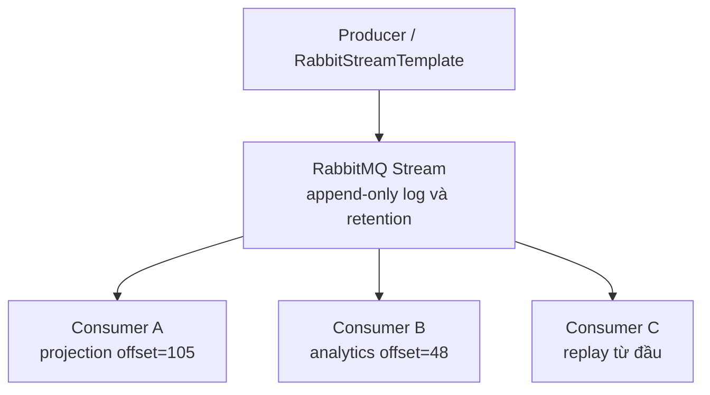
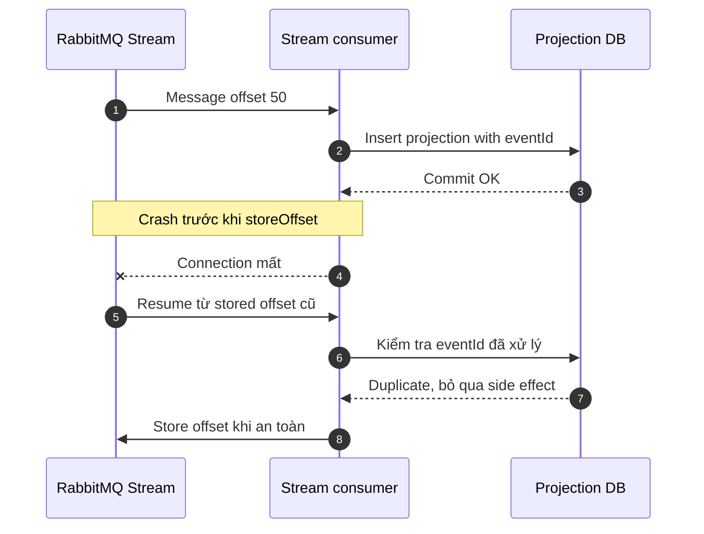
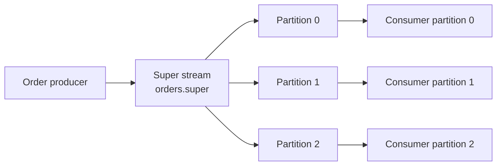

# StreamListenerContainer và StreamRabbitListenerContainerFactory

## 1. Vì sao Spring AMQP có listener container riêng cho RabbitMQ Streams?

RabbitMQ thường được biết đến qua exchange, queue, binding, `RabbitTemplate` và `@RabbitListener`. Với **queue truyền thống**, consumer nhận message, xử lý và ACK/NACK; message đã được ACK thường được loại khỏi queue. Nhưng RabbitMQ còn có **Streams**, một dạng nhật ký message bền vững (*append-only log*) có retention. Nhiều consumer độc lập có thể đọc cùng dữ liệu, đọc lại lịch sử và theo dõi vị trí mình đã đọc bằng **offset**.

Spring AMQP tích hợp RabbitMQ Stream Java Client thông qua module `spring-rabbit-stream`. Hai lớp quan trọng ở phía nhận là:

- **`StreamListenerContainer`:** tạo và quản lý stream consumer theo cách lập trình trực tiếp, không bắt buộc dùng annotation.
- **`StreamRabbitListenerContainerFactory`:** factory tạo `StreamListenerContainer` cho các phương thức có `@RabbitListener`, giúp lập trình theo mô hình annotation quen thuộc.

Hai lớp đều dựa trên `com.rabbitmq.stream.Environment` của native stream client. Chúng có cùng nền tảng stream consumption, nhưng khác cách đăng ký listener và cấu hình.

Ví dụ dịch vụ Báo cáo đọc stream `orders.audit.stream`. Khi hệ thống khởi động, dịch vụ có thể đọc từ đầu stream để xây lại một projection, hoặc đọc tiếp từ offset đã lưu để chỉ xử lý các event mới. Không thể áp dụng máy móc logic `basicAck(deliveryTag)` của queue AMQP 0-9-1 vào một consumer chạy theo giao thức stream.

Bài học thuộc chương **RabbitMQ Streams** của module **SPRING_AMQP**, giúp bạn kết hợp stream listener với publisher, định tuyến, giao dịch, retry, quản trị lỗi và quan sát để xây xử lý bất đồng bộ có khả năng phục hồi.

### Mục tiêu

Sau bài học, bạn sẽ có thể:

1. Phân biệt **stream** với classic/quorum queue về retention, replay và xác nhận tiến độ.
2. Cấu hình `Environment`, tạo stream và quản lý `StreamListenerContainer`.
3. Tạo `StreamRabbitListenerContainerFactory` cho `@RabbitListener` thường và native listener.
4. Phân biệt **Spring AMQP Message** với **native stream Message + Context**.
5. Chọn vị trí bắt đầu đọc và chiến lược **offset tracking** phù hợp.
6. Thiết kế retry, poison message, idempotency, single active consumer, super stream và quan sát hệ thống.

## 2. Stream khác queue truyền thống ở đâu?



| Tiêu chí | Classic/quorum queue thông thường | RabbitMQ Stream |
|---|---|---|
| Cách lưu dữ liệu | Queue cung cấp message tới consumer, message được ACK rồi được loại khỏi queue theo cơ chế queue | Append-only log; message được giữ tới khi retention loại dữ liệu cũ |
| Đọc lại message | Thường cần redelivery hoặc lưu bản sao bên ngoài | Có thể subscribe lại từ offset còn trong retention |
| Theo dõi tiến độ | Delivery tag và consumer ACK/NACK | Offset, consumer name và offset tracking |
| Nhiều ứng dụng cùng đọc một event | Thường dùng nhiều queue/binding cho từng subscriber | Các consumer độc lập có thể đọc cùng stream |
| Xử lý lỗi | Reject/requeue và DLX/DLQ theo queue | Ứng dụng quản lý retry/offset/error store; không dùng trực tiếp basicNack của consumer stream |
| API Spring nhận | `SimpleMessageListenerContainer` / `DirectMessageListenerContainer` | `StreamListenerContainer` |
| API Spring gửi | `RabbitTemplate` | `RabbitStreamTemplate` hoặc AMQP producer khi topology cho phép |
| Hiệu năng và replay | Phụ thuộc nhu cầu workload | Phù hợp đọc tuần tự, throughput cao và nhiều lượt replay |

**Retention khác acknowledgment.** Một consumer đã xử lý xong bản ghi offset `100` không khiến stream lập tức xóa bản ghi đó. Stream giữ dữ liệu theo chính sách độ tuổi/dung lượng. Ngược lại, lưu offset `100` không chứng minh transaction database đã commit, trừ khi application đặt checkpoint ở đúng thời điểm.

Thêm một khác biệt: stream có thể có **nhiều subscriber với vị trí đọc riêng**. Consumer projection hoàn tất tới offset `105` không ảnh hưởng vị trí offset `48` của consumer analytics.

> Phạm vi phiên bản: các ví dụ bên dưới dựa trên API Spring AMQP `spring-rabbit-stream` dòng 3.2.x và các khái niệm vẫn được tài liệu Spring AMQP hiện đại mô tả. Hãy dùng phiên bản `spring-rabbit-stream` tương thích với Spring Boot BOM của dự án và kiểm tra lại API nếu dùng một major version khác.

## 3. Môi trường và dependency

Để dùng native stream client qua Spring AMQP cần:

- RabbitMQ có **Stream plugin** và endpoint stream protocol khả dụng (cổng thường dùng `5552`, khác AMQP 0-9-1 thường là `5672`).
- Dependency `spring-rabbit-stream` cùng phiên bản tương thích với các module Spring AMQP; khi dùng Spring Boot, ưu tiên BOM quản lý phiên bản.
- `com.rabbitmq.stream.Environment` để tạo consumer, producer và quản trị stream.
- Stream được khai báo trước khi listener subscribe hoặc được tạo bằng admin thích hợp.

Ví dụ Maven khi đã import dependency management của Spring Boot tương thích:

```xml
<dependency>
    <groupId>org.springframework.boot</groupId>
    <artifactId>spring-boot-starter-amqp</artifactId>
</dependency>

<dependency>
    <groupId>org.springframework.amqp</groupId>
    <artifactId>spring-rabbit-stream</artifactId>
</dependency>
```

`spring-boot-starter-amqp` cung cấp các thành phần RabbitMQ/Spring AMQP thông thường; `spring-rabbit-stream` cung cấp các tích hợp stream. Tùy dự án chỉ dùng stream, thành phần starter có thể được điều chỉnh; trong ví dụ kết hợp queue và stream để tiện so sánh.

### 3.1. Cấu hình kết nối với stream protocol

Spring Boot hỗ trợ các thuộc tính `spring.rabbitmq.stream.*` trong những phiên bản có auto-configuration tương ứng. Ví dụ:

```yaml
spring:
  rabbitmq:
    host: localhost
    port: 5672
    username: streamuser
    password: "change-in-secret-manager"
    stream:
      host: localhost
      port: 5552
      username: streamuser
      password: "change-in-secret-manager"
      name: orders.audit.stream
```

`stream.name` giúp Spring Boot biết stream mặc định khi tự cấu hình `RabbitStreamTemplate`; `StreamRabbitListenerContainerFactory` vẫn phải được khai báo và liên kết với `Environment` nếu dùng `@RabbitListener` theo ví dụ này.

Trong môi trường thật, credentials phải lấy từ biến môi trường hoặc secret manager; cấu hình TLS, vhost và địa chỉ broker theo môi trường triển khai. **Không nhầm cổng stream protocol với cổng AMQP**: có kết nối AMQP 5672 không chứng minh stream client có thể mở session tới 5552.

Nếu không dùng Spring Boot auto-configuration cho stream, có thể tạo `Environment` trực tiếp:

```java
import com.rabbitmq.stream.Environment;
import org.springframework.context.annotation.Bean;
import org.springframework.context.annotation.Configuration;

@Configuration
public class ExplicitStreamEnvironmentConfig {

    @Bean(destroyMethod = "close")
    Environment streamEnvironment() {
        return Environment.builder()
                .host("localhost")
                .port(5552)
                .username("streamuser")
                .password("from-external-configuration")
                .build();
    }
}
```

Đây là **phương án thay thế** cơ chế tự cấu hình của Boot, không khai báo cùng lúc hai bean `Environment` một cách vô tình. Ở production, lấy `host`, `password` và TLS settings từ cấu hình ngoài; ví dụ này tập trung vào API `Environment.builder()`.

### 3.2. Khai báo stream: RabbitAdmin hoặc StreamAdmin

Một stream trong RabbitMQ cũng có thể được khai báo như một queue với argument loại stream:

```java
import org.springframework.amqp.core.Queue;
import org.springframework.amqp.core.QueueBuilder;
import org.springframework.context.annotation.Bean;

@Bean
Queue orderAuditStreamQueue() {
    return QueueBuilder.durable("orders.audit.stream")
            .stream()
            .build();
}
```

Tuy nhiên, cách dùng `RabbitAdmin` để tự declare `Queue` được kích hoạt khi có **kết nối AMQP truyền thống** mở. Nếu ứng dụng chỉ dùng stream API, đừng mặc định rằng khai báo bean `Queue` sẽ tự tạo stream. Khi đó dùng `StreamAdmin`:

```java
import com.rabbitmq.stream.Environment;
import java.time.Duration;
import org.springframework.context.annotation.Bean;
import org.springframework.rabbit.stream.support.StreamAdmin;

@Bean
StreamAdmin streamAdmin(Environment environment) {
    return new StreamAdmin(environment, creator -> {
        creator.stream("orders.audit.stream")
                .maxAge(Duration.ofDays(3))
                .create();
    });
}
```

Hai ví dụ là **hai cách provisioning thay thế nhau**. Nếu stream đã được tạo bằng IaC hoặc RabbitMQ Management, có thể chỉ quản lý topology từ hệ thống provisioning, tránh khai báo xung đột. Chú ý retention `3 ngày` ở đây là cấu hình minh họa; bài toán replay dài hơn sẽ cần thời gian lưu và dung lượng lớn hơn.

## 4. StreamListenerContainer: tạo listener bằng code

`StreamListenerContainer` là một Spring listener container quản lý native stream consumer. Nó nhận `Environment`, stream name, một message listener và cấu hình consumer. Thích hợp khi muốn tạo listener theo code, tùy biến lifecycle hoặc tích hợp với hệ thống không dùng `@RabbitListener`.

### 4.1. Nhận message kiểu Spring AMQP

```java
import com.rabbitmq.stream.Environment;
import java.nio.charset.StandardCharsets;
import org.springframework.amqp.core.MessageListener;
import org.springframework.context.annotation.Bean;
import org.springframework.context.annotation.Configuration;
import org.springframework.rabbit.stream.listener.StreamListenerContainer;

@Configuration
public class ProgrammaticStreamListenerConfig {

    @Bean
    StreamListenerContainer orderAuditContainer(Environment environment,
                                               AuditService auditService) {
        StreamListenerContainer container =
                new StreamListenerContainer(environment);

        container.setQueueNames("orders.audit.stream");
        container.setConsumerCustomizer((id, builder) ->
                builder.name("audit-projection-v1"));

        MessageListener listener = message -> {
            String orderId = new String(
                    message.getBody(), StandardCharsets.UTF_8);
            auditService.persistOnce(orderId);
        };

        container.setupMessageListener(listener);
        return container;
    }
}
```

Đây là listener **Spring AMQP Message**: callback có kiểu `org.springframework.amqp.core.Message` (thông qua `MessageListener`), không trực tiếp nhận stream `Context`. Khi `@Bean` được quản lý bởi Spring, container tham gia lifecycle của ứng dụng. Phương thức `persistOnce` cần tự triển khai ở tầng service để có transaction và idempotency.

Ý nghĩa các thao tác:

- `new StreamListenerContainer(environment)`: tạo container trên stream environment cụ thể.
- `setQueueNames("orders.audit.stream")`: chỉ định **một** stream. Đừng cấu hình nhiều queue trên một container stream như một số container AMQP truyền thống.
- `setConsumerCustomizer(...)`: tùy chỉnh native `ConsumerBuilder` trước khi consumer được tạo, ví dụ đặt name và chiến lược offset.
- `setupMessageListener(listener)`: đăng ký callback xử lý message.
- Lifecycle `start()` / `stop()` do container/Spring điều khiển; không tự tạo nhiều container trùng nhau khi mỗi lần request tới.

### 4.2. Cần tùy chỉnh offset khởi đầu

Ở native stream client, consumer mặc định có thể bắt đầu từ **`OffsetSpecification.next()`** nếu không có stored offset, tức chỉ đọc event mới. Muốn xây projection từ lịch sử thì chỉ định rõ:

```java
container.setConsumerCustomizer((id, builder) ->
        builder.name("audit-rebuild-v1")
               .offset(com.rabbitmq.stream.OffsetSpecification.first()));
```

`first()` nghĩa là từ bản ghi **cũ nhất còn tồn tại trong retention**, không nhất thiết là event đầu tiên trong lịch sử hệ thống. Khi một named consumer đã có offset lưu trên broker, offset này có thể được ưu tiên khi khởi động lại. Muốn replay độc lập, hãy dùng consumer name mới hoặc chủ động quản lý tracking/replay; đừng nghĩ đổi `first()` sẽ luôn bỏ qua checkpoint hiện có.

### 4.3. Tự quản lý vòng đời

Nếu không khai báo bean cho container mà tự tạo trong một service, phải rõ ràng về gọi `start()`, `stop()` và đóng `Environment` khi ứng dụng dừng. Nếu đăng ký qua `@Bean` và để Spring quản lý, tránh gọi `start()` nhiều lần không cần thiết.

Để giám sát, có thể kiểm tra `isRunning()`, trạng thái consumer và các chỉ số stream. `isRunning()` phản ánh lifecycle, **không tự chứng minh** đang bắt kịp broker offset hoặc database projection đã cập nhật xong.

## 5. StreamRabbitListenerContainerFactory: tích hợp @RabbitListener

Với annotation, Spring sử dụng `StreamRabbitListenerContainerFactory` để tạo container cho endpoint. Mỗi phương thức `@RabbitListener` có thể dùng một factory được đặt tên. Container bên dưới vẫn là `StreamListenerContainer`.

### 5.1. Factory nhận Spring AMQP Message hoặc payload đã convert

```java
import com.rabbitmq.stream.Environment;
import com.rabbitmq.stream.OffsetSpecification;
import org.springframework.amqp.rabbit.annotation.EnableRabbit;
import org.springframework.amqp.rabbit.listener.RabbitListenerContainerFactory;
import org.springframework.context.annotation.Bean;
import org.springframework.context.annotation.Configuration;
import org.springframework.rabbit.stream.config.StreamRabbitListenerContainerFactory;
import org.springframework.rabbit.stream.listener.StreamListenerContainer;

@Configuration
@EnableRabbit
public class AnnotatedStreamConfig {

    @Bean("streamListenerFactory")
    RabbitListenerContainerFactory<StreamListenerContainer>
    streamListenerFactory(Environment environment) {

        StreamRabbitListenerContainerFactory factory =
                new StreamRabbitListenerContainerFactory(environment);

        factory.setConsumerCustomizer((listenerId, builder) ->
                builder.name("orders-audit-reader-v1")
                       .offset(OffsetSpecification.first()));
        return factory;
    }
}
```

`@EnableRabbit` kích hoạt cơ chế phát hiện `@RabbitListener`; nhiều dự án Spring Boot AMQP đã được bật sẵn bởi cấu hình khác, nhưng khai báo ở đây giúp ví dụ tự chứa.

Listener:

```java
import org.springframework.amqp.rabbit.annotation.RabbitListener;
import org.springframework.stereotype.Component;

@Component
public class OrderAuditStreamListener {
    private final AuditService auditService;

    public OrderAuditStreamListener(AuditService auditService) {
        this.auditService = auditService;
    }

    @RabbitListener(
            id = "ordersAuditReader",
            queues = "orders.audit.stream",
            containerFactory = "streamListenerFactory")
    public void onEvent(String orderId) {
        auditService.persistOnce(orderId);
    }
}
```

Khi dùng `setNativeListener(false)` mặc định, adapter chuyển native stream message thành Spring AMQP Message rồi áp dụng cơ chế Spring listener để bind payload vào `String` hoặc DTO theo `MessageConverter`. `AuditService` ở đây là service nghiệp vụ cần triển khai; với JSON DTO phải cấu hình converter phù hợp và kiểm soát schema/version.

### 5.2. Annotation nào được hỗ trợ?

Với `StreamRabbitListenerContainerFactory` theo tài liệu Spring AMQP, các thuộc tính `@RabbitListener` được hỗ trợ chủ yếu gồm:

| Thuộc tính | Với Stream factory | Ghi chú |
|---|---|---|
| `id` | Có | Định danh endpoint; hữu ích cho vận hành |
| `queues` | Có, **một stream name** | Không kê nhiều tên stream trong cùng listener |
| `containerFactory` | Có | Chọn factory stream thay vì factory AMQP mặc định |
| `autoStartup` | Có | Điều khiển container khởi động tự động |
| `concurrency` | **Không được áp dụng như SMLC/DMLC** | Cấu hình stream consumer qua native client và kiến trúc stream/super stream |
| Một số thuộc tính AMQP khác | Có thể bị bỏ qua | Không suy rằng `ackMode`, exclusive, priority hoặc error handling của queue thông thường có cùng semantics |

Ví dụ dễ mắc lỗi:

```java
@RabbitListener(
        queues = "orders.audit.stream",
        concurrency = "8",
        containerFactory = "streamListenerFactory")
public void onEvent(String body) {
    // Không thể dựa vào concurrency=8 để tạo 8 consumer stream.
}
```

Nếu cần scale, dùng nhiều consumer theo mô hình stream phù hợp, hoặc **super stream** với partition và single active consumer. Phải nghiên cứu semantics phân phối/tái đọc cho từng trường hợp; không áp đặt tuning `prefetch` hay `concurrentConsumers` của `SimpleRabbitListenerContainerFactory` lên stream listener.

### 5.3. Đặt tên factory để tránh chọn nhầm

Nếu một ứng dụng vừa tiêu thụ classic queue vừa tiêu thụ stream, hãy có hai factory:

- `rabbitListenerContainerFactory` cho listener AMQP 0-9-1 thông thường (khi cần).
- `streamListenerFactory` cho stream.

Một `@RabbitListener` không chỉ định `containerFactory` có thể dùng factory mặc định của ứng dụng và đi vào cơ chế listener sai. Đặt tên tường minh giúp tránh lỗi khó chẩn đoán.

## 6. Native stream listener: lấy Context và tự lưu offset

Để kiểm soát stream-specific metadata và offset, factory hỗ trợ `setNativeListener(true)`. Lúc đó method có thể nhận:

- `com.rabbitmq.stream.Message`: message native của RabbitMQ Stream Java Client.
- `com.rabbitmq.stream.MessageHandler.Context`: context chứa thông tin offset và API `storeOffset()`.

### 6.1. Cấu hình native factory

```java
import com.rabbitmq.stream.Environment;
import com.rabbitmq.stream.OffsetSpecification;
import org.springframework.amqp.rabbit.listener.RabbitListenerContainerFactory;
import org.springframework.context.annotation.Bean;
import org.springframework.context.annotation.Configuration;
import org.springframework.rabbit.stream.config.StreamRabbitListenerContainerFactory;
import org.springframework.rabbit.stream.listener.StreamListenerContainer;

@Configuration
public class NativeStreamListenerConfig {

    @Bean("nativeStreamFactory")
    RabbitListenerContainerFactory<StreamListenerContainer>
    nativeStreamFactory(Environment environment) {

        StreamRabbitListenerContainerFactory factory =
                new StreamRabbitListenerContainerFactory(environment);

        factory.setNativeListener(true);
        factory.setConsumerCustomizer((listenerId, builder) -> {
            builder.name("orders-audit-native-v1")
                   .offset(OffsetSpecification.first())
                   .manualTrackingStrategy();
        });
        return factory;
    }
}
```

`manualTrackingStrategy()` yêu cầu **ứng dụng** chọn lúc lưu offset; nó không phải consumer `basicAck`. Tên consumer phải được đặt ổn định nếu muốn tiếp tục từ checkpoint của lần chạy trước.

### 6.2. Xử lý rồi checkpoint

```java
import com.rabbitmq.stream.Message;
import com.rabbitmq.stream.MessageHandler.Context;
import java.nio.charset.StandardCharsets;
import org.springframework.amqp.rabbit.annotation.RabbitListener;
import org.springframework.stereotype.Component;

@Component
public class NativeOrderAuditListener {
    private final AuditService auditService;

    public NativeOrderAuditListener(AuditService auditService) {
        this.auditService = auditService;
    }

    @RabbitListener(
            id = "nativeOrdersAudit",
            queues = "orders.audit.stream",
            containerFactory = "nativeStreamFactory")
    public void onStreamMessage(Message message, Context context) {

        String orderId = new String(
                message.getBodyAsBinary(), StandardCharsets.UTF_8);

        // Service phải hoàn tất transaction trước khi trả về.
        auditService.persistOnce(orderId);

        // Checkpoint stream sau khi ghi nghiệp vụ đã bền vững.
        context.storeOffset();
    }
}
```

Đây là ví dụ học thuật ưu tiên dễ quan sát. **Lưu offset sau mỗi message có thể gây nhiều ghi metadata và giảm throughput**. Trong workload cao, hãy checkpoint theo khoảng số message/thời gian, lưu checkpoint bên ngoài trong cùng transaction thích hợp hoặc dùng tracking strategy phù hợp với mục tiêu RPO/RTO.

**Nếu `persistOnce(...)` thất bại, đừng gọi `storeOffset()` như thể xử lý đã thành công.** Khi lưu offset tiến qua bản ghi lỗi, lần replay từ checkpoint có thể bỏ qua message đó. Cần thiết kế retry và trạng thái lỗi bền vững trước khi tiến checkpoint.

### 6.3. So sánh listener thường và native

| Khía cạnh | Spring AMQP style | Native stream style |
|---|---|---|
| Factory | `StreamRabbitListenerContainerFactory` mặc định | Cùng factory với `setNativeListener(true)` |
| Tham số | `String`, DTO hoặc `org.springframework.amqp.core.Message` | `com.rabbitmq.stream.Message`, `MessageHandler.Context` |
| Converter | Spring AMQP converter/adapters | Dùng native message và codec/converter phù hợp |
| Truy cập offset | Ít trực tiếp qua method signature | `context.offset()`, `context.storeOffset()` |
| Khi dùng | Consumer đơn giản, business payload | Replay có checkpoint, tracing theo offset, điều khiển chi tiết |
| Rủi ro chính | Nhầm semantics của queue, sai converter | Checkpoint quá sớm/quá dày, bỏ qua lỗi nghiệp vụ |

Một factory không nên được dùng vừa theo kiểu native vừa theo kiểu Spring listener khi các endpoint cần hai signatures khác nhau. Hãy đặt bean riêng để config dễ đọc và kiểm thử.

## 7. RabbitStreamTemplate để tạo dữ liệu thử

Phía producer của stream thường dùng `RabbitStreamTemplate`, tương tự một phần API của `RabbitTemplate` nhưng phát qua RabbitMQ Stream Java Client.

```java
import com.rabbitmq.stream.Environment;
import org.springframework.context.annotation.Bean;
import org.springframework.context.annotation.Configuration;
import org.springframework.rabbit.stream.producer.RabbitStreamTemplate;

@Configuration
public class StreamProducerConfig {
    @Bean
    RabbitStreamTemplate orderAuditStreamTemplate(Environment environment) {
        RabbitStreamTemplate template =
                new RabbitStreamTemplate(environment, "orders.audit.stream");
        template.setProducerCustomizer((stream, builder) ->
                builder.name("orders-audit-publisher"));
        return template;
    }
}
```

Ví dụ gửi:

```java
import java.util.concurrent.CompletableFuture;
import org.springframework.rabbit.stream.producer.RabbitStreamTemplate;
import org.springframework.stereotype.Service;

@Service
public class AuditEventPublisher {
    private final RabbitStreamTemplate template;

    public AuditEventPublisher(RabbitStreamTemplate template) {
        this.template = template;
    }

    public CompletableFuture<Boolean> publish(String orderId) {
        return template.convertAndSend(orderId);
    }
}
```

`convertAndSend(...)` trả về `CompletableFuture<Boolean>`. Ứng dụng cần theo dõi completion, trạng thái Boolean và exception theo contract của stream publisher; **không** đánh đồng “đã gọi phương thức” với “broker xác nhận publish thành công”. Khi lỗi kết nối làm kết quả không rõ, cùng event có thể được gửi lại; hãy thiết kế event ID bền vững, deduplication và producer recovery.

RabbitMQ Stream Java Client có cơ chế **producer deduplication** dựa trên producer name và publishing ID nếu cấu hình đúng. Nó không thay thế idempotency của consumer hoặc việc chống trùng side effect trong database.

## 8. Offset, consumer name và replay: phần cốt lõi của xử lý stream

RabbitMQ Stream Java Client hỗ trợ các vị trí bắt đầu khác nhau:

| Offset specification | Ý nghĩa thực tế |
|---|---|
| `OffsetSpecification.first()` | Bắt đầu từ bản ghi đầu tiên **còn trong retention** |
| `OffsetSpecification.last()` | Bắt đầu gần cuối stream, có thể nhận chunk cuối hiện có |
| `OffsetSpecification.next()` | Chỉ nhận những message được ghi **sau thời điểm subscribe** |
| `OffsetSpecification.offset(n)` | Yêu cầu bắt đầu từ offset cụ thể theo stream |
| `OffsetSpecification.timestamp(...)` | Có thể chọn vị trí theo mốc thời gian khi native client hỗ trợ |

Lưu ý, **offset không nhất thiết liên tục theo từng message**. Stream còn có các bản ghi nội bộ như offset tracking entries; đừng dùng phép `(offset + 1) % 1000` để khẳng định chính xác 1.000 message đã qua.

### 8.1. Vì sao consumer name quan trọng?

Server-side offset tracking đòi **consumer name**. Tên này đại diện cho vị trí đọc của một nhóm logic theo cách ứng dụng quản lý.

Ví dụ:

```text
orders.audit.stream
    ├─ consumer name = "audit-projection-v1": last stored offset 600
    └─ consumer name = "finance-report-v1": last stored offset 220
```

Cả hai cùng đọc stream mà **không cạnh tranh xóa dữ liệu của nhau**. Nếu dùng chung consumer name vô ý ở hai instance không được phối hợp, việc lưu offset có thể bị interleave và sai điểm resume. Khi scale nhiều instance, hãy xác định group semantics/single active consumer hoặc dùng partition rõ ràng.

### 8.2. Automatic tracking

Với **named consumer**, native client có auto tracking strategy theo mặc định (nếu không vô hiệu). Nó định kỳ lưu offset dựa trên ngưỡng message/time. Cách này đơn giản nhưng có thể dẫn đến replay một khoảng đã xử lý khi consumer crash trước lần flush gần nhất. Vì thế business handler phải idempotent.

Automatic tracking thường được cấu hình qua `ConsumerBuilder`, được truyền vào `setConsumerCustomizer`. Ví dụ để nhấn mạnh ý định:

```java
factory.setConsumerCustomizer((id, builder) ->
        builder.name("analytics-v1")
               .offset(OffsetSpecification.first())
               .autoTrackingStrategy()
               .messageCountBeforeStorage(500)
               .flushInterval(java.time.Duration.ofSeconds(5)));
```

**Giá trị 500 và 5 giây chỉ để minh họa**, cần hiệu chỉnh theo throughput và giới hạn replay chấp nhận được. Consumer offset đã lưu có thể được ưu tiên khi consumer với cùng name khởi động lại, thay vì luôn bắt đầu từ `first()`.

### 8.3. Manual tracking và thời điểm checkpoint

Khi dùng manual tracking, ứng dụng tự gọi `context.storeOffset()` **sau khi** phần việc mà offset đại diện đã được xử lý thành công. Nếu consumer xử lý theo thứ tự:

```text
offset 100 -> DB commit thành công
offset 101 -> DB commit thành công
offset 102 -> DB lỗi
offset 103 -> đã được nhận nhưng chưa an toàn để checkpoint
```

Ứng dụng không nên lưu checkpoint `103` nếu `102` chưa được xử lý/ghi lỗi bền vững đúng contract. Checkpoint không phải cơ chế “chỉ lỗi phần tử 102 rồi tiếp tục 103” theo kiểu NACK requeue. Nếu muốn bỏ qua poison message, cần lưu error record bền vững, quy định rõ hành vi replay và đối soát.

### 8.4. Checkpoint có thể bị chậm hoặc trùng với DB commit

Hai thao tác **DB commit** và **stream offset store** không có một transaction nguyên tử chung:



Do đó **at-least-once processing + idempotency** là thiết kế thực tế. Nếu muốn lưu checkpoint trong chính database nghiệp vụ và khôi phục đúng vị trí, có thể dùng external offset store cập nhật trong cùng transaction với projection. Nhưng khi đó cần cấu hình native subscription/re-subscription để đọc từ checkpoint DB đã lưu, không chỉ thay câu lệnh `storeOffset()`.

## 9. Xử lý lỗi, retry và “dead-letter” với stream

Stream không sử dụng cùng cơ chế per-message `basicAck`/`basicNack` như queue AMQP 0-9-1. Vì dữ liệu giữ theo log, một lỗi xử lý không khiến broker tự xóa hoặc requeue đúng bản ghi theo cách queue. Cần thiết kế **xử lý lỗi gắn với offset**.

### 9.1. Ba hướng thường dùng

| Lựa chọn | Phù hợp khi | Lưu ý |
|---|---|---|
| Retry tại chỗ có giới hạn | Lỗi hạ tầng tạm thời, thao tác idempotent | Backoff, giới hạn số lần, tránh block consumer quá lâu |
| Ghi event lỗi vào **error store/queue** rồi checkpoint | Poison message; muốn pipeline vẫn chạy | Phải ghi lỗi **bền vững trước** checkpoint; có replay/recovery riêng |
| Dừng hoặc cách ly consumer/partition | Tính đúng thứ tự nghiêm ngặt, không thể bỏ bản ghi | Cảnh báo, khôi phục nguồn, điều chỉnh offset có kiểm soát |

Nếu phần tử `eventId=E-102` là bản ghi lỗi, chỉ log rồi gọi `storeOffset()` có thể khiến lần restart tiếp tục sau nó, trong khi hệ thống không lưu bản ghi để sửa và replay. Đây là một **đường mất nghiệp vụ**, dù stream vẫn còn bản ghi đến khi retention xóa.

### 9.2. Retry trong StreamListenerContainer

Spring AMQP cho phép khai báo **advice chain** với stream listener container. Với **native stream listener**, có `StreamRetryOperationsInterceptorFactoryBean` hỗ trợ **stateless retry** và `StreamMessageRecoverer` phù hợp.

Cần phân biệt:

- Stateless retry có thể **gọi lại callback** sau lỗi, nên side effect đã xảy ra ở lượt trước có thể bị thực hiện lại.
- Spring AMQP tài liệu nêu **stateful retry không được hỗ trợ** ở stream container trong phạm vi API này.
- `MessageRecoverer` chuyên xử lý queue thông thường không nên mặc nhiên được đem lắp cho native stream listener.
- Recoverer của stream không tương đương broker DLX: nếu muốn chuyển sự kiện lỗi sang error stream/queue phải **chủ động publish và kiểm tra kết quả**.

Ví dụ mô tả luồng xử lý (mã giả):

```text
handle(nativeMessage, context):
    try:
        validate(payload)
        updateProjectionIdempotently(payload)
        storeOffsetWhenSafe(context)
    catch temporaryError:
        retryWithBoundedBackoff()
    catch permanentError:
        persistErrorEventAndConfirm()
        storeOffsetWhenSafe(context)
```

Khi xử lý nhiều message song song, **không checkpoint vượt qua những offset chưa xử lý xong**. Một future hoàn tất ở offset 105 không có nghĩa offset 103 đã thành công. Cần quản lý contiguous completed offset hoặc dùng xử lý tuần tự theo partition và offset.

### 9.3. Stream retention là giới hạn của replay

Nếu retention chỉ 3 ngày mà consumer ngừng 5 ngày, offset cũ có thể đã bị xóa khỏi stream. Việc lưu checkpoint không tạo khả năng đọc lại dữ liệu đã bị retention loại bỏ. Với yêu cầu audit/rebuild dài hạn, cấu hình đủ retention, lưu event trong archive/event store hoặc dùng chiến lược snapshot.

Cân nhắc dung lượng đĩa, replication factor, độ trễ đọc lại và tốc độ consumer. Retention theo tuổi/dung lượng có thể xóa **segment**, nên không nhất thiết cắt đúng ở timestamp của từng message.

## 10. Super streams và mở rộng số consumer

Một **super stream** là stream logic gồm các **partition streams**, hỗ trợ định tuyến message theo khóa để mở rộng throughput. Chọn partition key ổn định như `customerId` hoặc `aggregateId` khi cần thứ tự theo key.



`StreamListenerContainer` có API `superStream(...)` để cấu hình consumer cho super stream, kể cả mô hình **single active consumer** phù hợp.

Ví dụ programmatic, tách khỏi listener single stream ở phần 4:

```java
import com.rabbitmq.stream.Environment;
import com.rabbitmq.stream.OffsetSpecification;
import org.springframework.amqp.core.MessageListener;
import org.springframework.context.annotation.Bean;
import org.springframework.rabbit.stream.listener.StreamListenerContainer;

@Bean
StreamListenerContainer ordersSuperStreamContainer(
        Environment environment, AuditService auditService) {

    StreamListenerContainer container =
            new StreamListenerContainer(environment);

    container.superStream("orders.super", "orders-projection-v1", 3);

    MessageListener listener = message ->
            auditService.persistOnce(
                new String(message.getBody(),
                        java.nio.charset.StandardCharsets.UTF_8));

    container.setupMessageListener(listener);
    container.setConsumerCustomizer((id, builder) ->
            builder.offset(OffsetSpecification.first()));
    return container;
}
```

Đây là mô hình **minh họa khi super stream `orders.super` đã được provision** với ít nhất ba partition. Consumer và partition cần được cấu hình cho đúng phiên bản/native client; concurrency thực tế còn phụ thuộc `Environment` và giới hạn connection. Tài liệu Spring AMQP lưu ý khi concurrency lớn hơn một, `Environment.maxConsumersByConnection` ảnh hưởng số consumer thực sự; có thể cần giá trị `1` để đạt concurrency mong muốn.

**Super stream không tự tạo thứ tự toàn cục.** Chỉ nên kỳ vọng per-partition/per-key ordering khi producer định tuyến nhất quán và consumer xử lý đúng thứ tự. Khi phân vùng lại hoặc thay số partition, cần kế hoạch chuyển tuyến, đối chiếu offset và bảo vệ version/idempotency.

## 11. Quan sát, vận hành và vòng đời container

### 11.1. Thước đo nên có

| Nhóm | Chỉ số cần theo dõi |
|---|---|
| Stream storage | Dung lượng đĩa, retention, số segment, replication/leader |
| Consumer progress | Offset đã đọc, offset đã lưu, khoảng cách so với dữ liệu mới nhất (lag) |
| Business processing | Event/s, latency, tỷ lệ lỗi, số duplicate, transaction commit |
| Reliability | Retry, số event trong error store, số lần replay, checkpoint thất bại |
| Lifecycle | `isRunning()`, reconnect, consumer recovery, listener restart |
| Tracing | Consumer name, stream name, offset, event ID, trace ID |

Từ Spring AMQP 3.0.5, stream template và container có tích hợp **Micrometer Observation**. Có thể bật qua `setObservationEnabled(true)` trên factory/container phù hợp để ghi trace/timing, cùng các convention cho dữ liệu bổ sung. Chỉ bật tùy phiên bản và bộ instrument đang dùng; tránh vừa bật hai cơ chế timing trùng lặp rồi đếm double.

Ví dụ:

```java
factory.setObservationEnabled(true);
```

Trace/log nên chứa `eventId` và consumer name/stream/offset để nối xử lý từ producer đến consumer. **Offset không thay thế event ID** vì offset có ý nghĩa trong một stream/partition; event ID có thể được dùng để chống xử lý trùng nghiệp vụ.

### 11.2. Điều chỉnh hiệu năng

- Dùng stream native protocol nếu cần throughput cao, replay và offset tracking.
- Không ghi checkpoint **quá dày** nếu chỉ cần khôi phục gần nhất; cân đối chi phí offset metadata với mức replay chấp nhận được.
- Nếu consumer làm DB/API chậm, dùng xử lý theo batch có giới hạn nhưng đảm bảo commit/checkpoint an toàn.
- Kiểm soát số consumer kết nối trên cùng `Environment`, queue của executor và tác động I/O lên broker.
- Đặt retention phù hợp với thời gian consumer có thể offline, nhu cầu replay, dung lượng lưu và replication.
- Với super stream, xác định partition key và số partition theo throughput thực tế; một key nóng vẫn có thể là điểm nghẽn.
- Nếu cần xử lý dữ liệu có transaction, kết hợp idempotency, retry có giới hạn và state store, thay vì giả định offset tracking cung cấp exactly-once end-to-end.

## 12. Lỗi thường gặp và hướng chẩn đoán

| Triệu chứng | Nguyên nhân có thể | Kiểm tra |
|---|---|---|
| App kết nối AMQP nhưng stream listener không chạy | Stream plugin/port 5552 chưa khả dụng | Stream protocol listener, credential, firewall |
| `@RabbitListener` không nhận từ stream | Chọn nhầm factory AMQP thường | `containerFactory="streamListenerFactory"` |
| Listener đọc được message mới nhưng không đọc lịch sử | Consumer mặc định bắt đầu `next()` | `OffsetSpecification.first()` và stored offset hiện có |
| Đổi `first()` nhưng vẫn resume ở chỗ cũ | Named consumer có checkpoint lưu trên broker | Consumer name, server-side stored offset |
| Restart thấy xử lý lại vài message | Offset mới chưa được flush/store trước crash | Tracking strategy và idempotency |
| Listener native không nhận được `Context` | Chưa bật `setNativeListener(true)` | Native factory và method signature |
| Gọi `basicAck` không có ý nghĩa | Stream native không dùng delivery ACK như AMQP queue | Dùng tracking strategy và checkpoint |
| Có offset mới nhưng DB thiếu record | Checkpoint trước commit hoặc nuốt lỗi | Transaction boundary và vị trí `storeOffset()` |
| Lỗi một event chặn replay | Poison message và retry không giới hạn | Bounded retry, error store, quyết định checkpoint |
| Muốn scale bằng `concurrency="8"` mà không thấy hiệu quả | Property annotation không điều khiển stream container kiểu SMLC | Partition/super stream và native client config |
| Lag tăng dù `isRunning()` là true | Handler/downstream chậm hoặc thiếu consumer | Offset lag, throughput, DB/API latency |
| Mất dữ liệu cũ khi replay | Retention đã loại segment | Retention config, archive, snapshot |

## 13. Bài thực hành

### Bài 1 — Tạo stream và nhận dữ liệu qua @RabbitListener

Tạo `orders.audit.stream` bằng `StreamAdmin`, khai báo `streamListenerFactory` và listener nhận `String`. Gửi 5 order ID bằng `RabbitStreamTemplate`. Xác minh listener nhận payload và phân biệt stream protocol với queue AMQP.

### Bài 2 — Nhận bằng StreamListenerContainer trực tiếp

Thay annotation listener bằng `StreamListenerContainer` trong phần 4. Tạo bean, đăng ký `MessageListener` và thử start/stop container. Giải thích container tự quản lý listener khác factory tạo listener từ `@RabbitListener` thế nào.

### Bài 3 — First, next và stored offset

Dùng stream có 10 bản ghi. Tạo consumer name mới với `first()` để đọc từ đầu phần còn retention; khởi động lại cùng name sau khi lưu offset để quan sát resume. So sánh với một consumer mới dùng `next()`.

### Bài 4 — Native listener và manual tracking

Bật `setNativeListener(true)`, dùng `Message` và `Context`, xử lý 10 bản ghi và gọi `storeOffset()` sau một checkpoint an toàn. Cho tiến trình dừng trước checkpoint rồi chạy lại để thấy khả năng replay.

### Bài 5 — Crash sau DB commit nhưng trước checkpoint

Mô phỏng xử lý event `E-1001` đã commit DB rồi crash trước `storeOffset()`. Sau restart, event có thể đến lại. Thêm unique constraint trên `eventId` để bảo đảm side effect không trùng.

### Bài 6 — Lỗi vĩnh viễn và error store

Cho message thứ 3 có payload sai định dạng. Không checkpoint qua message đó trước khi đưa nó vào error store bền vững. Sau khi ghi lỗi thành công, tiến checkpoint theo contract và thử replay riêng event lỗi đã sửa.

### Bài 7 — Super stream

Provision một super stream ba partition. Dùng `StreamListenerContainer.superStream(...)` với ba consumer và gửi event có khóa `orderId`. Quan sát phân bố message theo partition và kiểm tra tính nhất quán khi cùng key gửi nhiều lần.

### Bài 8 — Retention và replay

Đặt retention ngắn trong môi trường thử nghiệm, gửi dữ liệu rồi đợi đủ điều kiện retention theo segment. Khởi động consumer cũ để xác định dữ liệu nào còn replay được. Đề xuất cấu hình retention, archive và alert theo SLA khôi phục.

## 14. Câu hỏi tự kiểm tra

1. `StreamListenerContainer` và `StreamRabbitListenerContainerFactory` khác nhau ở trách nhiệm nào?
2. Vì sao không dùng trực tiếp `SimpleRabbitListenerContainerFactory` để cấu hình native stream offset tracking?
3. Trong stream, `storeOffset()` có tương đương `basicAck(deliveryTag)` và xóa message không?
4. Đổi `OffsetSpecification.first()` có bảo đảm đọc lại từ đầu khi consumer name cũ đã có offset được lưu không?
5. Vì sao crash giữa DB commit và checkpoint dẫn tới duplicate, và cách xử lý an toàn là gì?
6. Khi dùng `@RabbitListener` với stream factory, thuộc tính `concurrency` có ý nghĩa giống SMLC không?
7. Native listener nhận `com.rabbitmq.stream.Message` và `Context` cần cấu hình nào?
8. Một consumer đã checkpoint offset 200 có làm stream xóa bản ghi 1–200 ngay không?
9. Khi stream có retention 3 ngày mà consumer ngừng 5 ngày, lưu offset có giúp khôi phục đầy đủ lịch sử không?
10. Vì sao super stream không tự tạo global ordering giữa tất cả partition?
11. Nếu một event lỗi vĩnh viễn, tại sao chỉ ghi log và tiến checkpoint có thể làm mất dữ liệu nghiệp vụ?
12. Metric nào giúp phân biệt listener đang chạy với listener thực sự theo kịp producer?

## Ghi nhớ

- **`StreamListenerContainer`** quản lý consumer stream được cấu hình trực tiếp; **`StreamRabbitListenerContainerFactory`** tạo stream container cho `@RabbitListener`.
- Cả hai dựa trên `com.rabbitmq.stream.Environment` và RabbitMQ Stream Java Client, không vận hành giống container AMQP queue thông thường.
- **Stream giữ message theo retention; consumer theo dõi offset.** Không dùng giả định ACK sẽ xóa message như classic/quorum queue.
- Khi cần `Context` và tự checkpoint, dùng **native listener** với `setNativeListener(true)` và `manualTrackingStrategy()`.
- **Checkpoint sau khi xử lý bền vững**; DB commit và offset store không nguyên tử, nên retry/idempotency/error store vẫn cần thiết.
- Với nhiều consumer, dùng chiến lược **partition/super stream**, consumer name và offset tracking phù hợp. Theo dõi lag, lỗi và retention để hệ thống Spring AMQP đáng tin cậy.

## Tài liệu tham khảo

- [Spring AMQP — Using the RabbitMQ Stream Plugin](https://docs.spring.io/spring-amqp/reference/stream.html)
- [Spring AMQP — StreamRabbitListenerContainerFactory API](https://docs.spring.io/spring-amqp/docs/3.2.x/api/org/springframework/rabbit/stream/config/StreamRabbitListenerContainerFactory.html)
- [Spring AMQP — StreamListenerContainer API](https://docs.spring.io/spring-amqp/docs/3.2.x/api/org/springframework/rabbit/stream/listener/StreamListenerContainer.html)
- [RabbitMQ — Streams and Super Streams](https://www.rabbitmq.com/docs/streams)
- [RabbitMQ Stream Java Client — Consumer, Offset Tracking and Super Streams](https://rabbitmq.github.io/rabbitmq-stream-java-client/stable/htmlsingle/)
- [Spring Boot — AMQP](https://docs.spring.io/spring-boot/reference/messaging/amqp.html)
