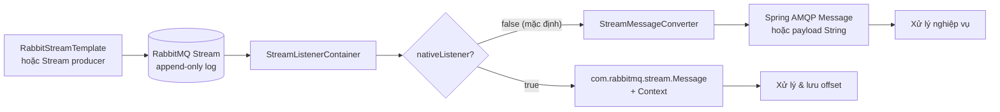

# Đọc Spring Message hoặc thông điệp stream nguyên bản

Khi tích hợp **RabbitMQ Streams** vào **Spring AMQP**, cùng một bản ghi trên stream có thể đến ứng dụng dưới hai dạng khác nhau: **Spring AMQP `Message`** đã được chuyển đổi hoặc **`com.rabbitmq.stream.Message` nguyên bản** của RabbitMQ Stream Java Client. Chọn kiểu dữ liệu nhận phù hợp giúp mã xử lý nghiệp vụ gọn hơn, hoặc giữ được quyền truy cập trực tiếp tới các thuộc tính native và **offset** của stream.

Bài học thuộc chương **RabbitMQ Streams** của module **SPRING_AMQP**. Từ kiến thức về `RabbitTemplate`, `@RabbitListener`, exchange, queue, binding, ACK/NACK, retry và dead-letter, ta chuyển sang mô hình append-only log, làm rõ điểm giống và khác với queue AMQP 0-9-1. Nội dung tập trung vào **đọc Spring Message hoặc thông điệp stream nguyên bản**, cách khai báo `StreamRabbitListenerContainerFactory`, chuyển đổi payload, xử lý `MessageHandler.Context` và lưu vị trí đã xử lý an toàn.

## 1. Mục tiêu học tập

Sau bài này, bạn có thể:

1. Phân biệt `org.springframework.amqp.core.Message`, `org.springframework.messaging.Message<?>` và `com.rabbitmq.stream.Message`.
2. Giải thích vì sao `StreamListenerContainer` và `StreamRabbitListenerContainerFactory` khác `SimpleMessageListenerContainer` / `DirectMessageListenerContainer`.
3. Cấu hình listener nhận **Spring AMQP Message** hoặc payload `String` bằng cơ chế chuyển đổi mặc định.
4. Cấu hình `setNativeListener(true)` để method nhận **native stream Message** cùng `MessageHandler.Context`.
5. Đọc body, application properties, offset, stream name và chọn vị trí bắt đầu với `OffsetSpecification`.
6. Hiểu `context.storeOffset()` là **lưu vị trí đã xử lý**, không phải `basicAck()` xóa message khỏi queue.
7. Xử lý lỗi, replay, duplicate và retention khi ứng dụng cần lưu dữ liệu bền vững.
8. Thử nghiệm hai listener với cùng stream và phân biệt các lỗi cấu hình thường gặp.

## 2. Trước hết: stream khác queue công việc truyền thống

RabbitMQ Streams sử dụng một **append-only log** lưu message theo offset. Consumer có thể đọc lại dữ liệu còn trong thời hạn retention bằng cách chọn vị trí bắt đầu. Message thường **không bị xóa chỉ vì một consumer đã đọc hoặc lưu offset**.

Ngược lại, luồng xử lý queue truyền thống qua AMQP 0-9-1 thường nhận delivery rồi dùng consumer ACK/NACK để broker biết message đã được xử lý và có thể loại khỏi queue.

| Tiêu chí | Queue công việc (classic/quorum, AMQP 0-9-1) | RabbitMQ Streams qua Stream Java Client |
| --- | --- | --- |
| Mô hình chính | Phân phối công việc tới consumer; message được xử lý/ACK theo delivery. | Log tuần tự, có thể có nhiều consumer đọc độc lập. |
| Vị trí đọc | Broker phân phối message sẵn sàng; delivery tag theo channel. | Consumer chọn **offset**: first, next, last, offset cụ thể hoặc vị trí thời gian theo client. |
| Sau khi xử lý | ACK liên quan việc broker xử lý delivery trong queue. | **Store offset** ghi vị trí consumer; message vẫn ở stream cho đến khi retention loại bỏ. |
| Đọc lại lịch sử | Không thể tự replay các delivery đã ACK và bị xóa khỏi queue thường. | Có thể replay từ offset vẫn còn dữ liệu trong log. |
| Xử lý trùng | Có thể xảy ra khi ACK mất, producer gửi lại. | Có thể xảy ra khi replay/restart, vị trí lưu chậm hoặc producer gửi trùng. |
| Bảo đảm dữ liệu | Queue durability, message persistence, ACK và replication. | Retention, stream replication, producer confirms và consumer offset tracking. |
| Bộ nhận Spring tiêu biểu | SMLC/DMLC và `@RabbitListener`. | `StreamListenerContainer`, `StreamRabbitListenerContainerFactory` và `@RabbitListener`. |

**Phân biệt giao thức:** RabbitMQ Stream Java Client sử dụng **RabbitMQ Stream protocol** trên cổng thường là **5552**, không phải cùng một channel AMQP 0-9-1 trên cổng **5672**. Stream sử dụng định dạng message tương thích mô hình AMQP 1.0 bên trong, nhưng cách consume và quản lý offset tuân theo stream protocol.

RabbitMQ cũng cho phép truy cập *stream queue* qua AMQP 0-9-1 trong một số tình huống. Bài này chọn **Spring Rabbit Stream integration**, vì đó là nơi tồn tại hai chế độ Spring Message / native Message của `StreamRabbitListenerContainerFactory`.



Cả hai nhánh đều đọc cùng *kiểu hạ tầng stream*. Công tắc `nativeListener` quyết định **dạng message mà ứng dụng nhận**, không tự biến stream thành queue hay tự bật exactly-once.

## 3. Ba lớp cùng có tên `Message`: đừng import nhầm

Chữ "Spring Message" có thể chỉ hai lớp trong hệ Spring. Khi làm việc với RabbitMQ Streams phải xác định **fully qualified name**:

| Kiểu | Package / interface | Nội dung và cách dùng |
| --- | --- | --- |
| **Spring AMQP Message** | `org.springframework.amqp.core.Message` | Có `byte[] body` và `MessageProperties`; do `StreamMessageConverter` chuyển từ native stream message. |
| **Spring Messaging Message** | `org.springframework.messaging.Message<T>` | Có payload kiểu `T` và map headers; thường xuất hiện trong phương thức annotation sau tầng adapter/conversion. |
| **RabbitMQ native Stream Message** | `com.rabbitmq.stream.Message` | Kiểu message của Stream Java Client; đọc `getBodyAsBinary()`, `getProperties()`, `getApplicationProperties()` và các thuộc tính AMQP 1.0-style. |

**Quan trọng:** dùng `import org.springframework.amqp.core.Message;` trong listener Spring, nhưng `import com.rabbitmq.stream.Message;` trong listener native. Nếu để IDE tự import nhầm rồi ép kiểu thủ công, listener có thể thất bại trong chuyển đổi tham số hoặc mất quyền truy cập native context.

Thông tin offset thuộc **`com.rabbitmq.stream.MessageHandler.Context`**, không nằm trong `getPublishingId()`. Publishing ID được dùng trong cơ chế publisher deduplication của stream; nó **không phải consumer offset** và không phải định danh nghiệp vụ mặc nhiên.

### Spring AMQP Message giữ metadata thế nào?

Đối với stream integration, Spring có lớp `org.springframework.rabbit.stream.support.StreamMessageProperties` mở rộng `MessageProperties`. Nó giữ các thuộc tính message phù hợp và có thể cung cấp `getContext()` của stream khi message được chuyển đổi từ một delivery.

```java
import org.springframework.amqp.core.Message;
import org.springframework.rabbit.stream.support.StreamMessageProperties;

void inspect(Message springMessage) {
    byte[] body = springMessage.getBody();

    if (springMessage.getMessageProperties()
            instanceof StreamMessageProperties streamProps) {
        var context = streamProps.getContext();
        if (context != null) {
            System.out.printf(
                "stream=%s offset=%d bytes=%d%n",
                context.stream(), context.offset(), body.length);
        }
    }
}
```

`getContext()` có thể trả `null`, ví dụ khi một `StreamMessageProperties` được tạo ngoài callback consumer. Vì vậy, **kiểm tra null** trước khi đọc offset hoặc lưu offset. Đây là API của **Spring AMQP 2.4+ stream support**, không phải thuộc tính chung của mọi AMQP message bình thường.

## 4. Chuẩn bị RabbitMQ Streams và dependency

Để dùng stream integration cần:

- Broker RabbitMQ có **stream plugin** được bật và cổng stream protocol có thể truy cập; thường **5552**. Cần stream exchange/queue topology hoặc stream được provision.
- Thư viện **`org.springframework.amqp:spring-rabbit-stream`** cùng phiên bản tương thích với các module Spring AMQP khác (thường do BOM hoặc Spring Boot quản lý).
- Bean `com.rabbitmq.stream.Environment` để tạo producer/consumer native, hoặc dùng auto-configuration của Spring Boot nếu phiên bản và starter đang dùng hỗ trợ.
- Có stream thực với quyền truy cập phù hợp; nếu chỉ dùng stream protocol, nên provision qua `StreamAdmin` thay vì mặc định dựa vào `RabbitAdmin` trên connection AMQP 0-9-1.

Ví dụ Gradle **không ép phiên bản khi đã dùng BOM phù hợp**:

```gradle
dependencies {
    implementation "org.springframework.amqp:spring-rabbit-stream"
    // Có thể cần thêm Spring Boot starter / AMQP modules phù hợp
    // với version line của ứng dụng.
}
```

**Tương thích phiên bản:** Spring AMQP bắt đầu tích hợp RabbitMQ Stream Java Client từ **2.4**. Tài liệu và ví dụ API trong bài dựa chủ yếu vào **Spring AMQP 3.2.x** và những API stream tương ứng còn có ở nhánh mới. Từ Spring AMQP **3.0**, các phương thức publish bất đồng bộ của `RabbitStreamTemplate` trả `CompletableFuture<Boolean>` thay vì `ListenableFuture` của 2.4.x; không áp dụng nguyên ví dụ future cho nhánh cũ.

### 4.1 Tạo stream bằng StreamAdmin

Nếu ứng dụng chỉ dùng stream protocol, `StreamAdmin` là lựa chọn phù hợp để tạo stream khi khởi động. Ví dụ mã cấu hình:

```java
import java.time.Duration;
import com.rabbitmq.stream.Environment;
import org.springframework.context.annotation.Bean;
import org.springframework.context.annotation.Configuration;
import org.springframework.rabbit.stream.support.StreamAdmin;

@Configuration
public class AuditStreamTopology {
    public static final String STREAM = "audit.events.stream";

    @Bean
    StreamAdmin auditStreamAdmin(Environment environment) {
        return new StreamAdmin(environment, creator -> {
            creator.stream(STREAM)
                    .maxAge(Duration.ofHours(6))
                    .create();
        });
    }
}
```

Điều kiện: đã có `Environment` bean. `StreamAdmin` dùng stream client để provision stream; `RabbitAdmin` dùng kết nối AMQP truyền thống để declare queue/exchange/binding.

Một cách khác là khai báo `QueueBuilder.durable("audit.events.stream").stream().build()` cùng `RabbitAdmin`, nhưng Spring docs lưu ý **admin declaration qua AMQP connection thường được kích hoạt khi mở connection AMQP**. Nếu ứng dụng chỉ có stream components, không có SMLC/DMLC hoặc kết nối AMQP 0-9-1, queue bean chưa chắc được khai báo đúng thời điểm. `StreamAdmin` tránh phụ thuộc này.

**Retention:** ví dụ `maxAge(6 giờ)` chỉ là thời hạn dữ liệu thử nghiệm. Khi retention xóa segment cũ, consumer không thể replay phần đã mất. Trong production, chọn retention theo backlog và thời gian ngừng tối đa được chấp nhận, kết hợp giới hạn dung lượng.

### 4.2 Chú ý cấu hình địa chỉ

`Environment` thường do Spring Boot cấu hình nếu đang dùng tích hợp tương thích. Nếu tự tạo từ Stream Java Client, phải cung cấp đúng host, port, credential và đóng lifecycle đúng cách; tránh tạo `Environment` mới cho mỗi message.

Ví dụ **minh họa ý tưởng**, chỉ dùng khi muốn tự quản lý bean:

```java
import com.rabbitmq.stream.Environment;
import org.springframework.context.annotation.Bean;
import org.springframework.context.annotation.Configuration;

@Configuration
class StreamEnvironmentConfig {
    @Bean(destroyMethod = "close")
    Environment streamEnvironment() {
        return Environment.builder()
                .host("localhost")
                .port(5552)
                .username("guest")
                .password("guest")
                .build();
    }
}
```

Đừng khai báo bean này nếu Spring Boot đã có `Environment` phù hợp, tránh hai bean cùng type khiến Spring injection mơ hồ. Tài khoản `guest` thường chỉ được RabbitMQ cho phép kết nối local mặc định; trong môi trường thật dùng tài khoản/secret và TLS đúng chính sách. Nếu các node stream advertise địa chỉ nội bộ không truy cập được từ client, cần cấu hình broker/cluster address thích hợp.

## 5. Cấu hình Spring Message listener (chế độ mặc định)

Đây là lựa chọn phù hợp nếu nghiệp vụ chỉ cần body và metadata Spring quen thuộc. Mặc định, `StreamRabbitListenerContainerFactory` **không bật native listener**; container chuyển native message sang Spring AMQP `Message` trước khi đưa cho adapter của `@RabbitListener`.

```java
import com.rabbitmq.stream.Environment;
import org.springframework.context.annotation.Bean;
import org.springframework.context.annotation.Configuration;
import org.springframework.amqp.rabbit.listener.RabbitListenerContainerFactory;
import org.springframework.rabbit.stream.config.StreamRabbitListenerContainerFactory;
import org.springframework.rabbit.stream.listener.StreamListenerContainer;

@Configuration
public class SpringStreamListenerConfig {

    @Bean
    RabbitListenerContainerFactory<StreamListenerContainer> springStreamFactory(
            Environment environment) {
        return new StreamRabbitListenerContainerFactory(environment);
    }
}
```

**Đọc raw Spring AMQP Message**:

```java
import java.nio.charset.StandardCharsets;
import org.springframework.amqp.core.Message;
import org.springframework.amqp.rabbit.annotation.RabbitListener;
import org.springframework.stereotype.Component;

@Component
public class SpringAuditListener {

    @RabbitListener(
        id = "audit-spring",
        queues = AuditStreamTopology.STREAM,
        containerFactory = "springStreamFactory")
    public void handle(Message message) {
        String payload = new String(
            message.getBody(), StandardCharsets.UTF_8);

        String messageId = message.getMessageProperties().getMessageId();
        String contentType = message.getMessageProperties().getContentType();

        System.out.printf(
            "Spring AMQP Message: id=%s type=%s body=%s%n",
            messageId, contentType, payload);

        // Gọi service xử lý dữ liệu nghiệp vụ.
    }
}
```

Đây là lớp **`org.springframework.amqp.core.Message`**. Nó cung cấp `getBody()` và `getMessageProperties()` như bạn thường thấy trong Spring AMQP queue integration, nhưng **đường tạo delivery là stream protocol**.

Có thể chọn dạng payload đơn giản:

```java
@RabbitListener(
    id = "audit-text",
    queues = AuditStreamTopology.STREAM,
    containerFactory = "springStreamFactory")
public void handleText(String payload) {
    System.out.println(payload);
}
```

**Không kích hoạt cùng lúc hai ví dụ `SpringAuditListener` và `handleText` nếu đang muốn đo một consumer duy nhất.** Nếu cả hai cùng hoạt động với thiết lập offset/consumer riêng, chúng có thể đọc các vị trí trong stream khác nhau hoặc cùng replay lịch sử; chúng không hoạt động giống hai competing consumers tự phân chia công việc trên một work queue.

### 5.1 Vậy `org.springframework.messaging.Message<T>` thì sao?

Trong cơ chế annotation-driven của Spring, adapter có thể cung cấp `org.springframework.messaging.Message<T>` để lấy cả payload và headers đã ánh xạ:

```java
@RabbitListener(
    id = "audit-spring-messaging",
    queues = AuditStreamTopology.STREAM,
    containerFactory = "springStreamFactory")
public void handleMessaging(
        org.springframework.messaging.Message<String> message) {

    String body = message.getPayload();
    Object idHeader = message.getHeaders().get("amqp_messageId");
    System.out.printf("payload=%s idHeader=%s%n", body, idHeader);
}
```

Đây là **một kiểu khác** với `org.springframework.amqp.core.Message`. Các header cụ thể sau ánh xạ còn phụ thuộc converter và adapter; tên `"amqp_messageId"` chỉ là ví dụ thường gặp, không nên dựa vào nó mà bỏ qua hợp đồng converter trong dự án. Nếu muốn đọc metadata AMQP nguyên bản với ít giả định nhất, dùng `org.springframework.amqp.core.Message` ở đoạn trước.

### 5.2 Chuỗi chuyển đổi dữ liệu

```text
RabbitMQ Stream native Message
    -> StreamMessageConverter (ví dụ DefaultStreamMessageConverter)
    -> Spring AMQP Message + StreamMessageProperties
    -> @RabbitListener adapter / argument conversion
    -> String, DTO, Spring AMQP Message hoặc Spring Messaging Message
```

Hai tầng converter không đồng nghĩa: `StreamMessageConverter` ánh xạ **native stream ↔ Spring AMQP Message**; bộ `MessageConverter`/argument converter của Spring có thể tiếp tục diễn giải body thành `String`, JSON DTO hoặc kiểu khác.

Với bài này, dùng `byte[]` hoặc UTF-8 `String` giúp tránh vấn đề mặc định JSON converter. Nếu payload là JSON và listener nhận `OrderEvent`, cần thiết lập converter đồng nhất giữa publisher/consumer và xử lý schema/version, không mặc định mọi byte JSON sẽ tự thành DTO.

## 6. Cấu hình native listener với `setNativeListener(true)`

Khi cần đọc message annotations, application properties, body native, **stream offset** hoặc tự điều khiển thời điểm store offset, bật chế độ native:

```java
import com.rabbitmq.stream.Environment;
import com.rabbitmq.stream.OffsetSpecification;
import org.springframework.amqp.rabbit.listener.RabbitListenerContainerFactory;
import org.springframework.context.annotation.Bean;
import org.springframework.context.annotation.Configuration;
import org.springframework.rabbit.stream.config.StreamRabbitListenerContainerFactory;
import org.springframework.rabbit.stream.listener.StreamListenerContainer;

@Configuration
public class NativeStreamListenerConfig {

    @Bean
    RabbitListenerContainerFactory<StreamListenerContainer> nativeStreamFactory(
            Environment environment) {

        var factory = new StreamRabbitListenerContainerFactory(environment);
        factory.setNativeListener(true);

        factory.setConsumerCustomizer((id, builder) -> {
            builder.name("audit-native-consumer-v1")
                    .offset(OffsetSpecification.first())
                    .manualTrackingStrategy();
        });

        return factory;
    }
}
```

Giải thích:

- `setNativeListener(true)` tạo adapter có khả năng gọi method với **`com.rabbitmq.stream.Message`** và **`MessageHandler.Context`**.
- `name(...)` là tên consumer dùng cho theo dõi vị trí; phải ổn định nếu muốn ứng dụng tiếp tục từ offset lưu trước đó.
- `offset(OffsetSpecification.first())` chọn vị trí ban đầu trong tình huống chưa có offset được lưu; không đồng nghĩa mỗi lần restart đều replay từ đầu khi consumer đã có tracking state.
- `manualTrackingStrategy()` yêu cầu ứng dụng tự quyết định khi gọi `context.storeOffset()`; hữu ích khi phải bảo đảm nghiệp vụ commit trước khi đánh dấu vị trí.

Với nhiều consumer/replica đọc cùng stream, phải xác định riêng chính sách consumer name và phân chia công việc; hai consumer chạy song song nhưng dùng một tên tracking không tự biến chúng thành một **consumer group** an toàn. Khi cần single-active và partition/super stream, phải cấu hình theo cơ chế Stream Java Client và Spring dành cho trường hợp đó.

### 6.1 Listener đọc message nguyên bản

```java
import java.nio.charset.StandardCharsets;
import com.rabbitmq.stream.Message;
import com.rabbitmq.stream.MessageHandler.Context;
import org.springframework.amqp.rabbit.annotation.RabbitListener;
import org.springframework.stereotype.Component;

@Component
public class NativeAuditListener {
    private final AuditService auditService;

    public NativeAuditListener(AuditService auditService) {
        this.auditService = auditService;
    }

    @RabbitListener(
        id = "audit-native",
        queues = AuditStreamTopology.STREAM,
        containerFactory = "nativeStreamFactory")
    public void onEvent(Message message, Context context) {

        String text = new String(
            message.getBodyAsBinary(), StandardCharsets.UTF_8);

        var properties = message.getProperties();
        var applicationProperties = message.getApplicationProperties();

        System.out.printf(
            "native: stream=%s offset=%d body=%s props=%s app=%s%n",
            context.stream(),
            context.offset(),
            text,
            properties,
            applicationProperties);

        // Business effect phải hoàn tất bền vững hoặc idempotent
        // trước khi lưu offset.
        auditService.processIdempotently(context.stream(),
                                         context.offset(), text);

        context.storeOffset();
    }
}
```

`AuditService` là service nghiệp vụ minh họa. `processIdempotently(...)` cần xác nhận transaction đã commit trước khi trả về. Nếu nó ném exception, code chưa gọi `storeOffset()`; việc retry/replay sau đó phụ thuộc stream client tracking và chiến lược xử lý lỗi của ứng dụng.

Hai API quan trọng:

- `message.getBodyAsBinary()` là dữ liệu payload bytes; `getBody()` có thể trả đối tượng theo codec native, **không bảo đảm là `byte[]`**.
- `context.offset()` và `context.stream()` định danh **vị trí** của delivery trong stream. Chúng thuộc context, không phải `MessageProperties.getDeliveryTag()` theo AMQP 0-9-1.

**Đừng gọi `channel.basicAck(...)`** trong native listener: stream client không cung cấp AMQP 0-9-1 channel/delivery tag cho đường consume này. Lưu offset qua context là cơ chế khác với ACK queue.

### 6.2 Nếu muốn giữ Spring AMQP Message nhưng vẫn chủ động store offset?

Bạn có thể dùng `StreamMessageProperties.getContext()` trong Spring message mode, nếu factory sử dụng cấu hình tracking phù hợp:

```java
import org.springframework.amqp.core.Message;
import org.springframework.rabbit.stream.support.StreamMessageProperties;

void onSpringMessageWithOffset(Message message) {
    if (!(message.getMessageProperties()
            instanceof StreamMessageProperties props)) {
        throw new IllegalStateException("Not a stream message");
    }

    var context = props.getContext();
    if (context == null) {
        throw new IllegalStateException("Missing stream context");
    }

    // Chỉ lưu khi business transaction đã commit.
    processIdempotently(message.getBody());
    context.storeOffset();
}
```

Trong trường hợp này phải cấu hình **consumer builder** theo manual tracking tương tự nhánh native. Điều đó cho thấy chọn Spring Message không hề ngăn truy cập mọi tính năng stream; **native mode tiện hơn** nếu muốn trực tiếp làm việc với `MessageHandler.Context` và native message.

## 7. So sánh Spring Message và native Message khi làm dự án

| Tiêu chí | Spring Message (converted) | Native `com.rabbitmq.stream.Message` |
| --- | --- | --- |
| Factory | `StreamRabbitListenerContainerFactory` với native=false (mặc định). | Factory với `setNativeListener(true)`. |
| Chữ ký listener | `Message` của Spring, `String` hoặc payload được converter hỗ trợ. | `Message` của Stream Java Client và `MessageHandler.Context`. |
| Lấy body | `getBody()` trả `byte[]`; hoặc listener nhận payload đã chuyển. | `getBodyAsBinary()`; `getBody()` phụ thuộc codec. |
| Lấy metadata | `MessageProperties`/`StreamMessageProperties`. | `getProperties()`, `getApplicationProperties()`, `getMessageAnnotations()`. |
| Đọc offset | Qua `StreamMessageProperties.getContext()` nếu có. | Trực tiếp `context.offset()`. |
| Lưu offset | Qua context nếu có và tracking được cấu hình. | `context.storeOffset()` rõ ràng trong method. |
| Tích hợp business DTO | Thuận tiện với Spring message conversion. | Tự deserialize hoặc dùng codec phù hợp; linh hoạt hơn. |
| Mức phụ thuộc thư viện | Mã nghiệp vụ gắn với Spring AMQP abstraction. | Mã nghiệp vụ/callback phụ thuộc Stream Java Client API. |
| Phù hợp | Consumer dùng nhiều tầng Spring, ưu tiên payload/headers thống nhất. | Consumer cần kiểm soát offset, native properties hoặc tối ưu pipeline stream. |

### Trường hợp lựa chọn thực tế

Với dịch vụ ghi audit log chỉ cần lưu một event JSON vào database, **Spring AMQP Message** thường gọn hơn. Nếu cần replay theo offset, lưu vị trí thủ công sau DB commit, đọc annotation và application properties theo codec, hoặc xử lý stream partition, **native Message + Context** cho phép làm việc trực tiếp với Stream Java Client.

Không có lựa chọn nào tự đảm bảo exactly-once business effect. Phải xem **idempotency**, **offset tracking**, **retention** và cơ chế publish/DB transaction.

## 8. Offset tracking: đọc từ đâu, lưu đến đâu?

Stream có offset tăng theo log. Khi đăng ký consumer, có thể chọn vị trí:

| Offset specification | Ý nghĩa |
| --- | --- |
| `OffsetSpecification.first()` | Đọc từ phần đầu **còn tồn tại** của stream. |
| `OffsetSpecification.next()` | Chờ dữ liệu mới sau thời điểm attach, không đọc lịch sử còn lưu. |
| `OffsetSpecification.last()` | Bắt đầu từ **chunk cuối cùng** đã ghi, không nhất thiết đúng một message cuối. |
| `OffsetSpecification.offset(123L)` | Yêu cầu đọc từ offset cụ thể nếu còn trong retention. |
| Offset dựa theo thời gian | Bắt đầu gần thời điểm xác định, tùy API/client và cách chunk được lưu. |

**Đừng nhầm `last()` với "chỉ lấy đúng một message mới nhất"**; RabbitMQ Stream tổ chức message thành chunks, nên có thể trả những message ở chunk cuối.

### 8.1 Consumer name và offset được lưu

Với cơ chế server-side offset tracking, vị trí đã lưu được gắn với **consumer name** và stream. Tên đó cần **ổn định qua restart** để consumer có thể tiếp tục gần nơi đã dừng. Nếu đổi tên consumer mỗi lần deploy, bạn có thể mất khả năng resume từ tracking state cũ và trở về hành vi start offset ban đầu.

```text
Consumer name = audit-native-consumer-v1

Lần đầu, chưa có stored offset:
  attach ở first
  xử lý offset 100, 101, 102
  lưu offset 102

Sau khi restart, stored offset = 102:
  ứng dụng tiếp tục từ khoảng offset 103
  (theo chính sách tracking/khởi tạo của client)
```

Việc tự động resume từ stored offset khi đã đặt `OffsetSpecification.first()` là hành vi được mô tả trong tài liệu offset tracking của RabbitMQ Stream Java Client. Nếu muốn replay lại từ đầu để xây projection mới, nên dùng **consumer name khác hoặc quy trình reset offset có chủ đích**; chỉ đổi tham số first trong cấu hình chưa chắc có tác dụng khi còn stored offset.

### 8.2 Ghi offset sau business commit

Sai thứ tự:

```text
storeOffset(102)
    -> DB transaction lỗi / tiến trình chết
    -> restart đọc từ 103
    -> có nguy cơ bỏ qua nghiệp vụ của 102
```

Thứ tự đúng cho phương án at-least-once + idempotency:

```text
Nhận offset 102
    -> bắt đầu DB transaction
    -> ghi business effect + marker chống trùng
    -> COMMIT DB thành công
    -> context.storeOffset()
    -> nếu mất kết nối trước/lúc lưu offset:
         102 có thể replay
         marker làm business effect trở thành no-op
```

**Lưu offset và COMMIT DB vẫn không phải một transaction phân tán**. Khi DB đã commit nhưng offset chưa được lưu, bản ghi có thể được đọc lại. Giải pháp là dùng unique key như `(consumerName, streamName, eventId)` hoặc một định danh nghiệp vụ ổn định, cùng DB transaction để đảm bảo cập nhật idempotent.

Nếu xử lý song song nhiều offset, không được lưu offset 105 chỉ vì phần tử 105 xong trong khi 103 và 104 còn chạy dở. Một lần resume ở 106 có thể bỏ sót 103/104. Khi cần parallelism, phải quản lý **highest contiguous processed offset** theo stream/partition hoặc chọn xử lý tuần tự ở đoạn cam kết offset.

### 8.3 Lưu offset theo mỗi message hay theo lô?

Gọi `storeOffset()` sau mỗi message dễ hiểu nhưng tạo thêm traffic/metadata. Gọi theo lô (ví dụ mỗi 100 hoặc 1.000 message) thường hiệu quả hơn nhưng tăng phạm vi replay khi consumer chết. Lựa chọn cần theo throughput, thời gian khôi phục, idempotency và số message tối đa có thể xử lý lặp.

| Chiến lược | Ưu điểm | Rủi ro/đánh đổi |
| --- | --- | --- |
| Store sau mỗi message | Ít replay sau restart, dễ hiểu. | Nhiều thao tác lưu offset. |
| Store mỗi 100 message | Ít thao tác tracking hơn. | Có thể replay tới khoảng 100 message đã xử lý nếu crash. |
| Auto tracking của client | Ít code thủ công, phù hợp luồng xử lý đơn giản. | Phải hiểu thời điểm library quyết định lưu; không thay thế bảo đảm DB commit. |
| Tự lưu offset trong DB cùng business transaction | Có thể nguyên tử hóa business effect với vị trí xử lý trong **cùng database**. | Phải tự quản lý vị trí attach/restart, retention và concurrency; complexity cao hơn. |

## 9. Retry, lỗi xử lý và retention

Stream không giống queue thông thường. Khi listener xử lý lỗi, đừng mặc định `basicNack(requeue=false)` sẽ chuyển message sang DLX như với SMLC/DMLC. Trong stream protocol, message nằm trong log theo retention; việc thử lại có thể là retry tại listener, replay từ offset, chuyển event lỗi sang một stream/queue riêng, hoặc ghi failure state trong DB.

Trong Spring AMQP, `StreamListenerContainer` có hỗ trợ advice chain (từ **2.4.5**) và stateless retry interceptor cho native stream message cùng `StreamMessageRecoverer` tùy phiên bản. **Stateful retry theo cách container queue thông thường không được hỗ trợ** trong tài liệu stream integration. Chính sách retry vẫn phải có giới hạn và quan sát được.

| Tình huống | Cách xử lý phù hợp |
| --- | --- |
| JSON không hợp lệ | Ghi nhận lỗi và cách ly/quarantine theo hợp đồng; quyết định có lưu offset để không kẹt stream hay không. |
| DB tạm thời down | Retry có backoff; không lưu offset khi business commit chưa thành công. |
| Lỗi cố định ở một event | Quy định retry limit, parking/error stream hoặc bảng lỗi, rồi mới quyết định đánh dấu đã xử lý/bỏ qua. |
| Consumer restart | Có thể replay phần sau vị trí cuối cùng đã lưu; handler phải idempotent. |
| Bản ghi đã bị retention xóa | Không thể replay lại phần bị xóa chỉ bằng thay `OffsetSpecification.first()`. |
| Đọc đồng thời một stream | Cần tính toán per-stream offset/partition, ordering và tránh consumer tracking state tranh nhau. |

**Không dùng `context.storeOffset()` như nút "ACK thành công và xóa message".** Nó lưu vị trí để khôi phục tiêu thụ; dữ liệu vẫn có thể được một consumer khác đọc lại nếu còn trong stream.

### Định danh chống trùng

Giả sử payload audit chứa `eventId=evt-1001`. Dù RabbitMQ Stream có offset cụ thể, event ID từ publisher vẫn là khóa nghiệp vụ phù hợp khi cùng logical event có thể được publish lại với **offset mới**. Khóa `(stream, offset)` giúp nhận diện cùng log record được replay, nhưng **không phát hiện** publisher gửi cùng event logic vào stream lần hai ở offset khác. Khi cần effectively-once business effect, dùng event ID ổn định và unique constraint/inbox trong database.

## 10. Cách publish để thực hành hai chế độ nhận

Dùng `RabbitStreamTemplate` thay cho `RabbitTemplate` khi publish trực tiếp bằng stream protocol. Trong Spring AMQP **3.0+**, API trả `CompletableFuture<Boolean>`:

```java
import com.rabbitmq.stream.Environment;
import org.springframework.context.annotation.Bean;
import org.springframework.context.annotation.Configuration;
import org.springframework.rabbit.stream.producer.RabbitStreamTemplate;

@Configuration
public class AuditStreamPublisherConfig {

    @Bean
    RabbitStreamTemplate auditStreamTemplate(Environment environment) {
        return new RabbitStreamTemplate(
                environment, AuditStreamTopology.STREAM);
    }
}
```

Gửi một payload đơn giản:

```java
import java.util.concurrent.CompletableFuture;
import org.springframework.rabbit.stream.producer.RabbitStreamTemplate;
import org.springframework.stereotype.Service;

@Service
public class AuditStreamPublisher {
    private final RabbitStreamTemplate template;

    public AuditStreamPublisher(RabbitStreamTemplate template) {
        this.template = template;
    }

    public CompletableFuture<Boolean> publish(String value) {
        return template.convertAndSend(value);
    }
}
```

Ở tầng gọi, **kiểm tra kết quả bất đồng bộ**: future exception hoặc `Boolean.FALSE` cần được xem xét theo chính sách publisher. Trong hệ thống thật, khi publish confirm không chắc chắn, có thể cần retry; nếu retry có thể tạo message trùng, dùng event ID ổn định và publisher deduplication khi phù hợp.

`RabbitStreamTemplate` còn có các API `send(org.springframework.amqp.core.Message)`, `send(com.rabbitmq.stream.Message)` và `messageBuilder()` cho native producer message. Hai hướng gửi phù hợp hai dạng nhận nhưng **không bắt buộc phải ghép đúng kiểu**: message được lưu dưới stream wire format, consumer quyết định converter/native adapter.

**Khác biệt phiên bản:** Spring AMQP 2.4.x dùng `ListenableFuture<Boolean>` trong API publish. Nếu thấy lỗi kiểu dữ liệu khi copy ví dụ trên vào ứng dụng cũ, kiểm tra phiên bản Spring AMQP trước khi sửa logic của stream.

## 11. Các giới hạn của `@RabbitListener` trên StreamListenerContainer

Khi cấu hình `containerFactory = "springStreamFactory"` hoặc `"nativeStreamFactory"`, bean thực tế tạo là `StreamListenerContainer`. Nó có contract khác với SMLC/DMLC. Tài liệu Spring AMQP nêu rằng **phần lớn thuộc tính `@RabbitListener` khác bị bỏ qua**, và chủ yếu hỗ trợ:

- `id`;
- `queues` — **chỉ một stream name** cho mỗi listener container;
- `autoStartup`;
- `containerFactory`.

Vì vậy, không nên copy các tham số sau mà kỳ vọng hoạt động giống queue consumer:

```java
// Cách hiểu sai với stream container:
@RabbitListener(
    queues = "audit.events.stream",
    containerFactory = "springStreamFactory",
    concurrency = "2-8" // KHÔNG điều khiển stream như SMLC.
)
void listen(String payload) {}
```

Khả năng scale stream cần xem **Stream Java Client**, consumer customizer, super stream/partition, consumer group hoặc Single Active Consumer tùy yêu cầu. Những cấu hình đó khác với `concurrentConsumers`, `maxConcurrentConsumers` hay `consumersPerQueue`.

### StreamAdmin vs RabbitAdmin

Tương tự, stream-only ứng dụng không nên dựa vào side effect "mở connection AMQP để RabbitAdmin khai báo queue" khi chỉ tạo `Environment`. Nếu stream không tồn tại, lỗi từ native consumer sẽ không được chữa bằng cách bật `autoStartup=true`. Cần provision stream đúng type/retention/permissions.

### Không nhầm loại container với loại message

- `StreamListenerContainer` + factory mặc định → **Spring AMQP Message / converted payload**.
- `StreamListenerContainer` + `nativeListener=true` → **native Message + Context**.
- `SimpleMessageListenerContainer` / `DirectMessageListenerContainer` trên queue thông thường → AMQP 0-9-1 delivery, ACK/NACK và DLX theo cơ chế queue.

Tên annotation vẫn là `@RabbitListener`, nhưng cấu trúc container quyết định semantics thực tế.

## 12. Quan sát và chẩn đoán

Để biết đã đọc đúng dạng message và offset, log những trường sau (tránh log toàn bộ payload nếu chứa dữ liệu nhạy cảm):

| Nhóm | Trường gợi ý | Vì sao cần |
| --- | --- | --- |
| Source | `streamName`, partition nếu super stream, `offset` | Xác định vị trí có thể replay và đối chiếu lag. |
| Logical event | `eventId`, schema version, correlation ID | Phát hiện duplicate ngay cả khi publisher dùng offset mới. |
| Conversion | runtime class, content type, payload bytes | Chẩn đoán import nhầm `Message` hoặc codec không tương thích. |
| Consumer | consumer name, instance ID, offset tracking strategy | Kiểm tra resume position sau restart. |
| Processing | start/end time, duration, business commit status | Phân biệt message đã đọc với nghiệp vụ hoàn tất. |
| Failure | exception, retry count, quarantine outcome | Tránh kẹt vĩnh viễn ở một record lỗi. |
| Stream retention | age/size policy, earliest available offset | Phát hiện việc consumer chậm vượt ngoài cửa sổ replay. |

Các lỗi thường gặp:

1. **Nhận `com.rabbitmq.stream.Message` nhưng quên `setNativeListener(true)`:** method không nhận đúng native type như kỳ vọng.
2. **Bật native rồi import `org.springframework.amqp.core.Message`:** code dùng API sai lớp.
3. **Dùng `getPublishingId()` để lấy vị trí đọc:** publishing ID không phải consumer offset; dùng `context.offset()`.
4. **Lưu offset trước DB COMMIT:** khi crash có nguy cơ bỏ qua message chưa xử lý bền vững.
5. **Không lưu offset bao giờ trong manual mode:** restart có thể replay lượng lớn dữ liệu; phải có chiến lược tracking.
6. **Coi `storeOffset()` như broker ACK/xóa message:** stream retention hoạt động độc lập.
7. **Đổi consumer name trên mỗi deployment:** có thể khiến consumer bắt đầu lại từ cấu hình initial offset.
8. **Dùng một consumer name tùy tiện cho các replica xử lý cùng stream:** dễ tranh tracking state; phải chọn mô hình consumer/partition rõ ràng.
9. **Không provision stream nhưng chỉ có RabbitAdmin và không mở AMQP connection:** stream chưa tồn tại, listener không thể consume.
10. **Đặt `@RabbitListener(concurrency="5")` kỳ vọng có năm stream consumer:** nhiều thuộc tính annotation không áp dụng cho stream container.
11. **Giữ retention ngắn hơn thời gian backlog:** các record cũ có thể bị xóa trước khi consumer đọc.
12. **Cho rằng retry native tự chuyển message sang DLQ:** stream không dùng cơ chế NACK/DLX truyền thống của queue consumer.

## 13. Bài thực hành

Chuẩn bị một RabbitMQ broker có bật stream plugin, cổng stream 5552, quyền tạo/đọc/ghi stream và ứng dụng Spring Boot có `spring-rabbit-stream`. Các ví dụ giả định đã tạo `audit.events.stream` với retention đủ dài.

### Thí nghiệm A — đọc dạng Spring Message

1. Đăng ký `springStreamFactory` và `SpringAuditListener`, **chưa kích hoạt native listener**.
2. Publish chuỗi `audit:event-001` qua `RabbitStreamTemplate.convertAndSend(...)`.
3. Quan sát kiểu `org.springframework.amqp.core.Message`, body UTF-8, `getContentType()` và các message properties.
4. Thêm đoạn đọc `StreamMessageProperties.getContext()` để log stream/offset khi có context.
5. Tắt consumer, bật lại; quan sát có replay hay chỉ đọc message mới tùy offset/tracking strategy.

**Câu hỏi:** Vì sao log `message.getBody()` cho byte array không giống `message.getBodyAsBinary()` của native dù nội dung payload tương đương?

### Thí nghiệm B — đọc native Message + Context

1. Tắt listener của thí nghiệm A; bật `nativeStreamFactory` và `NativeAuditListener`.
2. Publish `audit:event-002`.
3. Quan sát `message.getBodyAsBinary()`, `message.getApplicationProperties()`, `context.stream()` và `context.offset()`.
4. Xác nhận mã chỉ gọi `context.storeOffset()` sau khi service hoàn tất.
5. Dừng/restart consumer, đối chiếu offset đầu tiên sau restart với offset lưu trước đó.

**Câu hỏi:** Tại sao lưu offset ở native listener không làm message biến mất khỏi stream?

### Thí nghiệm C — đổi vị trí bắt đầu

Trong môi trường thử nghiệm, dùng consumer name mới để không bị offset đã lưu trước đó can thiệp. So sánh:

- `OffsetSpecification.first()`: đọc từ phần lịch sử còn retention.
- `OffsetSpecification.next()`: chỉ đọc những message đến sau lúc attach.
- `OffsetSpecification.last()`: đọc từ chunk cuối; có thể nhận hơn một message lịch sử.

Ghi lại offset đầu/cuối quan sát được, giải thích khác biệt giữa `last` và `next`.

### Thí nghiệm D — mô phỏng crash giữa DB và offset

Cho service ghi một bản ghi có unique key `eventId` rồi COMMIT. Cố tình dừng consumer **trước khi gọi `storeOffset()`** trong môi trường test; sau restart, có thể nhận lại message. Xác minh unique constraint khiến nghiệp vụ không ghi hai lần.

Làm thử chiều ngược lại trong môi trường cách ly (store offset trước business commit rồi làm DB lỗi) để giải thích nguy cơ **bỏ qua** một event chưa xử lý.

### Thí nghiệm E — thay đổi retention

Trong broker test, giảm thời gian retention và tạo backlog vượt hạn cho consumer chậm. Quan sát earliest available offset dịch chuyển; thử replay từ first và đối chiếu record cũ đã bị loại. Giải thích vì sao offset tracking tốt không thể khôi phục dữ liệu đã bị retention xóa.

### Tự kiểm tra

1. Ba lớp Java chứa tên `Message` khác nhau ở đâu và dùng khi nào?
2. `setNativeListener(true)` tác động tới payload nhận hay retention của stream?
3. API nào lấy offset chính xác trong native listener?
4. Vì sao `message.getPublishingId()` không thể thay cho `context.offset()`?
5. Vì sao `storeOffset()` cần thực hiện sau commit, dù vẫn có duplicate?
6. Lúc nào cần dùng `StreamAdmin` thay vì khai báo `QueueBuilder.stream()` qua `RabbitAdmin`?
7. Vì sao `@RabbitListener(concurrency="2-8")` không cấu hình scaling cho `StreamListenerContainer`?
8. Tại sao một consumer mới `last()` vẫn có thể thấy nhiều message trước thời điểm attach?

## 14. Ghi nhớ

- Đọc stream trong Spring AMQP có **hai dạng**: **Spring AMQP `Message`** và **native `com.rabbitmq.stream.Message`**; annotation có thể giống nhau nhưng adapter khác nhau.
- **`StreamRabbitListenerContainerFactory.setNativeListener(true)`** chuyển listener sang native mode và cho phép nhận **`MessageHandler.Context`** trực tiếp.
- **Spring AMQP Message** giữ body và `MessageProperties`; `StreamMessageProperties.getContext()` giúp truy cập offset trong trường hợp phù hợp.
- **`context.storeOffset()` lưu vị trí tiêu thụ**, không phải `basicAck()` và không xóa message. Hãy lưu sau khi business commit để tránh skip, và thiết kế idempotency để chịu replay.
- **StreamListenerContainer không có cùng contract concurrency/ACK/DLX** như SMLC/DMLC; những thuộc tính của `@RabbitListener` ngoài nhóm được hỗ trợ có thể bị bỏ qua.
- **Retention quyết định cửa sổ replay**; offset tracking và consumer restart không phục hồi dữ liệu đã bị loại khỏi stream.

## Tài liệu tham khảo

- [Spring AMQP — Using the RabbitMQ Stream Plugin](https://docs.spring.io/spring-amqp/reference/3.2/stream.html): factory, native listener, callback Context, StreamAdmin và API producer.
- [Spring AMQP — StreamRabbitListenerContainerFactory API](https://docs.spring.io/spring-amqp/docs/3.2.x/api/org/springframework/rabbit/stream/config/StreamRabbitListenerContainerFactory.html): `setNativeListener` và `setConsumerCustomizer`.
- [Spring AMQP — StreamMessageProperties API](https://docs.spring.io/spring-amqp/docs/3.2.x/api/org/springframework/rabbit/stream/support/StreamMessageProperties.html): metadata Spring và `getContext()`.
- [Spring AMQP — DefaultStreamMessageConverter API](https://docs.spring.io/spring-amqp/docs/3.2.x/api/org/springframework/rabbit/stream/support/converter/DefaultStreamMessageConverter.html): chuyển giữa Spring AMQP Message và native Stream Message.
- [RabbitMQ Streams and Super Streams](https://www.rabbitmq.com/docs/streams): append-only log, retention, offset và loại stream.
- [RabbitMQ Stream Java Client](https://rabbitmq.github.io/rabbitmq-stream-java-client/stable/htmlsingle/): `Environment`, consumer builder, offset tracking và native APIs.
- [RabbitMQ Stream Java Client — Message API](https://rabbitmq.github.io/rabbitmq-stream-java-client/stable/api/com/rabbitmq/stream/Message.html): body, properties, application properties và publishing ID.
- [RabbitMQ — Offset Tracking with Streams](https://www.rabbitmq.com/blog/2021/09/13/rabbitmq-streams-offset-tracking): resume, manual tracking và consumer name.
