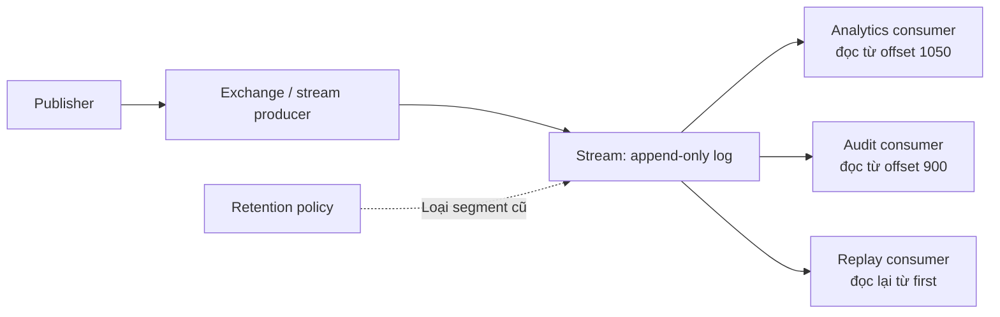
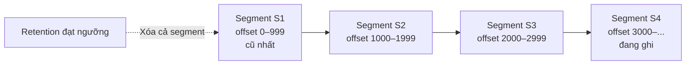
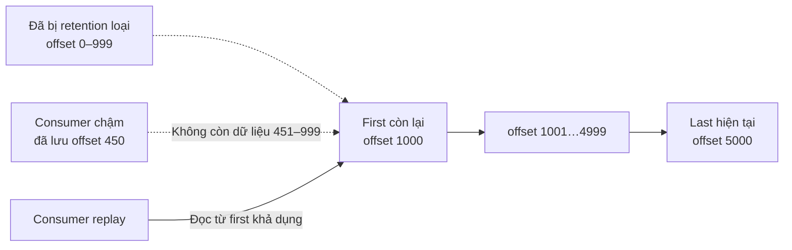

# Retention theo thời gian hoặc dung lượng

## 1. Vì sao RabbitMQ Stream cần retention?

Trong một ứng dụng dùng **Spring AMQP** và **RabbitMQ**, producer có thể phát sự kiện bằng `RabbitTemplate` hoặc `RabbitStreamTemplate`. Với queue truyền thống, message đã xử lý và được ACK thường bị loại khỏi queue. **RabbitMQ Stream** có cơ chế khác: đó là một **append-only log** bền vững, được thiết kế để nhiều consumer có thể đọc lại dữ liệu từ những vị trí khác nhau. Việc đọc một message **không xóa message đó** khỏi stream.

Ví dụ dịch vụ đơn hàng phát liên tục các sự kiện:

```text
offset 1001 | 2026-11-20 08:00 | OrderCreated:ORD-42
offset 1002 | 2026-11-20 08:01 | OrderPaid:ORD-42
offset 1003 | 2026-11-20 08:02 | OrderCreated:ORD-43
...
```

Một consumer `analytics` đọc để xây dựng báo cáo; một consumer `audit` có thể đọc lại dữ liệu cũ để đối chiếu. Nếu cứ giữ mọi sự kiện mãi mãi, stream sẽ tiếp tục sử dụng dung lượng đĩa. **Retention** là chính sách cho phép broker **loại bỏ những segment cũ** khi dữ liệu vượt độ tuổi hoặc dung lượng đã cấu hình.

Trong chương **RabbitMQ Streams** của module `SPRING_AMQP`, bài này tập trung vào:

1. Phân biệt **retention theo thời gian** (`max-age`) và **retention theo dung lượng** (`max-length-bytes`).
2. Hiểu rằng RabbitMQ xóa theo **segment**, không phải từng message tại đúng một mốc thời gian.
3. Khai báo retention khi tạo stream bằng Spring AMQP hoặc RabbitMQ Stream Java Client.
4. Thay đổi retention bằng **RabbitMQ policy** và đánh giá ảnh hưởng đến consumer replay, offset, dung lượng đĩa và vận hành.

> **Kết quả quan trọng:** Retention giới hạn **lịch sử còn có thể đọc lại**. Nó không quyết định consumer đã xử lý thành công hay chưa, không thay thế ACK/offset tracking và không đảm bảo dữ liệu cần replay luôn còn đủ.

## 2. Stream khác queue thông thường ở điểm nào?



| Khía cạnh | Classic/quorum queue (mô hình hàng đợi) | RabbitMQ Stream |
| --- | --- | --- |
| Sau khi consume và ACK | Message thường được xóa khỏi queue | Message **vẫn tồn tại** trong log |
| Nhiều consumer | Consumer cạnh tranh để nhận công việc, trừ khi tạo nhiều queue | Nhiều consumer đọc độc lập các phần lịch sử của cùng một stream |
| Đọc lại quá khứ | Cần lưu/copy message ở nơi khác | Đọc lại từ offset hoặc mốc thời gian **còn trong retention** |
| Giới hạn dữ liệu | TTL, độ dài queue, DLX và các chính sách riêng | Retention theo **tuổi** và **số byte** của log |
| ACK/offset | ACK quyết định xóa delivery khi đã xử lý | Offset/credit/tracking xác định vị trí đọc; **không bảo vệ dữ liệu khỏi retention** |
| Sử dụng đĩa | Phụ thuộc backlog, ACK và loại queue | Tăng theo lượng sự kiện được ghi cho tới khi retention loại segment cũ |

Stream không phải queue chuyên dùng để chờ ACK rồi xóa từng message. Vì thế các khái niệm `x-message-ttl` hay dead-letter của work queue không nên được dùng để thay thế `x-max-age` của stream.

## 3. Hai giới hạn retention chính

RabbitMQ hỗ trợ **hai giới hạn độc lập có thể phối hợp**. Khi dữ liệu đủ điều kiện bị loại vì **một trong hai** giới hạn, broker có thể xóa segment cũ tương ứng, dù giới hạn kia chưa đạt.

| Mục tiêu | Queue argument lúc khai báo stream | Key trong RabbitMQ policy | Giá trị minh họa |
| --- | --- | --- | --- |
| Giữ dữ liệu theo thời gian | `x-max-age` | `max-age` | `"7D"`: 7 ngày |
| Giới hạn dung lượng stream | `x-max-length-bytes` | `max-length-bytes` | `10_737_418_240`: 10 GiB |
| Kích thước segment để quyết định độ mịn của retention | `x-stream-max-segment-size-bytes` | `stream-max-segment-size-bytes` | `100_000_000`: khoảng 100 MB |

**Lưu ý:** `x-stream-max-segment-size-bytes` không phải một điều kiện retention thứ ba. Nó xác định kích thước đích của **một file segment**, ảnh hưởng tới lúc segment được đóng và có thể bị xóa. Giá trị mặc định được RabbitMQ tài liệu hóa là **500.000.000 byte** (500 MB thập phân).

### 3.1. Retention theo thời gian: `x-max-age`

```text
x-max-age = "7D"
```

Đây là cấu hình để stream giữ một **cửa sổ dữ liệu xấp xỉ bảy ngày**. Những segment cũ đủ điều kiện sẽ bị loại, kể cả khi chưa có consumer nào đọc những message đó.

Định dạng thời lượng được RabbitMQ chấp nhận sử dụng đơn vị:

| Ký hiệu | Ý nghĩa | Ví dụ |
| --- | --- | --- |
| `s` | Giây | `"30s"` |
| `m` | Phút | `"15m"` |
| `h` | Giờ | `"6h"` |
| `D` | Ngày | `"7D"` |
| `M` | Tháng | `"1M"` |
| `Y` | Năm | `"1Y"` |

Ký hiệu **phân biệt chữ hoa/chữ thường**: `m` là phút, `M` là tháng. Trong bài thực hành hãy ưu tiên `6h` hoặc `7D` để dễ quan sát ý nghĩa. Không diễn giải `"7D"` là lời hứa chính xác rằng mọi message sẽ bị xóa ngay tại giây thứ bảy ngày.

### 3.2. Retention theo dung lượng: `x-max-length-bytes`

```text
x-max-length-bytes = 10737418240
```

Giới hạn theo số byte hữu ích khi tốc độ sự kiện biến động hoặc nhà vận hành muốn có một mức ngân sách dung lượng cho từng stream. Khi lượng dữ liệu tích lũy vượt ngưỡng, RabbitMQ loại **các segment cũ nhất có thể loại được** để giải phóng đĩa.

Không coi `x-max-length-bytes` là **hard cap** tuyệt đối cho dung lượng thực tế trên disk:

- Segment đang ghi thường không bị cắt bỏ từng message.
- Broker luôn giữ ít nhất một segment khi segment đó còn message.
- Việc thực thi retention phụ thuộc thời điểm rollover/đóng segment.
- Index, metadata, offset tracking và bản sao stream trên các node cũng sử dụng dung lượng.

Do đó, nếu disk chỉ còn chính xác 10 GiB trống thì **không thể an toàn** khi đặt limit 10 GiB cho stream và kỳ vọng broker không dùng vượt mức đó.

### 3.3. Kết hợp thời gian và dung lượng

Một yêu cầu thường gặp là: “Giữ lịch sử tối đa 7 ngày, nhưng nếu dữ liệu tăng đột biến thì không để stream vượt ngân sách khoảng 10 GiB”.

```text
x-max-age          = "7D"
x-max-length-bytes = 10_737_418_240
```

| Tình trạng | Cơ chế có thể áp dụng trước | Ý nghĩa với replay |
| --- | --- | --- |
| Lượng ghi ít, dữ liệu đạt 7 ngày khi stream vẫn nhỏ | Age | Dữ liệu cũ được loại theo các segment đủ tuổi |
| Lượng ghi cao, stream đạt 10 GiB trong vài giờ | Size | Lịch sử **ngắn hơn 7 ngày** dù age được đặt 7 ngày |
| Stream chưa đủ tuổi và chưa gần giới hạn byte | Chưa cần xóa vì retention | Dữ liệu tiếp tục nằm trong log |
| Stream chỉ có một segment chứa message | Không thể xóa segment cuối có message | Dung lượng/thời gian thực tế có thể vượt ngưỡng cấu hình |

**Đọc đúng yêu cầu:** `max-age = 7D` không có nghĩa “đảm bảo luôn đọc lại được đủ 7 ngày” khi cũng có limit byte. Nó chỉ là **độ tuổi tối đa mục tiêu**, còn giới hạn dung lượng có thể rút ngắn khoảng lịch sử còn lại.

## 4. Segment: lý do retention không chính xác đến từng message

RabbitMQ Stream lưu dữ liệu trong nhiều **segment file** nối tiếp nhau. Broker ghi append vào segment hiện tại; khi segment đạt kích thước giới hạn, nó đóng segment đó và tiếp tục với segment mới. Retention làm việc bằng cách **xóa toàn bộ segment cũ**, thay vì xóa một phần file ở giữa.



Ví dụ giả sử stream có bốn segment (số liệu minh họa):

| Segment | Lượng dữ liệu giả định | Khoảng dữ liệu | Có thể xóa? |
| --- | ---: | --- | --- |
| `S1` | 100 MB | Ngày 1 | Có, nếu đủ điều kiện retention |
| `S2` | 100 MB | Ngày 2 | Có, nếu đủ điều kiện |
| `S3` | 100 MB | Ngày 3 | Có, nếu đủ điều kiện |
| `S4` | 35 MB | Ngày 4, đang ghi | Không cắt từng message để ép giới hạn |

Nếu ngưỡng dung lượng khiến cần giải phóng 60 MB, broker có thể xóa **cả `S1` 100 MB**. Không có việc “xóa 60% đầu của S1”. Tương tự, nếu một segment chứa message ở hai phía của mốc bảy ngày, **cả segment** được quản lý theo quy tắc segment của broker, nên tuổi của từng message không phải thời điểm xóa chính xác.

Tài liệu RabbitMQ Stream Java Client nhấn mạnh retention được thực thi khi **segment rollover**; vì vậy kích thước segment là một tham số quan trọng khi thử nghiệm và vận hành. Stream có lưu lượng thấp, rất ít rollover có thể giữ dữ liệu lâu hơn mốc age mong muốn.

### Vì sao không đơn giản giảm segment size xuống thật nhỏ?

- Segment nhỏ hơn giúp loại bỏ dữ liệu theo các khối mịn hơn và có thể rút ngắn độ trễ reclaim.
- Nhưng số file và metadata tăng; thao tác rollover, index và quản lý file có overhead.
- Segment lớn hơn giảm chi phí quản lý file nhưng khiến việc loại dữ liệu thô hơn, có thể vượt target age/size lâu hơn.

Không có kích thước segment tối ưu cho mọi workload. Hãy đo tốc độ ghi, kích thước message, số stream, số replica, biến động lưu lượng và độ chính xác giữ lịch sử mà nghiệp vụ cần.

## 5. Khai báo stream và retention bằng Spring AMQP

Spring AMQP hỗ trợ RabbitMQ Stream theo hai hướng cần phân biệt:

1. **Giao thức AMQP 0-9-1**: khai báo queue loại `stream` bằng `QueueBuilder.stream()`, dùng `RabbitAdmin` quản lý exchange/queue/binding và có thể publish với `RabbitTemplate`.
2. **RabbitMQ Stream protocol chuyên dụng**: sử dụng thư viện `spring-rabbit-stream`, `RabbitStreamTemplate`, `StreamListenerContainer` và `StreamAdmin` dựa trên `com.rabbitmq.stream.Environment`. Cách này tận dụng các tính năng đặc thù và hiệu năng của giao thức stream.

Hai cách có thể cùng làm việc trên một stream, nhưng **không dùng `SimpleRabbitListenerContainerFactory` như thể nó có toàn bộ semantics của native `StreamListenerContainer`**.

### 5.1. `QueueBuilder.stream()` với `RabbitAdmin`

Giả sử dịch vụ muốn giữ sự kiện audit tối đa bảy ngày hoặc khoảng 10 GiB, với segment khoảng 100 MB. Tạo bean hạ tầng:

```java
import org.springframework.amqp.core.BindingBuilder;
import org.springframework.amqp.core.Declarables;
import org.springframework.amqp.core.DirectExchange;
import org.springframework.amqp.core.Queue;
import org.springframework.amqp.core.QueueBuilder;
import org.springframework.context.annotation.Bean;
import org.springframework.context.annotation.Configuration;

@Configuration
public class AuditStreamTopology {

    @Bean
    public Declarables auditStreamDeclarables() {
        DirectExchange eventsExchange =
                new DirectExchange("audit.events.x", true, false);

        Queue auditStream = QueueBuilder
                .durable("audit.events.stream")
                .stream()
                .withArgument("x-max-age", "7D")
                .withArgument("x-max-length-bytes", 10_737_418_240L)
                .withArgument("x-stream-max-segment-size-bytes", 100_000_000)
                .build();

        return new Declarables(
                eventsExchange,
                auditStream,
                BindingBuilder.bind(auditStream)
                        .to(eventsExchange).with("audit.event")
        );
    }
}
```

Ở đây:

- `.stream()` đặt `x-queue-type = stream`, là **loại queue phải được quyết định lúc tạo**.
- `x-max-age` và `x-max-length-bytes` đặt retention ngay trong khai báo.
- `x-stream-max-segment-size-bytes` quyết định kích thước segment. Thông số này cần được chọn từ lúc khai báo; **đổi policy sau này không đảm bảo thay đổi segment size của stream đã tồn tại**.
- Exchange và binding cho phép producer dùng `RabbitTemplate.convertAndSend("audit.events.x", "audit.event", ...)`, vì stream loại queue vẫn có thể bind vào exchange.

Đối với một Spring Boot app có `CachingConnectionFactory` ở chế độ cache channel và `RabbitAdmin` được kích hoạt, bean `Declarables` sẽ được khai báo khi kết nối AMQP phù hợp được mở. Nếu ứng dụng **chỉ** dùng stream protocol native mà không tạo AMQP connection, bean queue kiểu này **không nhất thiết được `RabbitAdmin` auto-declare**; khi đó `StreamAdmin` là lựa chọn rõ ràng hơn.

**Không tự đổi tên stream sang queue classic để “sửa” mismatch:** RabbitMQ không cho đổi queue type của tài nguyên đã tồn tại bằng cách re-declare cùng tên. Cần migration sang stream mới khi thực sự đổi loại hoặc thay đổi những argument bất biến.

### 5.2. Khai báo bằng native `StreamAdmin`

Ứng dụng dùng giao thức stream chuyên dụng nên thêm dependency `org.springframework.amqp:spring-rabbit-stream` tương thích với phiên bản Spring AMQP/Spring Boot thực tế, và chuẩn bị một `com.rabbitmq.stream.Environment` kết nối tới cổng stream (thường 5552 nếu cấu hình mặc định và plugin được bật).

Spring AMQP cung cấp `StreamAdmin` để cấu hình stream creator. Ví dụ:

```java
import java.time.Duration;
import com.rabbitmq.stream.Environment;
import org.springframework.amqp.rabbit.stream.StreamAdmin;
import org.springframework.context.annotation.Bean;
import org.springframework.context.annotation.Configuration;

@Configuration
public class NativeAuditStreamConfig {

    // Environment bean được cấu hình riêng theo host, TLS, credentials,
    // stream port và virtual host của hạ tầng thực tế.
    @Bean
    public StreamAdmin auditStreamAdmin(Environment environment) {
        return new StreamAdmin(environment, creator -> {
            creator.stream("audit.events.stream")
                    .maxAge(Duration.ofDays(7))
                    .maxLengthBytes(
                            com.rabbitmq.stream.ByteCapacity.GB(10))
                    .maxSegmentSizeBytes(
                            com.rabbitmq.stream.ByteCapacity.MB(100))
                    .create();
        });
    }
}
```

Đoạn mã khai báo **một stream native** qua `Environment` đã được ứng dụng cấu hình. Cách gọi `.maxAge(Duration)` và `.maxLengthBytes(ByteCapacity)` thuộc RabbitMQ Stream Java Client, được sử dụng qua `StreamAdmin`.

**Quan trọng:** Mục 5.1 và 5.2 là **hai phương án thay thế** để khai báo cùng một stream. Trong một ứng dụng thật, nên xác định rõ ai sở hữu topology. Không cố tình để nhiều admin khai báo **cùng tên với argument khác nhau**. Nếu muốn routing qua AMQP exchange ở mục 5.1 trong một app chỉ có `StreamAdmin`, exchange và binding vẫn phải được provision riêng bởi AMQP admin hoặc hạ tầng ngoài.

### 5.3. Publish message: khác biệt giữa `RabbitTemplate` và `RabbitStreamTemplate`

Với exchange/binding ở mục 5.1, AMQP publisher có thể gửi:

```java
// RabbitTemplate: đi qua exchange + routing key (AMQP 0-9-1).
rabbitTemplate.convertAndSend(
        "audit.events.x", "audit.event", "OrderCreated:ORD-42");
```

Nếu dùng native stream client:

```java
import org.springframework.amqp.rabbit.stream.RabbitStreamTemplate;

// Có bean RabbitStreamTemplate dùng Environment và stream name hợp lệ.
RabbitStreamTemplate streamTemplate =
        new RabbitStreamTemplate(environment, "audit.events.stream");

streamTemplate.convertAndSend("OrderCreated:ORD-42")
        .thenAccept(confirmed -> {
            if (!confirmed) {
                // Ghi nhận lỗi publish và thực hiện retry có kiểm soát.
            }
        });
```

`RabbitStreamTemplate` làm việc với **tên stream** và trả kết quả bất đồng bộ (ví dụ `CompletableFuture<Boolean>`). Khi dùng như một bean ứng dụng, quản lý vòng đời template và `Environment`, xử lý publisher confirms, retry/idempotency và lỗi kết nối. Đừng tự suy ra rằng message có thể replay chỉ từ việc phương thức `convertAndSend` được gọi; nó còn phụ thuộc publish thành công và retention về sau.

## 6. Đặt retention bằng RabbitMQ policy

Đối với hệ thống đang chạy, **RabbitMQ policy** thường linh hoạt hơn việc hard-code retention trong Java:

- Có thể đổi giới hạn retention cho nhóm stream bằng pattern, không phải deploy code.
- Có thể giảm thời gian hoặc dung lượng giữ lại khi sắp đầy đĩa.
- Có thể tăng giới hạn để kéo dài cửa sổ replay **cho dữ liệu còn tồn tại**.
- Không thể hồi sinh segment đã bị retention loại bỏ.

RabbitMQ cho phép cấu hình cả `max-age` lẫn `max-length-bytes` theo policy. **Policy retention được ưu tiên so với các queue argument retention tương ứng** nếu cả hai được đặt; cần đối chiếu policy đang áp dụng thực tế trước khi kết luận cấu hình Java là hiệu lực cuối cùng.

### 6.1. Ví dụ trên shell Bash

Chỉ chạy các lệnh sau ở môi trường thí nghiệm hoặc sau khi đã thống nhất thay đổi retention cho stream thực:

```bash
# Vhost /, áp dụng cho đúng stream tên audit.events.stream.
rabbitmqctl set_policy -p / --apply-to streams \
  audit-retention '^audit[.]events[.]stream$' \
  '{"max-age":"7D","max-length-bytes":10737418240}'

# Xem policy trong virtual host.
rabbitmqctl list_policies -p /

# Khi cần gỡ policy thí nghiệm:
rabbitmqctl clear_policy -p / audit-retention
```

`--apply-to streams` giới hạn đối tượng policy là stream, thay vì áp dụng nhầm vào classic/quorum queue có tên khớp pattern. Regex `^...$` neo đầu/cuối để tránh vô tình thay đổi nhiều stream. Trong RabbitMQ Management UI, kiểm tra policy được gán và các argument hiệu lực tại **đúng vhost**.

**Lưu ý shell:** Ví dụ là cú pháp Bash. PowerShell và `cmd.exe` có cách escaping dấu nháy trong JSON khác; khi vận hành trên Windows, chuyển lệnh theo hướng dẫn CLI RabbitMQ hoặc dùng Management UI/API thay vì sao chép nguyên câu lệnh Bash.

### 6.2. Điều gì thay đổi được khi stream đang chạy?

| Thuộc tính | Dùng policy thay đổi lúc chạy? | Cần lưu ý |
| --- | --- | --- |
| `max-age` | Có | Có thể khiến các segment cũ đủ điều kiện bị loại; không khôi phục dữ liệu đã xóa |
| `max-length-bytes` | Có | Giảm limit có thể rút ngắn cửa sổ lịch sử; không phải giới hạn đĩa tức thì theo từng byte |
| `x-stream-max-segment-size-bytes` | Có thể có policy từ lúc khai báo | Với stream đã tồn tại, thay policy **không đảm bảo** thay đổi segment size đã chọn |
| `x-queue-type=stream` | Không | Loại queue phải được chọn lúc tạo; cần migration nếu muốn đổi |
| Exchange/binding của stream | Khai báo bằng AMQP administration | Policy retention không tự tạo exchange/binding |

**Đừng thử thay `x-max-age` trong code rồi coi lỗi declaration mismatch là cách cập nhật runtime.** Đối với retention thay đổi theo vận hành, quản lý policy ở broker và theo dõi cấu hình nào thực sự có hiệu lực.

## 7. Retention tác động tới offset và khả năng replay

RabbitMQ Stream sử dụng **offset** để biểu diễn vị trí trong log. Một consumer có thể đọc từ đầu dữ liệu còn giữ, từ cuối, từ offset cụ thể hoặc mốc thời gian (tùy client/protocol).



Khi broker đã xóa segment cũ:

- Offset trên log **không được đánh số lại từ 0**; “first” bây giờ là offset sớm nhất còn sẵn.
- Consumer xin đọc một offset đã bị retention loại có thể được **clamp** tới vùng dữ liệu còn khả dụng (tùy giao thức/đặc tả offset); việc này **không phục hồi các message đã bị xóa**.
- Dữ liệu đã mất do retention có thể khiến một consumer chậm **không theo kịp** dù consumer đó có offset được lưu bền vững.
- Consumer đọc từ timestamp nằm ngoài khoảng lịch sử còn giữ cũng không thể tìm lại các event đã bị xóa.

### 7.1. Native consumer đọc từ đầu dữ liệu còn lại

Ví dụ RabbitMQ Stream Java Client (cần `Environment`):

```java
import com.rabbitmq.stream.Consumer;
import com.rabbitmq.stream.Environment;
import com.rabbitmq.stream.OffsetSpecification;

Consumer replayConsumer = environment.consumerBuilder()
        .stream("audit.events.stream")
        .offset(OffsetSpecification.first())
        .messageHandler((context, message) -> {
            long offset = context.offset();
            // Xử lý message và ghi checkpoint theo chính sách ứng dụng.
            System.out.println("Read stream offset " + offset);
        })
        .build();

// Đóng khi không cần consume nữa:
// replayConsumer.close();
```

`OffsetSpecification.first()` có nghĩa **message đầu tiên còn có thể truy cập tại thời điểm đọc**, không phải message được publish đầu tiên kể từ khi stream được tạo. Nếu hệ thống cần lưu lịch sử audit **vượt quá retention**, phải đưa dữ liệu sang kho lưu trữ dài hạn hoặc dùng kiến trúc archival ngoài RabbitMQ.

### 7.2. Offset đã lưu không phải cam kết giữ dữ liệu

RabbitMQ Stream Java Client hỗ trợ server-side offset tracking cho một consumer có tên. Offset tracking giúp consumer khởi động lại tại vị trí đã xử lý, nhưng **broker không giữ riêng những segment quá hạn chỉ vì còn consumer chưa đọc**.

Ví dụ một consumer cần đọc toàn bộ sự kiện để cập nhật báo cáo:

```text
T0: Consumer đã xử lý tới offset 500.
T1: Consumer ngừng 2 ngày.
T2: Lưu lượng tăng mạnh; size retention xóa các segment tới offset 799.
T3: Consumer chạy lại, xin đọc từ offset 501.
T4: Chỉ có thể đọc lịch sử từ vùng đầu còn tồn tại.
```

Khi đó có **lỗ hổng dữ liệu**. Ứng dụng cần phát hiện được gap giữa checkpoint kỳ vọng và first offset còn giữ; sau đó **rebuild từ snapshot/nguồn dữ liệu gốc**, đánh dấu cần đối soát hoặc cảnh báo, thay vì âm thầm coi consumer đã bắt kịp.

### 7.3. Retention và ACK khác nhau về bản chất

Với các queue thông thường, ACK làm broker xóa delivery đã xử lý. Với stream, message tồn tại cho tới khi retention loại segment, dù các consumer đã đọc xong. Trong giao thức AMQP 0-9-1, ACK khi consume stream còn liên quan đến **credit/flow control**; trong native Stream Java Client, tracking offset và consumer credit có mô hình API riêng.

Không dùng `basicAck` trên stream để “dọn log cho bớt đầy”, và không kỳ vọng `storeOffset()` sẽ khóa không cho broker áp dụng retention.

## 8. Chọn retention từ nhu cầu sản phẩm và dung lượng thực

Giả sử hệ thống phát audit events với tốc độ trung bình `r` byte/giây, muốn giữ `T` giây lịch sử. Một ước lượng thô về dữ liệu một replica là:

\[
S_{\mathrm{ước\ lượng}} \approx r \times T
\]

Ví dụ ứng dụng ghi trung bình **20 MiB/phút**:

```text
20 MiB/phút × 60 phút × 24 giờ = 28.800 MiB/ngày
                               ≈ 28,125 GiB/ngày

Giữ khoảng 7 ngày:
28,125 GiB/ngày × 7 = 196,875 GiB dữ liệu thô
```

Đây chỉ là **ước lượng dung lượng payload/ghi log**, chưa tính chi phí segment, index, metadata, thay đổi kích thước message hoặc các bản sao trên cluster. Nếu chỉ đặt `max-length-bytes = 10 GiB`, cửa sổ lịch sử trong workload trên có thể ngắn hơn bảy ngày rất nhiều.

### 8.1. Công thức chọn limit

Để có kế hoạch thực tế:

1. Đo tốc độ ghi byte/giây ở mức **trung bình và P95/P99** theo thời gian, không chỉ số lượng message.
2. Chọn số ngày/giờ thật sự cần cho replay và đối soát.
3. Ước lượng `r × T`, cộng biên dự phòng cho burst, segment overhead và quá trình recover.
4. Đặt `max-length-bytes` đủ lớn so với cửa sổ cần giữ; nếu ngân sách disk thấp, **ghi rõ** lịch sử có thể bị rút ngắn.
5. Xem số **replica** và tổng số stream trên từng node; ngân sách đĩa toàn cluster không bằng limit của một stream.
6. Kiểm tra chính sách snapshot/archive bên ngoài nếu pháp lý hay nghiệp vụ yêu cầu lưu lâu hơn retention.

### 8.2. Tình huống thiết kế

| Bài toán | Cấu hình khởi điểm để đánh giá | Rủi ro cần quản lý |
| --- | --- | --- |
| Stream debug nội bộ, replay ngắn | `max-age=6h`, size limit tương đối nhỏ | Dữ liệu bị loại trước khi kỹ sư kịp điều tra |
| Event phục vụ analytics trong một tuần | `max-age=7D` và giới hạn byte tính theo lưu lượng peak | Khi burst, size limit thắng và giảm ngày lịch sử |
| Audit cần lưu vài năm | Stream retention ngắn + archive/snapshot dài hạn | Stream không nên là nơi lưu duy nhất cho yêu cầu giữ dữ liệu lâu dài |
| Nhiều consumer, một consumer thường ngừng vài ngày | Retention ít nhất lớn hơn thời gian ngừng tối đa dự kiến, có buffer | Backlog vượt retention; checkpoint không bảo vệ dữ liệu |
| Tải cao trên super stream nhiều partition | Policy và ngân sách theo từng partition stream | Tổng disk tăng theo số partition và replica |

Super stream là tập nhiều partition stream; retention cần được suy nghĩ cho **mỗi partition stream thực tế**, rồi cộng tổng ngân sách. Không suy luận limit 10 GiB cho mỗi partition thành 10 GiB cho **toàn bộ** super stream.

## 9. Vận hành: theo dõi segment, offset và dung lượng

Khi triển khai stream thực tế, cần quan sát cả **retention cấu hình** và **hệ quả retention**:

| Nhóm chỉ số | Cần trả lời |
| --- | --- |
| Effective policy/arguments | Stream đang có `max-age`, `max-length-bytes` nào, policy nào chiếm ưu tiên? |
| Disk dùng thực tế | Stream cùng các replica, index/metadata đang chiếm bao nhiêu dung lượng trên từng node? |
| Segment | Segment size và tốc độ rollover có khiến retention dọn dữ liệu theo đúng kỳ vọng? |
| First/last available offset | Cửa sổ lịch sử thực sự còn lại là gì? |
| Consumer offset/lag | Consumer chậm nhất cách đầu/tail log bao xa; có nguy cơ mất khả năng replay? |
| Publish/consume rate | Dự báo khi nào size-based retention sẽ rút ngắn cửa sổ replay |
| Disk alarms / node health | Retention đã đủ để tránh disk pressure hay chưa? |

Có thể xem thông số stream và policy trên RabbitMQ Management UI trong đúng virtual host, hoặc qua HTTP API/metrics/CLI phù hợp với phiên bản broker. `rabbitmqctl list_queues` và `rabbitmqctl list_policies` hữu ích để kiểm tra metadata, còn **offset đầu/cuối và độ sâu lịch sử** nên lấy từ công cụ quan sát stream/monitoring tương ứng; không tự suy ra từ chỉ số `messages_ready` như queue thông thường.

### Cảnh báo nên cấu hình

- **Disk free giảm nhanh** dù retention đã bật: kiểm tra segment rollover, replication và những stream khác cùng node.
- **Lag của consumer tiến gần độ dài lịch sử còn giữ**: consumer có nguy cơ hụt dữ liệu khi retention tiếp tục loại segment cũ.
- **Effective age/size khác kỳ vọng**: kiểm tra policy đang áp dụng, vhost và sự tương đương queue argument.
- **Có nhiều stream/partition bị tạo vô hạn**: retention từng stream không tự giới hạn số lượng stream.
- **Publisher timeout/nack**: retention chỉ dọn dữ liệu đã tồn tại; nó không thay thế cơ chế đảm bảo publish thành công.

## 10. Bài thực hành: retention theo thời gian và dung lượng

### Chuẩn bị

Chuẩn bị RabbitMQ có hỗ trợ stream queue. Nếu dùng native `RabbitStreamTemplate` hoặc native consumer, bật RabbitMQ Stream plugin và cấu hình kết nối tới stream protocol. Nếu chỉ thử khai báo/publish qua AMQP 0-9-1, có thể dùng `RabbitAdmin`, `RabbitTemplate` và stream queue như mục 5.1.

Để quan sát retention nhanh, nên **dùng stream riêng cho lab**, ví dụ `lab.retention.stream`, tuyệt đối không thay đổi policy trên stream có dữ liệu sản xuất cần giữ.

Ví dụ khai báo một stream lab:

```java
@Bean
Queue retentionLabStream() {
    return QueueBuilder.durable("lab.retention.stream")
            .stream()
            .withArgument("x-max-age", "6h")
            .withArgument("x-max-length-bytes", 100_000_000L)
            .withArgument("x-stream-max-segment-size-bytes", 20_000_000)
            .build();
}
```

**Chú ý:** Nếu không import `Queue` và `QueueBuilder` ở snippet lab, dùng các import như mục 5.1. Với stream lab 100 MB và segment 20 MB, muốn kiểm nghiệm size retention cần publish đủ dữ liệu để tạo **nhiều segment**; vài message ngắn sẽ chưa làm segment rollover. Không dùng một message vượt giới hạn kích thước message của broker để cố kiểm thử nhanh.

### Thí nghiệm A — Không có consumer, stream vẫn giữ dữ liệu

1. Publish nhiều message có ID tăng dần vào stream lab.
2. Không chạy consumer, kiểm tra broker giữ log.
3. Khởi chạy native consumer từ `OffsetSpecification.first()`; kiểm tra có thể đọc các message cũ còn trong retention.
4. Cho consumer hoàn tất rồi khởi chạy consumer khác từ `first`; kiểm tra đọc lại được lịch sử. Việc consumer trước đã xử lý không tự xóa log.

### Thí nghiệm B — Kích hoạt size retention

1. Publish theo batch với kích thước message và tổng số byte đủ lớn để vượt 100 MB **và tạo nhiều segment**.
2. Quan sát segment được đóng, tăng số byte rồi các segment cũ đủ điều kiện bị loại.
3. Kiểm tra offset đầu còn khả dụng sau retention; không kỳ vọng bắt đầu từ offset đầu tiên của toàn bộ lịch sử.
4. So sánh dung lượng thực tế trên broker với giới hạn 100 MB; giải thích chênh lệch do segment, metadata và replication.

### Thí nghiệm C — Kích hoạt age retention

1. Đổi policy của **stream lab** sang `"max-age":"30s"`; xác minh policy chỉ khớp stream lab.
2. Publish nhiều đợt message qua các khoảng thời gian khác nhau, tạo được **nhiều segment đóng**.
3. Quan sát dữ liệu trong segment cũ đủ tuổi dần bị loại khi retention được thực thi.
4. Nếu chưa thấy xóa ngay tại mốc 30 giây, kiểm tra **rollover** và thời gian áp dụng chính sách; không kết luận retention hỏng chỉ từ một message nằm trong segment hiện tại.

### Thí nghiệm D — Hai giới hạn cùng hoạt động

1. Đặt policy có cả `max-age=6h` và `max-length-bytes=100000000`.
2. Publish nhiều hơn 100 MB trong vòng vài phút.
3. Quan sát dữ liệu đầu stream bị loại do dung lượng **trước khi** đủ sáu giờ.
4. Khởi chạy consumer ở offset đã lưu trước khi retention; ghi nhận gap và cách ứng dụng cần đối soát dữ liệu không còn nữa.

### Thí nghiệm E — Gỡ policy và kiểm tra tính không thể hoàn nguyên

1. Bỏ policy retention trên stream lab bằng `rabbitmqctl clear_policy` hoặc Management UI.
2. Xác minh policy không còn áp dụng và các queue arguments mặc định/đã khai báo có thể tiếp tục có hiệu lực.
3. Thử replay từ offset đã bị xóa; message cũ **không quay trở lại** sau khi nâng giới hạn.
4. Xóa stream lab **chỉ khi chắc chắn không còn dữ liệu cần giữ**, tránh vô tình xóa tài nguyên chung.

## 11. Những hiểu lầm thường gặp

| Hiểu lầm | Vì sao sai? | Cách hiểu đúng |
| --- | --- | --- |
| “Consumer ACK xong sẽ xóa message trên stream.” | Stream là log không destructive | Dữ liệu chỉ bị loại theo retention/chính sách vận hành hoặc khi xóa stream |
| “`max-age=7D` bảo đảm luôn đọc lại được đúng bảy ngày.” | Size limit có thể đạt trước; retention theo segment | Thời gian giữ dữ liệu thực tế là cửa sổ còn lại sau **cả hai** điều kiện |
| “Đúng 7 ngày là message biến mất tức thì.” | Segment phải đủ điều kiện và rollover/retention có lịch thực thi | Coi age là chính sách giới hạn gần đúng, theo dõi segment |
| “`max-length-bytes=10GiB` giới hạn đĩa tuyệt đối ở 10GiB.” | Không xóa từng byte; nhiều replica/metadata cũng dùng disk | Dự trù headroom, tính theo node và replica |
| “Giảm segment size xuống mức cực nhỏ chắc chắn tốt.” | Tăng số file và metadata/IO overhead | Chọn từ đo đạc, cân bằng granularity và chi phí |
| “Có offset tracking thì RabbitMQ giữ lại message chưa đọc.” | Retention không chờ consumer chậm | Theo dõi lag, thiết kế snapshot/rebuild/archive |
| “Policy mới có thể phục hồi segment đã xóa.” | Retention là loại bỏ dữ liệu cũ | Tăng limit chỉ ảnh hưởng dữ liệu **chưa bị xóa** |
| “Đổi queue type sang stream bằng policy.” | Queue type là argument lúc khai báo | Tạo stream mới và migration khi thay loại |
| “Retention chính là `x-message-ttl` của classic queue.” | Cơ chế khác và ý nghĩa khác | Dùng `x-max-age`/`x-max-length-bytes` cho stream |
| “RabbitAdmin tự tạo stream dù không có AMQP connection.” | Auto-declare phụ thuộc vòng đời AMQP connection | Dùng `StreamAdmin` khi app chỉ dùng native stream protocol |

## 12. Câu hỏi tự kiểm tra

1. Vì sao RabbitMQ Stream phải có retention trong khi consumer đã đọc và ACK message?
2. `x-max-age` và `x-max-length-bytes` khác nhau ở điều kiện loại dữ liệu nào? Khi bật cả hai, vì sao lịch sử có thể ngắn hơn khoảng tuổi cấu hình?
3. Vì sao broker xóa **segment** thay vì xóa từng message có tuổi vượt ngưỡng? Cấu hình nào điều chỉnh kích thước segment?
4. `max-length-bytes=10GiB` có bảo đảm disk sử dụng không bao giờ vượt 10 GiB không? Phân tích trường hợp một segment vẫn còn message và stream có nhiều replica.
5. Phân biệt `x-max-age="7D"` với `x-message-ttl` của queue thông thường.
6. Khi nào dùng `QueueBuilder.stream()` + `RabbitAdmin` và khi nào dùng `StreamAdmin` + native `Environment`?
7. Nếu Java khai báo `x-max-age=7D` nhưng RabbitMQ policy hiện tại là `max-age=6h`, giá trị nào có hiệu lực đối với retention của stream?
8. Vì sao đổi `x-stream-max-segment-size-bytes` bằng policy sau khi stream đã tạo không nhất thiết đổi segment size thực?
9. Một consumer lưu offset 500 nhưng khi restart first available offset là 800. Ứng dụng cần phản ứng ra sao để không coi phần dữ liệu 501–799 là đã xử lý?
10. Hãy ước tính dung lượng cần giữ 7 ngày từ lưu lượng trung bình và giờ cao điểm, sau đó giải thích cách chọn age limit, size limit và disk headroom.
11. Với một super stream có sáu partition và ba replica mỗi partition, vì sao không thể coi giới hạn byte cho **một partition** là ngân sách disk của toàn bộ hệ thống?
12. Đề xuất các metric và cảnh báo giúp biết retention đang chạy đúng và consumer không bị tụt quá xa so với cửa sổ còn lại.

**Ghi nhớ:** RabbitMQ Stream giữ message trong append-only log để replay; **đọc/ACK không xóa message**. `x-max-age` giới hạn độ tuổi, `x-max-length-bytes` giới hạn dung lượng và có thể dùng đồng thời. Broker **xóa segment cũ**, nên việc thu hồi dữ liệu không chính xác tới từng message hay từng byte. Khi vận hành với Spring AMQP, cấu hình retention qua `QueueBuilder.stream()` hoặc `StreamAdmin`, dùng policy để điều chỉnh linh hoạt, và luôn theo dõi **first available offset, consumer lag, segment rollover và disk headroom** để tránh mất lịch sử ngoài dự kiến.

### Tài liệu tham khảo chính thức

- [RabbitMQ — Streams and Super Streams: Data Retention](https://www.rabbitmq.com/docs/streams#retention): `x-max-age`, `x-max-length-bytes`, segment và hành vi retention.
- [RabbitMQ — Configurable Limits](https://www.rabbitmq.com/docs/limits): giới hạn theo stream và phân biệt với giới hạn queue.
- [RabbitMQ — Policies](https://www.rabbitmq.com/docs/policies): áp dụng và thay đổi policy cho streams.
- [RabbitMQ Stream Java Client](https://rabbitmq.github.io/rabbitmq-stream-java-client/stable/htmlsingle/): `Environment`, `StreamCreator`, `ByteCapacity`, offset và tác động segment size.
- [Spring AMQP — Using the RabbitMQ Stream Plugin](https://docs.spring.io/spring-amqp/reference/stream.html): `QueueBuilder.stream`, `RabbitAdmin`, `StreamAdmin`, `RabbitStreamTemplate`, `StreamListenerContainer`.
