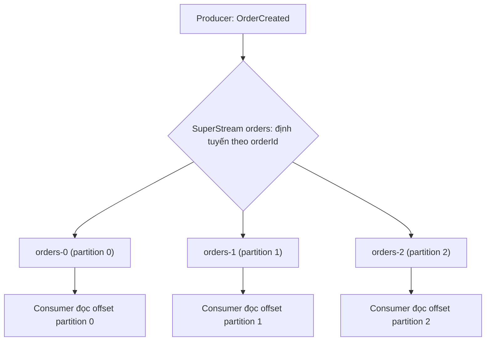
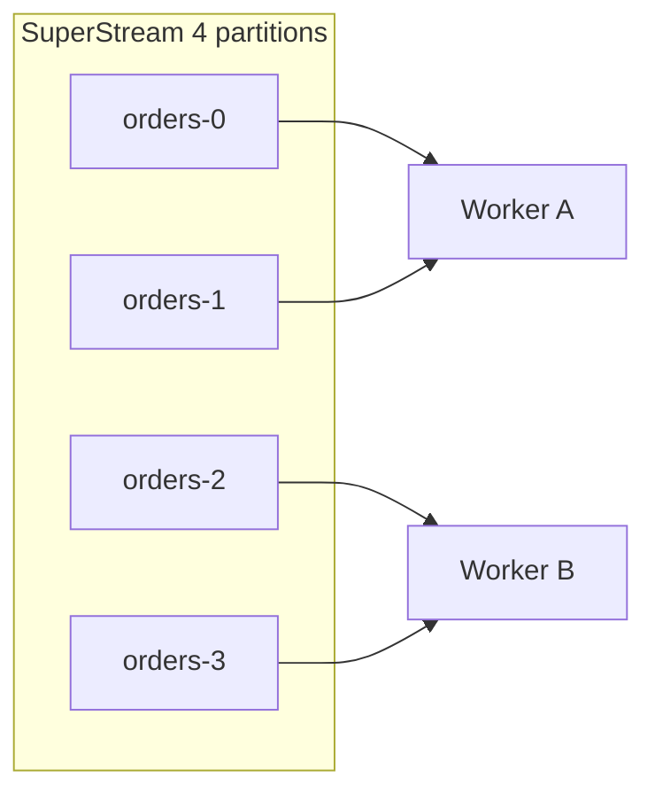

# SuperStream, phân vùng và chọn khóa định tuyến trong RabbitMQ Streams

**RabbitMQ Streams** lưu message theo dạng log có thứ tự và cho phép consumer đọc từ các vị trí (*offset*) khác nhau khi dữ liệu còn trong thời hạn lưu giữ. Đây là lựa chọn phù hợp cho luồng sự kiện có thông lượng cao, cần đọc lại lịch sử, xây dựng read model hoặc xử lý phân tích. Tuy nhiên, một stream đơn lẻ có giới hạn về thông lượng và mức song song. **SuperStream** mở rộng mô hình này bằng cách chia một luồng logic thành nhiều stream vật lý, gọi là **partition**.

Quyết định quan trọng nhất khi dùng SuperStream là **chọn khóa định tuyến (*partition/routing key*)**. Khóa quyết định sự kiện nào đi cùng một partition, từ đó ảnh hưởng trực tiếp tới tính thứ tự, phân phối tải và khả năng mở rộng consumer.

Bài học thuộc chương **RabbitMQ Streams** của **SPRING_AMQP**: kết nối khái niệm SuperStream với các thành phần Spring AMQP như `RabbitTemplate`, cấu hình exchange, queue/binding, consumer, publisher confirms, retry và quan sát hệ thống. Đồng thời cần phân biệt rõ **stream protocol** với các queue thông thường mà `@RabbitListener` dùng để xử lý theo cơ chế ack/nack.

## 1. Stream, partition và SuperStream là gì?

Một **stream** là một log message dạng append-only. Producer thêm message vào cuối log; consumer đọc theo offset và có thể đọc lại nếu message vẫn còn theo chính sách retention. Việc consumer đọc một message **không xóa ngay message đó** như cách hiểu thông thường về queue công việc.

Một **SuperStream** là tên logic đại diện cho nhiều stream vật lý và một cơ chế định tuyến:



Ví dụ tên SuperStream là `orders`, có ba partition `orders-0`, `orders-1` và `orders-2`. Các tên này minh họa quy ước phổ biến, không phải lời bảo đảm rằng mọi công cụ khai báo đều tạo tên giống hệt như vậy.

**Mỗi partition là một log có offset riêng.** Offset `42` trên `orders-0` và offset `42` trên `orders-1` không phải cùng một vị trí trong một log toàn cục. SuperStream không tự tạo một offset chung hoặc một thứ tự toàn cục trên các partition.

### So sánh với queue thông thường

| Tiêu chí | Classic/quorum queue theo mô hình công việc | Stream và SuperStream |
|---|---|---|
| Đọc message | Consumer nhận delivery và ack/nack; message được loại khỏi queue theo cơ chế queue | Consumer đọc log theo offset, log còn tồn tại đến khi retention xóa |
| Đọc lại lịch sử | Thường cần lưu bản sao hoặc republish | Có thể chọn offset cũ nếu dữ liệu vẫn được giữ |
| Song song | Có thể chạy nhiều competing consumers trên queue | SuperStream chia nhiều partition để xử lý/đọc song song |
| Thứ tự | Phụ thuộc queue, consumer, requeue và cách xử lý | Thứ tự append trong **mỗi partition**, không phải toàn SuperStream |
| Giới hạn lưu | Theo loại queue và chính sách broker | Retention theo thời gian/dung lượng của stream |
| Xử lý lỗi | Ack, nack, requeue, DLX/DLQ quen thuộc | Cần quản lý offset, xử lý lỗi và quy trình replay theo mô hình stream |

Không nên dùng tên “SuperStream” để gọi một exchange thông thường có nhiều queue và giả định nó đã hỗ trợ offset/replay. Một SuperStream cần topology stream phù hợp và client tiêu thụ theo đúng ngữ nghĩa stream.

## 2. Tại sao cần chia partition?

Một stream duy nhất có thể trở thành điểm giới hạn khi dữ liệu tăng. Chia partition cho phép chia tải ghi, đọc và lưu trữ thành nhiều luồng độc lập. Ứng dụng có thể phân phối partition cho các consumer khác nhau và cân bằng dung lượng trên các node tùy cách triển khai RabbitMQ.

Ví dụ hệ thống đơn hàng có 3 triệu sự kiện mỗi giờ. Nếu mỗi partition có giới hạn thông lượng thực tế do workload/broker quyết định, tăng số partition **có thể** giúp tăng năng lực xử lý tổng. Tuy nhiên hiệu năng thực sự phụ thuộc loại message, kích thước payload, lưu trữ, node, network, replication, cấu hình producer và tốc độ consumer.

Lợi ích quan trọng:

- Tăng mức song song giữa các nhóm khóa nghiệp vụ độc lập.
- Giữ sự kiện cùng một khóa ổn định trong cùng một partition để hỗ trợ xử lý theo thứ tự.
- Cho phép nhiều nhóm consumer độc lập đọc lại cùng dữ liệu để xây các view khác nhau.
- Phân phối dữ liệu và tải hiệu quả hơn một log đơn lẻ nếu khóa được chọn tốt.

Đổi lại, partition làm tăng độ phức tạp: **không còn thứ tự toàn cục**, phải theo dõi độ trễ theo partition, cân bằng consumer và chuẩn bị phương án khi thay đổi topology.

## 3. Routing key quyết định message vào partition nào

Thông thường, producer chọn một **routing key** từ message nghiệp vụ; cơ chế định tuyến của SuperStream xác định partition tương ứng. Với chiến lược **hash**, cùng key và cùng topology/mapping có xu hướng tới cùng partition. Một số cấu hình/client cũng hỗ trợ định tuyến theo **khóa binding cụ thể** để chủ động chọn partition.

```text
OrderCreated(orderId=ORD-1001) --> key "ORD-1001" --> partition 1
OrderPaid   (orderId=ORD-1001) --> key "ORD-1001" --> partition 1
OrderShipped(orderId=ORD-1001) --> key "ORD-1001" --> partition 1

OrderCreated(orderId=ORD-2007) --> key "ORD-2007" --> partition 0
```

Các số partition trên **chỉ minh họa**. Thuật toán routing thực tế do cấu hình exchange/producer và topology quyết định; không suy trực tiếp rằng Java `String.hashCode() % partitionCount` chính là thuật toán RabbitMQ sử dụng.

### Hash routing và key routing

| Chiến lược | Ý tưởng | Phù hợp với |
|---|---|---|
| **Hash routing** | Tính ánh xạ từ routing key sang một partition theo cơ chế hash của topology | Nhiều khóa nghiệp vụ, muốn phân bố tải tự động |
| **Key/binding routing** | Định tuyến dựa trên mapping của key/binding tới partition cụ thể | Cần chủ động xác định một số phân vùng hoặc quy tắc định tuyến |
| Chỉ định partition trực tiếp | Caller tự quyết định partition đích bằng kiến thức topology, khi client/API cho phép | Luồng điều phối đặc biệt; phải quản lý chặt mapping và thay đổi topology |

Không phải mọi phiên bản client và cách tạo SuperStream đều dùng cùng API để chọn chiến lược. Cần thống nhất cơ chế giữa các producer; nếu một producer băm theo khóa còn producer khác chọn partition trực tiếp, **cùng `orderId` có thể bị gửi sang hai partition**.

## 4. Chọn khóa định tuyến theo điều gì cần giữ thứ tự?

Hãy bắt đầu bằng câu hỏi: **Những sự kiện nào buộc phải đi cùng một partition để dễ xử lý theo thứ tự?** Đó thường là các sự kiện thuộc cùng một aggregate, entity hoặc business key.

### 4.1. Ví dụ cho hệ thống đơn hàng

| Khóa | Điều gì xảy ra? | Nhận xét |
|---|---|---|
| `eventId` | Mỗi sự kiện có khóa khác nhau, kể cả ba sự kiện của cùng một đơn | Phân phối thường đều, nhưng **không bảo đảm thứ tự theo đơn** |
| `orderId` | Các sự kiện của một đơn được định tuyến cùng partition | **Phù hợp** nếu cần duy trì thứ tự nghiệp vụ theo đơn |
| `customerId` | Mọi đơn của cùng khách hàng vào cùng partition | Giữ thứ tự theo khách hàng nhưng có thể tạo “hot key” |
| `tenantId` | Tất cả sự kiện một tenant vào một partition | Rất dễ lệch tải với tenant lớn |
| `tenantId + ":" + orderId` | Nhóm theo một đơn trong phạm vi tenant | Phù hợp với hệ thống đa khách hàng nếu ID đơn không duy nhất toàn cục |
| Timestamp hoặc random UUID mỗi lần gửi | Các lần retry của cùng sự kiện có thể đổi khóa | Tránh dùng khi cần thứ tự/idempotency ổn định |

Nếu một mã `ORD-1001` có thể xuất hiện ở hai tenant khác nhau, khóa `tenantId + ":" + orderId` giảm nguy cơ hai aggregate độc lập bị coi là cùng một khóa.

### 4.2. Chuẩn hóa khóa trước khi publish

Một khóa tốt cần **ổn định, xác định và có cùng quy tắc ở mọi producer**:

```java
public record OrderEvent(
        String eventId,
        String tenantId,
        String orderId,
        String type,
        long sequence) {}

public final class OrderPartitionKeys {
    private OrderPartitionKeys() {}

    public static String forOrder(OrderEvent event) {
        if (event == null
                || event.tenantId() == null || event.tenantId().isBlank()
                || event.orderId() == null || event.orderId().isBlank()) {
            throw new IllegalArgumentException("Thiếu tenantId hoặc orderId");
        }

        // Quy ước này yêu cầu hai ID đã là ID chuẩn hóa, không chứa '|'.
        // Nếu dữ liệu đầu vào có thể chứa '|', hãy dùng encoding có độ dài
        // hoặc quy tắc escape không nhập nhằng, thống nhất ở mọi producer.
        return event.tenantId() + "|" + event.orderId();
    }
}
```

Lưu ý: `eventId` định danh sự kiện để chống xử lý lặp; `orderId` là khóa dùng để nhóm các sự kiện của cùng đơn. Hai ID phục vụ các mục tiêu khác nhau. Một sự kiện được gửi lại phải giữ **cùng partition key** với lần gửi ban đầu.

### 4.3. Các tiêu chí đánh giá khóa

1. **Ordering domain:** nhóm nào cần xem sự kiện theo trình tự, ví dụ theo `orderId` hay `accountId`?
2. **Cardinality:** có đủ nhiều giá trị key để trải đều trên các partition không?
3. **Skew:** một vài key có chiếm phần lớn throughput hay không?
4. **Stability:** retry, replay và nhiều producer có cho cùng key không?
5. **Security/tenant:** khóa có vô tình trộn dữ liệu của hai tenant hoặc bộc lộ thông tin nhạy cảm không?
6. **Schema evolution:** sau khi đổi format, producer cũ/mới có còn định tuyến cùng aggregate giống nhau không?

**Hash tốt không tự giải quyết hot key.** Nếu một `customerId` tạo 80% lưu lượng, tất cả sự kiện của khách hàng đó vẫn vào cùng partition để giữ thứ tự. Tăng partition không chia nhỏ được một khóa đơn lẻ nếu vẫn buộc tất cả sự kiện có cùng key đi cùng nhau.

## 5. Khóa ổn định đem lại thứ tự ở mức nào?

Trong mỗi partition, broker lưu sự kiện theo thứ tự **được append vào log**. Nếu các message của cùng `orderId` luôn được route tới cùng partition, consumer đọc tuần tự có thể dựa vào thứ tự log đó.

Tuy nhiên cần phân biệt:

- **Thứ tự tạo sự kiện:** ứng dụng A tạo `OrderPaid` lúc 10:00:01, ứng dụng B tạo `OrderCancelled` lúc 10:00:02.
- **Thứ tự đến broker:** hai publish bất đồng bộ có thể đến broker theo thứ tự khác.
- **Thứ tự xử lý:** consumer đọc tuần tự nhưng tự đẩy tác vụ vào thread pool có thể hoàn thành lệch thứ tự.

Vì vậy, *cùng partition* giúp có một thứ tự append nhất quán, **không tự bảo đảm đúng thứ tự nghiệp vụ trên nhiều producer**. Nếu nghiệp vụ cần thứ tự nghiêm ngặt, thêm `sequence` tăng dần theo aggregate hoặc một cơ chế phát hành có thứ tự rõ ràng.

```text
orderId = ORD-1001, partition = 1

offset 120: OrderCreated, sequence=1
offset 121: OrderPaid,    sequence=2
offset 122: OrderShipped, sequence=3
```

Trong ví dụ lý tưởng này, consumer có thể xác minh `sequence` tăng từ 1 đến 3. Nếu nhận `sequence=3` trước `sequence=2`, consumer cần có quy tắc chờ, lưu tạm hoặc báo lỗi; không giả định offset tương đương version của aggregate.

**Không có thứ tự toàn cục giữa các partition.** Nếu `ORD-1001` ở partition 1 và `ORD-2007` ở partition 0, không thể dùng offset để nói sự kiện nào xảy ra trước trong toàn SuperStream.

## 6. Tạo SuperStream và chọn số partition

RabbitMQ Streams cần plugin stream và listener cho stream protocol nếu dùng client gốc. Đường truyền stream thường sử dụng **port 5552** theo cấu hình mặc định, khác **5672** của AMQP 0-9-1.

Trong môi trường thực hành, có thể tạo SuperStream bằng công cụ quản trị RabbitMQ Streams. Ví dụ về ý tưởng cấu hình:

```text
Tên SuperStream logic: orders
Số partition        : 4
Các stream con      : orders-0, orders-1, orders-2, orders-3
Routing strategy    : hash(order partition key) theo topology đã cấu hình
Retention           : thiết lập theo dung lượng/thời gian thực tế
```

Với các bản RabbitMQ có CLI quản trị SuperStream tương ứng, cách gọi thường gặp là:

```bash
rabbitmq-streams add_super_stream orders --partitions 4
```

**Cần kiểm tra cú pháp CLI và phiên bản RabbitMQ/Stream plugin đang dùng trước khi chạy.** Đây là thao tác tạo topology trên broker, không phải code Java tự động tạo partition khi gửi một message. Có thể khai báo topology bằng API của RabbitMQ Stream Java Client nếu phiên bản SDK hỗ trợ.

### Có phải partition càng nhiều càng tốt?

Không. Mỗi partition có chi phí metadata, lưu trữ, replica, kết nối/bộ xử lý và quan sát. Một phân tích sơ bộ:

| Đầu vào | Ví dụ giả định | Ý nghĩa |
|---|---|---|
| Mức song song mục tiêu | 8 consumer workers | Cần đủ partition để phân việc khi dùng nhóm consumer phối hợp |
| Mức tải tối đa của từng key | 500 msg/s | Hot key này không được chia nhỏ chỉ bằng tăng partition |
| Tổng throughput | 10.000 msg/s | Đo throughput từng partition và phần cứng thật |
| Lưu trữ/retention | 7 ngày | Tính tổng dung lượng, replication và headroom |
| Khả năng thay đổi topology | Có thể chuyển từ 4 lên 8 partition | Cần kế hoạch migration vì mapping key có thể đổi |

Không có công thức cố định “số partition = số CPU”. Chọn số partition dựa trên throughput đã đo, phân bố khóa, consumer concurrency, retention và khả năng mở rộng về sau.

## 7. Ví dụ publish theo khóa từ ứng dụng Spring AMQP

Có hai cách tích hợp cần phân biệt:

1. **RabbitMQ Stream protocol:** dùng RabbitMQ Stream Java Client hoặc tích hợp stream của Spring AMQP như `RabbitStreamTemplate`/`StreamListenerContainer` ở phiên bản hỗ trợ. API này hướng tới producer/consumer stream, offset và SuperStream.
2. **AMQP 0-9-1:** `RabbitTemplate` publish tới exchange được topology SuperStream tạo ra, **nếu exchange ấy hỗ trợ đường publish AMQP và quyền/định tuyến đã được cấu hình phù hợp**. `RabbitTemplate` vẫn là API publish AMQP; nó không tự trở thành stream consumer có offset.

Ví dụ dưới đây minh họa **cách giữ khóa định tuyến ổn định khi publish qua AMQP exchange**, không thay thế toàn bộ cấu hình SuperStream native:

```java
import com.fasterxml.jackson.core.JsonProcessingException;
import com.fasterxml.jackson.databind.ObjectMapper;
import org.springframework.amqp.core.MessageProperties;
import org.springframework.amqp.rabbit.core.RabbitTemplate;
import org.springframework.stereotype.Service;

@Service
public class OrderSuperStreamAmqpPublisher {
    private static final String SUPER_STREAM_EXCHANGE = "orders";

    private final RabbitTemplate rabbitTemplate;
    private final ObjectMapper objectMapper;

    public OrderSuperStreamAmqpPublisher(
            RabbitTemplate rabbitTemplate,
            ObjectMapper objectMapper) {
        this.rabbitTemplate = rabbitTemplate;
        this.objectMapper = objectMapper;
    }

    public void publish(OrderEvent event) throws JsonProcessingException {
        String partitionKey = OrderPartitionKeys.forOrder(event);
        String json = objectMapper.writeValueAsString(event);

        rabbitTemplate.convertAndSend(
                SUPER_STREAM_EXCHANGE,
                partitionKey,
                json,
                message -> {
                    MessageProperties properties =
                            message.getMessageProperties();
                    properties.setContentType(
                            MessageProperties.CONTENT_TYPE_JSON);
                    properties.setMessageId(event.eventId());
                    properties.setHeader("eventType", event.type());
                    return message;
                });
    }
}
```

**Điều kiện của ví dụ:** exchange `orders` phải tồn tại đúng vhost, có topology định tuyến SuperStream theo routing key, và ứng dụng dùng `RabbitTemplate` được cấu hình cho broker đó. Nếu chưa tạo SuperStream, hoặc exchange không dùng chiến lược routing phù hợp, method này không tự tạo các partition.

Khóa route đi vào tham số `routingKey` của `convertAndSend(...)`. `messageId` giúp truy vết sự kiện, nhưng không phải cơ chế deduplication mặc định của mọi đường gửi AMQP.

### Publisher confirm và retry

Nếu producer cần biết broker đã xử lý publish, cấu hình publisher confirm trên connection factory AMQP và xử lý `ack/nack`; cân nhắc mandatory/returns khi cần phát hiện publish không có đích. Những cơ chế này khác với **publisher confirmations của stream protocol**, dù đều nhằm nhận biết kết quả gửi.

Nếu mất kết nối sau khi broker đã nhận publish nhưng trước khi client nhận confirm, ứng dụng có thể không biết chắc trạng thái. Retry có khả năng tạo message trùng; consumer nên dùng `eventId` để deduplicate. Đừng tạo partition key mới ngẫu nhiên trong lần retry.

### Minh họa API native stream producer (mang tính định hướng)

Với RabbitMQ Stream Java Client, hình thức API phổ biến là dùng một `Environment`, tạo producer cho SuperStream, và cung cấp hàm lấy khóa từ message:

```java
// Mã định hướng: điều chỉnh chính xác các builder/API theo phiên bản
// rabbitmq-stream-client đang được sử dụng.
Environment environment = Environment.builder()
        .host("localhost")
        .port(5552)
        .build();

Producer producer = environment.producerBuilder()
        .superStream("orders")
        .routing(message -> {
            Object key = message.getApplicationProperties()
                    .get("partitionKey");
            return key.toString();
        })
        .build();

// Mỗi message phải được tạo với application property "partitionKey"
// bằng OrderPartitionKeys.forOrder(event). Sau publish cần theo dõi
// stream publish confirmation và đóng producer/environment khi shutdown.
```

Đoạn code này làm rõ **hợp đồng routing**, không phải ví dụ chạy độc lập: cần dependency Stream Java Client, tạo message có application properties, gọi `producer.send(...)` và quản lý connection/confirmation. Tên API có thể thay đổi theo phiên bản; không trộn các builder từ SDK khác nhau. Tương tự, nếu sử dụng `RabbitStreamTemplate` trong Spring AMQP, cần cấu hình môi trường stream, SuperStream và routing function theo API có trong dependency thực tế.

## 8. Consumer đọc partition và quản lý offset

Consumer stream cần biết **đọc từ offset nào**. Một số lựa chọn thường gặp:

| Vị trí bắt đầu | Ý nghĩa | Khi dùng |
|---|---|---|
| First/earliest còn giữ | Đọc lại từ đầu dữ liệu còn tồn tại trong retention | Backfill, xây read model |
| Last/latest theo semantics client | Bắt đầu ở cuối hoặc gần cuối log theo lựa chọn cụ thể | Chỉ quan tâm sự kiện mới |
| Offset chỉ định | Tiếp tục từ một vị trí đã biết | Phục hồi hoặc replay có kiểm soát |
| Offset đã lưu theo consumer/group | Tiếp tục từ vị trí xử lý trước đó | Consumer liên tục, chịu được restart |

**Offset thuộc từng partition.** Nếu lưu trạng thái, cần gắn ít nhất `(consumerGroup, partition, offset)`, hoặc cơ chế offset tracking tương đương mà client hỗ trợ. Chỉ lưu một con số cho toàn SuperStream là không đủ.

Ví dụ trạng thái:

```text
consumer = order-projection
orders-0 -> next offset cần xử lý: 2150
orders-1 -> next offset cần xử lý: 1988
orders-2 -> next offset cần xử lý: 2421
orders-3 -> next offset cần xử lý: 2054
```

Trong stream, lưu checkpoint/offset quá sớm có thể khiến ứng dụng **bỏ qua tác động nghiệp vụ chưa hoàn thành** sau crash. Lưu offset sau khi xử lý có thể dẫn tới **xử lý lặp** nếu tác động đã ghi xong nhưng checkpoint chưa lưu. Vì vậy cần idempotency và quy trình commit/checkpoint phù hợp với database hoặc hệ thống ngoài.

### Phân phối partition cho consumer

Một nhóm consumer được cấu hình theo cơ chế phối hợp của Stream Client (ví dụ single-active-consumer/group assignment nếu được hỗ trợ) có thể chia partition giữa các instance để tránh xử lý cạnh tranh cùng partition trong cùng nhóm.



Nếu có hai worker và bốn partition, mỗi worker có thể được gán hai partition trong một thời điểm. Nếu có tám worker nhưng chỉ bốn partition, **không thể kỳ vọng tám worker đều xử lý độc lập từng partition trong cùng một nhóm phối hợp**. Thêm consumer chỉ hữu ích tới mức song song mà số partition và cơ chế tiêu thụ cho phép.

Không nên mặc định việc đặt cùng tên consumer đã tự bật phân chia partition đúng ý: cần cấu hình group/SAC/offset tracking theo API client đang dùng và kiểm thử lúc worker tham gia, rời nhóm, mất kết nối.

### Khác với ack/nack của `@RabbitListener` thông thường

Một `@RabbitListener` trên classic/quorum queue thường làm việc với delivery và acknowledgement. RabbitMQ Streams giữ log theo retention và sử dụng offset; việc xử lý lỗi không nhất thiết tương đương `basicNack(requeue=true)` của queue công việc.

Tích hợp stream của Spring AMQP dùng các thành phần như `StreamListenerContainer`; nếu muốn dùng annotation `@RabbitListener` với stream container factory ở phiên bản hỗ trợ, phải cấu hình factory dành cho stream. **Không cấu hình một classic queue listener rồi giả định nó tự hiểu SuperStream, chia partition và offset tracking**.

## 9. Chọn partition key trong hệ thống đa khách hàng

Giả sử nền tảng có 100 khách hàng, mỗi khách hàng có nhiều đơn:

```text
Tenant A: 10.000 đơn/giờ
Tenant B:    100 đơn/giờ
Tenant C:     10 đơn/giờ
...
```

Nếu khóa là `tenantId`, tất cả đơn của A đi vào **một** partition. Nếu A chiếm phần lớn tải, partition ấy có thể trở thành nút cổ chai trong khi các partition khác ít việc.

Nếu yêu cầu chỉ giữ thứ tự trong **một đơn**, khóa `tenantId|orderId` tạo nhiều key hơn và thường phân phối đều hơn. Tuy nhiên, nếu một đơn đặc biệt có hàng trăm nghìn sự kiện, chính đơn đó vẫn là hot key.

| Yêu cầu nghiệp vụ | Khóa nên xem xét | Rủi ro |
|---|---|---|
| Đảm bảo sự kiện cùng đơn được xử lý theo append order | `tenantId|orderId` | Hot order vẫn tập trung một partition |
| Giữ thứ tự mọi thay đổi của một tài khoản | `tenantId|accountId` | Tài khoản lớn tạo skew |
| Mọi sự kiện một tenant phải đi qua một bộ xử lý tuần tự | `tenantId` | Giới hạn mức song song của tenant |
| Không cần thứ tự theo entity, ưu tiên phân phối tải | Hash theo ID có cardinality cao | Không còn bảo đảm thứ tự theo aggregate |

Không cố sửa skew bằng cách thêm random suffix vào key khi nghiệp vụ vẫn cần thứ tự; hành động đó phá vỡ invariant “cùng aggregate cùng partition”. Nếu mục tiêu thứ tự có thể thu hẹp, hãy điều chỉnh **phạm vi ordering** trước khi thay đổi key.

## 10. Thay đổi số partition: vì sao phải có kế hoạch?

Giả sử key `tenant-A|ORD-1001` đang được hash vào `orders-1` khi SuperStream có 4 partition. Nếu thay topology thành 8 partition, ánh xạ hash có thể đổi và các sự kiện mới của cùng key có thể sang partition khác.

Khi đó:

- Lịch sử của một aggregate nằm ở partition cũ, sự kiện mới nằm ở partition mới.
- Hai consumer có thể đồng thời xử lý các phần sự kiện của cùng aggregate.
- Offset của partition cũ không thể dùng làm offset cho partition mới.
- Không có bảo đảm tự động rằng broker sẽ chuyển toàn bộ sự kiện cũ sang partition mới theo thứ tự nghiệp vụ.

Khả năng bổ sung/sửa partition phụ thuộc phiên bản RabbitMQ và cách quản lý SuperStream; không nên giả định có thể “tăng số partition” như một thao tác hoàn toàn trong suốt.

### Chiến lược di chuyển thực tế

1. **Đánh giá trước** mức skew, thông lượng từng partition, retention và ordering requirement.
2. **Chọn đích mới có version**, ví dụ SuperStream `orders-v2` với số partition mong muốn.
3. **Định nghĩa thời điểm cutover** và quy tắc producer chuyển sang đích mới; tránh producer cũ/mới gửi phân tán cùng aggregate mà consumer không biết.
4. **Dùng event ID/sequence** để đối soát, phát hiện trùng/thiếu và đảm bảo thứ tự nghiệp vụ trong giai đoạn chuyển đổi.
5. **Chuyển consumer/checkpoint** theo kế hoạch, xử lý backlog ở topology cũ rồi mới ngừng sử dụng.
6. **Kiểm chứng rollback** và chỉ dọn topology cũ khi đã qua cửa sổ retention và yêu cầu audit.

Không áp dụng một công thức partition migration chung cho mọi trường hợp; mục tiêu là bảo toàn contract nghiệp vụ của event, nhất là khi yêu cầu thứ tự và replay.

## 11. Retry, retention và replay trong SuperStream

### 11.1. Không đồng nhất replay với requeue

Với classic queue, ứng dụng thường dùng ack/nack, requeue hoặc DLX/DLQ khi xử lý lỗi. Với stream, log vẫn còn trong retention; consumer có thể quay lại offset trước đó để đọc lại. **Điều này không tự tạo ra cơ chế dead-letter giống classic queue**.

Khi một sự kiện stream xử lý lỗi, hệ thống có thể:

- Retry trong ứng dụng với số lần và backoff có giới hạn.
- Ghi sự kiện lỗi vào một **error stream/queue riêng** để xử lý sau.
- Lưu kết quả/trạng thái đã xử lý trong database và tiếp tục theo chính sách nghiệp vụ.
- Dừng xử lý partition để tránh vượt qua một sự kiện bắt buộc phải hoàn tất theo thứ tự.
- Sau khi khắc phục lỗi, khởi động lại consumer từ offset đã kiểm soát.

**Thiết kế tránh poison event:** nếu mọi lần đọc lại đều dừng tại cùng một sự kiện sai schema, một partition có thể bị kẹt. Cần chính sách phân loại lỗi, bước cách ly và cách phục hồi rõ ràng mà vẫn bảo vệ yêu cầu ordering.

### 11.2. Retention giới hạn cửa sổ replay

Streams không phải kho lưu lịch sử vô hạn nếu cấu hình retention theo dung lượng/thời gian. Khi log cũ bị cắt bỏ, offset tương ứng có thể không còn đọc được. Một consumer mất kết nối dài hơn retention có thể bỏ lỡ dữ liệu không thể khôi phục từ chính stream đó.

Nếu nghiệp vụ yêu cầu replay nhiều tháng, cân nhắc retention dài hơn, lưu sự kiện vào kho bền vững khác hoặc có cơ chế tái tạo dữ liệu được kiểm soát. Kiểm tra **lag theo partition** so với tuổi dữ liệu cũ nhất còn lưu.

### 11.3. Phát lại có thể tạo tác động lặp bên ngoài

Đọc lại `OrderPaid` có thể khiến consumer gọi API ghi nhận thanh toán lần thứ hai nếu thiếu idempotency. Để giảm rủi ro:

1. Giữ `eventId` bất biến qua replay.
2. Dùng unique constraint/inbox theo `eventId` hoặc `tenantId,eventId` khi cần.
3. Khi gọi API ngoài, sử dụng idempotency key ổn định và đối soát kết quả không xác định.
4. Không lưu checkpoint rằng message đã xử lý xong khi tác động nghiệp vụ chưa hoàn tất.
5. Với backfill chỉ phục vụ báo cáo, tách consumer projection khỏi consumer gây side effect.

Publisher confirmations, offset tracking và idempotency giải quyết **những giai đoạn khác nhau** của độ tin cậy đầu cuối.

## 12. Quan sát SuperStream theo từng partition

Một SuperStream có thể trông hoạt động bình thường ở mức tổng hợp trong khi một partition bị nóng hoặc consumer của partition đó bị tụt lại rất xa.

| Chỉ số | Cách đọc | Dấu hiệu cần điều tra |
|---|---|---|
| Publish throughput theo partition | Message/s, bytes/s | Một partition vượt trội do hot key hoặc skew |
| Consumer throughput theo partition | Tốc độ xử lý thành công | Một worker chậm, lỗi xử lý hoặc downstream nghẽn |
| Offset lag | Khoảng cách giữa vị trí ghi mới và checkpoint đã xử lý | Lag tăng dài hạn; có nguy cơ vượt retention |
| Retention / oldest available offset | Dữ liệu còn đọc lại được | Consumer bị tụt sau cửa sổ dữ liệu |
| Partition/consumer assignment | Partition nào thuộc worker nào | Rebalance liên tục, worker không nhận partition |
| Publish confirmation failures | Publish bị nack, timeout hoặc không rõ kết quả | Có thể cần retry và chống trùng |
| Error/retry counts | Số lần xử lý lỗi và bản ghi cách ly | Poison events, sai schema hoặc downstream lỗi |
| Key distribution | Tỷ lệ message/bytes theo nhóm key | Hot tenant, hot order, khóa quá thô |

Không nên gắn trực tiếp mọi `orderId`/`eventId` làm nhãn metric vì cardinality có thể rất cao. Có thể log có lấy mẫu, histogram, thống kê top-N hot keys và nhãn partition/consumer ở mức có kiểm soát.

### Cách phân tích partition bị nóng

Giả sử `orders-2` có 70% lưu lượng dù SuperStream có 8 partition:

1. Kiểm tra cả **message count và bytes**, vì một vài message lớn cũng có thể gây nghẽn.
2. Xem key nào chiếm nhiều lưu lượng, ví dụ `tenant-A` hay một `accountId`.
3. Xác nhận mọi producer dùng cùng routing function và topology.
4. Xem consumer assignment, độ trễ xử lý và giới hạn downstream.
5. Nếu key quá thô, cân nhắc chọn khóa theo aggregate nhỏ hơn **khi nghiệp vụ cho phép**.
6. Đo lại hiệu năng; tránh đổi key trực tiếp trên production khi chưa có kế hoạch migration.

## 13. Ma trận kiểm thử với RabbitMQ thật

Unit test hàm `OrderPartitionKeys.forOrder()` giúp xác nhận key ổn định, nhưng không thể chứng minh broker gán partition, stream offsets và consumer assignment đúng. Cần kiểm thử tích hợp bằng một phiên bản RabbitMQ hỗ trợ Streams và client tương thích.

| Kịch bản | Điều cần xác nhận |
|---|---|
| Gửi nhiều event cùng `tenantId|orderId` | Các event cùng key đến cùng partition theo topology ổn định |
| Gửi nhiều key độc lập | Phân bố lên nhiều partition; đo mức lệch tải |
| Hai producer khác ngôn ngữ cùng phát cho một order | Cùng quy ước key/routing, không lệch partition |
| Gửi cùng key với `sequence` tăng | Thứ tự log được kiểm tra, consumer không tự xử lý lệch do thread pool |
| Có nhiều worker hơn số partition | Không kỳ vọng tất cả worker xử lý partition độc lập trong cùng nhóm phối hợp |
| Consumer restart | Phục hồi từ checkpoint/offset dự kiến, chấp nhận xử lý lặp an toàn |
| Consumer lag vượt retention | Phát hiện khoảng dữ liệu đã mất và có quy trình khôi phục |
| Một sự kiện luôn xử lý lỗi | Có cách cách ly/retry; không làm mất khả năng quan sát partition |
| Producer mất kết nối sau publish | Xử lý confirmation không xác định; retry không tạo tác động lặp |
| Thử đổi số partition/routing strategy | Xác định mapping thay đổi và bảo vệ thứ tự nghiệp vụ |
| Đọc lại lịch sử để xây read model | Không gọi lại API có side effect ngoài ý định |
| Cùng event bị replay | Inbox/idempotency loại bỏ tác động trùng |

Test nên quan sát partition và offset thực tế bằng Stream Client hoặc công cụ giám sát tương thích, thay vì suy ra từ tên exchange, routing key hoặc số lượng callback của listener.

## 14. Cách chọn kiến trúc theo yêu cầu

| Nhu cầu | Gợi ý | Đánh đổi |
|---|---|---|
| Nhiều sự kiện độc lập, cần throughput và replay | SuperStream nhiều partition, hash theo key có cardinality cao | Phải quản lý offsets, retention, phân phối consumer |
| Cần giữ thứ tự trong một đơn | Key `tenantId|orderId` | Cùng order bị giới hạn trong một partition |
| Cần thứ tự tuyệt đối của mọi sự kiện | Một luồng xử lý tuần tự hoặc cơ chế sequencing nghiệp vụ | Giảm khả năng mở rộng ngang |
| Cần worker queue có nack/requeue/DLQ truyền thống | Classic/quorum queue và `@RabbitListener` thông thường | Không có log replay giống Streams |
| Cần phân tích lịch sử trên cùng dữ liệu | Stream/SuperStream với consumer offset riêng cho mỗi use case | Chi phí retention và vận hành |
| Cần khớp dữ liệu DB với event khi producer crash | Transactional outbox và publish confirmation | Có thể gửi trùng; consumer vẫn cần idempotency |

### Câu hỏi tự kiểm tra

1. Vì sao SuperStream có thể tăng song song nhưng không tạo thứ tự toàn cục?
2. Khóa `eventId` và `orderId` khác nhau thế nào nếu phải xử lý `OrderCreated`, `OrderPaid`, `OrderShipped` theo thứ tự trong một đơn?
3. Vì sao dùng `tenantId` làm partition key có thể tạo hot partition?
4. Offset `100` của hai partition khác nhau có so sánh trực tiếp được không?
5. Vì sao tăng số partition có thể làm cùng aggregate chuyển sang partition khác khi topology thay đổi?
6. Trong Spring AMQP, vì sao `RabbitTemplate` publish đến exchange của SuperStream không đồng nghĩa `@RabbitListener` kiểu queue thường có thể tự đọc offset?
7. Khi replay một `OrderPaid`, cần có gì để không gọi hệ thống thanh toán hai lần?

**Ghi nhớ:** SuperStream là **một luồng logic gồm nhiều stream partition**. Khóa định tuyến quyết định message vào partition nào và vì thế quyết định miền giữ thứ tự, mức phân bố tải và giới hạn song song. Hãy chọn key theo aggregate cần ordering, giữ key ổn định qua retry/replay, theo dõi offset/lag theo partition và chuẩn bị kế hoạch khi thay đổi topology. Để có độ tin cậy đầu cuối trong Spring AMQP, vẫn cần publisher confirmations, checkpoint đúng thời điểm, xử lý lỗi có giới hạn và idempotency ở tầng nghiệp vụ.
