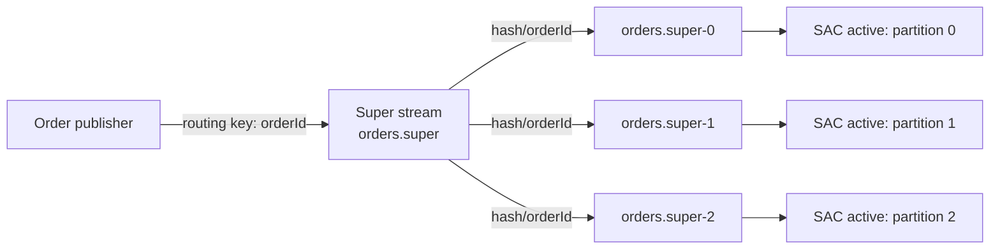
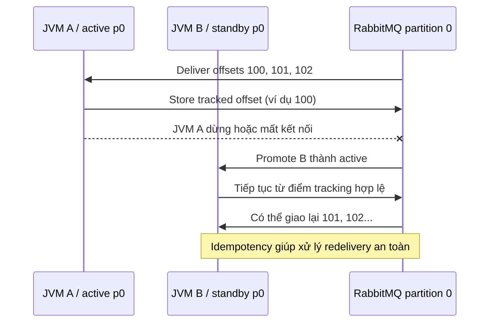

# Single Active Consumer trong RabbitMQ Super Stream

## 1. Vì sao cần Single Active Consumer khi sử dụng super stream?

Trong **SPRING_AMQP**, các ứng dụng thường gửi message bằng `RabbitTemplate` hoặc `RabbitStreamTemplate` và nhận bằng `@RabbitListener` hay listener container. Với nhu cầu xử lý bất đồng bộ có lưu lịch sử, replay và thông lượng cao, RabbitMQ cung cấp **Streams**: message nằm trong một log bền vững, consumer đọc theo **offset** thay vì làm message biến mất sau khi ack như queue truyền thống.

**Super stream** chia một logical stream thành nhiều **partition stream** để tăng thông lượng và khả năng mở rộng. Điều này đặt ra hai yêu cầu đồng thời:

1. Xử lý song song **giữa** các partition.
2. Tránh nhiều bản sao của cùng một ứng dụng xử lý **cùng partition** đồng thời khi scale ngang hoặc failover.

Tính năng **Single Active Consumer (SAC)** của RabbitMQ Stream protocol đáp ứng yêu cầu thứ hai. Khi các consumer dùng **cùng tên consumer group**, broker chỉ cho phép **một consumer active trên mỗi partition stream**; những consumer còn lại đứng chờ để tiếp quản khi active consumer dừng.

> **Điểm cần nhớ:** Với super stream có ba partition, SAC có thể cho phép **ba consumer active trong một group**, mỗi partition một consumer. Nó **không** giới hạn toàn bộ super stream chỉ còn một consumer active, và cũng **không** bảo đảm thứ tự toàn cục giữa các partition.

### Mục tiêu học tập

Sau bài này, bạn có thể:

- Phân biệt stream, super stream, partition, composite consumer và nhóm Single Active Consumer.
- Giải thích **consumer name**, active/standby, failover, rebalancing, offset tracking và thứ tự message theo partition.
- Tạo super stream, gửi event định tuyến theo `orderId` rồi triển khai SAC với **RabbitMQ Stream Java Client** và **Spring AMQP `StreamListenerContainer`**.
- Nhận diện giới hạn về concurrency, checkpoint, redelivery, xử lý lỗi và các khác biệt với `@RabbitListener` cho queue classic/quorum.
- Thiết kế quan sát và kiểm thử thực tế khi tăng/giảm instance hoặc mất kết nối.

Ví dụ xuyên suốt: ứng dụng `orders-projection` nhận event đơn hàng từ super stream `orders.super` có 3 partition. Các bản sao ứng dụng chạy đồng thời nhưng chỉ một consumer mỗi partition thuộc nhóm `orders-projection-v1` được phép active.

## 2. Super stream và partition hoạt động như thế nào?

Một **RabbitMQ stream** là append-only log: message được đọc nhiều lần khi còn nằm trong retention, và việc consumer xử lý không xóa trực tiếp message khỏi log. Một **super stream** là logical entity gồm nhiều stream thành phần, được tổ chức qua exchange, các partition stream và binding.

Ví dụ tạo `orders.super` với 3 partition:

```text
orders.super (logical super stream)
  |
  +-- orders.super-0   (partition stream)
  +-- orders.super-1   (partition stream)
  +-- orders.super-2   (partition stream)
```

Producer chọn **routing key** (ví dụ `orderId`). Với cơ chế hash routing nhất quán theo cấu hình, các message có cùng key thường được đưa tới cùng partition; điều này cho phép duy trì thứ tự **trong partition** cho các event liên quan tới một đơn hàng.



Hãy phân biệt hai khía cạnh:

| Thuộc tính | Phạm vi |
| --- | --- |
| **Thứ tự ghi/đọc offset** | Trong **một** partition stream. |
| **Thứ tự theo `orderId`** | Được giữ theo partition nếu producer luôn sử dụng cùng routing key/chiến lược và logic consumer không tự xử lý lệch thứ tự. |
| **Thứ tự toàn bộ super stream** | **Không có** một tổng thứ tự toàn cục giữa các partition. |
| **Offset** | Là giá trị **riêng của từng partition**, không phải một counter chung cho cả super stream. |
| **Retention** | Do chính sách stream quản lý; lưu trữ không chờ consumer ack để xóa message. |
| **SAC** | Chỉ định một active consumer **trên mỗi partition cho mỗi consumer name/group**. |

Chọn partition key sai, như random UUID của từng event thay vì `orderId`, có thể khiến sự kiện của cùng đơn hàng đi nhiều partition, gây khó bảo đảm thứ tự nghiệp vụ. Thay đổi số partition hoặc thuật toán routing cũng có thể đổi vị trí partition cho những key cũ; cần kế hoạch migration và kiểm soát ordering khi mở rộng topology.

## 3. SAC trên super stream có chính xác ý nghĩa gì?

### 3.1. Consumer group được nhận diện bằng `name`

Trong RabbitMQ **Stream Java Client**, hai lời gọi quan trọng:

```java
environment.consumerBuilder()
        .superStream("orders.super")
        .name("orders-projection-v1")
        .singleActiveConsumer()
        // ...
        .build();
```

- `superStream("orders.super")`: yêu cầu thư viện tiêu thụ các partition thuộc logical stream.
- `name("orders-projection-v1")`: tên **nhóm ứng dụng**; **bắt buộc** cho SAC, đồng thời là khóa định danh offset tracking.
- `singleActiveConsumer()`: đăng ký SAC cho các consumer của từng partition.

**Tất cả bản sao cùng xử lý một projection phải dùng cùng `name`**. Nếu instance A tên `orders-projection-v1` còn instance B tên `orders-projection-v2`, RabbitMQ xem chúng là **hai nhóm khác nhau**, mỗi nhóm có một active trên từng partition và **cùng đọc các event**. Điều đó có thể đúng khi một ứng dụng analytics khác cần fan-out độc lập, nhưng là lỗi nếu mục tiêu chỉ là HA/scale cho cùng nghiệp vụ.

### 3.2. Composite consumer và active consumer trên từng partition

Một super stream consumer là **composite consumer**: client tự tìm danh sách partition và tạo các consumer nội bộ cho từng partition.

Giả sử 3 JVM (A, B, C), mỗi JVM tạo một composite consumer với cùng `name`:

```text
                           Nhóm "orders-projection-v1"
Partition              JVM A          JVM B          JVM C
orders.super-0       ACTIVE         standby        standby
orders.super-1       standby        ACTIVE         standby
orders.super-2       standby        standby        ACTIVE
```

Đây chỉ là **một ví dụ phân công có thể xảy ra**. Broker có thể chọn khác, và một JVM cũng có thể active trên nhiều partition. Mỗi JVM tạo ba consumer nội bộ (tổng cộng 9); nhưng trong nhóm này **chỉ có tối đa 3 consumer active**, một trên mỗi partition.

| Số partition | Số JVM trong cùng group | Số consumer nội bộ có thể được tạo | Số active tối đa trong group |
| --- | --- | --- | --- |
| 3 | 1 | 3 | 3 |
| 3 | 2 | 6 | 3 |
| 3 | 3 | 9 | 3 |
| 3 | 5 | 15 | 3 |

Các con số giả định mỗi JVM tạo **một** composite consumer; nếu framework tạo nhiều consumer composite trên mỗi JVM thì số nội bộ thay đổi, nhưng nguyên tắc **một active mỗi partition mỗi group** vẫn giữ nguyên.

### 3.3. Điều gì xảy ra khi active consumer mất kết nối?

1. Instance A đang active trên `orders.super-0`.
2. A dừng, bị lỗi hoặc connection bị mất và broker phát hiện consumer không còn hoạt động.
3. Broker chọn một consumer standby **cùng tên** đang đăng ký ở partition 0, chẳng hạn instance B.
4. B trở thành active, đọc lại từ **offset được lưu/điểm resume phù hợp**.
5. Những partition khác vẫn có active consumer riêng; chúng có thể tiếp tục xử lý.



**SAC cung cấp active/standby và continuity, không biến processing thành exactly-once.** Nếu checkpoint đi sau tiến độ xử lý, B có thể thấy một số event A đã xử lý; nếu ứng dụng tự checkpoint **trước khi DB transaction hoàn tất**, có rủi ro bỏ qua hiệu ứng chưa được thực hiện.

## 4. SAC không phải cơ chế single active của queue thông thường

RabbitMQ có tính năng **Single Active Consumer** cho classic/quorum queue trong AMQP 0-9-1, thường cấu hình với queue argument `x-single-active-consumer=true`. Tuy cùng tên, **API và mô hình tiêu thụ của streams khác**.

| Câu hỏi | Classic/quorum queue SAC | Stream protocol SAC / super stream |
| --- | --- | --- |
| Tạo SAC | Queue argument `x-single-active-consumer=true` ở lúc declare. | `ConsumerBuilder.singleActiveConsumer()` cùng `name`, hoặc API Spring stream container. |
| Phạm vi | Một active consumer của **queue**. | Một active consumer của **mỗi partition** trong **group** có cùng name. |
| Vị trí đọc | Message delivery, ack/nack, requeue. | **Offset** trên append-only log; có thể replay. |
| Message sau xử lý | Thường được xóa khỏi queue sau ack. | Vẫn nằm trong stream đến khi retention xóa. |
| Khi consumer fail | Unacked delivery có thể được requeue/redeliver. | Consumer khác tiếp quản từ offset/tracking. |
| Kết hợp `@RabbitListener` | `SimpleMessageListenerContainer`/`DirectMessageListenerContainer`. | `StreamListenerContainer` hoặc `StreamRabbitListenerContainerFactory`. |

**Không** thêm `x-single-active-consumer=true` vào từng stream partition rồi mặc định coi đó là cấu hình đúng cho **stream protocol group SAC**. Trong bài này dùng chính API SAC của **RabbitMQ Stream Java Client**.

## 5. Chuẩn bị môi trường

### 5.1. Yêu cầu phiên bản và plugin

- RabbitMQ **3.11 trở lên** cho super stream và Single Active Consumer của Stream Java Client.
- RabbitMQ Stream plugin và endpoint stream protocol (mặc định port **5552**) khả dụng; AMQP 0-9-1 thường trên port **5672**.
- Java 17+ là mức thực hành hợp lý; cần version `spring-rabbit-stream` tương thích với `spring-amqp`/`spring-rabbit` và Stream Java Client.
- Một broker hoặc cluster dành cho thử nghiệm, không dùng dữ liệu production để xóa/tạo lại super stream.

Ví dụ trên máy có RabbitMQ CLI và quyền quản trị:

```bash
rabbitmq-plugins enable rabbitmq_stream rabbitmq_stream_management
rabbitmq-streams add_super_stream orders.super --partitions 3
```

Lệnh thứ hai tạo logical super stream và các partition stream/binding cần thiết. Trên hệ thống đã có topology, **không tạo lại mỗi lần ứng dụng start**. Có thể dùng `Environment.streamCreator()` của Stream Java Client hoặc Spring `SuperStream` bean kèm `RabbitAdmin` để provision thay cho lệnh CLI; hãy chọn **một** cơ chế chủ sở hữu topology.

### 5.2. Maven dependency

Với ứng dụng Spring Boot quản lý version thư viện, thêm:

```xml
<dependency>
    <groupId>org.springframework.boot</groupId>
    <artifactId>spring-boot-starter-amqp</artifactId>
</dependency>
<dependency>
    <groupId>org.springframework.amqp</groupId>
    <artifactId>spring-rabbit-stream</artifactId>
</dependency>
```

Nếu chạy **Java Client trực tiếp** mà không dùng Spring stream integration, cần thư viện `com.rabbitmq:stream-client` tương ứng. Không đưa nhiều version lệch nhau của `spring-rabbit`, `spring-rabbit-stream` và RabbitMQ Stream Java Client vào classpath.

### 5.3. Khởi tạo `Environment`

`Environment` thuộc **RabbitMQ Stream Java Client**; khác với `org.springframework.core.env.Environment`. Nó quản lý kết nối stream protocol, producer/consumer và một số tài nguyên client.

```java
import com.rabbitmq.stream.Environment;
import org.springframework.context.annotation.Bean;
import org.springframework.context.annotation.Configuration;

@Configuration
public class StreamConnectionConfig {
    @Bean(destroyMethod = "close")
    Environment rabbitStreamEnvironment() {
        return Environment.builder()
                .host("localhost")
                .port(5552)
                .username("guest")
                .password("guest")
                // Để concurrency nhiều consumer trên stream container
                // đạt mức mong muốn theo lưu ý của Spring AMQP.
                .maxConsumersByConnection(1)
                .build();
    }
}
```

Ví dụ trên chỉ dành cho môi trường local: tài khoản `guest` có hạn chế truy cập từ xa theo cấu hình mặc định của RabbitMQ. Khi triển khai thật, sử dụng user riêng, TLS, vhost và các endpoint được phép. `maxConsumersByConnection(1)` tăng số kết nối khi có nhiều consumer; phải cân bằng với giới hạn connection, tài nguyên và thông lượng.

## 6. Ví dụ 1: RabbitMQ Stream Java Client thuần

Đây là cách quan sát API đầy đủ và cơ chế SAC trên super stream.

### 6.1. Producer chọn partition theo `orderId`

```java
import com.rabbitmq.stream.Environment;
import com.rabbitmq.stream.Message;
import com.rabbitmq.stream.Producer;
import java.nio.charset.StandardCharsets;

// Environment đã được ứng dụng khởi tạo.
Producer producer = environment.producerBuilder()
        .superStream("orders.super")
        .routing(message -> message.getApplicationProperties()
                .get("orderId").toString())
        .producerBuilder()
        .build();

String orderId = "ORDER-1001";
String payload = "ORDER-1001|EVT-0001";

Message message = producer.messageBuilder()
        .applicationProperties()
            .entry("orderId", orderId)
        .messageBuilder()
        .addData(payload.getBytes(StandardCharsets.UTF_8))
        .build();

producer.send(message, confirmation -> {
    if (confirmation.isConfirmed()) {
        System.out.println("Broker đã xác nhận publish " + payload);
    } else {
        System.err.println("Publish chưa được xác nhận: " + payload);
    }
});

// Trong ứng dụng thực tế, đóng producer khi không còn dùng.
```

Điểm đáng chú ý:

- Producer `superStream("orders.super")` dùng cơ chế route partition của Stream Java Client.
- Cùng `orderId` phải được dùng ổn định làm routing key để các event của cùng aggregate vào cùng partition theo topology hiện tại.
- `Producer#send` trả kết quả publish thông qua callback **asynchronous confirmation**. Đừng đóng producer ngay sau `send` mà chưa đợi/điều phối kết quả publish.
- Khi producer mất confirm, outcome có thể không rõ; cân nhắc outbox, publisher deduplication phù hợp và consumer idempotency.

Với Stream Java Client, **producer deduplication** sử dụng **producer name + publishing ID** và có các điều kiện nghiêm ngặt về thứ tự publishing ID. Đây là cơ chế khác với **consumer SAC**; SAC không thay thế việc chống duplicate ở producer.

### 6.2. Consumer đăng ký SAC

Chạy đoạn sau trong **nhiều process/JVM** với cùng giá trị `consumer name`:

```java
import com.rabbitmq.stream.Consumer;
import com.rabbitmq.stream.Environment;
import com.rabbitmq.stream.OffsetSpecification;
import java.nio.charset.StandardCharsets;

Consumer consumer = environment.consumerBuilder()
        .superStream("orders.super")
        .name("orders-projection-v1")
        .singleActiveConsumer()
        .offset(OffsetSpecification.first())
        .messageHandler((context, message) -> {
            String payload = new String(
                    message.getBodyAsBinary(), StandardCharsets.UTF_8);

            // Bản demo xử lý đồng bộ; production gọi service idempotent.
            System.out.printf(
                    "partition=%s offset=%d payload=%s%n",
                    context.stream(), context.offset(), payload);
        })
        .build();

// Consumer tồn tại suốt vòng đời ứng dụng.
// Khi shutdown: consumer.close(); environment.close() (nếu do app sở hữu).
```

Trong cấu hình trên:

- `name("orders-projection-v1")` phải giống nhau ở các JVM cùng nhóm.
- `singleActiveConsumer()` làm broker chỉ có một active trên **mỗi partition** trong group.
- `offset(OffsetSpecification.first())` chỉ định điểm bắt đầu nếu **chưa có tracked offset**. Khi name đã có offset được lưu trên broker, client ưu tiên offset đã lưu để resume.
- **Automatic offset tracking** được bật mặc định với consumer có name. Mọi thao tác ở handler cần được xử lý đúng trước khi coi offset đã an toàn.

Đoạn mã chỉ in thông tin; nó **không** tự bảo đảm giao dịch nghiệp vụ hay việc xử lý mỗi event đúng một lần. Vì stream là log không xóa message sau khi đọc, muốn xử lý lại có thể khởi tạo consumer mới với chính sách offset phù hợp (và chú ý tên group khác/điểm resume).

## 7. Ví dụ 2: Spring AMQP `StreamListenerContainer`

Spring AMQP hỗ trợ RabbitMQ Stream plugin thông qua `spring-rabbit-stream`. Với super stream, sử dụng **`StreamListenerContainer.superStream(...)`** để bật SAC. Đây là API thuận tiện khi ứng dụng đang dùng Spring Boot, dependency injection, `RabbitTemplate`/`RabbitStreamTemplate` và các service nghiệp vụ.

### 7.1. Bean container lắng nghe super stream

```java
import com.rabbitmq.stream.Environment;
import com.rabbitmq.stream.OffsetSpecification;
import java.nio.charset.StandardCharsets;
import org.springframework.context.annotation.Bean;
import org.springframework.context.annotation.Configuration;
import org.springframework.rabbit.stream.listener.StreamListenerContainer;

@Configuration
public class OrderStreamListenerConfig {

    @Bean
    StreamListenerContainer ordersSuperStreamListener(
            Environment rabbitStreamEnvironment,
            OrderProjectionService service) {

        StreamListenerContainer container =
                new StreamListenerContainer(rabbitStreamEnvironment);

        // logical super stream, consumer group name, concurrency
        container.superStream(
                "orders.super", "orders-projection-v1", 3);

        container.setupMessageListener(message -> {
            String payload = new String(
                    message.getBody(), StandardCharsets.UTF_8);

            // Lời gọi đồng bộ tới service đã được inject qua Spring proxy.
            service.applyIdempotently(payload);
        });

        // Điểm bắt đầu khi group chưa có stored offset.
        container.setConsumerCustomizer((id, builder) ->
                builder.offset(OffsetSpecification.first()));
        return container;
    }
}
```

`OrderProjectionService` là service nghiệp vụ bạn tự triển khai (ví dụ ở mục 9); ví dụ giả định bean đã có trong Spring context. Listener container là một `SmartLifecycle`, được Spring start/stop cùng application context khi bean đã cấu hình hợp lệ.

### 7.2. Ý nghĩa tham số `concurrency`

`container.superStream("orders.super", "orders-projection-v1", 3)` cho phép framework tạo các consumer composite để xử lý super stream, với concurrency cấu hình là 3. **Concurrency trong một container không phải số active consumer toàn cục**:

- Broker quyết định active/standby **theo partition** giữa tất cả consumer có cùng name.
- Số partition đặt giới hạn tối đa **active consumer có ích** trong một group.
- Theo tài liệu Spring AMQP, khi `concurrency > 1`, mức song song thực tế còn phụ thuộc `Environment.maxConsumersByConnection`. Để đạt concurrency đầy đủ, tài liệu hướng dẫn đặt `maxConsumersByConnection(1)`.
- Một process có thể active nhiều partition hoặc không active partition nào, tùy cách broker phân công.

**Không** lấy `@RabbitListener(concurrency = "3")` của classic queue rồi suy ra Spring stream container dùng đúng giá trị đó. Spring stream listener chỉ hỗ trợ một tập thuộc tính annotation; hãy cấu hình super stream và concurrency **trên stream container**.

### 7.3. Khai báo topology bằng Spring hoặc CLI

Ngoài lệnh CLI ở mục 5, Spring AMQP có abstraction `SuperStream`:

```java
import org.springframework.context.annotation.Bean;
import org.springframework.rabbit.stream.config.SuperStream;

@Bean
SuperStream ordersSuperStream() {
    return new SuperStream("orders.super", 3);
}
```

`RabbitAdmin` có thể nhận `SuperStream` bean để khai báo logical exchange và partition streams. Tuy nhiên, `RabbitAdmin` dùng **kết nối AMQP 0-9-1**, còn `StreamListenerContainer` dùng **stream protocol**. Nếu ứng dụng chỉ có stream components và không có AMQP connection nào mở, không được mặc định rằng `RabbitAdmin` sẽ tự chạy: hãy dùng provisioning độc lập/CLI hoặc cấu hình cơ chế khai báo rõ ràng. **Chỉ chọn một cách provision** trong bài thực hành.

`SuperStream` thuộc package `org.springframework.rabbit.stream.config` của Spring AMQP. API khai báo và cơ chế quản trị topology phụ thuộc phiên bản `spring-rabbit-stream`/`spring-rabbit`; kiểm tra tài liệu khớp BOM của dự án.

## 8. Offset tracking là phần thiết yếu của failover

Khác với classic queue, consumer Stream protocol **không ack để xóa message**. Consumer ghi nhận tiến độ bằng **offset tracking**, do broker lưu hoặc do ứng dụng lưu ở kho ngoài.

### 8.1. Automatic offset tracking

Khi consumer có `name`, Java Client dùng **automatic tracking** mặc định:

```java
Consumer consumer = environment.consumerBuilder()
        .superStream("orders.super")
        .name("orders-projection-v1")
        .singleActiveConsumer()
        .autoTrackingStrategy()
            .messageCountBeforeStorage(30_000)
            .flushInterval(java.time.Duration.ofSeconds(10))
        .builder()
        .messageHandler((context, message) -> {
            processSynchronously(message); // phải hoàn tất trước return
        })
        .build();
```

Đây là cấu hình **minh họa**. Với super stream, Java Client điều chỉnh ngưỡng `messageCountBeforeStorage` theo số partition. Giá trị 30.000 trên super stream 3 partition tương ứng khoảng 10.000 message/partition trước khi đạt ngưỡng. Flush interval bảo đảm tiến độ được lưu theo chu kỳ; giá trị nên chọn bằng đo lường và yêu cầu replay, không dùng cứng cho mọi tải.

Trong luồng SAC, khi một consumer trở thành active, client tra cứu offset đã lưu để tiếp tục; khi mất vai trò active, client có cơ chế lưu tiến độ phù hợp. Tuy nhiên, offset có thể **đi sau** message cuối cùng đã xử lý, nên sau failover có thể đọc lại một đoạn.

```text
Partition p0:
offset:       100  101  102  103  104
DB đã commit:  ✓    ✓    ✓
stored offset:         100
Mất kết nối --> new active có thể gặp lại 101, 102
```

**Cần thiết kế idempotent**, ví dụ unique `eventId` và transaction DB bao cả dấu vết đã xử lý lẫn cập nhật projection.

### 8.2. Manual tracking khi cần kiểm soát tiến độ

Java Client hỗ trợ `manualTrackingStrategy()` và `MessageHandler.Context.storeOffset()`:

```java
Consumer consumer = environment.consumerBuilder()
        .superStream("orders.super")
        .name("orders-projection-v1")
        .singleActiveConsumer()
        .manualTrackingStrategy()
        .builder()
        .messageHandler((context, message) -> {
            // Chỉ gọi storeOffset sau khi nghiệp vụ/DB commit thành công.
            processSynchronouslyAndCommit(message);
            context.storeOffset();
        })
        .build();
```

Mẫu này diễn đạt **nguyên tắc thứ tự thao tác**, chưa phải cấu hình đầy đủ cho production. Khi dùng manual tracking với SAC, ứng dụng phải xử lý **active/inactive state transition**, đặc biệt bằng `consumerUpdateListener`, để quyết định offset resume và lưu tiến độ cuối cùng khi mất vai trò active. Không mặc định thư viện biết “offset cuối đã xử lý thành công” nếu handler đã chuyển việc sang thread khác.

Với super stream, sử dụng **`context.storeOffset()`** để client biết partition hiện tại. Không dùng `Consumer.store(long)` một cách chung cho super stream: offset numeric không có nghĩa độc lập với partition. Server-side stored offsets được quản lý theo consumer name và stream/partition.

### 8.3. External offset store

Khi yêu cầu khôi phục nhất quán với database, có thể lưu `(group_name, partition_stream, last_processed_offset)` trong DB **cùng transaction với thay đổi nghiệp vụ**. Khi partition được promote active, `consumerUpdateListener` đọc offset tương ứng và trả `OffsetSpecification.offset(lastProcessed + 1)`; nếu chưa có offset, chọn `first()`/`next()` theo chính sách bootstrap.

Điểm cần làm rõ:

- Nếu dùng external store, đặt `noTrackingStrategy()` để tắt server-side automatic tracking nếu muốn **một nguồn sự thật duy nhất**.
- Consumer vẫn **phải có name** để tham gia nhóm SAC, dù offset nằm ngoài broker.
- Cơ chế lưu offset theo từng partition phải **atomic** với side effect cần bảo vệ; cập nhật offset trước khi DB commit có thể làm mất công việc.
- Offset có thể **không liền kề** vì log có entries khác message; không dựa vào `offset % N` để đếm chính xác N message nghiệp vụ.

### 8.4. So sánh ba chiến lược

| Chiến lược | Lợi ích | Giới hạn/công việc cần làm |
| --- | --- | --- |
| **Automatic tracking** | Dễ cấu hình; client hỗ trợ resume và SAC handoff. | Có thể replay một đoạn; phải xử lý đồng bộ/hoàn tất đúng trước checkpoint và có idempotency. |
| **Manual tracking server-side** | Ứng dụng chủ động khi nào store offset. | Phải quản lý transition active/inactive, ghi offset đúng partition và xử lý lỗi lưu. |
| **External tracking** | Có thể lưu offset cùng transaction DB. | Cần store riêng cho từng partition, `noTrackingStrategy` và `consumerUpdateListener` để resume. |

## 9. Độ tin cậy nghiệp vụ: SAC khác exactly-once

SAC chỉ giải quyết **mỗi group có một active consumer trên mỗi partition tại một thời điểm**, không tự hoàn tất mọi khía cạnh độ tin cậy.

Giả sử listener nhận event `EVT-0001`, cập nhật PostgreSQL rồi instance dừng trước khi offset mới được lưu. Consumer standby trở thành active và có thể đọc lại `EVT-0001`.

### 9.1. Idempotency bằng transaction DB

```sql
CREATE TABLE consumed_stream_events (
    group_name VARCHAR(80) NOT NULL,
    event_id VARCHAR(128) NOT NULL,
    processed_at TIMESTAMPTZ NOT NULL DEFAULT now(),
    PRIMARY KEY (group_name, event_id)
);

CREATE TABLE order_projection (
    order_id VARCHAR(64) PRIMARY KEY,
    event_count INTEGER NOT NULL DEFAULT 0
);

INSERT INTO order_projection(order_id, event_count)
VALUES ('ORDER-1001', 0);
```

```java
import org.springframework.jdbc.core.JdbcTemplate;
import org.springframework.stereotype.Service;
import org.springframework.transaction.annotation.Transactional;

@Service
public class OrderProjectionService {
    private final JdbcTemplate jdbc;

    public OrderProjectionService(JdbcTemplate jdbc) {
        this.jdbc = jdbc;
    }

    @Transactional
    public void applyIdempotently(String payload) {
        // Demo format: orderId|eventId.
        String[] values = payload.split("\\|", -1);
        if (values.length != 2 || values[0].isBlank()
                || values[1].isBlank()) {
            throw new IllegalArgumentException("Event không hợp lệ");
        }

        String orderId = values[0];
        String eventId = values[1];

        int claimed = jdbc.update("""
            INSERT INTO consumed_stream_events(group_name, event_id)
            VALUES (?, ?)
            ON CONFLICT (group_name, event_id) DO NOTHING
            """, "orders-projection-v1", eventId);

        if (claimed == 0) {
            return; // Duplicate đã commit ở lần xử lý trước.
        }

        int rows = jdbc.update("""
            UPDATE order_projection
               SET event_count = event_count + 1
             WHERE order_id = ?
            """, orderId);

        if (rows != 1) {
            throw new IllegalStateException(
                    "Chưa có projection cho " + orderId);
        }
    }
}
```

Marker `consumed_stream_events` và `order_projection` nằm **trong một transaction**. Nếu cập nhật order lỗi, marker rollback; nếu replay sau DB commit, insert trùng trả 0 và không cộng bộ đếm lần nữa. Việc này không phụ thuộc vào JVM nào đang active.

**Quan trọng:** đừng coi unique key là giải pháp đầy đủ cho thứ tự nghiệp vụ. Nếu cùng `orderId` có các sự kiện `v1, v2` mà producer đã gửi sai thứ tự hoặc ứng dụng chạy nhiều xử lý async nội bộ, cần thêm `aggregateVersion`/state machine và kiểm tra version phù hợp.

### 9.2. Không dùng `nack/requeue` kiểu queue cho native stream

Trong listener queue classic/quorum, `basicAck`, `basicNack`, DLX và `AmqpRejectAndDontRequeueException` là các khái niệm quen thuộc. Khi dùng **Stream protocol**:

- Thao tác đọc không xóa message khỏi stream; tiến độ đọc được thể hiện bằng **offset**.
- Lỗi nghiệp vụ không mặc nhiên đưa message tới DLX chỉ vì handler ném exception.
- Cần quyết định **retry tại ứng dụng**, dừng/park partition, log/ghi trạng thái lỗi, hoặc **publish sang failure stream/DLQ riêng** bằng producer để điều tra.
- Khi replay, cần bảo đảm message không tạo side effect lặp và tránh việc một event lỗi làm pipeline kẹt mãi.

Spring AMQP có retry interceptor cho `StreamListenerContainer`/native stream messages ở các phiên bản hỗ trợ, nhưng **stateful retry** không được hỗ trợ như một số listener container truyền thống. Kiểm tra cơ chế retry và recoverer tương ứng thay vì sao chép cấu hình classic queue.

### 9.3. Thứ tự xử lý không chỉ do broker quyết định

Một active consumer có thể nhận message theo offset, nhưng ứng dụng vẫn có thể tạo race condition nếu handler:

```java
// Phản ví dụ: dispatch sang thread pool rồi return ngay.
messageHandler((context, message) -> {
    executor.submit(() -> updateDatabase(message));
    // Callback kết thúc trước khi DB commit.
});
```

Lúc này message ở offset lớn có thể hoàn tất trước offset nhỏ; tự checkpoint theo “đã dispatch” có thể vượt qua event chưa xử lý. Nếu cần ordering per aggregate:

- Xử lý **tuần tự theo partition** hoặc dùng executor có **per-key sequencing**.
- Chỉ đánh dấu offset đã xử lý theo **đoạn liên tiếp hoàn tất**, không chạy ahead qua offset lỗi.
- Tách các partition để xử lý song song, không song song vô hạn các event của **một** partition.
- Giới hạn in-flight, latency và backpressure để tránh chiếm tài nguyên.

## 10. Scale, failover và các giới hạn cần đo lường

### 10.1. Thêm JVM không luôn tăng throughput

Với 3 partition, group có tối đa 3 active consumer. Khi tăng từ 3 lên 10 JVM, bạn tăng số consumer standby, **không** tăng song song hữu ích vượt 3 partition. Muốn tăng mức song song cần xem **partition topology** và khả năng phân vùng nghiệp vụ; nhưng việc thay đổi partition count có thể thay đổi mapping của routing key và cần migration.

### 10.2. Một instance active nhiều partition

Broker không cam kết mỗi JVM nhận đúng một partition khi số instance bằng số partition. Phân bổ là kết quả của đăng ký/selection; theo dõi thực tế thay vì dựa trên sơ đồ minh họa. Khi một JVM giữ nhiều active partition, cần bảo đảm worker/thread và tài nguyên đủ xử lý; `maxConsumersByConnection` ảnh hưởng mức concurrency của client.

### 10.3. Failover có thể tạo replay

Thay đổi active consumer không phải transaction phân tán giữa offset và DB. Nếu server-side stored offset cũ hơn tiến độ DB, consumer mới có thể xử lý lại một đoạn; idempotency là thiết kế chuẩn. Nếu offset vượt trước DB do xử lý async/chọn sai checkpoint, event chưa hoàn tất có thể bị bỏ qua trong tiến trình bình thường.

### 10.4. Retention và replay

Stream giữ message đến khi retention xóa theo chính sách. Nếu consumer group dừng quá lâu và offset đã lưu nằm trước điểm đầu còn được giữ, phần lịch sử đã hết hạn **không thể khôi phục chỉ bằng SAC**. Cần giám sát consumer lag, thời hạn retention, dung lượng disk và thời gian recovery mong muốn.

### 10.5. Nhiều group độc lập

Group `orders-projection-v1` và `fraud-analysis-v1` cùng đọc `orders.super` sẽ có **mỗi group một active trên từng partition**. Đây là fan-out tiêu thụ lịch sử có chủ đích; đừng đặt tên consumer theo hostname/pod ID nếu mục tiêu là nhiều replica **cùng một** logical group.

## 11. Bài thực hành end-to-end

Chuẩn bị `orders.super` 3 partition từ mục 5, producer ở mục 6.1 và consumer Java Client **hoặc** container Spring AMQP ở mục 7. Chỉ dùng một phương án consumer cho mỗi process khi thử, tránh tạo thêm consumer không chủ ý.

### 11.1. Kiểm tra một instance

1. Chạy một consumer với name `orders-projection-v1`.
2. Gửi một số event, xen kẽ `ORDER-1001`, `ORDER-2001`, `ORDER-3001`.
3. Ghi log `context.stream()`, `context.offset()` và `orderId`.
4. Xác minh cùng `orderId` vào cùng partition, thứ tự trong partition khớp trình tự publish được broker ghi nhận.

### 11.2. Kiểm tra nhiều instance cùng name

1. Khởi chạy lần lượt ba JVM A, B, C, mỗi JVM dùng `name("orders-projection-v1")` và `singleActiveConsumer()`.
2. Quan sát nhóm consumer: mỗi partition chỉ có **một active**, các đăng ký còn lại standby.
3. Gửi thêm message; tất cả partition vẫn được phục vụ.
4. Nếu cả A, B, C đều thực sự xử lý cùng mọi message, kiểm tra tên group có khác nhau hoặc `singleActiveConsumer()` chưa bật.

### 11.3. Kiểm tra failover và replay

1. Ghi nhận một partition do JVM A active.
2. Cho A dừng đột ngột trong môi trường test.
3. Đợi broker phát hiện mất consumer và promote standby ở JVM còn sống.
4. Ghi log offset trước/sau handoff: có thể thấy lại message đã xử lý nhưng chưa lưu offset.
5. Xác minh `consumed_stream_events` chặn side effect lặp; nếu dùng manual tracking, kiểm tra quy tắc lưu offset và active/inactive callback.

### 11.4. Kiểm tra sự khác nhau giữa hai group

Chạy một nhóm khác tên `audit-v1` song song nhóm `orders-projection-v1`. Hai group **đều có quyền đọc** các partition, mỗi nhóm có active riêng. Khi chỉ muốn scale một loại xử lý, các instance của loại đó phải **cùng name**.

### 11.5. Kiểm tra concurrency của Spring container

Với container `superStream("orders.super", "orders-projection-v1", 3)`:

- Đo mức active và throughput khi `maxConsumersByConnection` được cấu hình phù hợp.
- Thử tăng concurrency vượt số partition; xác nhận không có hơn một active/partition/group.
- Đo connection count, CPU, lưu lượng và độ trễ xử lý; concurrency cao có thể tăng resource nhưng không tăng throughput nếu giới hạn bởi partition.

### 11.6. Kiểm tra lỗi nghiệp vụ và retention

Cho service cố tình ném exception với một payload, xác minh strategy thực tế: lỗi có được retry, được ghi failure stream hay đang bị handler bỏ qua? Sau đó thử consumer khởi động từ offset cũ (trong cửa sổ retention) và kiểm tra idempotency. Đừng thao tác xóa stream dữ liệu thật trong lúc thử.

## 12. Quan sát hệ thống và hướng chẩn đoán

Những chỉ số/log nên có:

| Nhóm quan sát | Cần kiểm tra |
| --- | --- |
| **Topology** | Logical super stream, số partition, leader/replica, retention. |
| **SAC group** | Consumer name, active/standby trên **mỗi partition**, số lần chuyển active. |
| **Offset** | Offset đang đọc, offset đã xử lý/đã lưu, chênh lệch lag và tiến độ theo partition. |
| **Nghiệp vụ** | Latency xử lý, lỗi DB/HTTP, duplicate detection, số lần retry, failure stream depth. |
| **Producer** | Publish confirms, timeout, retry, routing key/partition distribution. |
| **Tài nguyên** | Connection count, consumer count, throughput, CPU, disk/retention, network. |

Log nên có `consumerName`, `partitionStream`, `offset`, `eventId` và correlation ID. Tránh đưa `eventId` vào tag metric có cardinality cao; chỉ đưa key có tập giá trị giới hạn như partition và outcome.

### Lỗi thường gặp

| Hiện tượng | Nguyên nhân khả dĩ | Hướng xử lý |
| --- | --- | --- |
| Nhiều replica cùng xử lý mọi event trên một partition. | Bỏ `singleActiveConsumer()` hoặc dùng **khác consumer name**. | Dùng cùng name và bật SAC trên mọi replica cùng group. |
| Chỉ một process nhận tất cả partition. | Broker có thể giao nhiều active partition cho một instance. | Quan sát phân công thật; không mặc định một instance/partition. |
| Thêm replica nhưng throughput không tăng. | Đã đạt trần active = số partition hoặc nghẽn DB/CPU. | Đo bottleneck; đánh giá partitioning/routing thay vì tăng instance mù quáng. |
| Spring container concurrency không đạt kỳ vọng. | `Environment.maxConsumersByConnection` đang giới hạn. | Kiểm tra config Environment và số connection thực. |
| Sau failover thấy event cũ. | Stored offset chưa tới event cuối đã commit. | Idempotency, checkpoint theo kết quả, điều chỉnh tracking. |
| Bỏ sót event sau async handler. | Lưu offset theo message đã dispatch trước khi việc thật hoàn tất. | Chỉ checkpoint khi đã commit/hoàn tất theo thứ tự. |
| Event của cùng đơn bị đảo thứ tự. | Routing key thay đổi, producer gửi đồng thời sai thứ tự, hoặc xử lý downstream song song. | Route nhất quán theo `orderId` và serialize processing theo partition/aggregate. |
| Consumer mới không đọc lịch sử. | Name đã có stored offset hoặc cấu hình `next/last`. | Kiểm tra offset/group, chọn bootstrap policy có chủ đích. |
| Group dừng lâu rồi mất một đoạn lịch sử. | Offset nằm ngoài cửa sổ retention. | Tăng retention theo SLA, cảnh báo lag và kế hoạch snapshot/rebuild. |
| Dùng `basicNack`/DLX với native stream handler nhưng không có DLQ. | Nhầm API Stream protocol với AMQP queue consumer. | Thiết kế retry/parking/failure stream ở tầng ứng dụng. |

## 13. Câu hỏi tự kiểm tra

1. Super stream có 6 partition và 10 JVM cùng `name`, cùng bật SAC: tối đa bao nhiêu consumer **active trong group**?
2. Nếu JVM A/B dùng `name("projection-v1")` còn JVM C dùng `name("projection-v2")`, số nhóm xử lý độc lập là bao nhiêu?
3. SAC trên super stream có đảm bảo event ở partition 0 xử lý trước event ở partition 1 không?
4. Vì sao cần định tuyến theo `orderId` khi muốn giữ thứ tự sự kiện của một đơn hàng?
5. Sau DB commit, process chết trước khi lưu offset. Consumer mới có thể nhận lại message không? Cách bảo vệ?
6. Khi dùng manual offset tracking, vì sao `context.storeOffset()` phù hợp hơn `consumer.store(long)` trên super stream?
7. Khác nhau giữa `StreamListenerContainer.superStream(..., concurrency)` và `@RabbitListener(concurrency = "...")` của queue thông thường là gì?
8. Nếu consumer group dừng vượt retention, SAC có thể phục hồi toàn bộ event đã bị xóa không?
9. Vì sao nâng số JVM từ 3 lên 9 với super stream 3 partition không tự làm throughput tăng ba lần?

**Đáp án gợi ý:** (1) tối đa 6 active (mỗi partition một); (2) hai group và mỗi group đọc độc lập; (3) không; (4) key ổn định đưa cùng aggregate vào cùng partition; (5) có, dùng idempotency + DB transaction; (6) mỗi partition có offset riêng; (7) stream container cấu hình concurrency theo API super stream và SAC; (8) không; (9) số partition, chi phí I/O và tài nguyên downstream vẫn giới hạn.

## 14. Tổng kết

**Single Active Consumer trong RabbitMQ super stream** là cơ chế phối hợp các instance **cùng consumer name** sao cho **một consumer active trên mỗi partition**, standby tiếp quản khi active dừng. Nó kết hợp được **song song giữa partition**, **thứ tự trong partition** và **khả năng phục hồi consumer**. Muốn sử dụng trong Spring AMQP, chọn `StreamListenerContainer.superStream(name, consumerName, concurrency)` hoặc dùng trực tiếp `Stream Java Client .superStream(...).name(...).singleActiveConsumer()`.

Để hệ thống bất đồng bộ thật sự tin cậy, SAC phải đi kèm routing key ổn định, offset tracking theo từng partition, idempotent consumer, transaction DB, retry/failure strategy, publisher confirmation và quan sát độ trễ, lag, retention, failover. **Một active consumer mỗi partition không đồng nghĩa exactly-once end-to-end hoặc ordering toàn cục.**

## Tài liệu tham khảo

- [RabbitMQ — Streams and Superstreams](https://www.rabbitmq.com/docs/streams): bản chất stream/super stream, partition và Single Active Consumer.
- [RabbitMQ Stream Java Client — Reference Guide](https://rabbitmq.github.io/rabbitmq-stream-java-client/stable/htmlsingle/): `superStream`, `singleActiveConsumer`, consumer name, automatic/manual offset tracking, handoff, routing và publisher confirms.
- [Spring AMQP — Using the RabbitMQ Stream Plugin](https://docs.spring.io/spring-amqp/reference/stream.html): `spring-rabbit-stream`, `StreamListenerContainer`, `SuperStream`, `RabbitStreamTemplate` và `superStream(..., concurrency)`.
- [Spring AMQP — StreamListenerContainer Javadoc](https://docs.spring.io/spring-amqp/docs/3.2.x/api/org/springframework/rabbit/stream/listener/StreamListenerContainer.html): API `superStream`, `setConsumerCustomizer` và lifecycle.
- [RabbitMQ — Stream Plugin](https://www.rabbitmq.com/docs/stream): cấu hình stream protocol, port, stream client và plugin.
- [RabbitMQ — Consumer Acknowledgements and Publisher Confirms](https://www.rabbitmq.com/docs/confirms): khác biệt acknowledgement của queue và publisher confirms.
