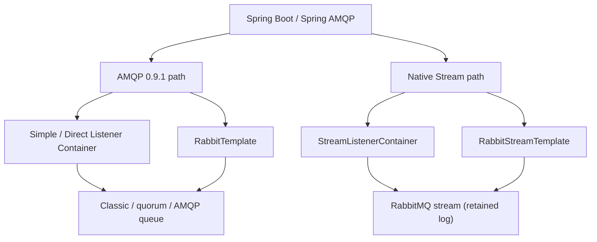
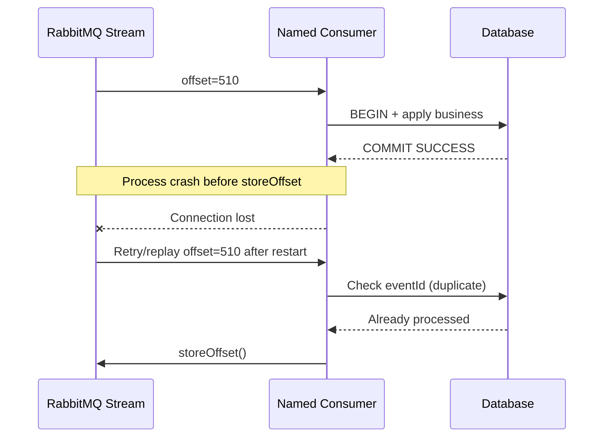
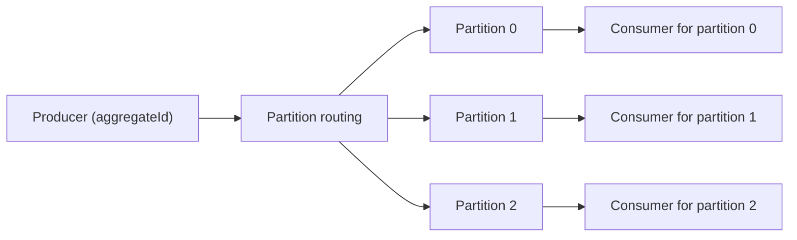

# Giới hạn annotation, retry và tính năng so với container AMQP 0.9.1

> **Chương:** RabbitMQ Streams  
> **Module:** SPRING_AMQP — học tích hợp RabbitMQ qua `RabbitTemplate`, `@RabbitListener`, exchange, queue, binding; luyện tập xác nhận giao nhận, retry, dead-letter, giao dịch và quan sát để xây dựng hệ thống xử lý bất đồng bộ đáng tin cậy.
>
> **Trọng tâm:** So sánh `StreamListenerContainer` / `StreamRabbitListenerContainerFactory` với `SimpleMessageListenerContainer` và `DirectMessageListenerContainer` của AMQP 0.9.1; hiểu **những gì `@RabbitListener` hỗ trợ**, cách **retry và offset tracking** khác ack/nack/requeue, và những tính năng không nên chuyển cấu hình máy móc từ queue sang stream.

## 1. Mục tiêu học tập

Sau bài này, bạn có thể:

1. Phân biệt RabbitMQ **stream (append-only log)** với classic/quorum **work queue**, cũng như phân biệt **native Stream Java client** với tiêu thụ stream queue qua AMQP 0.9.1.
2. Chọn đúng dependency, `Environment`, `RabbitStreamTemplate`, `StreamListenerContainer` và `StreamRabbitListenerContainerFactory` cho ứng dụng Spring AMQP.
3. Giải thích vì sao `@RabbitListener` vẫn dùng được cho stream nhưng chỉ một số attribute được hỗ trợ; không cấu hình `concurrency`, `ackMode`, batching hoặc nhiều queue theo thói quen của SMLC/DMLC.
4. Dùng named consumer, offset start, **manual offset tracking** và idempotency để xử lý message, replay và khôi phục sau sự cố.
5. Thiết kế **stateless retry**, phân loại lỗi, quarantine/parking và chính sách bỏ qua poison event có kiểm soát; biết rằng **stateful retry của AMQP container không có trên StreamListenerContainer**.
6. So sánh publisher confirmation, dead-letter, request/reply, AMQP transactions, prefetch, concurrency, ordering và observability giữa hai mô hình.
7. Lập kế hoạch kiểm thử/migration để tránh nhầm broker offset với nghiệp vụ đã commit.

## 2. Hai mô hình xử lý message trong cùng RabbitMQ

RabbitMQ có thể làm việc như **work queue** và như **retained stream**. Spring AMQP cung cấp các thành phần khác nhau cho từng mô hình:



### 2.1. Work queue và stream khác nhau ở điểm nào?

| Khía cạnh | Classic/quorum queue qua AMQP 0.9.1 | Stream dùng native stream protocol |
|---|---|---|
| Dữ liệu sau khi xử lý | Delivery được ack và không tiếp tục tồn tại như bản tin sẵn sàng của queue | Message nằm trong append-only log **cho đến khi retention xóa**; không mất chỉ vì một consumer xử lý xong |
| Người nhận | Thường là competing consumers chia các delivery | Nhiều consumer có thể đọc cùng log ở vị trí khác nhau |
| “Đã xử lý” | Ack/nack/reject theo delivery và channel | **Offset tracking/checkpoint** cho vị trí đọc; cần tự phân biệt với transaction nghiệp vụ |
| Đọc lại lịch sử | Thường không đọc lại message đã ack nếu không có nguồn khác | Có thể attach từ `first`, `last`, `next`, offset hoặc thời gian theo khả năng client |
| Retry lỗi | Requeue, retry interceptor, retry queue, TTL/DLX, DLQ | Stateless retry trong callback, replay/reposition theo offset; không có “nack vào đầu queue” tương đương |
| Giữ thứ tự | Có thể thay đổi do concurrency, prefetch, priority, redelivery | Có thứ tự offset **trong mỗi stream/partition**; thứ tự side effect vẫn tùy consumer |
| Lưu trữ | Phụ thuộc queue type và delivery lifecycle | Đĩa/segment, `max-age`, `max-length-bytes`; cần quản trị retention |
| Tình huống điển hình | Command/job xử lý một lần theo at-least-once | Event history, audit, analytics, nhiều consumer độc lập, replay |

**Không suy ra “Stream = exactly-once”.** Broker lưu message lâu hơn không có nghĩa HTTP/DB side effect chỉ chạy một lần. Consumer có thể đọc lại cùng offset sau crash hoặc replay; cần idempotency và checkpoint đúng thời điểm.

### 2.2. “Stream queue dùng AMQP 0.9.1” khác “native StreamListenerContainer”

RabbitMQ có queue type `stream` và cho phép một số tương tác thông qua AMQP 0.9.1. Nhưng khi `@RabbitListener` gắn với `SimpleRabbitListenerContainerFactory` hay `DirectRabbitListenerContainerFactory`, ứng dụng vẫn sử dụng **đường AMQP 0.9.1**, không tự biến thành native stream consumer.

Muốn sử dụng các tính năng native như `com.rabbitmq.stream.Environment`, stream offsets và `MessageHandler.Context`, cần **`spring-rabbit-stream` và `StreamRabbitListenerContainerFactory`**. Điều này đặc biệt quan trọng khi code có cùng annotation `@RabbitListener` nhưng hai factory hoạt động khác nhau.

## 3. Kiểm tra phiên bản và thành phần

Spring AMQP bắt đầu cung cấp các thành phần hỗ trợ RabbitMQ Stream Java client từ **Spring AMQP 2.4**. `adviceChain` cho StreamListenerContainer và factory hỗ trợ retry stateless được bổ sung từ **2.4.5**. Các ví dụ dưới đây minh họa API của **Spring AMQP 3.x** cùng Spring Boot 3.x; với Spring AMQP 4.x/Boot 4.x cần đối chiếu starter, package và dependency management theo phiên bản.

### 3.1. Maven dependencies (ví dụ Spring Boot 3.x)

```xml
<dependencies>
    <!-- Classic RabbitMQ AMQP 0.9.1 infrastructure -->
    <dependency>
        <groupId>org.springframework.boot</groupId>
        <artifactId>spring-boot-starter-amqp</artifactId>
    </dependency>

    <!-- Native RabbitMQ Streams integration for Spring AMQP -->
    <dependency>
        <groupId>org.springframework.amqp</groupId>
        <artifactId>spring-rabbit-stream</artifactId>
    </dependency>

    <!-- Bounded retry implementation -->
    <dependency>
        <groupId>org.springframework.retry</groupId>
        <artifactId>spring-retry</artifactId>
    </dependency>

    <dependency>
        <groupId>org.springframework.boot</groupId>
        <artifactId>spring-boot-starter-jdbc</artifactId>
    </dependency>
    <dependency>
        <groupId>org.postgresql</groupId>
        <artifactId>postgresql</artifactId>
        <scope>runtime</scope>
    </dependency>
</dependencies>
```

Lựa chọn BOM/dependency management sao cho phiên bản `spring-rabbit-stream` tương thích với `spring-rabbit`/`spring-amqp`. Đừng trộn major version tùy ý. Đây là module RabbitMQ **Stream**, không phải “chỉ dùng `spring-webflux`” hay thay hẳn `RabbitTemplate` bằng class có cùng API.

### 3.2. Broker cần lắng nghe đúng giao thức

- **AMQP 0.9.1:** thường qua cổng `5672` và các `ConnectionFactory` của Spring Rabbit.
- **RabbitMQ native Streams:** thường qua cổng `5552`, cần plugin/stream listener hoạt động và routing mạng (đặc biệt địa chỉ broker quảng bá cho client).
- **Management:** thường qua cổng `15672` nếu bật plugin quản trị.

Các cổng là mặc định điển hình, không cố định cho mọi môi trường. Trong cluster, load balancer/NAT và địa chỉ được broker quảng bá phải cho phép stream client kết nối tới node lưu stream leader/replica theo cơ chế client. Không tự dùng URL `amqp://host:5672` như URL của native stream environment.

## 4. Annotation: `@RabbitListener` chỉ hỗ trợ một phần

**Sự thật quan trọng:** Spring AMQP vẫn hỗ trợ `@RabbitListener` cho native streams **khi dùng `StreamRabbitListenerContainerFactory`**. Nhưng tài liệu Spring AMQP ghi rõ phần lớn thuộc tính annotation không được sử dụng theo cách của container AMQP.

Với Stream listener factory, những thuộc tính `@RabbitListener` được tài liệu nêu là được hỗ trợ gồm:

| Attribute | Ý nghĩa trong Stream listener |
|---|---|
| `id` | Định danh listener endpoint/container để quản lý và quan sát |
| `queues` | Tên **một stream duy nhất** cho endpoint |
| `autoStartup` | Cho phép quyết định có tự khởi động container hay không |
| `containerFactory` | Chỉ định bean factory tạo `StreamListenerContainer` |

**Các thuộc tính khác không được giả định là có tác dụng**, điển hình `concurrency`, khai báo nhiều queue, và các tùy chọn gắn chặt với ack/requeue/AMQP queue. Một số có thể được annotation parser chấp nhận nhưng bị bỏ qua, khiến ứng dụng khởi động thành công mà hành vi không đúng kỳ vọng.

### 4.1. Mẫu nên dùng

```java
@RabbitListener(
    id = "orders-audit-reader",
    queues = "orders.audit.stream",
    containerFactory = "streamListenerFactory",
    autoStartup = "true"
)
public void read(String event) {
    // xử lý event; semantics phụ thuộc stream factory và offset policy
}
```

### 4.2. Mẫu dễ sai khi copy từ SMLC/DMLC

```java
// KHÔNG NÊN dùng để mong cấu hình native stream như classic listener:
@RabbitListener(
    queues = {"orders.audit.stream", "payments.audit.stream"},
    concurrency = "4",
    ackMode = "MANUAL",
    containerFactory = "streamListenerFactory"
)
public void misleadingListener(String body) {
    // ...
}
```

Đoạn trên được đưa ra làm **anti-pattern**, không phải đoạn code hợp lệ để chạy. Stream factory chỉ hỗ trợ **một stream name** trên một annotated listener; `concurrency` không hoạt động như `SimpleRabbitListenerContainerFactory`; và `ackMode = "MANUAL"` của AMQP 0.9.1 **không biến thành offset tracking**. Để đọc nhiều stream, dùng các listener/container riêng hoặc kiến trúc super stream thích hợp.

### 4.3. Bảng đối chiếu annotation và container

| Kỳ vọng từ ứng dụng classic AMQP | SMLC/DMLC | Native StreamListenerContainer |
|---|---|---|
| `@RabbitListener(queues={A,B})` nhận nhiều queue | Có thể cấu hình theo container | **Một** stream name/endpoint |
| `@RabbitListener(concurrency="N")` | Có ý nghĩa với container hỗ trợ | Không dùng theo semantics classic; cần cấu hình consumer builder/super stream |
| `ackMode="MANUAL"` + `Channel.basicAck` | Hợp lệ khi dùng channel/delivery tag đúng | Không có cơ chế ack per-message qua AMQP channel trong native callback |
| `@RabbitListener(id=...)` | Hỗ trợ | Hỗ trợ |
| `@RabbitListener(autoStartup=...)` | Hỗ trợ | Hỗ trợ |
| `@RabbitListener(containerFactory=...)` | Hỗ trợ | Hỗ trợ, chọn stream factory |
| `@RabbitListener(bindings=...)` để tự tạo topology | Phù hợp với AMQP queue | Không coi là cách cấu hình native stream; dùng StreamAdmin/stream creator |
| `@RabbitListener` + JSON DTO converter | Hỗ trợ với converter đúng | Cần converter/adapter đúng, không tự bảo đảm schema/serializer |
| Nâng concurrency bằng một thuộc tính annotation | Thường thực hiện được trong giới hạn container | Thiết kế consumer/partition/super stream và đo Environment capacity |

Nếu annotation được gắn trên bean nhưng Spring Boot chọn **default classic rabbitListenerContainerFactory**, bạn có thể vẫn tạo **classic consumer** trên queue type stream, không phải consumer native. Hãy chỉ định factory tường minh và kiểm tra bean type lúc chạy.

## 5. Khởi tạo native streams đúng cách

### 5.1. Chọn cách provisioning: `QueueBuilder.stream()` hay `StreamAdmin`

Spring AMQP cho phép khai báo queue type stream qua AMQP 0.9.1:

```java
@Bean
org.springframework.amqp.core.Queue auditStreamQueue() {
    return org.springframework.amqp.core.QueueBuilder
        .durable("orders.audit.stream")
        .stream()
        .build();
}
```

Tuy nhiên, `RabbitAdmin` khai báo các Spring `Declarable` khi **một AMQP connection được mở**. Nếu ứng dụng **chỉ chạy native stream components**, connection AMQP 0.9.1 có thể không được mở và `RabbitAdmin` không tự chạy như mong đợi. Với ứng dụng stream-only hoặc muốn cấu hình retention/các đặc tính native, nên khai báo `StreamAdmin`/stream creator.

Ví dụ theo API tài liệu Spring AMQP:

```java
import java.time.Duration;
import com.rabbitmq.stream.Environment;
import org.springframework.context.annotation.Bean;
import org.springframework.context.annotation.Configuration;
import org.springframework.rabbit.stream.config.StreamAdmin;

@Configuration
class AuditStreamProvisioning {
    @Bean
    StreamAdmin auditStreamAdmin(Environment environment) {
        return new StreamAdmin(environment, streamCreator -> {
            streamCreator.stream("orders.audit.stream")
                .maxAge(Duration.ofDays(3))
                .create();
        });
    }
}
```

Giữ đồng nhất cách tạo topology qua IaC/StreamAdmin, tránh redeclare cùng stream với properties không tương thích. Retention `maxAge` là thời gian lưu log, **không phải TTL cho retry**; các segment bị loại theo quy tắc retention, nên số ngày giữ thực tế cần được đo trên broker.

### 5.2. Bean Environment và listener factory

```java
import com.rabbitmq.stream.Environment;
import org.springframework.amqp.rabbit.listener.RabbitListenerContainerFactory;
import org.springframework.context.annotation.Bean;
import org.springframework.context.annotation.Configuration;
import org.springframework.rabbit.stream.config.StreamRabbitListenerContainerFactory;
import org.springframework.rabbit.stream.listener.StreamListenerContainer;

@Configuration
class AuditStreamConfiguration {
    @Bean(destroyMethod = "close")
    Environment streamEnvironment() {
        return Environment.builder()
            .host("localhost")
            .port(5552)
            .username("guest") // CHỈ ví dụ localhost
            .password("guest")
            .build();
    }

    @Bean("streamListenerFactory")
    RabbitListenerContainerFactory<StreamListenerContainer> streamListenerFactory(
        Environment environment
    ) {
        return new StreamRabbitListenerContainerFactory(environment);
    }
}
```

Trong môi trường thật, credentials/host/port lấy từ secret manager và cấu hình externalized. Spring Boot có khả năng tự cấu hình `Environment` và stream template/factory theo phiên bản; khi đã tự tạo bean, kiểm tra các bean mặc định để tránh trùng hoặc bị ghi đè. Nếu muốn nhận native `com.rabbitmq.stream.Message` và `Context`, cần **setNativeListener(true)**.

### 5.3. Listener dùng Spring AMQP message conversion

```java
import org.springframework.amqp.rabbit.annotation.RabbitListener;
import org.springframework.stereotype.Component;

@Component
public class AuditTextReader {
    @RabbitListener(
        id = "audit-text-reader",
        queues = "orders.audit.stream",
        containerFactory = "streamListenerFactory"
    )
    public void handle(String body) {
        System.out.println("AUDIT: " + body);
    }
}
```

Đây là ví dụ *nhận nội dung* bằng adapter. Nó **không chứng minh message đã commit vào database** hoặc có checkpoint tương ứng. Nếu cần điều khiển chính xác offset và xử lý poison event, sử dụng native listener như mục 6. Đừng áp dụng `basicAck`/`basicNack` của AMQP 0.9.1 cho handler này.

## 6. Native message và manual offset tracking

Trong RabbitMQ Stream Java client, stream message có một **offset trong log**, và callback nhận `MessageHandler.Context` để có thể lưu offset. Việc lưu offset là **checkpoint của tiến trình đọc**, không giống ack để xóa message khỏi queue.

### 6.1. Đặt factory cho native listener

```java
import com.rabbitmq.stream.Environment;
import com.rabbitmq.stream.OffsetSpecification;
import org.springframework.amqp.rabbit.listener.RabbitListenerContainerFactory;
import org.springframework.context.annotation.Bean;
import org.springframework.context.annotation.Configuration;
import org.springframework.rabbit.stream.config.StreamRabbitListenerContainerFactory;
import org.springframework.rabbit.stream.listener.StreamListenerContainer;

@Configuration
class NativeAuditConfiguration {
    @Bean("nativeAuditStreamFactory")
    RabbitListenerContainerFactory<StreamListenerContainer> nativeAuditStreamFactory(
        Environment environment
    ) {
        var factory = new StreamRabbitListenerContainerFactory(environment);
        factory.setNativeListener(true);
        factory.setConsumerCustomizer((id, builder) -> {
            builder.name("orders-audit-projection-v1")
                .offset(OffsetSpecification.first())
                .manualTrackingStrategy();
        });
        return factory;
    }
}
```

Ở đây `OffsetSpecification.first()` có chủ đích cho **bài thực hành replay**, bắt đầu từ offset cũ nhất còn giữ lại. Với ứng dụng production, cần xác định quy tắc **khởi động mới** và **khôi phục offset đã lưu**; đừng mặc nhiên bắt đầu từ đầu mỗi lần deploy hoặc từ đuôi log và bỏ lỡ dữ liệu cũ.

Tên consumer sử dụng cho broker offset tracking phải ổn định qua các lần restart nếu muốn resume đúng vị trí. Khi nhiều instance/partition dùng cùng tên, phải thiết kế quyền sở hữu subscription và phân phối partition đúng cơ chế stream client, tránh nhiều process vô tình ghi đè checkpoint.

### 6.2. Handler chỉ lưu offset sau khi xử lý thành công

```java
import com.rabbitmq.stream.Message;
import com.rabbitmq.stream.MessageHandler.Context;
import java.nio.charset.StandardCharsets;
import org.springframework.amqp.rabbit.annotation.RabbitListener;
import org.springframework.stereotype.Component;

@Component
public class NativeAuditReader {
    private final AuditProjectionService service;

    public NativeAuditReader(AuditProjectionService service) {
        this.service = service;
    }

    @RabbitListener(
        id = "native-audit-reader",
        queues = "orders.audit.stream",
        containerFactory = "nativeAuditStreamFactory"
    )
    public void handle(Message message, Context context) {
        String payload = new String(
            message.getBodyAsBinary(), StandardCharsets.UTF_8
        );
        service.applyIdempotently(payload);

        // Chỉ yêu cầu checkpoint khi nghiệp vụ đã thành công.
        context.storeOffset();
    }
}
```

`AuditProjectionService` là service nghiệp vụ phải được triển khai riêng: kiểm tra schema, dùng `eventId` để deduplicate, commit DB trước khi hàm trả về và ném lỗi nếu chưa hoàn tất. `storeOffset()` không phải một JDBC commit; nếu database commit xong nhưng consumer crash trước khi offset được lưu bền vững, cùng event có thể được đọc lại.

**Ranh giới quan trọng:** `context.storeOffset()` theo cơ chế stream client lưu checkpoint của consumer; không có transaction phân tán nguyên tử giữa PostgreSQL và broker offset tracking. Với workload nhiều message, có thể lưu offset theo batch sau khi tất cả message trước mốc checkpoint đã thực sự được xử lý, nhưng phải hiểu cửa sổ replay và nguy cơ skip message lỗi.

### 6.3. Tại sao không có `Channel.basicAck`?

```text
AMQP 0.9.1 classic listener
  delivery(tag=17) -> xử lý -> basicAck(tag=17)
                            hoặc basicNack(tag=17, requeue=true/false)

Native Stream listener
  message(offset=205) -> xử lý -> storeOffset(205) theo consumer
                       message vẫn được giữ trong log tới khi retention xóa
                       một consumer khác có thể đọc offset=205 độc lập
```

RabbitMQ stream không dùng basic.ack để xóa từng event khỏi append-only log. Do đó, `ackMode="MANUAL"` của annotated AMQP listener **không phải cách bật manual offset tracking** cho stream. Phải cấu hình consumer builder `manualTrackingStrategy()` và chủ động gọi `Context.storeOffset()`, hoặc chọn chiến lược tracking có kiểm soát khác.

### 6.4. Đừng checkpoint vượt message lỗi

Giả sử đã xử lý thành công offset 300, xử lý offset 301 gặp lỗi validation, còn offset 302 thành công. Nếu vẫn lưu checkpoint 302 như thể “đã xử lý hết tới 302”, khi restart consumer có thể **bỏ qua 301**. Việc listener vẫn chạy không chứng minh business state đã nhất quán.

Các chiến lược thường dùng:

1. **Dừng/park partition tại offset lỗi** và xử lý lại sau khi sửa, nếu yêu cầu thứ tự nghiêm ngặt.
2. **Lưu poison event vào quarantine bền vững**, xác nhận hành động này thành công, rồi mới quyết định advance checkpoint để không block toàn luồng.
3. **Retry có giới hạn và backoff** trong callback; khi hết retry, báo động và có một policy rõ ràng cho việc tiếp tục/đóng consumer.
4. **Idempotency/inbox** để replay an toàn các offset đã commit nghiệp vụ nhưng chưa lưu checkpoint.

Không đặt `context.storeOffset()` trong `finally` cho tất cả mọi tình huống; nó có thể làm mất cơ hội xử lý lại event thất bại.

## 7. Retry: khác nhau về đối tượng và ngữ nghĩa

### 7.1. Retry của AMQP container truyền thống

Với `SimpleMessageListenerContainer`/`DirectMessageListenerContainer`, ứng dụng có thể dùng:

- `RetryOperationsInterceptor`/Spring Retry; **stateless** hoặc **stateful** tùy transaction và message identity.
- `defaultRequeueRejected`, `AmqpRejectAndDontRequeueException` và `ImmediateRequeueException` để điều khiển broker requeue/reject.
- DLX, retry queue, TTL và dead-letter để trì hoãn và cách ly message.
- `AcknowledgeMode.AUTO/MANUAL/NONE` và `Channel.basicAck/basicNack` trên AMQP channel.

Đây là **delivery settlement semantics** của AMQP 0.9.1.

### 7.2. Retry trong native StreamListenerContainer

Spring AMQP 2.4.5+ hỗ trợ `adviceChain` cho StreamListenerContainer và cung cấp `StreamRetryOperationsInterceptorFactoryBean` để tạo **stateless retry** với tùy chọn `StreamMessageRecoverer` cho **native stream message**.

**Stateful retry không được hỗ trợ** bởi container này theo tài liệu chính thức. Ngoài ra, `StreamMessageRecoverer` không nên được hiểu là RabbitMQ tự động DLQ message do callback lỗi; bạn phải triển khai hành vi recover cụ thể, kiểm soát checkpoint và lưu chứng cứ lỗi.

| Vấn đề | Classic AMQP container | Native Stream container |
|---|---|---|
| Retry một lần callback | Stateless retry interceptor | Stateless retry advice được hỗ trợ |
| Stateful retry gắn với message identity/rollback | Có mô hình cấu hình riêng khi phù hợp | **Không được hỗ trợ** trong StreamListenerContainer |
| Requeue theo `basicNack(requeue=true)` | Có | Không có tương đương ack/nack trên native stream |
| Dead-letter khi `requeue=false` | Broker có thể chuyển tới DLX/DLQ | Không có auto-DLQ chỉ từ exception của native callback |
| Retry sau restart | Broker redelivery hoặc retry queue | Đọc lại từ offset/checkpoint theo policy |
| Thông điệp hỏng | DLQ/recoverer theo AMQP route | Quarantine/recoverer riêng; offset không được advance khi chưa có quyết định |
| Giới hạn vòng lặp | Retry budget + DLQ | Retry budget + poison-event policy + checkpoint discipline |

### 7.3. Định nghĩa stateless retry có giới hạn

```java
import org.springframework.context.annotation.Bean;
import org.springframework.context.annotation.Configuration;
import org.springframework.rabbit.stream.retry.StreamRetryOperationsInterceptorFactoryBean;
import org.springframework.retry.support.RetryTemplate;

@Configuration
class StreamRetryAdviceConfiguration {
    @Bean("streamRetryAdvice")
    StreamRetryOperationsInterceptorFactoryBean streamRetryAdvice() {
        RetryTemplate retry = RetryTemplate.builder()
            .maxAttempts(3)  // Tổng 3 lần gọi, gồm lần đầu
            .exponentialBackoff(200, 2.0, 2_000)
            .build();

        var advice = new StreamRetryOperationsInterceptorFactoryBean();
        advice.setRetryOperations(retry);
        advice.setStreamMessageRecoverer((message, context, failure) -> {
            // THAY BẰNG durable quarantine / alert có xác nhận.
            // Không tự động checkpoint ở đây.
            throw new IllegalStateException(
                "Stream event failed after retries", failure
            );
        });
        return advice;
    }
}
```

`maxAttempts(3)` ở đây là **tổng lần xử lý** theo RetryTemplate, không phải broker phát delivery ba lần; `x-death` của AMQP cũng không tự tăng. Đoạn recoverer cố tình **không đánh dấu message đã xử lý**, buộc người vận hành/đơn vị xây callback thiết kế quarantine hoặc pause consumer. Trong production, nên phân loại exception có thể thử lại (I/O timeout) và lỗi không thể tự sửa (schema invalid) để tránh retry vô ích.

Sau khi xây advice bean (đây là Spring `FactoryBean<Advice>`), một stream factory riêng có thể dùng:

```java
import com.rabbitmq.stream.Environment;
import org.aopalliance.aop.Advice;
import org.springframework.amqp.rabbit.listener.RabbitListenerContainerFactory;
import org.springframework.beans.factory.annotation.Qualifier;
import org.springframework.context.annotation.Bean;
import org.springframework.context.annotation.Configuration;
import org.springframework.rabbit.stream.config.StreamRabbitListenerContainerFactory;
import org.springframework.rabbit.stream.listener.StreamListenerContainer;

@Configuration
class RetryEnabledStreamFactory {
    @Bean("retryingNativeStreamFactory")
    RabbitListenerContainerFactory<StreamListenerContainer> retryingFactory(
        Environment environment,
        @Qualifier("streamRetryAdvice") Advice retryAdvice
    ) {
        var factory = new StreamRabbitListenerContainerFactory(environment);
        factory.setNativeListener(true);
        factory.setAdviceChain(retryAdvice);
        // Tùy tình huống, thêm ConsumerCustomizer có manual tracking,
        // consumer name và offset policy, tương tự mục 6.
        return factory;
    }
}
```

**Không sử dụng hai stream listener** đọc cùng message với offset names/scope không rõ ràng chỉ để test retry. Mẫu ở trên là factory **thay thế** của mục 6 khi muốn retry; cần bổ sung offset policy và idempotency tương ứng trước khi triển khai.

### 7.4. Hết retry không được tự coi là ACK/DLQ

Khi hết số lần thử, cần lựa chọn quyết định nghiệp vụ:

| Quyết định | Hành động cần thực hiện | Rủi ro |
|---|---|---|
| Dừng consumer/partition, chưa advance checkpoint | Alert, giữ offset lỗi để xử lý lại từ nguồn | Lag tăng, các event phía sau bị chậm |
| Quarantine rồi tiếp tục | Ghi bản sao lỗi + metadata vào DB/stream/queue cách ly, **xác nhận lưu bền vững**, quyết định checkpoint | Nếu quarantine thất bại mà vẫn checkpoint sẽ bỏ sót dữ liệu |
| Bỏ qua có chủ đích | Lập quyết định theo policy, audit lý do, checkpoint | Mất nghiệp vụ của event đó; phải có quyền và bằng chứng |
| Khởi động lại từ offset trước | Chạy consumer/replay job riêng theo checkpoint | Có thể reprocess nhiều event đã thành công; phải idempotent |

Nếu ứng dụng publish poison event sang AMQP queue bằng `RabbitTemplate`, không tự giả định thao tác đó atomic với lưu offset stream hoặc transaction DB. Dùng publisher confirms/returns khi cần và thiết kế duplicate-safe. **Quarantine không giống broker DLX tự phát sinh do reject.**

## 8. Offset tracking, replay và retention

### 8.1. Ba khái niệm không thể đánh đồng

- **Log offset:** vị trí của message trong một stream/partition.
- **Stored consumer offset:** checkpoint cho một named consumer, thường dùng để khôi phục sau restart.
- **Business progress:** trạng thái nghiệp vụ thực tế trong database hoặc downstream. Có thể đã commit dù chưa checkpoint, hoặc ngược lại nếu code sai.



Đây là **at-least-once** tự nhiên của nhiều pipeline stream. Muốn hậu quả nghiệp vụ chỉ xảy ra một lần, consumer cần transactional inbox/deduplication key hoặc idempotent operation ở hệ thống đích.

### 8.2. Offset đầu, cuối và replay có mục đích

Native stream consumer có thể bắt đầu ở:

- `OffsetSpecification.first()`: offset cũ nhất còn được giữ (phù hợp để rebuild projection).
- `OffsetSpecification.last()`: vùng cuối log theo semantics chunk/offset của client; **không mặc định đồng nghĩa chỉ những message tương lai**.
- `OffsetSpecification.next()`: các message xuất hiện sau khi consumer attach, theo semantics client.
- Offset cụ thể hoặc vị trí theo thời gian khi API hỗ trợ.

Khi ứng dụng dùng **named consumer + broker offset tracking**, client có thể phục hồi từ vị trí đã lưu; cần kiểm tra chính sách lựa chọn *stored offset vs configured initial offset* của phiên bản client và cách đặt tên. Để replay độc lập mà không ảnh hưởng checkpoint production, thường tạo **consumer name riêng** hoặc một replay job có checkpoint riêng.

### 8.3. Retention không đảm bảo dữ liệu còn mãi

Stream là append-only log nhưng dữ liệu cũ được xóa theo chính sách retention. Các giá trị `max-age` và `max-length-bytes` được áp dụng theo segment, nên không nên suy ra một message sẽ tồn tại đúng một khoảng giây hoặc số byte tuyệt đối. Đặc biệt:

- Nếu consumer lag vượt retention, các offsets cũ có thể không còn tồn tại để replay.
- Lưu offset ở broker không giữ hộ dữ liệu quá tuổi hoặc quá dung lượng.
- Replay hàng loạt có thể gây spike CPU, disk I/O và downstream load; cần rate limit, checkpoint và đối soát.
- Với super streams, offset và retention phải được tính theo **từng partition**, không có một offset toàn cục.

Hãy thiết lập cảnh báo **consumer lag so với oldest available offset/retention boundary**, thay vì chỉ cảnh báo queue depth của classic AMQP.

## 9. Publisher: RabbitStreamTemplate không phải RabbitTemplate

`RabbitStreamTemplate` cung cấp **một tập con** của `RabbitTemplate` cho RabbitMQ native streams. Các phương thức publish trả `CompletableFuture<Boolean>` ở nhánh Spring AMQP 3.x hiện đại, phản ánh xác nhận từ stream producer ở cấp broker.

```java
import com.rabbitmq.stream.Environment;
import org.springframework.context.annotation.Bean;
import org.springframework.context.annotation.Configuration;
import org.springframework.rabbit.stream.producer.RabbitStreamTemplate;

@Configuration
class AuditStreamPublisherConfig {
    @Bean
    RabbitStreamTemplate auditStreamTemplate(Environment env) {
        return new RabbitStreamTemplate(env, "orders.audit.stream");
    }
}
```

```java
import java.util.concurrent.TimeUnit;
import org.springframework.rabbit.stream.producer.RabbitStreamTemplate;
import org.springframework.stereotype.Service;

@Service
public class StreamAuditPublisher {
    private final RabbitStreamTemplate stream;

    public StreamAuditPublisher(RabbitStreamTemplate stream) {
        this.stream = stream;
    }

    public void publish(String payload) throws Exception {
        Boolean confirmed = stream.convertAndSend(payload)
            .get(10, TimeUnit.SECONDS);
        if (!Boolean.TRUE.equals(confirmed)) {
            throw new IllegalStateException("Stream publish not confirmed");
        }
    }
}
```

Đoạn code chờ confirm đồng bộ chỉ để dễ hiểu; pipeline throughput cao thường dùng completion callback hoặc xử lý future bất đồng bộ có **bounded in-flight**. Nếu future timeout hoặc connection mất, kết quả có thể **UNKNOWN**: broker có thể đã nhận event nhưng client chưa thấy xác nhận. Dùng `eventId` ổn định, idempotency và transactional outbox nếu event gắn với DB transaction.

**Không chuyển nguyên `RabbitTemplate.convertSendAndReceive` / `replyTo` / `channelTransacted` sang RabbitStreamTemplate.** Native stream template chủ yếu phục vụ publish vào stream cụ thể; request/reply/RPC của AMQP queue và AMQP channel transactions là cơ chế khác. Cũng đừng đọc `Boolean.TRUE` như bằng chứng consumer đã xử lý nghiệp vụ.

### 9.1. Message conversion hai bước

`RabbitStreamTemplate` dùng:

1. `MessageConverter` để chuyển domain object sang Spring AMQP `Message`.
2. `StreamMessageConverter` để chuyển Spring AMQP `Message` sang native stream `com.rabbitmq.stream.Message`.

Nếu producer và consumer không đồng nhất content-type/serializer/schema, có thể xảy ra lỗi deserialize mặc dù broker đã lưu message thành công. Nên định nghĩa schema version, compatibility policy, header metadata và xử lý poison event trước khi chuyển sang stream.

## 10. Những tính năng classic AMQP không chuyển nguyên sang streams

| Tính năng quen thuộc | AMQP 0.9.1 SMLC/DMLC | Native Streams trong Spring AMQP |
|---|---|---|
| `basicAck/basicNack/basicReject` | Có; delivery tag thuộc channel | Không; dùng offset tracking/checkpoint |
| `AcknowledgeMode.MANUAL/AUTO` | Có ý nghĩa với delivery settlement | Không dùng làm offset strategy |
| `defaultRequeueRejected` | Điều khiển AMQP requeue khi listener lỗi | Không thể diễn giải thành “replay offset” |
| `AmqpRejectAndDontRequeueException` | Có thể gây reject và DLQ theo cấu hình | Không tự kích hoạt broker DLX cho native callback |
| TTL retry queue + DLX | Phổ biến với work queues | Không phải retry mặc định; cần retry/quarantine/replay riêng |
| `RabbitTransactionManager`, `channelTransacted` | Transaction AMQP channel | Không đem sang native stream producer/consumer như cũ |
| AMQP request/reply `ReplyTo` | Có cơ chế tương ứng trong `RabbitTemplate` | Không có API giống hệt trong `RabbitStreamTemplate` |
| Consumer prefetch `basic.qos` | Có | Không phải tham số điều tiết native stream tương đương; quản lý client credits/processing resources theo Stream API |
| `concurrency` trên `@RabbitListener` | Có tác dụng ở container hỗ trợ | Bị bỏ qua theo giới hạn stream annotation |
| Nhiều queue trên một annotated listener | Có thể cấu hình | Một stream/annotated endpoint |
| `RabbitAdmin` auto-declare queue/binding | Hoạt động khi AMQP connection được mở và admin chạy | Với stream-only thường chọn `StreamAdmin` |
| Retry stateful | Có trong một số trường hợp phù hợp | **Không hỗ trợ** trong StreamListenerContainer |
| Replay sau khi đã xử lý | Khó nếu message đã được ack | Tính năng cốt lõi của retained log, trong giới hạn retention |
| Theo dõi message đã xong | Ack count, unacked, DLQ | Offset/lag, checkpoint age, processing success/fail |

Một số RabbitMQ stream queues vẫn hỗ trợ tương tác AMQP 0.9.1 qua classic client, nhưng bảng này **chỉ so sánh native stream listener với classic AMQP listener**. Không dựa trên việc cùng tên “RabbitMQ Streams” để suy diễn mọi AMQP feature sẽ có trên Stream API.

## 11. Super streams và concurrency: thay đổi mô hình song song

Super stream là cơ chế phân vùng log thành nhiều stream partitions, thường được định tuyến bởi routing key/hash. Mỗi partition có thứ tự offset riêng; không có bảo đảm **total order** giữa tất cả partitions. Khi sử dụng super stream, Spring AMQP có `SuperStream` để provisioning và API native container riêng cho consumption.



Với dữ liệu `OrderCreated/OrderPaid/OrderShipped`, đưa các events cùng `orderId` vào cùng partition bằng routing ổn định nếu cần giữ thứ tự theo đơn hàng. Nhưng consumer vẫn phải kiểm soát version và idempotency nếu replay, retry hoặc downstream transaction có thể lỗi.

### 11.1. Không dùng `@RabbitListener(concurrency="3")` để cấu hình super stream

Spring AMQP cung cấp API trực tiếp trên `StreamListenerContainer` cho super stream; ví dụ:

```java
import com.rabbitmq.stream.Environment;
import com.rabbitmq.stream.OffsetSpecification;
import org.springframework.context.annotation.Bean;
import org.springframework.context.annotation.Configuration;
import org.springframework.rabbit.stream.listener.StreamListenerContainer;

@Configuration
class PartitionedStreamExample {
    @Bean
    StreamListenerContainer superStreamContainer(Environment env) {
        StreamListenerContainer container = new StreamListenerContainer(env);
        container.superStream("orders.audit.super", "audit-projection", 3);
        container.setupMessageListener(message -> {
            // DEMO only: hiện thực idempotency và checkpoint trước production.
            System.out.println(message);
        });
        container.setConsumerCustomizer(
            (id, builder) -> builder.offset(OffsetSpecification.last())
        );
        return container;
    }
}
```

Trong ví dụ tài liệu Spring AMQP, concurrency thực tế lớn hơn 1 còn chịu ảnh hưởng bởi capacity/`maxConsumersByConnection` của native `Environment`; không mặc định chỉ thay số 3 là có chính xác ba callback chạy song song. Nếu cấu hình consumer thông qua API direct/container, hãy tránh đăng ký cùng stream thêm một annotated listener không có chủ đích và tính đến nhiều instance khi scale.

### 11.2. Khi nào không cần super stream?

Nếu chỉ một consumer phải xây read-model tuần tự và throughput còn thấp, một stream cùng named consumer đã đủ. Chỉ thêm partition khi có lý do về throughput, cách ly workload và thiết kế khóa partition ổn định. Tăng số partition về sau có thể ảnh hưởng mapping key → partition; cần kế hoạch migration và versioning.

## 12. Quan sát: offset và lag là chỉ số trung tâm

Đối với AMQP queues, dashboard thường quan tâm `messages_ready`, `messages_unacknowledged`, ack/nack, DLQ depth. Đối với native Streams, một dashboard cần tập trung thêm:

| Chỉ số | Ý nghĩa và cảnh báo |
|---|---|
| **Producer confirm success/failure/timeout** | Broker nhận publish tới stream hay outcome chưa rõ |
| **Consumer offset / stored offset** | Consumer đang đọc đâu, checkpoint bền vững gần nhất ở đâu |
| **Lag theo partition/consumer** | Khoảng cách tới tail log; có nguy cơ vượt retention |
| **Offset checkpoint age** | Lần cuối checkpoint được ghi nhận, dùng phát hiện consumer không tiến lên |
| **Retry attempts và poison-event count** | Event làm callback thất bại nhiều lần, có cần quarantine/stop |
| **Quarantine backlog** | Các sự kiện đã được cách ly và chờ điều tra |
| **Duplicate suppression rate** | Tác động của replay/crash và hiệu quả idempotency |
| **Retention/oldest available offset/segment size** | Dữ liệu sắp bị loại trong lúc consumer còn lag |
| **Partition skew** | Một partition nhiều traffic hơn các partition khác |
| **Business commit latency / error** | Ứng dụng đã áp dụng dữ liệu đúng chưa, không chỉ đọc nhanh |

Các metric tên cụ thể tùy RabbitMQ Management/Prometheus, Stream Java client và Micrometer. Spring AMQP hỗ trợ **Micrometer Observation** cho `RabbitStreamTemplate` và stream listener từ phiên bản 3.0.5; bật `observationEnabled` trên template/factory theo tài liệu. Khi Observation được bật, Micrometer Timers riêng của container có thể được thay bằng metrics từ observation, nên kiểm tra thay đổi dashboard trước khi deploy.

Không dùng `eventId` hay full `aggregateId` làm tag metric vì cardinality cao; dùng structured logs và tracing. Một hệ thống có lag nhỏ nhưng persist sai business state vẫn là lỗi.

## 13. Quy trình lựa chọn và migration có kiểm soát

### 13.1. Quy tắc chọn mô hình

Chọn **SMLC/DMLC + AMQP 0.9.1** khi:

- Message là **job/command** cần xử lý bởi một worker tại một thời điểm.
- Muốn điều khiển ack/nack/requeue, retry queue, DLQ, request/reply hoặc channel transaction quen thuộc.
- Không cần giữ toàn bộ lịch sử để nhiều consumer replay.

Chọn **StreamListenerContainer + RabbitStreamTemplate** khi:

- Có yêu cầu **retained event log**, nhiều read-model/analytics consumers hoặc replay/rebuild projection.
- Chấp nhận thiết kế checkpoint và retry/quarantine ở tầng ứng dụng.
- Có khả năng quản trị retention, lag, partition và idempotency.

Đừng chọn stream chỉ vì tên “stream” nghe mới hơn; hãy xác định throughput, lịch sử dữ liệu, thời hạn replay, fault model và chi phí vận hành.

### 13.2. Checklist chuyển từ classic listener sang stream

1. **Xác định contract:** Event có `eventId`, `aggregateId`, schema version, timestamp và hợp đồng tương thích ngược.
2. **Provision:** Tạo stream qua `StreamAdmin` hoặc cách quản lý topology phù hợp, đặt retention và quyền truy cập.
3. **Client:** Dùng `spring-rabbit-stream` đúng phiên bản, có native `Environment`, `RabbitStreamTemplate`/`StreamRabbitListenerContainerFactory`.
4. **Annotation:** Mỗi annotated endpoint một stream; chỉ dùng những thuộc tính được hỗ trợ, không copy `ackMode`/`concurrency` từ SMLC.
5. **Replay start:** Chọn consumer name, initial offset và stored checkpoint policy. Không ghi đè checkpoint production trong test replay.
6. **DB/inbox:** Chặn duplicate và áp dụng business state đúng thứ tự trong transaction cần thiết.
7. **Failure:** Thiết kế retry stateless, phân loại poison event, quarantine và quyết định checkpoint khi lỗi.
8. **Producer:** Chờ/quan sát publisher confirmation, có retry budget và outbox nếu phát sự kiện từ database transaction.
9. **Quan sát:** Dashboard offset/lag/retention, retry, poison events, publish confirms và DB commit.
10. **Thử nghiệm:** Restart consumer, đứt broker, replay từ offset cũ, sự kiện lỗi, retention hết hạn và partition rebalance.

### 13.3. Một số lỗi dễ gặp sau migration

| Triệu chứng | Nguyên nhân có thể | Cách xử lý |
|---|---|---|
| `@RabbitListener` chạy nhưng không dùng offset API | Đang dùng classic listener factory | Gắn `StreamRabbitListenerContainerFactory` và `setNativeListener(true)` |
| Đặt `concurrency=5` nhưng chỉ có một reader | Attribute không áp dụng cho stream | Cấu hình consumer builder/super stream và đo capacity |
| Sau restart xử lý lại nhiều event cũ | Chưa đặt/tồn tại checkpoint, sai consumer name hoặc chủ động `first` | Kiểm tra stored offset và idempotency |
| Sau restart bỏ qua một số event | Chọn `next` không phù hợp, auto checkpoint quá sớm hoặc retention mất dữ liệu | Sửa offset policy, không checkpoint khi logic thất bại |
| Handler ném exception nhưng không thấy message trong DLQ | Native stream không tự reject-to-DLX như classic queue | Quarantine/retry policy riêng |
| `@Retryable` có nhưng event vẫn không theo dự kiến | Retry được cấu hình cho bean khác hoặc không theo stream advice chain | Dùng stream-specific stateless advice, kiểm thử lỗi thực |
| Thử bật stateful retry trên stream | Không được container hỗ trợ | Thiết kế replay/offset và stateless retry có giới hạn |
| `RabbitAdmin` không tạo stream trong app stream-only | Không có AMQP connection kích hoạt admin | Dùng `StreamAdmin` hoặc provisioning IaC riêng |
| Publisher Future timeout | Không nhận confirmation, outcome có thể unknown | Audit eventId, outbox/idempotency, điều tra network/broker |
| Consumer lag tăng khi DB chậm | Consumer xử lý logic nhanh hơn DB hoặc backpressure thiếu | Giới hạn in-flight, tối ưu DB, tăng partition có chủ đích |

## 14. Bài thực hành kiểm chứng giới hạn

Tạo một stream `orders.audit.stream` trong broker thử nghiệm, bật native stream protocol (thường cổng 5552). Dùng hai projectors có tên/checkpoint **khác nhau** để tránh ghi đè offset của nhau. Các thí nghiệm dưới đây nên ghi log `eventId`, offset, lần xử lý, trạng thái database và checkpoint.

| Test | Thực hiện | Điều phải xác nhận |
|---|---|---|
| **T1 — Annotation hỗ trợ** | Dùng `id`, `queues` một stream, `autoStartup`, `containerFactory` | Consumer khởi động với stream factory và nhận message |
| **T2 — Annotation không hỗ trợ** | Đặt `concurrency` hoặc nhiều stream names trong thử nghiệm riêng | Không tự cho rằng chúng chạy theo semantics SMLC; xác nhận qua config/runtime |
| **T3 — Bắt đầu từ `first`** | Publish A, B, C trước, rồi attach consumer mới | Đọc từ dữ liệu cũ nhất còn trong retention |
| **T4 — Bắt đầu từ `next`** | Attach consumer trước, sau đó publish D | Bắt đầu ở các message mới theo semantics client |
| **T5 — Store offset sau DB commit** | Commit rồi gọi `storeOffset` | Checkpoint tăng sau khi business logic thành công |
| **T6 — Crash giữa DB commit và checkpoint** | Ngắt consumer test ngay sau transaction DB | Có thể đọc lại event; idempotency chặn side effect trùng |
| **T7 — Poison JSON** | Publish payload lỗi; bật retry 3 attempts | Có 3 callback attempts, không tự DLQ; quarantine/stop theo policy |
| **T8 — Lag và retention** | Giữ consumer tắt quá retention của stream test | Có thể mất khả năng replay offsets cũ; cảnh báo lag/retention |
| **T9 — Hai consumer độc lập** | Hai named consumers đọc cùng stream | Mỗi consumer có offset/projection riêng |
| **T10 — Super stream** | Dùng partition theo `orderId` | Offset/order trong từng partition, không giả định global order |
| **T11 — Publisher confirm** | Publish và giả lập mất kết nối trước confirm | Outcome unknown; không tự đánh dấu broker chưa nhận |
| **T12 — So với classic queue** | Cùng lỗi nghiệp vụ trên SMLC có DLX và StLC native | SMLC có broker reject/DLQ, native cần policy quarantine/offset riêng |

### 14.1. Tình huống thực hành

Một hệ thống audit có các sự kiện `E100` offset 100, `E101` offset 101, `E102` offset 102. Consumer ghi dữ liệu của E100 vào DB rồi lưu offset 100. Với E101, DB commit thành công nhưng ứng dụng crash trước `storeOffset()`. Khi khởi động lại, hệ thống đọc lại E101; E102 đến sau.

Hãy trả lời:

1. Vì sao E101 có thể xử lý lại dù đây là RabbitMQ Stream và không có `basicNack`?
2. Vì sao không nên tự checkpoint 102 chỉ vì đã nhìn thấy E102?
3. Trong database nên có bảng idempotency với unique key gì?
4. Nếu E101 có schema sai vĩnh viễn, bạn chọn dừng partition hay lưu vào quarantine rồi advance? Cần bằng chứng gì?
5. Nếu đội vận hành muốn replay lại toàn bộ audit sau một tuần nhưng retention chỉ 3 ngày, điều gì xảy ra?
6. Nếu thêm `@RabbitListener(concurrency="8")` thì có tự tạo tám stream consumers không?

**Hướng giải:** Tách checkpoint khỏi transaction database, đánh dấu `eventId` đã xử lý cùng side effect, checkpoint sau commit; khi gặp gap/poison event phải có policy rõ. Retention là giới hạn dữ liệu thực tế; muốn replay một tuần phải thiết kế retention/archival trước khi sự cố xảy ra.

## 15. Ghi nhớ và tài liệu tham khảo

**Native RabbitMQ Streams và AMQP 0.9.1 container là hai đường đi khác nhau.** `StreamRabbitListenerContainerFactory` cho phép dùng `@RabbitListener`, nhưng chỉ hỗ trợ một số annotation attributes, một stream mỗi endpoint, và mô hình xử lý chính là **retained log + offset tracking**. Nó không tự có `Channel.basicAck/basicNack`, requeue/DLX khi listener lỗi hay stateful retry như container AMQP.

Spring AMQP có **stateless retry advice** cho stream từ nhánh 2.4.5+, nhưng hết retry phải có **quarantine/stop/replay policy** riêng. Để xử lý bất đồng bộ đáng tin cậy, đừng chỉ theo dõi tốc độ nhận message: hãy xác minh **business commit, idempotency, checkpoint, retention, publisher confirmation và consumer lag**. Chỉ thay annotation/factory mà không đổi fault model là một migration chưa hoàn chỉnh.

**Tài liệu chính thức:**

- Spring AMQP — Using the RabbitMQ Stream Plugin: https://docs.spring.io/spring-amqp/reference/stream.html
- Spring AMQP — Message Listener Container Configuration: https://docs.spring.io/spring-amqp/reference/amqp/containerAttributes.html
- Spring AMQP — Annotation-driven Listener Endpoints: https://docs.spring.io/spring-amqp/reference/amqp/receiving-messages/async-annotation-driven.html
- RabbitMQ — Streams and Superstreams: https://www.rabbitmq.com/docs/streams
- RabbitMQ — Stream Tutorial, Java: https://www.rabbitmq.com/tutorials/tutorial-one-java-stream
- RabbitMQ — Stream Offset Tracking Tutorial, Java: https://www.rabbitmq.com/tutorials/tutorial-two-java-stream
- RabbitMQ Stream Java Client — API and Consumer Offsets: https://rabbitmq.github.io/rabbitmq-stream-java-client/stable/htmlsingle/
- Spring Boot — AMQP/RabbitMQ and Stream Configuration: https://docs.spring.io/spring-boot/reference/messaging/amqp.html
