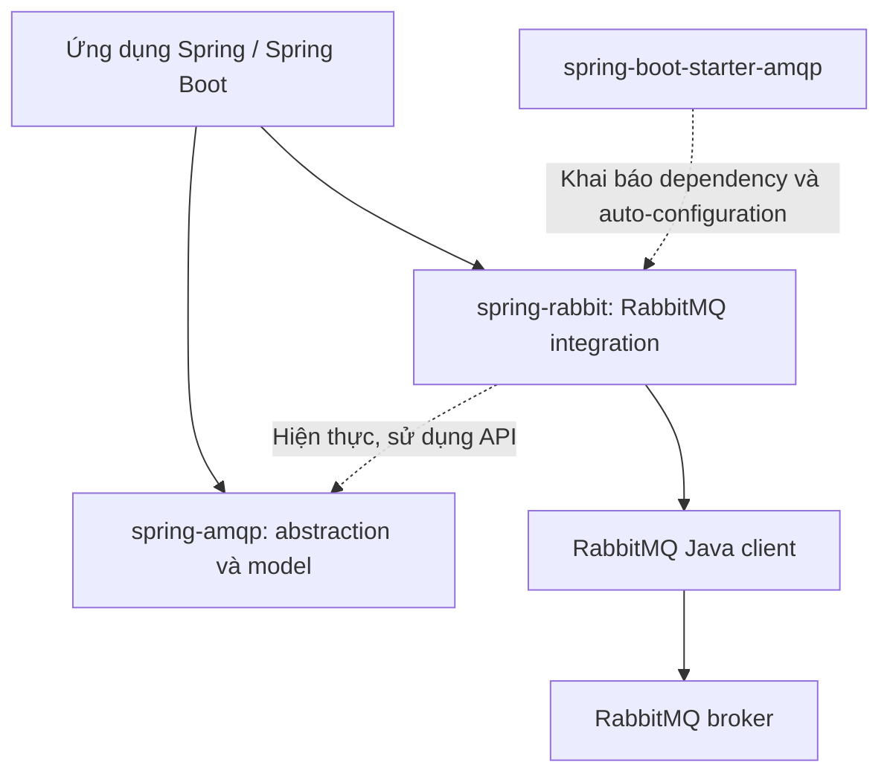
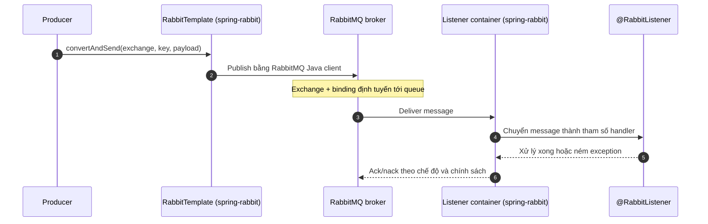

# Vai trò của `spring-amqp` và `spring-rabbit`

Khi bắt đầu tích hợp RabbitMQ với Spring, bạn sẽ thấy nhiều tên gần giống nhau: **Spring AMQP**, `spring-amqp`, `spring-rabbit`, `spring-boot-starter-amqp` và `amqp-client`. Nếu xem chúng là một thư viện duy nhất, bạn dễ chọn sai dependency, nhầm nơi đặt API hoặc cho rằng chỉ cần thêm thư viện là hệ thống đã trao đổi message an toàn.

Trong module **SPRING_AMQP**, chúng ta học cách gửi message bằng `RabbitTemplate`, nhận bằng `@RabbitListener`, định tuyến qua exchange–queue–binding, và xây xử lý bất đồng bộ đáng tin cậy với acknowledgment, retry, dead-letter, giao dịch và quan sát hệ thống. Hiểu vai trò của từng thư viện là bước đầu để biết API nào đang dùng, thành phần nào thực sự giao tiếp với RabbitMQ và Spring Boot hỗ trợ cấu hình tới đâu.

## 1. Mục tiêu học tập

Sau bài này, bạn có thể:

- Phân biệt **Spring AMQP** (tên dự án) với **`spring-amqp`** (module thư viện cụ thể).
- Giải thích trách nhiệm của `spring-amqp`, `spring-rabbit`, `spring-boot-starter-amqp` và RabbitMQ Java client.
- Xác định các lớp/interface/annotation thường dùng thuộc module nào.
- Khai báo dependency phù hợp cho ứng dụng Spring Boot và ứng dụng Spring tự cấu hình.
- Hiểu tại sao cần đồng bộ phiên bản thư viện, cấu hình broker và cơ chế bảo đảm giao nhận message.

## 2. Bức tranh tổng thể: từ API đến broker

**Spring AMQP** là tên của một dự án thuộc hệ sinh thái Spring, cung cấp các abstraction và phần triển khai để ứng dụng Java làm việc với hệ thống message theo cách quen thuộc của Spring. Trong dự án này có hai artifact đặc biệt quan trọng:

| Tên | Loại | Vai trò chính |
|---|---|---|
| **Spring AMQP** | Tên dự án/hệ thư viện | Nhóm API và tích hợp AMQP trong hệ sinh thái Spring |
| **`org.springframework.amqp:spring-amqp`** | Thư viện lõi | Cung cấp interface và mô hình dữ liệu AMQP: `AmqpTemplate`, `AmqpAdmin`, `Message`, `Queue`, `Exchange`, `Binding`... |
| **`org.springframework.amqp:spring-rabbit`** | Thư viện tích hợp RabbitMQ | Hiện thực các abstraction bằng RabbitMQ: `RabbitTemplate`, `RabbitAdmin`, kết nối, listener container, `@RabbitListener`, xác nhận gửi/nhận... |
| **`org.springframework.boot:spring-boot-starter-amqp`** | Spring Boot starter | Kéo vào bộ dependency cần thiết và kích hoạt auto-configuration cho ứng dụng Boot khi đáp ứng điều kiện |
| **`com.rabbitmq:amqp-client`** | RabbitMQ Java client | Thư viện giao tiếp RabbitMQ ở mức connection, channel, publish/consume của client Java |
| **RabbitMQ broker** | Dịch vụ máy chủ | Nhận, định tuyến, xếp hàng và phân phối message; chạy độc lập với ứng dụng Java |

Đây là mối quan hệ tổng quát:



Các mũi tên thể hiện vai trò phụ thuộc/tích hợp, không phải một sơ đồ truyền message vật lý chính xác. Luồng message thông thường là: ứng dụng gọi `RabbitTemplate` → `spring-rabbit` sử dụng RabbitMQ Java client → broker → listener container chuyển message cho `@RabbitListener`.

**Điểm dễ nhầm nhất:** tên **Spring AMQP** thường được dùng để nói về cả dự án, trong khi `spring-amqp` viết dưới dạng artifact ID chỉ **module lõi**. Bạn có thể đang dùng “Spring AMQP” trên thực tế dù trong `build.gradle` chỉ khai báo `spring-boot-starter-amqp`, vì starter kéo các module cần thiết theo quan hệ dependency.

## 3. `spring-amqp`: hợp đồng lập trình và mô hình message

`spring-amqp` định nghĩa những khái niệm chung để code nghiệp vụ không phải thao tác trực tiếp với `Channel` của RabbitMQ Java client trong mọi nơi.

### 3.1. Các API tiêu biểu

| API trong `org.springframework.amqp.core` | Ý nghĩa |
|---|---|
| `AmqpTemplate` | Giao diện các thao tác gửi, chuyển đổi và nhận message |
| `AmqpAdmin` | Giao diện tác vụ khai báo/xóa các tài nguyên AMQP như queue, exchange và binding |
| `Message` | Biểu diễn message theo dạng body là byte array cùng metadata |
| `MessageProperties` | Metadata của message: content type, headers, message ID, delivery mode... |
| `Queue` | Mô tả một queue: tên, durable, exclusive, auto-delete và arguments |
| `Exchange`, `DirectExchange`, `TopicExchange`, `FanoutExchange` | Mô tả exchange và kiểu định tuyến |
| `Binding`, `BindingBuilder` | Mô tả liên kết exchange ↔ queue (hoặc exchange ↔ exchange) và routing key |

Ví dụ dùng các kiểu dữ liệu của module lõi để **mô tả topology**, chưa phải mã gửi dữ liệu:

```java
import org.springframework.amqp.core.Binding;
import org.springframework.amqp.core.BindingBuilder;
import org.springframework.amqp.core.DirectExchange;
import org.springframework.amqp.core.Queue;

Queue queue = new Queue("orders.created", true);
DirectExchange exchange = new DirectExchange("orders.events", true, false);
Binding binding = BindingBuilder.bind(queue)
        .to(exchange)
        .with("order.created");
```

Đoạn mã tạo **các đối tượng Java mô tả tài nguyên**. Broker chưa tự động có queue/exchange chỉ vì bạn gọi `new Queue(...)`. Cần thành phần quản trị thực thi khai báo, chẳng hạn `RabbitAdmin`, và broker phải đang hoạt động với quyền phù hợp.

### 3.2. Lập trình hướng interface

Ứng dụng có thể phụ thuộc vào hợp đồng của module lõi:

```java
import org.springframework.amqp.core.AmqpTemplate;

public class OrderNotifier {
    private final AmqpTemplate amqpTemplate;

    public OrderNotifier(AmqpTemplate amqpTemplate) {
        this.amqpTemplate = amqpTemplate;
    }

    public void notifyNewOrder(String orderId) {
        amqpTemplate.convertAndSend(
                "orders.events", "order.created", orderId);
    }
}
```

`AmqpTemplate` là **interface**, không tự mở kết nối RabbitMQ. Để ví dụ chạy, Spring phải cấp một bean triển khai, thường là `RabbitTemplate` từ `spring-rabbit`. Phân tách interface và implementation giúp bạn dễ đọc code, mock ở ranh giới thích hợp và giảm phụ thuộc trực tiếp của nghiệp vụ vào chi tiết transport.

## 4. `spring-rabbit`: hiện thực và vận hành với RabbitMQ

`spring-rabbit` bổ sung các thành phần gắn trực tiếp với RabbitMQ:

| Thành phần | Trách nhiệm | Thường dùng khi |
|---|---|---|
| `RabbitTemplate` | Gửi, nhận, chuyển đổi message; hỗ trợ publisher confirm/return theo cấu hình | Producer phát sự kiện hoặc lệnh |
| `RabbitAdmin` | Triển khai `AmqpAdmin` để khai báo topology trên RabbitMQ | Ứng dụng cần tạo/kiểm tra exchange, queue, binding |
| `CachingConnectionFactory` | Quản lý kết nối và tái sử dụng channel với cơ chế cache | Cấu hình hạ tầng kết nối trong ứng dụng Spring |
| `@RabbitListener` | Đánh dấu phương thức xử lý message ở phía consumer | Viết handler nhận từ queue |
| `SimpleRabbitListenerContainerFactory` / `DirectRabbitListenerContainerFactory` | Tạo các listener container, cấu hình concurrency, acknowledge, retry và các thuộc tính tiêu thụ | Cần điều khiển hành vi consumer |
| RabbitMQ-specific callbacks và events | Theo dõi xác nhận publish, returned message, lỗi kết nối và sự kiện listener | Giám sát và xử lý lỗi |

Ví dụ, `RabbitTemplate` thuộc package `org.springframework.amqp.rabbit.core`; `@RabbitListener` thuộc `org.springframework.amqp.rabbit.annotation`. Chúng **không nằm trong JAR `spring-amqp` lõi**.

`spring-rabbit` dùng các abstraction `spring-amqp` và kết nối xuống RabbitMQ thông qua thư viện Java client. Nhờ đó:

- Producer thường gọi `RabbitTemplate.convertAndSend(...)` mà không phải tự lấy channel và gọi `basicPublish`.
- Consumer khai báo `@RabbitListener(queues = "...")`; listener container đảm nhiệm vòng đời consumer, nhận delivery và điều phối acknowledgement theo chế độ đã cấu hình.
- Ứng dụng có thể cấu hình retry, error handler, converter, publisher confirm, publisher return, transaction ở lớp Spring; **không có nghĩa những cơ chế này đều được bật sẵn**.

### 4.1. So sánh với RabbitMQ Java client thuần

Với `com.rabbitmq:amqp-client`, lập trình viên làm việc với các khái niệm như `Connection`, `Channel`, `basicPublish` và `basicConsume`. Điều này cho quyền kiểm soát ở mức thấp nhưng cũng làm ứng dụng tự gánh nhiều việc quản lý lifecycle, thread, chuyển đổi payload và xử lý lỗi.

`spring-rabbit` cung cấp các abstraction và tích hợp lifecycle với Spring; nó **không thay thế RabbitMQ broker** và cũng không loại bỏ trách nhiệm thiết kế bảo đảm giao nhận, retry hay idempotency.

## 5. `spring-boot-starter-amqp` đứng ở đâu?

Với ứng dụng **Spring Boot**, cách bắt đầu phổ biến là khai báo starter. Starter đưa `spring-rabbit` (và thông qua các dependency của nó, `spring-amqp` và RabbitMQ Java client) vào classpath. Cơ chế auto-configuration của Boot có thể tạo các bean như `ConnectionFactory`, `RabbitTemplate`, `AmqpAdmin` và hạ tầng listener khi điều kiện cấu hình phù hợp.

### 5.1. Maven (dự án đã dùng Spring Boot parent/BOM)

```xml
<dependency>
    <groupId>org.springframework.boot</groupId>
    <artifactId>spring-boot-starter-amqp</artifactId>
</dependency>
```

Version của starter và các dependency liên quan được quản lý theo **Spring Boot dependency management** của dự án. Nếu dự án không dùng parent/BOM hoặc cơ chế quản lý version tương đương, snippet trên chưa đủ để giải quyết version.

### 5.2. Gradle (dự án đã import Spring Boot BOM/dependency management)

```kotlin
dependencies {
    implementation("org.springframework.boot:spring-boot-starter-amqp")
}
```

Đây là ví dụ Gradle Kotlin DSL. Bạn cần áp dụng Spring Boot BOM thông qua cơ chế dependency management hoặc `platform(...)` phù hợp trong cấu hình dự án; riêng dòng dependency không tự đảm bảo version được chọn.

### 5.3. Cấu hình kết nối mẫu

```yaml
spring:
  rabbitmq:
    host: localhost
    port: 5672
```

Đây là cấu hình **môi trường phát triển cục bộ**. Ứng dụng còn cần broker RabbitMQ đang chạy, thông tin xác thực phù hợp và quyền truy cập queue/exchange; production thường cấu hình credentials qua secret và dùng kết nối bảo mật. **Thêm starter không tự cài hoặc khởi động RabbitMQ broker**.

Khi cần tinh chỉnh, Spring Boot cung cấp nhóm thuộc tính `spring.rabbitmq.*`. Các thuộc tính như xác nhận publisher, bắt returned message, chế độ ack và concurrency cần được chọn dựa trên phiên bản Boot và mục tiêu vận hành; không nên giả định tất cả mặc định đều bật.

### 5.4. Nếu không dùng Spring Boot

Trong ứng dụng **Spring Framework thuần**, bạn thường có thể khai báo trực tiếp `org.springframework.amqp:spring-rabbit` theo phiên bản tương thích. Dependency này thường kéo theo module `spring-amqp` và RabbitMQ Java client. Tuy nhiên, bạn phải tự khai báo `ConnectionFactory`, `RabbitTemplate`, `RabbitAdmin` (nếu cần), listener container factory, bật hạ tầng `@RabbitListener` (ví dụ `@EnableRabbit`) và các tham số kết nối phù hợp.

| Trường hợp | Dependency khởi đầu | Lưu ý |
|---|---|---|
| Spring Boot ứng dụng mới | `spring-boot-starter-amqp` | Thuận tiện vì dependency management và auto-configuration |
| Spring Framework tự cấu hình | `spring-rabbit` | Phải tự wiring những bean hạ tầng cần thiết |
| Chỉ cần kiểu dữ liệu/giao diện AMQP để xây một module lõi | `spring-amqp` | Chỉ có interface/model; chưa có `RabbitTemplate` để giao tiếp RabbitMQ |
| Cần điều khiển RabbitMQ ở mức Java client thấp | `amqp-client` | Tự quản lý connection/channel/lifecycle nếu không dùng lớp Spring |

Trong ứng dụng Boot đã dùng starter, thông thường **không cần khai báo lặp lại** `spring-rabbit`, `spring-amqp` và `amqp-client` với các version riêng.

## 6. Ví dụ kết hợp: gửi và nhận `order.created`

Giả sử `Order Service` tạo đơn và phát một message để `Inventory Service` xử lý giữ hàng. Ví dụ dưới đây có thể đặt trong **một ứng dụng demo Spring Boot** để thấy rõ từng API đến từ đâu. Khi tách thành hai microservice, cấu hình exchange/queue/binding cần được quản lý nhất quán và consumer phải nằm tại dịch vụ nhận.

### 6.1. Khai báo exchange, queue và binding

```java
import org.springframework.amqp.core.Binding;
import org.springframework.amqp.core.BindingBuilder;
import org.springframework.amqp.core.DirectExchange;
import org.springframework.amqp.core.Queue;
import org.springframework.amqp.core.QueueBuilder;
import org.springframework.context.annotation.Bean;
import org.springframework.context.annotation.Configuration;

@Configuration
public class OrderMessagingConfiguration {
    @Bean
    DirectExchange orderEventsExchange() {
        return new DirectExchange("orders.events", true, false);
    }

    @Bean
    Queue inventoryOrdersQueue() {
        return QueueBuilder.durable("inventory.order-created").build();
    }

    @Bean
    Binding inventoryOrdersBinding(Queue inventoryOrdersQueue,
                                   DirectExchange orderEventsExchange) {
        return BindingBuilder.bind(inventoryOrdersQueue)
                .to(orderEventsExchange)
                .with("order.created");
    }
}
```

**Phần lớn các lớp mô tả topology trên thuộc `spring-amqp`**; `@Bean` và `@Configuration` thuộc Spring Framework. Nếu có `RabbitAdmin` đang hoạt động và đủ quyền, ứng dụng có thể tự khai báo các bean topology này lên broker. Queue `durable` giúp queue tồn tại qua lần khởi động lại broker; độ bền của **message** còn phụ thuộc thuộc tính message, loại queue và bảo đảm lưu trữ của broker.

### 6.2. Producer gửi message

```java
import org.springframework.amqp.rabbit.core.RabbitTemplate;
import org.springframework.stereotype.Service;

@Service
public class OrderEventPublisher {
    private final RabbitTemplate rabbitTemplate;

    public OrderEventPublisher(RabbitTemplate rabbitTemplate) {
        this.rabbitTemplate = rabbitTemplate;
    }

    public void publish(String orderId) {
        rabbitTemplate.convertAndSend(
                "orders.events", "order.created", orderId);
    }
}
```

`RabbitTemplate` thuộc **`spring-rabbit`**; tham số `orders.events` là tên exchange, `order.created` là routing key, còn `orderId` là payload minh họa. Với `DirectExchange`, binding trong phần trên đưa message đúng routing key vào queue `inventory.order-created`.

Ở đây dùng `String` để có thể chạy với converter mặc định. Nếu gửi DTO/JSON, ứng dụng nên cấu hình message converter phù hợp, có schema/version của sự kiện và kiểm thử cả chiều serialize lẫn deserialize.

### 6.3. Consumer xử lý message

```java
import org.springframework.amqp.rabbit.annotation.RabbitListener;
import org.springframework.stereotype.Component;

@Component
public class InventoryOrderConsumer {
    @RabbitListener(queues = "inventory.order-created")
    public void handleOrderCreated(String orderId) {
        // Demo: thay bằng nghiệp vụ giữ hàng có kiểm soát trùng lặp.
        System.out.println("Received order: " + orderId);
    }
}
```

`@RabbitListener` và listener container thuộc **`spring-rabbit`**. Spring Boot có thể tự cấu hình hạ tầng để annotation hoạt động khi starter và điều kiện cấu hình phù hợp. Với Spring Framework tự cấu hình, bạn cần chủ động bật và cấu hình hạ tầng listener.

Code demo mới thể hiện **gửi → định tuyến → nhận**. Nó chưa có giao dịch lưu đơn, idempotency, timeout, publisher confirms, retry, DLQ hoặc các chính sách bảo đảm kết quả nghiệp vụ. Những phần đó cần triển khai thêm.

### 6.4. Ai chịu trách nhiệm ở mỗi bước?



Trong chuỗi này:

- `spring-amqp` định nghĩa `Queue`, `DirectExchange`, `Binding` và `Message`.
- `spring-rabbit` cung cấp `RabbitTemplate` và listener container để dùng các khái niệm trên với RabbitMQ.
- RabbitMQ broker thực hiện định tuyến và lưu trữ/phân phối message theo cấu hình thực tế.
- Spring Boot starter rút ngắn phần khởi tạo các bean Spring; nó không xử lý nghiệp vụ giữ hàng thay bạn.

## 7. Ranh giới trách nhiệm về độ tin cậy

Thư viện giúp triển khai cơ chế kỹ thuật; **ứng dụng** vẫn phải định nghĩa tính đúng đắn của quy trình.

| Nhu cầu | Thành phần liên quan | Điều cần nhớ |
|---|---|---|
| Xác nhận producer gửi tới broker | Publisher confirms với `RabbitTemplate` / connection config | Hàm `convertAndSend` trả về không đồng nghĩa consumer đã xử lý; confirm cũng không phải kết quả nghiệp vụ |
| Phát hiện không định tuyến được | Mandatory publish và publisher returns | Confirm thành công vẫn cần phân biệt với việc message không có queue đích |
| Xác nhận consumer đã nhận/xử lý | Listener container và ack/nack | Ở chế độ `AUTO`, container thường ack sau khi listener hoàn thành; hành vi khi exception tùy cấu hình |
| Retry lỗi tạm thời | Spring Retry/listener advice hoặc cơ chế retry qua broker | Phải giới hạn số lần/thời gian; không mặc định mọi lỗi đều được retry an toàn |
| Tách message lỗi lâu dài | Dead-letter exchange/queue, policy và error handling | DLQ/DLX cần khai báo/cấu hình; thêm thư viện không tự tạo đầy đủ chính sách |
| Tránh hiệu ứng nghiệp vụ trùng | Idempotency, khóa `eventId`, transaction database | Message có thể bị giao lại khi mất kết nối hoặc chưa ack |
| Đồng bộ DB với publish message | Transactional outbox hoặc thiết kế nhất quán thích hợp | Giao dịch database và publish RabbitMQ không tự nguyên tử chỉ nhờ `@Transactional` |
| Theo dõi quá trình xử lý | Metrics, tracing, logs, RabbitMQ Management/Prometheus | Quan sát queue depth, unacked, retry, DLQ, confirm, lỗi và độ trễ |

Đừng nhầm `AmqpAdmin`/**`RabbitAdmin`** (quản trị topology) với RabbitMQ Management UI (giao diện quản trị broker). Việc ứng dụng khai báo một queue thành công **không** chứng minh đã đáp ứng các yêu cầu về phân quyền, backup, khả năng chịu lỗi hay dung lượng.

## 8. Quản lý phiên bản: chọn một nguồn quản lý dependency

Trong chương **Phiên bản và thư viện**, vai trò của `spring-amqp` và `spring-rabbit` gắn trực tiếp với cách chọn version. Vì chúng cùng hệ sinh thái và sử dụng các API nội bộ liên quan, trộn các phiên bản không tương thích có thể gây lỗi biên dịch hoặc lỗi runtime như `NoSuchMethodError`, `ClassNotFoundException`.

### 8.1. Khi dùng Spring Boot

Nên bắt đầu từ **phiên bản Spring Boot phù hợp Java và Spring Framework của dự án**, rồi để Spring Boot BOM quản lý phiên bản `spring-rabbit`, `spring-amqp` và các dependency liên quan.

Ví dụ:

```text
Ứng dụng Spring Boot
└── spring-boot-starter-amqp
    └── spring-rabbit
        ├── spring-amqp
        └── RabbitMQ Java client (amqp-client)
```

Sơ đồ này **rút gọn**, không liệt kê toàn bộ dependency trung gian. Bản version được chọn thực tế phụ thuộc build configuration và dependency resolution; khi cần chính xác, hãy xem cây dependency đã resolve.

Trong dự án Gradle, có thể kiểm tra `spring-rabbit` nào đang được chọn bằng:

```bash
./gradlew dependencyInsight --dependency spring-rabbit --configuration runtimeClasspath
```

Với Maven:

```bash
mvn dependency:tree -Dincludes=org.springframework.amqp
```

Đây là **lệnh tham khảo khi làm việc trong dự án**, không phải bước cần chạy để đọc bài. Với dự án Windows dùng Gradle Wrapper, có thể dùng `gradlew.bat` thay cho `./gradlew`.

### 8.2. Khi dùng Spring Framework tự cấu hình

Chọn phiên bản `spring-rabbit` **tương thích** với phiên bản Spring Framework, Java và RabbitMQ client mà dự án sử dụng. Khi khai báo `spring-rabbit`, hãy để dependency management giải quyết các thư viện đi kèm hoặc đặt version của chúng đồng bộ theo hướng dẫn tương thích của dự án Spring AMQP. Không nên tự chọn một bản `spring-amqp` khác major version chỉ vì thấy mới hơn.

### 8.3. Khi nâng cấp

Trước và sau nâng cấp, cần kiểm tra:

1. Tương thích **Java ↔ Spring Boot/Spring Framework ↔ Spring AMQP** và phiên bản RabbitMQ broker/client.
2. Những API và cấu hình có thay đổi hoặc ngừng hỗ trợ, đặc biệt ở major version.
3. Hành vi thực tế của producer confirm/return, listener ack, retry/DLQ, converter, giao dịch và metrics.
4. Cây dependency đã resolve để phát hiện phiên bản bị ép xuống hoặc kéo lệch bởi dependency khác.

**Không có một con số version cố định phù hợp cho mọi dự án.** Phần kiến trúc ở bài này dùng tên artifact ổn định, còn phiên bản cụ thể cần lấy theo bộ dependency đang dùng và tài liệu tương thích của release tương ứng.

## 9. Các nhầm lẫn thường gặp

| Nhầm lẫn | Cách hiểu đúng |
|---|---|
| “Đã thêm `spring-amqp` nên dùng được `RabbitTemplate`.” | `RabbitTemplate` nằm trong `spring-rabbit`; `spring-amqp` lõi cung cấp abstraction. |
| “Starter là một broker.” | Starter là dependency/cấu hình cho ứng dụng; broker là dịch vụ RabbitMQ riêng. |
| “Spring Boot bắt buộc phải có `spring-rabbit` tự khai báo nữa.” | Starter thường đã kéo module cần thiết; chỉ thêm direct dependency khi có lý do rõ ràng. |
| “`@RabbitListener` là chức năng của `spring-amqp` lõi.” | Annotation và hạ tầng thực thi RabbitMQ listener thuộc `spring-rabbit`. |
| “Tạo bean `Queue` thì queue đã tồn tại trên broker.” | Cần cơ chế khai báo như `RabbitAdmin` hoạt động, có kết nối và đủ quyền. |
| “Dùng `RabbitTemplate` là tự động gửi đúng queue và không mất message.” | Cần đúng exchange, routing key, binding, delivery settings, confirms/returns và thiết kế xử lý lỗi. |
| “Khai báo `@Transactional` là DB và RabbitMQ cùng commit nguyên tử.” | Hai hệ thống không tự tham gia một giao dịch nguyên tử chung; cần mô hình nhất quán phù hợp như outbox. |
| “Dùng phiên bản mới nhất của từng JAR là tốt nhất.” | Ưu tiên **bộ phiên bản tương thích** do Boot BOM hoặc quy trình dependency management của dự án quản lý. |

## 10. Bài tập tự kiểm tra

**Tình huống A.** Dự án Spring Boot cần gửi một sự kiện `order.created` tới RabbitMQ. Bạn chỉ muốn khai báo một dependency chính. Chọn gì?

**Gợi ý:** `spring-boot-starter-amqp`, với Spring Boot BOM/dependency management phù hợp. Kiểm tra broker đang chạy và cấu hình connection.

**Tình huống B.** Bạn import `org.springframework.amqp.core.Queue` thành công nhưng IDE không tìm thấy `org.springframework.amqp.rabbit.core.RabbitTemplate`. Nguyên nhân nào cần kiểm tra trước?

**Gợi ý:** Có thể classpath mới chỉ chứa `spring-amqp`; kiểm tra `spring-rabbit` hoặc `spring-boot-starter-amqp` và cây dependency.

**Tình huống C.** `RabbitTemplate.convertAndSend(...)` chạy xong, nhưng consumer không nhận message. Thứ tự kiểm tra nào hợp lý?

**Gợi ý:** Kiểm tra kết nối và broker → exchange có tồn tại → routing key/binding → queue có nhận message hay không → publisher confirm/return → trạng thái và lỗi của listener. Không mặc định việc gửi không ném exception là bằng chứng đã có consumer xử lý.

**Tình huống D.** Consumer xử lý thành công nhưng message được giao lại. Đây là lỗi của thư viện nào?

**Gợi ý:** Chưa thể quy lỗi cho một thư viện. Cần xem thời điểm ack, mất kết nối, listener exception, cấu hình retry và cơ chế idempotency của nghiệp vụ. Redelivery là tình huống cần được thiết kế để xử lý an toàn.

## 11. Ghi nhớ

- **`spring-amqp`** cung cấp **hợp đồng API và mô hình** cho message, exchange, queue, binding và các thao tác AMQP.
- **`spring-rabbit`** triển khai **giao tiếp với RabbitMQ**: `RabbitTemplate`, `RabbitAdmin`, `@RabbitListener`, listener container và các cơ chế vận hành RabbitMQ.
- **`spring-boot-starter-amqp`** giúp đưa các thư viện này vào ứng dụng Boot và tận dụng **auto-configuration**; nó không cung cấp RabbitMQ broker.
- Dùng **dependency management nhất quán**, kiểm tra version thực tế và cấu hình riêng các yêu cầu về xác nhận giao nhận, retry, dead-letter, giao dịch, idempotency và quan sát hệ thống.
