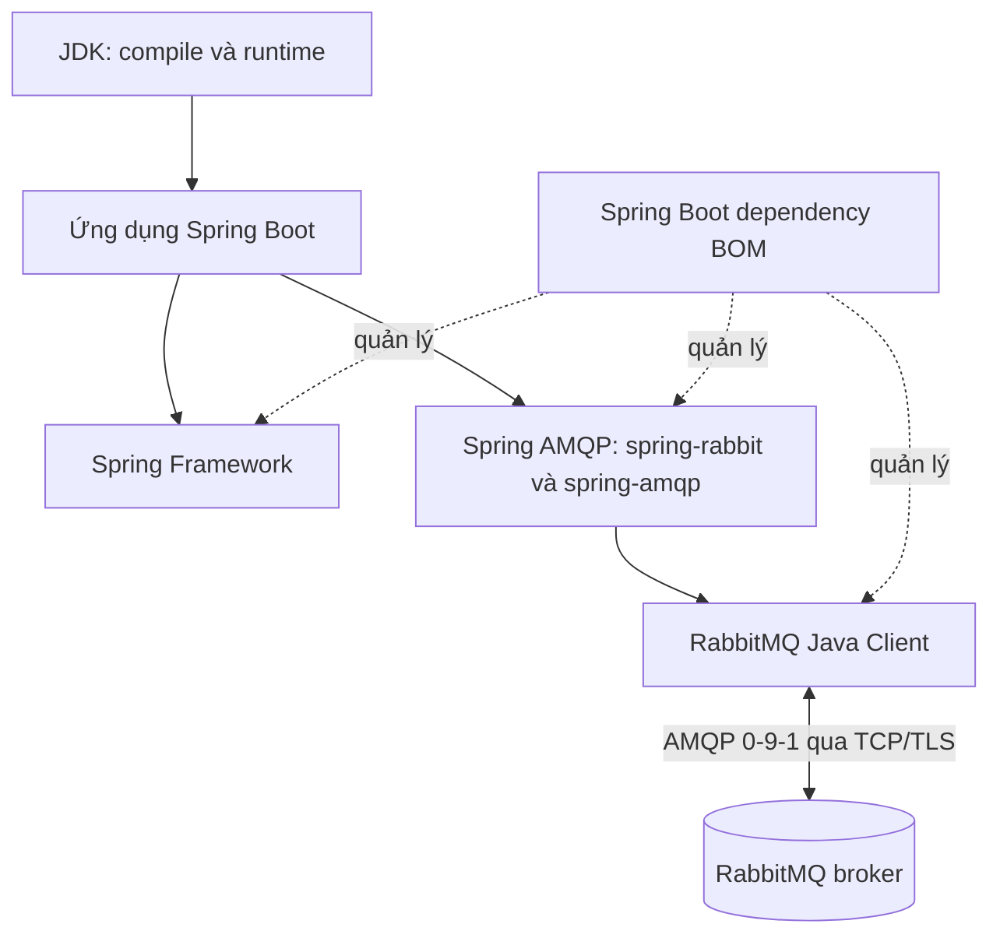

# Chọn Java, Spring Framework, Spring Boot và Spring AMQP tương thích

Đối với ứng dụng tích hợp RabbitMQ, việc chọn thư viện không dừng ở câu hỏi “Spring AMQP phiên bản nào mới nhất?”. Một ứng dụng có thể biên dịch thành công nhưng lỗi khi khởi động vì dùng sai phiên bản Spring Framework, hoặc chạy được nhưng gặp lỗi khi publish và nhận message vì thay đổi API, cấu hình listener và bộ chuyển đổi dữ liệu. Vì vậy, cần chọn **Java, Spring Boot, Spring Framework và Spring AMQP như một bộ phiên bản thống nhất**.

Bài này thuộc chương **Phiên bản và thư viện** của **SPRING_AMQP**. Mục tiêu là giúp bạn chọn nền tảng phù hợp để học và phát triển tích hợp RabbitMQ bằng `RabbitTemplate`, `@RabbitListener`, exchange, queue và binding; từ đó triển khai định tuyến, xác nhận giao nhận, retry, dead-letter, giao dịch và quan sát hệ thống một cách đáng tin cậy.

Sau khi học xong, bạn có thể:

- Đọc sơ đồ phụ thuộc giữa JDK, Spring Boot, Spring Framework, Spring AMQP và RabbitMQ Java Client.
- Chọn tổ hợp phiên bản có tính tương thích dựa trên **Spring Boot BOM**, thay vì tự ghép các thư viện độc lập.
- Tạo dự án Maven hoặc Gradle có `spring-boot-starter-amqp` và kiểm tra các phiên bản thực sự được resolve.
- Phân biệt lỗi không tương thích thư viện với lỗi kết nối, khai báo queue hay broker RabbitMQ.
- Lập kế hoạch nâng cấp major version mà không làm gián đoạn luồng xử lý message.

> **Phạm vi:** Ví dụ xây dựng trên Spring Boot 3.5.0 và Java 21 để minh họa một tổ hợp cụ thể đã phát hành. Đây **không phải tuyên bố về phiên bản mới nhất** tại thời điểm đọc. Khi bắt đầu dự án thực tế, hãy chọn bản patch còn được hỗ trợ, kiểm tra tài liệu tương thích và BOM của **đúng bản Spring Boot** được sử dụng.

## 1. Hiểu đúng các lớp phiên bản

Trong dự án Spring AMQP thường có các thành phần:

| Thành phần | Chịu trách nhiệm | Ai quyết định phiên bản? |
| --- | --- | --- |
| **JDK** | Biên dịch và chạy Java bytecode; cung cấp các tính năng ngôn ngữ/runtime | Nhóm phát triển chọn JDK, phù hợp yêu cầu tối thiểu và phạm vi JDK được kiểm thử của Spring Boot |
| **Spring Framework** | Dependency injection, cấu hình, lifecycle, messaging abstraction và hạ tầng ứng dụng | Thường **Spring Boot BOM** quản lý |
| **Spring Boot** | Khởi tạo ứng dụng, auto-configuration, starter, quản lý dependency và vận hành | Nhóm phát triển chọn một release line và patch cụ thể |
| **Spring AMQP** | `RabbitTemplate`, `@RabbitListener`, listener container, converter, retry và AMQP abstractions | Thường **Spring Boot BOM** quản lý thông qua `spring-boot-starter-amqp` |
| **RabbitMQ Java Client** | Kết nối/channels, frame và giao thức AMQP 0-9-1 với broker | Thường được BOM quản lý gián tiếp |
| **RabbitMQ broker** | Exchange, queue, routing, ACK, persistence, dead-letter, quorum queue... | Vận hành chọn phiên bản broker và tính năng hỗ trợ; kiểm tra tương thích độc lập |



**Hai loại tương thích khác nhau cần được kiểm tra:**

1. **Tương thích nội bộ ứng dụng:** JDK + Spring Boot + Spring Framework + Spring AMQP + các thư viện khác trên classpath có hoạt động với nhau không?
2. **Tương thích giao tiếp broker:** RabbitMQ Java Client có thể kết nối đến phiên bản broker đó không, và broker có hỗ trợ queue type, chính sách, tính năng và cơ chế xác nhận mà ứng dụng dùng không?

Việc kết nối AMQP 0-9-1 thường không yêu cầu client và broker có **cùng số phiên bản**. Tuy nhiên, khả năng hỗ trợ một tính năng cụ thể, hành vi của broker và phạm vi phiên bản còn được nhà cung cấp hỗ trợ vẫn cần kiểm tra riêng. Spring AMQP dùng để làm việc với RabbitMQ qua AMQP 0-9-1 không đồng nghĩa với mọi API RabbitMQ Streams hay AMQP 1.0.

## 2. Nguyên tắc quan trọng nhất: chọn Spring Boot trước, theo BOM sau

**BOM** (*Bill of Materials*) là danh sách các phiên bản dependency đã được Spring Boot quản lý thành một bộ. Khi khai báo starter phù hợp, Maven/Gradle có thể sử dụng những phiên bản này mà không cần chỉ định thủ công `spring-rabbit`, `spring-amqp`, Spring Framework hoặc `amqp-client`.

Quy trình lựa chọn hợp lý:

1. Xác nhận JDK mà dự án và môi trường triển khai có thể sử dụng.
2. Chọn một **Spring Boot release line còn được hỗ trợ** và phù hợp với JDK đó.
3. Sử dụng Spring Framework và Spring AMQP theo dependency management của **đúng bản Spring Boot đã chọn**.
4. Chỉ override dependency khi thực sự có lý do và đã kiểm tra tương thích với toàn bộ classpath.
5. Kiểm thử tích hợp với phiên bản RabbitMQ broker sẽ chạy trong môi trường thật.

**Không nên** lấy số phiên bản cao nhất của mỗi dự án rồi lắp thành một bộ. Spring Boot dùng các phiên bản phụ thuộc đã được phối hợp và kiểm thử theo từng release line; thay một mắt xích có thể làm xuất hiện lỗi nhị phân (`NoSuchMethodError`, `NoClassDefFoundError`) dù mã nguồn ứng dụng không thay đổi.

### 2.1. Bảng định hướng theo dòng phiên bản

Bảng dưới đây thể hiện **quan hệ giữa các dòng phát hành tiêu biểu**, đủ để nhận diện kiểu kết hợp đúng. Dãy phiên bản được quản lý chính xác còn phụ thuộc từng **bản patch Spring Boot**, nên hãy xem BOM thực tế khi chốt dependency.

| Dòng Spring Boot tiêu biểu | Java tối thiểu | Spring Framework chủ đạo | Spring AMQP chủ đạo | Ghi chú lựa chọn |
| --- | --- | --- | --- | --- |
| **2.7.x** | Java 8 | 5.3.x | 2.4.x | Dòng cũ, phù hợp để **bảo trì hệ thống legacy**; cần xem lại tình trạng hỗ trợ trước khi triển khai mới. |
| **3.2.x – 3.3.x** | Java 17 | 6.1.x | 3.1.x | Thuộc thế hệ Spring 6, dùng namespace `jakarta.*` ở các API liên quan. |
| **3.4.x – 3.5.x** | Java 17 | 6.2.x | 3.2.x | Ví dụ một bộ phiên bản Spring Boot 3 mới hơn. |
| **4.0.x** | Java 17 | 7.0.x | 4.0.x | Thế hệ major mới; cần kiểm tra migration guide, thay đổi API, cấu hình và serialization. |

Ví dụ đọc bảng: một dự án **Spring Boot 3.5.x** thông thường sử dụng **Spring Framework 6.2.x** và **Spring AMQP 3.2.x** do BOM quản lý. Không nên tự thêm Spring AMQP 4.0.x chỉ vì đây là dòng mới hơn. Tương tự, nếu quyết định nâng lên Spring Boot 4.x, cần đánh giá **cả bộ thư viện** và tác động tương thích, không chỉ sửa một con số trong `pom.xml`.

**Lưu ý:** bảng không có nghĩa mọi patch trong cùng một dòng đã được kiểm thử với mọi JDK tương lai. Java tối thiểu là điều kiện cần; để đưa ứng dụng vào production, hãy đối chiếu **Java tối đa được tài liệu của bản Boot xác nhận hỗ trợ** và thử nghiệm CI trên runtime thực tế.

### 2.2. JDK biên dịch và JDK chạy không được đánh đồng

- **Build JDK:** JDK chạy Maven hoặc Gradle và compiler.
- **Java source/target/release:** mức ngôn ngữ và bytecode mà mã nguồn dùng.
- **Runtime JDK:** JVM thực sự chạy ứng dụng trên máy chủ hoặc container.

Nếu biên dịch class cho Java 21 nhưng triển khai lên Java 17, ứng dụng sẽ lỗi dạng `UnsupportedClassVersionError`. Sử dụng Maven `maven.compiler.release` hoặc Gradle Java toolchain giúp làm rõ yêu cầu runtime và hạn chế sự khác biệt giữa các máy developer và CI.

```text
Ví dụ A: Build JDK 21 + --release 17 + Runtime JDK 17 → hợp lệ nếu toàn bộ thư viện hỗ trợ 17.
Ví dụ B: Build JDK 21 + --release 21 + Runtime JDK 17 → không hợp lệ.
Ví dụ C: Build JDK 17 + Spring Boot yêu cầu Java 17 + Runtime JDK 21 → có thể phù hợp nếu phiên bản Boot hỗ trợ Java 21.
```

## 3. Cần thêm thư viện Spring AMQP nào?

Đối với dự án Spring Boot có nhu cầu publish, consume, cấu hình queue/exchange/binding bằng RabbitMQ, lựa chọn đầu tiên thường là:

```text
org.springframework.boot:spring-boot-starter-amqp
```

Starter này cung cấp cấu hình và các thành phần cần thiết để dùng Spring AMQP trong ứng dụng Boot. Các artifact liên quan gồm:

| Artifact | Khi nào cần quan tâm? |
| --- | --- |
| `spring-boot-starter-amqp` | Cách khai báo dependency thông thường cho Spring Boot + RabbitMQ. |
| `org.springframework.amqp:spring-rabbit` | Các tích hợp RabbitMQ như `RabbitTemplate`, listener container và `@RabbitListener`. Thường đi cùng starter. |
| `org.springframework.amqp:spring-amqp` | Abstractions như `Message`, `Queue`, `Exchange`, `Binding`, converter và AMQP core. Thường được kéo theo bởi `spring-rabbit`. |
| `com.rabbitmq:amqp-client` | Java client cấp thấp, thường là dependency bắc cầu; không cần tự ấn định version trong dự án Boot thông thường. |
| `org.springframework.amqp:spring-rabbit-test` | Công cụ hỗ trợ test liên quan RabbitMQ; khai báo ở test scope khi cần. |

Nếu không dùng Spring Boot, bạn có thể phải tự cấu hình các dependency, listener container, kết nối và quản lý phiên bản Spring Framework/Spring AMQP. Bài này tập trung vào cách chọn stack **Spring Boot + Spring AMQP**, vốn giảm phần lớn rủi ro tương thích.

Tránh nhầm `spring-boot-starter-amqp` với một thư viện độc lập chứa mọi tính năng của RabbitMQ broker. Ví dụ, RabbitMQ Streams là một mô hình API và client riêng; không nên giả định các hàm `RabbitTemplate` AMQP 0-9-1 hoạt động trực tiếp như một stream producer/consumer.

## 4. Ví dụ Maven: Java 21 + Spring Boot 3.5.0

Giả sử dự án học tập chạy Java 21 và muốn làm việc với `RabbitTemplate`, `@RabbitListener`. Dưới đây là một `pom.xml` **tối giản nhưng đầy đủ**. Ở dự án thực tế, hãy thay `3.5.0` bằng bản patch còn được hỗ trợ của cùng dòng sau khi đối chiếu thông báo phát hành và chính sách cập nhật.

```xml
<?xml version="1.0" encoding="UTF-8"?>
<project xmlns="http://maven.apache.org/POM/4.0.0"
         xmlns:xsi="http://www.w3.org/2001/XMLSchema-instance"
         xsi:schemaLocation="http://maven.apache.org/POM/4.0.0
         https://maven.apache.org/xsd/maven-4.0.0.xsd">
    <modelVersion>4.0.0</modelVersion>

    <parent>
        <groupId>org.springframework.boot</groupId>
        <artifactId>spring-boot-starter-parent</artifactId>
        <version>3.5.0</version>
        <relativePath/>
    </parent>

    <groupId>com.example</groupId>
    <artifactId>spring-amqp-learning</artifactId>
    <version>0.0.1-SNAPSHOT</version>

    <properties>
        <java.version>21</java.version>
    </properties>

    <dependencies>
        <dependency>
            <groupId>org.springframework.boot</groupId>
            <artifactId>spring-boot-starter-amqp</artifactId>
        </dependency>
        <dependency>
            <groupId>org.springframework.boot</groupId>
            <artifactId>spring-boot-starter-test</artifactId>
            <scope>test</scope>
        </dependency>
        <dependency>
            <groupId>org.springframework.amqp</groupId>
            <artifactId>spring-rabbit-test</artifactId>
            <scope>test</scope>
        </dependency>
    </dependencies>

    <build>
        <plugins>
            <plugin>
                <groupId>org.springframework.boot</groupId>
                <artifactId>spring-boot-maven-plugin</artifactId>
            </plugin>
        </plugins>
    </build>
</project>
```

Tại đây chỉ khai báo **một phiên bản Spring Boot**. Parent chịu trách nhiệm quản lý phiên bản các starter và các dependency được BOM hỗ trợ. Bản vá được chọn có thể làm thay đổi phiên bản cụ thể của Spring Framework, Spring AMQP và client, nên không suy từ mã nguồn ra chính xác toàn bộ cây dependency.

**Nếu dự án phải dùng parent POM riêng:** có thể import `org.springframework.boot:spring-boot-dependencies` trong `<dependencyManagement>` với `type=pom`, `scope=import`; khi đó phải quản lý plugin riêng hoặc cấu hình chúng theo chuẩn build của tổ chức. Không thêm đồng thời nhiều BOM xung đột nếu chưa hiểu quy tắc ưu tiên.

## 5. Ví dụ Gradle Groovy DSL: Java toolchain 21

Tương tự Maven, dự án Gradle có thể sử dụng plugin Spring Boot cùng cơ chế dependency management:

```groovy
plugins {
    id 'java'
    id 'org.springframework.boot' version '3.5.0'
    id 'io.spring.dependency-management' version '1.1.7'
}

group = 'com.example'
version = '0.0.1-SNAPSHOT'

java {
    toolchain {
        languageVersion = JavaLanguageVersion.of(21)
    }
}

repositories {
    mavenCentral()
}

dependencies {
    implementation 'org.springframework.boot:spring-boot-starter-amqp'
    testImplementation 'org.springframework.boot:spring-boot-starter-test'
    testImplementation 'org.springframework.amqp:spring-rabbit-test'
}

tasks.named('test') {
    useJUnitPlatform()
}
```

Với một bản Spring Boot hỗ trợ Gradle đang dùng, plugin và dependency management trên sẽ giúp chọn phiên bản dependency đã được Boot quản lý. Trong thực tế hãy kiểm tra thêm **phiên bản Gradle được Spring Boot hỗ trợ**, bởi không phải mọi bản Gradle có thể chạy trên mọi JDK hoặc tương thích với mọi Spring Boot plugin. Nếu dự án dùng Gradle native BOM (`platform(...)`) thay cho `io.spring.dependency-management`, hãy áp dụng **một chiến lược quản lý dependency thống nhất**.

> Lưu ý khi đọc ví dụ: Java toolchain 21 đảm bảo compiler dùng JDK 21 khi Gradle tìm được toolchain, nhưng Gradle daemon và Gradle version vẫn có yêu cầu JDK riêng. Không thể kết luận build chắc chắn thành công chỉ vì đã cấu hình toolchain.

## 6. Kiểm chứng API bằng ứng dụng nhỏ

Sau khi chọn dependency, thử một luồng gửi/nhận `String` giúp phát hiện sớm lỗi classpath và cấu hình. Ví dụ dưới đây minh họa **default exchange** của RabbitMQ: producer gửi với routing key bằng tên queue. Không cần tự khai báo direct exchange khi chỉ gửi đến queue này.

### 6.1. Khai báo queue bền vững

```java
import org.springframework.amqp.core.Queue;
import org.springframework.amqp.core.QueueBuilder;
import org.springframework.context.annotation.Bean;
import org.springframework.context.annotation.Configuration;

@Configuration
class MessagingConfig {
    @Bean
    Queue workQueue() {
        return QueueBuilder.durable("demo.jobs.q").build();
    }
}
```

### 6.2. Publisher

```java
import org.springframework.amqp.rabbit.core.RabbitTemplate;
import org.springframework.stereotype.Service;

@Service
class JobPublisher {
    private final RabbitTemplate rabbitTemplate;

    JobPublisher(RabbitTemplate rabbitTemplate) {
        this.rabbitTemplate = rabbitTemplate;
    }

    void enqueue(String jobId) {
        // Default exchange (""): routing key = tên queue.
        rabbitTemplate.convertAndSend("", "demo.jobs.q", jobId);
    }
}
```

### 6.3. Consumer

```java
import org.springframework.amqp.rabbit.annotation.RabbitListener;
import org.springframework.stereotype.Component;

@Component
class JobConsumer {
    @RabbitListener(queues = "demo.jobs.q")
    void handle(String jobId) {
        System.out.println("Đang xử lý job " + jobId);
    }
}
```

Ứng dụng Spring Boot cần class khởi động có `@SpringBootApplication` và một broker RabbitMQ đang chạy. Ví dụ cấu hình kết nối local trong `application.yml`:

```yaml
spring:
  rabbitmq:
    host: localhost
    port: 5672
    username: guest
    password: guest
```

Tài khoản `guest` mặc định của RabbitMQ thường chỉ được phép đăng nhập qua localhost; thông tin này **chỉ phù hợp môi trường thực hành local**. Production cần tạo tài khoản, quyền truy cập, TLS và quản lý secret riêng.

Khi ứng dụng kết nối broker và `RabbitAdmin` được cấu hình phù hợp, Spring AMQP có thể khai báo bean queue; publisher dùng `RabbitTemplate` gửi message và listener tiêu thụ. **Đọc được một message chưa chứng minh hệ thống chịu lỗi tốt**: cần kiểm thử ACK, publisher confirms, returns, retry, dead-letter và kịch bản mất kết nối ở các bài chuyên sâu.

## 7. Đọc phiên bản thực sự được sử dụng

Số phiên bản trong `pom.xml` hoặc `build.gradle` chỉ là điểm bắt đầu. Dependency graph được giải quyết cuối cùng mới quyết định class nào được nạp khi chạy.

### 7.1. Với Maven

Trên Windows PowerShell, có thể dùng Maven Wrapper của dự án:

```powershell
.\mvnw.cmd -version
.\mvnw.cmd dependency:tree
.\mvnw.cmd help:effective-pom
```

Trên Linux/macOS dùng `./mvnw` thay cho `.\mvnw.cmd`. Quan sát trong cây dependency các artifact `spring-boot`, `spring-core`, `spring-context`, `spring-rabbit`, `spring-amqp` và `com.rabbitmq:amqp-client`; xem có nhiều phiên bản bất thường hoặc một dependency ép version trái với BOM hay không.

### 7.2. Với Gradle

```powershell
.\gradlew.bat --version
.\gradlew.bat dependencies --configuration runtimeClasspath
.\gradlew.bat dependencyInsight --dependency spring-rabbit --configuration runtimeClasspath
.\gradlew.bat dependencyInsight --dependency amqp-client --configuration runtimeClasspath
```

Trên Linux/macOS dùng `./gradlew`. `dependencyInsight` đặc biệt hữu ích khi một thư viện bị nâng/hạ qua dependency constraint hoặc direct override. Đọc lý do chọn version trong kết quả, tránh nhìn chỉ một dòng `implementation` rồi cho rằng toàn bộ classpath đã đúng.

### 7.3. Tự lập bảng xác nhận trước khi nâng cấp

| Mục cần ghi nhận | Ví dụ thông tin cần lưu |
| --- | --- |
| Java build/runtime | JDK 21 để build; JDK 21 cho image deploy |
| Spring Boot | Version lấy từ parent hoặc Boot Gradle plugin |
| Spring Framework | Version thực tế của `spring-context`, `spring-core` trong dependency graph |
| Spring AMQP | Version thực tế của `spring-rabbit`, `spring-amqp` |
| RabbitMQ Java Client | Version của `com.rabbitmq:amqp-client` |
| RabbitMQ broker | Version tại môi trường dev, staging, production; queue type và tính năng đang dùng |
| Công cụ build | Maven/Gradle, phiên bản wrapper, Java dùng để chạy build |

Lưu bảng này trong tài liệu kiến trúc hoặc pull request nâng cấp; nó giúp phân biệt thay đổi dependency với thay đổi cấu hình broker.

## 8. Các lỗi tương thích thường gặp

| Dấu hiệu | Nguyên nhân cần nghi ngờ | Cách tiếp cận |
| --- | --- | --- |
| `UnsupportedClassVersionError` | Class được build bằng Java mới hơn JDK runtime. | So sánh `java -version`, Java toolchain, compiler `release`, base image. |
| `NoSuchMethodError`, `NoClassDefFoundError` | Trộn các dòng Spring Framework/Spring AMQP hoặc dependency bắc cầu không nhất quán. | Xem dependency graph, bỏ override không cần thiết, quay về bộ quản lý bởi Boot BOM. |
| `ClassNotFoundException` khi chạy listener | Thiếu starter/library hoặc sai package API giữa các major version. | Kiểm tra thư viện trên runtimeClasspath, xem API của dòng Spring đang dùng. |
| Lỗi `javax.*` / `jakarta.*` | Dự án hoặc thư viện cũ chưa tương thích quá trình chuyển từ Spring Boot 2 lên 3. | Kiểm tra mã nguồn và thư viện liên quan; dùng biến thể hỗ trợ Spring Framework 6/Jakarta. |
| `NoSuchBeanDefinitionException` cho `RabbitTemplate` | Chưa có starter/auto-configuration phù hợp hoặc cấu hình bean bị tắt. | Kiểm tra dependency, auto-configuration report, connection factory và bean definition. |
| `Connection refused` đến `localhost:5672` | Broker chưa chạy, sai host/port, container network hoặc TLS. | Kiểm tra network và cấu hình kết nối; đây thường **không** phải lỗi phiên bản Spring. |
| `ACCESS_REFUSED` hoặc authentication failure | Sai user/password/vhost/permission hoặc hạn chế tài khoản `guest`. | Kiểm tra broker account, vhost, quyền và thông tin môi trường. |
| `PRECONDITION_FAILED` khi declare queue | Queue đã tồn tại nhưng khai báo thuộc tính khác (durable, arguments, queue type...). | So sánh định nghĩa queue với broker; lập kế hoạch thay đổi topology thay vì chỉ đổi dependency. |
| Listener chạy nhưng message lỗi chuyển đổi | Payload/converter không khớp; API serializer đã đổi khi nâng cấp. | Xác nhận content type, converter, type mapping và schema message. |

### 8.1. Không giải lỗi bằng cách “nâng Spring AMQP lên bản mới nhất”

Ví dụ dự án Spring Boot 3.5.x đang sử dụng Spring AMQP 3.2.x và báo `NoSuchMethodError`. Nếu thêm:

```xml
<!-- Ví dụ một cách override rủi ro: không áp dụng nguyên trạng -->
<dependency>
    <groupId>org.springframework.amqp</groupId>
    <artifactId>spring-rabbit</artifactId>
    <version>4.0.0</version>
</dependency>
```

thì có thể tạo thêm bất đồng giữa major version Spring AMQP và Spring Framework đang được Boot quản lý. Hướng điều tra hợp lý hơn là kiểm tra cây dependency, xác định thư viện nào đưa version sai vào, và thống nhất lại BOM. Nếu cần tính năng thuộc Spring AMQP major mới, hãy đánh giá **nâng cả Spring Boot release line** tương ứng.

## 9. Lên kế hoạch nâng cấp an toàn

Thay đổi phiên bản Spring AMQP có thể ảnh hưởng các thành phần vốn cần đúng ngữ nghĩa trong sản xuất: `RabbitTemplate`, `@RabbitListener`, cách khai báo exchange/queue, consumer ACK, publisher confirms/returns, retry, dead-letter và converters.

### 9.1. Nâng patch/minor trong cùng dòng

1. Xem release notes và changelog của Spring Boot, Spring AMQP, RabbitMQ Java Client.
2. Chốt một version Spring Boot cụ thể; cập nhật parent/plugin cùng một lần.
3. Resolve dependency, so sánh classpath trước/sau; kiểm tra override và dependency lỗi thời.
4. Chạy test từ thao tác publish đến listener, bao gồm lỗi xử lý và khôi phục kết nối.
5. Deploy staging với **cùng kiểu RabbitMQ broker, queue type và topology** như production; kiểm tra log và metrics.

### 9.2. Nâng major: ví dụ Boot 2.x → 3.x → 4.x

Không nên coi major upgrade như thay một dòng version. Một số vùng phải rà soát:

- **JDK tối thiểu:** từ thế hệ Spring Boot 3 cần Java 17 trở lên; kiểm tra runtime ở máy chủ và container.
- **Namespace API:** chuyển `javax.*` sang `jakarta.*` ở những tiêu chuẩn Java EE/Jakarta EE có liên quan; kiểm tra cả dependency bên thứ ba.
- **Spring Framework và Spring AMQP:** API bị thay thế/loại bỏ, thay đổi constructor, class, exception và listener configuration.
- **Serialization/message converters:** kiểm tra biến đổi JSON, type headers, Jackson và tương thích payload của message còn tồn đọng trong queue.
- **Tính năng reliability:** kiểm tra publisher confirm/return callback, retry, requeue, dead-letter và transaction; không dựa vào giả định hành vi mặc định vẫn giữ nguyên.
- **Quan sát:** kiểm tra metrics/tracing, tên observation hoặc tag và cách tích hợp Micrometer nếu ứng dụng phụ thuộc dashboard/alert.

Trong hệ thống có message tồn đọng, producer và consumer có thể chạy **khác phiên bản ứng dụng** trong giai đoạn rollout. Vì vậy, định dạng payload, schema và quy tắc tương thích giữa hai phiên bản ứng dụng phải được thiết kế độc lập với việc nâng các thư viện Spring.

### 9.3. Kiểm thử tích hợp để xác nhận tương thích thực tế

Một bài kiểm thử chỉ tạo `ApplicationContext` có thể phát hiện lỗi classpath, nhưng chưa kiểm chứng việc giao nhận message. Nên bổ sung test với RabbitMQ thật trong môi trường test (chẳng hạn container dùng cho integration test), tập trung vào:

| Kịch bản | Kết quả kỳ vọng |
| --- | --- |
| Declare queue/exchange/binding, publish và consume `String` | Listener nhận message đúng queue/routing key. |
| Publish message không có tuyến định tuyến phù hợp | Returns/alternate exchange hoạt động đúng nếu đã bật và cấu hình. |
| Listener ném exception | Hành vi ACK/NACK, retry/requeue và DLQ phù hợp chính sách. |
| Consumer bị ngắt trước ACK | Message có thể được giao lại; nghiệp vụ không bị xử lý trùng ngoài mong muốn. |
| Broker mất kết nối rồi phục hồi | Connection recovery, listener restart và readiness hoạt động như thiết kế. |
| Rollout hai phiên bản ứng dụng | Payload cũ/mới vẫn được đọc an toàn hoặc được từ chối theo chính sách rõ ràng. |

Những bài kiểm thử này vừa kiểm tra **bộ phiên bản được chọn**, vừa đặt nền tảng cho vận hành bất đồng bộ đáng tin cậy. Kết quả còn phụ thuộc cấu hình broker, loại queue và quyền truy cập; test phải phản ánh môi trường thật mới có ý nghĩa.

## 10. Ba tình huống lựa chọn

### Tình huống A: dự án mới, có Java 21

Nhóm muốn thực hành gửi message qua `RabbitTemplate`, nghe bằng `@RabbitListener`, retry và dead-letter. Cách chọn là xác định một dòng Spring Boot còn được hỗ trợ với Java 21, dùng `spring-boot-starter-amqp` và **giữ nguyên dependency management** của Boot. Ví dụ bài này dùng Boot 3.5.0 để minh họa. Khi bắt đầu dự án thực tế, hãy cập nhật lên patch an toàn và kiểm chứng JDK, Gradle/Maven, broker.

### Tình huống B: ứng dụng legacy chạy Java 8, Spring Boot 2.7

Không thể tự nâng Spring AMQP lên thế hệ 3.x để có API mới trong khi vẫn giữ Java 8 và Spring Framework 5.3. Cần lên kế hoạch nâng JDK và Spring Boot cùng các thư viện liên quan; trong thời gian chưa nâng được, duy trì bộ dependency tương thích của nhánh cũ và quản lý rủi ro hỗ trợ/bảo mật theo chính sách tổ chức.

### Tình huống C: muốn sử dụng API mới từ Spring AMQP 4

Trước khi thêm dependency trực tiếp, kiểm tra tính năng đó có yêu cầu Spring Framework 7/Spring Boot 4 hay không, thay đổi API và bộ chuyển đổi dữ liệu ra sao. Nếu chọn nâng major, thực hiện theo migration guide, thử nghiệm listener/producer với broker thật, rồi mới triển khai trên môi trường xử lý message quan trọng.

## 11. Bài thực hành chọn phiên bản

**Bài 1 – Đọc dependency graph:** Tạo dự án Maven mẫu ở mục 4, chạy `dependency:tree`, ghi chính xác version của `spring-core`, `spring-context`, `spring-rabbit`, `spring-amqp` và `amqp-client`. Giải thích vì sao không cần đặt `<version>` cho từng artifact.

**Bài 2 – Phân biệt hai loại lỗi:** Thử chạy ứng dụng khi broker RabbitMQ chưa bật, sau đó khởi động broker và gửi một message. Ghi lại lỗi trước/sau và giải thích vì sao lỗi `Connection refused` không được giải bằng cách đổi Spring AMQP version.

**Bài 3 – Đánh giá thay đổi major:** Với một dự án Java 8/Spring Boot 2.7 giả định, viết checklist những điều kiện để chuyển lên Java 21/Spring Boot 3.5: API Jakarta, thư viện bên thứ ba, cấu hình listener, converter, môi trường CI, broker và luồng xử lý message cũ.

**Bài 4 – Xem BOM mới:** Chọn một bản Spring Boot khác phù hợp dự án, xem bảng dependency management chính thức và so sánh cây dependency với bản cũ. Chỉ nâng version theo một bộ tương thích, rồi chạy lại test gửi/nhận và xử lý lỗi.

### Câu hỏi tự kiểm tra

1. Vì sao `spring-boot-starter-amqp` thường là dependency phù hợp hơn việc khai báo riêng `spring-rabbit` và `amqp-client` trong dự án Spring Boot?
2. Nếu biên dịch bằng Java 21 nhưng chạy bằng Java 17, điều kiện nào phải đúng để ứng dụng khởi động?
3. `spring-rabbit` đã được Spring Boot BOM quản lý; khi nào việc override nó có thể gây `NoSuchMethodError`?
4. Spring Boot 3.x và 4.x khác nhau như thế nào về dòng Spring Framework/Spring AMQP cần xét?
5. Một message bị dead-letter sai sau khi nâng phiên bản: bạn sẽ kiểm tra yếu tố classpath nào và cấu hình broker/listener nào?

## 12. Tài liệu chính thức cần tra khi chốt phiên bản

- [Spring Boot – Build Systems và Dependency Management](https://docs.spring.io/spring-boot/reference/using/build-systems.html): cách quản lý starter, plugin và các dependency theo từng bản Boot.
- [Spring Boot – Dependency Versions](https://docs.spring.io/spring-boot/appendix/dependency-versions/index.html): bảng phiên bản được quản lý của nhánh tài liệu tương ứng; **đảm bảo đang đọc đúng version**.
- [Spring AMQP – Reference Documentation](https://docs.spring.io/spring-amqp/reference/): API, listener, publisher confirms, retry và tương tác RabbitMQ.
- [Spring Framework – Overview](https://docs.spring.io/spring-framework/reference/overview.html): yêu cầu Java và định hướng các dòng Spring Framework.
- [RabbitMQ Documentation](https://www.rabbitmq.com/docs): broker, AMQP 0-9-1, queue types, reliability và vận hành.

**Nguyên tắc ghi nhớ:** chọn một **Spring Boot release line phù hợp JDK và được hỗ trợ**, dùng bộ Spring Framework/Spring AMQP do **BOM của đúng phiên bản Boot** quản lý, sau đó kiểm thử với RabbitMQ broker và các luồng nghiệp vụ thật. Sự tương thích của dependency là điểm khởi đầu; độ tin cậy giao nhận còn cần cấu hình ACK, confirms, retry, dead-letter, giao dịch và quan sát hệ thống.
