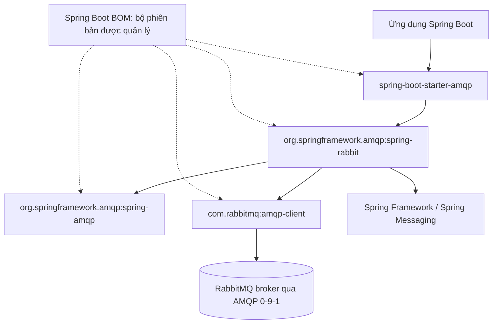

# Quản lý dependency qua Spring Boot và tránh trộn phiên bản RabbitMQ client

Khi tích hợp RabbitMQ với **Spring AMQP**, ứng dụng thường chỉ cần khai báo `spring-boot-starter-amqp`. Spring Boot sẽ chọn một nhóm thư viện tương thích để `RabbitTemplate`, `@RabbitListener`, connection factory, exchange, queue và binding hoạt động cùng nhau. Rủi ro xuất hiện khi dự án tự chỉ định thêm phiên bản `spring-rabbit`, `spring-amqp` hoặc đặc biệt là `com.rabbitmq:amqp-client` mà không kiểm tra sự tương thích.

Bài học thuộc chương **Phiên bản và thư viện** của module **SPRING_AMQP**. Mục tiêu là biết thư viện nào thực sự được nạp, để Spring Boot quản lý dependency đúng cách, phát hiện xung đột và nâng cấp có kiểm chứng. Đây là nền tảng cho các bài thực hành routing, xác nhận giao nhận, retry, dead-letter, transaction và quan sát hệ thống RabbitMQ đáng tin cậy.

## 1. Trước tiên, phân biệt ba lớp phiên bản

| Lớp | Ví dụ | Ai quản lý? | Ý nghĩa |
| --- | --- | --- | --- |
| **Spring Boot** | `spring-boot`, `spring-boot-autoconfigure`, `spring-boot-starter-amqp` | Phiên bản Spring Boot dự án chọn | Auto-configuration và danh sách phiên bản dependency được kiểm thử cùng nhau |
| **Spring AMQP và Java client** | `spring-rabbit`, `spring-amqp`, `com.rabbitmq:amqp-client` | Thường do Spring Boot BOM quản lý | API Spring, listener container, `RabbitTemplate` và thư viện Java kết nối RabbitMQ |
| **RabbitMQ broker** | RabbitMQ server chạy trên máy, container hoặc cluster | Hệ thống vận hành | Phiên bản server, chính sách queue, exchange, dead-letter, plugin và tính năng broker |

**Không cần và không nên bắt ba lớp này có cùng số phiên bản.** Spring Boot, Spring AMQP, RabbitMQ Java client và RabbitMQ server có lịch phát hành riêng. Điểm cần kiểm chứng là *tổ hợp phiên bản tương thích và tính năng có sẵn*, không phải các số version giống nhau.

Trong Spring AMQP, luồng phụ thuộc phổ biến có dạng:



Sơ đồ chỉ thể hiện các thành phần cốt lõi; cây phụ thuộc thực tế còn có logging, retry, Spring Context và các thư viện khác. Hãy xem cây dependency của **chính dự án** để biết artifact và phiên bản cuối cùng.

### Hiểu đúng tên thư viện

- **`org.springframework.boot:spring-boot-starter-amqp`**: dependency nên khai báo ở hầu hết ứng dụng Spring Boot sử dụng RabbitMQ qua Spring AMQP. Starter kéo theo các thư viện cần thiết và kích hoạt cơ chế auto-configuration khi điều kiện phù hợp.
- **`org.springframework.amqp:spring-rabbit`**: tích hợp RabbitMQ cho Spring, cung cấp `RabbitTemplate`, `@RabbitListener`, `CachingConnectionFactory`, listener container và nhiều API khác.
- **`org.springframework.amqp:spring-amqp`**: các abstraction AMQP của Spring, như `Message`, `Queue`, `Exchange`, `Binding`.
- **`com.rabbitmq:amqp-client`**: RabbitMQ Java client cấp thấp, trong package Java `com.rabbitmq.client`; Spring Rabbit sử dụng nó để làm việc với connection/channel và protocol AMQP 0-9-1.

Một điều dễ nhầm là **`com.rabbitmq:amqp-client` không phải phiên bản RabbitMQ broker**. Đổi dependency trong `pom.xml` hoặc `build.gradle` không nâng cấp server RabbitMQ. Ngược lại, nâng cấp RabbitMQ server không tự thay JAR trong ứng dụng.

## 2. Cách khuyến nghị: để Spring Boot quản lý dependency

Spring Boot công bố **Bill of Materials (BOM)**, cụ thể là `org.springframework.boot:spring-boot-dependencies`. BOM chứa các phiên bản thư viện mà một dòng Spring Boot đã lựa chọn. Khi dùng BOM, dự án thường **không ghi phiên bản** cho từng thư viện do BOM quản lý.

### 2.1. Maven: dự án có Spring Boot parent

Nếu `pom.xml` đã kế thừa `spring-boot-starter-parent` đúng phiên bản Boot mà dự án chọn, chỉ cần khai báo dependency:

```xml
<dependencies>
    <dependency>
        <groupId>org.springframework.boot</groupId>
        <artifactId>spring-boot-starter-amqp</artifactId>
    </dependency>

    <dependency>
        <groupId>org.springframework.boot</groupId>
        <artifactId>spring-boot-starter-test</artifactId>
        <scope>test</scope>
    </dependency>
</dependencies>
```

Trong cấu hình này, dự án **không cần** khai báo thêm một phiên bản cho `spring-rabbit`, `spring-amqp` hoặc `amqp-client` chỉ để chạy `RabbitTemplate`/`@RabbitListener`.

Nếu cần hình dung nơi chọn phiên bản Boot, xem đoạn `parent` (thay giá trị minh họa bằng **một bản Spring Boot có thật, đang được dự án hỗ trợ**):

```xml
<parent>
    <groupId>org.springframework.boot</groupId>
    <artifactId>spring-boot-starter-parent</artifactId>
    <version>YOUR_SUPPORTED_BOOT_VERSION</version>
    <relativePath/>
</parent>
```

`YOUR_SUPPORTED_BOOT_VERSION` là chỗ cần thay bằng số phiên bản cụ thể, **không phải literal dùng để build**. Khi đã chọn một dòng Boot, để parent/BOM giải quyết phần lớn phiên bản transitives giúp giảm rủi ro lệch phiên bản.

### 2.2. Maven: dự án có parent riêng

Nếu dự án không thể kế thừa `spring-boot-starter-parent`, có thể **import BOM** trong `dependencyManagement`:

```xml
<properties>
    <!-- Chọn phiên bản Spring Boot thực tế và được hỗ trợ. -->
    <spring-boot.version>YOUR_SUPPORTED_BOOT_VERSION</spring-boot.version>
</properties>

<dependencyManagement>
    <dependencies>
        <dependency>
            <groupId>org.springframework.boot</groupId>
            <artifactId>spring-boot-dependencies</artifactId>
            <version>${spring-boot.version}</version>
            <type>pom</type>
            <scope>import</scope>
        </dependency>
    </dependencies>
</dependencyManagement>

<dependencies>
    <dependency>
        <groupId>org.springframework.boot</groupId>
        <artifactId>spring-boot-starter-amqp</artifactId>
    </dependency>
</dependencies>
```

BOM quản lý **dependency versions**; dùng BOM theo cách này không tự sao chép toàn bộ cấu hình plugin, tài nguyên và build defaults từ Spring Boot parent. Những plugin cần thiết vẫn phải được quản lý đúng phiên bản trong dự án.

Nếu một dependency đã được khai báo với `<version>` trực tiếp, version đó có thể ghi đè lựa chọn của `dependencyManagement`. Vì vậy, "đã import BOM" **chưa đủ để kết luận** mọi dependency trong cây đều đúng version dự kiến.

### 2.3. Gradle: dự án dùng Spring Boot và dependency management

Với dự án Groovy DSL (`build.gradle`) **đã cấu hình** Spring Boot plugin cùng plugin `io.spring.dependency-management`, phần dependency thường chỉ cần:

```groovy
dependencies {
    implementation 'org.springframework.boot:spring-boot-starter-amqp'
    testImplementation 'org.springframework.boot:spring-boot-starter-test'
}
```

Plugin quản lý dependency có thể sử dụng BOM tương ứng với phiên bản Spring Boot plugin. Tránh thêm version trực tiếp cho `amqp-client` nếu chưa có lý do rõ ràng.

Nếu dự án chọn **Gradle native BOM support** thay cho plugin quản lý dependency, cần khai báo platform rõ ràng; ví dụ Kotlin DSL (`build.gradle.kts`), giả sử biến `springBootVersion` đã được định nghĩa:

```kotlin
dependencies {
    implementation(platform("org.springframework.boot:spring-boot-dependencies:$springBootVersion"))
    implementation("org.springframework.boot:spring-boot-starter-amqp")
    testImplementation("org.springframework.boot:spring-boot-starter-test")
}
```

Khi dùng native `platform`, quy tắc giải quyết xung đột version của Gradle vẫn có hiệu lực. Một dependency khác có thể đưa vào yêu cầu version cao hơn; **luôn xác nhận kết quả bằng `dependencyInsight`**. Không tự giả định rằng việc thêm BOM sẽ khóa cứng mọi artifact ở đúng một version trong mọi cấu hình Gradle.

> Chỉ chọn **một chiến lược quản lý phiên bản nhất quán** cho dự án. Trong repository nhiều module, nên quản lý phiên bản Spring Boot và BOM tập trung, tránh từng submodule tự đổi `spring-rabbit` hoặc `amqp-client` riêng lẻ.

## 3. Các cách khai báo gây lệch phiên bản

### 3.1. Vừa dùng starter vừa khóa RabbitMQ client tùy ý

Ví dụ Maven có rủi ro:

```xml
<dependency>
    <groupId>org.springframework.boot</groupId>
    <artifactId>spring-boot-starter-amqp</artifactId>
</dependency>

<!-- Rủi ro: ghi đè phiên bản amqp-client do BOM lựa chọn. -->
<dependency>
    <groupId>com.rabbitmq</groupId>
    <artifactId>amqp-client</artifactId>
    <version>UNREVIEWED_CLIENT_VERSION</version>
</dependency>
```

`UNREVIEWED_CLIENT_VERSION` là **placeholder để minh họa lỗi cấu hình**, không phải một release thực tế. Điểm cần nhận diện là khai báo version trực tiếp cho RabbitMQ Java client khi không xác minh với bản Spring Rabbit được sử dụng.

Tương tự trong Gradle:

```groovy
dependencies {
    implementation 'org.springframework.boot:spring-boot-starter-amqp'

    // Rủi ro: yêu cầu một version amqp-client ngoài quản lý chuẩn.
    implementation 'com.rabbitmq:amqp-client:UNREVIEWED_CLIENT_VERSION'
}
```

**Hậu quả có thể xảy ra** là Spring Rabbit gọi một method hoặc class không có trong `amqp-client` thực tế ở runtime, dẫn đến `NoSuchMethodError`, `NoClassDefFoundError`, `LinkageError` hoặc lỗi khởi tạo kết nối. Đây cũng có thể là triệu chứng của những xung đột classpath khác: phải kiểm tra JAR được chọn, không suy luận nguyên nhân chỉ từ tên exception.

### 3.2. Tự trộn các artifact của Spring AMQP

Ví dụ rủi ro khác là để BOM chọn `spring-rabbit` nhưng tự gắn version khác cho `spring-amqp`, hoặc khai báo `spring-rabbit` từ một dòng Spring AMQP khác với dòng Boot đang chạy. API Spring AMQP, Spring Framework và Spring Rabbit phải phù hợp với nhau.

Nếu cần API từ một bản Spring AMQP mới hơn, việc chỉ thêm:

```xml
<dependency>
    <groupId>org.springframework.amqp</groupId>
    <artifactId>spring-rabbit</artifactId>
    <version>ANOTHER_UNREVIEWED_VERSION</version>
</dependency>
```

không đủ để bảo đảm ứng dụng tương thích. Cần đối chiếu dòng Spring Boot, Spring Framework và Spring AMQP trong release notes/BOM; đôi khi cách an toàn là nâng cả Spring Boot lên bản bảo trì mới được hỗ trợ.

### 3.3. Nhầm artifact khi tích hợp chức năng khác của RabbitMQ

`com.rabbitmq:stream-client` (dành cho RabbitMQ Streams) là artifact **khác** `com.rabbitmq:amqp-client` (AMQP 0-9-1). Khi thêm thư viện Kafka, Spring Cloud Stream binder hay client khác vào dự án, hãy đọc cây dependency thay vì giả định mọi client RabbitMQ dùng cùng artifact và cùng cơ chế version.

### 3.4. Tin rằng "compile được" tức là runtime tương thích

Một ứng dụng có thể compile vì bộ thư viện được dùng lúc biên dịch chứa API mong muốn, nhưng khi chạy trong executable JAR, container, plugin loader hoặc môi trường khác lại có classpath khác. Các vấn đề binary compatibility thường chỉ xuất hiện khi thực sự gọi code liên quan đến connection, publish, consume hoặc acknowledgement.

## 4. Kiểm tra phiên bản thực sự được chọn

### 4.1. Với Maven

Chạy trong module chứa ứng dụng Spring Boot:

```bash
./mvnw dependency:tree -Dincludes=org.springframework.amqp:spring-rabbit,org.springframework.amqp:spring-amqp,com.rabbitmq:amqp-client
```

Nếu không dùng Maven Wrapper, thay `./mvnw` bằng `mvn`.

Kiểm tra thêm toàn bộ cây runtime và effective POM khi nghi BOM/parent bị ghi đè:

```bash
./mvnw dependency:tree -Dscope=runtime
./mvnw help:effective-pom
```

Trong cây dependency, tìm **phiên bản cuối cùng của** `spring-rabbit`, `spring-amqp` và `amqp-client`; đồng thời tìm nơi phát sinh dependency hoặc version override không chủ đích. Maven có thể hiển thị các nhánh đã được bỏ qua vì *version conflict*, tùy chế độ và phiên bản plugin.

### 4.2. Với Gradle

```bash
./gradlew dependencies --configuration runtimeClasspath
./gradlew dependencyInsight --dependency amqp-client --configuration runtimeClasspath
./gradlew dependencyInsight --dependency spring-rabbit --configuration runtimeClasspath
./gradlew dependencyInsight --dependency spring-amqp --configuration runtimeClasspath
```

Trên Windows có thể dùng `gradlew.bat` thay `./gradlew`. `dependencyInsight` giúp biết artifact nào yêu cầu dependency, **version nào được chọn** và lý do lựa chọn (chẳng hạn conflict resolution hoặc dependency constraint).

Hãy kiểm tra **đúng configuration**: một version ở `testRuntimeClasspath` không đương nhiên là version của `runtimeClasspath`; bản ứng dụng đóng gói cũng phải dùng bộ dependency phù hợp.

### 4.3. Bảng kiểm phát hiện bất thường

| Quan sát | Ý nghĩa cần kiểm tra | Hành động |
| --- | --- | --- |
| Có `spring-boot-starter-amqp`, nhưng còn `amqp-client` được khai báo với version riêng | Có thể ghi đè BOM | Xác minh lý do, đối chiếu compatibility, bỏ khai báo version nếu không cần |
| Có nhiều thư viện cùng kéo `amqp-client` khác version | Resolver phải chọn một version cho classpath/configuration | Dùng `dependency:tree`/`dependencyInsight` để tìm nhánh gây xung đột và version được chọn |
| `spring-amqp` và `spring-rabbit` từ các dòng phát hành khác nhau | Có nguy cơ API/binary incompatibility | Đồng bộ theo BOM/dòng Spring AMQP phù hợp |
| Unit test qua nhưng khi chạy production báo `NoSuchMethodError` | Có thể khác JAR runtime, build artifact hoặc classloader | Kiểm tra cây `runtimeClasspath`, nội dung artifact và stack trace |
| Local dùng broker mới, production dùng broker cũ | Feature hoặc cấu hình broker có thể khác | Đối chiếu hỗ trợ broker/client và kiểm thử trên phiên bản server đích |

Trong một `runtimeClasspath` được giải quyết bằng Maven/Gradle thông thường, công cụ build thường chọn **một version** cho cùng artifact, chứ không nhất thiết đóng gói cả hai version vào JAR. Vì vậy, cụm "trộn phiên bản" thường có nghĩa là **version cuối cùng được chọn không tương thích với các thư viện còn lại**. Với shading hoặc nhiều classloader, vẫn có thể tồn tại những bản class khác nhau ở runtime.

## 5. Nâng cấp hoặc xử lý cảnh báo bảo mật đúng cách

Khi có CVE hoặc cần tính năng RabbitMQ client mới, **đừng tự động sửa riêng số version `amqp-client`** rồi coi như hoàn tất. Hãy làm theo quy trình:

1. **Xác định bộ hiện tại**: ghi lại version Spring Boot, `spring-rabbit`, `spring-amqp`, `amqp-client` và RabbitMQ server, kèm dependency tree/runtimeClasspath của ứng dụng.
2. **Xác định yêu cầu**: bản vá CVE thuộc client, Spring AMQP, Spring Framework, dependency khác hay broker? Phiên bản bị ảnh hưởng và bản đã khắc phục là gì? Đọc thông báo chính thức tương ứng.
3. **Ưu tiên cập nhật Spring Boot trong dòng hỗ trợ**: chọn bản bảo trì có BOM quản lý thư viện đã sửa lỗi nếu khả thi; xem release notes và phạm vi hỗ trợ.
4. **Nếu buộc phải override** một dependency, hãy đối chiếu ma trận tương thích, ghi lý do và thời hạn override, tránh trộn các bản `spring-amqp`/`spring-rabbit` không cùng dòng. Chọn đúng cơ chế version management của Maven hoặc Gradle.
5. **Kiểm tra phiên bản được giải quyết**, build và chạy integration test kết nối với RabbitMQ broker tương ứng môi trường đích. Test cả tình huống thành công và lỗi, không chỉ `contextLoads`.
6. **Đóng gói và kiểm tra lại** dependency trong image/JAR triển khai, sau đó theo dõi metric publish/consume, connection/channel, queue depth và dead-letter sau nâng cấp.

Đặc biệt, đừng dùng `exclusion` để loại `com.rabbitmq:amqp-client` khỏi `spring-rabbit` mà không cung cấp một client tương thích: Spring Rabbit thực tế cần Java client để giao tiếp RabbitMQ. Cũng tránh dùng `force`, `strictly` hoặc override toàn cục chỉ để làm mất cảnh báo resolver; những cách này thay đổi kết quả chọn thư viện và vẫn phải được kiểm thử.

### Ví dụ tình huống: một thư viện thứ ba yêu cầu client mới

Giả sử dự án sử dụng Spring Boot BOM nhưng thêm thư viện `example-event-bridge`, kéo thêm `amqp-client` phiên bản khác.

```text
Ứng dụng
├─ spring-boot-starter-amqp
│  └─ spring-rabbit
│     └─ com.rabbitmq:amqp-client (phiên bản do Boot BOM quản lý)
└─ example-event-bridge
   └─ com.rabbitmq:amqp-client (yêu cầu phiên bản khác)
```

`example-event-bridge` là tên **giả định** để minh họa cây dependency, không phải gợi ý thêm thư viện này. Maven/Gradle sẽ áp dụng quy tắc quản lý dependency và conflict resolution để chọn artifact cuối cùng.

Hướng xử lý là đọc cây dependency, xem thư viện thứ ba có bản tương thích với dòng Boot hay không, hoặc nâng Boot/BOM phù hợp. Chỉ sau khi tìm hiểu nguyên nhân mới cân nhắc override, vì việc chọn version "cao nhất" hay "mới nhất" chưa chứng minh rằng Spring Rabbit đang sử dụng hoàn toàn tương thích.

## 6. Kiểm thử tối thiểu sau khi đổi dependency

Một lần nâng dependency phải kiểm tra được các hành vi mà ứng dụng Spring AMQP thực sự sử dụng:

| Bước kiểm thử | Thực hiện | Dấu hiệu đạt |
| --- | --- | --- |
| **Khởi động và kết nối** | Khởi chạy ứng dụng với broker test, cấu hình `spring.rabbitmq.*` đúng môi trường | `CachingConnectionFactory` tạo được connection/channel; listener khởi động |
| **Khai báo topology** | Tạo `DirectExchange`/`TopicExchange`, durable `Queue` và `Binding` | Exchange/queue/binding tồn tại đúng trên RabbitMQ, không có lỗi inequivalent argument |
| **Publish và route** | Dùng `RabbitTemplate.convertAndSend(...)` với routing key hợp lệ và không hợp lệ | Message vào queue mong đợi; publisher confirms/returns thể hiện đúng ý nghĩa khi đã bật và cấu hình |
| **Consume và ack** | Dùng `@RabbitListener` xử lý thành công, rồi tạo lỗi có kiểm soát | Message thành công được ack đúng; message lỗi được xử lý theo ack/requeue policy |
| **Retry và dead-letter** | Thử lỗi tạm thời và lỗi vĩnh viễn, giới hạn retry, cấu hình DLX/DLQ | Không requeue vô hạn; message sau retry thất bại đến đúng DLQ |
| **Giao dịch và xử lý trùng** | Giả lập ghi DB thành công nhưng consumer chưa ack, sau đó giao lại | Nghiệp vụ có idempotency; kết quả DB nhất quán và không thực hiện hành động trùng ngoài ý muốn |
| **Quan sát** | Xem RabbitMQ Management UI, logs, metrics/traces nếu cấu hình | Phân biệt được message `ready`, `unacked`, retry, dead-letter và lỗi kết nối |

Những ca kiểm thử này không biến Spring AMQP thành hệ thống "exactly once". Ví dụ, **publisher confirm** chỉ thể hiện một mốc xác nhận việc publish từ broker; **consumer ack** là mốc xử lý delivery của consumer; cả hai không tự bảo đảm giao dịch database thành công một lần duy nhất. Phiên bản thư viện phù hợp là điều kiện cần, còn thiết kế retry, DLQ và idempotency mới giúp xử lý bất đồng bộ an toàn.

## 7. Thực hành chẩn đoán trong một dự án mẫu

Bạn có thể tự thực hành theo chuỗi bước sau, ưu tiên làm trong nhánh thử nghiệm:

1. Tạo ứng dụng Spring Boot có dependency **duy nhất** `spring-boot-starter-amqp` cho RabbitMQ và sử dụng phiên bản Boot được chọn thông qua parent hoặc BOM.
2. Chạy `dependency:tree` (Maven) hoặc `dependencyInsight` (Gradle); ghi lại phiên bản thực tế của ba artifact `spring-rabbit`, `spring-amqp`, `amqp-client`.
3. Viết producer dùng `RabbitTemplate`, consumer dùng `@RabbitListener` và khai báo một exchange, queue, binding; gửi một message thành công.
4. Trong nhánh thử nghiệm, **giả lập cấu hình lỗi** bằng cách thêm khai báo version trực tiếp khác cho `amqp-client`. Chạy lại công cụ phân tích dependency và so sánh version **được chọn**, không cần cố gây lỗi production.
5. Gỡ override, kiểm tra cây dependency trở về bộ do BOM quản lý; chạy lại bài kiểm thử publish/consume và ca lỗi retry/DLQ.
6. Ghi nhận nguyên nhân cùng cách sửa để có tài liệu xử lý khi ứng dụng thật gặp `NoSuchMethodError`, lỗi connection hoặc lỗi listener sau nâng cấp.

## 8. Câu hỏi thường gặp

**Tôi có cần thêm `com.rabbitmq:amqp-client` khi đã khai báo `spring-boot-starter-amqp` không?** Ở hầu hết ứng dụng Spring Boot dùng `RabbitTemplate` và `@RabbitListener`, **không cần**. Client đã được kéo vào qua các dependency của Spring Rabbit. Thêm trực tiếp chỉ khi cần API cấp thấp hoặc có lý do khác đã được xác minh, và ưu tiên để BOM quản lý version.

**Có nên ghi phiên bản cho `spring-rabbit` hoặc `spring-amqp` để luôn được bản mới nhất?** Thường **không**. Bản mới nhất của riêng một thư viện chưa chắc là bản phù hợp với dòng Spring Boot/Spring Framework hiện tại. Nâng Boot/BOM có kế hoạch là cách khởi đầu an toàn hơn.

**Dùng cùng số version giữa `amqp-client` và RabbitMQ server có an toàn hơn không?** Không. Đây là hai dự án có chu kỳ phiên bản khác nhau. Hãy kiểm tra tương thích giao thức/tính năng giữa client được chọn và broker thực tế.

**Đã thêm BOM sao `dependencyInsight` vẫn chọn phiên bản khác?** Có thể tồn tại version khai báo trực tiếp, dependency constraint khác, `resolutionStrategy`, hoặc quy tắc conflict resolution. Xem `dependencyInsight` và cấu hình build; đừng chỉ đọc danh sách dependency khai báo.

**Làm sao biết phiên bản nào chính xác nên dùng?** Chốt phiên bản Spring Boot của dự án, đọc BOM/managed dependencies và tài liệu tương thích của dòng Boot/Spring AMQP đó. Kiểm tra thêm release notes và thông tin hỗ trợ của RabbitMQ Java client/broker. Các con số cụ thể thay đổi theo thời điểm nên không cố định một bảng version chung cho mọi dự án.

## 9. Ghi nhớ

- **Khai báo starter, quản lý version tập trung:** Với Spring Boot và RabbitMQ, bắt đầu bằng `spring-boot-starter-amqp` rồi để Spring Boot parent/BOM quản lý `spring-rabbit`, `spring-amqp` và `amqp-client`.
- **Kiểm tra artifact thực tế:** `mvn dependency:tree` hoặc `gradle dependencyInsight` cho biết version cuối cùng mà ứng dụng sử dụng, kể cả khi có transitive dependency gây xung đột.
- **Không tùy tiện trộn dòng phát hành:** Spring AMQP, RabbitMQ Java client, Spring Framework và Spring Boot cần tương thích; RabbitMQ broker là phiên bản độc lập.
- **Nâng cấp phải kiểm thử hành vi:** Kết nối, route, confirms, ack, retry, DLQ, transaction boundary và observability đều có thể chịu ảnh hưởng bởi thay đổi dependency hoặc broker.

Quản lý dependency tốt giúp nhóm tập trung xây luồng RabbitMQ tin cậy bằng `RabbitTemplate`, `@RabbitListener`, exchange, queue và binding, đồng thời phát hiện sớm những vấn đề chỉ xuất hiện ở runtime khi sử dụng một tổ hợp thư viện không phù hợp.
