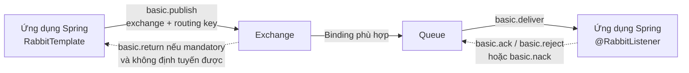

# Phạm vi tích hợp RabbitMQ bằng AMQP 0-9-1

Trong một ứng dụng Spring, lập trình viên thường làm việc với `RabbitTemplate`, `@RabbitListener`, exchange, queue và binding mà không trực tiếp gửi từng frame mạng. Tuy vậy, các thao tác đó dựa trên một giao thức cụ thể. Với **Spring AMQP dành cho RabbitMQ theo kiểu truyền thống, giao thức đó là AMQP 0-9-1** (cũng thường được viết là *AMQP 0.9.1*).

Hiểu phạm vi AMQP 0-9-1 giúp trả lời ba câu hỏi: những thao tác nào là chức năng giao thức; những chức năng nào do RabbitMQ mở rộng hoặc Spring cung cấp; và những điều gì vẫn phải do ứng dụng thiết kế để xử lý bất đồng bộ đáng tin cậy.

Sau bài học, bạn có thể:

- Mô tả đường đi của message qua connection, channel, exchange, binding, queue và consumer.
- Chọn đúng thư viện khi dự án dùng RabbitMQ AMQP 0-9-1 thay vì AMQP 1.0.
- Phân biệt consumer acknowledgement, publisher confirm, publisher return, retry, dead-letter và transaction.
- Xác định giới hạn của giao thức khi cần tính bền vững, tránh trùng lặp hoặc giao dịch với cơ sở dữ liệu.

## 1. Định vị AMQP 0-9-1 trong hệ sinh thái RabbitMQ

**AMQP** (*Advanced Message Queuing Protocol*) là một họ giao thức truyền message. **AMQP 0-9-1 và AMQP 1.0 là hai giao thức khác nhau ở cấp độ dữ liệu truyền trên mạng**, không phải hai phiên bản có thể thay thế trực tiếp chỉ bằng cách tăng số phiên bản thư viện.

| Thành phần | Vai trò | Cần ghi nhớ |
| --- | --- | --- |
| **AMQP 0-9-1** | Định nghĩa cách client kết nối, khai báo tài nguyên, publish, nhận và xác nhận message | Giao thức chính của luồng `RabbitTemplate` / `@RabbitListener` truyền thống |
| **RabbitMQ broker** | Triển khai giao thức và cung cấp exchange, queue, lưu trữ, định tuyến, xác thực, giám sát | Có nhiều tính năng **mở rộng** ngoài đặc tả AMQP 0-9-1 |
| **RabbitMQ Java Client** | Thư viện Java giao tiếp với broker bằng AMQP 0-9-1 | Spring Rabbit thường sử dụng client này ở lớp bên dưới |
| **Spring AMQP / Spring Rabbit** | Cung cấp API cấp cao, container listener, message converter, quản lý connection | `RabbitTemplate` và `@RabbitListener` giúp giảm code xử lý channel, consumer |
| **Spring Boot** | Tự cấu hình connection factory, template, admin, listener qua dependency và properties | Starter cần chọn **theo phiên bản Boot và giao thức mong muốn** |

Vì vậy, một ứng dụng sử dụng Spring AMQP không có nghĩa mọi khả năng mà ứng dụng sở hữu đều nằm trong tiêu chuẩn AMQP 0-9-1. Ví dụ, publisher confirms và dead-letter exchange là các cơ chế RabbitMQ bổ sung quanh giao thức; retry ở listener thường do Spring thực hiện.

### 1.1. AMQP 0-9-1 vẫn được hỗ trợ, nhưng không đồng nhất với AMQP 1.0

RabbitMQ hỗ trợ AMQP 0-9-1 để duy trì hệ sinh thái đã trưởng thành. RabbitMQ hiện cũng hỗ trợ AMQP 1.0 trực tiếp và tài liệu chính thức **khuyến nghị AMQP 1.0 cho ứng dụng mới**. Tuy nhiên, việc chọn giao thức còn tùy API, thư viện, tính năng broker, hệ thống đang vận hành và yêu cầu tương thích của dự án.

Trong phạm vi bài học này, ta cố ý chọn **AMQP 0-9-1** để học exchange/queue/binding, `RabbitTemplate`, `@RabbitListener` và những cơ chế tin cậy quen thuộc của Spring Rabbit. Không dùng API AMQP 1.0 để thay thế ngầm cho các ví dụ.

## 2. Message đi qua những thành phần nào?

`AMQP 0-9-1` mô hình hóa broker thông qua các thực thể và thao tác sau:

- **Connection:** kết nối mạng từ client đến broker; được xác thực, chọn một virtual host cụ thể.
- **Channel:** luồng logic bên trong connection, dùng để khai báo tài nguyên, publish hoặc consume; giúp không cần mở một TCP connection cho từng tác vụ.
- **Exchange:** nơi publisher gửi message; exchange định tuyến message theo loại exchange và các binding hiện có.
- **Binding:** quy tắc nối exchange với queue (hoặc exchange khác theo mở rộng RabbitMQ); có thể xét routing key.
- **Queue:** nơi broker giữ message chờ xử lý; nhiều consumer có thể cùng nhận từ một queue.
- **Consumer:** tiến trình đăng ký nhận message từ queue; có thể ack/nack tùy cơ chế được chọn.



**Lưu ý:** Hướng mũi tên chấm mô tả thông tin phản hồi, không phải một message mới được gửi ngược từ queue sang consumer. Publisher confirm (khi bật) là một phản hồi riêng của broker về việc nhận trách nhiệm đối với lần publish.

Đường đi điển hình:

1. Spring mở connection bằng thông tin broker, user và vhost, sau đó sử dụng channel.
2. Publisher gọi `RabbitTemplate.convertAndSend("orders.events", "order.created", payload)`.
3. RabbitMQ nhận `basic.publish` tới exchange `orders.events`, đối chiếu binding và chọn các queue đích.
4. Broker gửi message tới consumer đã đăng ký queue; listener gọi xử lý nghiệp vụ.
5. Khi dùng acknowledgement, broker xử lý `basic.ack` hoặc phản hồi từ chối phù hợp; Spring có thể quản lý việc này thay listener.

### 2.1. Những loại exchange thường gặp

| Exchange | Cách định tuyến | Tình huống |
| --- | --- | --- |
| **Direct** | Routing key khớp chính xác với binding key | Chia tác vụ theo loại lệnh |
| **Topic** | Khớp mẫu routing key với `*` và `#` | Sự kiện `order.created`, `order.cancelled` |
| **Fanout** | Phát tới các queue đã bind, không dựa vào routing key | Phân phối thông báo tới nhiều service |
| **Headers** | Đối chiếu thuộc tính header trong binding | Định tuyến theo metadata |

AMQP 0-9-1 có **default exchange** mang tên rỗng `""`; RabbitMQ tự bind mỗi queue vào exchange này bằng tên queue làm routing key. Dù có khả năng gửi trực tiếp qua default exchange, việc tự khai báo exchange và binding thường giúp làm rõ hợp đồng định tuyến giữa các service.

## 3. Phạm vi chức năng: giao thức, mở rộng RabbitMQ và Spring

Cần phân biệt lớp cung cấp tính năng để dự đoán đúng hành vi khi nâng cấp thư viện, thay broker hoặc xử lý lỗi.

| Nhu cầu | Cơ chế | Thuộc lớp nào? |
| --- | --- | --- |
| Khai báo exchange, queue, binding | `exchange.declare`, `queue.declare`, `queue.bind` | AMQP 0-9-1 |
| Gửi message tới exchange | `basic.publish`, exchange, routing key, properties/body | AMQP 0-9-1 |
| Nhận message | `basic.consume` / `basic.deliver`; có `basic.get` khi cần pull | AMQP 0-9-1 |
| Xác nhận xử lý của consumer | `basic.ack`, `basic.reject`; QoS/prefetch | AMQP 0-9-1 |
| Trả message không định tuyến được | `mandatory` và `basic.return` | AMQP 0-9-1 |
| Transaction trên channel | `tx.select`, `tx.commit`, `tx.rollback` | AMQP 0-9-1 |
| Xác nhận từ phía broker cho publisher | `confirm.select`, publisher confirm | **Mở rộng RabbitMQ** |
| Từ chối nhiều delivery một lần | `basic.nack` (có `multiple`) | **Mở rộng RabbitMQ** |
| Dead-letter exchange, queue TTL, quorum queue | Policy/queue arguments và cơ chế của broker | **Tính năng RabbitMQ**, không phải toàn bộ đặc tả AMQP 0-9-1 |
| Gọi hàm Java để publish/consume | `RabbitTemplate`, `@RabbitListener`, message converter | **Spring AMQP** |
| Retry theo backoff khi listener ném exception | Retry interceptor/container/recoverer | **Spring**, phối hợp cơ chế ack/reject của broker |
| Quan sát dashboard, quản lý qua HTTP API | RabbitMQ Management, metrics, tracing/observation | **Công cụ broker và tích hợp vận hành**, không phải frame AMQP 0-9-1 |

Ví dụ, hai broker cùng nói AMQP 0-9-1 có thể không hỗ trợ hoàn toàn giống nhau về publisher confirms, dead lettering hoặc quorum queues. Những tính năng ấy cần kiểm chứng trên **RabbitMQ và phiên bản broker thực tế**.

## 4. Chọn đúng dependency khi dùng Spring Boot

Tên thư viện phụ thuộc phiên bản Spring Boot. Đây là một điểm đặc biệt quan trọng trong chương **Phiên bản và thư viện**.

| Spring Boot | Starter RabbitMQ AMQP 0-9-1 | Ghi chú |
| --- | --- | --- |
| **3.x đến 4.1** | `org.springframework.boot:spring-boot-starter-amqp` | Starter lịch sử dành cho Spring Rabbit / AMQP 0-9-1 |
| **4.2 trở lên** (theo tài liệu 4.2) | `org.springframework.boot:spring-boot-starter-rabbitmq` | `spring-boot-starter-amqp` đã dành cho **AMQP 1.0 tổng quát** |
| **4.2, AMQP 1.0 trên RabbitMQ** | `spring-boot-starter-amqp-rabbitmq` | Đây là lựa chọn giao thức khác, không phải phần thực hành của bài |

Tại thời điểm soạn bài (tháng 11/2026), tài liệu Spring Boot 4.2 mô tả rõ ba nhánh AMQP. Khi phát triển hoặc bảo trì dự án, hãy kiểm tra **tài liệu đúng phiên bản Spring Boot**, thay vì luôn sao chép một tên starter từ hướng dẫn cũ.

Ví dụ Maven với **Spring Boot 4.2**, dự án đã dùng parent/BOM của Spring Boot:

```xml
<dependency>
    <groupId>org.springframework.boot</groupId>
    <artifactId>spring-boot-starter-rabbitmq</artifactId>
</dependency>
```

Nếu dự án dùng Spring Boot 3.x hoặc 4.0–4.1, thay artifact bằng `spring-boot-starter-amqp`. Không tự chèn một phiên bản dependency không tương thích với BOM của dự án.

Ở tầng thư viện, cấu hình thông thường của bài là:

```text
Ứng dụng Java
  -> RabbitTemplate / @RabbitListener (Spring Rabbit)
  -> RabbitMQ Java Client (AMQP 0-9-1)
  -> TCP hoặc TLS
  -> RabbitMQ broker + virtual host + exchange / queue
```

Dù một số API có tên giống nhau giữa các mô-đun Spring, **`RabbitTemplate` của Spring Rabbit không tự biến thành client AMQP 1.0**. Đối với tích hợp AMQP 1.0, Spring Boot mới có các API và module khác như `AmqpClient` hoặc `RabbitAmqpTemplate` tùy lựa chọn thư viện.

## 5. Ví dụ Spring AMQP với mô hình AMQP 0-9-1

Giả sử service quản lý đơn hàng phát sự kiện `order.created` cho service gửi thông báo.

### 5.1. Cấu hình connection và xác nhận publish

```yaml
# application.yml - ví dụ Spring Boot dùng starter AMQP 0-9-1 tương ứng
spring:
  rabbitmq:
    host: localhost
    port: 5672
    virtual-host: /orders
    publisher-confirm-type: correlated
    publisher-returns: true
    template:
      mandatory: true
    listener:
      simple:
        acknowledge-mode: auto
        prefetch: 10
```

Cấu hình ví dụ giả định rằng vhost `/orders` đã tồn tại, user đã được cấp quyền và ứng dụng nhận thông tin đăng nhập qua biến môi trường `SPRING_RABBITMQ_USERNAME`, `SPRING_RABBITMQ_PASSWORD` hoặc secret quản lý riêng. `acknowledge-mode: auto` nghĩa là **Spring listener container** tự phát ACK khi xử lý thành công; nó không có nghĩa AMQP consumer đang sử dụng `autoAck=true`. Hai khái niệm này cần được phân biệt.

`publisher-confirm-type: correlated` cho phép theo dõi broker confirm có correlation; `publisher-returns: true` cùng `template.mandatory: true` hỗ trợ nhận message không thể định tuyến tới queue. Bật properties chỉ thiết lập hạ tầng; ứng dụng vẫn cần **xử lý kết quả confirm/return** nếu muốn có chiến lược ghi nhận lỗi hoặc retry phù hợp.

### 5.2. Khai báo topology

```java
import org.springframework.amqp.core.Binding;
import org.springframework.amqp.core.BindingBuilder;
import org.springframework.amqp.core.Queue;
import org.springframework.amqp.core.QueueBuilder;
import org.springframework.amqp.core.TopicExchange;
import org.springframework.context.annotation.Bean;
import org.springframework.context.annotation.Configuration;

@Configuration
public class OrderAmqpConfig {
    @Bean
    TopicExchange orderExchange() {
        return new TopicExchange("orders.events", true, false);
    }

    @Bean
    Queue orderCreatedQueue() {
        return QueueBuilder.durable("orders.created").build();
    }

    @Bean
    Binding orderBinding(Queue orderCreatedQueue, TopicExchange orderExchange) {
        return BindingBuilder.bind(orderCreatedQueue)
                .to(orderExchange)
                .with("order.created");
    }
}
```

Trong cấu hình tự động thông thường, Spring AMQP có thể dùng `RabbitAdmin` để khai báo các bean topology trên broker thông qua connection hiện tại. Exchange, queue và binding thuộc **vhost `/orders`**; chúng không tự xuất hiện trong vhost khác.

### 5.3. Publisher và consumer

```java
import org.springframework.amqp.rabbit.core.RabbitTemplate;
import org.springframework.stereotype.Service;

@Service
public class OrderEventPublisher {
    private final RabbitTemplate rabbitTemplate;

    public OrderEventPublisher(RabbitTemplate rabbitTemplate) {
        this.rabbitTemplate = rabbitTemplate;
    }

    public void orderCreated(String orderId) {
        rabbitTemplate.convertAndSend(
                "orders.events", "order.created", orderId);
    }
}
```

```java
import org.springframework.amqp.rabbit.annotation.RabbitListener;
import org.springframework.stereotype.Component;

@Component
public class NotificationConsumer {
    @RabbitListener(queues = "orders.created")
    public void onOrderCreated(String orderId) {
        // Trong ứng dụng thực tế: ghi nhận idempotency rồi thực hiện nghiệp vụ.
        System.out.println("Notify for order " + orderId);
    }
}
```

Đây là ví dụ tối giản để minh họa đường đi của message. Vì `convertAndSend` là lời gọi publish **bất đồng bộ**, việc phương thức trả về bình thường **không chứng minh** consumer đã nhận và xử lý message. Ví dụ cũng chưa xử lý kết quả confirm, return, giao dịch dữ liệu hoặc retry.

## 6. Ba loại phản hồi thường dễ bị nhầm

| Phản hồi | Ai gửi? | Xác nhận điều gì? | Chưa bảo đảm điều gì? |
| --- | --- | --- | --- |
| **Publisher confirm** | Broker → publisher | Broker đã nhận trách nhiệm xử lý lần publish theo ngữ nghĩa confirm của loại queue/broker | Consumer đã chạy xong nghiệp vụ |
| **Publisher return** | Broker → publisher | Message có `mandatory=true` **không tìm được queue đích** theo routing hiện tại | Trạng thái xử lý nghiệp vụ của consumer |
| **Consumer acknowledgement** | Consumer → broker | Consumer xác nhận delivery đã xử lý theo quy ước của ứng dụng/container | Dữ liệu ở hệ thống ngoài chắc chắn đã commit nếu ứng dụng ack sai thời điểm |

Hai kịch bản giúp phân biệt:

- Exchange có tồn tại nhưng **không có binding phù hợp**: message `mandatory=true` có thể được `basic.return` về publisher; publisher confirm vẫn có thể là **ACK**, vì broker đã xử lý thao tác publish. Do đó **confirm ACK không đồng nghĩa message tới queue**.
- Queue đã nhận message, consumer đang xử lý thì mất kết nối **trước khi ACK**: broker có thể giao lại message cho consumer khác. Vì thế ứng dụng phải chuẩn bị cho khả năng **xử lý trùng lặp**.

Một thiết kế publisher đáng tin cậy thường phải xử lý **cả confirm lẫn return**. Một thiết kế consumer đáng tin cậy phải kiểm soát thời điểm ACK, hành vi requeue và tính idempotent của nghiệp vụ.

### 6.1. Chế độ ACK khi dùng `@RabbitListener`

Spring cung cấp nhiều cách cấu hình listener:

- **AUTO của Spring:** container gửi ACK sau khi listener hoàn tất thành công; khi exception xảy ra, hành vi reject/requeue phụ thuộc cấu hình retry và error handling.
- **MANUAL:** ứng dụng chủ động sử dụng delivery tag cùng `Channel.basicAck(...)` hoặc `basicNack(...)`; cần tránh ACK hai lần và xử lý lỗi rõ ràng.
- **NONE:** tương ứng mô hình không yêu cầu consumer ack ở cấp broker, nên không có cơ chế redelivery dựa trên unacked delivery như thông thường.

`prefetch` giới hạn số delivery chưa được ACK được phép đưa tới consumer; đây là công cụ điều tiết lưu lượng, không phải số worker Java hay bảo đảm thứ tự xử lý tuyệt đối.

## 7. Retry, dead-letter và giao dịch nằm ở ranh giới nào?

### 7.1. Retry không phải thao tác chung duy nhất của AMQP 0-9-1

AMQP 0-9-1 định nghĩa cơ chế giao message và cách consumer xác nhận hoặc từ chối. Cách *thử lại sau lỗi* có thể được triển khai theo nhiều lớp:

- **Spring listener retry:** gọi lại xử lý sau khi listener lỗi, theo cấu hình retry policy/backoff; một số kiểu retry diễn ra bên trong cùng lượt nhận message trước khi broker thấy kết quả cuối.
- **Broker requeue:** từ chối message với cờ requeue phù hợp để broker có thể giao lại. Nếu lặp không giới hạn, queue có thể gặp vòng lặp lỗi liên tục.
- **Dead lettering và cơ chế trì hoãn:** RabbitMQ có thể gửi message đến DLX khi bị từ chối không requeue, hết TTL, vượt giới hạn hoặc đạt delivery limit trong trường hợp áp dụng. DLX, TTL, quorum queues là tính năng của RabbitMQ và cần cấu hình phù hợp.

**Dead-letter exchange không mặc nhiên tồn tại cho mọi queue.** Khi message bị reject không requeue mà queue chưa có chiến lược dead-letter thích hợp, message có thể bị loại bỏ. Cũng không nên coi đường chuyển DLX là bảo đảm không mất message trong mọi cấu hình; các lựa chọn an toàn tùy loại queue và chiến lược dead lettering.

### 7.2. Transaction AMQP không phải transaction của cơ sở dữ liệu

`tx.select`, `tx.commit` và `tx.rollback` cho phép transaction trên **channel AMQP**, bao gồm publish/ack theo phạm vi protocol và broker. Cơ chế này có chi phí và không tự tạo một giao dịch nguyên tử với PostgreSQL, MySQL hay hệ thống thanh toán.

Ví dụ:

1. Ứng dụng ghi đơn hàng vào database thành công.
2. Trước khi publish sự kiện lên RabbitMQ, tiến trình bị tắt.
3. Database đã có đơn hàng nhưng queue chưa có sự kiện.

Chỉ bật channel transaction **không giải quyết** khoảng trống giữa hai tài nguyên. Với bài toán cần ràng buộc chặt chẽ, có thể thiết kế **transactional outbox** (ghi business data và bản ghi sự kiện cùng transaction DB, rồi publish bất đồng bộ), cùng confirm, retry và consumer idempotency.

### 7.3. Không mặc định có exactly-once

AMQP 0-9-1 không tự biến một đoạn xử lý nghiệp vụ thành **exactly-once end-to-end**. Mạng gián đoạn giữa xử lý thành công và ACK có thể dẫn đến redelivery; mạng gián đoạn khi publisher chờ confirm có thể làm publisher **không chắc** broker đã nhận message hay chưa. Publisher retry vì vậy cũng có thể tạo message trùng.

Một thiết kế thực tế thường hướng tới **at-least-once với xử lý idempotent**: dùng event ID ổn định, deduplication hoặc khóa duy nhất khi ghi kết quả, đồng thời quan sát và giới hạn retry.

## 8. Những gì không nên mặc nhiên coi là AMQP 0-9-1

| Mong muốn | Giới hạn cần hiểu |
| --- | --- |
| Dùng AMQP 1.0 theo nghĩa tương thích wire protocol | Cần client/thư viện AMQP 1.0 đúng loại; `RabbitTemplate` AMQP 0-9-1 không tự nói AMQP 1.0 |
| Dùng native RabbitMQ Streams protocol | Cần công cụ/API streams tương ứng; một số kiểu tích hợp stream qua RabbitMQ/Spring AMQP có thể tồn tại, nhưng đó không đồng nghĩa với việc mọi API AMQP 0-9-1 cung cấp toàn bộ tính năng native streams |
| Giao message xuyên virtual host | Exchange, queue và binding bị giới hạn trong vhost của connection; cần bridge hoặc dịch vụ chuyển tiếp rõ ràng |
| Quản lý RabbitMQ bằng HTTP | Management UI/API thuộc lớp quản trị HTTP, không phải thao tác `basic.publish` / `basic.consume` |
| Bảo đảm tổng quát về thứ tự khi nhiều consumer | Thứ tự quan sát còn chịu tác động bởi concurrency, requeue, priority và loại queue |
| Bảo đảm bền vững chỉ bằng durable queue | Cần xét thêm persistence của message, publisher confirms, loại queue, replication và cấu hình broker |
| Atomic commit giữa RabbitMQ và database | Cần giải pháp phối hợp nghiệp vụ, ví dụ outbox, idempotency; AMQP channel transaction tự nó không bao phủ DB |
| Thay RabbitMQ bằng broker bất kỳ chỉ vì cùng “AMQP” | Phải xác minh phiên bản giao thức và các extension mà code đang dựa vào |

Với các giao thức khác như MQTT, STOMP hoặc AMQP 1.0, RabbitMQ có cơ chế hỗ trợ riêng. Việc broker hỗ trợ nhiều giao thức **không đồng nghĩa** các giao thức có cùng ngữ nghĩa hoặc cùng API Spring.

## 9. Thực hành xác định ranh giới tính năng

Có thể dùng mô hình `orders.events → orders.created` ở trên để thực hiện thí nghiệm trong môi trường RabbitMQ dành cho học tập:

| Thí nghiệm | Thao tác | Kết luận mong đợi |
| --- | --- | --- |
| **Routing thành công** | Có binding `order.created`, publish bằng `RabbitTemplate` | Listener nhận nội dung; message đã đi qua exchange và queue |
| **Unroutable** | Publish bằng routing key không khớp, vẫn bật `mandatory` và return callback | Có publisher return; confirm ACK vẫn có thể xảy ra |
| **Consumer lỗi** | Cho listener ném exception và quan sát trạng thái ready/unacked hoặc redelivery | Việc retry/requeue do cấu hình container và phản hồi của broker quyết định |
| **Cô lập vhost** | Tạo queue trùng tên trong vhost khác rồi publish ở vhost hiện tại | Message không tự chạy xuyên vhost |
| **DB và message** | Giả lập lỗi sau commit DB nhưng trước publish | Thấy lý do cần outbox hoặc cơ chế khôi phục |
| **Thay starter** | Đối chiếu dependency theo phiên bản Spring Boot và xem client/protocol thực sự đang dùng | Phân biệt API AMQP 0-9-1 với AMQP 1.0 |

Để quan sát, dùng RabbitMQ Management UI và metrics: queue depth, consumers, unacknowledged messages, publish/ack rates, returned/unroutable messages và connection/channel status. Chỉ số và giao diện thuộc khả năng **quản trị vận hành RabbitMQ**, được dùng để hiểu điều gì đã xảy ra khi giao tiếp AMQP.

## 10. Cách xác định đúng phạm vi trong một dự án

Khi đọc yêu cầu “tích hợp RabbitMQ bằng Spring AMQP”, hãy trả lời lần lượt:

1. **Giao thức nào?** AMQP 0-9-1 hay AMQP 1.0? Kiểm tra starter, client thực tế và API đang dùng.
2. **Topology nào?** Exchange, queue, binding, routing key, vhost được tạo và quản lý ở đâu?
3. **Ai bảo đảm bước nào?** Broker nhận publish qua confirm; routing không tới queue được quan sát qua return; listener hoàn tất qua consumer ACK.
4. **Thất bại được giải quyết ra sao?** Cấu hình retry/requeue, DLX, idempotency, outbox và cảnh báo vận hành.
5. **Có phụ thuộc extension không?** Quorum queue, DLX, TTL, confirms, streams hoặc plugin có thể ràng buộc hệ thống với RabbitMQ cụ thể.

AMQP 0-9-1 cho ta **bộ thao tác chuẩn để trao đổi message qua broker**. Spring AMQP giúp sử dụng bộ thao tác đó trong Java; RabbitMQ bổ sung các khả năng quan trọng để vận hành thực tế. Độ tin cậy của quy trình bất đồng bộ đến từ việc kết hợp đúng cả ba lớp với thiết kế nghiệp vụ.

### Tài liệu tham khảo chính thức

- [RabbitMQ — AMQP 0-9-1 Model Explained](https://www.rabbitmq.com/tutorials/amqp-concepts)
- [RabbitMQ — Supported Protocols](https://www.rabbitmq.com/docs/protocols)
- [RabbitMQ — AMQP 0-9-1 Extensions](https://www.rabbitmq.com/docs/extensions)
- [RabbitMQ — Consumer Acknowledgements and Publisher Confirms](https://www.rabbitmq.com/docs/confirms)
- [RabbitMQ — Dead Letter Exchanges](https://www.rabbitmq.com/docs/dlx)
- [Spring AMQP — RabbitTemplate](https://docs.spring.io/spring-amqp/reference/amqp/template.html)
- [Spring Boot 4.1 — AMQP](https://docs.spring.io/spring-boot/4.1/reference/messaging/amqp.html)
- [Spring Boot 4.2 — AMQP](https://docs.spring.io/spring-boot/4.2/reference/messaging/amqp.html)

