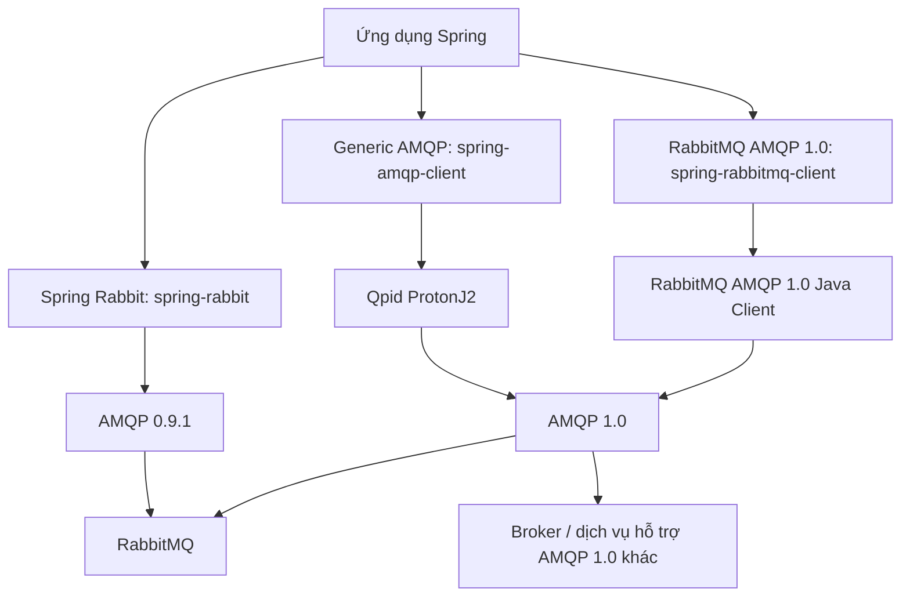
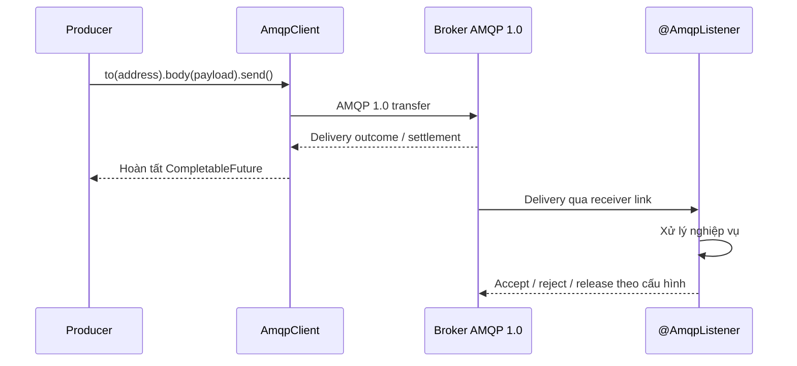

# `spring-amqp-client` cho AMQP 1.0 tổng quát từ Spring AMQP 4.1

**Chương:** Phiên bản và thư viện

**Phạm vi:** Spring AMQP 4.1 trở lên; trọng tâm là mô-đun `org.springframework.amqp:spring-amqp-client` dành cho **AMQP 1.0 tổng quát**.

Khi học Spring AMQP, chúng ta thường bắt đầu với RabbitMQ và các khái niệm `RabbitTemplate`, `@RabbitListener`, exchange, queue, binding. Từ **Spring AMQP 4.1**, dự án bổ sung `spring-amqp-client`, cho phép dùng các thành phần quen thuộc của Spring để gửi và nhận message bằng **giao thức AMQP 1.0**, qua những broker hoặc dịch vụ hỗ trợ giao thức đó.

Mục đích của mô-đun mới là **tích hợp AMQP 1.0 không phụ thuộc riêng RabbitMQ**. Nó không thay `spring-rabbit`, không tự chuyển `RabbitTemplate` sang AMQP 1.0, và không bảo đảm mọi broker AMQP 1.0 đều có cùng mô hình exchange, queue, binding hay cách triển khai retry/dead-letter.

Sau bài này, bạn có thể chọn đúng thư viện theo giao thức, cấu hình `AmqpConnectionFactory`/`AmqpClient`, gửi và nhận với `@AmqpListener`, hiểu địa chỉ đích và đánh giá các yêu cầu vận hành trước khi đưa vào hệ thống.

## 1. Vì sao cần mô-đun AMQP 1.0 tổng quát?

### 1.1. AMQP 0.9.1 và AMQP 1.0 là hai giao thức khác nhau

Tên gọi gần giống nhau nhưng **AMQP 0.9.1 và AMQP 1.0 không phải hai bản cập nhật tương thích ngược của cùng một wire protocol**.

| Tiêu chí | AMQP 0.9.1 truyền thống với RabbitMQ | AMQP 1.0 |
| --- | --- | --- |
| Cách giao tiếp | Thao tác exchange, queue, binding, publish, consume của giao thức 0.9.1 | Kết nối, session, sender/receiver link, transfer và settlement theo AMQP 1.0 |
| Địa chỉ gửi và nhận | API thường tách exchange và routing key/queue name | Link hoặc message mang **address**; ý nghĩa address do broker quy định |
| Thư viện Spring thường dùng | `spring-rabbit`, `RabbitTemplate`, `@RabbitListener` | `spring-amqp-client`, `AmqpClient`, `@AmqpListener` |
| Broker mục tiêu | RabbitMQ theo giao thức 0.9.1 | RabbitMQ và các hệ thống khác hỗ trợ AMQP 1.0 |
| Điều kiện liên thông | Cần client nói đúng phiên bản giao thức mà broker hỗ trợ | Cần cả hai phía hỗ trợ AMQP 1.0 và thống nhất cách ánh xạ địa chỉ/tính năng |

RabbitMQ **hỗ trợ AMQP 1.0 trực tiếp từ RabbitMQ 4.0** và có thể chấp nhận cả hai giao thức trên cổng AMQP mặc định, nhưng client vẫn phải thương lượng đúng giao thức. Điều đó không có nghĩa mọi broker AMQP 1.0 đều có exchange, queue hoặc routing key theo cách RabbitMQ triển khai.

### 1.2. Ba nhánh thư viện dễ nhầm

| Module | Được dùng cho | Client nền tảng | API Spring tiêu biểu |
| --- | --- | --- | --- |
| `spring-rabbit` | RabbitMQ với AMQP 0.9.1 | RabbitMQ Java client (`com.rabbitmq:amqp-client`) | `RabbitTemplate`, `RabbitAdmin`, `@RabbitListener` |
| `spring-rabbitmq-client` (từ Spring AMQP 4.0) | RabbitMQ **riêng** với AMQP 1.0 | RabbitMQ AMQP 1.0 Java client | `RabbitAmqpTemplate`, `RabbitAmqpAdmin` và listener hạ tầng RabbitMQ |
| **`spring-amqp-client` (từ Spring AMQP 4.1)** | AMQP 1.0 **tổng quát**, hướng tới nhiều broker | Apache Qpid **ProtonJ2 Client** | `AmqpClient`, `AmqpConnectionFactory`, `@AmqpListener` |

**Điểm quan trọng:** `spring-amqp-client` và `spring-rabbitmq-client` đều sử dụng AMQP 1.0 nhưng **không phải hai tên cho cùng một thư viện**. Chọn thư viện tổng quát khi cần hỗ trợ nhiều môi trường AMQP 1.0. Nếu chỉ dùng RabbitMQ và phụ thuộc mạnh vào các tính năng quản trị/topology đặc thù của RabbitMQ, hãy đánh giá thư viện chuyên dụng của RabbitMQ.

Sơ đồ vị trí các thư viện:



Sơ đồ cho thấy **cổng giao thức AMQP 1.0** là điểm giao giữa các broker, còn những tính năng cụ thể ở mỗi broker vẫn cần được kiểm chứng riêng.

## 2. Phiên bản, dependency và phạm vi tương thích

### 2.1. Mốc phiên bản cần nhớ

- **Spring AMQP 4.0:** có `spring-rabbitmq-client` cho AMQP 1.0 trên RabbitMQ.
- **Spring AMQP 4.1:** giới thiệu **`spring-amqp-client`** dùng ProtonJ2 cho AMQP 1.0 tổng quát; bổ sung `AmqpClient`, listener container và `@AmqpListener`.
- **Spring AMQP 4.1.x:** thuộc nhánh dựa trên **Spring Framework 7**; phải kiểm tra dependency tree trước khi ghép với dự án Spring Boot/Spring Framework đang dùng.
- **Các bản Spring AMQP mới hơn 4.1:** có thể thay đổi API hoặc bổ sung cải tiến; khi sử dụng thực tế hãy đối chiếu tài liệu đúng phiên bản mà ứng dụng đã khóa.

Ví dụ phụ thuộc Maven cho **nhánh 4.1**, dùng phiên bản minh họa `4.1.3`:

```xml
<dependency>
    <groupId>org.springframework.amqp</groupId>
    <artifactId>spring-amqp-client</artifactId>
    <version>4.1.3</version>
</dependency>
```

Tương đương Gradle:

```groovy
dependencies {
    implementation 'org.springframework.amqp:spring-amqp-client:4.1.3'
}
```

Nếu ứng dụng dùng **Spring Boot BOM hoặc dependency management**, hãy để BOM quản lý phiên bản khi có mục tương ứng và kiểm tra nhánh Spring AMQP được đưa vào. Không tự ép `spring-amqp-client:4.1.x` lên hệ sinh thái Spring Framework 6 / Spring Boot 3 nếu dependency nền chưa tương thích.

> **Lưu ý về starter Spring Boot:** Tên starter và ý nghĩa của nó phụ thuộc phiên bản Boot. Trong tài liệu **Spring Boot 4.1**, `spring-boot-starter-amqp` được mô tả cho RabbitMQ truyền thống (`RabbitTemplate`). Trong tài liệu **Spring Boot 4.2**, `spring-boot-starter-amqp` được mô tả cho **AMQP 1.0 tổng quát**, trong khi `spring-boot-starter-rabbitmq` là lựa chọn cho AMQP 0.9.1 và `spring-boot-starter-amqp-rabbitmq` cho AMQP 1.0 riêng RabbitMQ. Vì vậy **không đoán giao thức chỉ từ tên starter**; hãy mở đúng tài liệu Boot đang chạy và xem dependency tree.

### 2.2. Cần gì để chạy được ví dụ?

Một ứng dụng tối thiểu cần:

1. **JDK và Spring Framework tương thích** với nhánh Spring AMQP 4.1; đọc yêu cầu phiên bản từ tài liệu phát hành.
2. Dependency `spring-amqp-client` và các phụ thuộc ProtonJ2 do build tool resolve.
3. Một broker AMQP 1.0 đang hoạt động và tài khoản có quyền gửi/nhận.
4. **Address đã tồn tại và hợp lệ** theo quy ước broker; với RabbitMQ, queue hoặc exchange/binding tương ứng phải được provision.
5. Cấu hình endpoint, chứng thực, TLS và chính sách reconnect phù hợp môi trường.

Có thể dùng RabbitMQ 4.x để thực hành mà không phải bỏ các bài học trước về exchange, queue và binding. Tuy nhiên, phần **khai báo topology** là chức năng của broker và/hoặc công cụ quản trị: đừng mặc định thêm một bean kiểu `Queue` vào ứng dụng generic AMQP sẽ tự tạo queue giống `RabbitAdmin` của `spring-rabbit`.

## 3. Các thành phần chính của `spring-amqp-client`

`spring-amqp-client` bọc các khái niệm AMQP 1.0 trong API quen thuộc với lập trình viên Spring:

| Thành phần | Vai trò | Điểm cần chú ý |
| --- | --- | --- |
| `org.apache.qpid.protonj2.client.Client` | Client nền tảng Qpid ProtonJ2 | Có thể dùng trực tiếp; khi dùng `SingleAmqpConnectionFactory`, không bắt buộc tự tạo bean client |
| `AmqpConnectionFactory` | Abstraction tạo/quản lý kết nối AMQP 1.0 | Khác `org.springframework.amqp.rabbit.connection.ConnectionFactory` của RabbitMQ 0.9.1 |
| `SingleAmqpConnectionFactory` | Triển khai dùng chung một ProtonJ connection cho nhiều producer/consumer | Nhiều link dùng chung connection; có tùy chọn host, port, user, connection options |
| `AmqpClient` | Fluent API gửi và nhận trên một AMQP address | Các thao tác trả `CompletableFuture`, có bộ chuyển đổi message |
| `AmqpMessageListenerContainer` | Quản lý các receiver và vòng đời xử lý message | Điều khiển số consumer, credits, receive timeout và khôi phục receiver |
| `@EnableAmqp` | Đăng ký hạ tầng annotation listener | Dùng khi tự cấu hình các bean Spring, không dựa vào auto-configuration |
| `@AmqpListener` | Lắng nghe message từ một hay nhiều AMQP address | Không phải `@RabbitListener` của `spring-rabbit` |
| `MethodAmqpMessageListenerContainerFactory` | Tạo container cho listener POJO | Cấu hình converter, concurrency, auto-accept, error handler |

Ví dụ vòng đời message:



**Việc gửi được broker tiếp nhận khác với việc consumer đã xử lý xong.** Kết quả `CompletableFuture<Boolean>` của `send()` cho biết kết quả hoạt động gửi theo contract client; nó không phải xác nhận hoàn tất tác vụ nghiệp vụ downstream.

## 4. Cấu hình bằng Spring Java Configuration

Phần này minh họa **Spring AMQP 4.1 với cấu hình thủ công**, để làm rõ những bean mà thư viện mới cần. Đối với Spring Boot có auto-configuration tương thích, nhiều bean có thể được tạo tự động.

### 4.1. Connection factory và `AmqpClient`

```java
@Configuration(proxyBeanMethods = false)
@EnableAmqp
class GenericAmqp10Config {

    @Bean
    AmqpConnectionFactory amqpConnectionFactory() {
        // Mặc định kết nối localhost:5672.
        // Khi triển khai thật, cấu hình host, port, user, TLS.
        return new SingleAmqpConnectionFactory();
    }

    @Bean
    AmqpClient amqpClient(AmqpConnectionFactory factory) {
        return AmqpClient.builder(factory)
                .defaultToAddress("/queues/orders.mail")
                .build();
    }

    @Bean(name = AmqpDefaultConfiguration
            .DEFAULT_AMQP_LISTENER_CONTAINER_FACTORY_BEAN_NAME)
    MethodAmqpMessageListenerContainerFactory amqpListenerContainerFactory(
            AmqpConnectionFactory factory) {
        return new MethodAmqpMessageListenerContainerFactory(factory);
    }
}
```

Các kiểu trong ví dụ thuộc `org.springframework.amqp.client`, `org.springframework.amqp.client.config` và annotation liên quan; cấu hình Spring dùng `@Configuration`/`@Bean`. Trên nhánh 4.1, `SingleAmqpConnectionFactory` mặc định dùng `localhost:5672` và có tùy chọn reconnect. Trong môi trường thật, phải đặt rõ điểm cuối broker, xác thực/TLS, timeout và giới hạn phục hồi.

Bean `MethodAmqpMessageListenerContainerFactory` được đặt tên bằng hằng số của `AmqpDefaultConfiguration` để `@AmqpListener` không khai báo `containerFactory` vẫn tra được factory mặc định. `@EnableAmqp` đăng ký các thành phần quét và tạo listener endpoint.

Nếu cần chuyển object Java sang JSON và ngược lại, truyền `JacksonJsonMessageConverter` cho `AmqpClient.builder(...).messageConverter(...)` và cấu hình converter tương ứng cho listener factory. Nếu không cấu hình converter, `AmqpClient` sử dụng `SimpleMessageConverter`. Không nên giả định hai đầu tự hiểu cùng một kiểu Java phức tạp.

### 4.2. Gửi message đến address

```java
@Service
class OrderEventPublisher {
    private final AmqpClient client;

    OrderEventPublisher(AmqpClient client) {
        this.client = client;
    }

    CompletableFuture<Boolean> publishOrderCreated(String orderId) {
        return client.to("/queues/orders.mail")
                .body(orderId)
                .messageId("order-created-" + orderId)
                .header("event-type", "order.created")
                .send();
    }
}
```

Ví dụ trên gửi message đơn giản đến địa chỉ `/queues/orders.mail` của **RabbitMQ AMQP 1.0**. Queue này **phải tồn tại trước khi gửi**. Mỗi broker có thể dùng address khác; không thể bê nguyên chuỗi `/queues/...` sang mọi dịch vụ AMQP 1.0.

Producer phải theo dõi future:

```java
publisher.publishOrderCreated("ORD-1024")
        .whenComplete((accepted, error) -> {
            if (error != null) {
                // Ghi log, phân loại lỗi và lên kế hoạch retry an toàn.
            } else if (!Boolean.TRUE.equals(accepted)) {
                // Kết quả gửi chưa được xác nhận thành công.
            } else {
                // Thao tác gửi được xác nhận theo contract của client.
                // Chưa có nghĩa email đã được gửi.
            }
        });
```

Không gọi `send()` rồi bỏ mặc future trong các luồng cần bảo đảm message đã được broker tiếp nhận. Ngược lại, cũng không nên `join()` một cách mù quáng trên thread HTTP khi mục tiêu là xử lý bất đồng bộ; hãy thiết kế phản hồi và xử lý lỗi rõ ràng.

### 4.3. Nhận message bằng `@AmqpListener`

```java
@Component
class OrderMailConsumer {

    @AmqpListener(addresses = "/queues/orders.mail")
    void onOrderCreated(String orderId) {
        // Ghi nhận eventId/orderId để chống xử lý trùng.
        // Sau đó thực hiện tác vụ gửi email.
        System.out.println("Send order email for " + orderId);
    }
}
```

**Khác biệt cần nhớ:**

- `@AmqpListener(addresses = "...")` dùng AMQP **address**; `@RabbitListener(queues = "...")` dùng các queue của RabbitMQ theo hạ tầng listener 0.9.1.
- `@AmqpListener` được xử lý bởi hạ tầng `spring-amqp-client`, không phải `RabbitListenerEndpointRegistry`.
- Mặc định receiver link có cơ chế **credit** để hạn chế số delivery đang cấp cho consumer. Concurrency, initial credits và timeout phải được chỉnh theo khả năng xử lý thực tế.
- Listener cần có quy tắc retry, lỗi vĩnh viễn và idempotency; việc đánh dấu message hoàn tất không nên đi trước tác dụng phụ nghiệp vụ nếu điều đó có thể gây mất tác vụ.

### 4.4. Nhận chủ động khi không cần listener chạy thường trực

`AmqpClient` còn có API fluent để đọc on demand:

```java
CompletableFuture<String> receiveFuture =
        amqpClient.from("/queues/orders.mail").receiveAndConvert();
```

`receiveAndConvert()` dùng `MessageConverter`. Khi chuyển thành kiểu model cụ thể thay vì `Object`, tài liệu Spring yêu cầu converter phù hợp với `SmartMessageConverter`, ví dụ `JacksonJsonMessageConverter`. Nếu consumer cần luôn lắng nghe công việc đến, `@AmqpListener`/listener container thường hợp lý hơn việc tự viết vòng lặp polling.

## 5. Địa chỉ AMQP 1.0 và exchange/queue/binding trên RabbitMQ

Đây là phần kết nối `spring-amqp-client` với kiến thức RabbitMQ đã học.

Trong **RabbitMQ 4.x**, address **v2** được khuyến nghị cho AMQP 1.0:

| Mục đích | RabbitMQ AMQP 1.0 address v2 | Ý nghĩa |
| --- | --- | --- |
| Gửi thẳng vào một queue đã tồn tại | `/queues/orders.mail` | Broker định tuyến vào queue qua default exchange |
| Gửi vào exchange với routing key | `/exchanges/orders.events/order.created` | Publish đến exchange `orders.events` bằng routing key `order.created` |
| Gửi vào exchange với routing key rỗng | `/exchanges/orders.broadcast` | Phù hợp khi exchange bỏ qua routing key, ví dụ fanout |
| Consumer nhận từ queue | `/queues/orders.mail` | Receiver link đọc từ queue đã tồn tại |

Ví dụ bên gửi:

```java
amqpClient.to("/exchanges/orders.events/order.created")
          .body("ORD-1024")
          .send();
```

Muốn message tới `orders.mail`, cần có binding tương ứng, ví dụ:

```text
AMQP 1.0 sender link
    address = /exchanges/orders.events/order.created
                         |
                         v
            exchange orders.events
                         |
            binding: order.created
                         |
                         v
                 queue orders.mail
                         |
                         v
AMQP 1.0 receiver link
    address = /queues/orders.mail
```

Mô hình **exchange → binding → queue** vẫn thuộc RabbitMQ; `spring-amqp-client` giao tiếp bằng AMQP 1.0 address, thay vì API riêng gồm các tham số exchange/routing-key kiểu `RabbitTemplate`.

**Các giới hạn quan trọng:**

- `/queues/...` và `/exchanges/...` là **quy ước của RabbitMQ**, không phải quy tắc địa chỉ chung bắt buộc cho mọi broker AMQP 1.0.
- Địa chỉ receive v2 của RabbitMQ là `/queues/:queue`; queue phải có sẵn. Một exchange không thay thế trực tiếp địa chỉ nhận từ queue.
- Nếu tên queue, exchange hoặc routing key chứa ký tự đặc biệt như dấu `/`, cần **percent-encode theo RFC 3986** khi tạo address. Ví dụ routing key `region/sg` thành `region%2Fsg` trong đường dẫn.
- Những địa chỉ v1 như `/amq/queue/...` hoặc `/exchange/...` thuộc quy ước cũ, đã bị RabbitMQ đánh dấu deprecated; nên ưu tiên v2.
- Broker có thể trả trạng thái delivery không được route/chấp nhận khi address hoặc binding sai. Ứng dụng phải kiểm tra kết quả gửi và giám sát lỗi định tuyến.

## 6. Tích hợp qua Spring Boot: kiểm tra đúng phiên bản

Khi dùng **Spring Boot 4.2** và starter generic AMQP 1.0 (`spring-boot-starter-amqp` theo tài liệu 4.2), Spring Boot tự tạo `AmqpConnectionFactory`, `AmqpClient` và hạ tầng `@AmqpListener` theo cấu hình. Ví dụ:

```yaml
spring:
  amqp:
    host: localhost
    port: 5672
    username: guest
    password: guest
    client:
      default-to-address: /queues/orders.mail
      completion-timeout: 2s
```

Ở đây `spring.amqp.*` dành cho **generic AMQP 1.0** theo tài liệu Boot 4.2. Nếu dùng RabbitMQ AMQP 0.9.1 với `RabbitTemplate`, cấu hình quen thuộc là `spring.rabbitmq.*`. Hai nhóm thuộc hạ tầng khác nhau.

```java
@Component
class GenericAmqpMailHandler {
    private final AmqpClient client;

    GenericAmqpMailHandler(AmqpClient client) {
        this.client = client;
    }

    void publish(String payload) {
        client.to("/queues/orders.mail").body(payload).send();
    }

    @AmqpListener(addresses = "/queues/orders.mail")
    void consume(String payload) {
        System.out.println("Received: " + payload);
    }
}
```

Ví dụ `publish()` ở đây minh họa API ngắn; production cần theo dõi future và lỗi gửi. **Đừng áp dụng block cấu hình này cho Boot 4.1 mà không xác minh auto-configuration:** tài liệu Boot 4.1 mô tả `spring-boot-starter-amqp` theo luồng RabbitMQ classic, khác tài liệu Boot 4.2.

Để hạn chế lỗi do version drift, luôn kiểm tra ba thứ cùng lúc: **version Spring Boot**, **version Spring AMQP được resolve**, **nội dung starter/auto-configuration thực tế**. Nếu dùng starter và tự cấu hình lại toàn bộ factory, tránh vô tình tạo hai hạ tầng listener khác nhau.

## 7. Giao nhận tin cậy: có gì giống và khác `RabbitTemplate`?

AMQP 1.0 có khái niệm **delivery outcome và settlement**. Trong Spring AMQP generic, người lập trình vẫn cần quyết định khi nào công việc được xem là thành công, thất bại hoặc cần giao lại.

### 7.1. Các mốc xác nhận không đồng nghĩa nhau

1. `AmqpClient.send()` tạo ra `CompletableFuture<Boolean>` phản ánh kết quả thao tác gửi.
2. Broker xử lý transfer, route message vào đích nếu địa chỉ/topology hợp lệ và trả delivery outcome theo giao thức.
3. Consumer nhận delivery và thực hiện thao tác nghiệp vụ.
4. Receiver **settle** delivery bằng trạng thái phù hợp (ví dụ accept/reject/release), hoặc container thực hiện theo cấu hình auto-accept.
5. Giao dịch database, gửi email và settlement với broker là các thao tác khác nhau; nếu consumer chết giữa những mốc đó, message có thể được giao lại hoặc tác dụng phụ đã xảy ra mà chưa được ghi nhận.

**Không coi `CompletableFuture<Boolean>` là publisher confirm + consumer acknowledgment + thành công nghiệp vụ trong một bước.** Khi broker không route, sender bị mất kết nối hoặc consumer bị lỗi, ứng dụng cần cách phát hiện và phục hồi riêng.

### 7.2. Auto-accept, manual settlement và receiver credits

`AmqpMessageListenerContainer` mặc định dùng `autoAccept = true`. Có thể đặt `autoAccept = false` để hệ thống đưa `AmqpAcknowledgment` vào thuộc tính của Spring AMQP message nhằm điều khiển settlement thủ công trong listener. Khi xử lý native delivery, `ProtonDeliveryListener` cho phép can thiệp sâu hơn.

- **Auto-accept:** ít mã hơn, phù hợp xử lý đơn giản khi đã hiểu hành vi lỗi của listener.
- **Manual settlement:** dùng khi cần đặt rõ thời điểm chấp nhận/reject sau khi tác dụng phụ đã được xử lý.
- **Link credits:** điều tiết số delivery broker được phép gửi qua receiver link; thiết lập quá cao có thể tạo nhiều công việc in-flight, quá thấp có thể giảm throughput.
- **Concurrency:** `consumersPerQueue` hoặc cấu hình tương ứng ở listener factory quyết định số consumer cho một address; tăng song song có thể làm thay đổi thứ tự quan sát được.

Khi triển khai, hãy thử nghiệm **consumer exception**, **timeout**, **connection recovery**, **process crash** và **redelivery**. Không suy luận rằng một cờ requeue của listener AMQP 1.0 sẽ có cùng ý nghĩa như cấu hình mặc định của `@RabbitListener` trên 0.9.1.

### 7.3. Retry, dead-letter và giao dịch

`spring-amqp-client` là client giao thức, **không tự bảo đảm exactly-once ở tầng nghiệp vụ**. Với xử lý đáng tin cậy:

- Gắn `messageId`/`eventId` duy nhất và làm consumer **idempotent** bằng khóa nghiệp vụ hoặc bảng đã xử lý.
- Phân biệt lỗi **tạm thời** (mạng, dịch vụ 503) và lỗi **vĩnh viễn** (schema sai, thiếu dữ liệu).
- Giới hạn retry/backoff; tránh delivery bị quay vòng vô hạn.
- Thiết kế **DLQ/dead-letter** theo tính năng và cấu hình broker cụ thể; AMQP 1.0 không có một quy tắc DLX/DLQ chung cho mọi broker.
- Nếu lưu dữ liệu trong database rồi phát message, cân nhắc **transactional outbox** để tránh trường hợp DB commit nhưng ứng dụng chết trước khi publish.
- Theo dõi delivery được gửi, accepted/rejected/released, số lần retry, backlog, tuổi message, lỗi kết nối, lỗi giải mã payload và độ trễ xử lý.

Spring AMQP 4.1 còn có cơ chế khôi phục receiver link trong `AmqpMessageListenerContainer` theo `recoveryBackOff`. Reconnect thành công ở connection không đồng nghĩa receiver link cũ chắc chắn còn nguyên. Vì vậy cần quan sát consumer có thực sự tiếp tục nhận message hay không sau sự cố mạng/broker.

## 8. Khi nào chọn `spring-amqp-client`, khi nào không?

| Bối cảnh | Lựa chọn nên đánh giá | Lý do |
| --- | --- | --- |
| Có yêu cầu tích hợp với nhiều broker/dịch vụ nói AMQP 1.0 | **`spring-amqp-client`** | ProtonJ2 và `AmqpClient` hướng tới giao thức chung |
| Chỉ triển khai RabbitMQ, đã có rất nhiều `RabbitTemplate`, `RabbitAdmin`, `@RabbitListener` | Tiếp tục **`spring-rabbit`** nếu chưa có yêu cầu đổi protocol | Ít thay đổi API, topology và vận hành |
| Muốn dùng AMQP 1.0 nhưng chỉ nhắm RabbitMQ và cần hỗ trợ đặc thù | **`spring-rabbitmq-client`** | Dùng native RabbitMQ AMQP 1.0 client |
| Muốn nhiều subscriber nhận cùng sự kiện trên RabbitMQ | Có thể dùng bất kỳ client phù hợp, nhưng provision exchange/binding/queue đúng | Mô hình fan-out đến từ topology broker |
| Cần streaming/replay lịch sử, broker-specific settlement hoặc transactional flow đặc biệt | Xác minh tính năng của broker và client trước khi chọn | AMQP 1.0 generic không đồng nghĩa tính năng broker đồng nhất |
| Dự án Spring Boot cũ chưa tương thích Spring Framework 7 | Không ép module 4.1 vào ngay | Cần nâng hệ sinh thái hoặc lựa chọn phiên bản tương thích |

Một tiêu chí quan trọng là **tính di động (portability) ở tầng giao thức khác với tính di động ở tầng nghiệp vụ**. Dù hai broker cùng hỗ trợ AMQP 1.0, cách định tuyến, phân quyền, định nghĩa queue/topic, TTL, DLQ, bảo đảm thứ tự và khả năng provisioning có thể khác nhau. Mỗi broker mục tiêu nên có kiểm thử hợp đồng riêng.

## 9. Thực hành đề xuất: so sánh hai đường gửi

**Mục tiêu:** dùng một RabbitMQ 4.x, một queue `orders.mail` và một exchange `orders.events` có binding routing key `order.created`. Bắt đầu bằng cách tạo topology qua công cụ quản trị hoặc hạ tầng provisioning được hỗ trợ; đừng giả định generic client tự khai báo queue.

### Bài tập A — Gửi trực tiếp vào queue

1. Dùng `spring-amqp-client` tạo `AmqpConnectionFactory` và `AmqpClient`.
2. Gửi `OrderCreated(orderId)` hoặc chuỗi orderId đến `/queues/orders.mail`.
3. Tạo `@AmqpListener(addresses = "/queues/orders.mail")`, quan sát message được nhận.
4. Ghi log eventId và thời gian từ lúc publish đến khi xử lý.
5. Thử gửi khi queue không tồn tại; ghi lại future/error và xử lý theo contract.

### Bài tập B — Gửi qua exchange

1. Tạo exchange `orders.events` và binding từ routing key `order.created` đến `orders.mail`.
2. Gửi bằng `amqpClient.to("/exchanges/orders.events/order.created")`.
3. Kiểm chứng listener đang đọc `/queues/orders.mail` nhận cùng payload.
4. Đổi routing key sang giá trị không có binding; quan sát outcome và lỗi định tuyến.
5. Tạo thêm queue `orders.audit` với binding phù hợp; kiểm tra mỗi queue nhận bản sao sự kiện riêng theo topology.

### Bài tập C — Xử lý thất bại

1. Cho listener ném lỗi tạm thời với một eventId xác định.
2. Quan sát delivery/settlement, hành vi retry hoặc redelivery theo cấu hình thực tế.
3. Bật quy trình hạn chế retry và chuyển lỗi vĩnh viễn sang cơ chế lỗi được broker hỗ trợ.
4. Thử cho consumer dừng giữa lúc xử lý, rồi khởi động lại.
5. Xác minh tác dụng phụ nghiệp vụ được bảo vệ khỏi xử lý trùng lặp.

**Tiêu chí hoàn thành:** Bạn chỉ rõ được vì sao `/queues/...` là địa chỉ AMQP 1.0 của RabbitMQ, future gửi được xử lý ở đâu, listener nào nhận, message có được giao lại khi lỗi hay không và dữ liệu nghiệp vụ có bị tác dụng phụ trùng lặp hay không.

## 10. Các lỗi cấu hình phổ biến

| Dấu hiệu | Nguyên nhân thường gặp | Cách kiểm tra |
| --- | --- | --- |
| `@AmqpListener` không chạy | Thiếu `@EnableAmqp` hoặc factory mặc định khi cấu hình thủ công; Boot starter không đúng nhánh | Kiểm tra annotation infrastructure và dependency thực tế |
| Không inject được `AmqpClient` | Chưa khai báo bean hoặc starter/auto-config không hỗ trợ generic AMQP 1.0 | Kiểm tra `AmqpClient`/`AmqpConnectionFactory` trong ApplicationContext |
| Kết nối thành công nhưng không gửi/nhận được | Sai address, thiếu queue/binding, thiếu quyền đọc/ghi | Kiểm tra topology và quy tắc address của broker |
| Dùng `/queue/...` hoặc `/exchange/...` trên RabbitMQ mới | Đang dùng cú pháp address v1 đã deprecated | Chuyển sang v2 `/queues/...` và `/exchanges/...` |
| Publish không báo exception tức thì nhưng message không xuất hiện | Future chưa được quan sát, gửi chưa settle hoặc không có route | Gắn callback, log outcome, kiểm tra routing và consumer |
| Message JSON không chuyển được thành model | Producer/consumer dùng converter khác nhau, thiếu type mapping | Khai báo `MessageConverter` phù hợp, kiểm thử payload thực tế |
| Listener ngừng nhận sau lỗi mạng/session | Receiver link bị hỏng hoặc recovery không thành công | Theo dõi trạng thái container, error handler, backoff và broker session |
| Cấu hình `spring.rabbitmq.*` không tác dụng với generic AMQP 1.0 | Dùng sai namespace thuộc RabbitMQ 0.9.1 | Đối chiếu tài liệu Spring Boot đúng phiên bản; với Boot 4.2 generic dùng `spring.amqp.*` |

## 11. Câu hỏi tự kiểm tra

1. Vì sao AMQP 1.0 không phải bản wire-protocol tương thích ngược của AMQP 0.9.1?
2. `spring-rabbitmq-client` và `spring-amqp-client` giống và khác nhau ở điểm nào?
3. Tại sao thay `RabbitTemplate.convertAndSend(exchange, key, payload)` bằng `AmqpClient` cần xử lý lại logic địa chỉ?
4. Nếu broker nhận message nhưng consumer chưa xử lý, future của sender thể hiện điều gì?
5. Khi có `@AmqpListener` nhưng listener không hoạt động trong Spring cấu hình thủ công, nên kiểm tra những bean nào?
6. Vì sao không thể mặc định `/queues/orders.mail` dùng được trên mọi broker AMQP 1.0?
7. Nếu consumer ghi DB thành công rồi crash trước khi xác nhận message, có nguy cơ nào và xử lý ra sao?
8. Vì sao không nên suy diễn ý nghĩa `spring-boot-starter-amqp` giống nhau giữa Spring Boot 4.1 và 4.2?

## 12. Ghi nhớ

`spring-amqp-client`, xuất hiện từ **Spring AMQP 4.1**, mang đến **`AmqpClient`**, `AmqpConnectionFactory`, `AmqpMessageListenerContainer` và `@AmqpListener` cho **AMQP 1.0 tổng quát dựa trên Qpid ProtonJ2**. Khả năng kết nối nhiều broker cùng giao thức là lợi thế chính. Muốn hệ thống xử lý bất đồng bộ tin cậy, vẫn phải kiểm tra **địa chỉ và topology từng broker**, **settlement**, **retry/dead-letter**, **idempotency**, **giao dịch/outbox** và **quan sát hệ thống**. Khi triển khai hãy khóa và kiểm tra chính xác phiên bản Spring AMQP, Spring Framework, Spring Boot và broker.

### Nguồn tham khảo chính thức

- [Spring AMQP 4.1 — Generic AMQP 1.0 Support](https://docs.spring.io/spring-amqp/reference/4.1/amqp10-client.html): dependency, connection factory, client, consumer, annotation, listener factory.
- [Spring AMQP 4.1 — Quick Tour / Compatibility](https://docs.spring.io/spring-amqp/reference/4.1/introduction/quick-tour.html): yêu cầu tương thích Spring Framework.
- [Spring AMQP 4.1.0 release announcement](https://spring.io/blog/2026/06/09/spring-amqp-4-1-0-available/): xác nhận mô-đun AMQP 1.0 tổng quát.
- [RabbitMQ — AMQP 1.0](https://www.rabbitmq.com/docs/amqp): hỗ trợ AMQP 1.0, address v2, routing và settlement.
- [Spring Boot 4.1 — AMQP](https://docs.spring.io/spring-boot/4.1/reference/messaging/amqp.html) và [Spring Boot 4.2 — AMQP](https://docs.spring.io/spring-boot/reference/messaging/amqp.html): phân biệt starter và auto-configuration theo phiên bản.
