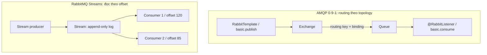
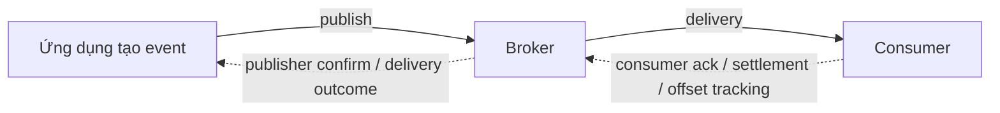

# Phân biệt cấu hình và API giữa các protocol

## 1. Vì sao cần phân biệt protocol khi tích hợp RabbitMQ?

RabbitMQ có thể phục vụ nhiều kiểu client và giao thức nhắn tin. Tuy nhiên, từ việc **cùng kết nối đến RabbitMQ** không thể suy ra rằng các client dùng cùng cách thiết lập kết nối, cùng cấu trúc message hay cùng API xác nhận đã xử lý. Đặc biệt, tên **AMQP 0-9-1** và **AMQP 1.0** dễ tạo cảm giác đây là hai bản cập nhật nhỏ của một giao thức; trên thực tế, chúng có mô hình và wire protocol khác nhau.

Trong module **SPRING_AMQP**, luồng học tập chính là tích hợp RabbitMQ bằng `RabbitTemplate`, `@RabbitListener`, exchange, queue và binding để định tuyến message; sau đó triển khai acknowledgement, retry, dead-letter, transaction và quan sát hệ thống. Những API và thuật ngữ này gắn trực tiếp với **cách Spring AMQP làm việc với AMQP 0-9-1**. Khi chuyển sang protocol khác, cần đối chiếu lại cả thư viện, cấu hình lẫn ngữ nghĩa xử lý message.

Sau bài này, bạn có thể:

- Chỉ ra sự khác nhau giữa **phiên bản thư viện**, **phiên bản broker** và **phiên bản protocol**.
- Nhận biết khi nào dùng Spring AMQP với AMQP 0-9-1, AMQP 1.0 client, RabbitMQ Streams, MQTT hoặc STOMP.
- So sánh các khái niệm connection, session/channel, exchange, queue, stream, topic, settlement/ack và offset.
- Phân biệt cấu hình Spring Boot `spring.rabbitmq.*` với cấu hình của các client dùng protocol khác.
- Biết điều gì phải thay đổi khi chuyển API publish/consume, retry, dead-letter, confirm hoặc transaction.
- Thiết kế thử nghiệm tối thiểu để tránh nhầm “kết nối thành công” với “định tuyến và xác nhận thành công”.

## 2. Ba loại phiên bản phải được nhìn riêng

| Loại | Ví dụ | Chi phối điều gì? |
| --- | --- | --- |
| **Protocol / wire version** | AMQP **0-9-1**, AMQP **1.0**, MQTT 3.1.1/5.0, STOMP 1.2, RabbitMQ Stream protocol | Format frame/gói tin, bắt tay, lệnh gửi/nhận, ngữ nghĩa ack/settlement và khả năng tương tác giữa các client |
| **Thư viện client và framework** | RabbitMQ Java client, Spring AMQP/Spring Rabbit, RabbitMQ Stream Java client, Qpid JMS, Spring Integration MQTT/STOMP | Class, annotation, callback, cấu hình, cơ chế kết nối/recovery và cách framework trừu tượng hóa protocol |
| **Phiên bản broker / plugin** | RabbitMQ server và các thành phần hỗ trợ protocol được bật | Protocol nào broker tiếp nhận, cách ánh xạ destination, tính năng khả dụng, giới hạn và cơ chế tương thích |

Ví dụ: nâng **Spring AMQP 3.x lên 4.x** (nếu có trong stack của dự án) là thay đổi phiên bản **framework**; điều này **không tự động biến** `RabbitTemplate` thành AMQP 1.0 client. Tương tự, nâng RabbitMQ server không đồng nghĩa ứng dụng đang gửi frame AMQP 1.0. Muốn biết protocol thực tế, phải xem **loại client**, **listener phía broker** và **cấu hình kết nối**.

Một địa chỉ có dạng `amqp://...` hoặc cổng TCP phổ biến cũng **không đủ** để kết luận client đang dùng AMQP 0-9-1 hay 1.0. Hai giao thức có thể dùng kiểu URI tương tự nhưng **khác protocol header và hệ lệnh**. Hãy xác định rõ sản phẩm client và tài liệu version đang sử dụng.

## 3. Bức tranh các protocol thường gặp

### 3.1. So sánh nhanh

| Protocol | Mô hình giao tiếp nổi bật | Tầng client/API thường dùng | Destination và vị trí của message |
| --- | --- | --- | --- |
| **AMQP 0-9-1** | Connection chứa nhiều channel; publisher gửi đến exchange, exchange route qua binding | Spring AMQP: `RabbitTemplate`, `@RabbitListener`; RabbitMQ Java client | **Exchange + routing key → queue**; consumer nhận từ queue |
| **AMQP 1.0** | Connection, session, link sender/receiver; cơ chế delivery settlement và credit | Client AMQP 1.0 chuyên dụng hoặc JMS provider dùng AMQP 1.0 (ví dụ Qpid JMS) | **Address/node/link** theo mô hình 1.0 và cách broker triển khai |
| **RabbitMQ Streams** | Append-only log, consumer theo offset, khả năng đọc lại dữ liệu | RabbitMQ Stream client; tích hợp Spring Rabbit Stream khi stack hỗ trợ | **Stream + offset**; retention/segment thay vì xóa từng message khi ack như queue truyền thống |
| **MQTT** | Publish/subscribe theo topic, phiên client và QoS | MQTT client (ví dụ Eclipse Paho), Spring Integration MQTT nếu cần | **Topic** theo phân cấp và wildcard MQTT; cách bridge vào RabbitMQ tùy adapter/plugin |
| **STOMP** | Protocol dạng frame với `SEND`, `SUBSCRIBE`, `ACK` và destination | STOMP client hoặc Spring WebSocket/STOMP/Spring Integration STOMP | **Destination string**; ý nghĩa `/queue/...`, `/topic/...` tùy broker/relay/plugin |

**Phân biệt quan trọng:** cùng một RabbitMQ deployment có thể phục vụ nhiều protocol nếu phần hỗ trợ tương ứng được bật. Điều này **không khiến** Spring AMQP tự hiểu API của MQTT/STOMP/AMQP 1.0, hoặc khiến một message tự động có semantics tương đương trên mọi protocol.

### 3.2. Hai luồng có hình thức tương tự nhưng mô hình khác



Trong sơ đồ trên, queue AMQP 0-9-1 và stream có thể cùng chứa thông điệp nghiệp vụ “đơn hàng đã tạo”, nhưng cách tiêu thụ, lưu trữ và phát lại là khác nhau.

## 4. AMQP 0-9-1 trong Spring AMQP: cấu hình và API tiêu chuẩn

Đây là đường tích hợp trọng tâm của module. Ở tầng Spring Boot, dependency phổ biến là:

```xml
<!-- Maven: phiên bản được Spring Boot BOM quản lý -->
<dependency>
    <groupId>org.springframework.boot</groupId>
    <artifactId>spring-boot-starter-amqp</artifactId>
</dependency>
```

Starter cung cấp cơ sở cho `spring-rabbit` và RabbitMQ Java client. Khi dùng Spring Boot dependency management, nên để BOM quản lý những phiên bản tương thích, trừ khi có lý do kỹ thuật rõ ràng để override và đã kiểm chứng.

### 4.1. Mẫu application.yml của AMQP 0-9-1

```yaml
spring:
  rabbitmq:
    host: ${RABBITMQ_HOST:localhost}
    port: 5672
    username: ${RABBITMQ_USERNAME:guest}
    password: ${RABBITMQ_PASSWORD:guest}
    virtual-host: /
    requested-heartbeat: 30s
    connection-timeout: 5s
    publisher-confirm-type: correlated
    publisher-returns: true
    template:
      mandatory: true
    listener:
      simple:
        acknowledge-mode: auto
        prefetch: 20
        concurrency: 2
```

Đặc điểm của cấu hình này:

- `host`, `port`, `username`, `password` và `virtual-host` thiết lập connection của **RabbitMQ AMQP client**. Tài khoản `guest` thường chỉ được phép kết nối từ localhost theo cấu hình mặc định RabbitMQ; dùng tài khoản riêng khi triển khai từ xa.
- `requested-heartbeat` là đề xuất về heartbeat AMQP 0-9-1, được thương lượng với broker; nó không phải mức timeout của từng lần publish.
- `publisher-confirm-type: correlated` bật cơ chế publisher confirm với correlation data ở Spring AMQP; `publisher-returns` và `template.mandatory` hỗ trợ quan sát message không định tuyến đến queue phù hợp.
- `listener.simple.acknowledge-mode: auto` nghĩa là **container Spring AMQP tự gửi ack sau khi xử lý thành công**. Nó khác chế độ `autoAck/noAck` cấp RabbitMQ client, nơi delivery được xem là đã xác nhận lúc gửi.
- `prefetch` là số lượng delivery chưa ack có thể được cấp trước cho consumer; không có cùng ngữ nghĩa với link credit của AMQP 1.0 hay QoS level của MQTT.
- Đây là cấu hình **AMQP 0-9-1 thông qua Spring Rabbit**; không thể sao chép nguyên các khóa này sang MQTT, STOMP hay client AMQP 1.0 và mong chúng có tác dụng.

Port `5672` là cổng AMQP TCP thông dụng của RabbitMQ, còn `5671` thường được dùng cho AMQP qua TLS nếu broker cấu hình listener tương ứng. **Port là thông tin endpoint**, không phải chứng minh mọi protocol có chung API.

### 4.2. Topology qua exchange, queue, binding

```java
import org.springframework.amqp.core.Binding;
import org.springframework.amqp.core.BindingBuilder;
import org.springframework.amqp.core.Queue;
import org.springframework.amqp.core.QueueBuilder;
import org.springframework.amqp.core.TopicExchange;
import org.springframework.context.annotation.Bean;
import org.springframework.context.annotation.Configuration;

@Configuration
class OrderAmqpConfig {
    static final String EXCHANGE = "orders.events";
    static final String QUEUE = "billing.orders";
    static final String ROUTING_KEY = "orders.created";

    @Bean
    TopicExchange ordersExchange() {
        return new TopicExchange(EXCHANGE, true, false);
    }

    @Bean
    Queue billingOrders() {
        return QueueBuilder.durable(QUEUE).build();
    }

    @Bean
    Binding billingOrdersBinding(Queue billingOrders,
                                 TopicExchange ordersExchange) {
        return BindingBuilder.bind(billingOrders)
                .to(ordersExchange)
                .with(ROUTING_KEY);
    }
}
```

`TopicExchange`, `Queue`, `Binding` là **khái niệm topology của AMQP 0-9-1 và Spring AMQP**. Không nên thay thẳng ba lớp này vào ứng dụng MQTT, STOMP hoặc AMQP 1.0 nếu chưa biết broker ánh xạ destination theo cách nào.

### 4.3. Publish và consume bằng API Spring AMQP

```java
import org.springframework.amqp.rabbit.annotation.RabbitListener;
import org.springframework.amqp.rabbit.core.RabbitTemplate;
import org.springframework.stereotype.Component;

@Component
class OrderMessaging {
    private final RabbitTemplate rabbitTemplate;

    OrderMessaging(RabbitTemplate rabbitTemplate) {
        this.rabbitTemplate = rabbitTemplate;
    }

    void publishOrderCreated(String orderId) {
        rabbitTemplate.convertAndSend(
                OrderAmqpConfig.EXCHANGE,
                OrderAmqpConfig.ROUTING_KEY,
                orderId);
    }

    @RabbitListener(queues = OrderAmqpConfig.QUEUE)
    void consumeOrderCreated(String orderId) {
        // Logic nghiệp vụ cần idempotent nếu message được giao lại.
        System.out.println("Order: " + orderId);
    }
}
```

Ở chiều gửi, `RabbitTemplate` dùng `basic.publish` trên channel AMQP 0-9-1. Ở chiều nhận, listener container đăng ký consumer trên queue và quản lý ack/nack. Việc lệnh `convertAndSend` trả về không tự chứng minh message đã được lưu vào đúng queue; muốn xác minh broker đã chấp nhận publish, cần publisher confirm; muốn phát hiện không có queue được định tuyến đến, cần mandatory publish và return callback.

Một số API định danh rất đặc trưng cho AMQP 0-9-1:

| Mục đích | API/khái niệm |
| --- | --- |
| Gửi message | `RabbitTemplate.convertAndSend(exchange, routingKey, payload)`; Java client `basicPublish` |
| Đăng ký nhận | `@RabbitListener(queues = "...")`; Java client `basicConsume` |
| Manual ack | `Channel.basicAck(deliveryTag, false)` hoặc `basicNack` trên chính channel nhận |
| Điều tiết message chưa ack | `basic.qos` / `prefetch` |
| Xác nhận publish | `confirm.select` / publisher confirms; Spring `publisher-confirm-type` |
| Không route được | Mandatory flag + `basic.return`; Spring returns callback |
| Dead-letter queue | Chính sách hoặc `x-dead-letter-exchange` và binding |
| Transaction AMQP | `tx.select`, `tx.commit`, `tx.rollback` trên channel, với giới hạn riêng |

Không được nhầm **publisher confirm** với **consumer ack**: confirm nói về publish ở phía broker, còn ack nói về delivery đã được consumer xử lý/nhận trách nhiệm theo chính sách ứng dụng.

## 5. AMQP 1.0: cùng tên AMQP, khác mô hình và API

AMQP 1.0 là một giao thức độc lập so với AMQP 0-9-1. Mô hình của AMQP 1.0 xoay quanh **connection → session → link**. Sender và receiver hoạt động trên link; delivery sử dụng **settlement** và các outcome. **Credit-based flow control** điều tiết lượng delivery có thể truyền.

| AMQP 0-9-1 | AMQP 1.0 | Ghi chú khi di chuyển |
| --- | --- | --- |
| Connection + **channel** | Connection + **session** + **link** | Không có tương đương một-một về vòng đời và thread safety |
| `basic.publish(exchange, routingKey)` | Sender link gửi message đến **address/node** | Cách address ánh xạ lên queue/exchange do broker định nghĩa |
| `basic.consume(queue)` | Receiver link nhận từ **source address** | Phải cấu hình source/target link phù hợp |
| `basic.ack` / `basic.nack` trên delivery tag | Delivery **settlement** với outcome | Không chuyển cơ học delivery tag hoặc mã ack |
| `basic.qos` / prefetch | **Link credit** | Hai cơ chế có mục tiêu flow control nhưng ngữ nghĩa và API khác |
| Publisher confirm | Outcome/settlement theo AMQP 1.0 client | Phải kiểm tra khi nào client coi gửi thành công |
| Spring `RabbitTemplate` / `@RabbitListener` | API AMQP 1.0 hoặc JMS adapter phù hợp | Khác thư viện, annotation và configuration |

Một số AMQP 1.0 client có API native sender/receiver; một cách tích hợp khác là dùng **JMS provider chạy trên AMQP 1.0** (ví dụ Qpid JMS). Khi đó code Java có thể dùng `JmsTemplate` hoặc `@JmsListener` với `ConnectionFactory` theo chuẩn JMS. **JMS là API Java, không phải tên của wire protocol**; cần kiểm tra provider thực sự chạy AMQP 1.0 và broker hỗ trợ các chức năng JMS cần dùng.

Mô hình sau chỉ là **pseudocode khái niệm, không phải Java API của một thư viện cụ thể**:

```text
connection = amqp10Client.connect(endpoint, credentials)
session = connection.openSession()
sender = session.openSender(targetAddress)

delivery = sender.send(message)
outcome = delivery.awaitSettlement()
check(outcome)  // Accepted, Rejected, Released... theo client/broker

receiver = session.openReceiver(sourceAddress)
receiver.grantCredit(50)

message = receiver.receive()
handle(message)
receiver.settle(message, accepted)
```

Tên method thực tế phụ thuộc thư viện. Một client dùng AMQP 1.0 sẽ có cách mở session/link, quản lý link credit, settlement/recovery và cấu hình TLS/credentials của chính nó; không suy diễn từ `spring.rabbitmq.listener.simple.*`.

**Cấu hình broker phải được xác nhận:** RabbitMQ hỗ trợ AMQP 1.0 theo khả năng của phiên bản và thành phần cấu hình tương ứng. Không được giả định mọi bản cài RabbitMQ đều lắng nghe/cho phép AMQP 1.0 giống AMQP 0-9-1. Việc AMQP 1.0 và AMQP 0-9-1 có thể sử dụng cổng AMQP quen thuộc không có nghĩa một client 0-9-1 tự “nâng cấp” thành 1.0.

## 6. RabbitMQ Streams: thay queue acknowledgment bằng mô hình offset

RabbitMQ Streams cung cấp cách lưu trữ và tiêu thụ kiểu log: producer append bản ghi, consumer đọc theo vị trí (**offset**), dữ liệu được duy trì theo chính sách retention. Một message có thể được các consumer đọc lại ở những vị trí khác nhau; consumer không xóa bản ghi chỉ bằng cách ack như queue AMQP 0-9-1.

Các yếu tố điển hình:

- **Protocol/client**: RabbitMQ Stream Java client hoặc module tích hợp Spring Rabbit Stream phù hợp với phiên bản đang dùng (có `RabbitStreamTemplate` trong hệ sinh thái Spring AMQP). Không dùng `RabbitTemplate.convertAndSend(exchange, routingKey, ...)` để gửi trực tiếp theo native Stream protocol.
- **Endpoint**: RabbitMQ Stream protocol thường có listener riêng, cổng phổ biến `5552` cho kết nối thông thường; kiểm tra cổng/TLS cụ thể của broker.
- **Destination**: stream được khai báo và producer gửi vào stream; consumer đọc từ offset, có thể bắt đầu từ earliest/latest/stored offset tùy cấu hình API.
- **Khôi phục**: theo dõi offset và khả năng replay; xử lý trùng, tính thứ tự và retained data cần được thiết kế.
- **Throughput**: phù hợp kịch bản lưu lượng cao, cần đọc lại hoặc fan-out theo nhóm consumer; không mặc nhiên thay thế mọi use case queue.

Minh họa **pseudocode**, tránh nhầm với method chuẩn của một phiên bản thư viện:

```text
streamClient = connectToStreamEndpoint(...)
producer = streamClient.createProducer(stream = "order-events")
producer.publish(event)

consumer = streamClient.createConsumer(
    stream = "order-events",
    startOffset = storedOffset
)
for each record:
    processIdempotently(record)
    persistProcessingPosition(record.offset)
```

Giữa các phiên bản thư viện, tên API, chiến lược tracking offset và cơ chế subscription có thể khác. Ngay cả khi dùng `RabbitStreamTemplate` hay container dành cho stream, không được áp dụng máy móc cấu hình `spring.rabbitmq.listener.simple.prefetch`, chính sách `basicAck`, DLX/TTL hoặc transaction của queue AMQP 0-9-1 lên stream.

**Lưu ý về terminology:** RabbitMQ có thể có queue kiểu “stream” được mô tả trong các ngữ cảnh quản trị, nhưng **Stream protocol / native stream client** là con đường truy cập khác với việc dùng Spring AMQP 0-9-1 cho queue thông thường. Để dùng tính năng nào, cần chọn đúng broker capability và client API của tính năng đó.

## 7. MQTT: topic và QoS khác exchange/routing key và ack

MQTT thường dùng cho IoT, thiết bị di động hoặc client cần gói tin nhỏ và publish/subscribe theo **topic**. Nếu RabbitMQ có MQTT listener/plugin thích hợp, client MQTT kết nối theo protocol MQTT (cổng quen thuộc `1883`, TLS thường `8883`; phụ thuộc cấu hình môi trường).

| Khái niệm MQTT | Ý nghĩa | Khác biệt với Spring AMQP |
| --- | --- | --- |
| `topic` như `orders/created` | Tên topic dạng phân cấp; subscription có thể dùng `+`, `#` | Không phải AMQP routing key `orders.created` với `*`, `#` theo topic exchange |
| QoS 0 | At most once trên luồng MQTT liên quan | Không tương đương publisher confirm AMQP |
| QoS 1 | At least once ở phạm vi giao thức tương ứng; có thể có duplicate | Không phải `basicAck` của consumer Spring AMQP |
| QoS 2 | Quy trình MQTT để tránh duplicate delivery trên một luồng giao thức được quy định | Không đảm bảo “exactly once” xuyên DB, mạng, bridge và toàn hệ thống |
| Session/client identifier | Quản lý phiên MQTT, subscription và trạng thái liên quan | Không thay thế AMQP vhost/channel/consumer tag |

Ví dụ topic MQTT:

```text
Publisher MQTT:
  publish(topic="orders/created", payload="{...}", qos=1)

Subscriber MQTT:
  subscribe(topic="orders/+", qos=1)
```

Đây là pseudocode; với Java có thể dùng MQTT client phù hợp như Eclipse Paho, hoặc tích hợp qua **Spring Integration MQTT**. Cấu hình sẽ thuộc adapter/client MQTT (broker URI, client ID, subscriptions, QoS, session settings...), **không phải** cấu hình cho `RabbitTemplate`.

Khi tích hợp MQTT với RabbitMQ, cách ánh xạ topic MQTT vào tài nguyên AMQP phụ thuộc cơ chế MQTT broker/bridge/plugin đang dùng. Không suy diễn rằng topic `orders/created` tự động tương ứng exchange `orders.events` và routing key `orders.created`, hoặc QoS MQTT có thể dùng thay cho publisher confirm AMQP.

## 8. STOMP: frame, destination và ACK

STOMP là protocol dạng text frame, hay gặp khi ứng dụng tích hợp WebSocket hoặc các broker hỗ trợ STOMP. Các lệnh thường thấy là `CONNECT`, `SEND`, `SUBSCRIBE`, `ACK`, `NACK` và `DISCONNECT`. Một frame tối giản có thể có dạng:

```text
SEND
destination:/queue/billing.orders
content-type:text/plain

order-123
^@
```

`^@` trong ví dụ trên đại diện ký tự kết thúc frame NUL, không phải hai ký tự literal `^` và `@` trong gói tin thực tế. Tên destination và cách chuyển thành tài nguyên broker phụ thuộc cấu hình STOMP broker hoặc relay.

Những khác biệt chính:

- STOMP client cấu hình **STOMP endpoint**, credentials, subscription id và các headers như `ack`/`destination`. Cổng điển hình có thể là `61613` cho TCP STOMP nếu broker bật listener tương ứng.
- `ACK` hoặc `NACK` của STOMP có cách định danh và phạm vi theo version/subscription. Không thể gọi `Channel.basicAck` trên delivery từ STOMP.
- Trong Spring, **Spring WebSocket + STOMP** dùng các API như `@MessageMapping` và `SimpMessagingTemplate` cho messaging qua STOMP; **Spring Integration STOMP** là một khả năng tích hợp khác. Các API đó không đồng nghĩa `@RabbitListener` hoặc `RabbitTemplate`.
- Với cấu hình broker relay, ứng dụng Spring có thể nhận/gửi STOMP qua một relay kết nối đến RabbitMQ; lúc đó WebSocket client, relay và RabbitMQ có vòng đời và cơ chế báo lỗi riêng.

Đừng giả định mọi destination `/topic/...` trên STOMP có hành vi persistence, durable queue, dead-letter, publisher confirm như AMQP 0-9-1. Phải kiểm tra mapping và các header/chính sách do broker STOMP triển khai.

## 9. Bảng đối chiếu cấu hình, API và độ tin cậy

### 9.1. Một nhu cầu nghiệp vụ, nhiều cơ chế

| Nhu cầu | AMQP 0-9-1 + Spring AMQP | AMQP 1.0 | RabbitMQ Streams | MQTT / STOMP |
| --- | --- | --- | --- | --- |
| Mở kết nối | `CachingConnectionFactory`, TCP/vhost, channel cache | Connection/session/link client AMQP 1.0 | Stream Environment/client, stream listener | Client/adapter protocol tương ứng |
| Gửi sự kiện | `RabbitTemplate.convertAndSend` | Sender link / JMS provider API | Stream producer append | MQTT publish(topic) / STOMP SEND(destination) |
| Nhận sự kiện | `@RabbitListener(queues=...)` | Receiver link / JMS listener | Consumer đọc theo offset | MQTT subscribe / STOMP SUBSCRIBE |
| Định tuyến | Exchange, routing key, binding | Address/link + broker routing | Stream name + offset | Topic MQTT / destination STOMP |
| Xác nhận xử lý | Consumer `basic.ack`, `basic.nack` | Settlement/outcomes | Theo dõi offset, cơ chế tracking | MQTT QoS / STOMP ACK |
| Xác nhận gửi | Publisher confirms + returns nếu cần | Delivery outcome/settlement hoặc semantics JMS provider | Publish confirmation/callback của stream client | MQTT QoS handshake / receipt STOMP nếu được hỗ trợ |
| Retry | Client retry, requeue, delayed retry, DLX theo thiết kế | Retry + broker features tương ứng | Replay/reprocess theo offset hoặc stream khác | Client/reconnect/bridge/broker behavior tùy giao thức |
| Dead-letter | DLX, DLQ, chính sách queue | Tùy broker và client/binding 1.0 | Không áp dụng cơ học DLX queue; thường cần luồng xử lý riêng | Tùy broker/bridge, không suy từ MQTT/STOMP ACK |
| Transaction | `tx.select/commit/rollback` trên channel (và các giới hạn) | Tùy transaction support thực tế của client/broker/JMS | Không dùng transaction channel 0-9-1 | Không được suy diễn từ QoS hoặc STOMP ACK |
| Quan sát | Connections, channels, consumers, ready/unacked, confirms | Sessions, links, credit, unsettled deliveries | Offsets, lag, retention, producer/consumer | Client sessions, QoS states, subscriptions, receipts |

Các hàng ở bảng là **bản đồ chọn đúng khái niệm**, không phải lời hứa rằng mọi broker và mọi client đều triển khai đầy đủ một tính năng.

### 9.2. “ACK” có thể nói về các tầng khác nhau



- **Producer-side acknowledgement** giúp biết trạng thái gửi theo semantics của protocol/client. Đối với AMQP 0-9-1, confirm từ broker vẫn không chứng minh business consumer đã xử lý xong.
- **Consumer-side acknowledgement/settlement** thể hiện client đã tiếp nhận trách nhiệm cho một delivery theo protocol. Không đồng nghĩa transaction cơ sở dữ liệu đã commit trừ khi ứng dụng phối hợp rõ ràng.
- **Offset tracking** của stream ghi nhận vị trí đã đọc/xử lý theo chiến lược consumer. Nó không làm cho bản ghi tự biến mất khỏi stream ngay lập tức.
- **MQTT QoS handshake** giới hạn phạm vi bảo đảm ở tuyến MQTT tương ứng. Không đảm bảo thông điệp chỉ được xử lý đúng một lần trong database phía sau.
- **STOMP receipt** (nếu client/broker hỗ trợ yêu cầu và trả receipt) cũng không thay thế xác nhận nghiệp vụ từ một consumer downstream.

### 9.3. Sự khác nhau khi xảy ra lỗi mạng

Với AMQP 0-9-1, mất connection kéo theo các channel không hợp lệ, consumer chưa ack có thể nhận lại delivery sau phục hồi. Ở AMQP 1.0, cần quản lý trạng thái unsettled delivery và link recovery theo khả năng của client/broker. Với Streams, consumer reconnect và chọn lại vị trí đọc; sai chiến lược commit/tracking offset có thể gây đọc lại hoặc bỏ sót. MQTT và STOMP còn phụ thuộc session, subscriptions, QoS/ack mode và bridge/relay.

**Quy tắc chung:** reconnect khôi phục kết nối truyền thông nhưng không tự giải quyết tình huống “đã commit nghiệp vụ, chưa gửi ack”. Bất kể protocol, thiết kế **idempotency**, định danh sự kiện và chiến lược retry phù hợp mới xử lý được duplicate và kết quả không chắc chắn.

## 10. Quản lý phiên bản thư viện và khả năng tương thích

### 10.1. Những module cần nhận diện trong dependency graph

| Công nghệ chọn dùng | Thành phần Java thường gặp | Hành động kiểm tra trước khi tích hợp |
| --- | --- | --- |
| RabbitMQ AMQP 0-9-1 + Spring | `spring-boot-starter-amqp`, `spring-rabbit`, RabbitMQ Java client | Kiểm tra Spring Boot ↔ Spring AMQP ↔ RabbitMQ client; xem API deprecation và property tương ứng |
| AMQP 1.0 | AMQP 1.0 Java client, hoặc Qpid JMS và Spring JMS nếu dùng JMS | Kiểm tra protocol 1.0 ở broker; address/link, settlement, SASL/TLS, JMS feature support |
| RabbitMQ Streams | RabbitMQ Stream Java client, `spring-rabbit-stream` nếu có trong stack | Kiểm tra phiên bản client, broker stream listener, retention và offset tracking |
| MQTT | MQTT Java client hoặc Spring Integration MQTT | Kiểm tra MQTT version 3.1.1/5, client-ID, QoS, retained messages và mapping broker |
| STOMP | STOMP client, Spring Messaging/WebSocket hoặc Spring Integration STOMP | Kiểm tra phiên bản STOMP, relay, destination semantics và subscription ack mode |

Đường dẫn package không thể hoán đổi: `org.springframework.amqp.rabbit.*` gắn với Spring Rabbit, `jakarta.jms.*` gắn với JMS API, còn MQTT/Stream client định nghĩa API khác. Khi copy ví dụ từ bài viết Internet, cần kiểm tra import và phiên bản dependency thay vì sửa lỗi compile bằng cách đổi tên class tùy ý.

### 10.2. Tại sao không nên ghép version bằng suy đoán?

Các nhóm phiên bản có tốc độ phát hành và yêu cầu runtime khác nhau. Một bản Spring Boot mới có thể thay đổi Java baseline, phiên bản Spring Framework, dependency management và cấu hình mặc định; broker nâng cấp cũng có thể thay đổi chính sách plugin/protocol. Do đó:

1. Chọn **Spring Boot release** đang dùng và để BOM quản lý nhóm Spring AMQP khi có thể.
2. Xác định **protocol thực** của từng kết nối, không dựa trên tên “AMQP” chung.
3. Kiểm tra **broker capabilities, plugin/listener và chính sách bảo mật** tương ứng phiên bản triển khai.
4. Đọc **migration notes/release notes** khi nâng cấp major version; kiểm tra deprecated/removed API và property.
5. Thực hiện **integration test trên phiên bản broker mục tiêu** với publish → route → consume → ack, lỗi mạng và recovery; unit test mock một `RabbitTemplate` không kiểm chứng tương thích giao thức.
6. Ghi rõ sơ đồ client/protocol/broker version trong tài liệu triển khai để tránh người vận hành dùng sai endpoint.

Không nên đưa ra quy tắc “RabbitMQ X luôn tương thích Spring AMQP Y” nếu chưa đối chiếu ma trận tương thích chính thức của những phiên bản dự án thật sự sử dụng.

### 10.3. Mẫu inventory phiên bản cho dự án

```text
Service                 : order-service
Spring Boot             : <version đang dùng>
Spring AMQP             : <version do BOM quản lý>
RabbitMQ Java client    : <resolved version>
RabbitMQ broker         : <server version>
Wire protocol           : AMQP 0-9-1
Endpoint                : rabbitmq.internal:5672
Topology                : orders.events -> orders.created -> billing.orders
Publish guarantee       : confirms + returns + outbox nếu cần
Consume guarantee       : manual/AUTO ack, idempotent consumer
Broker feature/plugins  : <thực tế đang bật>
```

Đây là bảng mẫu để nhóm dự án điền **giá trị quan sát được** khi triển khai, không phải bảng version đã được xác minh cho một môi trường cụ thể.

## 11. Kịch bản chuyển đổi protocol: cần đổi gì?

Giả sử dịch vụ thanh toán ban đầu xử lý event bằng `RabbitTemplate` và `@RabbitListener`. Nhóm phát triển nhận yêu cầu đẩy sự kiện sang nhiều thiết bị IoT hoặc cho phép phân tích lại toàn bộ lịch sử sự kiện.

### Kịch bản A: AMQP 0-9-1 → MQTT cho thiết bị

- **Vẫn giữ nghiệp vụ** tạo event và schema payload nhưng phải xây publisher/subscriber MQTT hoặc bridge/adapter.
- **Đổi API**: gửi vào topic MQTT, chọn QoS, client ID, subscription và xử lý reconnect.
- **Đổi routing contract**: document topic namespace, wildcard và ánh xạ từ exchange/routing key nếu tích hợp hai giao thức.
- **Đổi cách kiểm chứng**: kiểm tra QoS, duplicate, session persistence và đường đi qua bridge; không dùng publisher confirm 0-9-1 làm bằng chứng đã đến từng thiết bị.
- **Giữ idempotency** vì MQTT QoS 1 hoặc mất mạng vẫn có thể khiến event được xử lý lặp.

### Kịch bản B: AMQP 0-9-1 → RabbitMQ Streams cho replay

- **Đổi destination** từ exchange/queue sang stream và producer/consumer API tương ứng.
- **Đổi consumer state** từ ack delivery sang quản lý offset, checkpoint và chính sách phát lại.
- **Đổi retention**: kiểm tra thời gian/kích thước giữ dữ liệu và sức chứa broker; không áp dụng cơ học TTL/DLX của queue.
- **Đổi metric**: theo dõi consumer offset, lag và tốc độ append/đọc bên cạnh lỗi publish.
- **Giữ event ID/sequence nghiệp vụ** để phát lại mà không tạo tác dụng phụ trùng.

### Kịch bản C: AMQP 0-9-1 → AMQP 1.0 để tích hợp hệ thống khác

- **Đổi client và abstractions**: lựa chọn API native AMQP 1.0 hoặc JMS provider hợp lệ.
- **Đổi mapping destination** sang mô hình source/target address mà broker nhận diện.
- **Đổi ack/flow control** sang settlement và credit; kiểm tra outcome của sender/receiver.
- **Kiểm tra broker** chấp nhận AMQP 1.0 trên endpoint đã chọn và chức năng cần dùng được hỗ trợ.
- **Kiểm tra lại transaction, retry và error recovery** vì không thể tự động chuyển `basic.ack`, publisher confirm hay `x-dead-letter-exchange`.

Nếu chỉ **nâng phiên bản Spring Boot/Spring AMQP** mà vẫn giữ AMQP 0-9-1, hãy tập trung vào compatibility/deprecations/test contract; chưa có lý do để chuyển sang MQTT, STOMP hoặc AMQP 1.0.

## 12. Ví dụ kiểm thử phân biệt cấu hình và API

Có thể xây một bài lab cô lập với ba ứng dụng: API Spring AMQP 0-9-1 publish đơn hàng, một client MQTT gửi trạng thái thiết bị, và một stream consumer phân tích lịch sử (chỉ khi broker và plugin/listener hỗ trợ). Dùng các event ID khác nhau và ghi log kèm protocol.

| Kiểm thử | Hành động | Kỳ vọng kiểm chứng |
| --- | --- | --- |
| 0-9-1 route thành công | `RabbitTemplate.convertAndSend` với exchange và routing key đã binding | Queue nhận message, listener xử lý, confirm/return thể hiện đúng hành vi |
| 0-9-1 route thất bại | Gửi đến exchange tồn tại nhưng không có binding khớp; dùng mandatory | Quan sát return (nếu thiết lập đúng), phân biệt với confirm của publish |
| MQTT topic match | Publish `orders/created` và subscribe `orders/+` | Kiểm chứng wildcard/topic và QoS qua MQTT client; không yêu cầu tạo Java `TopicExchange` trong MQTT publisher |
| Stream replay | Đọc từ offset đã lưu rồi đọc lại từ offset cũ | Cùng record có thể được đọc lại; cần deduplicate ở nghiệp vụ |
| Mất kết nối | Dừng mạng/broker trong lab rồi khôi phục | Quan sát hành vi client theo từng protocol và xác định message nào có thể bị gửi/nhận lại |
| Sử dụng sai endpoint | Cấu hình client một protocol đến listener chỉ nhận protocol khác | Lỗi protocol handshake hoặc không kết nối; chứng minh việc cùng host/port không bảo đảm tương thích |

Các thí nghiệm phải chạy trên broker test, không gây ngắt kết nối hoặc thay đổi topology trên môi trường production.

### Checklist chọn công nghệ

Trước khi viết code, trả lời các câu hỏi:

1. Client hiện dùng **wire protocol nào**, hay chỉ mới biết broker là “RabbitMQ”?
2. Thư viện trong dự án cung cấp **API gì**: `RabbitTemplate`, sender link, stream producer, MQTT publish hay STOMP SEND?
3. Đích gửi là **exchange + routing key + queue**, **address**, **stream + offset**, **topic**, hay **destination**?
4. Điều gì được coi là “gửi thành công” và “xử lý thành công” trong protocol này?
5. Nếu disconnect sau lúc commit DB nhưng trước khi xác nhận, message có thể được xử lý lại không? Ai chịu trách nhiệm chống trùng?
6. Broker có bật listener/plugin tương ứng, giới hạn tài nguyên và bảo mật phù hợp không?
7. Phiên bản client/framework/broker nào đang được cài thật; chức năng cần dùng đã được integration test chưa?

## 13. Câu hỏi tự đánh giá

1. Vì sao không thể kết luận `RabbitTemplate` sử dụng AMQP 1.0 chỉ vì Spring AMQP có phiên bản thư viện mới hơn?
2. `basic.ack`, delivery settlement, MQTT QoS 1 và stream offset tracking đều liên quan đến độ tin cậy. Điểm khác biệt về **phạm vi bảo đảm** của chúng là gì?
3. Một đội chuyển từ AMQP 0-9-1 sang RabbitMQ Streams để có replay. Những thay đổi tối thiểu về producer API, consumer state, retention và metric là gì?
4. Vì sao khi cấu hình STOMP relay đến RabbitMQ không nên mặc định mọi `/topic/...` tương đương một `TopicExchange`?
5. Nếu client AMQP 0-9-1 báo protocol handshake failure khi kết nối đến endpoint dùng cho protocol khác, nên kiểm tra những lớp cấu hình nào trước khi thử đổi credentials?
6. Tại sao publisher confirm hoặc MQTT QoS không đủ để chứng minh một giao dịch thanh toán downstream đã thành công và chỉ chạy đúng một lần?

**Ghi nhớ:** **protocol** quyết định cách trao đổi frame và xác nhận; **client/framework** quyết định class, API và property cấu hình; **broker/plugin** quyết định endpoint và chức năng thực sự được triển khai. Với bài học Spring AMQP dùng `RabbitTemplate`, `@RabbitListener`, exchange, queue và binding, hãy mặc định phân tích theo **AMQP 0-9-1** trừ khi dự án xác định rõ đang sử dụng giao thức hoặc client khác. Khi đổi protocol, phải đánh giá lại routing, acknowledgement, retry, dead-letter, transaction và cách quan sát hệ thống từ đầu theo đúng semantics của lựa chọn mới.
