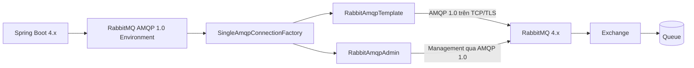

# Cấu hình môi trường, kết nối và template của RabbitMQ AMQP 1.0

> **Chương:** AMQP 1.0  
> **Công nghệ:** RabbitMQ 4.x, Spring AMQP 4.x, Spring Boot 4.x  
> **Trọng tâm:** Khởi tạo môi trường AMQP 1.0, thiết lập kết nối với `AmqpConnectionFactory`, khai báo topology và sử dụng `RabbitAmqpTemplate` để gửi/nhận message bất đồng bộ. Không nhầm với `RabbitTemplate` sử dụng AMQP 0-9-1.

## 1. Bài toán: dùng cùng RabbitMQ nhưng đổi giao thức

Một hệ thống Java hiện dùng `RabbitTemplate` để gửi `order.created` tới RabbitMQ và `@RabbitListener` để nhận ở queue `orders.created`. Nhóm phát triển muốn thử **AMQP 1.0**, giao thức mới được RabbitMQ hỗ trợ trực tiếp, nhưng lại chỉ thay một vài thuộc tính của `spring.rabbitmq.*`. Ứng dụng vẫn chạy và vẫn giao tiếp bằng AMQP 0-9-1. Lý do: **giao thức không được quyết định bởi số port hay tên phương thức `convertAndSend()`**; nó được quyết định bởi client library và handshake được dùng lúc kết nối.

Với **Spring AMQP**, tích hợp RabbitMQ AMQP 1.0 có một tập thành phần riêng: `com.rabbitmq.client.amqp.Environment`, `org.springframework.amqp.rabbitmq.client.AmqpConnectionFactory`, `SingleAmqpConnectionFactory`, `RabbitAmqpAdmin` và `RabbitAmqpTemplate`. Phần API message quen thuộc của Spring có thể được tái sử dụng, nhưng connection, cách settlement và xử lý bất đồng bộ không giống hoàn toàn client AMQP 0-9-1 truyền thống.

Sau bài này, bạn có thể:

- Chuẩn bị RabbitMQ hỗ trợ AMQP 1.0, tài khoản, virtual host, cổng TCP/TLS và các dependency đúng phiên bản.
- Cấu hình **Spring Boot tự động** bằng `spring.amqp.rabbitmq.*`, hoặc **Java Config thủ công** với `Environment` và `SingleAmqpConnectionFactory`.
- Tạo `RabbitAmqpTemplate`, `RabbitAmqpAdmin`, exchange, queue, binding; gửi và nhận message qua `CompletableFuture`.
- Phân biệt `RabbitAmqpTemplate`/`RabbitAmqpListenerContainerFactory` với `RabbitTemplate`/container của AMQP 0-9-1.
- Hiểu những giới hạn của kết nối, recovery, address v2, publisher outcome, idempotency và khả năng tương tác giữa hai giao thức.

## 2. Chọn đúng công nghệ và phiên bản trước khi viết code

AMQP **1.0** và **0-9-1** là hai wire protocol khác nhau, không phải chỉ hai cách đặt tên phiên bản của cùng một API Java. RabbitMQ **4.0 trở lên** hỗ trợ AMQP 1.0 **native**, không cần bật plugin `rabbitmq_amqp1_0` như những mô hình/phiên bản cũ. Mặc định cả hai giao thức có thể đi qua **port 5672** (TCP) hoặc **5671** (TLS) do broker phân biệt trong protocol handshake.

| Mục tiêu | Dependency/tầng client | Template/consumer | Cấu hình Spring Boot tham khảo |
| --- | --- | --- | --- |
| **RabbitMQ AMQP 1.0**, trọng tâm bài này | Spring AMQP `org.springframework.amqp:spring-rabbitmq-client`, dựa trên Java client **`com.rabbitmq.client:amqp-client`** | `RabbitAmqpTemplate`, `RabbitAmqpListenerContainerFactory` | `spring.amqp.rabbitmq.*` (Spring Boot 4.2+) |
| **AMQP 1.0 generic**, cần đổi qua nhiều loại broker | Spring AMQP `org.springframework.amqp:spring-amqp-client`, dựa trên **Qpid ProtonJ2** | `AmqpClient`, `@AmqpListener` | `spring.amqp.*` (Spring Boot 4.2+) |
| **RabbitMQ AMQP 0-9-1**, các bài truyền thống | Spring AMQP `spring-rabbit`, dựa trên Java client **`com.rabbitmq:amqp-client`** | `RabbitTemplate`, `SimpleRabbitListenerContainerFactory` | `spring.rabbitmq.*` |

Ở thời điểm tài liệu Spring AMQP **4.2** và Spring Boot **4.2**, starter được Spring Boot công bố cho nhánh RabbitMQ AMQP 1.0 là **`spring-boot-starter-amqp-rabbitmq`**. Nếu dự án đang dùng Spring Boot 3.x/Spring AMQP 3.x, **không sao chép cấu hình này rồi giả định các class trên đã tồn tại**; cần kiểm tra ma trận tương thích và nâng cấp một cách có kế hoạch. Chỉ thêm client AMQP 1.0 thuần không tự làm xuất hiện Spring `RabbitAmqpTemplate`.

### 2.1. Ba điều kiện tối thiểu

1. **Broker:** RabbitMQ 4.0+ và listener AMQP có thể truy cập (mặc định 5672); với môi trường có TLS dùng endpoint có cấu hình TLS phù hợp.
2. **Tài khoản:** Username/password hoặc cơ chế xác thực được broker và client hỗ trợ. AMQP 1.0 ở RabbitMQ yêu cầu **SASL** trong quá trình thiết lập kết nối. User cần quyền `configure`/`write`/`read` phù hợp với exchange và queue sẽ dùng.
3. **Client:** Thư viện Spring/RabbitMQ AMQP 1.0 đúng phiên bản. Không dùng `CachingConnectionFactory` của `spring-rabbit` để cung cấp cho `RabbitAmqpTemplate`.

`Environment` quản lý các tài nguyên dùng chung của client AMQP 1.0, còn `AmqpConnectionFactory` tạo/cấp kết nối tới broker. Cùng một AMQP 1.0 connection có thể phục vụ nhiều producer, consumer và thao tác management qua các **link** được client quản lý. Không suy diễn mô hình `Channel`/`basicAck(deliveryTag)` của AMQP 0-9-1 sang mọi API 1.0.

## 3. Chuẩn bị môi trường RabbitMQ để thực hành

Nếu đã có broker RabbitMQ 4.x trong môi trường lab, chỉ cần bảo đảm host/port, vhost, credentials và firewall. Nếu chưa có, có thể dùng container local. Ví dụ minh họa dưới đây dành cho máy đã cài Docker; bài học **không thực thi lệnh này**:

```bash
docker run -d --name rabbitmq-amqp10-demo \
  -p 127.0.0.1:5672:5672 \
  -p 127.0.0.1:15672:15672 \
  -e RABBITMQ_DEFAULT_USER=demo \
  -e RABBITMQ_DEFAULT_PASS=demo-password-local \
  rabbitmq:4-management
```

Đây là account/mật khẩu **chỉ dùng cho lab trên localhost**. Không tái sử dụng ở production hoặc đưa port quản trị 15672 ra Internet. Trong môi trường tổ chức, dùng secret manager, TLS, quyền tối thiểu và monitoring phù hợp.

Kiểm tra broker:

```bash
docker ps --filter name=rabbitmq-amqp10-demo
docker logs rabbitmq-amqp10-demo
```

RabbitMQ Management UI (nếu bật management plugin) thường mở tại `http://localhost:15672`; đăng nhập bằng tài khoản lab. Tuy nhiên, **management UI lên được không chứng minh AMQP 1.0 kết nối thành công**: cần thực sự dùng client 1.0 để handshake và gửi/nhận thử.



Port mặc định là 5672 **cho cả 1.0 và 0-9-1**; nó không phải tùy chọn `protocol=1.0`. Giao thức do thư viện client lựa chọn. Với yêu cầu xác thực, một AMQP 1.0 connection còn sử dụng SASL negotiation; đừng tắt bảo mật để thử vượt lỗi đăng nhập.

## 4. Cách A — Spring Boot tự động cấu hình AMQP 1.0

Đây là lựa chọn đơn giản nhất khi dự án sử dụng **Spring Boot 4.2+** và chỉ cần RabbitMQ AMQP 1.0. Spring Boot có thể tự tạo `Environment`, `AmqpConnectionFactory`, `RabbitAmqpTemplate`, `RabbitAmqpAdmin` và listener container factory liên quan khi dependency thích hợp có mặt và không bị bean tùy chỉnh thay thế.

### 4.1. Dependency Gradle/Maven

Sử dụng dependency starter RabbitMQ AMQP 1.0, để **Spring Boot BOM** quản lý version:

```groovy
// build.gradle (Gradle Groovy DSL), dự án đã dùng Spring Boot 4.2+
dependencies {
    implementation 'org.springframework.boot:spring-boot-starter-amqp-rabbitmq'
}
```

Hoặc với Maven sử dụng parent/BOM Spring Boot tương ứng:

```xml
<dependency>
    <groupId>org.springframework.boot</groupId>
    <artifactId>spring-boot-starter-amqp-rabbitmq</artifactId>
</dependency>
```

**Đừng chọn nhầm:** `spring-boot-starter-rabbitmq` là hướng **AMQP 0-9-1** trong dòng Spring Boot mới; `spring-boot-starter-amqp` là hướng **generic AMQP 1.0** dùng Qpid, không phải chính `RabbitAmqpTemplate`. Ở dự án Spring Boot đời trước, tên starter có thể khác; luôn kiểm tra version của ứng dụng chứ không dùng mù lệnh dependency ở trên.

### 4.2. `application.yml` đúng namespace

```yaml
spring:
  amqp:
    rabbitmq:
      host: ${RABBIT_HOST:localhost}
      port: ${RABBIT_PORT:5672}
      username: ${RABBIT_USER:demo}
      password: ${RABBIT_PASSWORD:demo-password-local}
      virtual-host: /
      template:
        exchange: demo.amqp10.orders
        routing-key: created
        default-receive-queue: demo.amqp10.orders.created
```

Trong lab, các giá trị mặc định sau dấu `:` trong placeholder tương ứng với account demo đã tạo; khi triển khai thực tế, đặt `RABBIT_HOST`, `RABBIT_USER`, `RABBIT_PASSWORD` bằng secret injection và không lưu password thật trong repository.

Các thuộc tính quan trọng:

| Property | Ý nghĩa | Điểm cần tránh |
| --- | --- | --- |
| `spring.amqp.rabbitmq.host` / `.port` | Endpoint RabbitMQ dùng AMQP 1.0. | Không dùng `spring.rabbitmq.host` nếu mục tiêu là cấu hình riêng cho `RabbitAmqpTemplate`. |
| `.username` / `.password` | Danh tính SASL. | Không sử dụng `guest/guest` từ máy từ xa hoặc lưu mật khẩu production vào YAML. |
| `.virtual-host` | Phạm vi topology và quyền truy cập. | Thiếu quyền đối với vhost có thể làm declare/consume thất bại. |
| `.template.exchange` | Exchange mặc định của template khi không truyền exchange trong mỗi lần send. | Phải khai báo exchange trước khi publish. |
| `.template.routing-key` | Routing key mặc định. | Binding không khớp sẽ làm message không tới queue. |
| `.template.default-receive-queue` | Queue mặc định dùng khi gọi `receive`/`receiveAndConvert` không truyền queue. | Đây không phải queue trả lời RPC mặc định và cũng không tự tạo queue. |

Spring Boot còn hỗ trợ thuộc tính `spring.amqp.rabbitmq.address` để cấu hình endpoint bằng AMQP URI; **khi đặt `address`, `host` và `port` bị bỏ qua**. Với `amqps://` cần cấu hình SSL bundle theo hướng dẫn Boot (`spring.amqp.rabbitmq.ssl.bundle`) và chứng chỉ hợp lệ. Đừng sao chép đồng thời URI và host/port rồi suy đoán thuộc tính nào thắng.

### 4.3. Topology chung vẫn dùng `Exchange`, `Queue`, `Binding`

Thư viện Spring AMQP 1.0 RabbitMQ-specific **tái sử dụng** abstraction declarable của `org.springframework.amqp.core`. Ví dụ exchange direct, queue durable và binding:

```java
import org.springframework.amqp.core.Binding;
import org.springframework.amqp.core.BindingBuilder;
import org.springframework.amqp.core.DirectExchange;
import org.springframework.amqp.core.Queue;
import org.springframework.amqp.core.QueueBuilder;
import org.springframework.context.annotation.Bean;
import org.springframework.context.annotation.Configuration;

@Configuration(proxyBeanMethods = false)
public class OrdersAmqp10Topology {
    public static final String EXCHANGE = "demo.amqp10.orders";
    public static final String QUEUE = "demo.amqp10.orders.created";
    public static final String ROUTING_KEY = "created";

    @Bean
    DirectExchange amqp10OrdersExchange() {
        return new DirectExchange(EXCHANGE);
    }

    @Bean
    Queue amqp10OrdersQueue() {
        return QueueBuilder.durable(QUEUE).build();
    }

    @Bean
    Binding amqp10OrdersBinding(DirectExchange amqp10OrdersExchange,
                                Queue amqp10OrdersQueue) {
        return BindingBuilder.bind(amqp10OrdersQueue)
                .to(amqp10OrdersExchange)
                .with(ROUTING_KEY);
    }
}
```

Lưu ý `@Configuration(proxyBeanMethods = false)` ở ví dụ trên: không gọi chéo các method `@Bean` như `amqp10OrdersQueue()` từ method khác; để Spring truyền **bean đã quản lý** vào tham số của method `amqp10OrdersBinding`. Khi `RabbitAmqpAdmin` của AMQP 1.0 chạy, nó quét các declarable bean và thực hiện khai báo topology qua API management của Java client AMQP 1.0.

**Durable queue ≠ persistent message:** queue bền vững giữ định nghĩa sau restart, còn bảo đảm giữ message phụ thuộc loại queue, cách lưu trữ, publisher outcome và tình trạng broker. Nếu đã có queue cùng tên nhưng thuộc tính/arguments khác, việc khai báo lại có thể thất bại; hãy thử bằng tên dành riêng cho demo.

## 5. Gửi message bằng `RabbitAmqpTemplate`

Spring AMQP 1.0 đưa ra `RabbitAmqpTemplate` triển khai `AsyncAmqpTemplate`. Tên phương thức gần giống `RabbitTemplate`, nhưng **các thao tác bất đồng bộ trả về `CompletableFuture`**; không nên coi một lời gọi `convertAndSend()` không ném exception ngay là đã chắc chắn hoàn tất ở broker.

### 5.1. Publisher nhận template do Boot tạo

```java
import java.util.concurrent.CompletableFuture;
import org.springframework.amqp.rabbitmq.client.RabbitAmqpTemplate;
import org.springframework.stereotype.Service;

@Service
public class OrdersAmqp10Publisher {
    private final RabbitAmqpTemplate template;

    public OrdersAmqp10Publisher(RabbitAmqpTemplate template) {
        this.template = template;
    }

    public CompletableFuture<?> publishCreated(String operationId) {
        // Dùng exchange/routing key đã cấu hình trong application.yml.
        return template.convertAndSend("order-created:" + operationId);
    }

    public CompletableFuture<?> publishExplicitly(String operationId) {
        return template.convertAndSend(
                OrdersAmqp10Topology.EXCHANGE,
                OrdersAmqp10Topology.ROUTING_KEY,
                "order-created:" + operationId);
    }
}
```

`convertAndSend(...)` sử dụng `MessageConverter` để biến payload Java thành `org.springframework.amqp.core.Message` rồi chuyển qua Java client AMQP 1.0. Converter mặc định hỗ trợ các kiểu đơn giản; nếu gửi record/object JSON, hãy chọn converter và content type rõ ràng thay vì giả định mọi ứng dụng đều deserialize class giống nhau.

### 5.2. Quan sát future và xử lý lỗi

```java
import java.time.Duration;
import java.util.concurrent.TimeUnit;
import org.springframework.boot.CommandLineRunner;
import org.springframework.context.annotation.Bean;
import org.springframework.context.annotation.Configuration;

@Configuration(proxyBeanMethods = false)
public class OrdersAmqp10DemoRunner {
    @Bean
    CommandLineRunner demoAmqp10Send(OrdersAmqp10Publisher publisher) {
        return args -> {
            // Chỉ dùng cho chạy lab một lần; không hard-code auto-publish trong production.
            publisher.publishExplicitly("op-demo-1")
                    .get(10, TimeUnit.SECONDS);
            System.out.println("AMQP 1.0 send completed");
        };
    }
}
```

`get(10, TimeUnit.SECONDS)` giúp ví dụ command-line đợi kết quả rõ ràng; trong dịch vụ có lưu lượng lớn, nên dùng `.whenComplete(...)`/composition thay vì chặn thread đang xử lý message. Khi future lỗi hoặc timeout, **kết quả publish có thể chưa xác định**: broker có thể đã chấp nhận message nhưng client không nhận được phản hồi. Retry cần giữ `operationId` và consumer cần idempotency.

```java
publisher.publishExplicitly("op-demo-2")
        .whenComplete((result, error) -> {
            if (error != null) {
                // Ghi log với operationId, lên lịch retry/outbox theo chính sách.
                System.err.println("Publish not confirmed: " + error);
            }
            else {
                System.out.println("Publish completed by AMQP 1.0 client");
            }
        });
```

Đoạn code trên là *mẫu gọi bên trong service có biến `publisher`*, không phải một file Java độc lập. Kết quả future phản ánh trạng thái thao tác gửi mà client AMQP 1.0 báo về; **không phải consumer đã ghi database thành công**. Đừng sử dụng cấu hình xác nhận của `RabbitTemplate` AMQP 0-9-1 (`spring.rabbitmq.publisher-confirm-type`, `CorrelationData`) như thể chúng tự áp dụng sang `RabbitAmqpTemplate`.

### 5.3. Nhận message trực tiếp từ template

Nếu **không** dùng listener trên cùng queue để tranh message, có thể nhận một message theo mô hình pull:

```java
// default-receive-queue đã được khai báo trong application.yml.
template.receiveAndConvert()
        .thenAccept(body -> System.out.println("Received: " + body))
        .exceptionally(ex -> {
            System.err.println("Receive failed: " + ex);
            return null;
        });
```

`receiveAndConvert()` cũng trả `CompletableFuture`. Trong hệ thống thực tế, dùng `@RabbitListener` thường phù hợp hơn cho consumer chạy liên tục; **đừng vừa gọi `receiveAndConvert()` vừa chạy listener cùng queue khi mục tiêu là mọi message đi qua listener**, vì hai consumer sẽ cạnh tranh delivery.

## 6. `@RabbitListener` và container AMQP 1.0

Spring AMQP 4.x vẫn hỗ trợ annotation quen thuộc `@RabbitListener`, nhưng container bên dưới phải là **`RabbitAmqpListenerContainerFactory`** khi bạn muốn nói giao thức **1.0**. Nó không phải `SimpleRabbitListenerContainerFactory` dành cho AMQP 0-9-1.

Với Spring Boot 4.2+ chỉ cài starter RabbitMQ AMQP 1.0, Boot có thể auto-configure default listener factory. Listener minh họa:

```java
import org.springframework.amqp.rabbit.annotation.RabbitListener;
import org.springframework.stereotype.Component;

@Component
public class OrdersAmqp10Listener {
    @RabbitListener(queues = OrdersAmqp10Topology.QUEUE)
    public void onOrderCreated(String payload) {
        System.out.println("AMQP 1.0 received: " + payload);
        // Production: validate, ghi DB trong transaction, idempotent rồi trả về.
    }
}
```

Ứng dụng dùng container kiểu AMQP 1.0 sẽ chuyển đổi native message của client RabbitMQ sang API message của Spring cho listener. Khi dùng settlement tự động, xử lý thành công mới nên hoàn tất delivery. Nếu cần kiểm soát thủ công, Spring AMQP 1.0 có `AmqpAcknowledgment` / `Consumer.Context` cùng chế độ manual settlement; **không copy máy móc `Channel.basicAck(deliveryTag)` của AMQP 0-9-1** vào listener 1.0.

### 6.1. Nếu dự án đồng thời chứa cả AMQP 0-9-1 và AMQP 1.0

Khi có nhiều loại listener factory, **không phụ thuộc vào việc Spring chọn bean mặc định theo may rủi**. Đặt tên riêng và chỉ định rõ:

```java
import org.springframework.amqp.rabbitmq.client.AmqpConnectionFactory;
import org.springframework.amqp.rabbitmq.client.config.RabbitAmqpListenerContainerFactory;
import org.springframework.context.annotation.Bean;
import org.springframework.context.annotation.Configuration;

@Configuration(proxyBeanMethods = false)
public class ExplicitAmqp10ListenerConfig {
    @Bean("amqp10ListenerFactory")
    RabbitAmqpListenerContainerFactory amqp10ListenerFactory(
            AmqpConnectionFactory connectionFactory) {
        return new RabbitAmqpListenerContainerFactory(connectionFactory);
    }
}
```

```java
@RabbitListener(
        queues = OrdersAmqp10Topology.QUEUE,
        containerFactory = "amqp10ListenerFactory")
public void handleViaAmqp10(String payload) {
    System.out.println(payload);
}
```

Đoạn handler cuối minh họa method trong một Spring `@Component`, **không tạo thêm consumer nếu đã dùng listener ở mục 6**. Khi tạo factory tùy chỉnh trong ứng dụng Spring Boot, có thể dùng `RabbitAmqpListenerContainerFactoryConfigurer` của Boot để kế thừa những thiết lập mặc định, rồi mới tùy chỉnh. Nếu muốn ứng dụng chạy đồng thời hai protocol, hãy đặt tên rõ cho cả connection factories, admins, templates và listener factories nhằm tránh wiring sai kiểu hoặc khai báo topology trùng.

## 7. Cách B — tự cấu hình `Environment`, connection và template bằng Java

Không phải mọi dự án đều muốn dùng Spring Boot auto-configuration. Trong ứng dụng Spring Framework thuần hoặc khi cần quản lý broker/connection rõ ràng, có thể khai báo bean thủ công. **Đây là phương án thay thế cho cách A**, không nên copy vào cùng project rồi vô tình tạo hai `Environment`/`RabbitAmqpTemplate` nếu chưa có chủ đích.

### 7.1. Dependency thư viện Spring AMQP

```groovy
dependencies {
    // BOM/framework quản lý phiên bản tương thích; 4.2.x là nhánh minh họa.
    implementation 'org.springframework.amqp:spring-rabbitmq-client'
}
```

`spring-rabbitmq-client` kéo theo RabbitMQ AMQP 1.0 Java client và các API Spring cần thiết. Gói native **`com.rabbitmq.client:amqp-client`** khác artifact AMQP 0-9-1 **`com.rabbitmq:amqp-client`** dù cùng có chữ `amqp-client`.

### 7.2. Định nghĩa đầy đủ bean kết nối

```java
import com.rabbitmq.client.amqp.Environment;
import com.rabbitmq.client.amqp.impl.AmqpEnvironmentBuilder;
import org.springframework.amqp.rabbitmq.client.AmqpConnectionFactory;
import org.springframework.amqp.rabbitmq.client.RabbitAmqpAdmin;
import org.springframework.amqp.rabbitmq.client.RabbitAmqpTemplate;
import org.springframework.amqp.rabbitmq.client.SingleAmqpConnectionFactory;
import org.springframework.beans.factory.annotation.Value;
import org.springframework.context.annotation.Bean;
import org.springframework.context.annotation.Configuration;

@Configuration(proxyBeanMethods = false)
public class ManualAmqp10Config {
    @Bean(destroyMethod = "close")
    Environment amqp10Environment() {
        // Environment chứa tài nguyên dùng chung (executor, metrics, observation...).
        return new AmqpEnvironmentBuilder().build();
    }

    @Bean
    AmqpConnectionFactory amqp10ConnectionFactory(
            Environment amqp10Environment,
            @Value("${app.amqp10.host:localhost}") String host,
            @Value("${app.amqp10.port:5672}") int port,
            @Value("${app.amqp10.username:demo}") String username,
            @Value("${app.amqp10.password}") String password) {

        return new SingleAmqpConnectionFactory(amqp10Environment)
                .setHost(host)
                .setPort(port)
                .setUsername(username)
                .setPassword(password)
                .setVirtualHost("/");
    }

    @Bean
    RabbitAmqpAdmin amqp10Admin(AmqpConnectionFactory amqp10ConnectionFactory) {
        return new RabbitAmqpAdmin(amqp10ConnectionFactory);
    }

    @Bean
    RabbitAmqpTemplate amqp10Template(AmqpConnectionFactory amqp10ConnectionFactory) {
        RabbitAmqpTemplate template = new RabbitAmqpTemplate(amqp10ConnectionFactory);
        template.setExchange(OrdersAmqp10Topology.EXCHANGE);
        template.setRoutingKey(OrdersAmqp10Topology.ROUTING_KEY);
        template.setReceiveQueue(OrdersAmqp10Topology.QUEUE);
        return template;
    }
}
```

Với cấu hình thủ công này, đặt property `app.amqp10.password` từ biến môi trường/secret; ví dụ:

```yaml
app:
  amqp10:
    host: ${RABBIT_HOST:localhost}
    port: ${RABBIT_PORT:5672}
    username: ${RABBIT_USER:demo}
    password: ${RABBIT_PASSWORD:demo-password-local}
```

Phân biệt **ba lớp**:

- **`Environment` (`com.rabbitmq.client.amqp.Environment`):** điểm khởi tạo client AMQP 1.0, có thể chứa các pool executor, metrics và observation dùng chung. Nó **không** phải `org.springframework.core.env.Environment` đọc Spring property.
- **`AmqpConnectionFactory` (`org.springframework.amqp.rabbitmq.client.AmqpConnectionFactory`):** interface cấp `com.rabbitmq.client.amqp.Connection` để client 1.0 dùng; `SingleAmqpConnectionFactory` quản lý một connection chia sẻ và cấu hình kết nối/recovery.
- **`RabbitAmqpTemplate` / `RabbitAmqpAdmin`:** hai adapter Spring sử dụng connection factory để gửi/nhận và quản trị topology tương ứng; admin có lifecycle tự phát hiện declarable bean của Spring.

Nếu muốn dùng nhiều broker RabbitMQ bằng AMQP 1.0, có thể tạo các `SingleAmqpConnectionFactory` riêng với host/URI khác nhau và inject bằng `@Qualifier`. Spring AMQP **4.2** còn có routing connection factories dành cho AMQP 1.0, nhưng đó là bài toán routing nhiều broker, không cần thiết cho demo kết nối một broker.

**Quản lý lifecycle:** tránh tự gọi `new Environment`/`new Connection` tại mỗi request. Để Spring quản lý bean và đóng environment khi shutdown; nếu bạn chủ động dùng native RabbitMQ AMQP 1.0 client ngoài Spring, phải quản lý vòng đời client resources và closing tương ứng.

### 7.3. `RabbitAmqpAdmin` khác `RabbitAdmin` AMQP 0-9-1

`RabbitAmqpAdmin` thực hiện topology management thông qua connection AMQP **1.0** (`Connection.management()` của Java client), còn `RabbitAdmin` trong `spring-rabbit` quản lý topology qua connection **0-9-1**. Cả hai đều có thể khai báo các bean `Queue`, `Exchange`, `Binding` quen thuộc, nhưng khi dùng hỗn hợp phải xác định **admin nào đang khai báo gì** để tránh trùng/xung đột thuộc tính hoặc yêu cầu quyền không đúng.

Ở `RabbitAmqpAdmin`, quá trình quét bean declarable thường gắn với lifecycle `start()`. Khi connection phục hồi, topology và producer/consumer được client AMQP 1.0 quản lý phục hồi trong phạm vi tương ứng. **Topology tự được khai báo lại không có nghĩa publish đang chờ đã hoàn tất hoặc mọi dữ liệu đã được lưu bền vững.**

## 8. Địa chỉ AMQP 1.0: hiểu v2 và lý do `RabbitAmqpTemplate` hữu ích

AMQP 1.0 dùng khái niệm **link** và **address** ở mức giao thức. Với RabbitMQ 4.x, địa chỉ AMQP 1.0 **v2** được khuyến nghị; address của RabbitMQ không phải định dạng mặc định chung bắt buộc với mọi broker AMQP 1.0.

| Nhu cầu | Address v2 của RabbitMQ AMQP 1.0 | Diễn giải |
| --- | --- | --- |
| Gửi tới exchange và routing key | `/exchanges/demo.amqp10.orders/created` | Broker route qua exchange `demo.amqp10.orders` với key `created`. |
| Gửi tới một queue trực tiếp | `/queues/demo.amqp10.orders.created` | Broker xử lý qua cơ chế default exchange bên trong; queue phải tồn tại. |
| Nhận từ queue | `/queues/demo.amqp10.orders.created` | Receiver link lấy message từ queue này. |

Tên exchange, routing key hoặc queue có ký tự đặc biệt (ví dụ `/`) cần **percent-encode theo RFC 3986** trong address v2, như key `order/42` thành `order%2F42`. Không sử dụng định dạng v1 cũ `/exchange/...` hoặc `/amq/queue/...` cho ứng dụng mới vì v1 đã được RabbitMQ đánh dấu deprecated.

**`RabbitAmqpTemplate` che bớt chi tiết address v2:** bạn có thể viết `convertAndSend(exchange, routingKey, payload)` và `receiveAndConvert(queue)` theo API Spring thay vì lắp thủ công address `/exchanges/...` trong code ứng dụng. Nhưng khi làm việc với native `com.rabbitmq.client.amqp` hoặc một AMQP 1.0 client khác, phải dùng address phù hợp broker và vhost.

AMQP 1.0 cho phép gửi/nhận message xuyên giao thức trong RabbitMQ: producer 1.0 và consumer 0-9-1 có thể kết nối vào **cùng queue**, và ngược lại. Broker có thể cần **chuyển đổi thuộc tính message** giữa hai dạng; không giả định tất cả header/type/annotation đều round-trip nguyên vẹn mà chưa kiểm thử. Hệ thống nghiệp vụ nên dùng payload/schema rõ ràng và kiểm thử interoperability với những message property quan trọng.

## 9. Kết nối an toàn: SASL, vhost, TLS và recovery

### 9.1. SASL và virtual host

RabbitMQ yêu cầu **SASL** cho AMQP 1.0. Dùng đúng account được cấp quyền vào vhost và queue/exchange. Khi dùng `spring.amqp.rabbitmq.virtual-host`, Boot sẽ cấu hình kết nối theo vhost mong muốn; trong native AMQP 1.0, RabbitMQ sử dụng giá trị hostname trong AMQP `open` frame theo quy tắc của nó (chẳng hạn `vhost:tenant-1`). Đừng suy từ một URI AMQP 0-9-1 rồi tự viết lại handshake bằng chuỗi thủ công; để client library thực hiện.

### 9.2. TLS

Nếu broker bật TLS, sử dụng cổng TLS thích hợp (thường 5671) và hostname certificate hợp lệ. Với Spring Boot 4.2+, cấu hình SSL bundle theo tài liệu:

```yaml
spring:
  amqp:
    rabbitmq:
      host: rabbit.example.internal
      port: 5671
      username: ${RABBIT_USER}
      password: ${RABBIT_PASSWORD}
      ssl:
        bundle: rabbitmq-client

  ssl:
    bundle:
      pem:
        rabbitmq-client:
          truststore:
            certificate: classpath:certs/rabbit-ca.pem
```

Đoạn này **minh họa cấu trúc**, yêu cầu có CA certificate thực và phải cấu hình thêm client certificate nếu broker cần mutual TLS. Không bật `trustAll` hoặc tắt hostname verification để xử lý lỗi trong production. Khi dùng property `address: amqps://...`, Boot cũng yêu cầu SSL bundle tương ứng.

### 9.3. Recovery không thay thế retry nghiệp vụ

Java client RabbitMQ AMQP 1.0 có cơ chế phục hồi connection/link/topology; `SingleAmqpConnectionFactory` và listener container tận dụng cơ chế này. Nhưng nếu mất mạng trong lúc publish, ứng dụng có thể **không biết chắc** broker đã chấp nhận message hay chưa. Retry có thể tạo **duplicate**. Khi listener xử lý thành công ở database rồi mất connection trước settlement, message có thể redeliver.

Hướng thiết kế:

1. Producer dùng một `operationId` bền vững và theo dõi kết quả future; khi cần không mất event giữa DB commit và publish, dùng **transactional outbox**.
2. Consumer dùng `@RabbitListener` với nghiệp vụ **idempotent** (inbox marker/unique key cùng transaction DB với side effect) trước khi settle delivery.
3. Có retry hữu hạn, backoff và dead-letter/quarantine phù hợp loại lỗi; không retry nóng vô hạn khi broker đang lỗi.
4. Đo thời gian reconnect, lỗi authentication, publish outcome và trạng thái queue/binding sau recovery.

AMQP 1.0 không tự biến các thao tác Spring database thành một transaction phân tán XA với RabbitMQ. Không nên hứa exactly-once business effect chỉ vì đã chuyển từ 0-9-1 sang 1.0.

## 10. Checklist kiểm tra chạy thử

### 10.1. Luồng thử tối thiểu

1. Khởi động RabbitMQ 4.x, xác nhận port và thông tin đăng nhập đúng.
2. Thêm **đúng** starter `spring-boot-starter-amqp-rabbitmq` (hoặc dùng cấu hình thủ công `spring-rabbitmq-client` riêng) và xác nhận phiên bản Spring AMQP phù hợp.
3. Cấu hình `spring.amqp.rabbitmq.*` trong `application.yml`; **không** chỉ đổi `spring.rabbitmq.*` của dự án cũ rồi tin rằng client chuyển protocol.
4. Khởi chạy Spring Boot, xác nhận `RabbitAmqpAdmin` đã khai báo exchange `demo.amqp10.orders`, queue `demo.amqp10.orders.created` và binding key `created`.
5. Dùng `OrdersAmqp10Publisher.publishExplicitly("op-demo-1")` và đợi future hoàn thành hoặc kiểm tra callback lỗi.
6. Chạy listener `@RabbitListener` qua factory AMQP 1.0 và quan sát payload; không chạy đồng thời `receiveAndConvert()` trên cùng queue nếu muốn kiểm thử listener đơn lẻ.
7. Thử tắt kết nối/broker **chỉ trong lab**, sau đó khởi động lại; xác minh connection hồi phục và lặp gửi bằng **operationId cố định** để kiểm tra xử lý trùng.

### 10.2. Sự cố và hướng chẩn đoán

| Hiện tượng | Nguyên nhân thường gặp | Cách kiểm tra |
| --- | --- | --- |
| `RabbitAmqpTemplate` không có bean | Chưa thêm starter/module AMQP 1.0 đúng hoặc phiên bản Spring quá cũ. | Xem dependency/version, phân biệt starter generic và RabbitMQ-specific. |
| Vẫn thấy `RabbitTemplate` là template được inject | Dự án đang dùng AMQP 0-9-1 hoặc có hai starter/factory. | Kiểm tra class import, kiểu bean và `containerFactory` của listener. |
| Kết nối tới 5672 nhưng protocol bị từ chối | Client/protocol không hỗ trợ ở broker, SASL bị lỗi, broker quá cũ hoặc cấu hình listener khác. | Kiểm tra RabbitMQ version, connection logs và credentials. |
| `ACCESS_REFUSED`/authentication failed | Sai user/password, vhost hoặc quyền. | Kiểm tra account, SASL và quyền configure/write/read theo vhost. |
| Future gửi lỗi, không tìm thấy exchange | Exchange chưa được khai báo hoặc admin không chạy/không đủ quyền. | Kiểm tra `RabbitAmqpAdmin`, topology và broker log. |
| Send báo thành công nhưng listener không nhận | Sai routing key, binding thiếu, consumer đang trỏ queue khác hoặc có consumer cạnh tranh. | Kiểm tra exchange → binding → queue, số consumer và routing. |
| `@RabbitListener` dùng nhầm client 0-9-1 | Bean factory mặc định thuộc hệ khác khi có hai stack. | Khai báo `RabbitAmqpListenerContainerFactory` tên riêng và chỉ rõ `containerFactory`. |
| Local nhận message nhưng production không | TLS/CA, firewall, guest policy, vhost hoặc address/port khác. | Kiểm tra hostname, port, chứng chỉ, quyền và secret injection. |
| Consumer xử lý một message hai lần sau reconnect | Delivery trước đó chưa settle hoặc publisher retry sau timeout. | Dùng `operationId`, DB idempotency, log theo message ID. |

### 10.3. Khuyến nghị quan sát

Để đo độ tin cậy, ghi nhận **host/vhost**, trạng thái AMQP connection, số lần reconnect, thời gian send future hoàn thành, tỷ lệ send failure/released outcome, message không route, số consumer active, queue ready/unacked, redelivery, DLQ và business idempotency hit rate. Log nên có `operationId` và correlation ID nhưng không chứa password, token hay payload nhạy cảm.

## 11. Những hiểu lầm thường gặp

| Nhận định | Thực tế |
| --- | --- |
| “AMQP 1.0 = AMQP 0-9-1 với số phiên bản mới.” | Là hai giao thức khác nhau, có handshake và mô hình link/settlement khác nhau. |
| “Đổi port 5672 sang port khác là bật AMQP 1.0.” | RabbitMQ 4.x chấp nhận hai protocol trên cùng port mặc định; client library quyết định handshake. |
| “Spring Boot `spring.rabbitmq.*` cấu hình `RabbitAmqpTemplate`.” | Nhánh RabbitMQ AMQP 1.0 dùng `spring.amqp.rabbitmq.*` trong Boot 4.2+. |
| “`spring-boot-starter-amqp` luôn là RabbitMQ AMQP 1.0.” | Với Boot 4.2+, starter này là generic AMQP 1.0; RabbitMQ-specific là `spring-boot-starter-amqp-rabbitmq`. |
| “`RabbitTemplate` và `RabbitAmqpTemplate` dùng chung `CachingConnectionFactory`.” | Hai template dùng **hai loại connection factory khác nhau**, gắn với protocol tương ứng. |
| “Có `CompletableFuture` nghĩa là consumer đã xử lý thành công.” | Future send không xác nhận side effect ở database của consumer. |
| “`@RabbitListener` luôn dùng AMQP 0-9-1.” | Có thể dùng với RabbitMQ AMQP 1.0 khi được gắn đúng `RabbitAmqpListenerContainerFactory`. |
| “Khai báo queue durable bảo đảm không bao giờ mất message.” | Còn phụ thuộc persistence, queue type, publisher outcomes, replication và lỗi hạ tầng. |
| “Client recovery làm retry business exactly-once.” | Recovery connection/link không thay thế outbox, idempotency và chính sách retry nghiệp vụ. |

## 12. Tổng kết

Để tích hợp RabbitMQ AMQP 1.0 với **Spring AMQP**, hãy bắt đầu bằng **RabbitMQ 4.x** và một stack thư viện **AMQP 1.0 thật sự**. Với **Spring Boot 4.2+**, cách nhanh nhất là thêm `spring-boot-starter-amqp-rabbitmq`, cấu hình `spring.amqp.rabbitmq.*`, định nghĩa `Exchange`/`Queue`/`Binding` và inject `RabbitAmqpTemplate`. Nếu cấu hình thủ công, khởi tạo `com.rabbitmq.client.amqp.Environment`, `SingleAmqpConnectionFactory`, `RabbitAmqpAdmin`, `RabbitAmqpTemplate` và `RabbitAmqpListenerContainerFactory` theo đúng loại connection factory.

**Điểm mấu chốt:** `RabbitAmqpTemplate` vẫn đem lại API gửi/nhận quen thuộc của Spring, nhưng triển khai trên **AMQP 1.0** và trả **kết quả bất đồng bộ qua `CompletableFuture`**. Nó không phải `RabbitTemplate` AMQP 0-9-1 được đổi tên. Dù dùng protocol nào, muốn xử lý bất đồng bộ đáng tin cậy vẫn phải quan tâm topology, routing, quyền truy cập, bảo mật, recovery, publisher outcomes, consumer settlement, retry và idempotency.

### Tài liệu tham khảo

- [Spring AMQP — RabbitMQ AMQP 1.0 Support](https://docs.spring.io/spring-amqp/reference/rabbitmq-amqp-client.html): `Environment`, `AmqpConnectionFactory`, `SingleAmqpConnectionFactory`, `RabbitAmqpAdmin`, `RabbitAmqpTemplate`, listener AMQP 1.0.
- [Spring Boot — AMQP](https://docs.spring.io/spring-boot/reference/messaging/amqp.html): phân biệt ba starter, namespace `spring.amqp.rabbitmq.*`, auto-config và SSL bundle.
- [RabbitMQ — AMQP 1.0](https://www.rabbitmq.com/docs/amqp): bản native từ RabbitMQ 4.0, SASL, vhost, address v2, routing và tương tác giữa các protocol.
- [RabbitMQ — AMQP 1.0 Client Libraries](https://www.rabbitmq.com/client-libraries/amqp-client-libraries): client được RabbitMQ khuyến nghị và hướng dẫn tích hợp.
- [RabbitMQ AMQP 1.0 Java Client — Reference](https://rabbitmq.github.io/rabbitmq-amqp-java-client/stable/htmlsingle/): `Environment`, connection settings, sender/receiver và settlement.
- [RabbitMQ — Networking](https://www.rabbitmq.com/docs/networking): các cổng mặc định, quyền truy cập và kết nối TCP/TLS.
