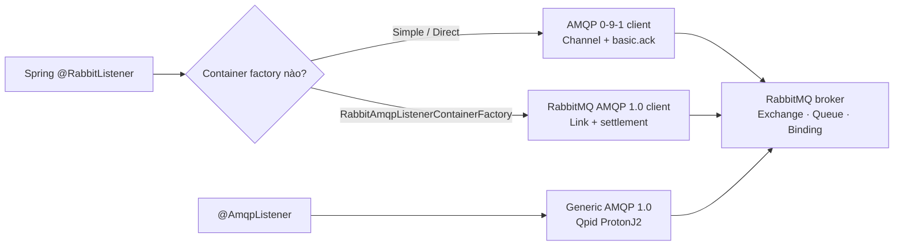
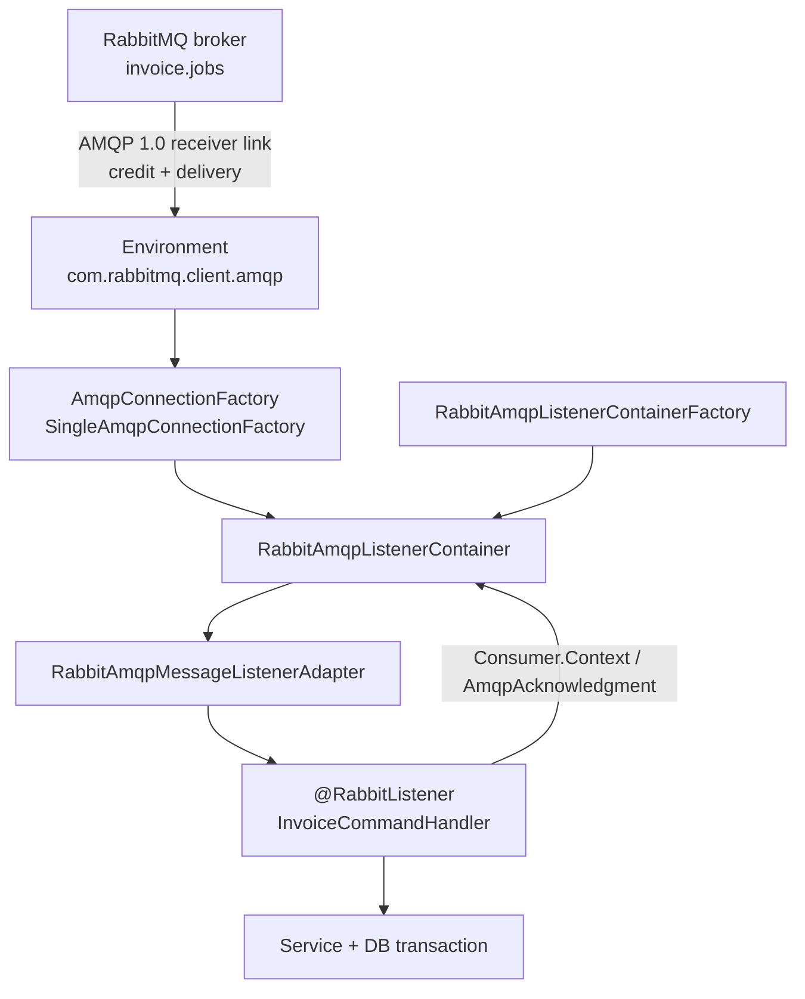
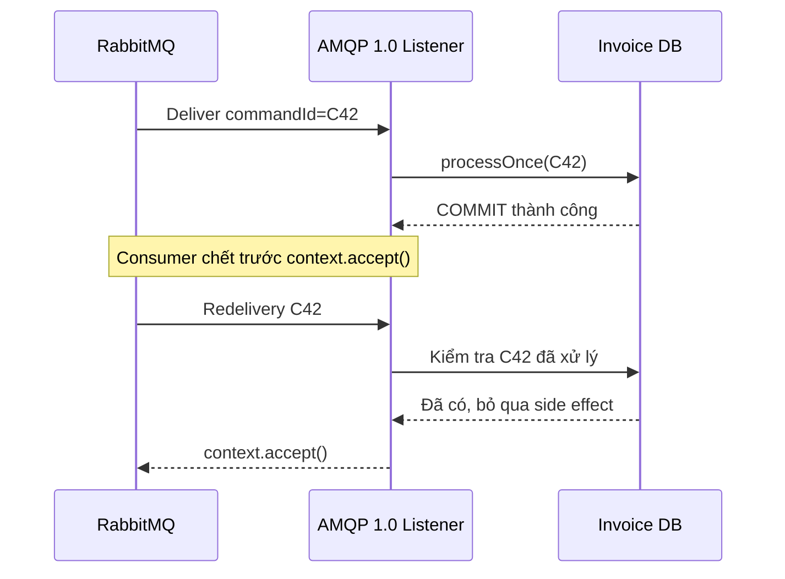

# Listener RabbitMQ AMQP 1.0 và phạm vi tái sử dụng @RabbitListener

Khi một ứng dụng chuyển từ **AMQP 0-9-1** sang **AMQP 1.0** trên RabbitMQ, câu hỏi thường gặp là: *“Có phải bỏ toàn bộ `@RabbitListener` và viết lại các consumer không?”* Với **Spring AMQP 4.x**, câu trả lời là **có thể tiếp tục dùng `@RabbitListener`**, nhưng phải chọn **đúng listener container factory** và thay đổi cách xác nhận message cho phù hợp với giao thức mới.

Spring AMQP có module **`spring-rabbitmq-client`** dành riêng cho RabbitMQ AMQP 1.0. Module này cung cấp `RabbitAmqpListenerContainer` và `RabbitAmqpListenerContainerFactory` để kết nối cơ chế nhận message AMQP 1.0 với annotation `@RabbitListener` quen thuộc. Nó cũng có `RabbitAmqpTemplate` để gửi message và `RabbitAmqpAdmin` để quản lý exchange, queue, binding. Nhờ vậy có thể giữ lại nhiều phần của lớp xử lý nghiệp vụ, converter và mô hình endpoint, trong khi **connection, consumer và settlement thực tế đã khác**.

Bài học thuộc chương **AMQP 1.0** của module **SPRING_AMQP**, dựa trên những kiến thức về `RabbitTemplate`, `@RabbitListener`, exchange, queue, binding, xác nhận giao nhận, retry và dead-letter. Trọng tâm là xác định chính xác **phạm vi tái sử dụng `@RabbitListener`** và tránh những giả định của AMQP 0-9-1 khi triển khai consumer AMQP 1.0.

**Sau bài học, bạn có thể:**

- Phân biệt listener AMQP 0-9-1, **RabbitMQ-specific AMQP 1.0** và **generic AMQP 1.0** trong Spring.
- Cấu hình `RabbitAmqpListenerContainerFactory` và `@RabbitListener` nhận message trên RabbitMQ AMQP 1.0.
- Chuyển từ `Channel.basicAck/basicNack/basicReject` sang **AMQP 1.0 delivery settlement** với `Consumer.Context` hoặc `AmqpAcknowledgment`.
- Biết những thành phần annotation, conversion, request–reply có thể giữ và những thuộc tính container phải kiểm tra lại.
- Thiết kế thử nghiệm đối chiếu lỗi, retry, DLQ, redelivery và khả năng tương tác giữa hai phiên bản giao thức.

## 1. Ba nhánh Spring AMQP cần phân biệt

“Spring hỗ trợ AMQP 1.0” không có nghĩa chỉ có một bộ client hoặc một annotation.

| Nhánh tích hợp | Thư viện chính | Annotation listener | Container factory | Dùng cho |
| --- | --- | --- | --- | --- |
| **RabbitMQ AMQP 0-9-1** | `spring-rabbit` (classic RabbitMQ Java client) | `@RabbitListener` | `SimpleRabbitListenerContainerFactory` / `DirectRabbitListenerContainerFactory` | Hệ thống RabbitMQ sử dụng giao thức 0-9-1 |
| **RabbitMQ AMQP 1.0** | `spring-rabbitmq-client` (RabbitMQ AMQP 1.0 Java client) | **`@RabbitListener`** | **`RabbitAmqpListenerContainerFactory`** | RabbitMQ có hỗ trợ AMQP 1.0, muốn giữ API listener Spring quen thuộc |
| **Generic AMQP 1.0** | `spring-amqp-client` (Qpid ProtonJ2) | **`@AmqpListener`** | `MethodAmqpMessageListenerContainerFactory` | Cần kết nối nhiều broker hỗ trợ AMQP 1.0, hướng đến tính di động |

**Phạm vi phiên bản:** `spring-rabbitmq-client` được giới thiệu từ **Spring AMQP 4.0**; generic `spring-amqp-client` từ **Spring AMQP 4.1**. Nếu dự án còn ở Spring AMQP 3.x, không nên sao chép các class/bean bên dưới và kỳ vọng đã tồn tại. Chọn bộ phiên bản Spring Boot – Spring AMQP – Java tương thích, hoặc có chiến lược nâng cấp rõ ràng.

**Giới hạn tương thích:** `spring-rabbitmq-client` dùng thư viện `com.rabbitmq.client:amqp-client` thiết kế cho **RabbitMQ**; không phải client AMQP 1.0 chạy mặc định với mọi broker. Khi cần một client di động qua ActiveMQ, Azure Service Bus và RabbitMQ, xem nhánh generic AMQP 1.0 tương ứng, với **`@AmqpListener`**, không nhầm hai nhánh.

Spring AMQP có thể kéo `spring-rabbit` làm dependency để dùng lại một số abstraction như `@RabbitListener`; điều đó **không chứng minh listener mới đang sử dụng giao thức 0-9-1**. **Bean factory được chọn** mới quyết định implementation của consumer.

## 2. RabbitMQ AMQP 1.0 không phải RabbitMQ Stream protocol

RabbitMQ hỗ trợ **AMQP 1.0 trực tiếp từ RabbitMQ 4.0**, đồng thời vẫn hỗ trợ AMQP 0-9-1. Cả hai có thể dùng cùng cổng TCP **5672** mặc định (hoặc TLS **5671** khi đã cấu hình), chọn giao thức bằng **protocol header** trong giai đoạn thiết lập kết nối.



Đừng nhầm **AMQP 1.0** với **RabbitMQ native Stream protocol** (thường dùng cổng **5552** và `RabbitStreamTemplate`/`StreamListenerContainer`). Chúng là các giao thức và bộ công cụ khác nhau; AMQP 1.0 vẫn có thể làm việc với queue/stream theo những khả năng mà RabbitMQ hỗ trợ, nhưng không tự biến listener thành native stream consumer.

Ở RabbitMQ, AMQP 1.0 vẫn truy cập được **exchange, queue, binding**. Các địa chỉ AMQP 1.0 theo quy ước mới của RabbitMQ (address v2) gồm:

| Địa chỉ | Ý nghĩa |
| --- | --- |
| `/queues/invoice.jobs` | Receive từ queue `invoice.jobs` hoặc send trực tiếp tới queue hiện có |
| `/exchanges/invoice.events/invoice.created` | Publish tới exchange `invoice.events` với routing key `invoice.created` |
| `/exchanges/invoice.events` | Publish tới exchange với routing key rỗng; phù hợp khi loại exchange không cần key |

RabbitMQ yêu cầu **percent-encoding** các ký tự đặc biệt trong thành phần của address theo RFC 3986. Với `@RabbitListener(queues = "invoice.jobs")` của **RabbitMQ-specific Spring integration**, listener container nhận **tên queue** và xử lý phần địa chỉ thấp hơn; người dùng không phải tự chuyển annotation thành `/queues/invoice.jobs`. Trong **generic AMQP 1.0**, `@AmqpListener(addresses = "/queues/invoice.jobs")` dùng địa chỉ broker cụ thể.

## 3. Những gì có thể tái sử dụng từ @RabbitListener

`@RabbitListener` được giữ vì `RabbitAmqpMessageListenerAdapter` hỗ trợ cơ chế gọi phương thức POJO theo cùng mô hình Spring Messaging. Các khả năng quan trọng:

| Có thể giữ | Điều kiện hoặc lưu ý |
| --- | --- |
| Annotation `@RabbitListener` trên method/class | Phải có `RabbitAmqpListenerContainerFactory` phù hợp được chọn |
| `queues`, `id`, `containerFactory`, `autoStartup` | Tên queue, ID endpoint và factory vẫn là cách khai báo endpoint |
| POJO method nhận `String`, DTO, `byte[]` | Phụ thuộc message converter và nội dung message, không tự động bảo toàn mọi kiểu |
| Spring AMQP `Message`, Spring Messaging `Message` | Adapter có thể chuyển từ native AMQP 1.0 message |
| Header mapping, argument resolution, validation | Xem lại mapping/representation của message properties và application properties |
| `@RabbitHandler` cho class-level listener, xử lý phân nhánh payload | Theo phạm vi annotation-driven adapter hỗ trợ |
| Request–reply và trả kết quả từ listener | Adapter tái sử dụng các nguyên tắc reply; cần kiểm tra reply address, correlation, timeout theo AMQP 1.0 |
| `concurrency` và `ackMode` | Được hỗ trợ nhưng semantics thực thi phải theo **RabbitAmqpListenerContainer** |

Điều **không** nên chuyển nguyên xi:

- Injection `com.rabbitmq.client.Channel` và gọi `basicAck`, `basicNack`, `basicReject`: đó là giao thức **AMQP 0-9-1**.
- `SimpleRabbitListenerContainerFactory`, `DirectRabbitListenerContainerFactory`, `CachingConnectionFactory`: chúng quản lý container/connection **0-9-1**, không tự nói AMQP 1.0.
- Các giả định về `deliveryTag`, channel transaction, `basic.qos`/prefetch, publisher confirms/returns ở dạng callback 0-9-1.
- Các property/điều khiển dành riêng cho SMLC/DMLC như `concurrentConsumers`, `messagesPerAck`, `declarationRetries`: không áp dụng máy móc cho container AMQP 1.0.

**Điểm mấu chốt:** tái sử dụng annotation là **tái sử dụng mô hình khai báo endpoint**, không có nghĩa hai implementation của consumer tương đương ở mức giao thức.

## 4. Kiến trúc của RabbitMQ AMQP 1.0 listener



Các tầng có trách nhiệm riêng:

1. **`Environment`:** cấu hình kết nối/client RabbitMQ AMQP 1.0, phục vụ nhiều connection nếu cần.
2. **`AmqpConnectionFactory`:** abstraction AMQP 1.0 của package `org.springframework.amqp.rabbitmq.client`; implementation `SingleAmqpConnectionFactory` quản lý kết nối thực. Nó **khác** `org.springframework.amqp.rabbit.connection.ConnectionFactory` của 0-9-1.
3. **`RabbitAmqpListenerContainerFactory`:** tạo listener container theo tên queue, cấu hình nhận và settle message.
4. **`RabbitAmqpListenerContainer`:** mở và giám sát consumer/receiver link AMQP 1.0, chuyển message đến listener.
5. **`RabbitAmqpMessageListenerAdapter`:** chuyển message, giải quyết argument và gọi POJO method `@RabbitListener`.
6. **Ứng dụng:** commit nghiệp vụ, quyết định accept/requeue/discard và ghi log/metrics.

Khi chưa có container factory trong Spring Boot, Boot có thể tự cấu hình factory theo starter đã chọn. Trong ứng dụng có **cả AMQP 0-9-1 và AMQP 1.0**, nên đặt **tên bean factory rõ ràng** và ghi `containerFactory` trên mỗi listener. Điều này tránh một listener vô tình được gắn với giao thức khác với dự định.

## 5. Khởi tạo dự án Spring Boot dùng RabbitMQ AMQP 1.0

Với dòng **Spring Boot 4.2**, có starter dành riêng cho RabbitMQ AMQP 1.0:

```xml
<!-- Dùng BOM / dependency management của Spring Boot thích hợp. -->
<dependency>
    <groupId>org.springframework.boot</groupId>
    <artifactId>spring-boot-starter-amqp-rabbitmq</artifactId>
</dependency>
```

Nếu không dùng starter hoặc muốn cấu hình thủ công, dependency cốt lõi tương ứng là:

```xml
<dependency>
    <groupId>org.springframework.amqp</groupId>
    <artifactId>spring-rabbitmq-client</artifactId>
</dependency>
```

**Chọn một cách quản lý dependency phù hợp với version dự án.** Không tự ghép một bản Spring AMQP 4.x vào ứng dụng Boot cũ nếu chưa kiểm tra ma trận tương thích. Ví dụ dưới đây lấy **Spring AMQP 4.x / Spring Boot có hỗ trợ RabbitMQ AMQP 1.0** làm nền tảng.

Cấu hình Boot cho nhánh RabbitMQ AMQP 1.0:

```yaml
spring:
  amqp:
    rabbitmq:
      host: localhost
      port: 5672
      username: app_user
      password: ${RABBITMQ_PASSWORD}
```

Tên property ở đây là **`spring.amqp.rabbitmq.*`**, khác với **`spring.rabbitmq.*`** thường dùng cho AMQP 0-9-1. Trong vận hành, lấy password từ secret manager/biến môi trường và cấu hình TLS khi kết nối qua mạng không tin cậy.

RabbitMQ 4.x hỗ trợ AMQP 1.0 **natively**, không yêu cầu bật plugin Stream protocol. Broker phải cho phép client authenticate bằng SASL, đúng vhost/quyền và đúng cổng AMQP.

## 6. Khai báo exchange, queue và binding

RabbitMQ AMQP 1.0 vẫn có thể dùng cùng mô hình topology với ứng dụng AMQP 0-9-1. Ví dụ đặt command tạo hóa đơn vào queue `invoice.jobs` và dùng dead-letter exchange `invoice.dlx` để cách ly message không xử lý được:

```java
import org.springframework.amqp.core.Binding;
import org.springframework.amqp.core.BindingBuilder;
import org.springframework.amqp.core.DirectExchange;
import org.springframework.amqp.core.Queue;
import org.springframework.amqp.core.QueueBuilder;
import org.springframework.context.annotation.Bean;
import org.springframework.context.annotation.Configuration;

@Configuration
public class InvoiceTopology {

    @Bean
    DirectExchange invoiceEvents() {
        return new DirectExchange("invoice.events", true, false);
    }

    @Bean
    DirectExchange invoiceDlx() {
        return new DirectExchange("invoice.dlx", true, false);
    }

    @Bean
    Queue invoiceJobs() {
        return QueueBuilder.durable("invoice.jobs")
                .deadLetterExchange("invoice.dlx")
                .deadLetterRoutingKey("invoice.dead")
                .build();
    }

    @Bean
    Queue invoiceDead() {
        return QueueBuilder.durable("invoice.dead").build();
    }

    @Bean
    Binding invoiceJobsBinding(Queue invoiceJobs,
                               DirectExchange invoiceEvents) {
        return BindingBuilder.bind(invoiceJobs)
                .to(invoiceEvents).with("invoice.create");
    }

    @Bean
    Binding invoiceDeadBinding(Queue invoiceDead,
                               DirectExchange invoiceDlx) {
        return BindingBuilder.bind(invoiceDead)
                .to(invoiceDlx).with("invoice.dead");
    }
}
```

Các bean topology này chỉ mô tả **đối tượng cần khai báo**. Trong nhánh RabbitMQ AMQP 1.0, `RabbitAmqpAdmin` có thể quản lý chúng bằng API management của AMQP 1.0:

```java
import org.springframework.amqp.rabbitmq.client.AmqpConnectionFactory;
import org.springframework.amqp.rabbitmq.client.RabbitAmqpAdmin;
import org.springframework.context.annotation.Bean;
import org.springframework.context.annotation.Configuration;

@Configuration
public class InvoiceAdminConfig {
    @Bean
    RabbitAmqpAdmin rabbitAmqpAdmin(
            AmqpConnectionFactory connectionFactory) {
        return new RabbitAmqpAdmin(connectionFactory);
    }
}
```

Nếu dùng Boot starter đã **auto-configure `RabbitAmqpAdmin`**, không khai báo bean tương đương lần thứ hai. Nếu topology do Terraform/operator hoặc một service khác sở hữu, có thể bỏ bean admin và provisioning bên ngoài. Dùng **một owner rõ ràng** cho việc tạo/đổi queue, tránh hai service khai báo lệch `durable`, queue type hoặc arguments.

Ví dụ đặt DLX trực tiếp trên queue để minh họa; production thường nên quản lý dead-letter exchange/routing qua **broker policy** để điều chỉnh linh hoạt. Cần kiểm tra cụ thể khi đổi queue arguments vì queue đã tồn tại có thể từ chối redeclaration không tương thích.

## 7. Cấu hình đúng RabbitAmqpListenerContainerFactory

Tạo factory riêng và chỉ định tên trong annotation:

```java
import org.springframework.amqp.rabbitmq.client.AmqpConnectionFactory;
import org.springframework.amqp.rabbitmq.client.config.RabbitAmqpListenerContainerFactory;
import org.springframework.context.annotation.Bean;
import org.springframework.context.annotation.Configuration;

@Configuration
public class InvoiceAmqp10ListenerConfig {

    @Bean("invoiceAmqp10Factory")
    RabbitAmqpListenerContainerFactory invoiceAmqp10Factory(
            AmqpConnectionFactory connectionFactory) {
        return new RabbitAmqpListenerContainerFactory(connectionFactory);
    }
}
```

**Tên class chính xác:** `org.springframework.amqp.rabbitmq.client.config.RabbitAmqpListenerContainerFactory`. Đừng nhầm với `org.springframework.amqp.rabbit.config.SimpleRabbitListenerContainerFactory` dùng cho 0-9-1 hoặc `org.springframework.amqp.client.config.MethodAmqpMessageListenerContainerFactory` dùng cho generic AMQP 1.0.

Nếu muốn các endpoint `@RabbitListener` **không ghi `containerFactory`** đều dùng AMQP 1.0, có thể đăng ký bean factory dưới tên mặc định `rabbitListenerContainerFactory` hoặc dùng cấu hình endpoint tương ứng. Nhưng khi một ứng dụng có nhiều giao thức, việc chọn factory **tường minh** giúp dễ review và vận hành hơn.

## 8. Tái sử dụng @RabbitListener với payload String

Ở mức POJO, handler nhận một `String` vẫn rất giống AMQP 0-9-1:

```java
import org.springframework.amqp.rabbit.annotation.RabbitListener;
import org.springframework.stereotype.Component;

@Component
public class InvoiceCommandListener {

    @RabbitListener(
            id = "invoice-amqp10-consumer",
            queues = "invoice.jobs",
            containerFactory = "invoiceAmqp10Factory")
    public void handle(String command) {
        System.out.println("Received: " + command);
    }
}
```

Spring chuyển native AMQP 1.0 message sang format mà listener adapter hiểu, sau đó dùng `MessageConverter` để tạo argument `String`. Khi method trả về bình thường, container áp dụng **settlement theo mode đang cấu hình**; không tự suy rằng listener này có consumer ack kiểu AMQP 0-9-1.

Với dữ liệu JSON/DTO, cần định nghĩa message converter phù hợp và kiểm thử content type, charset, mapping header. Một custom converter viết cho `org.springframework.amqp.core.Message` có thể được **tái sử dụng** nếu đáp ứng contract tương ứng, nhưng không nên giả định mọi native message annotation của AMQP 1.0 đều có biểu diễn giống hệt BasicProperties của 0-9-1.

### Khai báo concurrency

```java
@RabbitListener(
    id = "invoice-workers",
    queues = "invoice.jobs",
    containerFactory = "invoiceAmqp10Factory",
    concurrency = "2")
public void processTwoConsumers(String payload) {
    // Các command độc lập có thể xử lý song song.
}
```

Đây là ví dụ **method annotation** đặt trong một bean đã có lifecycle Spring. `concurrency="2"` có thể tạo hai consumer trên queue theo cơ chế của factory AMQP 1.0; **không có bảo đảm hai command được commit đúng thứ tự enqueue**. Đừng sao chép cú pháp `"2-5"` hay thuộc tính `consumersPerQueue` từ container 0-9-1 mà chưa xác minh semantics của factory AMQP 1.0.

## 9. Khác biệt quan trọng nhất: AMQP 1.0 settlement

AMQP 0-9-1 yêu cầu consumer gửi `basic.ack`, `basic.nack` hoặc `basic.reject` theo **delivery tag trên channel**. Với AMQP 1.0, client **settle delivery** bằng một **outcome**:

| Kết quả xử lý | RabbitMQ AMQP 1.0 Java client | Tương đương ý nghĩa ở AMQP 0-9-1 |
| --- | --- | --- |
| Xử lý thành công | `Consumer.Context.accept()` | `basicAck(tag, false)` |
| Chưa xử lý được, muốn nhận lại | `Consumer.Context.requeue()` | `basicNack(tag, false, true)` |
| Message không hợp lệ, bỏ khỏi queue nguồn | `Consumer.Context.discard()` | `basicReject(tag, false)` |

Các phép đối chiếu này nói về **mục đích nghiệp vụ**, không có nghĩa frame, channel hoặc cơ chế flow control tương đương. Trong AMQP 1.0, tên outcome giao thức liên quan là `accepted`, `released` và `rejected`; khi dùng `discard`, RabbitMQ có thể đưa message sang DLX nếu queue nguồn được cấu hình đúng, hoặc loại bỏ khi không có DLX.

`RabbitAmqpListenerContainer` có chế độ **`autoSettle=false`**, tương ứng mục tiêu `AcknowledgeMode.MANUAL`: ứng dụng tự quyết định outcome. Khi đó listener có thể nhận:

- `com.rabbitmq.client.amqp.Consumer.Context`: API native để `accept()`, `requeue()`, `discard()`.
- `org.springframework.amqp.core.AmqpAcknowledgment`: Spring abstraction, có `acknowledge()` và `acknowledge(AmqpAcknowledgment.Status.REQUEUE)`.

**Không dùng `com.rabbitmq.client.Channel` hoặc `deliveryTag`** để ack trong listener AMQP 1.0. Cũng không trộn cả `Context` và `AmqpAcknowledgment` để settle **cùng một delivery hai lần**.

## 10. Ví dụ manual settlement: ack sau khi commit

Giả sử mỗi message chứa một `commandId` duy nhất cho thao tác tạo hóa đơn. `InvoiceService.processOnce(String)` là service nghiệp vụ do ứng dụng triển khai: phải kiểm tra duplicate dựa trên `commandId`, cập nhật database trong một transaction và chỉ trả về khi transaction đã commit thành công.

```java
import com.rabbitmq.client.amqp.Consumer;
import org.springframework.amqp.rabbit.annotation.RabbitListener;
import org.springframework.dao.TransientDataAccessException;
import org.springframework.stereotype.Component;

@Component
public class InvoiceCommandHandler {

    private final InvoiceService invoiceService;

    public InvoiceCommandHandler(InvoiceService invoiceService) {
        this.invoiceService = invoiceService;
    }

    @RabbitListener(
        id = "invoice-manual-amqp10",
        queues = "invoice.jobs",
        containerFactory = "invoiceAmqp10Factory",
        ackMode = "#{T(org.springframework.amqp.core.AcknowledgeMode).MANUAL}")
    public void onCommand(String command, Consumer.Context context) {
        try {
            if (command == null || command.isBlank()) {
                context.discard();            // Không hợp lệ -> DLQ nếu có
                return;
            }
            invoiceService.processOnce(command);
            context.accept();                 // Chỉ sau DB commit
        }
        catch (TransientDataAccessException ex) {
            context.requeue();                // Ví dụ retry cơ bản
        }
        catch (InvalidInvoiceCommandException ex) {
            context.discard();                // Lỗi nghiệp vụ vĩnh viễn
        }
    }
}
```

Đây là **mẫu minh họa**, không phải chương trình hoàn chỉnh: cần triển khai `InvoiceService`, `InvalidInvoiceCommandException`, parser, cấu hình converter, timeout và retry. Với lỗi không được bắt, cần xác định **error handler** và trạng thái settlement tương ứng theo cấu hình container; không được để message treo vì callback chưa settle mà không có chính sách xử lý.

**Vì sao cần idempotency?** Nếu database đã commit rồi listener chết trước khi broker nhận outcome `accepted`, broker có thể giao lại message cho consumer khác. Một transaction có unique constraint trên `(consumer_name, command_id)` hoặc khóa nghiệp vụ tương đương giúp tránh tạo hóa đơn lần hai.



**Không retry ngay vô hạn:** `context.requeue()` có thể khiến message trở lại nhanh, gây hot loop khi một phụ thuộc bị hỏng. Hệ thống thật cần backoff, giới hạn số lần thử và DLQ/quarantine; semantics của delivery count/retry phụ thuộc loại queue và phiên bản RabbitMQ.

### Tương đương với AmqpAcknowledgment

Thay vì native `Consumer.Context`, listener có thể nhận `AmqpAcknowledgment`. Ví dụ độc lập này dùng **cùng factory**:

```java
import org.springframework.amqp.core.AmqpAcknowledgment;
import org.springframework.amqp.rabbit.annotation.RabbitListener;

@RabbitListener(
    id = "audit-manual-amqp10",
    queues = "audit.jobs",
    containerFactory = "invoiceAmqp10Factory",
    ackMode = "#{T(org.springframework.amqp.core.AcknowledgeMode).MANUAL}")
public void onAudit(String data, AmqpAcknowledgment acknowledgment) {
    if (data == null || data.isBlank()) {
        acknowledgment.acknowledge(AmqpAcknowledgment.Status.REQUEUE);
        return;
    }
    auditService.processOnce(data); // Service do ứng dụng triển khai
    acknowledgment.acknowledge();
}
```

Mẫu thứ hai nằm trong một class có `auditService` đã inject và queue `audit.jobs` đã được tạo riêng. Nó chỉ minh họa signature và cách dùng abstraction; không ghép trực tiếp vào class đầu tiên. Nếu cần bỏ message vĩnh viễn, có thể dùng native `context.discard()` hoặc tra cứu đầy đủ trạng thái tương ứng của `AmqpAcknowledgment` theo version đang dùng.

## 11. Credit và concurrency: không áp dụng máy móc prefetch của 0-9-1

AMQP 1.0 sử dụng **link credit** để kiểm soát số delivery mà broker được phép gửi qua receiver link. Khi consumer settle, client/container có thể cấp lại credit, cho phép nhận thêm message.

| Khía cạnh | AMQP 0-9-1 | RabbitMQ AMQP 1.0 |
| --- | --- | --- |
| Nhận message | `basic.consume` trên channel | Consumer/receiver link AMQP 1.0 |
| Flow control | `basic.qos`/`prefetchCount` | **Link credit** |
| Xác nhận | `basicAck`/`basicNack` theo delivery tag | **Settlement outcome** trên delivery |
| Đồng thời | SMLC/DMLC concurrency/consumers-per-queue | `RabbitAmqpListenerContainer` concurrency/consumer links |
| Đóng consumer khi còn việc | Unacked deliveries có thể được redeliver | Unsettled deliveries có thể được redeliver |
| Tăng throughput | Prefetch, concurrency, ack gộp nếu đúng | Credit, concurrency, batch/settlement theo khả năng client |

**Tăng concurrency không bảo đảm thứ tự xử lý.** Một queue có thể giao message A cho consumer 1 và B cho consumer 2; B commit trước A. Với event của cùng orderId/accountId cần thứ tự, dùng version trong payload, optimistic locking, phân vùng theo khóa hoặc một active consumer phù hợp.

**Không suy luận credit bằng delivery tag.** Credit là cơ chế cho phép broker gửi thêm, trong khi outcome thể hiện kết quả xử lý từng delivery. Đây là những trách nhiệm khác nhau và không thay bằng `Channel.basicQos(...)` trong listener AMQP 1.0.

## 12. Request–reply có thể tái sử dụng đến mức nào?

`RabbitAmqpMessageListenerAdapter` tái sử dụng nhiều tính năng annotation-driven POJO listener, bao gồm phương thức trả kết quả. Với AMQP 1.0:

- Requester dùng `RabbitAmqpTemplate`/`AsyncAmqpTemplate` có các thao tác gửi/nhận bất đồng bộ, ví dụ `convertSendAndReceive(...)`.
- Responder dùng `@RabbitListener` và có thể return giá trị để Spring gửi reply theo cấu hình `reply-to`/`correlation`.
- Reply address, message conversion, timeout và trạng thái kết nối vẫn phải được kiểm thử theo **AMQP 1.0**.

```java
import org.springframework.amqp.rabbit.annotation.RabbitListener;
import org.springframework.stereotype.Component;

@Component
public class InvoiceQueryResponder {

    @RabbitListener(
        queues = "invoice.query",
        containerFactory = "invoiceAmqp10Factory")
    public String lookup(String invoiceId) {
        // Chỉ là ví dụ đọc dữ liệu, không phát sinh side effect.
        return "status-for:" + invoiceId;
    }
}
```

Ví dụ giả định queue `invoice.query` đã được provision. Nếu requester không cung cấp `reply-to` và cũng không có đích trả về dự phòng, không thể tự giả định reply luôn tới nơi. Request–reply vẫn là **hai lần giao message độc lập**, không được bảo đảm hoàn tất chỉ nhờ request được broker chấp nhận.

**Không áp dụng nguyên xi `RabbitTemplate` callback API của 0-9-1.** `RabbitAmqpTemplate` là implementation của `AsyncAmqpTemplate`, thao tác trả `CompletableFuture`; việc xác nhận publish dựa trên kết quả send theo AMQP 1.0, không phải gọi `setConfirmCallback`/`setReturnsCallback` như `RabbitTemplate`. Đặc biệt, một send hoàn tất không chứng minh responder đã commit nghiệp vụ.

## 13. Batch listener và những thuộc tính có điều kiện phiên bản

`RabbitAmqpMessageListener` hỗ trợ nhận/settle theo batch khi cấu hình `batchSize` lớn hơn 1, cùng thời gian flush batch chưa đủ size. Từ **Spring AMQP 4.2**, `@RabbitListener` có thể ghi đè `batchSize` và `batchReceiveTimeout` của `RabbitAmqpListenerContainerFactory` cho từng endpoint.

Khả năng batch này không biến nhiều message thành **một transaction database**. Nếu event thứ 7 trong batch 20 event lỗi:

1. Phải biết 6 event trước đó đã commit chưa.
2. Phải phân biệt message nào có thể accept và message nào cần requeue/discard.
3. Nếu chọn settlement gộp, phải kiểm tra chính xác phạm vi theo API AMQP 1.0, không giả định `basicAck(lastDeliveryTag, true)` của 0-9-1.
4. Cần idempotency và giới hạn retry để bảo vệ khi consumer chết giữa commit và settlement.

Một câu lệnh `@RabbitListener(batchSize="20")` phù hợp với Spring AMQP 4.2 có thể không được nhận bởi ứng dụng dùng 4.0 hoặc 4.1. Khi nâng cấp, kiểm tra **Javadoc cho version đang chạy** và các tham số annotation/factory có thực sự hỗ trợ trước khi áp dụng.

## 14. So sánh những đoạn code khi chuyển từ 0-9-1

### Trước: AMQP 0-9-1 dùng Channel

```java
import com.rabbitmq.client.Channel;
import org.springframework.amqp.core.Message;
import org.springframework.amqp.rabbit.annotation.RabbitListener;

@RabbitListener(queues = "invoice.jobs", ackMode = "MANUAL",
                containerFactory = "classicListenerFactory")
public void handleClassic(Message message, Channel channel)
        throws java.io.IOException {
    long tag = message.getMessageProperties().getDeliveryTag();
    invoiceService.processOnce(message.getBody());
    channel.basicAck(tag, false);
}
```

### Sau: RabbitMQ AMQP 1.0 dùng settlement

```java
import com.rabbitmq.client.amqp.Consumer;
import org.springframework.amqp.rabbit.annotation.RabbitListener;

@RabbitListener(
    queues = "invoice.jobs",
    ackMode = "#{T(org.springframework.amqp.core.AcknowledgeMode).MANUAL}",
    containerFactory = "invoiceAmqp10Factory")
public void handleAmqp10(String payload, Consumer.Context context) {
    invoiceService.processOnce(payload);
    context.accept();
}
```

Hai đoạn là **minh họa dạng method** với dependency/service/factory tương ứng đã tồn tại; không nên khai báo cả hai listener cùng đọc chung queue trong lúc migration trừ khi chấp nhận chúng **cạnh tranh message**. Điểm giữ lại là `@RabbitListener`, tên queue, business service; điểm đổi là **factory**, **kiểu argument** và **outcome**.

### Bảng quyết định khi migrate

| Phần hiện tại | Có thể giữ? | Việc cần làm |
| --- | --- | --- |
| `@RabbitListener(queues=...)` | Có | Chọn `RabbitAmqpListenerContainerFactory` |
| Service nghiệp vụ, DTO và validation | Thường có | Kiểm tra conversion và idempotency |
| Exchange, queue, binding | Có thể | Xác định chủ sở hữu topology; dùng `RabbitAmqpAdmin` hoặc IaC |
| `@RabbitHandler`/reply method | Phần lớn | Kiểm tra signature và reply-to/correlation |
| `RabbitTemplate` publish | Không giữ nguyên khi yêu cầu publish qua 1.0 | Đổi sang `RabbitAmqpTemplate` và xử lý future |
| `com.rabbitmq.client.Channel` | Không | Dùng `Consumer.Context` hoặc `AmqpAcknowledgment` |
| `CachingConnectionFactory` | Không | Dùng `AmqpConnectionFactory` cho AMQP 1.0 |
| `SimpleRabbitListenerContainerFactory` | Không | Dùng `RabbitAmqpListenerContainerFactory` |
| Manual ack và xử lý retry | Giữ **nguyên tắc**, đổi API | `accept`/`requeue`/`discard` + backoff/DLQ |
| Metrics, tracing, correlation ID | Giữ mục tiêu | Xác minh mapping và thay đổi instrumentation |

## 15. Thử nghiệm trên môi trường tích hợp

Chuẩn bị RabbitMQ hỗ trợ AMQP 1.0, một ứng dụng Spring Boot/Spring AMQP tương thích với `spring-rabbitmq-client`, và exchange/queue/binding của mục 6. Khi cần so sánh hai giao thức, dùng **môi trường test**, không có dữ liệu khách hàng thật.

1. **Xác minh protocol:** kết nối bằng starter RabbitMQ AMQP 1.0 trên cổng AMQP của broker. Kiểm tra broker connection metadata/protocol; cổng 5672 **không đủ** để suy ra client đang dùng 0-9-1 hay 1.0.
2. **Nhận message cơ bản:** publish `commandId=C101` vào `invoice.events` / `invoice.create` rồi kiểm tra `@RabbitListener` AMQP 1.0 nhận payload, tạo invoice và settle thành công.
3. **Lỗi dữ liệu vĩnh viễn:** gửi message không hợp lệ. Với `context.discard()` và DLX đã khai báo, xác minh message đến `invoice.dead`; không có DLX thì có thể bị loại.
4. **Lỗi database tạm thời:** cho service ném `TransientDataAccessException`. Quan sát `context.requeue()` và cách message được giao lại. Đo tần suất retry; nếu hot loop, áp dụng backoff.
5. **Crash sau commit trước settlement:** dừng consumer ngay sau khi database commit, trước `context.accept()`. Khởi động lại và kiểm tra redelivery **không tạo invoice trùng** nhờ idempotency.
6. **Factory nhầm:** cố tình đăng ký một listener test với classic factory khi dự định dùng AMQP 1.0; xác minh broker client protocol/bean type rồi sửa lại. Không kết luận đúng giao thức chỉ từ tên annotation.
7. **Interop:** producer AMQP 0-9-1 gửi tới cùng queue, consumer AMQP 1.0 nhận; sau đó thử producer AMQP 1.0 và classic consumer. Kiểm tra charset, content type, headers, queue type, durable và ack.
8. **Concurrency:** tăng `concurrency=2` và cho hai message có thời gian xử lý khác nhau. Quan sát thứ tự **hoàn tất** có thể không còn là thứ tự enqueue.
9. **Request–reply:** cho requester AMQP 1.0 hỏi trạng thái hóa đơn; xác nhận reply được ghép đúng request và timeout không bị hiểu nhầm thành nghiệp vụ chưa chạy.
10. **Recovery:** restart broker hoặc ngắt kết nối trong môi trường thử nghiệm. Kiểm tra listener reattach, những message unsettled có thể redeliver và nghiệp vụ vẫn đúng sau reconnect.

### Gợi ý metrics/logging

Theo dõi ít nhất `listener_id`, queue, protocol version, số consumer/receiver links, số delivery `accepted/requeued/discarded`, số duplicate được chặn, độ trễ commit DB, lỗi conversion, số lần reconnect và backlog DLQ. Với AMQP 1.0, theo dõi thêm **credit/settlement latency** nếu client/monitoring cung cấp.

Một metric có tên như `invoice_amqp10_requeued_total` chỉ là ví dụ **metric ứng dụng tự định nghĩa**, không mặc định có sẵn trong RabbitMQ hay Spring.

## 16. Các lỗi thường gặp và cách khắc phục

| Sai lầm | Hậu quả | Cách xử lý |
| --- | --- | --- |
| Cho rằng mọi `@RabbitListener` đều là 0-9-1 | Nhầm connection/container và API xác nhận | Kiểm tra bean factory, module và protocol connection |
| Dùng `spring.rabbitmq.*` cho starter AMQP 1.0 | App không nhận cấu hình như mong đợi | Dùng `spring.amqp.rabbitmq.*` theo Boot version |
| Inject `Channel` trong listener 1.0 | Signature sai hoặc không thể ack như mong đợi | Dùng `Consumer.Context`/`AmqpAcknowledgment` |
| Gọi `context.accept()` trước DB commit | Broker loại message dù transaction sau đó fail | Accept sau khi service commit |
| Quên settle trong MANUAL mode | Credit bị tiêu hao, consumer có thể ngừng nhận thêm | Đảm bảo mỗi delivery có outcome hoặc chính sách lỗi rõ |
| Requeue vô hạn lỗi vĩnh viễn | Hot loop và backlog | Phân loại lỗi, delay/backoff, DLQ |
| Nghĩ generic `@AmqpListener` dùng cùng factory với `@RabbitListener` | Ứng dụng wiring sai | Tách RabbitMQ-specific và generic AMQP 1.0 |
| Copy `prefetchCount/messagesPerAck` từ SMLC | Tuning không có hiệu quả như kỳ vọng | Tìm cấu hình credit/batch của AMQP 1.0 client |
| Xem future publish thành công là nghiệp vụ hoàn tất | Báo kết quả sai | Theo dõi riêng broker outcome và DB transaction |
| Chỉ bật durable/persistent là đủ | Có thể vẫn mất việc hoặc trùng việc | Outbox, confirmation, ack sau commit, idempotency và giám sát |

## 17. Câu hỏi tự kiểm tra

1. `@RabbitListener` có thể sử dụng AMQP 1.0 từ Spring AMQP phiên bản nào và factory nào quyết định listener nói giao thức đó?
2. Phân biệt `spring-rabbitmq-client` và `spring-amqp-client`: chúng dùng thư viện nào, annotation listener nào và hỗ trợ loại broker nào?
3. Vì sao không thể lấy `com.rabbitmq.client.Channel` và gọi `basicAck` trong listener RabbitMQ AMQP 1.0?
4. `Consumer.Context.accept()`, `requeue()` và `discard()` có ý nghĩa nghiệp vụ gì? Khi nào `discard()` đưa message vào DLQ?
5. Vì sao việc một consumer AMQP 1.0 nhận được message và settle thành công chưa chứng minh side effect của database đúng?
6. Trong ứng dụng có cả 0-9-1 và 1.0, cách nào bảo đảm `@RabbitListener` này dùng đúng container factory?
7. `RabbitAmqpTemplate` khác `RabbitTemplate` về kiểu API gửi message và cách quan sát kết quả như thế nào?
8. Khi listener dùng `String`/DTO, những thành phần nào có thể giữ lại sau migration, và converter phải kiểm tra những điều gì?
9. Khi `concurrency="2"`, tại sao event B có thể commit trước event A dù queue nhận A trước?
10. Với Spring AMQP 4.2, tính năng override batch trên annotation ảnh hưởng thế nào đến phạm vi version có thể chạy ví dụ?

## Tài liệu tham khảo

- [Spring AMQP — RabbitMQ AMQP 1.0 Support](https://docs.spring.io/spring-amqp/reference/rabbitmq-amqp-client.html): `spring-rabbitmq-client`, `RabbitAmqpListenerContainerFactory`, `@RabbitListener`, manual settlement, batch, request–reply.
- [Spring AMQP — Generic AMQP 1.0 Support](https://docs.spring.io/spring-amqp/reference/amqp10-client.html): `spring-amqp-client`, ProtonJ2, `@AmqpListener` và phạm vi tương thích nhiều broker.
- [Spring Boot — AMQP](https://docs.spring.io/spring-boot/reference/messaging/amqp.html): starter RabbitMQ 1.0, các property `spring.amqp.rabbitmq.*` và auto-configuration.
- [RabbitMQ — AMQP 1.0](https://www.rabbitmq.com/docs/amqp): protocol negotiation, address v2, exchange/queue routing và các outcome.
- [RabbitMQ — AMQP 1.0 Client Libraries](https://www.rabbitmq.com/client-libraries/amqp-client-libraries): consumer settlement, credit và các hành vi của RabbitMQ AMQP 1.0 clients.
- [RabbitMQ — Work Queues (AMQP 1.0)](https://www.rabbitmq.com/tutorials/tutorial-two-java-amqp10): `accept`, `requeue`, xử lý lỗi và redelivery.
- [Spring AMQP — Annotation-driven Listener Endpoints](https://docs.spring.io/spring-amqp/reference/amqp/receiving-messages/async-annotation-driven.html): phương thức POJO, conversion, handler method và reply.
- [Spring AMQP — Listener Container Configuration](https://docs.spring.io/spring-amqp/reference/amqp/containerAttributes.html): các tham số container truyền thống để đối chiếu, tránh áp dụng nhầm giữa giao thức.
