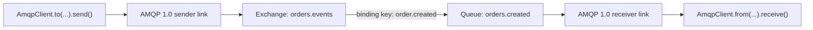
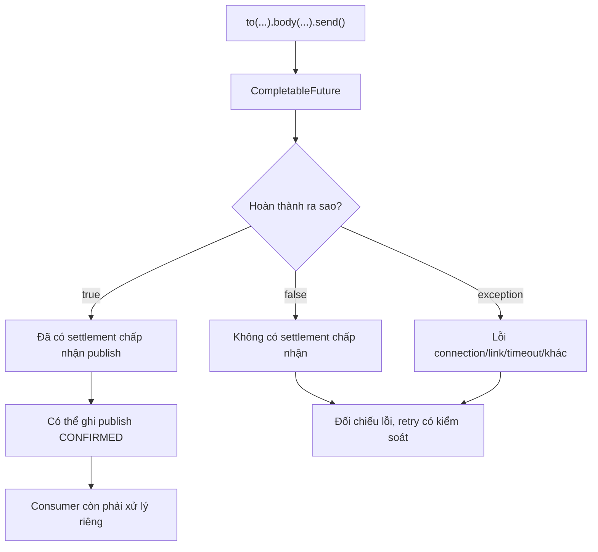
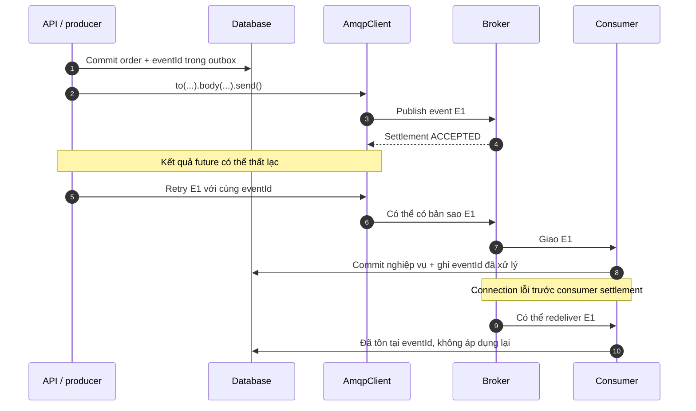

# AmqpClient và thao tác gửi/nhận dựa trên CompletableFuture

## 1. Bối cảnh và mục tiêu

Trong chương **AMQP 1.0** của module **SPRING_AMQP**, ta tìm hiểu cách gửi và nhận message qua RabbitMQ mà không phải chặn luồng gọi cho đến khi broker hoàn thành từng thao tác. Ở các phần trước, ứng dụng thường dùng `RabbitTemplate`, `@RabbitListener`, exchange, queue và binding với AMQP 0.9.1. **`AmqpClient`** mang đến một API fluent sử dụng **AMQP 1.0**, cho phép cả **send** và **receive theo yêu cầu** trả về `CompletableFuture`.

Ví dụ, một service quản lý đơn hàng phải publish `OrderCreated`, trong khi một tác vụ quản trị thỉnh thoảng cần đọc một message từ queue. Ứng dụng không cần giữ một request thread chờ broker nhận message. Thay vào đó, nó nhận future, đăng ký callback và xử lý kết quả sau khi thao tác hoàn thành.

Sau bài này, bạn có thể:

1. Xác định chính xác **`AmqpClient` của Spring AMQP 4.1+**, không nhầm với `RabbitAmqpTemplate` hay `RabbitTemplate`.
2. Cấu hình `AmqpConnectionFactory` và kết nối AMQP 1.0; định tuyến bằng AMQP address của RabbitMQ.
3. Gửi bằng `to(address).body(...).send()` hoặc `sendToDefault(...)`; nhận bằng `from(address).receive()` và `receiveAndConvert()`.
4. Phân biệt `CompletableFuture<Boolean>` hoàn thành thành công, trả `false`, hoàn thành exceptionally và timeout.
5. Hiểu settlement/ack, khả năng retry, DLQ, transaction, idempotency và vì sao **future thành công chưa đồng nghĩa nghiệp vụ được xử lý**.
6. Chọn `@AmqpListener` cho luồng tiêu thụ liên tục thay vì polling bằng `receive()` với tần suất cao.

## 2. Đúng thư viện, đúng phiên bản, đúng giao thức

**Phạm vi ví dụ:** Spring AMQP **4.2** (chức năng `AmqpClient` xuất hiện từ **4.1**) và Spring Boot **4.2** khi dùng auto-configuration. Những dự án đang dùng Spring AMQP 3.x hoặc 4.0 **không có API generic `AmqpClient`** này. Nếu dự án dùng phiên bản cũ, hãy nâng cấp theo BOM tương thích hoặc chọn API hiện có của phiên bản đó; không sao chép import mới rồi mong chúng biên dịch.

| Công cụ | Module / giao thức | API điển hình | Mục đích |
|---|---|---|---|
| `RabbitTemplate` | `spring-rabbit`, AMQP **0.9.1** | `convertAndSend(exchange, key, body)` | Publish/receive trên RabbitMQ qua AMQP truyền thống |
| `AsyncRabbitTemplate` | `spring-rabbit`, AMQP **0.9.1** | `convertSendAndReceive(...)` trả future | RPC request–reply bất đồng bộ |
| `RabbitAmqpTemplate` | `spring-rabbitmq-client`, RabbitMQ AMQP **1.0** | API `AsyncAmqpTemplate` trả future | Tích hợp AMQP 1.0 **riêng RabbitMQ** từ Spring AMQP 4.0 |
| **`AmqpClient`** | **`spring-amqp-client`**, AMQP **1.0** dựa trên **Qpid ProtonJ2** | `to(...).body(...).send()`, `from(...).receive()` | API generic AMQP 1.0, sử dụng được với nhiều broker AMQP 1.0 tương thích |
| `RabbitStreamTemplate` | `spring-rabbit-stream`, RabbitMQ Stream protocol | `convertAndSend(...)` trả future | Publish vào stream log, không phải AMQP 1.0 generic |

Spring AMQP 4.1+ triển khai `org.springframework.amqp.client.AmqpClient` dựa trên **Apache Qpid ProtonJ2**, trong khi `RabbitAmqpTemplate` dựa trên client AMQP 1.0 riêng RabbitMQ. Hai lớp có thể cùng gửi tới RabbitMQ nhưng **không phải một API và không chia sẻ cấu hình connection factory mặc nhiên**.

Giao thức AMQP 1.0 mô tả connection, session, sender/receiver **link**, settlement và credit; không giống wire format của AMQP 0.9.1. RabbitMQ 4.x hỗ trợ AMQP 1.0 trên cổng AMQP thường gặp `5672` (hoặc `5671` cho TLS theo cấu hình). **Không sử dụng cổng stream `5552`** cho `AmqpClient`.

## 3. Địa chỉ gửi và nhận: đừng nhầm với tên queue

AMQP 1.0 dùng khái niệm **address**. Cách diễn giải address là quyết định của broker. Với **RabbitMQ 4.x**, nên dùng địa chỉ định dạng **v2**:

| Address | Ý nghĩa trên RabbitMQ |
|---|---|
| `/queues/orders.created` | Producer gửi trực tiếp tới queue đã tồn tại (thông qua default exchange ở phía broker) |
| `/exchanges/orders.events/order.created` | Producer gửi tới exchange `orders.events` với routing key `order.created` |
| `/exchanges/amq.fanout` | Producer gửi tới exchange `amq.fanout` với routing key rỗng |
| `/queues/orders.created` ở receiver | Consumer **nhận** từ queue `orders.created` |

Địa chỉ nguồn để consume trên RabbitMQ v2 là dạng `/queues/:queue`. Các địa chỉ v1 như `/queue/orders.created` hoặc `/exchange/orders.events/order.created` đã bị deprecate; **không dùng** chúng trong ví dụ mới. Tên exchange, queue và routing key có ký tự đặc biệt (ví dụ dấu `/`) phải được **percent-encode theo RFC 3986**, chẳng hạn `my%2Fkey`.

### 3.1. Exchange, queue và binding vẫn tồn tại

AMQP 1.0 không làm biến mất exchange và binding của RabbitMQ. Khi gửi tới `/exchanges/orders.events/order.created`:



**Queue, exchange và binding phải được provision trước** bằng công cụ quản trị RabbitMQ hoặc cơ chế topology management phù hợp. `AmqpClient.to("/queues/orders.created")` **không có nghĩa queue sẽ tự được tạo**. Để vận hành thực tế, kiểm tra cả quyền publish vào default exchange `amq.default` khi gửi tới `/queues/...`.

Nếu exchange nhận message nhưng **không có binding phù hợp**, broker có thể trả outcome **released** vì không định tuyến được message; đừng đồng nhất việc đã tạo sender link với việc message đã đến consumer.

## 4. Khởi tạo dự án: hai cách cấu hình

### 4.1. Dùng auto-configuration của Spring Boot 4.2

Với Maven, dùng starter **generic AMQP 1.0**:

```xml
<dependency>
    <groupId>org.springframework.boot</groupId>
    <artifactId>spring-boot-starter-amqp</artifactId>
</dependency>
```

Để dùng API trực tiếp trong một ứng dụng Spring AMQP không có Boot auto-configuration, có thể dùng module:

```xml
<dependency>
    <groupId>org.springframework.amqp</groupId>
    <artifactId>spring-amqp-client</artifactId>
</dependency>
```

Dùng **BOM tương thích** của Spring Boot/Spring AMQP để xác định phiên bản; nếu không dùng BOM cần cung cấp phiên bản tường minh (ví dụ 4.2.0 tương ứng tài liệu bài này). `spring-boot-starter-rabbitmq` của Boot 4.2 là đường tích hợp AMQP 0.9.1; **không** phải cùng starter generic AMQP 1.0.

Trong `application.yml`:

```yaml
spring:
  amqp:
    host: localhost
    port: 5672
    username: guest
    password: guest
    client:
      default-to-address: "/queues/orders.created"
      completion-timeout: 10s
```

Spring Boot 4.2 có thể auto-configure `AmqpClient` và `AmqpConnectionFactory` từ `spring.amqp.*`. Tài khoản `guest` ở đây **chỉ dành cho thử nghiệm local**; RabbitMQ thường giới hạn tài khoản này với kết nối localhost. Production cần credential riêng, TLS, virtual host và quyền đúng.

### 4.2. Tự cấu hình Spring AMQP, không trộn với Boot tự động

Khi muốn quản lý bean trực tiếp, tạo `SingleAmqpConnectionFactory` và `AmqpClient`. Đây là **phương án thay thế** cho Boot auto-configuration trên:

```java
import java.time.Duration;
import org.springframework.amqp.client.AmqpClient;
import org.springframework.amqp.client.AmqpConnectionFactory;
import org.springframework.amqp.client.SingleAmqpConnectionFactory;
import org.springframework.context.annotation.Bean;
import org.springframework.context.annotation.Configuration;

@Configuration
public class GenericAmqp10Config {
    @Bean
    AmqpConnectionFactory amqpConnectionFactory() {
        // Mặc định ví dụ: localhost:5672.
        // Thực tế cấu hình host, port, user và TLS từ môi trường.
        return new SingleAmqpConnectionFactory();
    }

    @Bean
    AmqpClient amqpClient(AmqpConnectionFactory connectionFactory) {
        return AmqpClient.builder(connectionFactory)
                .defaultToAddress("/queues/orders.created")
                .completionTimeout(Duration.ofSeconds(10))
                .build();
    }
}
```

`SingleAmqpConnectionFactory` quản lý **ProtonJ2 connection**; nhiều sender và receiver có thể chia sẻ connection nhưng sử dụng các link riêng. Tùy phiên bản 4.1.x, `SpringAmqpConnectionFactory` (từ 4.1.3) hỗ trợ phục hồi session dùng chung khi session bị đóng mà connection còn mở. Không giả định việc tự reconnect chắc chắn **đã xử lý xong mọi message đang bay**.

## 5. Gửi bất đồng bộ bằng `AmqpClient`

`AmqpClient` dùng fluent API `to(address)`, `body(...)`, đặt metadata, sau đó `send()`. Giá trị trả về là `CompletableFuture<Boolean>` — code **được quyền tiếp tục chạy** mà không chờ broker settlement ngay tại dòng publish.

### 5.1. Gửi trực tiếp vào queue

```java
import java.util.concurrent.CompletableFuture;
import org.springframework.amqp.client.AmqpClient;
import org.springframework.stereotype.Service;

@Service
public class OrderAmqpPublisher {
    public static final String ADDRESS = "/queues/orders.created";
    private final AmqpClient client;

    public OrderAmqpPublisher(AmqpClient client) {
        this.client = client;
    }

    public CompletableFuture<Boolean> publish(
            String eventId, String orderId) {
        if (eventId == null || eventId.isBlank()
                || orderId == null || orderId.isBlank()) {
            return CompletableFuture.failedFuture(
                    new IllegalArgumentException("IDs must not be blank"));
        }

        String payload = eventId + "|" + orderId + "|CREATED";
        return client.to(ADDRESS)
                .body(payload)
                .messageId(eventId)
                .header("eventType", "OrderCreated")
                .send();
    }
}
```

`eventId` đóng vai trò **idempotency key nghiệp vụ** và phải giữ nguyên khi retry. `messageId` trong metadata giúp truy vết nhưng không tự làm broker/consumer deduplicate. Payload dùng ký tự `|` chỉ để minh họa; với ứng dụng thật dùng JSON có schema và validation.

### 5.2. Gửi qua exchange và routing key

```java
CompletableFuture<Boolean> result = client
        .to("/exchanges/orders.events/order.created")
        .body("evt-1002|order-91|CREATED")
        .priority(5)
        .header("source", "order-service")
        .messageId("evt-1002")
        .send();
```

Nếu exchange `orders.events` không có binding `order.created` dẫn tới queue mong muốn, sender có thể nhận kết quả không được chấp nhận. Để phân biệt lỗi routing với lỗi auth/connection, cần theo dõi broker outcome và exception/metrics. **Không có quy tắc AMQP 0.9.1 `mandatory returns` được copy nguyên sang API này**.

### 5.3. Gửi Spring AMQP Message và native ProtonJ Message

```java
import java.nio.charset.StandardCharsets;
import java.util.concurrent.CompletableFuture;
import org.springframework.amqp.core.Message;
import org.springframework.amqp.client.AmqpClient;

public CompletableFuture<Boolean> sendExisting(
        AmqpClient client, String eventId) {
    Message springMessage = new Message(
            ("event=" + eventId).getBytes(StandardCharsets.UTF_8));

    // Sử dụng defaultToAddress được thiết lập trong AmqpClient.Builder.
    return client.sendToDefault(springMessage);
}
```

```java
// Đối với thư viện native Qpid ProtonJ2:
org.apache.qpid.protonj2.client.Message<String> nativeMessage =
        org.apache.qpid.protonj2.client.Message.create("native payload");

CompletableFuture<Boolean> nativeResult =
        client.to("/queues/orders.created")
                .protonMessage(nativeMessage)
                .send();
```

Các ví dụ là những **lựa chọn gửi khác nhau**; không dán chúng nguyên xi ra ngoài class rồi mong biên dịch. `org.springframework.amqp.core.Message` và `org.apache.qpid.protonj2.client.Message` là **hai lớp khác nhau**. `AmqpClient` chuyển đổi Spring Message sang ProtonJ Message bên trong khi cần.

## 6. Ý nghĩa của `CompletableFuture<Boolean>`

### 6.1. Kết quả đã được xác nhận và kết quả chưa biết



Theo contract của API, `CompletableFuture<Boolean>` phản ánh kết quả **message settlement phía gửi**. Khi future trả `true`, message đã được broker chấp nhận ở mức publish; đây **không phải** xác nhận một `@AmqpListener` hay database downstream đã hoàn thành.

Khi future trả `false`, không coi publish đã thành công. Ví dụ, RabbitMQ AMQP 1.0 có thể trả outcome **released** khi exchange không định tuyến được. Khi future hoàn thành **exceptionally** hoặc bị timeout, kết quả tại broker có thể chưa xác định; không lập tức khẳng định broker chưa nhận message.

| Kết quả | Cách hiểu ở caller | Phản ứng đề xuất |
|---|---|---|
| `true` | Có kết quả publish được chấp nhận | Ghi dấu `CONFIRMED`, tiếp tục theo dõi việc xử lý của consumer |
| `false` | Publish không được xác nhận chấp nhận | Kiểm tra address, topology, quyền và loại lỗi trước khi retry |
| Exception | Có lỗi trong send hoặc khi chờ settlement | Phân loại hạ tầng/broker/client; áp dụng backoff và đối soát |
| Future chưa hoàn thành trước deadline | Chưa đủ bằng chứng về kết quả | Ghi `UNKNOWN`, giữ nguyên eventId qua lần xử lý lại |

### 6.2. Xử lý callback không chặn

```java
import java.util.concurrent.CompletableFuture;

CompletableFuture<Boolean> future =
        orderAmqpPublisher.publish("evt-1001", "order-42");

future.whenComplete((accepted, failure) -> {
    if (failure != null) {
        System.err.println("Publish failed/unknown: " + failure);
    } else if (Boolean.TRUE.equals(accepted)) {
        System.out.println("Broker accepted evt-1001");
    } else {
        System.err.println("Broker did not accept evt-1001");
    }
});

// Thread hiện tại có thể tiếp tục công việc khác.
```

Đoạn log chỉ dùng cho bài học; hệ thống thật phải ghi `eventId`, số lần thử, latency, kết quả và correlation/trace context vào logger/metrics. `whenComplete` không bảo đảm callback chạy trên thread riêng của ứng dụng: có thể chạy ở thread hoàn thành future. **Tránh thực hiện database I/O chậm hay blocking HTTP trong callback**; nếu cần, chuyển sang executor hoặc outbox worker thích hợp.

### 6.3. Phối hợp nhiều future

```java
import java.util.List;
import java.util.concurrent.CompletableFuture;

List<CompletableFuture<Boolean>> sends = List.of(
        orderAmqpPublisher.publish("evt-1", "order-1"),
        orderAmqpPublisher.publish("evt-2", "order-2"),
        orderAmqpPublisher.publish("evt-3", "order-3"));

CompletableFuture<Void> completed = CompletableFuture.allOf(
        sends.toArray(CompletableFuture[]::new));

completed.whenComplete((ignored, error) -> {
    if (error != null) {
        System.err.println("At least one send failed: " + error);
    }
    for (int i = 0; i < sends.size(); i++) {
        CompletableFuture<Boolean> future = sends.get(i);
        // Mỗi future cần được phân loại riêng; allOf không bảo đảm
        // tất cả kết quả Boolean là true.
    }
});
```

`CompletableFuture.allOf(...)` hoàn thành khi các future thành phần kết thúc; nếu một thành phần exceptional, future tổng exceptional. Kể cả khi future tổng **không có exception**, vẫn cần kiểm tra từng `Boolean` vì có thể có `false`. Không lấy việc `allOf` hoàn tất làm cam kết “mọi message đã được consumer xử lý”.

### 6.4. Timeout và hủy future

```java
import java.util.concurrent.TimeUnit;

CompletableFuture<Boolean> timed =
        orderAmqpPublisher.publish("evt-4", "order-4")
                .orTimeout(5, TimeUnit.SECONDS);
```

`orTimeout` là giới hạn **thời gian quan sát future** ở client. Nó **không phải lệnh rollback/hủy message ở RabbitMQ**. Broker có thể đã nhận message trước khi timeout tới caller. Với client `AmqpClient`, builder còn hỗ trợ `completionTimeout(Duration)`, mặc định theo tài liệu Spring AMQP là một phút. Đặt timeout phù hợp với SLO, nhưng luôn có đường trạng thái `UNKNOWN`.

## 7. Nhận bất đồng bộ theo nhu cầu với `from(...).receive()`

`AmqpClient.from(address)` trả về `ReceiveSpec`, có thể điều chỉnh thời gian chờ rồi thực hiện receive. Đây là **pull/on-demand receive**, khác với `@AmqpListener` được container duy trì lâu dài.

### 7.1. Nhận Spring AMQP Message

```java
import java.time.Duration;
import java.nio.charset.StandardCharsets;
import java.util.concurrent.CompletableFuture;
import org.springframework.amqp.client.AmqpClient;
import org.springframework.amqp.core.Message;

public CompletableFuture<String> receiveOne(AmqpClient client) {
    return client.from("/queues/orders.created")
            .timeout(Duration.ofSeconds(3))
            .receive()
            .thenApply((Message message) ->
                    new String(message.getBody(), StandardCharsets.UTF_8));
}
```

`receive()` trả về `CompletableFuture<Message>`; `thenApply` tạo future chuyển payload. Nếu timeout hoặc receiver link thất bại, future có thể hoàn thành exceptional. `ReceiveSpec.timeout(Duration)` chịu giới hạn bởi `AmqpClient.Builder.completionTimeout(Duration)` (mặc định một phút). Nếu nhận được message nhưng giải mã payload lỗi, lỗi sẽ thuộc quá trình xử lý ở phía client; cần chính sách xử lý dữ liệu sai rõ ràng.

### 7.2. Nhận native ProtonJ Message

```java
CompletableFuture<org.apache.qpid.protonj2.client.Message<?>> result =
        client.from("/queues/orders.created")
                .timeout(Duration.ofSeconds(3))
                .receiveProtonMessage();
```

Đường native phù hợp khi cần xử lý properties/annotations hoặc body đặc thù của ProtonJ. Không trộn native `Message<?>` với Spring `Message` trong cùng code mà không xác định rõ converter.

### 7.3. Nhận DTO qua `receiveAndConvert()`

Nếu cấu hình `JacksonJsonMessageConverter` (một `SmartMessageConverter`), caller có thể làm việc với DTO:

```java
import java.util.concurrent.CompletableFuture;
import org.springframework.amqp.client.AmqpClient;
import org.springframework.amqp.support.converter.JacksonJsonMessageConverter;

record OrderCreated(String eventId, String orderId) {}

// Khi tự cấu hình client:
// AmqpClient.builder(factory)
//     .messageConverter(new JacksonJsonMessageConverter())
//     .build();

CompletableFuture<Boolean> sent = client
        .to("/queues/orders.created")
        .body(new OrderCreated("evt-1005", "order-73"))
        .send();

CompletableFuture<OrderCreated> received =
        client.from("/queues/orders.created")
                .receiveAndConvert();
```

Đây là ví dụ **minh họa type inference** được Spring AMQP hỗ trợ. `receiveAndConvert()` với kiểu đích cụ thể (khác `Object`) cần `SmartMessageConverter`; converter mặc định `SimpleMessageConverter` không đảm bảo tái tạo record Java từ JSON. Khi viết test, hãy **chờ send được chấp nhận trước khi receive** để tránh race, ví dụ nối future bằng `thenCompose`.

```java
CompletableFuture<OrderCreated> roundTrip =
        client.to("/queues/orders.created")
                .body(new OrderCreated("evt-1006", "order-74"))
                .send()
                .thenCompose(accepted -> {
                    if (!Boolean.TRUE.equals(accepted)) {
                        return CompletableFuture.failedFuture(
                                new IllegalStateException("Send not accepted"));
                    }
                    return client.from("/queues/orders.created")
                            .receiveAndConvert();
                });
```

**Cảnh báo:** Chỉ dùng round-trip với **queue test riêng** và **một consumer**. Nếu có listener khác đang cạnh tranh cùng queue, phép kiểm chứng này có thể nhận một event khác, hoặc listener kia nhận mất event bạn vừa publish. Thêm eventId/correlation trong kiểm thử để xác nhận dữ liệu khớp mong đợi.

## 8. Khi nào nên dùng `@AmqpListener` thay vì gọi receive liên tục?

`from(...).receive()` phù hợp với lệnh kiểm tra một message, tác vụ quản trị, test hoặc polling có tần suất thấp. Với consumer có nhiệm vụ xử lý liên tục, dùng **`AmqpMessageListenerContainer`** và `@AmqpListener` (generic AMQP 1.0).

Trong Spring Boot 4.2 với generic AMQP 1.0 starter, annotation listener được auto-configure khi hạ tầng tương ứng có mặt:

```java
import org.springframework.amqp.client.annotation.AmqpListener;
import org.springframework.stereotype.Component;

@Component
public class OrderCreatedListener {
    private final OrderProjector projector;

    public OrderCreatedListener(OrderProjector projector) {
        this.projector = projector;
    }

    @AmqpListener(addresses = "/queues/orders.created")
    public void onMessage(String payload) {
        projector.applyOnce(payload);
    }
}

interface OrderProjector {
    void applyOnce(String payload);
}
```

**Phân biệt tên annotation:** Generic AMQP 1.0 dùng **`org.springframework.amqp.client.annotation.AmqpListener`**, không phải `@RabbitListener` của đường tích hợp RabbitMQ. Nếu dùng Spring AMQP không có Boot annotation auto-configuration, bật `@EnableAmqp` và cung cấp `MethodAmqpMessageListenerContainerFactory` theo tài liệu.

### 8.1. Settlement và credit

Trong AMQP 1.0, receiver dùng **link credit** để biểu thị khả năng nhận thêm delivery. `AmqpMessageListenerContainer` có thể tự chấp nhận message theo `autoAccept=true`, hoặc đặt `autoAccept=false` để handler quyết định settlement. Khi dùng manual settlement, `AmqpAcknowledgment` cho phép đánh dấu:

- `ACCEPT`: xử lý message thành công.
- `REJECT`: từ chối; broker có thể chuyển tới dead-letter nếu có policy.
- `REQUEUE`: từ chối và yêu cầu requeue/redelivery.

Đây là ví dụ với manual settlement **thay thế cho listener tự động** ở trên:

```java
import org.springframework.amqp.client.annotation.AmqpListener;
import org.springframework.amqp.core.AmqpAcknowledgment;
import org.springframework.stereotype.Component;

@Component
public class ManuallySettledListener {
    private final OrderProjector projector;

    public ManuallySettledListener(OrderProjector projector) {
        this.projector = projector;
    }

    @AmqpListener(
            addresses = "/queues/orders.created",
            autoAccept = "false")
    public void onMessage(String payload, AmqpAcknowledgment acknowledgment) {
        try {
            projector.applyOnce(payload);
            acknowledgment.acknowledge(); // ACCEPT, sau commit nghiệp vụ.
        } catch (InvalidOrderEventException invalid) {
            acknowledgment.acknowledge(AmqpAcknowledgment.Status.REJECT);
        } catch (TemporaryProjectorException temporary) {
            acknowledgment.acknowledge(AmqpAcknowledgment.Status.REQUEUE);
        }
    }
}

class InvalidOrderEventException extends RuntimeException {}
class TemporaryProjectorException extends RuntimeException {}
```

**Không chạy cả hai listener ví dụ cùng lúc trên queue test**: chúng trở thành competing consumers. Retry `REQUEUE` liên tục có thể gây hot loop, vì thế ứng dụng thật phải có giới hạn số lần, backoff và DLQ. Những exception không được bắt cần được listener container/error handler xử lý theo chính sách cấu hình; không mặc định mọi lỗi tự chuyển DLQ.

Trong thực tế, hành động **ACCEPT chỉ sau khi database đã commit**; nếu mất kết nối sau commit nhưng trước settlement, message có thể được giao lại. Vì vậy `OrderProjector.applyOnce` phải **idempotent** dựa trên `eventId`, không dựa vào flag redelivery.

### 8.2. Bài học về asynchronous callback

Nếu `@AmqpListener` trả `CompletableFuture<?>` cho luồng request–reply hoặc tạo thao tác nghiệp vụ không đồng bộ, không nên chấp nhận message **trước** khi công việc quan trọng kết thúc. Cần cấu hình settlement đúng hợp đồng của listener container và kiểm tra lỗi exceptional completion. Một callback future không mang ý nghĩa nghiệp vụ “đã commit” trừ khi logic đằng sau nó chứng minh điều đó.

## 9. Retry, outbox và idempotency khi gửi/nhận bằng future

### 9.1. Hai cửa sổ lỗi dễ gây mất hoặc trùng message



`CompletableFuture` giải quyết **lập trình bất đồng bộ**, chứ không tạo ra **exactly-once processing**.

### 9.2. Transactional outbox cho producer

Nếu nghiệp vụ cập nhật database và phải phát event:

1. Trong cùng một database transaction, lưu bản ghi đơn hàng và outbox với `eventId`.
2. Relay lấy event `PENDING`, gửi qua `AmqpClient` và đăng ký callback trên future.
3. Future trả `true` → lưu `CONFIRMED`. `false`/exception/timeout → phân loại trạng thái, retry với **cùng eventId**.
4. Nếu relay crash sau broker chấp nhận nhưng trước khi ghi `CONFIRMED`, lần chạy sau có thể phát lại. Consumer phải deduplicate.
5. Đối soát outbox quá hạn, DLQ, event ID và trạng thái consumer sau sự cố.

Không đặt lời gọi broker bên trong DB transaction rồi tưởng rằng chúng **commit nguyên tử**: AMQP settlement và database commit không có giao dịch phân tán tự động ở đây.

### 9.3. Inbox/idempotency cho consumer

Ví dụ PostgreSQL:

```sql
CREATE TABLE processed_events (
    event_id     VARCHAR(120) PRIMARY KEY,
    order_id     VARCHAR(120) NOT NULL,
    event_type   VARCHAR(60) NOT NULL,
    processed_at TIMESTAMPTZ NOT NULL DEFAULT NOW()
);
```

Trong một **database transaction**, consumer nên khóa/insert `eventId` bằng unique constraint, kiểm tra payload trùng có cùng nội dung không, áp dụng tác dụng phụ và commit cùng dấu đã xử lý. Nếu event ID cũ được giao lại, trả kết quả đã lưu/không tạo side effect mới. Nếu cùng event ID nhưng payload khác, báo **IDEMPOTENCY_CONFLICT** để điều tra.

Không chỉ dùng `HashSet` trong bộ nhớ: restart làm mất lịch sử, nhiều replica có thể xử lý cùng event. Với side effect gọi hệ thống ngoài database (thanh toán, email, API bên thứ ba), phải dùng idempotency key của đối tác, outbox hoặc đối soát riêng.

### 9.4. Phân loại lỗi để retry đúng

| Lỗi | Ví dụ | Hành động hợp lý |
|---|---|---|
| Trạng thái nghiệp vụ cuối cùng | Đơn đã hủy, số lượng không hợp lệ | Lưu `REJECTED`/trạng thái domain, không retry mù quáng |
| Message không hợp lệ | Payload sai schema, thiếu ID | Reject/DLQ hoặc quarantine theo hợp đồng |
| Lỗi hạ tầng tạm thời | Broker unavailable, DB 503 | Retry có giới hạn, exponential backoff + jitter |
| Không xác định | Future timeout sau publish, mất kết nối trước settlement | Đối soát; resend cùng `eventId` khi policy yêu cầu |
| Duplicate hợp lệ | Broker redelivery hoặc publisher retry | Trả kết quả đã lưu, không lặp side effect |

## 10. Backpressure và giới hạn số future đang chờ

Một service tạo hàng chục nghìn `CompletableFuture` mà không theo dõi có thể làm tăng bộ nhớ và làm sender/broker quá tải. Cần giới hạn số thao tác **in-flight**, đo latency nhận settlement và có phương án từ chối hoặc lưu outbox khi đã đạt giới hạn.

Ví dụ giới hạn 200 publish đang bay:

```java
import java.util.concurrent.CompletableFuture;
import java.util.concurrent.RejectedExecutionException;
import java.util.concurrent.Semaphore;
import org.springframework.amqp.client.AmqpClient;

public class BoundedAmqpPublisher {
    private final AmqpClient client;
    private final Semaphore permits = new Semaphore(200);

    public BoundedAmqpPublisher(AmqpClient client) {
        this.client = client;
    }

    public CompletableFuture<Boolean> publish(String eventId, String payload) {
        if (!permits.tryAcquire()) {
            return CompletableFuture.failedFuture(
                    new RejectedExecutionException("Too many in-flight sends"));
        }

        try {
            return client.to("/queues/orders.created")
                    .body(payload)
                    .messageId(eventId)
                    .send()
                    .whenComplete((accepted, error) -> permits.release());
        } catch (RuntimeException failureBeforeFuture) {
            permits.release();
            return CompletableFuture.failedFuture(failureBeforeFuture);
        }
    }
}
```

Giới hạn 200 chỉ là con số minh họa, không phải mặc định phù hợp cho mọi tải. Với future bị timeout, permit có thể được giải phóng khi **ứng dụng** đã hết hạn chờ, nhưng publish gốc chưa chắc bị hủy; cần cơ chế đối soát. Cũng nên giới hạn payload, queue backlog, receive link credits và tài nguyên executor.

## 11. Quan sát và kiểm thử

### 11.1. Metric tối thiểu

| Nhóm | Metric/log | Điều cần phát hiện |
|---|---|---|
| Sender | Attempts, future `true`/`false`/exception, latency p95/p99 | Broker chậm, lỗi address, publish không được chấp nhận |
| In-flight | Pending futures, permit còn lại, số publish bị từ chối | Memory/backpressure |
| Receiver | Message received, receive timeout, conversion failures | Queue rỗng, lỗi converter, receiver link lỗi |
| Listener | Active consumers, settlement ACCEPT/REJECT/REQUEUE, redelivery | Poison message/retry nóng |
| Broker | Queue ready/unacked, DLQ depth, exchange/routing errors | Topology sai, backlog và message không xử lý |
| Nghiệp vụ | Unique eventId đã commit, duplicate, ID conflict, backlog nghiệp vụ | Tác dụng phụ lặp hoặc event thất lạc |
| Outbox | PENDING/CONFIRMED/UNKNOWN, tuổi record chờ publish | Producer chết trước hoặc sau settlement |

Kết hợp `eventId`, queue/address, correlation ID (nếu có request–reply), trace ID và settlement vào logs, nhưng tránh ghi payload nhạy cảm. Đừng báo “đã xử lý N message” chỉ từ số future `true`: đó là **publish accepted**, không phải consumer business commits.

### 11.2. Bài thực hành theo bước

1. **Chuẩn bị topology:** tạo queue `orders.created`, exchange `orders.events` và binding `order.created` trong RabbitMQ 4.x. Xác minh AMQP 1.0 được chấp nhận tại cổng và user có quyền phù hợp.
2. **Send trực tiếp:** gọi `to("/queues/orders.created").body(...).send()`, đăng ký `whenComplete`, quan sát settlement. Không gọi `get()` ngay sau `send()` trong đường request cần async.
3. **Receive một lần:** không khởi động competing listener; gọi `from("/queues/orders.created").timeout(...).receive()` và kiểm tra payload.
4. **Send qua exchange:** gọi `to("/exchanges/orders.events/order.created")`. Thử routing key không có binding trên môi trường test; so sánh trạng thái future và metric.
5. **Convert DTO:** cấu hình `JacksonJsonMessageConverter`, gửi record `OrderCreated` rồi nhận bằng `receiveAndConvert()`. Giải thích vì sao `SimpleMessageConverter` không thể suy ra DTO tùy ý.
6. **Timeout:** dùng fault injection ngắt mạng sau publish nhưng trước settlement. Đánh dấu event `UNKNOWN`; resend bằng **cùng eventId**, kiểm tra consumer idempotent.
7. **Redelivery:** cho worker commit DB nhưng mất kết nối trước settlement. Kiểm tra bảng `processed_events` không ghi side effect lần hai.
8. **Load/backpressure:** tạo burst trong staging, đo thời gian future hoàn thành và số pending; giảm tốc producer khi vượt budget, kiểm tra không rò permit.
9. **Listener liên tục:** thay receive polling bằng `@AmqpListener` và cấu hình settlement; so sánh CPU, độ trễ và cách xử lý poison message.

### 11.3. Kết quả thử nghiệm cần ghi

```text
Run ID / timestamp:
Spring AMQP + Spring Boot version:
RabbitMQ version, vhost, AMQP 1.0 address:
Queue/exchange/binding:
Số eventId gửi duy nhất:
Future true / false / exception / timeout:
Số eventId commit duy nhất:
Duplicate bị bỏ qua / DLQ / replay:
In-flight tối đa, latency p95/p99:
Kết luận: publish và xử lý nghiệp vụ có được đối soát?
```

## 12. Sai lầm thường gặp

| Sai lầm | Hệ quả | Cách đúng |
|---|---|---|
| Nhầm `AmqpClient` với `RabbitAmqpTemplate` | Sai dependency/import/giao thức | Chọn `spring-amqp-client` 4.1+ cho generic AMQP 1.0 |
| Dùng AMQP 0.9.1 exchange/routing overload trên `AmqpClient` | Không khớp API | Dùng `to("/exchanges/.../key")` hoặc `to("/queues/...")` |
| Sử dụng địa chỉ RabbitMQ v1 | Có nguy cơ không tương thích phiên bản mới | Dùng address v2, percent-encode đúng |
| Nghĩ `true` là consumer đã xử lý xong | Báo success nghiệp vụ quá sớm | Tách publisher settlement và consumer commit |
| Bỏ qua future hoặc retry mọi timeout với ID mới | Không thấy lỗi, có thể tạo duplicate | Theo dõi future, dùng `eventId` ổn định và outbox |
| Chờ `get()` ngay sau `send()` ở mọi request | Chặn luồng, mất lợi ích async | Đăng ký callback, dùng executor/worker phù hợp |
| Poll `receive()` liên tục như một listener | Lãng phí tài nguyên, khó quản lý credit | Dùng `@AmqpListener`/listener container |
| Dùng `@RabbitListener` của AMQP 0.9.1 cho generic `AmqpClient` | Sai loại listener | Dùng `@AmqpListener` của module AMQP 1.0 |
| Requeue vô hạn lỗi payload | Poison message gây vòng lặp | Phân loại lỗi, giới hạn retry, DLQ |
| Coi AMQP settlement và DB transaction là atomic | Có thể replay sau commit | Unique eventId, transaction/inbox, reconciliation |

## 13. Câu hỏi ôn tập

1. `AmqpClient` xuất hiện từ Spring AMQP phiên bản nào, sử dụng thư viện Qpid nào và khác `RabbitAmqpTemplate` ra sao?
2. Trong RabbitMQ 4.x, `/queues/orders.created` và `/exchanges/orders.events/order.created` khác nhau thế nào? Queue và binding được tạo ở đâu?
3. `CompletableFuture<Boolean> = true` xác nhận điều gì? Tại sao nó **không** là bằng chứng consumer đã commit database?
4. Nếu `send()` timeout, có thể khẳng định message chưa tới broker không? Vì sao phải giữ nguyên `eventId` khi retry?
5. Khi nào dùng `receive()`, `receiveProtonMessage()` và `receiveAndConvert()`? Điều kiện để nhận DTO có kiểu cụ thể là gì?
6. `@AmqpListener(autoAccept="false")` giúp quản lý settlement thế nào? Vì sao không được ACCEPT trước khi nghiệp vụ commit?
7. Tại sao cùng một event có thể được consumer thấy hai lần ngay cả khi publisher đã nhận `true`? Nêu cách tránh lặp side effect.
8. `allOf(...)` hoàn thành không exception có nghĩa mọi Boolean đều `true` không? Tại sao phải xem từng future?
9. Một service gửi 50.000 message cùng lúc mà không giới hạn in-flight có thể gặp rủi ro gì? Nêu hai cách hạn chế.

## 14. Tài liệu tham khảo

- [Spring AMQP — Generic AMQP 1.0 Support](https://docs.spring.io/spring-amqp/reference/amqp10-client.html): `AmqpClient`, `SingleAmqpConnectionFactory`, `ReceiveSpec`, `@AmqpListener`.
- [Spring AMQP 4.2 Javadoc — AmqpClient](https://docs.spring.io/spring-amqp/docs/4.2.x/api/org/springframework/amqp/client/AmqpClient.html): builder, `to`, `from`, `sendToDefault`.
- [Spring AMQP 4.2 Javadoc — ReceiveSpec](https://docs.spring.io/spring-amqp/docs/4.2.x/api/org/springframework/amqp/client/AmqpClient.ReceiveSpec.html): `receive`, `receiveProtonMessage`, `receiveAndConvert`, `timeout`.
- [Spring AMQP 4.2 Javadoc — SendSpec](https://docs.spring.io/spring-amqp/docs/4.2.x/api/org/springframework/amqp/client/AmqpClient.SendSpec.html): `body`, `message`, `protonMessage`.
- [Spring Boot — AMQP](https://docs.spring.io/spring-boot/reference/messaging/amqp.html): starters và `spring.amqp.*` cho generic AMQP 1.0.
- [RabbitMQ — AMQP 1.0](https://www.rabbitmq.com/docs/amqp): address v2, exchange, queue, binding và publisher outcomes.

**Ghi nhớ:** `AmqpClient` (Spring AMQP 4.1+, generic AMQP 1.0) cung cấp thao tác **gửi/nhận theo yêu cầu** qua `CompletableFuture`, giúp caller không phải chặn để đợi mỗi settlement. Future thành công chỉ mô tả kết quả **AMQP send/receive**, không thay thế xác nhận nghiệp vụ. Để xử lý bất đồng bộ đáng tin cậy với RabbitMQ, hãy dùng đúng AMQP address, theo dõi settlement, cấu hình listener/credit phù hợp, retry hữu hạn, **idempotency bền** và đối soát sau timeout.
