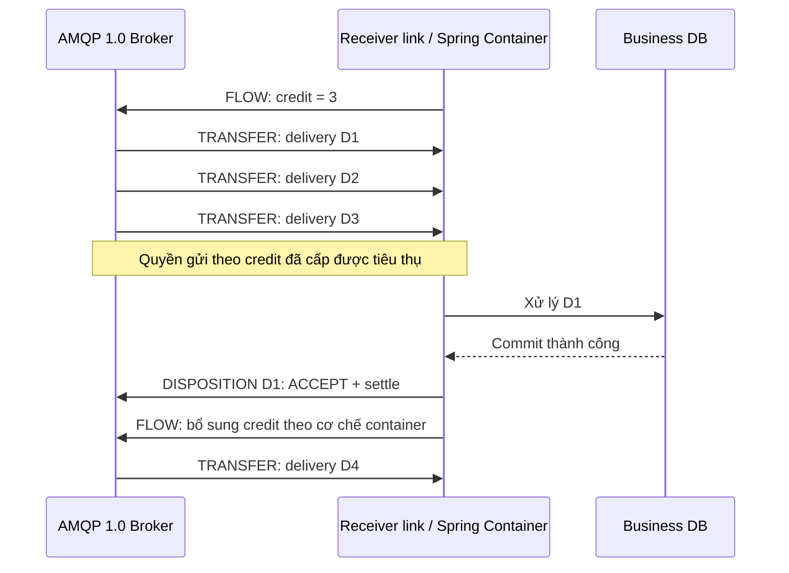
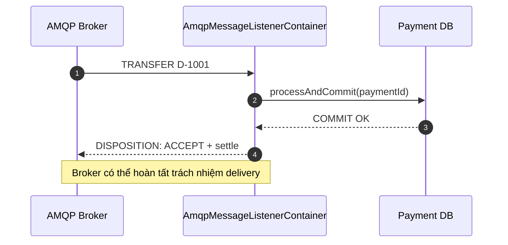
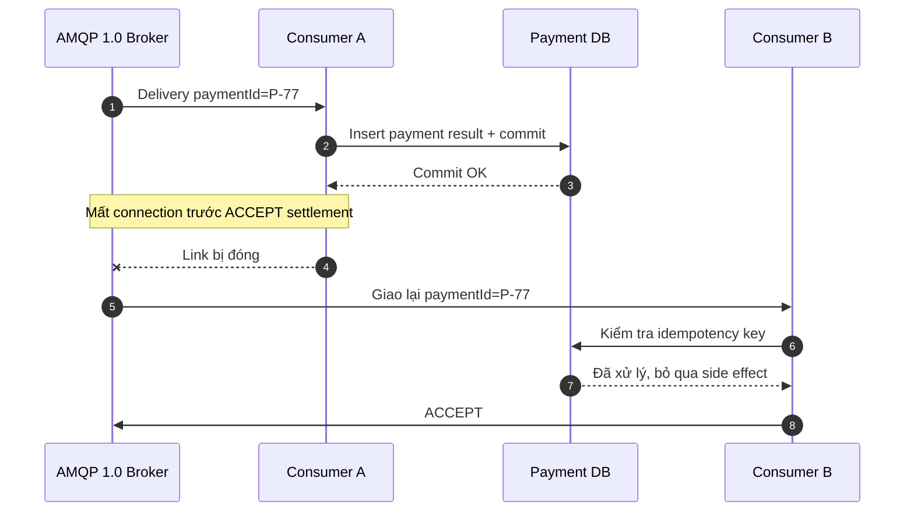

# AmqpMessageListenerContainer, link credit và settlement thủ công

## 1. Bối cảnh: xử lý message qua AMQP 1.0 không phải chỉ đổi tên ACK

Trong module **SPRING_AMQP**, chúng ta đã dùng `RabbitTemplate`, `@RabbitListener`, exchange, queue và binding để xây dựng các luồng xử lý bất đồng bộ với RabbitMQ. Khi chuyển sang **AMQP 1.0**, nhiều khái niệm vẫn quen thuộc — producer, consumer, message, định tuyến, retry và xác nhận giao nhận — nhưng giao thức và API cụ thể khác đáng kể so với AMQP 0-9-1.

Bài này tập trung vào ba thành phần có quan hệ trực tiếp:

1. **`AmqpMessageListenerContainer`** — container của Spring AMQP dùng consumer AMQP 1.0.
2. **Link credit** — cơ chế flow control của AMQP 1.0, quyết định receiver cho phép sender chuyển thêm bao nhiêu delivery trên một link.
3. **Manual settlement** — cách consumer chủ động xác nhận delivery thành công, từ chối hoặc yêu cầu giao lại sau khi biết kết quả xử lý nghiệp vụ.

Ví dụ dịch vụ Thanh toán tiêu thụ message từ địa chỉ `/queues/payment.commands`. Khi xử lý thành công và transaction đã commit, nó đánh dấu delivery **ACCEPT**. Khi payload sai vĩnh viễn, nó **REJECT**. Khi downstream tạm lỗi, nó có thể **REQUEUE** theo chính sách có giới hạn. Trong suốt quá trình này, link credit điều tiết lượng message được chuyển đến consumer.

**Điểm khác quan trọng:** trong mô hình AMQP 1.0 generic, ta không gọi `com.rabbitmq.client.Channel.basicAck(deliveryTag, false)`. Thay vào đó, Spring cung cấp `AmqpAcknowledgment` hoặc ứng dụng làm việc trực tiếp với native AMQP 1.0 delivery. Giao thức AMQP 1.0 sử dụng **link, credit và delivery state/settlement**, không dùng channel delivery tag giống API AMQP 0-9-1.

### Mục tiêu học tập

Sau bài học, bạn có thể:

- Tạo container AMQP 1.0 với `AmqpConnectionFactory`, đăng ký `MessageListener`, cấu hình địa chỉ, concurrency và initial credits.
- Giải thích sự khác nhau giữa **credit cấp quyền nhận**, **message đã được giao**, **message đang xử lý** và **delivery đã settled**.
- Sử dụng `setAutoAccept(false)` và `MessageProperties.getAmqpAcknowledgment()` để settle sau khi hoàn tất nghiệp vụ.
- Phân biệt `AmqpAcknowledgment.Status.ACCEPT`, `REJECT` và `REQUEUE`, kể cả rủi ro retry vô hạn.
- Dùng `pause()`/`resume()` để giảm hoặc khôi phục flow, điều chỉnh `initialCredits` và `consumersPerQueue`.
- Nhận biết lỗi do link/session, xử lý recovery và duy trì idempotency khi broker giao lại message.
- Phân biệt API **generic AMQP 1.0** với hai API quen thuộc khác của hệ sinh thái Spring.

## 2. Chọn đúng thư viện và listener container

Trong Spring AMQP hiện đại có **ba nhánh tích hợp cần tránh nhầm**:

| Nhánh | Module / client | Container nhận message | Annotation |
|---|---|---|---|
| RabbitMQ **AMQP 0-9-1** truyền thống | `spring-rabbit` / RabbitMQ Java Client | `SimpleMessageListenerContainer`, `DirectMessageListenerContainer` | `@RabbitListener` |
| **Generic AMQP 1.0** dùng được với nhiều broker | `spring-amqp-client` / Apache Qpid ProtonJ2 | **`AmqpMessageListenerContainer`** | **`@AmqpListener`** |
| **RabbitMQ-specific AMQP 1.0** | `spring-rabbitmq-client` / RabbitMQ AMQP 1.0 Java Client | `RabbitAmqpListenerContainer` | `@RabbitListener` với factory AMQP 1.0 phù hợp |

**Phạm vi và phiên bản của bài:** `AmqpMessageListenerContainer` thuộc **`spring-amqp-client`, được giới thiệu từ Spring AMQP 4.1**, dựa trên **Qpid ProtonJ2**. Các đoạn code chính bên dưới được mô tả theo nhánh Spring AMQP 4.1+ và Spring Boot có tích hợp generic AMQP 1.0 tương ứng. Không sao chép code này nguyên xi vào dự án Spring AMQP 3.x rồi mặc định sẽ biên dịch.

Module `spring-rabbitmq-client` (có `RabbitAmqpListenerContainer`, `RabbitAmqpTemplate`, `RabbitAmqpListenerContainerFactory`) cũng nói AMQP 1.0 nhưng dùng **các kiểu Java và factory khác**. `setAutoSettle(false)` của nhánh RabbitMQ-specific không phải `setAutoAccept(false)` của nhánh generic; dù mục tiêu đều là settlement thủ công, không trộn các class/bean thuộc hai module.

### 2.1. AMQP 1.0 và RabbitMQ Streams cũng khác nhau

RabbitMQ Stream có giao thức và consumer cursor/offset riêng, tích hợp Spring qua `StreamListenerContainer` và `StreamRabbitListenerContainerFactory`. Nó không phải AMQP 1.0 generic consumer. 

- **AMQP 1.0:** receiver link cấp credit, delivery được settle theo trạng thái; message từ queue được broker quản lý theo semantics của queue/đích.
- **RabbitMQ Stream:** append-only log, retention, consumer offset và replay; lưu offset **không xóa message** như ACK một queue truyền thống.
- **AMQP 0-9-1:** `basic.qos`/prefetch và `basicAck/basicNack` trên channel.

Các bài toán đáng tin cậy đều cần idempotency và retry hợp lý, nhưng **không thể thay thế API delivery giữa ba loại**.

## 3. Link, receiver, delivery và credit

AMQP 1.0 dùng **connection** chứa các **session**, trên mỗi session có các **link**. Một receiver link là đầu nhận message; một sender link là đầu gửi. Với consumer, broker đóng vai sender trên link, còn ứng dụng đóng vai receiver.



### 3.1. Credit có ý nghĩa gì?

**Một link credit** là quyền mà receiver cấp cho sender để chuyển một delivery trên link đó. Khi broker gửi delivery, số credit chưa sử dụng giảm. Nếu receiver không còn credit, sender không được tùy ý tiếp tục đẩy delivery trên link. Đây là cơ chế **flow control dựa trên tín dụng**, giúp receiver điều tiết lượng công việc.

Nếu receiver cấp 20 credits, broker có thể chuyển tối đa lượng delivery tương ứng với quyền đã cấp trước khi nhận thêm credit. Con số này **không có nghĩa** ứng dụng có 20 thread; cũng **không có nghĩa** đã settle 20 delivery.

| Trạng thái | Broker đã chuyển payload? | Đã giải phóng trách nhiệm delivery? |
|---|---|---|
| Credit còn sẵn | Chưa nhất thiết | Không liên quan, mới là quyền gửi |
| Delivery đến ứng dụng | Có | Chưa chắc |
| Handler đã bắt đầu gọi DB | Có | Chưa |
| DB commit thành công | Có | Chưa, cho đến khi settlement được ghi nhận |
| Delivery được ACCEPT/settled | Có | Có theo cơ chế và thời điểm settlement |
| Delivery chưa settle khi connection/link mất | Có thể đã chuyển | Có thể bị giao lại, tùy outcome broker |

**Credit và settlement là hai chiều điều khiển liên quan nhưng không đồng nghĩa.** Credit quyết định *có thể nhận thêm bao nhiêu*; settlement trả lời *delivery trước đó đã được xử lý như thế nào*.

### 3.2. Initial credits và bổ sung credit trong Spring

`AmqpMessageListenerContainer` mặc định dùng **100 initial credits cho receiver link**. Khi delivery được settle, container có cơ chế bổ sung credit để có thể tiếp tục nhận delivery mới. Bạn có thể đổi giá trị ban đầu bằng `setInitialCredits(int)`.

Ví dụ:

```java
container.setInitialCredits(20);
```

Dùng credit thấp có thể giới hạn số message được chuyển trước khi consumer hoàn thành việc xử lý và giải phóng quyền nhận tiếp. Nhưng credit quá thấp cũng có thể làm tăng thời gian chờ và giảm throughput nếu network round-trip/settlement chậm.

Trên giao thức, **credits không phải danh sách các message đã ACK**. Không nên tìm `deliveryTag` kiểu 0-9-1 hoặc gọi `basicQos` trên container AMQP 1.0 generic.

### 3.3. Concurrency làm thay đổi tổng số link

Container cung cấp `setConsumersPerQueue(int)`; mặc định **1 consumer cho mỗi địa chỉ**. Mỗi consumer nội bộ dùng receiver/link của riêng nó. Nếu có hai địa chỉ, mỗi địa chỉ có ba consumer, và mỗi receiver có 20 initial credits, tổng số quyền gửi ban đầu có thể được phân bổ trên nhiều link tới cỡ:

\[
2 \text{ địa chỉ} \times 3 \text{ receiver/địa chỉ} \times 20 \text{ credit/receiver} = 120
\]

Đây **không phải** cam kết đúng 120 message sẽ đồng thời xử lý hoặc nhận được; nó chỉ giúp ước lượng cửa sổ nhận khi broker có đủ message và có nhiều link hoạt động. Delivery timing, replenishment, ứng dụng và loại đích quyết định trạng thái thực tế.

Nếu mỗi receiver được xử lý bởi một tác vụ và việc xử lý DB mất vài giây, tăng đồng thời từ 1 lên 10 consumer trên một queue có thể tăng tổng in-flight và áp lực lên database. Concurrency cũng có thể làm **thứ tự hoàn tất** khác thứ tự delivery.

## 4. Cấu hình Spring Boot cho generic AMQP 1.0

Ví dụ sử dụng **Spring Boot 4.x tương thích Spring AMQP 4.1+**, Java 17+ hoặc phiên bản Java theo yêu cầu của BOM thực tế và một AMQP 1.0 broker khả dụng. Với Spring Boot phiên bản mới hỗ trợ generic AMQP 1.0, starter là:

```xml
<dependency>
    <groupId>org.springframework.boot</groupId>
    <artifactId>spring-boot-starter-amqp</artifactId>
</dependency>
```

Nếu **không dùng** starter phù hợp và phải khai báo thủ công, dependency Spring AMQP generic tương ứng là:

```xml
<dependency>
    <groupId>org.springframework.amqp</groupId>
    <artifactId>spring-amqp-client</artifactId>
</dependency>
```

Phiên bản nên được quản lý bằng **BOM tương thích** thay vì tự trộn `spring-amqp-client` mới với `spring-amqp` cũ.

### 4.1. application.yml

```yaml
spring:
  amqp:
    host: localhost
    port: 5672
    username: ${AMQP_USERNAME}
    password: ${AMQP_PASSWORD}
```

Đây là cấu hình của **generic AMQP 1.0** dưới namespace `spring.amqp.*`. Không nhầm với `spring.rabbitmq.*` thường dùng cho AMQP 0-9-1, hoặc `spring.amqp.rabbitmq.*` của nhánh RabbitMQ-specific AMQP 1.0.

Với RabbitMQ, địa chỉ có dạng **`/queues/payment.commands`** là quy tắc AMQP 1.0 address dành cho queue; đây là ví dụ **đặc thù địa chỉ của RabbitMQ**, không phải tên đích phổ quát của mọi AMQP 1.0 broker. Khi đổi sang ActiveMQ hoặc một AMQP 1.0 broker khác, kiểm tra conventions về destination address và routing tương ứng.

Bạn có thể cấu hình `AmqpConnectionFactory` thủ công khi không dùng auto-configuration:

```java
import org.springframework.amqp.client.AmqpConnectionFactory;
import org.springframework.amqp.client.SingleAmqpConnectionFactory;
import org.springframework.context.annotation.Bean;
import org.springframework.context.annotation.Configuration;

@Configuration
public class GenericAmqpConnectionConfig {

    @Bean
    AmqpConnectionFactory amqpConnectionFactory() {
        // Dùng mặc định localhost:5672.
        // Production: cấu hình host, credentials, TLS và recovery từ bên ngoài.
        return new SingleAmqpConnectionFactory();
    }
}
```

**Không** khai báo đồng thời với auto-configured factory mà không chủ ý về lựa chọn bean. Với Spring Boot, ưu tiên cấu hình `spring.amqp.*` và sử dụng `AmqpConnectionFactory` được tự tạo.

### 4.2. Gửi message thử bằng AmqpClient

`AmqpClient` là API generic AMQP 1.0 để gửi/nhận theo `CompletableFuture`. Thông thường Spring Boot có thể tự cấu hình client khi dependency phù hợp được nạp.

```java
import java.util.concurrent.CompletableFuture;
import org.springframework.amqp.client.AmqpClient;
import org.springframework.stereotype.Service;

@Service
public class PaymentCommandPublisher {
    private final AmqpClient client;

    public PaymentCommandPublisher(AmqpClient client) {
        this.client = client;
    }

    public CompletableFuture<Boolean> publish(String paymentId) {
        return client.to("/queues/payment.commands")
                .body(paymentId)
                .messageId("payment-command:" + paymentId)
                .send();
    }
}
```

Ứng dụng phải **quan sát kết quả future và xử lý lỗi**. Một lần gọi `send()` trả về không đồng nghĩa broker đã xử lý thành công. Khi future timeout hoặc kết nối mất, có thể không biết chính xác broker đã nhận chưa: retry cùng message ID và consumer idempotent là thiết kế thường dùng.

Trong bài này, queue đích `payment.commands` giả định đã được provision bền vững trên broker. Đừng trộn AMQP 0-9-1 `RabbitAdmin` vào ví dụ trừ khi hạ tầng được thiết kế dùng hai giao thức; topology có thể tạo ngoài qua IaC, RabbitMQ management hoặc API quản trị phù hợp.

## 5. Tạo AmqpMessageListenerContainer trực tiếp

Container trực tiếp thích hợp khi bạn muốn đăng ký `MessageListener` bằng code, kiểm soát receive timeout, manual settlement, số receiver hoặc lifecycle.

```java
import java.nio.charset.StandardCharsets;
import java.time.Duration;

import org.springframework.amqp.client.AmqpConnectionFactory;
import org.springframework.amqp.client.listener.AmqpMessageListenerContainer;
import org.springframework.amqp.core.AmqpAcknowledgment;
import org.springframework.amqp.core.Message;
import org.springframework.context.annotation.Bean;
import org.springframework.context.annotation.Configuration;

@Configuration
public class PaymentAmqpContainerConfig {

    @Bean
    AmqpMessageListenerContainer paymentListenerContainer(
            AmqpConnectionFactory connectionFactory,
            PaymentCommandService paymentService) {

        AmqpMessageListenerContainer container =
                new AmqpMessageListenerContainer(connectionFactory);

        container.setQueueNames("/queues/payment.commands");
        container.setConsumersPerQueue(2);
        container.setInitialCredits(20);
        container.setAutoAccept(false);
        container.setReceiveTimeout(Duration.ofSeconds(1));
        container.setRecoveryInterval(Duration.ofSeconds(5));

        container.setupMessageListener((Message message) -> {
            AmqpAcknowledgment acknowledgment = message
                    .getMessageProperties()
                    .getAmqpAcknowledgment();

            if (acknowledgment == null) {
                // Không được coi là đã quản lý settlement thủ công.
                throw new IllegalStateException(
                        "Thiếu AmqpAcknowledgment: kiểm tra autoAccept");
            }

            String paymentId = new String(
                    message.getBody(), StandardCharsets.UTF_8);

            AmqpAcknowledgment.Status outcome;
            try {
                paymentService.processAndCommit(paymentId);
                outcome = AmqpAcknowledgment.Status.ACCEPT;
            }
            catch (NonRetryablePaymentException invalid) {
                // Sai dữ liệu vĩnh viễn: không nên retry mù quáng.
                outcome = AmqpAcknowledgment.Status.REJECT;
            }
            catch (TransientPaymentException temporary) {
                // Chỉ phù hợp khi có chính sách retry có giới hạn.
                outcome = AmqpAcknowledgment.Status.REQUEUE;
            }

            acknowledgment.acknowledge(outcome);
        });

        return container;
    }
}
```

Đây là **khung tích hợp**. `PaymentCommandService`, `NonRetryablePaymentException`, `TransientPaymentException` do ứng dụng triển khai. Service phải phân loại lỗi đáng tin cậy; cần thêm chính sách cho các lỗi không nằm trong hai kiểu trên (ví dụ alert, dừng consumer hoặc phục hồi có giới hạn). Không coi ví dụ là giải pháp retry production hoàn chỉnh.

### 5.1. Ý nghĩa mỗi cấu hình

| Cấu hình | Tác dụng |
|---|---|
| `new AmqpMessageListenerContainer(factory)` | Tạo consumer AMQP 1.0 từ `AmqpConnectionFactory` generic |
| `setQueueNames("/queues/payment.commands")` | Đặt AMQP 1.0 address/queue cần subscribe |
| `setConsumersPerQueue(2)` | Tạo hai receiver/consumer cho mỗi address |
| `setInitialCredits(20)` | Cấp cửa sổ credit ban đầu trên receiver link |
| `setAutoAccept(false)` | Không auto-accept; cấp `AmqpAcknowledgment` cho callback |
| `setReceiveTimeout(Duration.ofSeconds(1))` | Thời gian chờ cho một lần `Receiver.receive()` |
| `setRecoveryInterval(Duration.ofSeconds(5))` | Khoảng thời gian giữa những lần thử khôi phục receiver link thất bại |
| `setupMessageListener(...)` | Đăng ký callback nhận `org.springframework.amqp.core.Message` |

`receiveTimeout` **không phải timeout cho công việc nghiệp vụ**. Nếu `processAndCommit` gọi API ngoài 30 giây, `receiveTimeout=1s` không tự hủy công việc đó.

### 5.2. Tại sao settle sau khi commit?



Nếu gọi `acknowledgment.acknowledge()` **trước** transaction, rồi ứng dụng chết trước khi DB commit, delivery có thể đã bị settle thành công và broker không còn cơ sở giao lại.

Thứ tự **commit DB → ACCEPT** giảm nguy cơ mất xử lý, nhưng vẫn có cửa sổ khác: DB commit xong, container crash trước khi broker nhận settlement. Message có thể được giao lại. Vì vậy `processAndCommit` phải **idempotent** (ví dụ một unique key trên `paymentId` hoặc `eventId` trong cùng transaction).

### 5.3. Tránh settle hai lần

Một delivery phải có quyết định settlement rõ ràng. Không làm kiểu này:

```java
try {
    service.processAndCommit(paymentId);
    ack.acknowledge(); // ACCEPT
}
catch (Exception ex) {
    // Nguy hiểm nếu exception phát sinh khi gửi ACCEPT
    // hoặc service đã commit: cố REQUEUE có thể settle lần hai.
    ack.acknowledge(AmqpAcknowledgment.Status.REQUEUE);
}
```

Hãy **tách xác định kết quả nghiệp vụ** khỏi **lệnh settlement**:

```java
AmqpAcknowledgment.Status decision = decideOutcome(paymentId);
ack.acknowledge(decision);
```

Trong đó `decideOutcome(...)` là logic nghiệp vụ được thiết kế riêng. Nếu lệnh settlement ném exception do link lỗi, **không mù quáng gửi settlement thứ hai**; kết quả phía broker có thể không xác định và delivery sẽ cần được giải quyết qua cơ chế reconnect/redelivery.

### 5.4. Giới hạn khi dùng callback bất đồng bộ

Nếu listener chỉ chuyển việc cho `Executor` rồi **return**, nhưng không có một bước settlement sau khi công việc thật sự hoàn tất, delivery có thể treo (khi `autoAccept=false`), hoặc bị ACCEPT sớm (khi `autoAccept=true`).

Nếu ứng dụng tự chuyển `AmqpAcknowledgment` sang thread khác, phải kiểm tra **thread-safety, vòng đời receiver link và session** của client/phiên bản đang dùng. Không giữ acknowledgment qua lần mất link rồi cố settle trên link mới như thể nó là cùng delivery. Cách đơn giản để học và kiểm soát kết quả là xử lý/commit đồng bộ trong callback, settle ngay sau đó.

Khi cần throughput cao, cân nhắc thêm consumer theo số link, giảm I/O của handler, hoặc xây pipeline async có cơ chế theo dõi completion và settlement đúng vòng đời. Đừng tăng credit vô hạn để che lấp bottleneck trong database.

## 6. Ý nghĩa của ACCEPT, REJECT và REQUEUE

Spring AMQP cung cấp `org.springframework.amqp.core.AmqpAcknowledgment`. Giao diện có:

```java
void acknowledge(AmqpAcknowledgment.Status status);

// Mặc định:
void acknowledge();  // tương đương trạng thái chấp nhận.
```

Ba trạng thái enum:

| `Status` | Mục đích | Diễn giải và yêu cầu |
|---|---|---|
| **`ACCEPT`** | Đánh dấu message xử lý thành công | Chỉ sau khi công việc/commit đã hoàn tất theo hợp đồng |
| **`REJECT`** | Từ chối delivery | Dùng cho lỗi không thể xử lý; đích/queue có thể dead-letter **nếu** broker/policy hỗ trợ và được cấu hình |
| **`REQUEUE`** | Từ chối và yêu cầu giao lại | Dùng có kiểm soát cho lỗi tạm thời; có nguy cơ vòng lặp nếu không giới hạn |

Ở cấp AMQP 1.0, settlement là **delivery disposition**; mapping chính xác tới hành vi của broker và policy có thể phụ thuộc implementation. Đừng đồng nhất toàn bộ semantics này với `basicNack(tag, false, requeue)` của AMQP 0-9-1.

### 6.1. Trường hợp 1: giao dịch thành công → ACCEPT

```java
paymentService.processAndCommit(paymentId);
acknowledgment.acknowledge(AmqpAcknowledgment.Status.ACCEPT);
```

Nếu DB đã nhận diện `paymentId` từng xử lý thành công, consumer có thể bỏ qua side effect và vẫn ACCEPT delivery trùng.

### 6.2. Trường hợp 2: payload sai vĩnh viễn → REJECT

```java
if (paymentId.isBlank()) {
    acknowledgment.acknowledge(AmqpAcknowledgment.Status.REJECT);
    return;
}
```

REJECT thể hiện ứng dụng không chấp nhận xử lý payload hiện tại. Với RabbitMQ, message có vào DLQ hay không còn phụ thuộc cấu hình queue/exchange, DLX và semantics của đường reject. Nếu cần bảo toàn thông tin lỗi, lưu một bản **error report bền vững** hoặc kiểm chứng DLQ trước khi chấp nhận discard.

### 6.3. Trường hợp 3: lỗi tạm thời → REQUEUE có giới hạn

```java
catch (TransientPaymentException ex) {
    acknowledgment.acknowledge(AmqpAcknowledgment.Status.REQUEUE);
}
```

**Không áp dụng đoạn này vô điều kiện trong production**. Nếu broker giao ngay lại message và lỗi vẫn tồn tại, nó có thể tạo **hot loop**, gây cạn tài nguyên, chiếm link credit và cản trở message khác.

Một giải pháp đáng tin cậy phải có policy rõ:

- Số lần thử tối đa hoặc deadline.
- Backoff có giới hạn, ưu tiên delayed retry nếu broker/topology hỗ trợ.
- Phân loại lỗi nghiệp vụ vĩnh viễn và lỗi hạ tầng tạm thời.
- Sau khi hết lượt, đưa message vào nơi xử lý lỗi bền vững (DLQ, error store hoặc parking).
- Khóa idempotency để một delivery bị gửi lại không tạo side effect lặp.

Cờ redelivery hoặc tên delivery **không thay thế** bộ đếm attempt đáng tin cậy. Cần dựa vào metadata retry được bảo quản đúng, record trong DB hoặc cơ chế mà broker cung cấp.

### 6.4. Auto accept và manual settle

| Cấu hình | Ai đưa quyết định settlement? | Rủi ro |
|---|---|---|
| `autoAccept=true` (mặc định) | Container quản lý accept/đường xử lý lỗi theo kết quả listener | Nếu listener fire-and-forget rồi trả về, có thể xác nhận sớm |
| `autoAccept=false` | Ứng dụng qua `AmqpAcknowledgment`, hoặc native listener tự xử lý | Quên settle khiến delivery còn unsettled; credit/backpressure và recovery bị ảnh hưởng |

**Đừng cấu hình `autoAccept=false` rồi chỉ đặt message vào `BlockingQueue` trong bộ nhớ mà không có consumer khác settle nó.** Điều này có thể làm các delivery mắc ở trạng thái unsettled và không có thêm credit để nhận message mới.

## 7. Native ProtonDeliveryListener khi cần kiểm soát sâu

Nếu cần quyền truy cập vào **ProtonJ2 native delivery**, Spring AMQP cung cấp giao diện `ProtonDeliveryListener`. Ví dụ chỉ về cách đăng ký kiểu listener:

```java
import org.springframework.amqp.client.AmqpConnectionFactory;
import org.springframework.amqp.client.listener.AmqpMessageListenerContainer;
import org.springframework.amqp.client.listener.ProtonDeliveryListener;
import org.springframework.context.annotation.Bean;

@Bean
AmqpMessageListenerContainer nativeContainer(
        AmqpConnectionFactory factory, NativeDeliveryHandler handler) {

    AmqpMessageListenerContainer container =
            new AmqpMessageListenerContainer(factory);

    container.setQueueNames("/queues/native.events");
    container.setAutoAccept(false);

    container.setupMessageListener(
            (ProtonDeliveryListener) handler::onDelivery);

    return container;
}
```

Ở đây `NativeDeliveryHandler` là thành phần ứng dụng do bạn tự định nghĩa, có method nhận native `org.apache.qpid.protonj2.client.Delivery`; method phải xử lý settlement của native delivery phù hợp với ProtonJ2.

**Khác biệt rất quan trọng:** khi `autoAccept=false` với `ProtonDeliveryListener`, trách nhiệm không chỉ là **settle delivery** mà còn có thể bao gồm **replenish link credits** theo contract native. Container không thể suy ra kết quả từ `AmqpAcknowledgment` như nhánh Spring `MessageListener` thông thường.

Tránh dùng native listener nếu chỉ cần nhận payload và settle ba trạng thái cơ bản; `org.springframework.amqp.core.MessageListener` và `AmqpAcknowledgment` thường đơn giản, dễ kiểm thử hơn. Chỉ dùng native contract nếu bạn thực sự cần xử lý body stream, delivery metadata, settlement hoặc flow control cấp thấp.

## 8. @AmqpListener và MethodAmqpMessageListenerContainerFactory

Việc tạo container trực tiếp không phải cách duy nhất. Generic AMQP 1.0 có `@EnableAmqp` và **`@AmqpListener`**. Không dùng nhầm `@RabbitListener` của RabbitMQ-specific AMQP 1.0 hoặc AMQP 0-9-1 khi mục tiêu là `spring-amqp-client`.

### 8.1. Khai báo factory

```java
import java.time.Duration;
import org.springframework.amqp.client.AmqpConnectionFactory;
import org.springframework.amqp.client.annotation.EnableAmqp;
import org.springframework.amqp.client.config.MethodAmqpMessageListenerContainerFactory;
import org.springframework.context.annotation.Bean;
import org.springframework.context.annotation.Configuration;

@Configuration
@EnableAmqp
public class GenericAmqpListenerFactoryConfig {

    @Bean("paymentAmqpFactory")
    MethodAmqpMessageListenerContainerFactory paymentAmqpFactory(
            AmqpConnectionFactory connectionFactory) {

        MethodAmqpMessageListenerContainerFactory factory =
                new MethodAmqpMessageListenerContainerFactory(
                        connectionFactory);

        factory.setAutoAccept(false);
        factory.setConcurrency(2);
        factory.setInitialCredits(20);
        factory.setReceiveTimeout(Duration.ofSeconds(1));
        factory.setDefaultRequeueRejected(false);

        return factory;
    }
}
```

Factory tạo container cho từng endpoint; `@AmqpListener` chỉ định địa chỉ bằng `addresses`. Thuộc tính `concurrency` trên factory là số receiver consumer tương ứng cho mỗi địa chỉ trong mô hình này. Không phải số thread chạy business handler song song không giới hạn.

### 8.2. Listener annotation xử lý thủ công

```java
import java.nio.charset.StandardCharsets;
import org.springframework.amqp.client.annotation.AmqpListener;
import org.springframework.amqp.core.AmqpAcknowledgment;
import org.springframework.amqp.core.Message;
import org.springframework.stereotype.Component;

@Component
public class PaymentAnnotatedListener {
    private final PaymentCommandService paymentService;

    public PaymentAnnotatedListener(PaymentCommandService paymentService) {
        this.paymentService = paymentService;
    }

    @AmqpListener(
            addresses = "/queues/payment.commands",
            containerFactory = "paymentAmqpFactory",
            id = "paymentGenericAmqpListener")
    public void receive(Message message) {
        AmqpAcknowledgment ack = message
                .getMessageProperties()
                .getAmqpAcknowledgment();

        if (ack == null) {
            throw new IllegalStateException(
                    "Listener chưa được cấu hình manual settlement");
        }

        String paymentId = new String(
                message.getBody(), StandardCharsets.UTF_8);

        AmqpAcknowledgment.Status decision;
        try {
            paymentService.processAndCommit(paymentId);
            decision = AmqpAcknowledgment.Status.ACCEPT;
        }
        catch (NonRetryablePaymentException ex) {
            decision = AmqpAcknowledgment.Status.REJECT;
        }
        catch (TransientPaymentException ex) {
            decision = AmqpAcknowledgment.Status.REQUEUE;
        }

        ack.acknowledge(decision);
    }
}
```

**Chú ý khi chạy:** listener trực tiếp ở mục 5 và listener annotation ở mục 8 là **hai phương án thay thế** trên cùng `/queues/payment.commands`. Nếu bật cả hai, broker có thể phân phối message cho hai consumer, gây khó kiểm tra. Hãy chạy một phương án tại một thời điểm để hiểu chính xác settlement và credit.

`setDefaultRequeueRejected(false)` ở factory ảnh hưởng hành vi khi một listener **ném exception** và container/adapter xử lý exception; nó **không thay thế** yêu cầu gọi `ack.acknowledge(...)` cho mọi nhánh nghiệp vụ khi `autoAccept=false`. Nếu code đã settle rồi lại ném lỗi, có nguy cơ framework cố xử lý lại một delivery đã settled; hãy thiết kế đường trả về rõ ràng.

### 8.3. Vì sao @AmqpListener khác @RabbitListener?

- `@AmqpListener` từ package `org.springframework.amqp.client.annotation`, dùng generic AMQP 1.0 factory và registry.
- `@RabbitListener` từ package `org.springframework.amqp.rabbit.annotation`, dùng Rabbit-specific factory theo cấu hình dự án.
- `MethodAmqpMessageListenerContainerFactory` khác `SimpleRabbitListenerContainerFactory`/`DirectRabbitListenerContainerFactory` của AMQP 0-9-1.
- Khi đọc ví dụ có `ackMode="MANUAL"` và `Channel.basicAck`, hãy nhận diện nó thường áp dụng cho nhánh AMQP 0-9-1, **không** tự chuyển sang `AmqpMessageListenerContainer`.

Generic AMQP 1.0 cũng có thể hỗ trợ kiểu trả về bất đồng bộ như `CompletableFuture`/`Mono` qua annotation adapter. Tuy vậy, nếu dùng manual settlement, phải kiểm tra chính xác hợp đồng của adapter và version: **không assume** listener `void` trả về sau khi launch job thì framework sẽ đợi job xong.

## 9. Pause/resume: điều tiết dòng message bằng credit

Container có API `pause()` và `resume()`, và các biến thể theo address:

```java
container.pause();                         // Pause tất cả consumers.
container.resume();                        // Resume tất cả consumers.
container.pause("/queues/payment.commands");
container.resume("/queues/payment.commands");
```

Spring AMQP triển khai pause bằng cách **đặt link credit về 0**, resume bổ sung credit tương ứng. Receiver link vẫn tồn tại; pause không có nghĩa đóng link hoặc dừng toàn bộ container.

### 9.1. Pause khác stop

| Hành động | Link/consumer | Delivery đang xử lý | Nhận message mới |
|---|---|---|---|
| `pause()` | Giữ receiver link | Không tự rollback/hủy công việc đang chạy | Ngừng cấp quyền nhận tiếp sau khi flow được áp dụng |
| `resume()` | Tiếp tục dùng link đang có | Xử lý đang chạy vẫn theo hợp đồng | Bổ sung credit để có thêm delivery |
| `stop()` | Dừng consumer/container theo lifecycle | Cần graceful shutdown, settlement và xử lý in-flight | Consumer dừng; chưa settled có thể được redeliver |
| Đóng connection đột ngột | Link/session bị hủy | Không có bảo đảm commit nghiệp vụ | Broker có thể giao lại delivery chưa settle |

Pause là **backpressure mềm**, hữu ích khi DB gặp tải đột biến hoặc khi cần tạm giảm tiếp nhận. Nó không tự hủy callback đã chạy, không ngắt một transaction đang xử lý và không bảo đảm mọi delivery đang bay trên network biến mất lập tức; cần tính cả in-flight và credit đã được broker sử dụng trước khi pause có hiệu lực.

### 9.2. Ví dụ điều tiết khi downstream quá tải

Một chính sách có thể là:

```text
Nếu DB pool utilization > 90% trong 30 giây:
    pause consumer của payment.commands
Khi DB pool utilization < 65% đủ 60 giây:
    resume
```

Các giá trị trên **là đề xuất giả lập để thực hành**, không phải mặc định của Spring AMQP. Trong production cần hysteresis, giới hạn thời gian pause, cảnh báo và hành vi khi metrics không khả dụng để tránh pause/resume liên tục.

Khi downstream phục hồi, resume làm các receiver có thêm credit. Nếu có nhiều replica ứng dụng, mỗi replica có container và flow riêng; pause của một instance không dừng toàn bộ những consumer khác.

## 10. Receive timeout, task executor và link recovery

### 10.1. Receive timeout không phải hạn chót công việc

`AmqpMessageListenerContainer` dùng `org.apache.qpid.protonj2.client.Receiver.receive()` theo vòng lặp. `setReceiveTimeout(Duration)` kiểm soát thời gian chờ của **một lần receive**, mặc định khoảng 1 giây theo tài liệu tham khảo.

Nếu handler mất 10 giây để commit DB, receive timeout 1 giây **không** làm handler bị timeout sau 1 giây. Đặt business timeout ở DB transaction, HTTP client hoặc workflow theo yêu cầu.

### 10.2. Task executor và mức độ đồng thời

Mỗi internal consumer của container chạy trên một `Executor`. Mặc định Spring dùng `SimpleAsyncTaskExecutor`; có thể truyền executor của ứng dụng qua `setTaskExecutor(...)`:

```java
import java.util.concurrent.Executor;
import java.util.concurrent.Executors;

Executor executor = Executors.newFixedThreadPool(4);
container.setTaskExecutor(executor);
```

Đây là **minh họa cấu hình**. Khi dùng `ExecutorService` tự tạo, phải quản lý shutdown của executor; ứng dụng Spring production nên dùng bean `ThreadPoolTaskExecutor` được Spring quản lý với số thread đủ cho số consumer, queue capacity hợp lý và graceful shutdown.

Đừng tạo `consumersPerQueue=20` nhưng executor có tối đa 2 thread rồi kỳ vọng cả 20 receiver sẽ nhận công việc đều đặn. Số consumer có thể tiến triển thực tế bị giới hạn bởi executor và resource của broker.

### 10.3. Nếu receiver link bị hỏng

Một receiver link có thể lỗi riêng dù connection đã hoặc sẽ tự khôi phục. Tài liệu Spring AMQP lưu ý ProtonJ2 client không tự khôi phục receiver link đã lỗi trong mọi trường hợp. Container có vòng phục hồi riêng:

- Báo lỗi cho `ErrorHandler` nếu được cấu hình, hoặc log lỗi.
- Tạo lại receiver link theo `recoveryBackOff`.
- Mặc định dùng khoảng retry cố định khoảng **5 giây** với số lần không giới hạn.
- `setRecoveryInterval(Duration)` là cách nhanh để thay khoảng giữa lần thử.
- Nếu custom `BackOff` hết lượt, consumer có thể bị dừng; khi không còn consumer nào, `isRunning()` có thể thành `false`.

Vì vậy monitor phải xem **trạng thái link/consumer**, không chỉ `connection up`. Mất link trong lúc DB commit hoặc settlement có thể làm delivery bị giao lại khi kết nối phục hồi.

### 10.4. Graceful shutdown

Khi deploy hoặc tắt ứng dụng:

1. Ngừng tiếp nhận mới bằng pause hoặc cơ chế dừng phù hợp.
2. Cho các callback đang chạy thời gian hoàn tất theo budget.
3. Settle những delivery đã hoàn thành theo đúng kết quả.
4. Dừng container và đóng connection/executor theo lifecycle.
5. Chuẩn bị cho redelivery các message chưa settle nếu shutdown buộc phải cắt ngang.

Container có `setGracefulShutdownPeriod(Duration)` để cấu hình thời gian chờ khi dừng. Không biến giới hạn này thành giả định rằng handler luôn hoàn tất trong thời gian đó; cần timeout riêng và idempotency.

## 11. Tính đúng đắn đầu cuối: settlement sau commit vẫn có thể duplicate

Xét sự cố:



**Settlement và transaction DB không nguyên tử.** Không tồn tại một cuộc gọi `acknowledge()` khiến RabbitMQ và database tự trở thành một transaction phân tán.

Để chịu được at-least-once delivery:

- Định nghĩa một **business/event ID ổn định**, ví dụ `paymentId` hoặc `commandId`.
- Trong cùng transaction, ghi dấu vết đã xử lý với unique constraint và cập nhật business state.
- Nếu một lần xử lý đã commit và message được giao lại, consumer nhận ra duplicate, không thực hiện side effect lần hai, rồi ACCEPT.
- Với API bên ngoài có side effect (thanh toán), sử dụng idempotency key của provider hoặc tra cứu trạng thái trước retry.
- Nếu consumer cần phát message tiếp theo sau DB commit, cân nhắc **transactional outbox**; sender confirm/settlement vẫn là các ranh giới riêng.

Ví dụ PostgreSQL:

```sql
CREATE TABLE processed_payment_commands (
    command_id VARCHAR(120) PRIMARY KEY,
    processed_at TIMESTAMPTZ NOT NULL DEFAULT now()
);

CREATE TABLE payment_projection (
    payment_id VARCHAR(120) PRIMARY KEY,
    status VARCHAR(40) NOT NULL
);
```

Một service có thể kiểm tra/chèn `command_id` và cập nhật `payment_projection` trong cùng transaction:

```java
import org.springframework.jdbc.core.JdbcTemplate;
import org.springframework.stereotype.Service;
import org.springframework.transaction.annotation.Transactional;

@Service
public class PaymentCommandService {
    private final JdbcTemplate jdbc;

    public PaymentCommandService(JdbcTemplate jdbc) {
        this.jdbc = jdbc;
    }

    @Transactional
    public void processAndCommit(String commandId) {
        int inserted = jdbc.update("""
            INSERT INTO processed_payment_commands(command_id)
            VALUES (?)
            ON CONFLICT (command_id) DO NOTHING
            """, commandId);

        if (inserted == 0) {
            return; // Duplicate: đã xử lý trong transaction trước.
        }

        jdbc.update("""
            INSERT INTO payment_projection(payment_id, status)
            VALUES (?, 'COMPLETED')
            ON CONFLICT (payment_id)
            DO UPDATE SET status = EXCLUDED.status
            """, commandId);
    }
}
```

Đây là **mẫu minh họa** chống trùng cho một trạng thái, chưa triển khai logic thanh toán thực tế. Trong production, việc ghi `COMPLETED` phải phản ánh kết quả thanh toán đáng tin cậy; không được đánh dấu hoàn tất trước khi provider hoặc DB nghiệp vụ thực sự xác nhận.

## 12. Lỗi vĩnh viễn, retry và dead-letter

Không phải mọi exception đều thích hợp để `REQUEUE`:

| Loại lỗi | Ví dụ | Quyết định hướng tới |
|---|---|---|
| Hợp đồng message sai | JSON sai, thiếu ID bắt buộc, schema không tương thích | `REJECT` hoặc lưu lỗi bền vững; có cảnh báo và phục hồi |
| Lỗi DB/network tạm thời | Connection timeout, HTTP 503 | Retry có backoff và giới hạn, sau đó chuyển đến error flow |
| Quá tải tài nguyên | Pool cạn, downstream 429 | Giảm initial credits, pause/resume, điều chỉnh concurrency và backoff |
| Side effect không rõ thành công chưa | API thanh toán timeout nhưng có thể đã thu tiền | Tra cứu trạng thái theo business ID trước khi retry |
| Mất link trước settlement | Connection/session/receiver hỏng | Reconnect, chấp nhận redelivery và dùng idempotency |
| Message độc làm lặp vô hạn | Cùng payload luôn lỗi | Giới hạn attempt, parking/DLQ hoặc manual inspection |

### 12.1. REJECT không bảo đảm có DLQ

Ở RabbitMQ, việc message bị dead-letter còn phụ thuộc queue source, cấu hình DLX, binding, routing key và điều kiện broker xử lý. Với một AMQP 1.0 broker khác, behavior có thể khác. **Đừng coi `REJECT` là API tạo DLQ tự động**.

Nếu yêu cầu **không mất thông tin lỗi**, hãy:

1. Kiểm chứng DLX hoặc luồng error store trên broker đích.
2. Nếu chuyển lỗi bằng application republish, chờ kết quả publish có ý nghĩa.
3. Chỉ settle message gốc khi đường lưu lỗi đạt ranh giới bền vững quy định.
4. Dùng event ID ổn định vì crash giữa “ghi lỗi” và “settle gốc” có thể tạo duplicate.
5. Giám sát số message lỗi, retry và tốc độ replay từ DLQ.

### 12.2. REQUEUE vô hạn sẽ phá backpressure

Link credit điều tiết tốc độ broker chuyển delivery tới consumer, nhưng nếu ứng dụng liên tục REQUEUE cùng message, nó vẫn có thể quay trở lại khi credit được bổ sung. Khi lỗi vĩnh viễn, xử lý lại mãi chỉ tiêu tốn CPU và làm chậm message lành.

Giải pháp không chỉ là giảm credit. Bạn còn phải thiết kế **ngưỡng retry**, **delay**, **phân loại lỗi** và một trạng thái cuối có thể phục hồi. Nếu cần ordering nghiêm ngặt cho cùng aggregate, việc đưa predecessor vào DLQ phải đi kèm cơ chế chặn/cách ly version sau, không âm thầm áp dụng vượt trước.

## 13. Quan sát và điều chỉnh theo chỉ số

### 13.1. Những gì nên đo

| Nhóm | Chỉ số |
|---|---|
| Kết nối/link | Connection up/down, session/link errors, số receiver active, số lần recovery |
| Flow control | Initial credits, link credit hiện tại nếu instrument được, số delivery đang unsettled, thời gian pause |
| Handler | Throughput, thời gian xử lý, tỷ lệ commit thành công, DB latency, executor queue |
| Settlement | Số ACCEPT/REJECT/REQUEUE, lỗi settlement, delivery bị redeliver |
| Reliability | Retry attempts, số poison message, độ sâu DLQ/error store, tuổi message lỗi |
| End-to-end | Thời gian từ publish đến business commit, SLA per message class |

Các giá trị **credit và unsettled** phải hiểu theo **receiver/link**; tổng hợp across consumers cần tránh đếm nhầm. Không giả định RabbitMQ Management UI expose đầy đủ AMQP 1.0 credit ở mọi phiên bản; có thể cần native client metrics hoặc application instrumentation.

Log nên chứa `messageId` hoặc `commandId`, AMQP address, listener ID, outcome, số attempt, thời điểm nhận/commit/settle và mã lỗi. Không log credential, token hay dữ liệu thanh toán nhạy cảm.

### 13.2. Tín hiệu chẩn đoán

| Triệu chứng | Nguyên nhân có thể | Kiểm tra |
|---|---|---|
| Container running nhưng không nhận message | Không còn credit, đang pause, sai address hoặc broker không có message | Receiver link, credit, `pause()`, address `/queues/...` |
| Nhận một số message rồi đứng | `autoAccept=false` nhưng listener quên settle | Pending delivery, đường exception, `getAmqpAcknowledgment()` |
| DB xử lý xong nhưng message trở lại | Link chết trước settlement hoặc settle timeout | Log commit/settlement, idempotency, recovery |
| REQUEUE lặp và CPU tăng | Lỗi dữ liệu nhưng retry vô hạn | Phân loại lỗi, backoff, ngưỡng cuối |
| Tăng consumer khiến DB quá tải | Nhiều link và initial credits làm tăng in-flight | `consumersPerQueue`, `initialCredits`, DB pool |
| Pause rồi vẫn thấy callback đang chạy | Delivery đã in-flight trước pause | Flow không hủy công việc đang chạy |
| Không khôi phục consumer sau lỗi | Receiver link mất; backoff hết lượt hoặc lỗi quyền | `recoveryBackOff`, `ErrorHandler`, `isRunning()` |
| Gọi basicAck không hoạt động | Nhầm API AMQP 0-9-1 với generic AMQP 1.0 | Module, container và `AmqpAcknowledgment` |
| Không thấy message lỗi ở DLQ | Chưa có DLX/đường định tuyến phù hợp | Policy queue, broker disposition, DLQ binding |
| Annotation listener không chạy | Dùng `@RabbitListener` thay vì `@AmqpListener` hoặc sai factory | Package annotation, `@EnableAmqp`, bean factory |

### 13.3. Điều chỉnh credit có cơ sở

Đừng chọn `initialCredits=1000` chỉ vì throughput thấp. Hãy đo trước:

- Thời gian handler và broker round-trip.
- Số consumer active thực tế và số message in-flight.
- Kích thước payload, giới hạn memory và DB connection pool.
- Tỷ lệ REQUEUE và số poison message.
- Khả năng broker và consumer phục hồi khi connection/link đứt.

**Quy trình thử nghiệm:** cố định hai consumer, đo throughput/latency với credit 10, 20, 50, 100; ghi nhận p95 xử lý, memory và số unsettled. Chọn giá trị giúp saturate workload **mà không vượt ngân sách tài nguyên và độ trễ**. Nếu handler bị block vì I/O, mở rộng worker/consumer và giảm latency có thể quan trọng hơn việc tăng credit.

## 14. Bài thực hành

### Bài 1 — Phân biệt các client AMQP

Kiểm tra dependency của một dự án thực hành dùng generic `spring-amqp-client`. Tìm `AmqpMessageListenerContainer`, `@AmqpListener` và `AmqpClient`. So sánh với `SimpleMessageListenerContainer`/`RabbitTemplate` của AMQP 0-9-1 và `RabbitAmqpListenerContainer` của nhánh RabbitMQ-specific AMQP 1.0. Giải thích vì sao không dùng lẫn các import.

### Bài 2 — Manual ACCEPT sau commit

Provision `payment.commands` trên broker có AMQP 1.0. Dùng container ở mục 5 với `autoAccept=false` và một service ghi DB có idempotency. Gửi 10 message hợp lệ bằng `AmqpClient`. Quan sát mỗi message chỉ ACCEPT sau khi transaction hoàn tất.

### Bài 3 — REJECT lỗi vĩnh viễn

Gửi payload trống hoặc sai schema. Cho listener phân loại thành `NonRetryablePaymentException`, gọi `REJECT`. Kiểm tra broker disposition và điều kiện message có vào DLQ hay không. Không suy rằng chỉ REJECT là đủ nếu thiếu DLX/binding.

### Bài 4 — REQUEUE lỗi tạm thời

Giả lập DB trả lỗi tạm thời cho một message. Cho listener REQUEUE rồi xử lý lại. Thêm giới hạn số lần và backoff; so sánh số delivery, CPU, backlog giữa retry có giới hạn và retry liên tục không delay.

### Bài 5 — So sánh initial credit

Cấu hình `consumersPerQueue=1` và thử `initialCredits` 5, 20, 100. Dùng handler có delay 200ms và đo throughput, unsettled, memory. Sau đó tăng thành hai consumer và giải thích vì sao số credit/in-flight tổng có thể tăng.

### Bài 6 — Pause, resume và link lifecycle

Khi consumer đang chạy, gọi `pause()`, quan sát các delivery đã in-flight vẫn có thể hoàn tất, còn delivery mới giảm. Gọi `resume()` và đo thời gian phục hồi throughput. So sánh với `stop()`.

### Bài 7 — Crash sau DB commit trước settlement

Đặt điểm dừng sau khi `processAndCommit` trả về nhưng trước `ack.acknowledge(ACCEPT)`. Kill consumer, khởi động lại và quan sát message có thể redeliver. Xác minh unique constraint làm DB không ghi trùng.

### Bài 8 — Receiver link recovery

Cố tình ngắt kết nối hoặc mô phỏng link lỗi trong môi trường thử nghiệm. Quan sát `ErrorHandler`, interval 5 giây hoặc cấu hình custom và trạng thái `isRunning()`. Phân biệt việc connection được phục hồi với receiver link đã subscribe lại thành công.

### Bài 9 — Annotation với factory riêng

Tắt container programmatic, bật `@AmqpListener` và `paymentAmqpFactory` ở mục 8. Kiểm chứng `autoAccept=false` và việc nhận `AmqpAcknowledgment` qua `MessageProperties`. Thử đổi `setDefaultRequeueRejected(false)` và quan sát riêng nhánh exception từ adapter so với nhánh listener chủ động settle.

### Bài 10 — Thiết kế chính sách an toàn

Tạo bảng quyết định cho bốn loại lỗi: sai dữ liệu, DB timeout, thiếu quyền AMQP và lỗi nghiệp vụ không rõ trạng thái. Với mỗi loại, chỉ định ACCEPT/REJECT/REQUEUE, retry tối đa, điều kiện DLQ, alert, idempotency key và cách kiểm thử crash window.

## 15. Câu hỏi tự kiểm tra

1. `AmqpMessageListenerContainer` nằm trong module Spring AMQP nào và dùng native client nào?
2. `RabbitAmqpListenerContainer` khác `AmqpMessageListenerContainer` ở điều gì dù cả hai đều nói AMQP 1.0?
3. Vì sao link credit không phải số message đã ACK và không phải số thread xử lý?
4. Với hai địa chỉ, ba consumer mỗi địa chỉ và 20 initial credits mỗi receiver, tổng quyền nhận ban đầu lý thuyết là bao nhiêu?
5. `setAutoAccept(false)` thay đổi trách nhiệm của application như thế nào?
6. Cần lấy `AmqpAcknowledgment` ở đâu khi dùng Spring `MessageListener`?
7. `ACCEPT`, `REJECT` và `REQUEUE` khác nhau về ý nghĩa nghiệp vụ gì?
8. Vì sao REQUEUE vô hạn có thể làm hệ thống nghẽn dù AMQP 1.0 có flow control?
9. `pause()` có đóng receiver link hoặc hủy delivery đang xử lý không?
10. `receiveTimeout=1s` có tự làm business handler timeout sau một giây không?
11. Vì sao connection khôi phục chưa chắc receiver link đã tự khôi phục?
12. Khi consumer crash sau DB commit nhưng trước ACCEPT, cần cơ chế gì để không tạo side effect lặp?
13. Nếu lỗi nghiệp vụ đã được ghi log nhưng message được REJECT, có thể kết luận nó nằm trong DLQ không?
14. Khi dùng `@AmqpListener`, cần factory/annotation nào để bảo đảm generic AMQP 1.0?
15. Khi nào nên dùng `ProtonDeliveryListener` thay cho `MessageListener` và trách nhiệm credit khác gì?

## Ghi nhớ

- **`AmqpMessageListenerContainer`** thuộc **generic `spring-amqp-client` (Spring AMQP 4.1+, Qpid ProtonJ2)**; không nhầm với `RabbitAmqpListenerContainer` của RabbitMQ-specific AMQP 1.0 hoặc container AMQP 0-9-1.
- **Link credit** kiểm soát số delivery sender được phép chuyển trên một receiver link. **Settlement** là quyết định kết quả delivery; chúng liên quan nhưng không giống nhau.
- **`setAutoAccept(false)`** trao trách nhiệm settlement cho listener: dùng `MessageProperties.getAmqpAcknowledgment()` và gọi `ACCEPT`, `REJECT` hoặc `REQUEUE` theo kết quả nghiệp vụ.
- **ACK/ACCEPT sau DB commit không tạo exactly-once**. Khi connection/link mất, delivery chưa được settle có thể được giao lại; consumer cần transaction và idempotency.
- **Đừng để delivery treo hoặc retry vô hạn.** Chọn credit, concurrency, backoff, pause/resume, DLQ/error store và observability phù hợp với năng lực downstream.
- Với xử lý native `ProtonDeliveryListener`, ứng dụng còn phải tôn trọng **trách nhiệm replenishment credits**; với `@AmqpListener`, chọn đúng `MethodAmqpMessageListenerContainerFactory` để tránh trộn các nhánh AMQP khác.

## Tài liệu tham khảo

- [Spring AMQP — Generic AMQP 1.0 Support (spring-amqp-client)](https://docs.spring.io/spring-amqp/reference/amqp10-client.html)
- [Spring AMQP — AmqpMessageListenerContainer JavaDoc](https://docs.spring.io/spring-amqp/docs/current/api/org/springframework/amqp/client/listener/AmqpMessageListenerContainer.html)
- [Spring AMQP — MethodAmqpMessageListenerContainerFactory JavaDoc](https://docs.spring.io/spring-amqp/docs/current/api/org/springframework/amqp/client/config/MethodAmqpMessageListenerContainerFactory.html)
- [Spring AMQP — AmqpAcknowledgment.Status JavaDoc](https://docs.spring.io/spring-amqp/docs/current/api/org/springframework/amqp/core/AmqpAcknowledgment.Status.html)
- [Spring AMQP — RabbitMQ-specific AMQP 1.0 Support](https://docs.spring.io/spring-amqp/reference/rabbitmq-amqp-client.html)
- [Spring Boot — AMQP (0-9-1 và AMQP 1.0)](https://docs.spring.io/spring-boot/reference/messaging/amqp.html)
- [AMQP 1.0 Standard](https://www.amqp.org/resources/specifications)
- [RabbitMQ — AMQP 1.0 Protocol](https://www.rabbitmq.com/docs/amqp)
