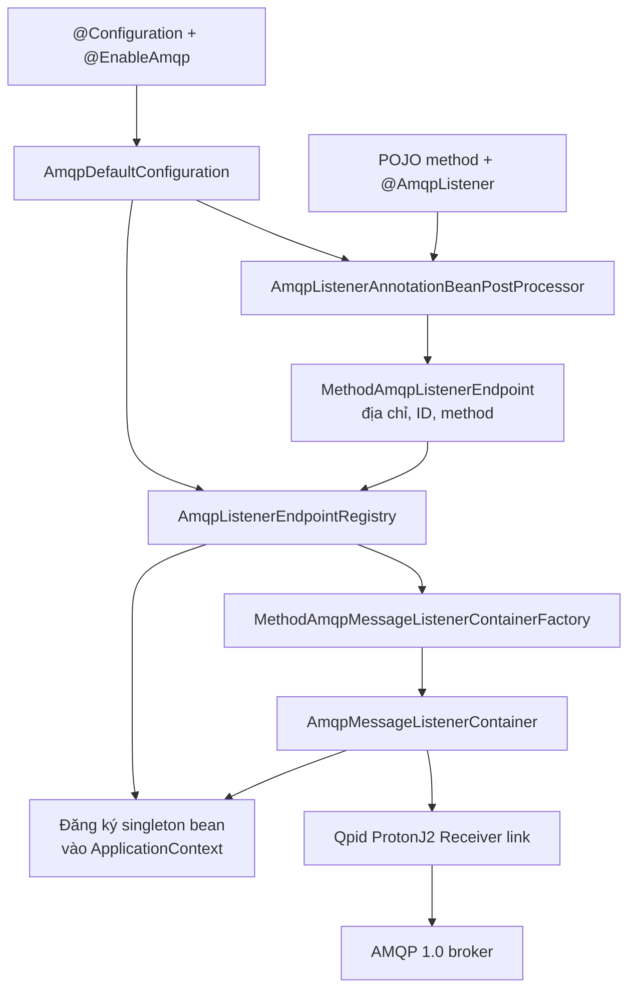

# @EnableAmqp, @AmqpListener và registry riêng của generic client

Khi đã quen Spring AMQP với `RabbitTemplate`, `@RabbitListener`, exchange, queue và binding, bạn có thể nghĩ rằng chuyển sang **AMQP 1.0** chỉ là thay connection factory. Thực tế, Spring AMQP hiện có **nhiều nhánh tích hợp**, với annotation, container và registry không giống nhau.

Đặc biệt, module **`spring-amqp-client` (generic AMQP 1.0)** sử dụng Qpid ProtonJ2 để làm việc với **nhiều broker hỗ trợ AMQP 1.0**, không giới hạn RabbitMQ. Nó cung cấp **`@EnableAmqp`**, **`@AmqpListener`** và **`AmqpListenerEndpointRegistry`**. Ba thành phần này không phải tên mới của `@EnableRabbit`, `@RabbitListener` hay `RabbitListenerEndpointRegistry` vốn quen thuộc ở nhánh RabbitMQ.

Bài này thuộc chương **AMQP 1.0** của module **SPRING_AMQP**. Trọng tâm là hiểu đúng **hạ tầng annotation của generic client**, cách tạo container, cách registry đăng ký listener, vòng đời bean, cấu hình bằng Java/Spring Boot, và tác động tới ACK, retry, request–reply cũng như độ tin cậy đầu cuối.

> **Phạm vi phiên bản:** generic `spring-amqp-client` được giới thiệu ở **Spring AMQP 4.1**; các API trong bài dựa trên dòng **4.1–4.2**. Không sao chép trực tiếp vào dự án dùng Spring AMQP 3.2 hoặc 4.0 rồi giả định các class này đã tồn tại.

## 1. Kết quả học tập

Sau bài này, bạn có thể:

1. Phân biệt **generic AMQP 1.0**, **RabbitMQ-specific AMQP 1.0** và **RabbitMQ AMQP 0-9-1** trong hệ sinh thái Spring.
2. Giải thích `@EnableAmqp` kích hoạt những infrastructure bean nào.
3. Viết `@AmqpListener(addresses = "...")` và gắn nó với `MethodAmqpMessageListenerContainerFactory`.
4. Mô tả luồng từ `AmqpListenerAnnotationBeanPostProcessor` → endpoint → `AmqpListenerEndpointRegistry` → `AmqpMessageListenerContainer`.
5. Đăng ký endpoint **bằng mã** qua `SimpleAmqpListenerEndpoint` và registry generic.
6. Giải thích sự khác biệt quan trọng về **vòng đời bean** so với `RabbitListenerEndpointRegistry`.
7. Cấu hình `concurrency`, `initialCredits`, `receiveTimeout`, `autoAccept`, recovery và shutdown đúng theo AMQP 1.0.
8. Xử lý ACK/settlement, redelivery, idempotency, request–reply và chẩn đoán các lỗi import/factory/registry.

## 2. Đặt ba tích hợp AMQP cạnh nhau

Trong các phiên bản hiện đại, Spring AMQP có những lựa chọn sau:

| Hướng tích hợp | Artifact tiêu biểu | Client/protocol | Annotation listener | Registry |
| --- | --- | --- | --- | --- |
| **RabbitMQ AMQP 0-9-1** | `spring-rabbit` | RabbitMQ Java client, AMQP 0-9-1 | `@RabbitListener`, `@EnableRabbit` | `RabbitListenerEndpointRegistry` |
| **RabbitMQ-specific AMQP 1.0** | `spring-rabbitmq-client` (từ Spring AMQP 4.0) | RabbitMQ AMQP 1.0 Java client, dành cho RabbitMQ | Vẫn dùng `@RabbitListener` / `@EnableRabbit` | `RabbitListenerEndpointRegistry` |
| **Generic AMQP 1.0** | **`spring-amqp-client`** (từ Spring AMQP 4.1) | **Qpid ProtonJ2**, AMQP 1.0 đa broker | **`@AmqpListener` / `@EnableAmqp`** | **`AmqpListenerEndpointRegistry`** |

Đây là những integration khác nhau. Cùng làm việc với RabbitMQ **không có nghĩa** chúng dùng chung connection factory, container hay registry.

### Ba loại connection factory dễ bị import nhầm

```text
org.springframework.amqp.rabbit.connection.ConnectionFactory
    -> Spring RabbitMQ AMQP 0-9-1

org.springframework.amqp.rabbitmq.client.AmqpConnectionFactory
    -> RabbitMQ-specific AMQP 1.0

org.springframework.amqp.client.AmqpConnectionFactory
    -> Generic AMQP 1.0, Qpid ProtonJ2
```

**Ví dụ:** `SingleAmqpConnectionFactory` trong bài nằm ở package `org.springframework.amqp.client`, **không** phải `org.springframework.amqp.rabbitmq.client`. IDE có thể tự import sai nếu project chứa đồng thời nhiều module AMQP.

Spring Boot hiện đại cũng phân biệt các starter:

- `spring-boot-starter-amqp`: generic AMQP 1.0.
- `spring-boot-starter-amqp-rabbitmq`: RabbitMQ-specific AMQP 1.0.
- `spring-boot-starter-rabbitmq`: RabbitMQ AMQP 0-9-1.

**Không dùng tên starter để suy đoán ở phiên bản Boot cũ.** Các phân loại trên dựa theo tài liệu Spring Boot 4.2; hãy kiểm tra BOM của dự án. Trong phần cấu hình thuần Spring dưới đây, ta khai báo artifact `spring-amqp-client` trực tiếp để xác định rõ nhánh đang học.

### AMQP 1.0 address không giống routing key

Trên generic client, `@AmqpListener` dùng thuộc tính **`addresses`**, không phải `queues`. Địa chỉ là một AMQP 1.0 *source address* mà broker hoặc dịch vụ AMQP 1.0 hiểu.

Ví dụ với RabbitMQ:

```text
/queues/orders.work.q
```

Đây là một quy ước địa chỉ RabbitMQ, **không phải cú pháp bắt buộc của mọi broker AMQP 1.0**. Với một nhà cung cấp khác, address có thể mang hình thức khác. Muốn generic client có tính portable, hãy cấu hình address từ environment/property của từng broker.

Các khái niệm routing, queue và binding vẫn quan trọng: trên RabbitMQ, AMQP 1.0 receiver cần một đích có thật và phù hợp topology. Song `@AmqpListener` không tự tạo exchange, queue hay binding như một lệnh declare; hãy provision chúng qua hạ tầng quản lý broker.

## 3. `@EnableAmqp` làm việc gì?

Để bật khả năng quét các method có `@AmqpListener` trong ứng dụng Spring cấu hình thủ công, đặt annotation sau trên một `@Configuration`:

```java
import org.springframework.amqp.client.config.EnableAmqp;
import org.springframework.context.annotation.Configuration;

@Configuration
@EnableAmqp
public class GenericAmqpListenerEnablement {
}
```

`@EnableAmqp` import `AmqpDefaultConfiguration` của generic client. Cấu hình này đăng ký các **infrastructure bean**:

| Thành phần | Vai trò |
| --- | --- |
| `AmqpListenerAnnotationBeanPostProcessor` | Quét bean POJO, tìm `@AmqpListener`, phân tích các thuộc tính và tạo endpoint. |
| `AmqpListenerEndpointRegistry` | Đăng ký endpoint với listener container factory và **đưa container thành singleton bean** trong Spring application context. |
| `AmqpDefaultConfiguration` | Cấu hình hạ tầng, chứa tên mặc định của processor và container factory. |

Khi chưa bật hạ tầng (và cũng không có auto-configuration tương ứng), `@AmqpListener` có thể chỉ là annotation trên một method Java: **không có consumer nào được khởi tạo**.

**Quan trọng về Spring Boot:** nếu đang dùng Spring Boot 4.2 với generic AMQP 1.0 auto-configuration đúng starter, Boot có thể thiết lập hạ tầng annotation và factory mặc định cho bạn. Ví dụ `@EnableAmqp` ở đây dành cho cấu hình thủ công, để bạn nhìn rõ cơ chế; không cần đăng ký lại hạ tầng trùng lặp khi Boot đã quản lý.

### So với `@EnableRabbit`

```java
// RabbitMQ AMQP 0-9-1 hoặc RabbitMQ-specific AMQP 1.0:
@EnableRabbit
class RabbitListenerConfig { }

// Generic AMQP 1.0:
@EnableAmqp
class GenericAmqpListenerConfig { }
```

Hai annotation import các cấu hình và post-processor khác nhau. Thêm `@EnableRabbit` **không thay thế** được `@EnableAmqp` nếu method dùng `@AmqpListener` của generic client.

## 4. Chuỗi tạo listener: annotation → endpoint → container

Để hiểu registry riêng, cần phân biệt **metadata endpoint** và **runtime consumer**.



Theo thứ tự khái niệm:

1. Spring tạo bean dịch vụ có phương thức `@AmqpListener`.
2. `AmqpListenerAnnotationBeanPostProcessor` phát hiện annotation; đọc địa chỉ, ID, factory, concurrency, timeout và các tùy chọn.
3. Hạ tầng xây `MethodAmqpListenerEndpoint`, gắn method cần gọi.
4. `AmqpListenerEndpointRegistry` chọn `MethodAmqpMessageListenerContainerFactory` phù hợp.
5. Factory tạo `AmqpMessageListenerContainer`, cài `AmqpMessagingListenerAdapter` và các thuộc tính của endpoint/factory.
6. Registry đăng ký container như **singleton bean thực** trong Spring context; lifecycle Spring quản lý việc start/stop.
7. Container sử dụng `org.apache.qpid.protonj2.client.Receiver` để đọc message từ AMQP 1.0 address.

**Endpoint** không tự nhận message. **Factory** không phải consumer đang chạy. **Container** mới là đối tượng quản lý receiver link và gọi listener. **Registry** kết nối các khâu cấu hình và đăng ký.

### Vai trò của default factory

Nếu method không ghi `containerFactory`:

```java
@AmqpListener(addresses = "/queues/orders.work.q")
public void onOrder(String body) {
    // ...
}
```

Framework cần tìm một bean `AmqpMessageListenerContainerFactory` có **tên mặc định**:

```java
AmqpDefaultConfiguration
    .DEFAULT_AMQP_LISTENER_CONTAINER_FACTORY_BEAN_NAME
```

Không đoán tên bean theo thói quen `rabbitListenerContainerFactory` của nhánh `@RabbitListener`. Nếu không dùng Boot auto-configuration, cần tạo đúng factory và đăng ký theo constant trên.

## 5. Cấu hình Java đầy đủ cho generic AMQP 1.0

Ví dụ tối giản hướng đến **Spring AMQP 4.1+**, trên RabbitMQ broker đã hỗ trợ AMQP 1.0 và đã có queue tên `orders.work.q`. Cấu hình connection mặc định dùng `localhost:5672`; nếu môi trường khác, đọc host, port, credentials từ cấu hình thực tế thay vì hard-code.

### 5.1 Dependency

Dùng BOM tương thích (Spring Boot hoặc dependency management của dự án):

```gradle
dependencies {
    implementation("org.springframework.amqp:spring-amqp-client")
}
```

Không trộn version `spring-amqp-client` 4.2 với core Spring AMQP 3.x. Nếu bạn dùng Spring Boot 4.2 auto-configuration, có thể chọn `spring-boot-starter-amqp` thay vì tự tạo tất cả bean thủ công.

### 5.2 Connection factory, listener factory và producer

```java
import java.time.Duration;

import org.springframework.amqp.client.AmqpClient;
import org.springframework.amqp.client.AmqpConnectionFactory;
import org.springframework.amqp.client.SingleAmqpConnectionFactory;
import org.springframework.amqp.client.config.AmqpDefaultConfiguration;
import org.springframework.amqp.client.config.EnableAmqp;
import org.springframework.amqp.client.config.MethodAmqpMessageListenerContainerFactory;
import org.springframework.context.annotation.Bean;
import org.springframework.context.annotation.Configuration;

@Configuration
@EnableAmqp
public class GenericAmqpConfig {

    @Bean
    AmqpConnectionFactory genericAmqpConnectionFactory() {
        // Minh họa localhost:5672 mặc định.
        // Ở production, cấu hình broker address, TLS và credential
        // theo environment/secret manager.
        return new SingleAmqpConnectionFactory();
    }

    @Bean(AmqpDefaultConfiguration
            .DEFAULT_AMQP_LISTENER_CONTAINER_FACTORY_BEAN_NAME)
    MethodAmqpMessageListenerContainerFactory genericListenerFactory(
            AmqpConnectionFactory connectionFactory) {

        var factory =
            new MethodAmqpMessageListenerContainerFactory(
                connectionFactory);

        factory.setConcurrency(2);
        factory.setInitialCredits(50);
        factory.setReceiveTimeout(Duration.ofSeconds(2));
        factory.setAutoAccept(true);
        factory.setGracefulShutdownPeriod(Duration.ofSeconds(15));
        return factory;
    }

    @Bean
    AmqpClient amqpClient(AmqpConnectionFactory connectionFactory) {
        return AmqpClient.builder(connectionFactory).build();
    }
}
```

Các class được import từ nhánh **`org.springframework.amqp.client`**. `SingleAmqpConnectionFactory` quản lý kết nối Qpid ProtonJ2, **không phải** `CachingConnectionFactory` của RabbitMQ AMQP 0-9-1.

Trong ứng dụng Boot đã có auto-configured `AmqpConnectionFactory`, `AmqpClient` và factory mặc định, **đừng tạo bản sao không cần thiết**. Thay vào đó, tùy biến những bean do Boot cung cấp, hoặc tạo factory riêng được chỉ rõ bằng `containerFactory`.

### 5.3 Viết `@AmqpListener`

```java
import org.springframework.amqp.client.annotation.AmqpListener;
import org.springframework.stereotype.Component;

@Component
public class OrderGenericListener {

    private final OrderService orderService;

    public OrderGenericListener(OrderService orderService) {
        this.orderService = orderService;
    }

    @AmqpListener(
        id = "orders-generic-v1",
        addresses = "/queues/orders.work.q",
        concurrency = "2"
    )
    public void onOrder(String payload) {
        orderService.processIdempotently(payload);
    }
}
```

`OrderService` là dịch vụ nghiệp vụ do ứng dụng cung cấp. Cách đặt tên `processIdempotently` nhấn mạnh yêu cầu chịu được redelivery, không phải API bắt buộc của Spring.

Trong ví dụ:

- `addresses` là địa chỉ AMQP 1.0, **không** phải `queues` hoặc `bindings`.
- `id` là định danh endpoint/container. Đặt ổn định giúp tìm bean và quan sát.
- `concurrency="2"` ghi đè giá trị tương ứng của factory để tạo **hai consumer trên mỗi address**.
- Không đặt `containerFactory` nên dùng **factory mặc định** đã khai báo bằng constant.
- `void` đồng nghĩa không tạo reply ứng dụng; framework giải quyết settlement theo `autoAccept`.

### 5.4 Publisher gửi message bằng `AmqpClient`

```java
import java.util.concurrent.CompletableFuture;
import org.springframework.amqp.client.AmqpClient;
import org.springframework.stereotype.Service;

@Service
public class OrderGenericPublisher {

    private final AmqpClient client;

    public OrderGenericPublisher(AmqpClient client) {
        this.client = client;
    }

    public CompletableFuture<Boolean> publish(String orderJson) {
        return client.to("/queues/orders.work.q")
                     .body(orderJson)
                     .messageId("event-1001")
                     .send();
    }
}
```

Lời gọi gửi trả `CompletableFuture<Boolean>`. Ví dụ `messageId("event-1001")` chỉ nhằm minh họa header; thực tế phải lấy ID ổn định từ **event đang gửi** chứ không hard-code cùng giá trị cho mọi message.

**Không coi gọi `send()` là đã được broker xác nhận.** Ứng dụng cần theo dõi future hoàn tất, lỗi gửi, timeout và chính sách retry/outbox. Khi một kết quả publish không chắc chắn, cùng event có thể được gửi lại; consumer nên có idempotency key.

## 6. `@AmqpListener` có những thuộc tính nào?

Ngoài ba trường `id`, `addresses` và `containerFactory`, generic annotation còn hỗ trợ nhiều tuỳ chọn. Các giá trị annotation được đưa dưới dạng string, có thể chứa property placeholder hoặc SpEL.

| Thuộc tính | Ý nghĩa | Điều cần nhớ |
| --- | --- | --- |
| `id` | ID cho container. | Nếu bỏ trống, framework tạo tên theo class + method + hậu tố `.listenerContainer`. |
| `addresses` | Một hoặc nhiều AMQP 1.0 source addresses. | Có thể là mảng hoặc chuỗi phân tách bằng dấu phẩy; phải tồn tại trên broker. |
| `containerFactory` | Bean factory tạo container. | Nếu bỏ trống cần bean mặc định. |
| `concurrency` | Số consumer trên **mỗi address**. | Không dùng cú pháp SMLC `"2-8"`; dạng nguyên `"2"`. |
| `initialCredits` | Số credit cấp ban đầu cho receiver link. | Flow control của AMQP 1.0; khác tên `prefetchCount` ở AMQP 0-9-1. |
| `autoAccept` | Container tự settle delivery thành **accepted** khi listener hoàn tất bình thường. | Khi cần chủ động settle, đặt `false` và dùng `AmqpAcknowledgment`. |
| `receiveTimeout` | Timeout mỗi lượt `Receiver.receive()`, hỗ trợ ms/ISO-8601 Duration. | Không phải timeout của `RabbitTemplate.receive()`. |
| `gracefulShutdownPeriod` | Thời gian chờ shutdown graceful. | Cần lớn hơn xử lý thông thường khi phù hợp. |
| `autoStartup` | Có tự khởi động container không. | Dùng để trì hoãn listener tới khi hệ thống đã sẵn sàng. |
| `executor` | Bean executor cho các consumer task. | Phải đủ tài nguyên khi concurrency tăng. |
| `messageConverter` | Bean converter cho payload. | Cần nhất quán với producer và content type. |
| `headerMapper` | Ánh xạ AMQP headers sang Spring Messaging headers. | Không giả định mọi header luôn được copy 1:1. |
| `errorHandler` | Listener error handler phù hợp generic module. | Không dùng nhầm `RabbitListenerErrorHandler` chỉ vì tên gần giống. |
| `defaultRequeueRejected` | Chính sách requeue mặc định khi listener thất bại. | Tránh retry nóng vô hạn với lỗi dữ liệu không thể phục hồi. |
| `adviceChain` | Các bean Spring AOP Advice bao quanh listener. | Hữu ích cho cross-cutting concern, cần tránh double retry. |

Ví dụ annotation có placeholder:

```java
@AmqpListener(
    id = "orders-generic-custom",
    addresses = "${app.amqp.orders-address}",
    containerFactory = "customGenericFactory",
    concurrency = "${app.amqp.consumers:3}",
    initialCredits = "40",
    receiveTimeout = "PT2S",
    autoAccept = "true",
    gracefulShutdownPeriod = "PT20S"
)
public void handle(String payload) {
    process(payload);
}
```

Ví dụ này chỉ dùng khi có bean `customGenericFactory`. Giá trị `PT2S` là cú pháp ISO-8601 Duration cho 2 giây. Khi muốn dùng expression, annotation cũng chấp nhận SpEL theo quy tắc của Spring.

### Tạo factory riêng

```java
import java.time.Duration;
import org.springframework.amqp.client.AmqpConnectionFactory;
import org.springframework.amqp.client.config.MethodAmqpMessageListenerContainerFactory;
import org.springframework.context.annotation.Bean;
import org.springframework.context.annotation.Configuration;

@Configuration
class CustomGenericFactoryConfig {

    @Bean("customGenericFactory")
    MethodAmqpMessageListenerContainerFactory customGenericFactory(
            AmqpConnectionFactory connectionFactory) {

        var factory =
            new MethodAmqpMessageListenerContainerFactory(
                connectionFactory);
        factory.setConcurrency(3);
        factory.setInitialCredits(40);
        factory.setReceiveTimeout(Duration.ofSeconds(2));
        factory.setAutoAccept(true);
        return factory;
    }
}
```

Nếu dùng Spring Boot auto-configuration, có thể dùng `AmqpMessageListenerContainerFactoryConfigurer` của Boot để kế thừa cấu hình chung trước khi ghi đè. Ví dụ tạo factory trực tiếp ở trên là hướng **thuần Spring**, không tự sao chép mọi setting Boot đã thiết lập.

## 7. Registry riêng: `AmqpListenerEndpointRegistry` khác `RabbitListenerEndpointRegistry`

Đây là trọng tâm của bài.

### 7.1 Cùng tên “registry” nhưng quản lý container khác nhau

| Đặc điểm | **Generic `AmqpListenerEndpointRegistry`** | **Rabbit `RabbitListenerEndpointRegistry`** |
| --- | --- | --- |
| Package | `org.springframework.amqp.client.config` | `org.springframework.amqp.rabbit.listener` |
| Dành cho | `@AmqpListener` của `spring-amqp-client`. | `@RabbitListener` của nhánh Rabbit. |
| Factory/endpoint | `AmqpMessageListenerContainerFactory`, `AmqpListenerEndpoint`. | `RabbitListenerContainerFactory`, `RabbitListenerEndpoint`. |
| Cách giữ runtime container | **Đăng ký container trực tiếp thành singleton bean trong ApplicationContext**. | Container do registry giữ và quản lý vòng đời, **không mặc nhiên là bean**. |
| Tìm một container | Có thể `applicationContext.getBean(containerId, AmqpMessageListenerContainer.class)`. | `rabbitRegistry.getListenerContainer(id)`. |
| Đăng ký bằng mã | `registerListenerEndpoint(factory, endpoint)`. | Qua `RabbitListenerEndpointRegistrar` / registry với API riêng. |
| Có thể dùng thay nhau? | **Không.** | **Không.** |

**Điểm dễ mắc lỗi:** Với generic registry, **không** dùng ví dụ `rabbitRegistry.getListenerContainer("orders")` từ tài liệu `@RabbitListener`, vì đó là API/quy tắc vòng đời của registry khác.

### 7.2 Bean name và định danh

Generic registry dùng `endpoint.getId()` làm tên bean nếu có ID. Nếu không có ID, tên được tạo từ class/method và hậu tố `.listenerContainer` theo cơ chế tương ứng.

```java
@AmqpListener(
    id = "orders-generic-v1",
    addresses = "/queues/orders.work.q")
public void onOrder(String payload) {
    // ...
}
```

Có thể lấy container bằng Spring context:

```java
import org.springframework.amqp.client.listener.AmqpMessageListenerContainer;
import org.springframework.context.ApplicationContext;

public class GenericContainerInspector {
    private final ApplicationContext context;

    public GenericContainerInspector(ApplicationContext context) {
        this.context = context;
    }

    public boolean isOrdersConsumerRunning() {
        AmqpMessageListenerContainer container =
            context.getBean(
                "orders-generic-v1",
                AmqpMessageListenerContainer.class);

        return container.isRunning();
    }
}
```

Tùy cách tổ chức, inspector có thể được khai báo làm `@Component`. ID phải ổn định và **không trùng** giữa các endpoint trong cùng ApplicationContext. Việc có bean container trong context không có nghĩa broker queue tồn tại hoặc receiver link đã kết nối thành công; dùng `isRunning()` kết hợp log/metrics.

### 7.3 Đăng ký endpoint bằng mã: `SimpleAmqpListenerEndpoint`

Khi address được phát hiện động từ hệ thống cấu hình hoặc bạn không muốn viết annotation trên từng method, registry cung cấp API đăng ký trực tiếp:

```java
import java.nio.charset.StandardCharsets;

import org.springframework.amqp.client.AmqpConnectionFactory;
import org.springframework.amqp.client.config.AmqpListenerEndpointRegistry;
import org.springframework.amqp.client.config.AmqpMessageListenerContainerFactory;
import org.springframework.amqp.client.config.SimpleAmqpListenerEndpoint;
import org.springframework.beans.factory.SmartInitializingSingleton;
import org.springframework.beans.factory.annotation.Qualifier;
import org.springframework.context.annotation.Bean;
import org.springframework.context.annotation.Configuration;

@Configuration
public class ProgrammaticGenericListenerConfig {

    @Bean("auditGenericFactory")
    AmqpMessageListenerContainerFactory auditGenericFactory(
            AmqpConnectionFactory connectionFactory) {
        var factory =
            new AmqpMessageListenerContainerFactory(
                connectionFactory);
        factory.setConcurrency(1);
        factory.setAutoAccept(true);
        return factory;
    }

    @Bean
    SmartInitializingSingleton registerAuditEndpoint(
            AmqpListenerEndpointRegistry registry,
            @Qualifier("auditGenericFactory")
            AmqpMessageListenerContainerFactory factory) {

        return () -> {
            var endpoint = new SimpleAmqpListenerEndpoint(
                message -> {
                    String body = new String(
                        message.getBody(),
                        StandardCharsets.UTF_8);
                    System.out.println("AUDIT " + body);
                },
                "/queues/orders.audit.q"
            );

            endpoint.setId("audit-generic-v1");
            registry.registerListenerEndpoint(factory, endpoint);
        };
    }
}
```

**Vì sao chọn `SmartInitializingSingleton`?** Callback chạy sau khi Spring tạo các singleton thông thường, giúp đăng ký endpoint trong giai đoạn khởi tạo, trước khi application context hoàn tất vòng refresh và khởi động lifecycle bean. Không gọi đăng ký sớm trong constructor của một bean có thể khiến phụ thuộc chưa sẵn sàng.

Phần trên tạo **một endpoint simple** dùng `org.springframework.amqp.core.MessageListener`. Nó khác **`MethodAmqpListenerEndpoint`** vốn gọi POJO method được mô tả từ `@AmqpListener`.

Những điều phải chuẩn bị:

- Queue/address `/queues/orders.audit.q` cần tồn tại. Đây **không phải** auto-declare topology.
- ID `audit-generic-v1` phải duy nhất.
- Registry generic chọn đúng **`AmqpMessageListenerContainerFactory`**, không dùng `SimpleRabbitListenerContainerFactory`.
- Container được đăng ký như **singleton bean** có tên `audit-generic-v1`.
- Khi cần thêm endpoint sau lúc context đã khởi động, phải kiểm tra lifecycle và gọi start container một cách chủ động nếu hạ tầng không tự khởi động bean được đăng ký muộn. Không dựa vào giả định Spring sẽ tự start mọi singleton bổ sung sau refresh.

### 7.4 Điều khiển container đã đăng ký

Với generic client, lấy bean từ ApplicationContext:

```java
import org.springframework.amqp.client.listener.AmqpMessageListenerContainer;
import org.springframework.context.ApplicationContext;

void pauseAudit(ApplicationContext context) {
    AmqpMessageListenerContainer container =
        context.getBean("audit-generic-v1",
                        AmqpMessageListenerContainer.class);
    container.pause();
}

void resumeAudit(ApplicationContext context) {
    AmqpMessageListenerContainer container =
        context.getBean("audit-generic-v1",
                        AmqpMessageListenerContainer.class);
    container.resume();
}
```

`pause()` ở generic AMQP 1.0 có ý nghĩa **ngừng cấp link credits** (đặt về 0) mà không nhất thiết hủy receiver link. `resume()` cấp credits trở lại. Nó khác với `stop()`, vốn đóng/quản lý vòng đời consumer.

**Không dùng các đoạn `ApplicationContext.getBean(...)` này để thay thế `RabbitListenerEndpointRegistry.getListenerContainer(...)` của legacy Rabbit listener.** Ngược lại, generic registry không nhất thiết cung cấp cùng các phương thức liệt kê/get container như Rabbit registry; hãy dựa vào bean đã được đăng ký trong context.

## 8. Sự khác nhau về flow control và concurrency

AMQP 1.0 sử dụng **receiver link credit** để điều tiết số delivery được sender gửi đến receiver.

Trong generic `AmqpMessageListenerContainer`:

- `initialCredits` mặc định khoảng **100** trên mỗi receiver link.
- Khi message được **settle**, client/container bổ sung credit để có thể tiếp tục nhận.
- `consumersPerQueue` mặc định **1**; `factory.setConcurrency(N)` tạo N consumer cho **mỗi address**.
- Mỗi consumer chạy nhờ một `Executor`; mặc định container dùng `SimpleAsyncTaskExecutor`.
- `receiveTimeout` mặc định khoảng **1 giây** cho vòng `Receiver.receive()`.

Ví dụ:

```text
@AmqpListener(addresses={"/queues/orders.q", "/queues/audit.q"},
              concurrency="3")

=> 3 consumer cho /queues/orders.q
=> 3 consumer cho /queues/audit.q
=> tổng 6 consumer task/receiver link
```

Đừng tính theo mô hình SMLC `concurrentConsumers=3` nghe nhiều queue chỉ với ba thread. Generic AMQP 1.0 gần mô hình **số consumer mỗi address**.

### Initial credits không phải số thread

Tăng `initialCredits=500` **không** tạo 500 thread. Nó tăng số delivery có thể được cấp theo flow control trước khi các delivery được settle/replenish. Với payload lớn hoặc xử lý chậm, credit quá cao có thể làm tăng dữ liệu in-flight và memory pressure.

Ngược lại, đặt concurrency rất cao trong khi task executor thiếu khả năng chạy hoặc database pool quá nhỏ sẽ làm listener chờ downstream thay vì tăng throughput.

### Recovery và pause/resume

Qpid ProtonJ2 connection có cơ chế reconnect, nhưng receiver link bị lỗi có thể cần **tạo lại**. Generic `AmqpMessageListenerContainer` có `recoveryBackOff`/`recoveryInterval` để mở lại receiver link, mặc định thường thử lại với khoảng 5 giây, không giới hạn.

`pause()` và `resume()` hữu ích để giảm tải tạm thời bằng cách điều chỉnh credits. Đừng nhầm với "pause giữ toàn bộ message không mất" ở mọi broker: độ bền queue, TTL, retention, durable delivery và trạng thái broker vẫn quyết định message tồn tại thế nào.

## 9. Manual settlement: `autoAccept` và `AmqpAcknowledgment`

Ở AMQP 0-9-1, người học thường thấy `basicAck(deliveryTag, false)` và `basicNack(...)`. Trong **generic AMQP 1.0**, delivery được **settle theo outcome**, và Spring cung cấp abstraction `AmqpAcknowledgment`.

Với `autoAccept=true` (mặc định), listener hoàn tất bình thường → container tự accept delivery. Khi muốn tự quyết định thời điểm settle, đặt `autoAccept=false`:

```java
import org.springframework.amqp.client.annotation.AmqpListener;
import org.springframework.amqp.core.AmqpAcknowledgment;
import org.springframework.amqp.core.Message;
import org.springframework.stereotype.Component;

@Component
public class GenericManualSettlementListener {

    private final InventoryService service;

    public GenericManualSettlementListener(InventoryService service) {
        this.service = service;
    }

    @AmqpListener(
        id = "inventory-manual-v1",
        addresses = "/queues/inventory.reserve.q",
        autoAccept = "false"
    )
    public void handle(Message message, AmqpAcknowledgment ack) {
        service.reserveTransactionally(message.getBody());
        // Chỉ accept sau khi tác động nghiệp vụ đã commit.
        ack.acknowledge(AmqpAcknowledgment.Status.ACCEPT);
    }
}
```

`InventoryService` là interface/service giả định. Nếu service ném exception, đoạn mã chưa gọi `acknowledge(ACCEPT)`; ứng dụng phải có **policy xử lý lỗi** để quyết định requeue/reject/settlement thay vì để các delivery không settle vĩnh viễn.

Các trạng thái abstraction chính:

| Status | Ý nghĩa | Dùng khi nào? |
| --- | --- | --- |
| `ACCEPT` | Chấp nhận delivery. | Business effect đã hoàn tất và được lưu bền vững. |
| `REJECT` | Từ chối delivery. | Lỗi vĩnh viễn, theo quy tắc broker/policy. |
| `REQUEUE` | Từ chối và yêu cầu giao lại. | Lỗi tạm thời nhưng phải có backoff/giới hạn, tránh retry loop. |

Một cách xử lý lỗi có chủ đích:

```java
try {
    service.reserveTransactionally(message.getBody());
    ack.acknowledge(AmqpAcknowledgment.Status.ACCEPT);
}
catch (InvalidBusinessPayloadException ex) {
    // Cần cấu hình DLQ/quarantine theo broker.
    ack.acknowledge(AmqpAcknowledgment.Status.REJECT);
}
catch (TransientDownstreamException ex) {
    // Cảnh giác requeue nóng; nên có retry/backoff có giới hạn.
    ack.acknowledge(AmqpAcknowledgment.Status.REQUEUE);
}
```

Hai exception trên là **kiểu do ứng dụng định nghĩa**, không phải class có sẵn trong Spring AMQP. Chỉ dùng snippet này sau khi xây chính sách lỗi và logging phù hợp. Nếu muốn Spring error handler xử lý, đừng đồng thời tự settle cùng delivery mà không kiểm chứng hành vi.

**Khi listener trả bất đồng bộ** như `CompletableFuture`, `Mono` hoặc Kotlin `suspend`, framework chuyển sang settlement không tự động theo hành vi async để có thể đợi kết quả. Không dùng `autoAccept=true` rồi mặc định ACK đã xảy ra ngay khi method trả về Future chưa hoàn tất.

## 10. Request–reply trong generic `@AmqpListener`

Generic listener cũng hỗ trợ method có giá trị trả về; framework dùng địa chỉ `replyTo` trong message request. Khi request không có `replyTo`, có thể dùng `@SendTo` làm địa chỉ mặc định.

```java
import org.springframework.amqp.client.annotation.AmqpListener;
import org.springframework.messaging.handler.annotation.SendTo;
import org.springframework.stereotype.Component;

@Component
public class GenericPricingListener {

    @AmqpListener(
        id = "pricing-generic-v1",
        addresses = "/queues/pricing.requests.q")
    @SendTo("/queues/pricing.replies.q")
    public String price(String sku) {
        return "SKU-42".equals(sku) ? "125000" : "NOT_FOUND";
    }
}
```

Đây là ví dụ phản hồi dạng `String`; địa chỉ `/queues/pricing.replies.q` là fallback đã được broker provision. Nếu requester đặt `replyTo` khác, framework ưu tiên đích đó theo hợp đồng request–reply.

`@AmqpListener` còn hỗ trợ trả `Mono<T>`, `CompletableFuture<T>` hoặc Kotlin `suspend`. Với mô hình async, cần theo dõi completion, exception và outcome của delivery; không được coi callback tạo Future là nghiệp vụ đã thành công.

**Tránh nhầm `RabbitTemplate.convertSendAndReceive()` của AMQP 0-9-1 với `AmqpClient`**: generic client có phương thức async riêng, không tự chia sẻ correlation state hoặc connection/channel với `RabbitTemplate` legacy. Dữ liệu đi chung RabbitMQ không làm hai API trở thành một template duy nhất.

## 11. Spring Boot 4.2: khi không cần tạo factory thủ công

Nếu dự án sử dụng Spring Boot tương thích với generic AMQP 1.0, Boot có thể auto-configure `AmqpConnectionFactory`, `AmqpClient` và default `MethodAmqpMessageListenerContainerFactory`. Một cấu hình minh họa:

```yaml
spring:
  amqp:
    host: localhost
    port: 5672
    username: app
    password: change-me-in-secret-store
    client:
      default-to-address: /queues/orders.work.q
      completion-timeout: 500ms
```

Với hạ tầng generic được Boot dựng đúng, chỉ cần:

```java
@Component
class OrderListener {

    @AmqpListener(addresses = "/queues/orders.work.q")
    void consume(String payload) {
        System.out.println(payload);
    }
}
```

Đối với ứng dụng thật, credential phải lấy từ secret store/biến môi trường, không lưu mật khẩu thật trong source. Địa chỉ phải phù hợp broker và queue phải được provision.

**Đừng đồng thời dùng property dành cho nhánh khác** mà kỳ vọng chúng cấu hình generic client:

| Nhánh | Prefix Boot tiêu biểu |
| --- | --- |
| Generic AMQP 1.0 | `spring.amqp.*` |
| RabbitMQ-specific AMQP 1.0 | `spring.amqp.rabbitmq.*` |
| RabbitMQ AMQP 0-9-1 | `spring.rabbitmq.*` |

Nếu tạo một factory riêng trong Boot, cân nhắc dùng `AmqpMessageListenerContainerFactoryConfigurer` để kế thừa các policy chung của Boot, rồi chỉ thay điều cần khác. Nếu trộn nhiều starter, dùng tên bean và qualifier rõ ràng để tránh inject nhầm `AmqpConnectionFactory` cùng tên nhưng khác package.

### Tương thích artifact

| Phiên bản Spring AMQP | Có `@EnableAmqp` / `@AmqpListener` generic? | Ghi chú |
| --- | --- | --- |
| **3.x** | **Không**. | Chủ yếu tích hợp RabbitMQ AMQP 0-9-1/Streams. |
| **4.0** | **Chưa có generic module này**. | Có RabbitMQ-specific AMQP 1.0 qua `spring-rabbitmq-client`, vẫn dùng `@RabbitListener`. |
| **4.1+** | **Có** với `spring-amqp-client`. | Generic client dựa trên Qpid ProtonJ2, registry riêng. |
| **4.2** | Có; tài liệu reference và Boot mô tả tương đối đầy đủ. | Luôn kiểm tra BOM và Javadoc của patch version ứng dụng. |

## 12. Lỗi thường gặp khi cấu hình annotation và registry

| Triệu chứng | Nguyên nhân thường gặp | Cách kiểm tra/sửa |
| --- | --- | --- |
| `@AmqpListener` không nhận message | Chưa bật hạ tầng annotation hoặc Boot starter sai. | Kiểm tra `@EnableAmqp` / generic auto-configuration; processor đã được đăng ký chưa. |
| `ClassNotFoundException` với `EnableAmqp` | Dùng Spring AMQP 3.x/4.0 hoặc thiếu `spring-amqp-client`. | Dùng 4.1+ và artifact phù hợp. |
| IDE import `@RabbitListener` thay vì `@AmqpListener` | Hai annotation khác nhau. | Kiểm tra package `org.springframework.amqp.client.annotation.AmqpListener`. |
| Không có factory mặc định | Quên bean mặc định hoặc cấu hình khác ghi đè. | Tạo `MethodAmqpMessageListenerContainerFactory` theo constant hoặc chỉ rõ `containerFactory`. |
| Dùng `queues=` trên generic listener | `@AmqpListener` dùng `addresses`. | Đổi thành `addresses="/queues/..."` theo broker. |
| Dùng `RabbitListenerEndpointRegistry` để tìm endpoint generic | Registry không dùng chung. | Dùng `AmqpListenerEndpointRegistry` và bean container trong Spring context. |
| Dùng `getListenerContainer(id)` trên generic registry | API khác Rabbit registry. | Lấy `ApplicationContext.getBean(id, AmqpMessageListenerContainer.class)`. |
| Đăng ký programmatic endpoint trùng ID | Spring context không thể có hai singleton cùng tên theo chính sách đăng ký. | Cấp ID duy nhất và quản lý lifecycle rõ ràng. |
| Bean container có nhưng consumer không chạy | Broker queue/address không tồn tại, credential sai, `autoStartup=false` hoặc link lỗi. | Kiểm tra container `isRunning()`, client logs, broker consumer/link state. |
| Message xử lý lặp khi connection bị mất | Delivery chưa settle hoặc sender publish lại. | Idempotency key, transaction và retry có kiểm soát. |
| Tăng `initialCredits` nhưng throughput không tăng | DB/CPU/taskExecutor nghẽn, concurrency chưa hợp lý. | Đo in-flight, thread, message latency và downstream. |
| `autoAccept=false` nhưng không settle | Delivery/credits bị giữ, consumer không tiến. | ACK theo `AmqpAcknowledgment` và có nhánh lỗi rõ ràng. |
| Đặt `REQUEUE` cho mọi lỗi | Có thể tạo retry loop nóng. | Phân loại lỗi, backoff, DLQ và giới hạn retry. |
| `@SendTo` sai địa chỉ | Không trả reply đúng queue. | Kiểm tra địa chỉ AMQP 1.0 của broker, `replyTo` và converter. |
| Dùng `spring.rabbitmq.*` để cấu hình generic | Properties đó dành cho AMQP 0-9-1. | Dùng `spring.amqp.*` khi chọn generic starter tương thích. |

## 13. Bài thực hành

Thực hiện trên broker hoặc virtual host **thử nghiệm** có hỗ trợ AMQP 1.0, đã provision các địa chỉ `/queues/orders.work.q` và `/queues/orders.audit.q`. Kiểm tra version Spring AMQP **4.1+** trước khi chạy. Nếu chỉ có Spring AMQP 3.x/4.0, không cố build các API generic chưa xuất hiện.

### A. Chỉ dùng annotation

1. Cấu hình `GenericAmqpConfig` với `@EnableAmqp` và default factory.
2. Tạo `OrderGenericListener` với `@AmqpListener(id="orders-generic-v1", addresses="/queues/orders.work.q")`.
3. Publish một payload đơn giản bằng `AmqpClient`; xử lý `CompletableFuture<Boolean>` để xác nhận trạng thái send.
4. Xác minh method được gọi và container có thể lấy từ `ApplicationContext.getBean("orders-generic-v1", AmqpMessageListenerContainer.class)`.
5. Bỏ `@EnableAmqp` trong **cấu hình Spring thuần không dùng Boot auto-configuration** và quan sát mất infrastructure annotation.

**Câu hỏi:** Tại sao bean dịch vụ vẫn được Spring tạo nhưng không có receiver link khi annotation processor chưa được bật?

### B. Đăng ký endpoint qua registry

1. Tắt/bỏ listener annotation của thí nghiệm A để tránh consumer cạnh tranh khi muốn so sánh.
2. Dùng `SimpleAmqpListenerEndpoint` và `AmqpListenerEndpointRegistry.registerListenerEndpoint(factory, endpoint)`.
3. Gán ID `audit-generic-v1`, address `/queues/orders.audit.q`.
4. Publish message; xác minh endpoint simple được gọi.
5. Lấy container từ context, thử `pause()` rồi publish tiếp, sau đó `resume()`.
6. Đọc log và broker metrics để phân biệt pause do credit bằng 0 với stop/hủy receiver link.

**Câu hỏi:** Tại sao không thể dùng `RabbitListenerEndpointRegistry.getListenerContainer("audit-generic-v1")` cho ví dụ này?

### C. Chỉnh concurrency và credits

Chọn một address, tải ổn định:

| Cấu hình | Quan sát cần ghi |
| --- | --- |
| `concurrency=1`, `initialCredits=10` | Một consumer; in-flight ít hơn. |
| `concurrency=3`, `initialCredits=10` | Ba consumer trên address; kiểm tra downstream. |
| `concurrency=3`, `initialCredits=100` | Credit nhiều hơn, nhưng không tự sinh thêm thread. |
| Hai address, `concurrency=3` | Sáu consumer/receiver tasks, nếu cả hai địa chỉ có thật. |

Đo message/giây đã **xử lý nghiệp vụ**, latency, CPU, memory và connection/link count. Không kết luận throughput tăng chỉ vì số consumer/credit tăng.

### D. ACK sau business transaction

Chuyển listener sang `autoAccept=false`, dùng `AmqpAcknowledgment`. Sau khi DB commit, gọi `Status.ACCEPT`. Giả lập lỗi tạm thời rồi `REQUEUE` có giới hạn; lỗi vĩnh viễn thì `REJECT` theo policy broker/DLQ.

Mô phỏng crash sau DB commit nhưng trước settlement trong môi trường test. Broker có thể redeliver; dùng event ID và unique constraint/inbox để đảm bảo không tạo tác động trùng.

### E. Sai registry và sai import

Thử cố tình:

- Import `org.springframework.amqp.rabbit.annotation.RabbitListener` nhưng truyền `addresses` → không đúng contract annotation.
- Dùng `org.springframework.amqp.rabbit.connection.ConnectionFactory` khi khởi tạo `MethodAmqpMessageListenerContainerFactory` → sai type.
- Dùng `RabbitListenerEndpointRegistry` trong code đăng ký `SimpleAmqpListenerEndpoint` → sai API.
- Dùng Spring AMQP 4.0 với import `EnableAmqp` → class không có trong generic client.

Giải thích lỗi trước khi sửa, thay vì cast hoặc thêm dependency tùy tiện.

## 14. Checklist dùng generic client trong production

1. **Phiên bản:** Spring AMQP 4.1+ và dependency `spring-amqp-client` cùng dòng BOM.
2. **Broker:** AMQP 1.0 được bật; address đúng quy ước broker và đã provision.
3. **Cấu hình:** dùng đúng `org.springframework.amqp.client.AmqpConnectionFactory`, `@EnableAmqp` và `@AmqpListener`.
4. **Factory:** có `MethodAmqpMessageListenerContainerFactory` mặc định hoặc tên `containerFactory` cụ thể.
5. **Registry:** ID duy nhất; hiểu container generic là **singleton bean** và quản lý vòng đời Spring.
6. **Flow control:** `concurrency` và `initialCredits` cân đối CPU, DB pool và kích thước payload.
7. **Settlement:** `autoAccept` phù hợp; manual settlement có nhánh ACCEPT/REJECT/REQUEUE.
8. **Reliability:** event ID ổn định, transaction và idempotent consumer; producer xử lý future publish.
9. **Lỗi:** recovery backoff cho receiver link, retry/backoff riêng cho xử lý nghiệp vụ, DLQ/quarantine theo broker.
10. **Quan sát:** trạng thái container, receiver link/credit, số delivery hoàn tất, latency, redelivery, error và shutdown.
11. **Request–reply:** converter, replyTo/@SendTo, correlation và async completion nhất quán.
12. **Tính portable:** không mặc định mọi broker AMQP 1.0 đều hiểu `/queues/...`, RabbitMQ DLX hoặc policy cùng cách.

## 15. Ghi nhớ cốt lõi

- **`@EnableAmqp`** bật hạ tầng listener của **generic AMQP 1.0**, gồm annotation processor và **`AmqpListenerEndpointRegistry`**.
- **`@AmqpListener(addresses = "...")`** không phải `@RabbitListener(queues = "...")`; sử dụng `MethodAmqpMessageListenerContainerFactory` và Qpid ProtonJ2.
- **Registry generic đăng ký container thành singleton bean trong ApplicationContext**. Đây là khác biệt lớn so với `RabbitListenerEndpointRegistry`, nơi container annotation thông thường được giữ trong registry chứ không phải bean trực tiếp.
- **`AmqpListenerEndpointRegistry.registerListenerEndpoint(factory, endpoint)`** hỗ trợ cấu hình bằng mã; `SimpleAmqpListenerEndpoint` dành cho listener callback, `MethodAmqpListenerEndpoint` dành cho POJO method.
- **Concurrency là số consumer mỗi address**, còn `initialCredits` là flow control của receiver link. Đừng áp dụng trực tiếp thuật toán co giãn SMLC.
- **Auto-accept/settlement không bảo đảm exactly-once business effect**. Cần ACK sau transaction, idempotency, retry có giới hạn và quan sát rõ ràng.

## Tài liệu tham khảo

- [Spring AMQP — Generic AMQP 1.0 Support](https://docs.spring.io/spring-amqp/reference/amqp10-client.html): `spring-amqp-client`, ProtonJ2, `@EnableAmqp`, `@AmqpListener`, factory, registry và lifecycle.
- [Spring Boot — AMQP](https://docs.spring.io/spring-boot/reference/messaging/amqp.html): ba kiểu AMQP, starter và cấu hình generic `spring.amqp.*`.
- [Spring AMQP Javadoc — EnableAmqp](https://docs.spring.io/spring-amqp/docs/current-SNAPSHOT/api/org/springframework/amqp/client/config/EnableAmqp.html): import và hạ tầng annotation.
- [Spring AMQP Javadoc — AmqpListener](https://docs.spring.io/spring-amqp/docs/current-SNAPSHOT/api/org/springframework/amqp/client/annotation/AmqpListener.html): signature, `addresses`, concurrency, `autoAccept` và reply.
- [Spring AMQP Javadoc — AmqpListenerEndpointRegistry](https://docs.spring.io/spring-amqp/docs/current-SNAPSHOT/api/org/springframework/amqp/client/config/AmqpListenerEndpointRegistry.html): API đăng ký endpoint và singleton bean.
- [Spring AMQP Javadoc — AmqpMessageListenerContainerFactory](https://docs.spring.io/spring-amqp/docs/current-SNAPSHOT/api/org/springframework/amqp/client/config/AmqpMessageListenerContainerFactory.html): `setConcurrency`, credits, timeout, recovery và create container.
- [Spring AMQP Javadoc — SimpleAmqpListenerEndpoint](https://docs.spring.io/spring-amqp/docs/current-SNAPSHOT/api/org/springframework/amqp/client/config/SimpleAmqpListenerEndpoint.html): constructor callback và addresses.
- [Spring AMQP — RabbitMQ AMQP 1.0 Support](https://docs.spring.io/spring-amqp/reference/rabbitmq-amqp-client.html): phân biệt nhánh RabbitMQ-specific với generic.
- [Spring AMQP — Annotation-driven Listener Endpoints](https://docs.spring.io/spring-amqp/reference/amqp/receiving-messages/async-annotation-driven/enable.html): đối chiếu `@EnableRabbit`/`@RabbitListener` của Rabbit listener.
