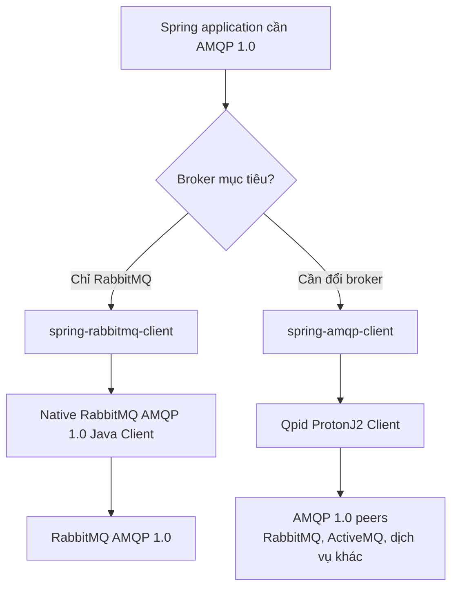
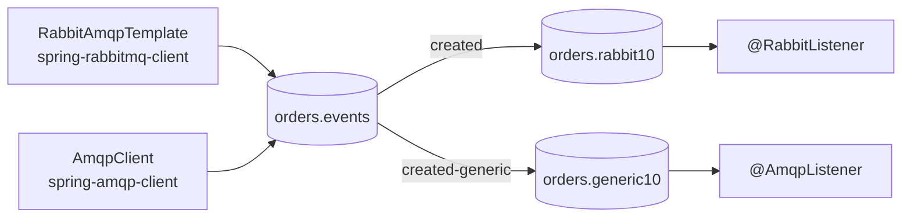

# Phân biệt API, thuộc tính và mức hỗ trợ giữa hai module AMQP 1.0

> **Chương:** AMQP 1.0. Trong module **SPRING_AMQP**, chúng ta đã học `RabbitTemplate`, `@RabbitListener`, exchange, queue, binding, ack, retry, dead-letter và transaction của RabbitMQ. Spring AMQP hiện có **hai cách tích hợp AMQP 1.0**: `spring-rabbitmq-client` và `spring-amqp-client`. Bài này chỉ ra chúng khác nhau thế nào về **client nền tảng, API Spring, thuộc tính cấu hình, topology, settlement, mức tương thích broker và phiên bản**. Ví dụ dựa trên Spring AMQP **4.2**, đã phát hành tháng 11/2026; những tính năng có mốc 4.1 hoặc 4.2 được ghi riêng để tránh áp sai cho dự án cũ.

## 1. Hai module cùng dùng AMQP 1.0 nhưng có mục tiêu khác nhau

**AMQP 1.0** là giao thức truyền message dựa trên connection, session, sender/receiver link, link credit, transfer và delivery settlement. Nó **khác AMQP 0-9-1** mà `RabbitTemplate` và `SimpleRabbitListenerContainer` thường dùng. Hai module dưới đây cùng nói AMQP 1.0, nhưng API/framework và phạm vi broker khác nhau.

| Tiêu chí | RabbitMQ-specific | Generic / broker-agnostic |
| --- | --- | --- |
| Maven artifact | `org.springframework.amqp:spring-rabbitmq-client` | `org.springframework.amqp:spring-amqp-client` |
| Có từ Spring AMQP | **4.0** | **4.1** |
| Native Java client | `com.rabbitmq.client:amqp-client` | `org.apache.qpid:protonj2-client` |
| Broker mục tiêu | **RabbitMQ** có AMQP 1.0 | Broker/peer tuân thủ AMQP 1.0: RabbitMQ, ActiveMQ, Azure Service Bus... theo mức hỗ trợ cụ thể |
| Connection factory | `org.springframework.amqp.rabbitmq.client.AmqpConnectionFactory` | `org.springframework.amqp.client.AmqpConnectionFactory` |
| Factory điển hình | `SingleAmqpConnectionFactory(Environment)` | `SingleAmqpConnectionFactory()`, có thể tự tạo Qpid `Client` |
| Gửi/nhận | `RabbitAmqpTemplate`, triển khai `AsyncAmqpTemplate` | `AmqpClient` với fluent `to(...)`, `from(...)` |
| Listener annotation | `@RabbitListener(queues = "...")` | `@AmqpListener(addresses = "...")` |
| Container | `RabbitAmqpListenerContainer` | `AmqpMessageListenerContainer` |
| Listener factory | `RabbitAmqpListenerContainerFactory` | `MethodAmqpMessageListenerContainerFactory` |
| Topology qua Spring | `RabbitAmqpAdmin` quản lý RabbitMQ exchange/queue/binding | Không có `RabbitAmqpAdmin` dạng broker-neutral tương ứng; tạo topology bằng công cụ phù hợp broker |
| Chuyển đổi message | Dùng lại `org.springframework.amqp.core.Message` và `MessageConverter` | Cũng dùng Spring AMQP `Message`/`MessageConverter`, chuyển từ/đến ProtonJ2 |
| Trả kết quả async | `CompletableFuture` | `CompletableFuture` |

**Kết luận lựa chọn:** nếu hệ thống **chỉ chạy RabbitMQ** và cần reuse `@RabbitListener`, `AmqpAdmin`, queue/exchange/binding hoặc request–reply kiểu Spring AMQP, chọn `spring-rabbitmq-client`. Nếu mục tiêu là giao tiếp qua **AMQP 1.0 với nhiều loại broker** và chấp nhận mô hình **address** tổng quát, chọn `spring-amqp-client`.



### Mốc phiên bản quan trọng

| Mốc | Tính năng liên quan |
| --- | --- |
| **Spring AMQP 4.0** (2025) | Giới thiệu `spring-rabbitmq-client`, dựa trên native RabbitMQ AMQP 1.0 Java client |
| **Spring AMQP 4.1** (2026) | Giới thiệu `spring-amqp-client`, dựa trên Qpid ProtonJ2 và API fluent `AmqpClient` |
| **Spring AMQP 4.1.3** | Generic thêm `SpringAmqpConnectionFactory` để phục hồi shared session khi session bị peer đóng |
| **Spring AMQP 4.2** (19/11/2026) | RabbitMQ-specific thêm `AbstractRoutingAmqpConnectionFactory`/`SimpleRoutingAmqpConnectionFactory`; `@RabbitListener` có override `batchSize`/`batchReceiveTimeout` phù hợp container |

Không copy các API có mốc 4.2 vào chương trình đang dùng 4.0. Khi xem documentation, ưu tiên **đường dẫn version pin** tương ứng với BOM dự án; trang không pin có thể đã mô tả phiên bản mới hơn.

## 2. Phân biệt cả hai với AMQP 0-9-1 và RabbitMQ Streams

Một dự án Spring Boot có thể sử dụng nhiều protocol trong cùng RabbitMQ cluster. **Trùng port không đồng nghĩa trùng protocol**:

| Stack | Spring artifacts / client | Protocol/port điển hình | API quen thuộc |
| --- | --- | --- | --- |
| RabbitMQ AMQP **0-9-1** | `spring-rabbit`, Java client `com.rabbitmq:amqp-client` | AMQP 0-9-1, thường **5672** | `RabbitTemplate`, `RabbitAdmin`, `@RabbitListener` |
| RabbitMQ AMQP **1.0 native** | `spring-rabbitmq-client`, `com.rabbitmq.client:amqp-client` | AMQP 1.0, có thể **5672** | `RabbitAmqpTemplate`, `RabbitAmqpAdmin`, `@RabbitListener` |
| Generic AMQP **1.0** | `spring-amqp-client`, `protonj2-client` | AMQP 1.0, RabbitMQ thường **5672** | `AmqpClient`, `@AmqpListener` |
| RabbitMQ **Stream protocol** | `spring-rabbit-stream`, Stream Java Client | Stream protocol, thường **5552** | `RabbitStreamTemplate`, `StreamListenerContainer` |

RabbitMQ có thể hỗ trợ cả 0-9-1 và 1.0 qua cùng AMQP listener/port nhờ **protocol negotiation**. Cổng Stream protocol là cổng khác. AMQP 1.0 cũng **không phải** “AMQP 0-9-1 nâng cấp không đổi API”: transaction, settlement, địa chỉ đích, connection và listener containers có ngữ nghĩa khác.

Trong `spring-rabbitmq-client`, `spring-rabbit` có thể là dependency bắc cầu để **tái sử dụng abstraction và `@RabbitListener`**; điều đó không có nghĩa mọi lời gọi phải dùng connection 0-9-1. Ngược lại, `spring-amqp-client` không phải phiên bản đổi tên của `spring-rabbitmq-client`.

## 3. So sánh dependency và Spring Boot starters

### 3.1. Maven khi dùng Spring AMQP trực tiếp

Chọn **một trong hai** dependency sau theo mục tiêu (version thường do BOM quản lý):

```xml
<!-- RabbitMQ-specific AMQP 1.0 -->
<dependency>
    <groupId>org.springframework.amqp</groupId>
    <artifactId>spring-rabbitmq-client</artifactId>
</dependency>
```

```xml
<!-- Generic AMQP 1.0, Qpid ProtonJ2 -->
<dependency>
    <groupId>org.springframework.amqp</groupId>
    <artifactId>spring-amqp-client</artifactId>
</dependency>
```

Tương ứng với Gradle:

```groovy
// Chọn một dependency phù hợp nhu cầu.
implementation 'org.springframework.amqp:spring-rabbitmq-client'
// Hoặc:
implementation 'org.springframework.amqp:spring-amqp-client'
```

Nếu không có dependency management, phải ghi **phiên bản tương thích** với Spring Framework, Spring Boot và các module AMQP khác. Không dùng tùy ý `spring-amqp-client:4.2` cùng một `spring-rabbit:3.2` cũ.

### 3.2. Spring Boot 4.x: ba starter và ba nhóm property

Spring Boot 4.2 tài liệu hóa ba starter độc lập. Đây là điểm dễ nhầm nhất khi chuyển từ dự án Spring Boot 3.x:

| Mục tiêu | Spring Boot starter | Prefix thuộc tính |
| --- | --- | --- |
| **Generic AMQP 1.0** | `spring-boot-starter-amqp` | **`spring.amqp.*`** |
| **RabbitMQ-only AMQP 1.0** | `spring-boot-starter-amqp-rabbitmq` | **`spring.amqp.rabbitmq.*`** |
| **RabbitMQ AMQP 0-9-1** | `spring-boot-starter-rabbitmq` | **`spring.rabbitmq.*`** |

Đối với người quen Spring Boot 3.x, tên `spring-boot-starter-amqp` trước đây thường gợi liên tưởng đến RabbitMQ AMQP 0-9-1. Khi sang Boot 4.x, hãy **xác định loại starter theo phiên bản Boot**, không dựa vào tên cũ. Không đổi `spring.rabbitmq.*` thành `spring.amqp.*` mà không kiểm tra stack đang sử dụng.

**Hai nhóm YAML đúng nhưng dành cho hai stack khác nhau:**

```yaml
# Phương án A: Generic AMQP 1.0 / Qpid ProtonJ2
spring:
  amqp:
    host: localhost
    port: 5672
    username: app
    password: ${AMQP_PASSWORD}
    client:
      default-to-address: /queues/orders.jobs
      completion-timeout: 500ms
```

```yaml
# Phương án B: RabbitMQ-specific AMQP 1.0
spring:
  amqp:
    rabbitmq:
      host: localhost
      port: 5672
      username: app
      password: ${AMQP_PASSWORD}
      template:
        exchange: orders.events
        routing-key: created
        default-receive-queue: orders.jobs
```

**Mỗi khối là một phương án riêng** để thử nghiệm. Nếu dùng cả hai stack trong một ứng dụng, phải kiểm soát bean injection, consumer và admin tránh hai nhóm cùng tạo consumer trên một queue một cách vô ý.

### 3.3. Các customizer khác nhau trong Spring Boot

| Generic AMQP 1.0 | RabbitMQ-specific AMQP 1.0 |
| --- | --- |
| `ConnectionOptionsCustomizer`: cấu hình Qpid `ConnectionOptions` | `AmqpEnvironmentCustomizer`: cấu hình native RabbitMQ `Environment` |
| `AmqpClientCustomizer`: cấu hình fluent `AmqpClient` | `RabbitAmqpTemplateCustomizer`: cấu hình `RabbitAmqpTemplate` |
| `AmqpMessageListenerContainerFactoryConfigurer` | `RabbitAmqpListenerContainerFactoryConfigurer` |
| `spring.amqp.client.default-to-address` | `spring.amqp.rabbitmq.template.exchange`/`routing-key` |
| `spring.amqp.host`/`port`/`username`/`password` | `spring.amqp.rabbitmq.host`/`port`/`username`/`password` |

Với RabbitMQ-specific, có thêm `spring.amqp.rabbitmq.address` (URI dạng `amqp://...`). Khi chỉ định `address`, `host` và `port` bị bỏ qua; `amqps` yêu cầu SSL bundle (`spring.amqp.rabbitmq.ssl.bundle`). Generic thường cấu hình qua `spring.amqp.*` và ProtonJ `ConnectionOptions`. Không mặc định `spring.rabbitmq.ssl.*` cho AMQP 0-9-1 sẽ thiết lập TLS cho cả hai client AMQP 1.0.

## 4. Các lớp cùng tên nhưng thuộc package khác nhau

Hai module cố ý đều có tên `AmqpConnectionFactory` và `SingleAmqpConnectionFactory`, nhưng chúng **không cùng kiểu Java**:

| Lớp | RabbitMQ-specific | Generic |
| --- | --- | --- |
| `AmqpConnectionFactory` | `org.springframework.amqp.rabbitmq.client.AmqpConnectionFactory` | `org.springframework.amqp.client.AmqpConnectionFactory` |
| `SingleAmqpConnectionFactory` | `org.springframework.amqp.rabbitmq.client.SingleAmqpConnectionFactory` | `org.springframework.amqp.client.SingleAmqpConnectionFactory` |
| Native Connection | `com.rabbitmq.client.amqp.Connection` | `org.apache.qpid.protonj2.client.Connection` |
| Native Message | `com.rabbitmq.client.amqp.Message` | `org.apache.qpid.protonj2.client.Message` |
| Spring Message | `org.springframework.amqp.core.Message` | `org.springframework.amqp.core.Message` |
| API gửi/nhận | `org.springframework.amqp.rabbitmq.client.RabbitAmqpTemplate` | `org.springframework.amqp.client.AmqpClient` |

**Cảnh báo quan trọng:** `org.springframework.amqp.rabbit.connection.ConnectionFactory` là connection factory cho **RabbitMQ AMQP 0-9-1**. Nó **không thay thế** một trong hai `AmqpConnectionFactory` ở bảng trên. Tên “ConnectionFactory” giống nhau không có nghĩa có thể tiêm nhầm bean mà vẫn hoạt động.

Nếu bắt buộc dùng cả hai loại AMQP 1.0 trong một ứng dụng, đặt tên bean theo protocol/vender:

```java
// Minh họa naming convention, KHÔNG là cấu hình tự chạy:
// @Bean("genericAmqpConnectionFactory") ...
// @Bean("rabbitAmqp10ConnectionFactory") ...
// @Qualifier("genericAmqpConnectionFactory")
// @Qualifier("rabbitAmqp10ConnectionFactory")
```

Trong mã Java, ưu tiên import đầy đủ theo module; nếu cần dùng cùng tên lớp ở một file, sử dụng fully qualified name. Tương tự, khi khai báo `@RabbitListener` và `@AmqpListener` cùng ứng dụng, phải chỉ định `containerFactory` đúng kiểu và biết bean nào tiêu thụ queue/address nào.

## 5. Phương án A — RabbitMQ-specific: Environment, factory, template, admin

Giả sử một ứng dụng Java chỉ sử dụng RabbitMQ AMQP 1.0, cần khai báo exchange `orders.events`, queue `orders.jobs` và binding key `created`. Native RabbitMQ client có `com.rabbitmq.client.amqp.Environment`, còn Spring bọc connection trong `org.springframework.amqp.rabbitmq.client.AmqpConnectionFactory`.

### 5.1. Cấu hình connection

```java
import com.rabbitmq.client.amqp.Environment;
import com.rabbitmq.client.amqp.impl.AmqpEnvironmentBuilder;
import org.springframework.amqp.rabbitmq.client.AmqpConnectionFactory;
import org.springframework.amqp.rabbitmq.client.SingleAmqpConnectionFactory;
import org.springframework.context.annotation.Bean;
import org.springframework.context.annotation.Configuration;

@Configuration(proxyBeanMethods = false)
public class RabbitAmqp10Config {

    @Bean(destroyMethod = "close")
    Environment rabbitAmqp10Environment() {
        return new AmqpEnvironmentBuilder()
            .connectionSettings()
            .host("localhost")
            .port(5672)
            .environmentBuilder()
            .build();
    }

    @Bean("rabbitAmqp10ConnectionFactory")
    AmqpConnectionFactory rabbitAmqp10ConnectionFactory(
            Environment rabbitAmqp10Environment) {
        return new SingleAmqpConnectionFactory(
            rabbitAmqp10Environment);
    }
}
```

Đây là ví dụ xây dựng thủ công, mặc định xác thực/vhost theo native client. Với production, lấy host/port/credential/TLS từ secret và cấu hình ngoài. Một `Environment` có thể tạo các connection với thông số riêng; `SingleAmqpConnectionFactory` giữ một connection được dùng chung bởi producer, consumer và management, tận dụng multiplexing của AMQP 1.0 links.

Nếu dùng `spring-boot-starter-amqp-rabbitmq` và property `spring.amqp.rabbitmq.*`, Spring Boot có thể tạo sẵn `Environment`, `RabbitAmqpTemplate` và `RabbitAmqpAdmin`. **Không khai báo thêm bộ bean thủ công trùng chức năng** nếu không thực sự cần tùy biến.

### 5.2. `RabbitAmqpTemplate` và `RabbitAmqpAdmin`

```java
import org.springframework.amqp.rabbitmq.client.AmqpConnectionFactory;
import org.springframework.amqp.rabbitmq.client.RabbitAmqpAdmin;
import org.springframework.amqp.rabbitmq.client.RabbitAmqpTemplate;
import org.springframework.beans.factory.annotation.Qualifier;
import org.springframework.context.annotation.Bean;
import org.springframework.context.annotation.Configuration;

@Configuration(proxyBeanMethods = false)
class RabbitAmqp10MessagingConfig {

    @Bean("rabbitAmqp10Template")
    RabbitAmqpTemplate rabbitAmqp10Template(
            @Qualifier("rabbitAmqp10ConnectionFactory")
            AmqpConnectionFactory factory) {
        RabbitAmqpTemplate template = new RabbitAmqpTemplate(factory);
        template.setExchange("orders.events");
        template.setRoutingKey("created");
        template.setReceiveQueue("orders.jobs");
        return template;
    }

    @Bean
    RabbitAmqpAdmin rabbitAmqp10Admin(
            @Qualifier("rabbitAmqp10ConnectionFactory")
            AmqpConnectionFactory factory) {
        return new RabbitAmqpAdmin(factory);
    }
}
```

`RabbitAmqpAdmin` triển khai abstraction `AmqpAdmin`, quét các bean `Exchange`/`Queue`/`Binding`/`Declarables` khi bắt đầu và dùng native AMQP 1.0 `Connection.management()` để quản lý topology RabbitMQ. Đây là **năng lực dành riêng cho RabbitMQ**; module generic không có cùng một giao diện quản lý queue/exchange theo cách broker-neutral.

Khai báo topology bằng các lớp core Spring AMQP quen thuộc:

```java
import org.springframework.amqp.core.Binding;
import org.springframework.amqp.core.BindingBuilder;
import org.springframework.amqp.core.DirectExchange;
import org.springframework.amqp.core.Queue;
import org.springframework.amqp.core.QueueBuilder;
import org.springframework.context.annotation.Bean;
import org.springframework.context.annotation.Configuration;

@Configuration(proxyBeanMethods = false)
class RabbitAmqp10Topology {
    @Bean
    DirectExchange ordersExchange() {
        return new DirectExchange("orders.events");
    }

    @Bean
    Queue ordersQueue() {
        return QueueBuilder.durable("orders.jobs").build();
    }

    @Bean
    Binding ordersBinding(Queue ordersQueue,
                          DirectExchange ordersExchange) {
        return BindingBuilder.bind(ordersQueue)
            .to(ordersExchange).with("created");
    }
}
```

`@Configuration(proxyBeanMethods=false)` ở đây đi cùng phương thức `@Bean Binding` nhận queue/exchange qua tham số; không gọi trực tiếp các method `ordersQueue()` hoặc `ordersExchange()` để tránh tạo instance ngoài cơ chế dependency injection.

### 5.3. Publish và nhận bằng RabbitMQ-specific API

`RabbitAmqpTemplate` triển khai `AsyncAmqpTemplate` và các thao tác trả về `CompletableFuture`. Khi tạo template với `setExchange` và `setRoutingKey`, có thể gửi đơn giản:

```java
import java.time.Duration;
import java.util.concurrent.CompletableFuture;
import java.util.concurrent.TimeUnit;
import org.springframework.amqp.rabbitmq.client.RabbitAmqpTemplate;
import org.springframework.beans.factory.annotation.Qualifier;
import org.springframework.stereotype.Service;

@Service
class RabbitAmqp10OrderPublisher {
    private final RabbitAmqpTemplate template;

    RabbitAmqp10OrderPublisher(
            @Qualifier("rabbitAmqp10Template")
            RabbitAmqpTemplate template) {
        this.template = template;
    }

    CompletableFuture<?> publish(String eventJson) {
        return template.convertAndSend(eventJson)
            .orTimeout(10, TimeUnit.SECONDS);
    }

    CompletableFuture<?> readOnce() {
        return template.receiveAndConvert("orders.jobs");
    }
}
```

Producer phải quan sát cả **kết quả và exception** từ future; việc method trả về không có nghĩa broker đã settle publish. `RabbitAmqpTemplate` còn hỗ trợ receive, request–reply (`convertSendAndReceive`), `receiveAndReply` và default receive queue. Đây là **template style** gần với `RabbitTemplate` 0-9-1, nhưng return type và low-level semantics khác.

Listener dùng `@RabbitListener`, và phải chỉ định đúng factory của AMQP 1.0:

```java
import org.springframework.amqp.rabbitmq.client.AmqpConnectionFactory;
import org.springframework.amqp.rabbitmq.client.config.RabbitAmqpListenerContainerFactory;
import org.springframework.beans.factory.annotation.Qualifier;
import org.springframework.context.annotation.Bean;
import org.springframework.context.annotation.Configuration;

@Configuration(proxyBeanMethods = false)
class RabbitAmqp10ListenerConfig {
    @Bean("rabbitAmqp10ListenerFactory")
    RabbitAmqpListenerContainerFactory rabbitAmqp10ListenerFactory(
            @Qualifier("rabbitAmqp10ConnectionFactory")
            AmqpConnectionFactory factory) {
        return new RabbitAmqpListenerContainerFactory(factory);
    }
}
```

```java
import org.springframework.amqp.rabbit.annotation.RabbitListener;
import org.springframework.stereotype.Component;

@Component
class RabbitAmqp10OrderListener {
    @RabbitListener(
        queues = "orders.jobs",
        containerFactory = "rabbitAmqp10ListenerFactory")
    public void handle(String payload) {
        // Xử lý nghiệp vụ, ví dụ OrderService.process(payload).
        // Để exception propagate nếu xử lý không thành công.
    }
}
```

Trong Spring thuần, cần bật annotation infrastructure `@EnableRabbit`, và trong ứng dụng có nhiều `@RabbitListener` sử dụng các protocol khác nhau thì **`containerFactory` nên tường minh**. Bean factory mặc định của `@RabbitListener` cũng có thể được đặt tên theo `RabbitListenerAnnotationBeanPostProcessor.DEFAULT_RABBIT_LISTENER_CONTAINER_FACTORY_BEAN_NAME` như tài liệu, nhưng ứng dụng đa-protocol không nên dựa vào mặc định không rõ.

**Phạm vi giới hạn:** `RabbitAmqpAdmin` chỉ khai báo topology của RabbitMQ; không có bằng chứng broker khác hỗ trợ cùng API. `RabbitAmqpTemplate` không thay thế một bean `RabbitTemplate` 0-9-1 ở nơi code yêu cầu đúng kiểu đó, dù API có các tên method giống nhau.

## 6. Phương án B — Generic AMQP 1.0: ProtonJ2, `AmqpClient`, `@AmqpListener`

Ở đây ứng dụng muốn cùng code gửi/nhận qua AMQP 1.0 với RabbitMQ hoặc một broker khác. Ta dùng **Qpid ProtonJ2** và `spring-amqp-client`, không cần RabbitMQ native Environment.

### 6.1. ConnectionFactory và fluent client

```java
import org.springframework.amqp.client.AmqpClient;
import org.springframework.amqp.client.AmqpConnectionFactory;
import org.springframework.amqp.client.SingleAmqpConnectionFactory;
import org.springframework.context.annotation.Bean;
import org.springframework.context.annotation.Configuration;

@Configuration(proxyBeanMethods = false)
class GenericAmqp10Config {
    @Bean("genericAmqp10ConnectionFactory")
    AmqpConnectionFactory genericAmqp10ConnectionFactory() {
        // Mặc định kết nối localhost:5672 theo ProtonJ2.
        return new SingleAmqpConnectionFactory();
    }

    @Bean
    AmqpClient genericAmqp10Client(
            AmqpConnectionFactory genericAmqp10ConnectionFactory) {
        return AmqpClient.builder(genericAmqp10ConnectionFactory)
            .defaultToAddress("/queues/orders.jobs")
            .build();
    }
}
```

`SingleAmqpConnectionFactory` ở đây quản lý `org.apache.qpid.protonj2.client.Connection`. Nếu cần thiết lập nâng cao, dùng `setConnectionOptions(ConnectionOptions)` (Qpid) hoặc các setter của factory; có thể tạo `org.apache.qpid.protonj2.client.Client` bean riêng nhưng **không bắt buộc** vì factory có thể tự khởi tạo. Đối với AMQP 1.0, một connection phục vụ nhiều sender/receiver links; áp dụng `ReconnectOptions` theo nhu cầu hạ tầng.

**Cảnh báo portability:** `"/queues/orders.jobs"` ở trên là **quy ước address của RabbitMQ**, không phải địa chỉ được chuẩn AMQP 1.0 bắt buộc. Nếu dùng Azure Service Bus hoặc ActiveMQ, thay address, credential và cơ chế provision entity theo quy tắc broker đó.

### 6.2. `AmqpClient` là fluent API, không phải RabbitTemplate

`AmqpClient` có `to(address)` tạo một `SendSpec` và `from(address)` tạo một `ReceiveSpec`. Có thể gửi một payload và bổ sung các thuộc tính message:

```java
import java.util.concurrent.CompletableFuture;
import org.springframework.amqp.client.AmqpClient;
import org.springframework.stereotype.Service;

@Service
class GenericAmqp10OrderPublisher {
    private final AmqpClient client;

    GenericAmqp10OrderPublisher(AmqpClient client) {
        this.client = client;
    }

    CompletableFuture<Boolean> publish(String eventJson, String eventId) {
        return client.to("/exchanges/orders.events/created")
            .body(eventJson)
            .messageId(eventId)
            .header("eventType", "OrderCreated")
            .send();
    }

    CompletableFuture<?> readOnce() {
        return client.from("/queues/orders.jobs").receiveAndConvert();
    }
}
```

Phương thức `to(...).body(...).send()` cho phép lập cấu hình send theo từng destination, `.priority(7)` và `.userId(...)` là các ví dụ được tài liệu hỗ trợ. Đầu ra bất đồng bộ là `CompletableFuture<Boolean>` đối với send; boolean/failure thể hiện kết quả tương tác theo implementation, **không** bảo đảm consumer đã hoàn tất.

Nếu chuyển Java record hoặc DTO sang JSON, cấu hình một `MessageConverter` phù hợp; mặc định thường dùng `SimpleMessageConverter` nên **đừng giả định object sẽ được serialize JSON tự động**. Tài liệu mô tả `JacksonJsonMessageConverter` và cách đặt:

```java
import org.springframework.amqp.client.AmqpClient;
import org.springframework.amqp.client.AmqpConnectionFactory;
import org.springframework.amqp.support.converter.JacksonJsonMessageConverter;

AmqpClient jsonClient = AmqpClient.builder(connectionFactory)
    .defaultToAddress("/queues/orders.jobs")
    .messageConverter(new JacksonJsonMessageConverter())
    .build();
```

Đây là **một biến thể minh họa**, `connectionFactory` là factory generic đã định nghĩa. `receiveAndConvert()` kiểu DTO yêu cầu converter có khả năng `SmartMessageConverter`. Khi dùng Spring Boot 4.x với Jackson trên classpath, auto-config có thể chọn converter phù hợp; phải kiểm tra cấu hình có hiệu lực thay vì dựa vào suy đoán.

### 6.3. `@AmqpListener` với addresses

`spring-amqp-client` có một hệ annotation riêng: `@EnableAmqp`, `@AmqpListener`, `AmqpListenerEndpointRegistry`, `MethodAmqpMessageListenerContainerFactory`.

```java
import org.springframework.amqp.client.AmqpConnectionFactory;
import org.springframework.amqp.client.config.MethodAmqpMessageListenerContainerFactory;
import org.springframework.context.annotation.Bean;
import org.springframework.context.annotation.Configuration;

@Configuration(proxyBeanMethods = false)
class GenericAmqp10ListenerConfig {
    @Bean("genericAmqp10ListenerFactory")
    MethodAmqpMessageListenerContainerFactory genericAmqp10ListenerFactory(
            AmqpConnectionFactory genericAmqp10ConnectionFactory) {
        MethodAmqpMessageListenerContainerFactory factory =
            new MethodAmqpMessageListenerContainerFactory(
                genericAmqp10ConnectionFactory);
        factory.setConcurrency(2);
        factory.setInitialCredits(100);
        return factory;
    }
}
```

```java
import org.springframework.amqp.client.annotation.AmqpListener;
import org.springframework.stereotype.Component;

@Component
class GenericAmqp10OrderListener {
    @AmqpListener(
        addresses = "/queues/orders.jobs",
        containerFactory = "genericAmqp10ListenerFactory")
    public void onEvent(String eventJson) {
        // Xử lý nghiệp vụ idempotent; exception phải được xử lý đúng.
    }
}
```

Spring thuần cần `@EnableAmqp` để kích hoạt annotation processing; Spring Boot AMQP generic starter có thể auto-config infrastructure này. `@AmqpListener` cũng hỗ trợ request–reply với `@SendTo` và các kiểu trả về bất đồng bộ như `Mono`, `CompletableFuture`, Kotlin `suspend`.

**Điểm quan trọng:** ở phương án generic, listener lấy **address**, không dùng thuộc tính `queues` giống `@RabbitListener`. Khi chạy trên RabbitMQ 4.x nên dùng AMQP 1.0 **address v2** `/queues/{queue}`. Không thay code generic bằng `@RabbitListener(queues=...)` mà không thay cả module/container.

## 7. Thuộc tính message: phần giống nhau và phần không nên suy diễn

Hai module đều cung cấp lớp **`org.springframework.amqp.core.Message`** và `MessageProperties` ở tầng Spring, nhưng phía native protocol có các biểu diễn khác:

| Cấp | RabbitMQ-specific | Generic |
| --- | --- | --- |
| Đối tượng Spring | `org.springframework.amqp.core.Message` | `org.springframework.amqp.core.Message` |
| Native message | `com.rabbitmq.client.amqp.Message` | `org.apache.qpid.protonj2.client.Message` |
| Chuyển đổi | Nội bộ `RabbitAmqpTemplate`/listener adapter | Nội bộ `AmqpClient` qua `ProtonUtils` |
| Object payload | `MessageConverter`, mặc định `SimpleMessageConverter` | `MessageConverter`, mặc định `SimpleMessageConverter` |
| Thuộc tính metadata | Spring `MessageProperties`/headers | Spring `MessageProperties`/fluent `messageId`, `priority`, `header`... |
| Sender result | Future mang kết quả publish/settlement | Future mang kết quả publish/settlement |

AMQP 1.0 phân biệt **message header**, **properties** (`message-id`, `correlation-id`, `reply-to`...), **application-properties**, **message-annotations** và body. Tầng `MessageProperties` của Spring giúp code nghiệp vụ nhất quán, nhưng **không phải mọi header native có thể round-trip giữ nguyên kiểu dữ liệu qua mọi broker/protocol**. Cần kiểm thử mapper, converter, format JSON và ID giữa producer và consumer.

Ví dụ message nghiệp vụ:

```java
import java.nio.charset.StandardCharsets;
import org.springframework.amqp.core.Message;
import org.springframework.amqp.core.MessageProperties;

MessageProperties properties = new MessageProperties();
properties.setMessageId("order-created-42");
properties.setContentType(MessageProperties.CONTENT_TYPE_JSON);
properties.setHeader("eventType", "OrderCreated");

Message event = new Message(
    "{\"orderId\":\"42\"}".getBytes(StandardCharsets.UTF_8),
    properties);
```

Đối tượng này có thể được truyền vào API nhận Spring `Message` của cả hai module, nhưng **địa chỉ gửi, config converter, native message annotations và response outcome** phụ thuộc module/broker. Nếu cần giữ byte chính xác, gửi payload bytes và content type tường minh; nếu cần dữ liệu typed, dùng `SmartMessageConverter` đúng cách.

### Thuộc tính chỉ được hiểu bởi RabbitMQ không tự trở thành portable

Ví dụ RabbitMQ **4.4+** hỗ trợ delayed messages trên quorum queue bằng message annotation `x-opt-delivery-time`, và Spring AMQP **4.2** có `MessageProperties.setDeliveryTime(Instant)`. Một ứng dụng dùng `spring-amqp-client` (generic) **không mặc nhiên khiến broker AMQP 1.0 khác hỗ trợ cùng kiểu delay, DLX, delivery-limit hoặc routing**. Đây là **semantics của broker**, không phải bảo đảm từ tên giao thức AMQP 1.0.

Tương tự, RabbitMQ có thể ánh xạ message annotation `x-exchange`/`x-routing-key` khi **giao** message cho consumer, nhưng chúng **không phải** cách chuẩn để yêu cầu broker route một publish mới; publisher phải dùng đúng **AMQP 1.0 target address**. Đừng sao chép giả định “đặt header routing-key là RabbitMQ sẽ tự định tuyến” sang một broker khác.

## 8. Routing: RabbitMQ-specific dùng exchange/routing key, generic dùng address

**AMQP 1.0 specification không định nghĩa cách mọi broker phải phân giải string address thành exchange hay queue.** Khi dùng `spring-amqp-client` với RabbitMQ, code generic vẫn phải dùng **địa chỉ RabbitMQ hiểu**. RabbitMQ từ 4.0 khuyến nghị **address format v2**, thay cho một số format v1 đã deprecated.

| Mục đích trong RabbitMQ | Target/source address v2 | API ở hai module |
| --- | --- | --- |
| Publish tới exchange với routing key | `/exchanges/orders.events/created` | `AmqpClient.to(address)` hoặc `RabbitAmqpTemplate.convertAndSend("orders.events","created",...)` |
| Publish tới exchange bỏ qua routing key | `/exchanges/fanout.events` | Generic `to(address)`; specialized chọn exchange thích hợp |
| Gửi trực tiếp vào queue hiện có | `/queues/orders.jobs` | Generic `to(address)`; specialized có overload gửi queue/default route |
| Nhận từ queue hiện có | `/queues/orders.jobs` | Generic `@AmqpListener(addresses = ...)`; specialized `@RabbitListener(queues = "orders.jobs")` |
| Routing key chứa dấu `/` | `/exchanges/amq.direct/customer%2Fcreated` | Generic **encode RFC 3986** các phần tên trong address |

Ví dụ minh họa cùng một intent:

```java
// RabbitMQ-specific Spring AMQP 1.0:
RabbitAmqpTemplate rabbitTemplate = /* bean đã cấu hình */;
rabbitTemplate.convertAndSend(
    "orders.events", "created", "{\"id\":\"42\"}");

// Generic Spring AMQP 1.0 khi broker đích là RabbitMQ 4.x:
AmqpClient amqpClient = /* bean đã cấu hình */;
amqpClient.to("/exchanges/orders.events/created")
    .body("{\"id\":\"42\"}")
    .send();
```

Đoạn trên là **so sánh API**, không phải một class Java có đầy đủ imports và declarations. Trong RabbitMQ, cả hai có thể cùng tạo message gửi vào exchange `orders.events` với routing key `created`, nếu broker đã có binding tới `orders.jobs`. Với broker khác, tên `/exchanges/...` có thể vô nghĩa và phải đổi theo quy ước của broker đó.

**Các giới hạn của address v2 cần nhớ:**

1. **Source address nhận từ queue:** `/queues/{queue}`. Queue phải tồn tại và client có quyền.
2. **Target address** có thể là `/exchanges/{exchange}/{routing-key}`, `/exchanges/{exchange}`, `/queues/{queue}`; đây là các dạng của RabbitMQ.
3. Khi publish trực tiếp tới `/queues/{queue}`, RabbitMQ dùng default exchange nội bộ và kiểm tra permission phù hợp (chẳng hạn `amq.default`).
4. Các ký tự đặc biệt trong exchange, queue, routing key cần percent-encode theo **RFC 3986**. Dấu `/` trong routing key phải thành `%2F`.
5. Format v1 như `/exchange/xxx`, `/amq/queue/xxx` hoặc `/queue/xxx` đã deprecated từ RabbitMQ 4.0. Không đưa format v1 vào code mới.
6. Nếu target exchange không tìm được queue phù hợp, RabbitMQ có thể trả về **delivery outcome `released`**, dù connection còn sống. Hãy xử lý kết quả send, không mặc định rằng việc gọi send không ném exception là đã route.

AMQP 1.0 hỗ trợ **anonymous terminus**: có thể mở link không gắn cố định một destination và xác định message `to` per send. Tuy nhiên, hãy dùng target address cố định khi publish đến một ít destination vì dễ quản lý hơn; chuyên gia hiệu năng mới cần cân nhắc anonymous link theo quy mô và client library.

## 9. Receive, credit, settlement và retry khác nhau ra sao?

### 9.1. Credit là giới hạn giao message theo AMQP 1.0

AMQP 1.0 dùng **link credit** để receiver thông báo số delivery nó sẵn sàng nhận. Đây là cơ chế flow control của **AMQP 1.0 receiver link**, khác cách cấu hình `basic.qos(prefetch)` trên consumer AMQP 0-9-1.

| Khía cạnh | `spring-rabbitmq-client` | `spring-amqp-client` |
| --- | --- | --- |
| Container | `RabbitAmqpListenerContainer` | `AmqpMessageListenerContainer` |
| Concurrency | Theo container / `@RabbitListener`, queue-specific | `consumersPerQueue` (default 1), `@AmqpListener(concurrency=...)` |
| Flow control | Native RabbitMQ AMQP client **credit** | ProtonJ2 receiver **credit**; mặc định initial credits khoảng **100** |
| Tự settle | `autoSettle=true` (mặc định) | `autoAccept=true` (mặc định) |
| Settle thủ công | `autoSettle=false`; `AmqpAcknowledgment` hoặc native `Consumer.Context` | `autoAccept=false`; `AmqpAcknowledgment` hoặc native ProtonJ `Delivery` |
| Lỗi xử lý | Container error handling, native outcomes theo RabbitMQ | `ErrorHandler`, `defaultRequeueRejected`, AMQP 1.0 settlement theo peer |
| Link recovery | Native RabbitMQ Java client có recovery | ProtonJ2 recover connection; container mở lại receiver link theo `recoveryBackOff` |

Khi listener thành công ở chế độ auto, container/client settle delivery phù hợp. Khi listener gặp lỗi, phải kiểm tra **error handler**, chính sách **requeue/discard** và **dead-letter** của broker. Không suy ra rằng “autoAccept” và “autoSettle” có mọi thuộc tính giống nhau hay mapping 1:1 giữa mọi AMQP 1.0 peer.

**Không áp dụng** thẳng `channel.basicAck(tag)`, `basicReject(tag, true)`, `basicNack(tag, false, true)` của AMQP 0-9-1 vào client AMQP 1.0: native settlement sử dụng `accepted`, `released`, `rejected`, `modified` (tùy client/broker). Lớp Spring `AmqpAcknowledgment` cung cấp một abstraction, nhưng hiệu ứng cuối cùng vẫn do broker quyết định.

### 9.2. Manual settlement với RabbitMQ-specific

Factory có thể cấu hình `autoSettle=false` hoặc listener dùng `ackMode=MANUAL`. Khi đó `@RabbitListener` nhận `AmqpAcknowledgment` hoặc `Consumer.Context` của RabbitMQ client:

```java
import org.springframework.amqp.core.AmqpAcknowledgment;
import org.springframework.amqp.rabbit.annotation.RabbitListener;
import org.springframework.stereotype.Component;

@Component
class RabbitAmqp10ManualListener {

    @RabbitListener(
        queues = "orders.jobs",
        containerFactory = "rabbitAmqp10ListenerFactory",
        ackMode = "MANUAL")
    public void handle(String eventJson, AmqpAcknowledgment acknowledgment) {
        try {
            process(eventJson);
            acknowledgment.acknowledge();
        } catch (TemporaryBusinessException ex) {
            acknowledgment.acknowledge(AmqpAcknowledgment.Status.REQUEUE);
        }
    }

    private void process(String eventJson) {
        // Nghiệp vụ giả lập. Thay bằng service/DB transaction thật.
    }
}
```

`TemporaryBusinessException` là exception nghiệp vụ ứng dụng tự định nghĩa. Trong project thật, cần giới hạn số lần retry và có đường xử lý lỗi vĩnh viễn. **Manual settlement phải xảy ra đúng một lần**: sau `acknowledge(REQUEUE)` không gọi thêm `acknowledge()`.

Với RabbitMQ AMQP 1.0 có thể nhận native `com.rabbitmq.client.amqp.Message` và `Consumer.Context`; tài liệu nêu `context.discard()` để từ chối delivery, bên cạnh `AmqpAcknowledgment.Status.REQUEUE` để trả về. Những outcome này được RabbitMQ ánh xạ tới queue semantics; hãy kiểm tra DLX/delivery limit theo queue type và phiên bản broker.

### 9.3. Manual settlement với generic AMQP 1.0

Với generic container, đặt `setAutoAccept(false)`; framework thêm `AmqpAcknowledgment` vào message properties để người xử lý chủ động settle:

```java
import org.springframework.amqp.client.AmqpConnectionFactory;
import org.springframework.amqp.client.config.MethodAmqpMessageListenerContainerFactory;
import org.springframework.context.annotation.Bean;

@Bean("manualGenericAmqpFactory")
MethodAmqpMessageListenerContainerFactory manualGenericAmqpFactory(
        AmqpConnectionFactory connectionFactory) {
    MethodAmqpMessageListenerContainerFactory factory =
        new MethodAmqpMessageListenerContainerFactory(connectionFactory);
    factory.setAutoAccept(false);
    factory.setInitialCredits(50);
    factory.setConcurrency(2);
    return factory;
}
```

```java
import org.springframework.amqp.client.annotation.AmqpListener;
import org.springframework.amqp.core.AmqpAcknowledgment;
import org.springframework.stereotype.Component;

@Component
class GenericAmqp10ManualListener {
    @AmqpListener(
        addresses = "/queues/orders.jobs",
        containerFactory = "manualGenericAmqpFactory")
    public void onEvent(String payload, AmqpAcknowledgment acknowledgment) {
        // Áp dụng nghiệp vụ/DB commit trước khi settle delivery.
        acknowledgment.acknowledge();
    }
}
```

Các code block ở mục này trình bày **hai biến thể độc lập** và cần lớp ứng dụng thích hợp; nếu vừa giữ listener auto vừa thêm listener manual trên cùng queue thì message được cạnh tranh giữa chúng, không tạo bản sao message cho cả hai.

### 9.4. Recovery và giới hạn tài nguyên

Ở generic module, `AmqpMessageListenerContainer` có default `consumersPerQueue=1`, `initialCredits=100`, `receiveTimeout=1 giây`, executor mặc định `SimpleAsyncTaskExecutor`. Receiver link bị lỗi có thể không được ProtonJ2 khôi phục ngay cả khi connection đã hồi phục; container tự mở link lại với `recoveryBackOff`, mặc định khoảng **5 giây** với số lần thử không giới hạn. `pause()`/`resume()` điều chỉnh link credits thay vì tắt connection.

Trong RabbitMQ-specific module, native client quản lý connection recovery và AMQP 1.0 topology; listener container hỗ trợ `autoSettle`, concurrency và batch. **Spring AMQP 4.2** cho phép `@RabbitListener` override `batchSize`/`batchReceiveTimeout` cho Rabbit-specific AMQP 1.0 container; không giả định cùng annotation này có cùng hiệu lực trên generic `@AmqpListener`.

Với cả hai, nếu downstream đang chậm, tăng `concurrency`, credit hoặc batch size quá lớn có thể đẩy thêm tải vào database/API. Cần giới hạn thread/executor, số consumer, timeout, retry và DLQ/quarantine; recovery thành công không đồng nghĩa nghiệp vụ xử lý đúng.

## 10. Mức hỗ trợ theo tính năng: nên chọn module nào?

| Khả năng / nhu cầu | `spring-rabbitmq-client` | `spring-amqp-client` |
| --- | --- | --- |
| Chỉ dùng AMQP 1.0 tới RabbitMQ | **Có, mục tiêu chính** | **Có**, cần địa chỉ phù hợp RabbitMQ |
| Đổi sang Azure Service Bus hoặc ActiveMQ | **Không phù hợp** | **Mục tiêu chính**, nhưng cần kiểm chứng addressing, auth và broker-specific features |
| Fluent DSL `to(...).body(...).send()`, `from(...)` | Không phải API chính | **Có** — `AmqpClient` |
| `RabbitAmqpTemplate` giống phong cách RabbitTemplate | **Có** | Không |
| `@RabbitListener(queues=...)` và `RabbitHandler` | **Có** | Dùng `@AmqpListener(addresses=...)` |
| `@AmqpListener` với `Mono`/`CompletableFuture`/`suspend` return | Không phải annotation của module | **Có** |
| Khai báo RabbitMQ exchange, queue, binding bằng Spring admin | **Có** — `RabbitAmqpAdmin` | Không có admin Rabbit-specific tích hợp tương ứng |
| AMQP 1.0 request–reply | **Có** — `RabbitAmqpTemplate.convertSendAndReceive(...)` | **Có** — qua `@AmqpListener`/reply và API tương ứng, không cùng method template |
| Spring `MessageProperties`, `MessageConverter` | **Có** | **Có** |
| Native RabbitMQ `Consumer.Context` | **Có** | Không; native là Qpid `Delivery` |
| Native Qpid ProtonJ2 `Delivery`/`Client` | Không | **Có** |
| Receiver link flow-control / credit | **Có** qua native client | **Có**, exposed `initialCredits` và pause/resume |
| Routing trong RabbitMQ bằng exchange/key | **Có**, API template trực tiếp | **Có**, dùng địa chỉ RabbitMQ v2 `/exchanges/...` |
| RabbitMQ quorum delayed-message, DLX, delivery-limit | Theo phiên bản/loại queue RabbitMQ | Chỉ khi broker RabbitMQ hỗ trợ và đã cấu hình đúng; **không portable** |
| Connection routing nhiều factories | **Có từ 4.2** | Không giả định có cùng API |
| Shared-session recovery extension | Không dùng ProtonJ2 | `SpringAmqpConnectionFactory` từ **4.1.3** |

**Cách đọc ma trận:** “có” nghĩa là module hỗ trợ **giao tiếp hoặc API cần thiết**, không phải mọi broker, queue type hay cấu hình đều cung cấp cùng ngữ nghĩa vận hành. Ví dụ AMQP 1.0 cho phép message có `priority`, nhưng một queue cụ thể có thực thi priority hay không là khả năng của broker/queue type. Tương tự, generic không biến `DLX` thành khái niệm portable giữa mọi broker.

## 11. Những lỗi thiết kế thường gặp khi chọn module

### 11.1. Dùng sai starter hoặc prefix property

Một ứng dụng Spring Boot 4 dùng `spring-boot-starter-amqp` và chỉ cấu hình `spring.rabbitmq.host` có thể chưa cấu hình được **generic AMQP 1.0** như ý, vì starter generic đọc `spring.amqp.host`. Ngược lại, `spring-boot-starter-amqp-rabbitmq` cần `spring.amqp.rabbitmq.host`. Hãy đọc Effective Configuration của Spring Boot, kiểm tra dependency tree và bean thực được tạo.

**Dấu hiệu:** kết nối vẫn cố vào `localhost:5672` dù đã nhập hostname khác. Nguyên nhân có thể là property sai namespace, bean custom override auto-config, hoặc factory cụ thể dùng connection options riêng.

### 11.2. Import nhầm `AmqpConnectionFactory`

`org.springframework.amqp.client.AmqpConnectionFactory` và `org.springframework.amqp.rabbitmq.client.AmqpConnectionFactory` cùng tên ngắn nhưng là **hai interface khác nhau**. Với Rabbit-specific `RabbitAmqpTemplate`, phải dùng Rabbit-specific factory; với generic `AmqpClient`, phải dùng generic factory. Nếu IDE tự import sai, code có thể không biên dịch hoặc injection không đúng bean.

### 11.3. Dùng sai annotation listener

`@RabbitListener(queues="orders.jobs")` không được generic `@EnableAmqp` xử lý thay cho `@AmqpListener(addresses="/queues/orders.jobs")`. Ngược lại, `@AmqpListener` không tự dùng `RabbitAmqpListenerContainerFactory`. Nếu ứng dụng có cả hai, dùng tên `containerFactory` khác nhau rõ ràng.

### 11.4. Cho rằng cùng AMQP 1.0 nghĩa là address giống nhau

RabbitMQ dùng `/exchanges/...` và `/queues/...` (address v2). Broker khác có thể dùng tên queue trực tiếp, topic address, link capabilities, hoặc quy tắc authentication riêng. Cần tham khảo tài liệu của **peer** và test gửi/nhận. Không coi string address là một object `Queue` portable.

### 11.5. Cho rằng publish thành công khi gọi xong method

Cả `RabbitAmqpTemplate` và `AmqpClient` sử dụng `CompletableFuture`. Nếu fire-and-forget rồi process crash, không có cách biết publish đã được broker accept hay chưa. Khi timeout/mất connection, kết quả có thể **chưa rõ**. Với event nghiệp vụ quan trọng, cần event ID ổn định, outbox/publisher retry có backoff và consumer idempotent.

### 11.6. Dùng thuật ngữ “ACK” từ 0-9-1 để mô tả mọi trường hợp

AMQP 1.0 dùng receiver link **credit** và các settlement outcome. Không copy code `Channel.basicNack(...)` hoặc `basicReject(...)` sang AMQP 1.0. Hãy cấu hình `autoSettle` hay `autoAccept` theo **đúng container** và hiểu mapping của `AmqpAcknowledgment`/native `Consumer.Context`/`Delivery`.

### 11.7. Tưởng generic đã có RabbitMQ topology admin

Generic `AmqpClient` là API gửi/nhận theo address; **không cung cấp `RabbitAmqpAdmin`** để tự động quét bean `Queue`/`Exchange`/`Binding`. Với RabbitMQ, có thể provision bằng hệ thống quản trị bên ngoài hoặc kết hợp module Rabbit-specific/0-9-1 **một cách có chủ đích**. Khi hướng tới broker khác, phải dùng công cụ provision riêng của broker đó.

### 11.8. Dùng nhiều protocol trong một ứng dụng mà không ràng buộc ownership

Trong một hệ thống có `RabbitTemplate` 0-9-1, `RabbitAmqpTemplate` 1.0 và `AmqpClient` 1.0, code phải quy định rõ **ai publish**, **ai declare topology**, **ai consume** trên mỗi queue, **ai xử lý retry**. Nếu cả hai listener cùng subscribe `orders.jobs`, chúng là competing consumers theo semantics broker, chứ không nhận hai bản sao độc lập để so sánh.

## 12. Thực hành so sánh hai module trên cùng RabbitMQ

### 12.1. Chuẩn bị và bố trí an toàn

Sử dụng RabbitMQ 4.x thử nghiệm có AMQP 1.0 listener trên cổng 5672. Tạo `orders.events` (direct exchange) và hai queue riêng:

- `orders.rabbit10` với binding key `created`, dùng cho ứng dụng RabbitMQ-specific.
- `orders.generic10` với binding key `created-generic`, dùng cho ứng dụng generic.

Hai queue giúp đối chiếu mà không để consumer của hai ứng dụng cạnh tranh trên cùng queue. Có thể tạo topology bằng `RabbitAmqpAdmin` trong ứng dụng thứ nhất, RabbitMQ Management UI hoặc infrastructure-as-code trước khi chạy ứng dụng thứ hai. Không kỳ vọng generic client tự tạo exchange/queue trong RabbitMQ.



Với RabbitMQ-specific, đặt `setExchange("orders.events")`, `setRoutingKey("created")` và `@RabbitListener(queues="orders.rabbit10")`. Với generic, dùng `client.to("/exchanges/orders.events/created-generic")` và `@AmqpListener(addresses="/queues/orders.generic10")`. **Hai bộ ví dụ trong mục 5–6 minh họa cùng API nhưng cần thay tên queue/routing key như vừa nêu để chạy bài lab này.**

### 12.2. Ma trận kiểm thử

| Trường hợp | Hành động | Điều cần kiểm tra |
| --- | --- | --- |
| A — Kết nối | Chạy từng ứng dụng với credential/vhost đúng | Cả hai dùng **AMQP 1.0**, không nhầm stream port 5552 |
| B — Topology | Dùng RabbitAmqpAdmin tạo RabbitMQ queue/exchange/binding | Rabbit-specific có API admin; generic chỉ kết nối tới địa chỉ đã provision |
| C — Publish | Gửi event ID riêng vào từng routing key | Future thành công; event xuất hiện đúng queue |
| D — Message metadata | Đặt message ID, content type, application header | Consumer đọc được thông tin theo converter; kiểm tra type thực tế |
| E — Listener | Dùng `@RabbitListener` và `@AmqpListener` đúng factory | Mỗi listener chỉ tiêu thụ queue được giao |
| F — Manual settlement | Tắt auto settle/accept, cố ý REQUEUE lần đầu | Message được giao lại tùy broker; không double-settle |
| G — Unroutable | Publish vào exchange với routing key không bind queue nào | Quan sát failed/released outcome; không coi call send thành công |
| H — Timeout publish | Làm gián đoạn connection hoặc fault-inject Future timeout | Đánh dấu outcome chưa rõ và retry cùng event ID |
| I — Restart consumer | DB commit xong, dừng ứng dụng trước settlement | Redelivery có thể xảy ra; idempotency tránh xử lý trùng |
| J — Đổi broker generic | Đổi AMQP address và credential sang một peer khác | Kiểm chứng message format, settlement, auth và các tính năng đặc thù |

**Tiêu chí hoàn thành bài:** người học giải thích được vì sao hai module chạy AMQP 1.0 nhưng cần import, starter, property prefix, listener annotation và topology management khác nhau; đồng thời không giả định ACK/return/settlement của một broker cũng được broker khác triển khai y hệt.

### 12.3. Câu hỏi tự kiểm tra

1. Tại sao `spring-amqp-client` ra đời sau `spring-rabbitmq-client`, và mục tiêu portability của nó khác ra sao?
2. Với Spring Boot 4.2, ba starter cho **generic 1.0**, **RabbitMQ-specific 1.0**, **RabbitMQ 0-9-1** lần lượt là gì?
3. Hai interface `AmqpConnectionFactory` cùng tên nằm ở những package nào? Chúng có thể thay thế nhau trực tiếp không?
4. Mẫu `@RabbitListener(queues="orders.jobs")` đổi thành gì khi dùng generic `spring-amqp-client`?
5. So sánh `RabbitAmqpTemplate.convertAndSend(...)` với `AmqpClient.to(...).body(...).send()`.
6. Vì sao `/exchanges/orders.events/created` được RabbitMQ hiểu nhưng có thể không hợp lệ với một broker AMQP 1.0 khác?
7. Cấu hình `autoSettle=false` khác `autoAccept=false` ở tầng container nào? Điểm chung là gì?
8. Vì sao hai module có thể dùng chung `MessageProperties` nhưng không bảo đảm mọi annotation native được broker khác hiểu?
9. Rabbit-specific có chức năng quản lý topology nào mà generic không cung cấp sẵn?
10. Khi broker nhận message nhưng mất kết quả publisher settlement, client phải thiết kế retry/idempotency như thế nào?

## 13. Hướng dẫn quyết định khi bắt đầu dự án

| Nếu yêu cầu của bạn là... | Lựa chọn khởi điểm |
| --- | --- |
| RabbitMQ-only, hệ thống đã dùng `@RabbitListener` và topology Spring AMQP | `spring-rabbitmq-client` |
| RabbitMQ AMQP 1.0, muốn `RabbitAmqpTemplate` và async request/reply | `spring-rabbitmq-client` |
| Tích hợp AMQP 1.0 nhiều vendor, chấp nhận thay address/config theo từng broker | `spring-amqp-client` |
| Thích fluent API gửi/nhận và `@AmqpListener` | `spring-amqp-client` |
| Hệ thống cũ chạy AMQP 0-9-1 ổn định, cần `RabbitTemplate`, publisher confirm, retry/DLQ quen thuộc | Tiếp tục `spring-rabbit`/`spring-boot-starter-rabbitmq`; nâng protocol khi có mục tiêu cụ thể |
| Cần log replay theo offset trên RabbitMQ Streams | Xem `spring-rabbit-stream`/Stream Java Client, đây là **một protocol khác** |

**Checklist trước khi commit thay đổi sang AMQP 1.0:** xác nhận dependency và BOM; cổng broker/protocol; package chính xác của factory; địa chỉ RabbitMQ v2 hay địa chỉ vendor khác; topology provisioning; producer future outcome; consumer settle/credit/error handler; khả năng replay/redelivery; giám sát và idempotency.

## 14. Nguồn tham khảo chính thức

- [Spring AMQP 4.2 — RabbitMQ AMQP 1.0 Support](https://docs.spring.io/spring-amqp/reference/4.2/rabbitmq-amqp-client.html): `spring-rabbitmq-client`, Environment, factory, `RabbitAmqpAdmin`, `RabbitAmqpTemplate`, listener và batch.
- [Spring AMQP 4.2 — Generic AMQP 1.0 Support](https://docs.spring.io/spring-amqp/reference/4.2/amqp10-client.html): `spring-amqp-client`, Qpid ProtonJ2, `AmqpClient`, `@AmqpListener`, credit/recovery.
- [Spring Boot — AMQP](https://docs.spring.io/spring-boot/reference/messaging/amqp.html): ba starter, nhóm property `spring.amqp.*`, `spring.amqp.rabbitmq.*`, `spring.rabbitmq.*` và customizer.
- [RabbitMQ — AMQP 1.0 protocol and address format v2](https://www.rabbitmq.com/docs/amqp): address `/exchanges/...`, `/queues/...`, percent-encoding, outcome và broker-specific semantics.
- [Spring AMQP 4.2.0 release announcement (19/11/2026)](https://spring.io/blog/2026/11/19/spring-amqp-4-2-0-available/): những bổ sung 4.2, gồm routing connection factory và per-listener batch.
- [Spring AMQP 4.1.0 release announcement (09/06/2026)](https://spring.io/blog/2026/06/09/spring-amqp-4-1-0-available/): giới thiệu generic `spring-amqp-client`.
- [Spring AMQP 4.0.0 release announcement (19/11/2025)](https://spring.io/blog/2025/11/19/spring-amqp-4-0-0-available/): giới thiệu RabbitMQ-specific `spring-rabbitmq-client`.
- [RabbitMQ AMQP 1.0 Java Client](https://rabbitmq.github.io/rabbitmq-amqp-java-client/stable/): native client `com.rabbitmq.client:amqp-client` và `Environment`.
- [Qpid ProtonJ2 Java Client](https://github.com/apache/qpid-protonj2): client nền tảng cho generic `spring-amqp-client`.

**Điểm cốt lõi:** cùng giao thức **AMQP 1.0** nhưng **`spring-rabbitmq-client` là tích hợp RabbitMQ-native** (template/admin/listener theo mô hình RabbitMQ), còn **`spring-amqp-client` là tích hợp generic qua Qpid ProtonJ2** (fluent client, address-based listener, ít giả định về broker). Cả hai có thể dùng Spring `Message`/`MessageProperties` và future bất đồng bộ, nhưng **dependency, property prefix, factory, annotation, topology và khả năng broker-specific khác nhau**. Chọn theo nhu cầu portability và cấu hình đúng từng tầng để tránh lỗi khó phát hiện.
