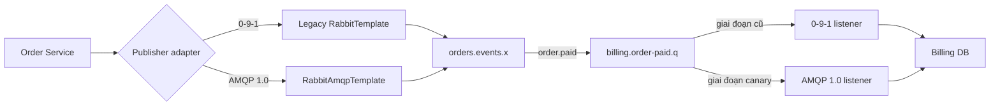
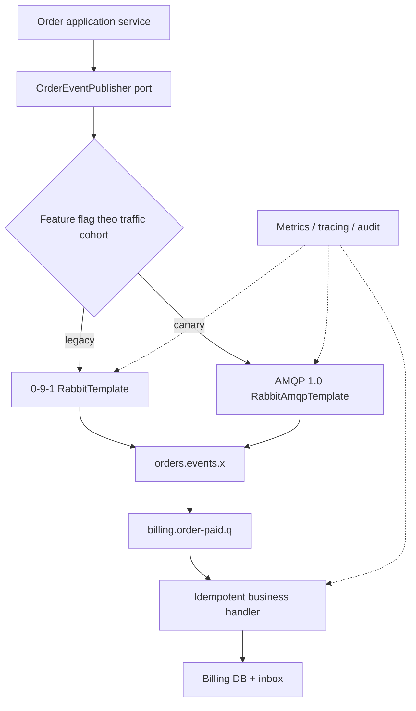
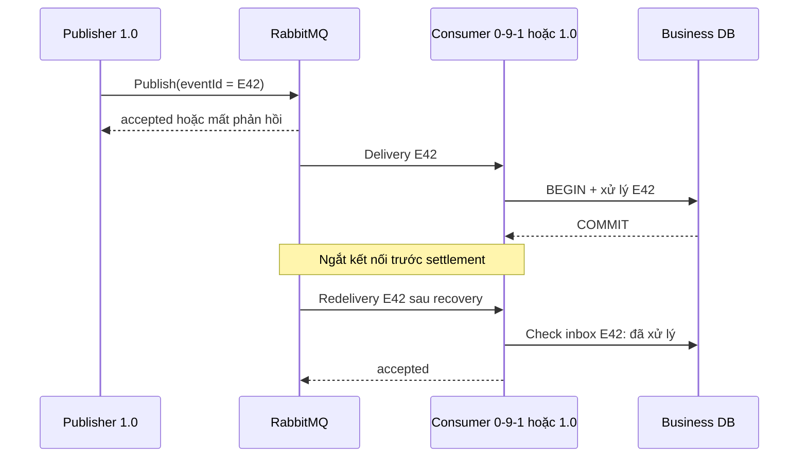

# Kế hoạch chuyển protocol và kiểm thử tương thích nghiệp vụ

## 1. Mục tiêu: chuyển transport nhưng không làm đổi kết quả nghiệp vụ

Giả sử hệ thống đặt hàng đang dùng **Spring AMQP** với RabbitMQ theo giao thức **AMQP 0-9-1**:

1. `RabbitTemplate` gửi sự kiện `OrderPaid` tới exchange `orders.events.x`, routing key `order.paid`.
2. Exchange chuyển sự kiện qua binding đến queue `billing.order-paid.q`.
3. `@RabbitListener` cập nhật trạng thái hóa đơn và gửi ACK sau khi lưu thành công.
4. Lỗi tạm thời được retry; lỗi vĩnh viễn được đưa vào dead-letter queue (DLQ).

Nhóm phát triển muốn chuyển một phần client sang **AMQP 1.0** để tận dụng giao thức mới. Mục tiêu không phải chỉ là “kết nối được tới port 5672” mà là duy trì những cam kết quan trọng:

- Cùng một sự kiện hợp lệ phải đến **đúng queue**, được giải mã đúng và tạo **cùng trạng thái nghiệp vụ**.
- Lỗi, retry, dead-letter, redelivery và timeout phải có kết quả **được định nghĩa**, không âm thầm mất dữ liệu.
- Một sự kiện được giao hai lần không được tạo hai hóa đơn hay trừ tiền hai lần.
- Có thể triển khai theo từng đợt, quan sát kết quả và quay lại client cũ mà **không làm hỏng dữ liệu đang xử lý**.

Đây là chủ đề **“Kế hoạch chuyển protocol và kiểm thử tương thích nghiệp vụ”** thuộc chương **AMQP 1.0**, module `SPRING_AMQP`. Bài kết hợp exchange, queue, binding, `RabbitTemplate`, `@RabbitListener`, xác nhận giao nhận, transaction và quan sát hệ thống để xây một **kế hoạch migration có cổng kiểm thử rõ ràng**.

> **Phạm vi phiên bản:** RabbitMQ hỗ trợ AMQP 1.0 trực tiếp từ RabbitMQ 4.0; AMQP 0-9-1 vẫn được hỗ trợ song song. Spring AMQP 4.0 bổ sung module `spring-rabbitmq-client` dành riêng cho RabbitMQ AMQP 1.0; từ Spring AMQP 4.1 có thêm `spring-amqp-client` dùng Qpid ProtonJ2 cho các broker AMQP 1.0 nói chung. Các ví dụ tích hợp dưới đây nhắm **Spring Boot 4.x/Spring AMQP 4.x**. Ứng dụng còn dùng Spring Boot 3.x/Spring AMQP 3.x phải lập kế hoạch nâng cấp dependency hoặc tích hợp client 1.0 riêng, **không** coi đây là thay đổi một property là xong.

## 2. Không phải nâng cấp nhỏ từ 0-9-1 lên 1.0

**AMQP 1.0 và AMQP 0-9-1 là hai wire protocol khác nhau**, không phải hai minor version có thể thay nhau sử dụng trên cùng một client/channel. RabbitMQ 4.x phân biệt protocol qua phần mở đầu của kết nối TCP/TLS; cổng mặc định `5672` có thể nhận cả hai protocol nhưng **client phải hỗ trợ protocol tương ứng**.

| Khía cạnh | AMQP 0-9-1 truyền thống | AMQP 1.0 với RabbitMQ | Hệ quả khi migration |
| --- | --- | --- | --- |
| Lớp API Java | `RabbitTemplate`, `CachingConnectionFactory`, `RabbitAdmin` | `RabbitAmqpTemplate`, `AmqpConnectionFactory`, `RabbitAmqpAdmin` (client riêng cho RabbitMQ); hoặc generic `AmqpClient` | Đổi dependency, lifecycle và một phần cách gọi API |
| Tổ chức giao tiếp | Connection → channel → `basic.publish`, `basic.consume` | Connection → session/link, sender/receiver, flow credit, settlement | Không dùng `Channel` 0-9-1 để điều khiển delivery 1.0 |
| Định tuyến | Exchange + routing key; consume từ queue | RabbitMQ vẫn có exchange/queue/binding, nhưng client 1.0 dùng **address** | Phải map địa chỉ và quyền truy cập |
| Xác nhận gửi | Publisher confirms và returned message | Kết quả sender settlement như `accepted`, `rejected`, `released` | Chuyển **ý nghĩa kết quả**, không chỉ đổi tên callback |
| Xác nhận nhận | `basicAck`, `basicNack`, `basicReject` | `accepted`, `released`, `rejected`, `modified` (khi broker hỗ trợ) | Kiểm tra từng nhánh lỗi/đường DLQ |
| Giới hạn message | Prefetch/QoS, ACK | Link credit/flow control, settlement | Cần đo lại throughput và số delivery chưa hoàn tất |
| Rabbit transaction | `tx.select`/`tx.commit` trên channel 0-9-1 | **RabbitMQ AMQP 1.0 hiện không hỗ trợ transaction** | Luồng phụ thuộc `channelTransacted` phải thiết kế lại |
| Payload/metadata | Body byte array, properties và headers | AMQP 1.0 message sections, properties, application-properties/annotations | Phải kiểm tra chuyển đổi liên protocol, đặc biệt kiểu dữ liệu |
| Topology recovery | Spring `RabbitAdmin` trên connection 0-9-1 | `RabbitAmqpAdmin` trên connection AMQP 1.0 hoặc công cụ hạ tầng riêng | Không tự coi các cơ chế admin/recovery tương đương tuyệt đối |

RabbitMQ khuyến nghị AMQP 1.0 cho ứng dụng mới; tuy nhiên **việc chuyển một ứng dụng cũ vẫn phải dựa vào các tính năng nó đang sử dụng**. Không nên di chuyển khi luồng nghiệp vụ bắt buộc một tính năng chưa được hỗ trợ trong broker/client đích.

## 3. Bắt đầu bằng inventory và bản đồ dependency

Trước khi sửa Java code, liệt kê **tất cả endpoint và cam kết thực tế**. Đừng chỉ tìm `RabbitTemplate.convertAndSend`: một ứng dụng có thể dùng `@RabbitListener`, request/reply, DLX, TTL, manual ACK, queue quorum, stream, publisher confirm hoặc Rabbit transaction trong những đường xử lý khác.

| Hạng mục cần chụp lại | Câu hỏi phải trả lời | Bằng chứng |
| --- | --- | --- |
| Broker/vhost | Phiên bản RabbitMQ? Các node/cluster cùng hỗ trợ 1.0? Authentication và TLS? | Version, topology và cấu hình kết nối |
| Exchange/queue/binding | Exchange type, routing key, DLX, TTL, queue type, durability có gì? | Definitions/Management UI/IaC |
| Publisher | Có kiểm tra confirm/return? Retry bao nhiêu lần? Event ID ở đâu? | Code và log publish |
| Consumer | ACK tự động hay thủ công? Side effect nào xảy ra trước ACK? | Listener factory, handler và transaction |
| Payload | JSON/Avro/Protobuf, charset, content type, schema version? | Mẫu message thật đã ẩn dữ liệu nhạy cảm |
| Headers/properties | `messageId`, `correlationId`, `replyTo`, expiration, timestamp, application headers được dùng thế nào? | Contract test và message fixture |
| Retry/DLQ | Retry nóng, delayed retry, TTL/DLX, poison message, redelivery count? | Queue policies và logs |
| Request/reply | Caller timeout, correlation, response route, hủy request? | RPC tests |
| Giao dịch | Có `channelTransacted`, `RabbitTransactionManager`, synchronization với DB? | Config và failure tests |
| SLO | P95/P99 latency, throughput, backlog, tỷ lệ lỗi tối đa? | Dashboard baseline từ bản 0-9-1 |

Đầu ra của giai đoạn này là một **bản kiểm kê có chủ sở hữu và tiêu chí pass/fail**, không phải một danh sách API dự định thay. Cần phân loại đường xử lý thành ba nhóm:

1. **Có thể chuyển ngay:** publish/consume thông thường, payload rõ ràng, không dùng tính năng thiếu ở client 1.0.
2. **Cần adapter hoặc thay đổi thiết kế:** custom header, RPC, manual ACK, retry, transaction với database, phụ thuộc semantics client.
3. **Tạm giữ 0-9-1:** đường xử lý dùng tính năng AMQP 0-9-1 chưa có trong RabbitMQ AMQP 1.0 hoặc cần kiểm chứng thêm.

### Sơ đồ luồng và vị trí thay protocol



**Chú ý:** `C0` và `C1` cùng consume `billing.order-paid.q` là **competing consumers**; mỗi message thường chỉ đến một trong hai, không phải hai bản copy để so kết quả. Muốn shadow test, phải tạo **queue thử nghiệm riêng**, cùng nhận message đã được định tuyến thích hợp, và vô hiệu hóa side effect thực ở nhánh shadow.

## 4. Map địa chỉ AMQP 0-9-1 sang AMQP 1.0

RabbitMQ 4.x vẫn dùng topology exchange/queue/binding. Nhưng AMQP 1.0 client chỉ định **target/source address**; với RabbitMQ nên dùng cú pháp **address v2**:

| Ý định | AMQP 0-9-1 | AMQP 1.0 address v2 |
| --- | --- | --- |
| Publish tới exchange `orders.events.x`, routing key `order.paid` | `convertAndSend("orders.events.x", "order.paid", body)` | `/exchanges/orders.events.x/order.paid` |
| Publish tới fanout exchange `alerts.x` | `convertAndSend("alerts.x", "", body)` | `/exchanges/alerts.x` |
| Publish trực tiếp tới queue `jobs.work.q` qua default exchange | `convertAndSend("", "jobs.work.q", body)` | `/queues/jobs.work.q` |
| Consume queue `billing.order-paid.q` | `@RabbitListener(queues = "billing.order-paid.q")` | Source `/queues/billing.order-paid.q` ở tầng protocol |

RabbitMQ **không** dùng cú pháp địa chỉ v1 cũ `/exchange/...` hoặc `/queue/...` làm chuẩn mới; địa chỉ v1 đã bị deprecated. Đối với address v2, dấu `/` nằm trong tên exchange/routing key/queue phải **percent-encode**: routing key `orders/eu` trở thành `orders%2Feu`, không tự tách thêm một path segment.

Ví dụ:

```text
Exchange:   orders.events.x
RoutingKey: order.paid
Target:     /exchanges/orders.events.x/order.paid
Source:     /queues/billing.order-paid.q

Exchange:   amq.direct
RoutingKey: orders/eu
Target:     /exchanges/amq.direct/orders%2Feu
```

**Quyền truy cập** vẫn cần đúng vhost và permission. Gửi tới `/queues/:queue` về nội bộ dùng default exchange nên phải có quyền write thích hợp lên `amq.default`. Address sai hoặc queue/exchange không tồn tại phải được đưa vào negative tests, không để ứng dụng chỉ nhìn “send method không ném exception”.

### Dùng API Spring nào?

Nếu chỉ nhắm RabbitMQ, `spring-rabbitmq-client` có `RabbitAmqpTemplate` cho phép gửi bằng **exchange và routing key tương tự API Spring quen thuộc**. Nếu mục tiêu là **portability AMQP 1.0 giữa các broker**, `spring-amqp-client` cung cấp `AmqpClient` và bạn cần cấu hình address phù hợp với **broker đích**. `/exchanges/...` và `/queues/...` là **quy ước địa chỉ của RabbitMQ**, không phải syntax bắt buộc của mọi AMQP 1.0 broker.

## 5. So khớp message contract trước khi chuyển publisher

Việc broker hỗ trợ hai protocol **không đồng nghĩa byte và metadata tương đương** sau chuyển đổi. Tốt nhất, định nghĩa một contract nghiệp vụ **độc lập với wire protocol**.

### 5.1. Business envelope có định danh ổn định

Ví dụ payload JSON:

```json
{
  "eventId": "evt-9b5b2d",
  "eventType": "OrderPaid",
  "schemaVersion": 1,
  "orderId": "ORD-42",
  "aggregateVersion": 3,
  "occurredAt": "2026-11-26T02:00:00Z",
  "paymentId": "PAY-101"
}
```

Contract xác định rõ:

- `eventId` dùng **idempotency/dedup**, phải giữ nguyên nếu publish lại sau timeout.
- `orderId` là khóa nghiệp vụ; `aggregateVersion` là thứ tự của một order, **không** thay bằng delivery tag hay link transfer ID.
- `schemaVersion` giúp consumer diễn giải dữ liệu qua các lần nâng cấp.
- `occurredAt` ở dạng UTC ISO-8601, không phụ thuộc đơn vị giây/millisecond của timestamp trong protocol.
- `paymentId` phải có quy tắc bất biến; nhận duplicate không làm xử lý thanh toán hai lần.

Đừng để các trường bắt buộc chỉ tồn tại trong headers của một protocol. Có thể đặt `messageId`, `correlationId`, `contentType`, `traceId` trong metadata để hỗ trợ quan sát, nhưng các khóa nghiệp vụ quan trọng cần được chuẩn hóa trong contract.

### 5.2. Những phép chuyển đổi cần kiểm tra thật

RabbitMQ có cơ chế **inter-protocol property conversion** khi message được publish bằng protocol này nhưng consume bằng protocol khác. Các quy tắc không phải ánh xạ một-một vô điều kiện:

| Trường | Điều cần thử | Rủi ro nếu bỏ qua |
| --- | --- | --- |
| Body | AMQP 1.0 `data` (một section) ↔ body bytes 0-9-1 | Nếu publish `amqp-value`/nhiều sections, 0-9-1 consumer có thể nhận **AMQP-encoded bytes**, không còn JSON/plain text như mong đợi |
| `content-type`/`content-encoding` | Chuỗi và charset thực tế | Message converter chọn sai kiểu |
| `message-id` | String, UUID, binary, giá trị dài | Có thể đổi dạng text hoặc được chuyển sang header dự phòng |
| `correlation-id` | Kiểu dữ liệu, giới hạn độ dài và mốc khớp request | RPC consumer không ghép được response |
| `reply-to` | `my.reply.q` ↔ `/queues/my.reply.q` | Reply gửi sai queue, timeout |
| Timestamp | AMQP 0-9-1 timestamp giây ↔ AMQP 1.0 milliseconds | Thời gian sai gấp 1.000 lần nếu tự parse |
| Expiration/TTL | String milliseconds ↔ numeric TTL | Message hết hạn sớm hoặc muộn |
| Headers/application-properties | Kiểu chuỗi, số, binary, danh sách/map lồng nhau | Có thuộc tính bị bỏ qua hoặc không convert được |
| Delivery mode | Persistent/nonpersistent ↔ durable flag | Hiểu sai mức độ bền của message |
| `x-*` headers | Có thể chuyển thành AMQP 1.0 annotations | Không nên tự gán các annotation do broker sở hữu như `x-exchange`, `x-routing-key` để điều khiển routing |

Ví dụ: RabbitMQ chuyển một AMQP 1.0 message có **một `data` section** thành body bytes để consumer 0-9-1 đọc. Với một `amqp-value` phức tạp, payload có thể được chuyển thành **encoded AMQP 1.0**, kèm `type="amqp-1.0"` ở phía 0-9-1. Đây không phải JSON string. Vì vậy không thể chỉ gửi một message `"hello"` và kết luận mọi kiểu payload được bảo toàn.

**Nguyên tắc test:** So sánh **giá trị được business handler diễn giải**, đồng thời kiểm tra metadata bắt buộc và ghi lại khác biệt protocol có chủ đích. Không đòi mọi header/wire byte hoàn toàn giống nhau nếu contract không yêu cầu.

## 6. Settlement và lỗi: ánh xạ dựa trên ý nghĩa

Đối với AMQP 0-9-1, lập trình viên quen thuộc với publisher confirms và consumer `basicAck`/`basicNack`. AMQP 1.0 sử dụng **delivery outcomes/settlement**. RabbitMQ định nghĩa những ý nghĩa cụ thể:

| Vai trò | Kết quả 1.0 | Ý nghĩa với RabbitMQ | Tương ứng thực dụng ở 0-9-1 |
| --- | --- | --- | --- |
| Publisher | `accepted` | Các queue đích chấp nhận publish | Publisher `basic.ack` |
| Publisher | `rejected` | Broker từ chối publish (ví dụ queue quá giới hạn) | Publisher `basic.nack` |
| Publisher | `released` | Không route được vào queue nào | `basic.return` (với `mandatory`) và confirm |
| Consumer | `accepted` | Đã xử lý; broker có thể xóa delivery | `basicAck` |
| Consumer | `released` | Không xử lý; broker requeue | `basicNack(..., requeue=true)` |
| Consumer | `rejected` | Không xử lý được; DLX nếu cấu hình, nếu không có thể bị loại | `basicReject(..., requeue=false)` |
| Consumer | `modified` | Xử lý theo annotations/chỉ dẫn sửa đổi trong RabbitMQ | Không có tương đương đơn giản một-một |

Lưu ý cùng một từ `released` có ý nghĩa khác giữa **publisher** (không có queue nhận) và **consumer** (requeue). Vì thế **đừng dùng một enum kết quả chung** cho hai phía mà thiếu `direction`.

### Ví dụ lỗi không được phép thành công giả

```text
Publisher gửi /exchanges/orders.events.x/order.paid
  ├─ accepted  -> được broker xác nhận
  ├─ rejected  -> xử lý lỗi/quá tải, retry có backoff nếu phù hợp
  ├─ released  -> kiểm tra routing, exchange, binding, quyền
  └─ timeout   -> kết quả không chắc chắn; retry với cùng eventId
```

Nếu publisher nhận `released`, đó không phải tín hiệu để tiếp tục đánh dấu outbox `PUBLISHED`. Khi một API Spring trả `CompletableFuture<Boolean>`, **luôn kiểm tra giá trị false và exceptional completion**, không chỉ đợi Future hoàn tất.

### Retry, dead-letter, requeue

Định nghĩa lại bảng xử lý lỗi theo nghiệp vụ:

| Tình huống | Mong muốn | Test phải chứng minh |
| --- | --- | --- |
| Consumer commit DB thành công | Không chạy lại side effect | Consumer settle `accepted` sau commit; replay cùng `eventId` là no-op |
| DB tạm unavailable | Có thể thử lại | Không settle thành công; requeue/backoff theo chính sách |
| Payload invalid/schema không hỗ trợ | Không lặp vô hạn | `rejected` → DLQ (khi queue có DLX) hoặc quy trình parking |
| Lỗi do binding sai | Không âm thầm mất event | Publisher nhận kết quả lỗi/unroutable; hệ thống cảnh báo |
| Broker ngắt ngay sau khi đã chấp nhận publish | Trạng thái publish chưa chắc chắn | Retry cùng `eventId` mà không sinh nghiệp vụ trùng |
| Consumer chết sau DB commit, trước settlement | Redelivery là điều có thể xảy ra | Inbox/version guard chặn side effect lần hai |

Các policy như queue TTL, dead-letter exchange, quorum queue delivery-limit tồn tại ở **broker**. Migration client vẫn phải kiểm tra outcome tương ứng, không suy rằng vì queue/DLX giữ nguyên thì client mới sẽ tự xử lý exception như client cũ.

## 7. Kiến trúc migration: adapter và feature flag, không thay trực tiếp toàn hệ thống

Thiết kế một **cổng phát sự kiện nghiệp vụ**, ví dụ `OrderEventPublisher`, để business service không phụ thuộc trực tiếp `RabbitTemplate` hay `RabbitAmqpTemplate`.



**Feature flag chỉ quyết định một producer thực sự phát event**, không mặc định publish cùng event qua cả hai protocol vào queue thật. Nếu cố dual-publish để thử, consumer có thể nhận **hai message**; chỉ được làm khi có cơ chế dedup chắc chắn và mục tiêu thử nghiệm đã được chấp thuận.

Một luồng an toàn hơn khi cần so sánh song song:

- **Primary route:** chỉ một producer gửi event tới exchange/queue nghiệp vụ thật.
- **Shadow route:** tạo một **queue thử nghiệm riêng** nhận bản copy từ exchange/binding phù hợp; shadow consumer chỉ parse/validate và tính kết quả giả lập, **không** gọi API thanh toán hay ghi bảng nghiệp vụ thật.
- **Result comparator:** ghi `eventId`, schema version, parse result, field khác biệt; so sánh theo cùng `eventId`, không so thứ tự nhận tuyệt đối của hai queue.

Nếu broker topology hiện tại không cho phép fan-out an toàn, hãy replay một tập fixture dữ liệu đã ẩn thông tin nhạy cảm trên **broker/vhost thử nghiệm riêng**. Không shadow consume trên cùng work queue vì sẽ **cướp message** từ consumer thật.

## 8. Tích hợp Spring Boot 4.x: chạy hai client song song

Đoạn sau minh họa API hiện hành; không giả định repository đang học đã nâng dependency. Xác định phiên bản Spring Boot/Spring AMQP thực tế trước khi áp dụng.

### 8.1. Chọn dependency đúng mục đích

Với Spring Boot 4.x:

```gradle
dependencies {
    // Client RabbitMQ AMQP 0-9-1 truyền thống:
    implementation("org.springframework.boot:spring-boot-starter-rabbitmq")

    // Client RabbitMQ-specific AMQP 1.0:
    implementation("org.springframework.boot:spring-boot-starter-amqp-rabbitmq")

    // Chọn thay thế khi cần AMQP 1.0 đa broker:
    // implementation("org.springframework.boot:spring-boot-starter-amqp")
}
```

Thường **không cần cả RabbitMQ-specific và generic AMQP 1.0** nếu không có lý do rõ ràng. Nếu dùng Spring AMQP trực tiếp thay vì Boot starter, module tương ứng là `spring-rabbit` (0-9-1), `spring-rabbitmq-client` (RabbitMQ 1.0) hoặc `spring-amqp-client` (generic 1.0).

Trong Spring Boot 4.x, các namespace configuration khác nhau:

```yaml
spring:
  rabbitmq:                      # RabbitMQ AMQP 0-9-1
    host: localhost
    port: 5672
    username: ${RABBIT_USER}
    password: ${RABBIT_PASSWORD}

  amqp:
    rabbitmq:                    # RabbitMQ AMQP 1.0
      host: localhost
      port: 5672
      username: ${RABBIT_USER}
      password: ${RABBIT_PASSWORD}
```

Hai client có thể kết nối tới **cùng broker và vhost**. Chúng không cùng chia sẻ một `ConnectionFactory` Java: tên interface của module 1.0 là `org.springframework.amqp.rabbitmq.client.AmqpConnectionFactory`, còn 0-9-1 là `org.springframework.amqp.rabbit.connection.ConnectionFactory`. Không vô tình inject một factory cho cả hai.

Khi triển khai thực tế, thêm TLS/CA/cert, vhost và credentials tối thiểu. RabbitMQ yêu cầu **SASL** cho kết nối AMQP 1.0; cần kiểm thử authentication/authorization ngay từ giai đoạn tích hợp.

### 8.2. Publisher cũ và publisher mới cùng payload

Ví dụ dùng **cùng Spring AMQP `Message` với body JSON UTF-8**. Phần JSON đã chứa `eventId` và `schemaVersion`, nên consumer ở protocol nào cũng có thể diễn giải contract khi broker chuyển đổi message đúng.

```java
import java.nio.charset.StandardCharsets;

import org.springframework.amqp.core.Message;
import org.springframework.amqp.core.MessageDeliveryMode;
import org.springframework.amqp.core.MessageProperties;

public final class OrderEventMessages {

    private OrderEventMessages() {}

    public static Message json(String eventId, String json) {
        MessageProperties props = new MessageProperties();
        props.setContentType("application/json");
        props.setContentEncoding("UTF-8");
        props.setMessageId(eventId);
        props.setDeliveryMode(MessageDeliveryMode.PERSISTENT);

        return new Message(
                json.getBytes(StandardCharsets.UTF_8), props);
    }
}
```

Gửi qua protocol cũ:

```java
import org.springframework.amqp.core.Message;
import org.springframework.amqp.rabbit.core.RabbitTemplate;
import org.springframework.stereotype.Service;

@Service
public class LegacyOrderEventSender {
    private final RabbitTemplate rabbitTemplate;

    public LegacyOrderEventSender(RabbitTemplate rabbitTemplate) {
        this.rabbitTemplate = rabbitTemplate;
    }

    public void send(Message event) {
        rabbitTemplate.send(
                "orders.events.x", "order.paid", event);

        // Đây chỉ là lời gọi gửi; muốn bảo đảm broker nhận,
        // cần publisher confirms/returns và xử lý lỗi tương ứng.
    }
}
```

Gửi qua protocol 1.0, sử dụng module `spring-rabbitmq-client`:

```java
import java.util.concurrent.CompletableFuture;
import org.springframework.amqp.core.Message;
import org.springframework.amqp.rabbitmq.client.RabbitAmqpTemplate;
import org.springframework.stereotype.Service;

@Service
public class Amqp10OrderEventSender {
    private final RabbitAmqpTemplate rabbitAmqpTemplate;

    public Amqp10OrderEventSender(RabbitAmqpTemplate rabbitAmqpTemplate) {
        this.rabbitAmqpTemplate = rabbitAmqpTemplate;
    }

    public CompletableFuture<Boolean> send(Message event) {
        return rabbitAmqpTemplate.send(
                "orders.events.x", "order.paid", event);
    }
}
```

`RabbitAmqpTemplate` thực hiện chuyển đổi Spring `Message` sang AMQP 1.0 message và cung cấp kết quả bất đồng bộ. Trong code nghiệp vụ, **không** tự coi `CompletableFuture` tồn tại là publish thành công; xử lý `true`, `false`, timeout và exception theo contract đã định nghĩa.

Ví dụ kiểm tra kết quả trong tầng ứng dụng (thời hạn chỉ để minh họa):

```java
import java.util.concurrent.TimeUnit;

Boolean accepted = amqp10Sender.send(event)
        .get(10, TimeUnit.SECONDS);

if (!Boolean.TRUE.equals(accepted)) {
    throw new IllegalStateException(
            "Publish was not accepted by RabbitMQ");
}
```

Nếu `.get(...)` timeout, kết quả thực tế **chưa chắc chắn**: broker có thể đã nhận nhưng phản hồi không đến kịp. Khi publish lại, cần giữ nguyên `eventId`. Producer nên dùng **transactional outbox** nếu event phải được phát chắc chắn sau database commit; protocol 1.0 không làm hai commit database/broker thành một transaction.

### 8.3. Listener AMQP 1.0 và sự khác biệt settlement

Spring AMQP 4.x có `RabbitAmqpListenerContainerFactory` cho RabbitMQ AMQP 1.0. Một cách khai báo factory rõ ràng:

```java
import org.springframework.amqp.rabbitmq.client.AmqpConnectionFactory;
import org.springframework.amqp.rabbitmq.client.RabbitAmqpListenerContainerFactory;
import org.springframework.context.annotation.Bean;
import org.springframework.context.annotation.Configuration;

@Configuration
public class Amqp10ListenerConfiguration {

    @Bean("amqp10ListenerFactory")
    public RabbitAmqpListenerContainerFactory amqp10ListenerFactory(
            AmqpConnectionFactory connectionFactory) {
        return new RabbitAmqpListenerContainerFactory(connectionFactory);
    }
}
```

Consumer minh họa **manual settlement** cho queue canary riêng:

```java
import org.springframework.amqp.core.AmqpAcknowledgment;
import org.springframework.amqp.rabbit.annotation.RabbitListener;
import org.springframework.stereotype.Component;

@Component
public class CanaryOrderEventListener {
    private final OrderEventContractValidator validator;

    public CanaryOrderEventListener(
            OrderEventContractValidator validator) {
        this.validator = validator;
    }

    @RabbitListener(
            id = "amqp10OrderCanary",
            queues = "billing.order-paid.canary.q",
            containerFactory = "amqp10ListenerFactory",
            ackMode =
                "#{T(org.springframework.amqp.core.AcknowledgeMode).MANUAL}")
    public void inspect(
            String json,
            AmqpAcknowledgment acknowledgment) {
        try {
            // Chỉ parse và so khớp contract, không ghi hóa đơn thật.
            validator.verify(json);
            acknowledgment.acknowledge();
        } catch (InvalidContractException invalid) {
            acknowledgment.acknowledge(
                    AmqpAcknowledgment.Status.REJECT);
        } catch (TransientValidationException retryable) {
            acknowledgment.acknowledge(
                    AmqpAcknowledgment.Status.REQUEUE);
        }
    }
}
```

`OrderEventContractValidator`, `InvalidContractException` và `TransientValidationException` là **các kiểu nghiệp vụ minh họa cần tự triển khai**. `acknowledgment.acknowledge()` tương ứng accepted, `Status.REQUEUE` tương ứng requeue, còn `Status.REJECT` yêu cầu không xử lý tiếp (DLQ nếu topology có DLX). Không ACK một delivery hai lần.

Trong ứng dụng thật, tránh `REQUEUE` liên tục không delay khi downstream lỗi dài. Và đừng để listener canary cùng nghe `billing.order-paid.q` rồi gọi nhầm xử lý nghiệp vụ: mục đích canary này là **đo tính tương thích**, không thay thế primary consumer.

### 8.4. Khi cần client AMQP 1.0 độc lập broker

Nếu cần giao tiếp ngoài RabbitMQ (ví dụ một broker AMQP 1.0 khác), module generic Spring AMQP 4.1+ dùng `AmqpClient` và `@AmqpListener`:

```java
import org.springframework.amqp.client.AmqpClient;
import org.springframework.stereotype.Service;

@Service
public class GenericAmqpPublisher {
    private final AmqpClient client;

    public GenericAmqpPublisher(AmqpClient client) {
        this.client = client;
    }

    public void send(String json) {
        client.to("/exchanges/orders.events.x/order.paid")
                .body(json)
                .send();
    }
}
```

Địa chỉ ở ví dụ trên **chỉ đúng theo quy ước RabbitMQ v2**. Với broker khác phải cấu hình address và semantics do broker đó hỗ trợ. `send()` vẫn trả một kết quả bất đồng bộ; code production phải theo dõi completion thay vì bỏ qua như snippet minh họa. **Không dùng `@RabbitListener` của RabbitMQ-specific client để thay thế trực tiếp `@AmqpListener` của generic module**.

## 9. Kế hoạch từng pha và tiêu chí chuyển giai đoạn

Đề xuất sáu pha; mỗi pha có **đầu ra kiểm chứng được** và điều kiện dừng rõ:

| Pha | Thực hiện | Điều kiện đi tiếp | Phương án quay lại |
| --- | --- | --- | --- |
| 0. Baseline | Ghi version, topology, SLO, contract fixtures, cơ chế retry/DLQ/transaction | Có inventory đầy đủ và owner phê duyệt phạm vi | Giữ nguyên 0-9-1 |
| 1. Sandbox | RabbitMQ 4.x, client 1.0, publish/consume liên protocol, test payload/headers/settlement | Bộ compatibility tests pass; chưa có side effect thật | Hủy môi trường thử |
| 2. Shadow read | Queue shadow riêng, consumer 1.0 parse/so sánh với primary | Không có schema drift, không có side effect, đủ traffic đại diện | Stop shadow consumer |
| 3. Publisher canary | Chọn tỷ lệ rất nhỏ producer phát qua 1.0 vào queue thật, còn primary consumer cũ | Zero unexpected unroutable; error/latency/duplicate trong ngưỡng | Chuyển flag publisher về 0-9-1 |
| 4. Consumer canary | Chuyển có kiểm soát consumer 1.0 trên **partition/queue riêng** hoặc một lượng delivery xác định | DB effects, ACK, DLQ, retry, redelivery tests pass | Stop 1.0 consumers, khôi phục 0-9-1 consumers |
| 5. Mở rộng & ổn định | Tăng từng nấc, quan sát đủ cửa sổ lỗi và SLA, giữ đường rollback | SLO ổn định, backlog không tăng, replay/đối soát đạt | Giảm/đảo traffic theo kế hoạch |

Thứ tự publisher trước hay consumer trước **không cố định**, vì RabbitMQ có thể chuyển đổi inter-protocol. Chọn phía có phạm vi tác động nhỏ hơn để canary trước. Điều quan trọng là kiểm chứng đủ **bốn chiều publish/consume**:

| Publisher | Consumer | Vai trò trong test |
| --- | --- | --- |
| 0-9-1 | 0-9-1 | Baseline |
| **1.0** | **0-9-1** | Chứng minh consumer cũ hiểu message do publisher mới tạo |
| **0-9-1** | **1.0** | Chứng minh consumer mới đọc được dữ liệu lịch sử/producer cũ |
| **1.0** | **1.0** | Đích sau migration |

Khi kiểm thử trên **cùng một queue**, mỗi test phải chạy độc lập, chỉ có **một consumer** thực sự lấy message. Không mở hai consumer và mong cả hai đều nhận cùng một delivery. Để so song song, dùng **hai queue có routing tương đương** với hai consumer riêng.

### Gợi ý lộ trình theo một tuần triển khai

Không cần buộc mọi tổ chức dùng cùng mốc ngày, nhưng mỗi đợt nên có:

1. **Go/no-go trước canary**: xác minh version, auth, topology, rollback flag và dashboard.
2. **Canary nhỏ**: dùng key/cohort cố định theo tenant hoặc partition để dễ đối chiếu.
3. **Observation window**: chờ đủ thời gian để thấy những retry chậm, late DLQ, backlog và duplicate.
4. **Tăng nấc**: chỉ tăng khi kết quả batch trước đã đối soát xong.
5. **Freeze/rollback** khi chạm ngưỡng lỗi; chỉ mở lại sau khi sửa root cause và chạy lại tests.

Không dùng randomized traffic per event nếu cùng `orderId` cần bảo đảm thứ tự; nên route ổn định theo **business key** trong suốt một giai đoạn migration.

## 10. Bộ compatibility tests phải đánh giá *nghiệp vụ*, không chỉ HTTP 200

### 10.1. Contract test matrix

Tạo một bộ **golden messages** (ẩn thông tin cá nhân) có đủ trường hợp:

| Mã test | Dữ liệu đầu vào | Kỳ vọng |
| --- | --- | --- |
| CT-01 | JSON hợp lệ có `eventId`, schemaVersion, UTF-8 | Cả bốn hướng protocol parse giống nhau |
| CT-02 | Ký tự tiếng Việt/emoji, dấu `/` trong routing key | Body không lỗi charset; address v2 encode đúng |
| CT-03 | `content-type=application/json`, binary body | Converter chọn đúng schema |
| CT-04 | Correlation ID string và UUID | Ghép đúng request/reply, không đổi ID bất ngờ |
| CT-05 | Header chuỗi, số, map/array lồng nhau | Phát hiện chính xác trường nào preserve/convert/drop |
| CT-06 | Publish đến exchange không có binding | 1.0 publisher không coi `released` là success |
| CT-07 | Publish đến exchange không tồn tại/không có quyền | Negative outcome/exception và cảnh báo |
| CT-08 | TTL ngắn, timeout trong xử lý | Message hết hạn theo cấu hình được chấp thuận |
| CT-09 | Consumer lỗi tạm thời | Redelivery có kiểm soát, không ACK nhầm |
| CT-10 | Consumer lỗi vĩnh viễn | Đi DLQ/parking đúng policy, không lặp vô hạn |
| CT-11 | Broker mất kết nối khi publish | Kết quả bất định được retry cùng `eventId`, không double effect |
| CT-12 | DB commit xong nhưng settlement thất lạc | Redelivery → inbox bỏ qua tác động trùng |
| CT-13 | Hai event cùng order đến lệch thứ tự | Guard `aggregateVersion` không cho ghi vượt version |
| CT-14 | Producer/consumer nhiều instance | Backlog, credit, fairness và concurrency trong giới hạn |
| CT-15 | RPC request/reply với timeout | ReplyTo/correlation/late reply được xử lý đúng |
| CT-16 | Rollback feature flag giữa tải thật | Không mất/nhân đôi side effect ngoài chính sách retry |

Nên có thêm contract test cho `message-id` dài, dạng binary, header thuộc namespace `x-*`, malformed UTF-8, payload rỗng, oversize payload, binary protobuf/Avro, và các thuộc tính không hỗ trợ chuyển đổi. **Dữ liệu quan trọng phải nằm trong body hoặc một contract adapter được kiểm tra**, không phụ thuộc header mapping ngầm.

### 10.2. Ví dụ JUnit 5: publish 1.0, consume 0-9-1

Giả sử trên **RabbitMQ 4.x thử nghiệm** đã tạo exchange `compat.test.x`, queue `compat.from10.q` và binding routing key `from10`. Không chạy listener nền cùng lấy message khỏi queue test này.

```java
import static org.junit.jupiter.api.Assertions.*;

import java.nio.charset.StandardCharsets;
import java.util.concurrent.TimeUnit;

import org.junit.jupiter.api.Test;
import org.springframework.amqp.core.Message;
import org.springframework.amqp.rabbit.core.RabbitTemplate;
import org.springframework.amqp.rabbitmq.client.RabbitAmqpTemplate;
import org.springframework.boot.test.context.SpringBootTest;
import org.springframework.test.context.TestConstructor;

@SpringBootTest
@TestConstructor(autowireMode = TestConstructor.AutowireMode.ALL)
class ProtocolCompatibilityIT {
    private final RabbitAmqpTemplate amqp10;
    private final RabbitTemplate legacy09;

    ProtocolCompatibilityIT(
            RabbitAmqpTemplate amqp10,
            RabbitTemplate legacy09) {
        this.amqp10 = amqp10;
        this.legacy09 = legacy09;
    }

    @Test
    void amqp10PublisherMustBeReadableByLegacyConsumer()
            throws Exception {
        String payload = """
                {"eventId":"evt-test-01","eventType":"OrderPaid",
                 "schemaVersion":1,"orderId":"ORD-42",
                 "aggregateVersion":3}
                """;
        Message original =
                OrderEventMessages.json("evt-test-01", payload);

        Boolean accepted = amqp10.send(
                "compat.test.x", "from10", original)
                .get(10, TimeUnit.SECONDS);
        assertEquals(Boolean.TRUE, accepted);

        Message received = legacy09.receive(
                "compat.from10.q", 10_000L);
        assertNotNull(received);
        assertEquals("application/json",
                received.getMessageProperties().getContentType());
        assertEquals(payload,
                new String(received.getBody(), StandardCharsets.UTF_8));

        // Trong test thật: deserialize JSON và so sánh eventId,
        // orderId, aggregateVersion, nghiệp vụ dự kiến.
    }
}
```

Lớp trên là **minh họa một integration test** dùng Spring Test constructor injection. Để chạy thực tế cần tạo topology bằng admin/test fixture, cung cấp hai template đúng connection/protocol, kết nối RabbitMQ test 4.x và cô lập từng queue test. **Không** dùng queue production hoặc dùng chung queue này với listener thật; phải xác nhận `accepted` và binding, tránh làm test treo do broker chưa sẵn sàng.

Chiều ngược lại **0-9-1 → 1.0** cần một queue test độc lập, publish bằng `RabbitTemplate` rồi nhận bằng `RabbitAmqpTemplate`/native AMQP 1.0 client, so sánh JSON, metadata và business outcome. Sau đó thử cả 1.0 → 1.0 và baseline 0-9-1 → 0-9-1.

### 10.3. Contract tests cho idempotency: cùng event, một effect

Trong billing DB, thiết kế bảng inbox:

```sql
CREATE TABLE processed_events (
    event_id VARCHAR(128) PRIMARY KEY,
    processed_at TIMESTAMPTZ NOT NULL DEFAULT now()
);
```

Handler thực hiện **trong cùng database transaction**:

```text
BEGIN
  INSERT processed_events(event_id)
    ON CONFLICT DO NOTHING
  IF new eventId:
    validate order + aggregate version
    apply billing update
COMMIT
SETTLE accepted (hoặc gửi ACK)
```

Nếu database commit xong nhưng consumer mất connection trước settlement, RabbitMQ có thể redeliver message qua cả protocol cũ hoặc mới. Handler nhìn thấy `eventId` đã commit thì **bỏ qua side effect và xác nhận thành công**. Inbox DB không bảo vệ những external API không có idempotency key; với thanh toán phải thêm khóa giao dịch/bù trừ phù hợp.

## 11. Kiểm thử lỗi hạ tầng và chuyển đổi traffic

### Fault injection theo từng cửa sổ lỗi



| Điểm gây lỗi | Bằng chứng bắt buộc |
| --- | --- |
| Chặn TCP trước khi sender mở link | Retry/backoff, không tạo false success |
| Broker nhận publish nhưng client mất outcome | Trạng thái bất định, retry dùng cùng eventId |
| Exchange/binding bị xóa | Sender nhận released/rejected/exception; cảnh báo |
| Consumer process chết trước database commit | DB rollback; message được giao lại |
| Process chết sau DB commit, trước settlement | Inbox chặn double effect |
| DLX không route được tới DLQ | Cảnh báo về cấu hình mất dữ liệu; không coi là thành công nghiệp vụ |
| Consumer quá chậm, credit/prefetch không hợp lý | Backlog và memory nằm trong giới hạn |
| Rollback từ 1.0 về 0-9-1 | Consumer cũ đọc được message mới đã publish; không hỏng schema hoặc ID |

Khi test lỗi, **đừng chỉ kiểm tra số message trong queue**. Cần kiểm tra **trạng thái database**, số lần gọi external side effect, event ID đã được dedup, message ở DLQ và lịch sử retry.

### Kiểm tra transaction: một cổng chặn trước khi chuyển

RabbitMQ 0-9-1 có các transaction AMQP giới hạn trên channel; RabbitMQ AMQP 1.0 hiện **không hỗ trợ transaction**. Nếu ứng dụng đang dựa vào `channelTransacted=true`, `RabbitTransactionManager` hoặc Best Efforts 1 Phase Commit với database thì **không thể sao chép nguyên cấu hình** sang client AMQP 1.0 và cho rằng semantics giống cũ.

Với việc “cập nhật DB rồi phát sự kiện”, nên đánh giá **transactional outbox**:

1. Cùng DB transaction ghi order và `outbox_events` với `eventId`.
2. Relay publish qua 1.0, đợi outcome thành công và ghi `PUBLISHED`.
3. Khi outcome timeout, giữ event để retry với **cùng `eventId`**.
4. Consumer dedup bằng inbox hoặc khóa nghiệp vụ.

Đó là **eventual consistency có thể phục hồi**, không phải distributed atomic transaction giữa DB và RabbitMQ. Trước khi chuyển traffic nghiệp vụ tiền tệ, phải chạy đầy đủ các failure tests và đối soát số liệu.

## 12. SLO, quan sát và tiêu chí rollback

Khi canary, phân tách metrics theo **protocol, client version, broker/vhost, queue, message type và cohort**. Một bảng dashboard tối thiểu:

| Metric | Mục đích |
| --- | --- |
| `publish_accepted / attempted` | Tỷ lệ publish thực sự được xác nhận |
| `publish_released`, `publish_rejected`, timeout | Phát hiện unroutable, từ chối và trạng thái bất định |
| Queue depth / message age / consumer count | Phát hiện backlog, listener không theo kịp |
| `processing_latency_p95/p99` | So sánh baseline và canary |
| `redelivery_rate`, `dlq_depth`, retry count | Đánh giá lỗi và poison messages |
| `business_duplicate_prevented` | Bao nhiêu lần inbox/guard chặn trùng |
| `business_outcome_mismatch` | Hai protocol cho kết quả nghiệp vụ khác nhau trong fixture/shadow |
| Connection recovery/link attach failures | Lỗi authentication, vhost, credit, reconnect |
| `event_gap_count` / missing version | Phát hiện sai thứ tự hoặc thiếu sự kiện |

**Ví dụ ngưỡng canary** (chỉ là mẫu; thay bằng baseline/SLO của dự án):

- **Không có** `business_outcome_mismatch` ở fixture bắt buộc.
- **Không có** sự kiện `OrderPaid` bị xử lý hai lần thành double charge.
- Không có tăng bất thường của unroutable, DLQ hay schema errors so với baseline.
- P95/P99 latency và backlog không vượt ngưỡng SLO đã được nhóm vận hành thông qua.
- Đã chạy rollback drill thành công trong môi trường thử nghiệm với message đang `unacked`.

Nếu một điều kiện **blocking** thất bại, tạm dừng nâng cohort. Rollback chỉ đổi **đường gửi/nhận của message mới**, không rollback database và không thu hồi những event đã publish. Sau rollback, vẫn phải **drain/đối soát** các message đang ở queue, retry queue và DLQ.

### Runbook rollback tối thiểu

1. Đóng feature flag làm tăng traffic AMQP 1.0, dừng mở rộng cohort.
2. Chọn **một** publisher path cho event mới (tránh dual-publish không chủ đích).
3. Dừng consumer 1.0 theo cơ chế graceful shutdown; đảm bảo delivery đang xử lý được settle hoặc redeliver theo quy tắc.
4. Bật lại consumer 0-9-1 ở đúng queue/partition, không đổi tên queue tùy tiện.
5. Quan sát `ready`, `unacked`, redelivery, DLQ và trạng thái inbox/DB.
6. Đối soát event IDs thiếu, trùng, phiên bản aggregate bị gap; replay có kiểm soát nếu cần.
7. Ghi nhận root cause, version và fixture gây lỗi rồi bổ sung test trước khi thử canary lại.

**Giữ đường rollback khả dụng** cho tới khi đã vượt đủ thời gian quan sát và chứng minh các luồng cũ không còn phụ thuộc 0-9-1. Không xóa queue hoặc cắt đường 0-9-1 chỉ vì một ngày canary không có lỗi.

## 13. Checklist phê duyệt chuyển protocol

| Điều kiện | Xác nhận |
| --- | --- |
| RabbitMQ version và client framework tương thích | [ ] |
| Không sử dụng tính năng 0-9-1 bắt buộc nhưng chưa có trong 1.0 | [ ] |
| Exchange/queue/binding và address v2 chính xác | [ ] |
| SASL, TLS, vhost và quyền publisher/consumer đúng | [ ] |
| Test đủ bốn chiều 0-9-1/1.0 publish và consume | [ ] |
| Body, schema, content-type, headers và correlation đúng contract | [ ] |
| `accepted`/`released`/`rejected` và settlement phía consumer được xử lý | [ ] |
| Retry, DLQ, timeout, crash sau DB commit đã được kiểm thử | [ ] |
| Idempotency và version guard hoạt động dưới redelivery | [ ] |
| Canary/shadow không tạo tác động nghiệp vụ trùng | [ ] |
| Dashboard và ngưỡng go/no-go có chủ sở hữu | [ ] |
| Rollback drill và đối soát dữ liệu đã chạy thành công | [ ] |

## 14. Câu hỏi tự kiểm tra

1. Vì sao RabbitMQ chấp nhận cả AMQP 0-9-1 và 1.0 trên cùng port **không** khiến `RabbitTemplate` 0-9-1 tự nói được AMQP 1.0?
2. Từ `RabbitTemplate.convertAndSend("orders.events.x", "order.paid", body)`, hãy xác định address v2 tương ứng. Nếu routing key chứa dấu `/`, cần xử lý gì?
3. Vì sao cần kiểm thử **bốn chiều publish/consume** thay vì chỉ 1.0 → 1.0?
4. Một AMQP 1.0 publisher bị `released`. Điều này khác gì `released` do consumer trả về?
5. Body dạng `amqp-value` có thể gây vấn đề gì cho consumer 0-9-1 chỉ biết giải mã UTF-8 JSON?
6. Nếu consumer old/new cùng đọc **một queue**, đó có phải shadow testing đúng nghĩa không? Cách bố trí queue nào an toàn hơn?
7. Vì sao không thể mang nguyên `channelTransacted=true` và `RabbitTransactionManager` sang AMQP 1.0 của RabbitMQ?
8. Broker đã nhận publish nhưng phản hồi bị mất: có được tạo một `eventId` mới khi retry không? Vì sao?
9. Sau database commit nhưng trước settlement, process chết. Thiết kế inbox giúp bảo đảm nghiệp vụ như thế nào?
10. Cần so sánh những metric và điều kiện nào trước khi tăng canary từ nhóm khách hàng nhỏ lên lưu lượng lớn?
11. Vì sao rollback protocol **không** đồng nghĩa rollback những side effect đã hoàn tất trong DB?
12. Viết kế hoạch migration cho một service có RPC, TTL/DLX và thanh toán: luồng nào có thể chuyển trước, luồng nào phải giữ lại để nghiên cứu thêm?

**Ghi nhớ:** Migration từ AMQP 0-9-1 sang AMQP 1.0 là **thay đổi protocol và client semantics**, không chỉ là đổi dependency. RabbitMQ 4.x hỗ trợ cả hai, nhưng application phải kiểm thử kỹ **routing, body/metadata conversion, settlement, retry, transaction, correlation và idempotency**. Thực hiện theo các pha inventory → compatibility tests → shadow → canary → tăng dần, với **feature flag, metric nghiệp vụ và rollback plan** rõ ràng. Một migration thành công là khi **kết quả nghiệp vụ không đổi** ngay cả trong những tình huống lỗi khó nhất.

### Tài liệu tham khảo chính thức

- [RabbitMQ — AMQP 1.0](https://www.rabbitmq.com/docs/amqp): phiên bản, address v2, inter-protocol interoperability, settlement outcomes và giới hạn hỗ trợ.
- [RabbitMQ — Inter-Protocol Property Conversions](https://www.rabbitmq.com/docs/conversions): mapping body, message ID, correlation ID, headers, TTL và kiểu dữ liệu giữa 0-9-1/1.0.
- [RabbitMQ — Compatibility and Conformance](https://www.rabbitmq.com/docs/specification): phạm vi hỗ trợ AMQP 1.0 và 0-9-1.
- [Spring AMQP — RabbitMQ AMQP 1.0 Support](https://docs.spring.io/spring-amqp/reference/rabbitmq-amqp-client.html): `RabbitAmqpTemplate`, `RabbitAmqpAdmin`, listener factory và settlement.
- [Spring AMQP — Generic AMQP 1.0 Support](https://docs.spring.io/spring-amqp/reference/amqp10-client.html): `AmqpClient` và `@AmqpListener` với Qpid ProtonJ2.
- [Spring Boot — AMQP](https://docs.spring.io/spring-boot/reference/messaging/amqp.html): starter, auto-configuration và property namespace cho ba kiểu client.
