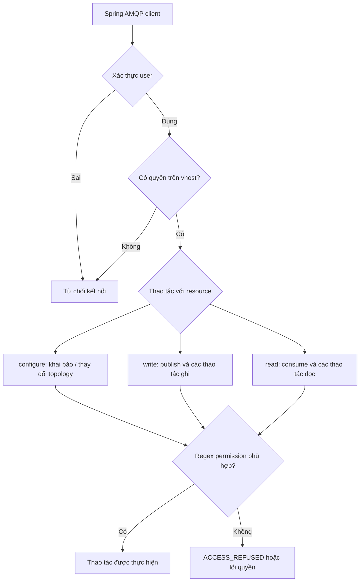
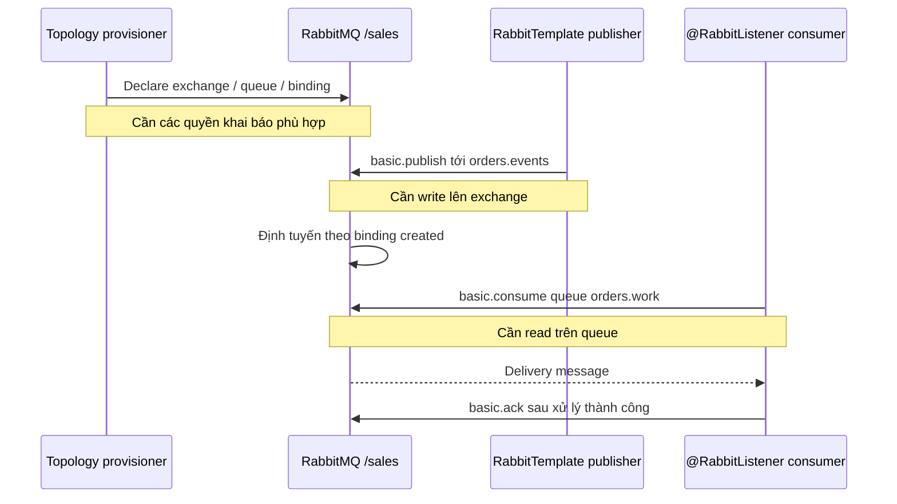

# Tài khoản RabbitMQ và quyền `configure`, `write`, `read` trên virtual host

Một hệ thống dùng **Spring AMQP** thường có hai loại thành phần: producer gửi message bằng `RabbitTemplate` và consumer xử lý message bằng `@RabbitListener`. Chúng kết nối RabbitMQ để sử dụng exchange, queue và binding. Nếu tất cả thành phần đều dùng tài khoản quản trị có toàn quyền, một lỗi cấu hình hoặc credential bị lộ có thể cho phép ứng dụng sửa topology, đọc message không thuộc phạm vi hoặc gửi message đến một đích ngoài ý muốn.

Trong chương **Bảo mật** của **SPRING_AMQP**, bài học này tập trung vào **tài khoản RabbitMQ và ba quyền AMQP `configure`, `write`, `read` trong phạm vi virtual host (vhost)**. Mục tiêu là thiết kế quyền tối thiểu cho producer, consumer và tiến trình khai báo topology; cấu hình Spring Boot đúng credential; nhận diện lỗi phân quyền và kiểm chứng các giới hạn bảo vệ khi ứng dụng cần retry, dead-letter và quan sát hệ thống.

## 1. Ba câu hỏi khác nhau: xác thực, chọn vhost và cấp quyền

RabbitMQ cần kiểm tra nhiều bước trước khi cho ứng dụng sử dụng một queue hoặc exchange:

1. **Authentication — Bạn là ai?** Client gửi thông tin xác thực theo cơ chế được cấu hình, ví dụ tên người dùng/mật khẩu qua AMQP SASL hoặc phương thức khác mà broker hỗ trợ.
2. **Vhost access — Bạn được mở connection vào vhost này không?** Một connection AMQP gắn với một vhost cụ thể; user phải được cấp quyền vào vhost đó.
3. **Resource authorization — Bạn được làm gì với tài nguyên nào?** RabbitMQ kiểm tra `configure`, `write` và `read` với tên exchange/queue cần sử dụng.



**Vhost không phải user.** Một user có thể được cấp quyền ở nhiều vhost; nhiều user có thể chia sẻ một vhost. Quyền của user ở vhost `sales` không tự áp dụng cho vhost `billing`, dù hai bên đều có queue tên `orders.work`.

Ví dụ:

```text
RabbitMQ broker
├── vhost /sales
│   ├── exchange orders.events
│   └── queue    orders.work
└── vhost /billing
    ├── exchange orders.events
    └── queue    orders.work

app_sales chỉ được cấp quyền trên /sales
app_billing chỉ được cấp quyền trên /billing
```

Tên queue giống nhau **không** làm chúng trở thành cùng một queue. Producer không thể gửi từ vhost này sang vhost khác bằng cách thêm `tenantId` vào header hoặc đổi routing key; việc chuyển dữ liệu giữa vhost cần một cơ chế cầu nối được thiết kế và cấp quyền riêng.

## 2. Ý nghĩa chính xác của `configure`, `write` và `read`

RabbitMQ dùng ba nhóm permission theo **biểu thức chính quy (regular expression)** để kiểm soát tên resource trong một vhost.

| Quyền | Thao tác tiêu biểu | Tài nguyên được so khớp | Ví dụ nhu cầu |
|---|---|---|---|
| `configure` | Khai báo/xóa queue hoặc exchange, thay đổi một số thuộc tính topology | Tên queue/exchange | `RabbitAdmin` tạo `orders.work` |
| `write` | Publish bằng `basic.publish`, và một số thao tác liên quan đến binding | Tên exchange hoặc resource theo thao tác | `RabbitTemplate` gửi tới `orders.events` |
| `read` | `basic.consume`, `basic.get`, và một số thao tác liên quan đến binding | Tên queue hoặc resource theo thao tác | `@RabbitListener` đọc `orders.work` |

Những thao tác như **khai báo binding** có thể cần kiểm tra nhiều quyền trên các tài nguyên liên quan, không chỉ `configure` của queue. Vì vậy, user dùng để tạo topology phải được cấp **đủ quyền cho từng thao tác thực tế**; user chỉ gửi/nhận message không nhất thiết được cấp quyền khai báo binding.

### 2.1. Quyền `configure` không phải quyền “được gửi”

Một producer thuần túy có thể chỉ cần `write` trên exchange đã tồn tại. Cấp thêm `configure` nghĩa là mở rộng khả năng thao tác topology; đây không phải điều kiện bắt buộc để publish vào một exchange đã được khai báo sẵn.

Ngược lại, một ứng dụng sử dụng `RabbitAdmin` để tự tạo queue/exchange/binding có thể bị từ chối nếu chỉ có `write`/`read`. Khi đó, vấn đề không phải do listener không biết nhận payload, mà là **runtime đang cố thực hiện thao tác quản trị topology**.

### 2.2. Quyền `write` áp dụng cho exchange, không kiểm tra `tenantId` trong body

Producer được cấp `write` trên `orders.events` có thể publish vào exchange đó theo quy tắc định tuyến của exchange và các cơ chế quyền bổ sung nếu được cấu hình. Quyền `write` thông thường **không có nghĩa** RabbitMQ sẽ đọc JSON và chỉ chấp nhận những message có `tenantId` hợp lệ.

Nếu cần phân quyền theo routing key trên **topic exchange**, RabbitMQ còn có cơ chế *topic permissions* chuyên biệt trong những trường hợp được hỗ trợ. Quyền đó là một lớp kiểm tra bổ sung; nó không thay thế quyền resource ở cấp exchange/vhost và không mặc định áp dụng cho mọi loại exchange.

### 2.3. Quyền `read` không cho phép đọc mọi queue cùng vhost

Consumer cần `read` đối với queue nó muốn subscribe. Khi dùng biểu thức chính quy giới hạn đúng `orders.work`, consumer không tự có quyền đọc `payments.work`.

**Chú ý:** permission áp dụng cho **tên resource** và loại thao tác. RabbitMQ không tự biết hai queue nào “thuộc cùng khách hàng” nếu ứng dụng dùng một user được cấp `.*` trên toàn vhost.

## 3. Cách đọc và thiết kế regex permission

RabbitMQ thường nhận ba regex theo thứ tự **configure, write, read**. Dùng ký tự neo `^` và `$` giúp giới hạn đúng tên cần cấp.

Giả sử vhost `/sales` có:

```text
Exchange: orders.events
Queue:    orders.work
Routing:  created
```

| Regex | Ý nghĩa |
|---|---|
| `^orders\.events$` | Chỉ khớp tên `orders.events` |
| `^orders\.work$` | Chỉ khớp tên `orders.work` |
| `^orders\..*$` | Khớp mọi tên bắt đầu bằng `orders.`; **rộng hơn nhiều** |
| `.*` | Khớp mọi tên; chỉ nên dùng khi thực sự muốn cấp quyền rộng |
| `^$` | Thường dùng để không cấp quyền trên các resource có tên thông thường; cần chú ý trường hợp resource đặc biệt như default exchange |

Trong regex, dấu chấm `.` tự nó khớp **một ký tự bất kỳ**, không nhất thiết là dấu chấm trong tên resource. Vì vậy `^orders.events$` có thể khớp những tên ngoài dự kiến; để biểu thị dấu chấm thật, dùng `\.`.

Ví dụ, `^orders\..*$` được dùng cho toàn bộ exchange/queue bắt đầu bằng `orders.`, trong khi `^orders\.events$` cấp quyền đúng **một exchange**. Khi thiết kế least privilege, ưu tiên tên chính xác thay cho tiền tố rộng nếu danh sách tài nguyên ổn định.

**Không xem `^$` là cơ chế “deny all” hoàn hảo với mọi tài nguyên đặc biệt.** Default exchange của RabbitMQ có tên giao thức đặc biệt và các quy tắc kiểm tra quyền riêng cần được kiểm thử. Nếu ứng dụng dùng default exchange hoặc queue name do server sinh, hãy kiểm tra chính xác phiên bản và hành vi broker trước khi kết luận một regex đã chặn toàn bộ đường truy cập.

## 4. Ba danh tính điển hình: publisher, consumer và topology administrator

Một chính sách dễ kiểm soát là tách vai trò của từng thành phần:

| Danh tính | `configure` | `write` | `read` | Công việc |
|---|---|---|---|---|
| `orders_publisher` | Không cấp trên resource thông thường | `orders.events` | Không cấp | Gửi sự kiện đơn hàng |
| `orders_consumer` | Không cấp | Không cấp | `orders.work` | Đọc và xử lý message |
| `orders_provisioner` | Các resource được phép khai báo | Các quyền cần cho binding | Các quyền cần cho binding | Tạo exchange, queue, binding |

Các dòng trên là **phân quyền theo trách nhiệm**, không phải danh sách permission duy nhất bắt buộc cho mọi ứng dụng. Chẳng hạn:

- Một listener vừa nhận message vừa **gửi reply** hoặc phát một sự kiện mới có thể cần thêm quyền `write` trên exchange reply/sự kiện.
- Một service dùng `RabbitTemplate.convertSendAndReceive()` có thể cần các quyền phục vụ nhận phản hồi, tùy cơ chế reply queue, direct reply-to và cách client vận hành.
- Một hệ thống xử lý lỗi bằng **dead-letter exchange** cần cấu hình topology/quyền phù hợp với cơ chế broker và luồng republish thủ công. Không suy rằng runtime luôn phải có quyền `write` vào DLX chỉ vì queue sử dụng dead-lettering.
- Một listener gọi `RabbitAdmin` khi start sẽ cần các quyền khai báo, hoặc phải chuyển trách nhiệm khai báo cho tiến trình provisioning.

### Vì sao nên tách provisioner khỏi runtime?

Khi exchange, queue và binding đã được quản lý bằng IaC hoặc pipeline triển khai, producer/consumer ít khi cần quyền thay đổi topology. Nếu tài khoản runtime bị lộ, việc thiếu `configure` sẽ hạn chế khả năng kẻ tấn công xóa hoặc sửa những tài nguyên chỉ được phép khai báo bởi provisioner.

Tách tài khoản cũng giúp phân biệt trong audit: một hành động tạo queue là việc của provisioning, không phải của consumer đang xử lý message.

## 5. Thực hành cấp quyền bằng `rabbitmqctl`

Các lệnh dưới đây giả định đang chạy trên môi trường quản trị RabbitMQ phù hợp, có quyền quản lý user/vhost. **Không chạy chúng bằng credential ứng dụng thông thường.** Trong môi trường thật, nên dùng automation/IaC, kiểm soát truy cập quản trị và secret manager.

### 5.1. Tạo vhost và chuẩn bị user

```bash
# Tạo vhost cho hệ thống bán hàng.
rabbitmqctl add_vhost /sales

# Giả sử ba tài khoản đã được provisioning bằng phương thức quản lý
# danh tính và mật khẩu an toàn của tổ chức:
#   orders_publisher, orders_consumer, orders_provisioner
#
# Không ghi mật khẩu thật vào script được commit hoặc command history.
```

Có thể tạo user, xoay vòng mật khẩu và thu hồi user qua công cụ RabbitMQ phù hợp, nhưng nên dùng cơ chế cấp secret không làm lộ mật khẩu trong lịch sử lệnh/process list. Việc tạo một user **không tự cấp toàn quyền trên mọi vhost**.

### 5.2. Cấp quyền riêng cho publisher và consumer

```bash
# Configure / Write / Read, theo đúng thứ tự.
# Publisher chỉ có write vào exchange orders.events.
rabbitmqctl set_permissions -p /sales orders_publisher \
  '^$' '^orders\.events$' '^$'

# Consumer chỉ có read từ queue orders.work.
rabbitmqctl set_permissions -p /sales orders_consumer \
  '^$' '^$' '^orders\.work$'

# Provisioner được quản lý hai tên resource trong ví dụ.
# Quyền write/read kèm theo phục vụ các thao tác khai báo binding.
rabbitmqctl set_permissions -p /sales orders_provisioner \
  '^orders\.(events|work)$' \
  '^orders\.(events|work)$' \
  '^orders\.(events|work)$'
```

Trong ví dụ, vhost được viết là `/sales`; đây là tên vhost nguyên văn, không phải đường dẫn file. Khi dùng default vhost `/`, phải truyền chính xác `-p /` ở CLI hoặc escape/URL-encode đúng ngữ cảnh nếu truy cập Management HTTP API.

**Kiểm tra lại ngay sau khi cấp:**

```bash
rabbitmqctl list_vhosts
rabbitmqctl list_permissions -p /sales
rabbitmqctl list_user_permissions orders_publisher
rabbitmqctl list_user_permissions orders_consumer
rabbitmqctl list_user_permissions orders_provisioner
```

Ở thời điểm này, các tài khoản chưa thể sử dụng một exchange/queue **chưa tồn tại** nếu quyền không cho phép tự khai báo nó. Provisioning phải tạo `orders.events`, `orders.work` và binding `created` trong `/sales` trước khi service runtime bắt đầu.

### 5.3. Thu hồi quyền

```bash
# Thu hồi quyền AMQP của publisher đối với vhost /sales.
rabbitmqctl clear_permissions -p /sales orders_publisher

# Có thể cấp lại quyền tối thiểu khi đã xử lý nguyên nhân.
rabbitmqctl set_permissions -p /sales orders_publisher \
  '^$' '^orders\.events$' '^$'
```

Thu hồi permission không nhất thiết ngay lập tức xử lý mọi connection/channel đã mở và mọi thông điệp đang bay qua hệ thống theo cách ứng dụng mong muốn. Khi cần vô hiệu credential bị lộ, cần có quy trình cắt/kiểm tra kết nối hiện hữu, xoay secret, xác minh việc từ chối kết nối mới và audit tác động.

## 6. Phân quyền nào được kiểm tra ở từng thao tác AMQP?

Hãy nhìn vòng đời một message từ producer đến consumer:



Thao tác `basic.ack` xác nhận delivery; nó **không tự cấp quyền read** trên queue khác. Với `@RabbitListener` chạy ở acknowledge mode `AUTO`, container xác nhận theo kết quả method; nếu xử lý exception, cấu hình retry/requeue/dead-letter quyết định việc tiếp theo. Đừng nhầm `read` của ACL với `basic.ack`: hai khái niệm khác nhau.

### Lỗi `ACCESS_REFUSED` và lỗi `NOT_FOUND` khác nhau

- **`ACCESS_REFUSED`:** user được xác thực nhưng không đủ quyền với resource/thao tác, hoặc bị giới hạn ở vhost không được phép.
- **`NOT_FOUND`:** exchange/queue không tồn tại trong vhost đang kết nối, dù resource có thể tồn tại ở một vhost khác.
- **`PRECONDITION_FAILED`:** khai báo resource có cùng tên nhưng thuộc tính khác với resource đã có, chẳng hạn khác durability/queue arguments. Đây không nhất thiết là lỗi permission.
- **Lỗi authentication/TLS:** connection bị từ chối trước khi tới bước kiểm tra quyền resource.

Vì vậy, gặp lỗi không tìm thấy queue không có nghĩa nên cấp `.*` cho user. Trước hết cần kiểm tra **host, vhost, tên queue/exchange, quyền và topology**.

## 7. Tích hợp vào Spring Boot với credential tối thiểu

Ví dụ dùng **Spring Boot 3.x, Java 17+ và Spring AMQP**. Producer và consumer được triển khai trong cùng một ứng dụng minh họa nhưng dùng **hai tài khoản riêng**. Trong production, hai thành phần này thường nằm ở các service riêng, mỗi service chỉ nhận credential cần thiết.

### 7.1. Dependency và cấu hình

```groovy
dependencies {
    implementation 'org.springframework.boot:spring-boot-starter-amqp'
}
```

Ví dụ `application.yml`:

```yaml
app:
  amqp:
    host: localhost
    port: 5672
    virtual-host: /sales
    publisher:
      username: orders_publisher
      password: ${AMQP_ORDERS_PUBLISHER_PASSWORD}
    consumer:
      username: orders_consumer
      password: ${AMQP_ORDERS_CONSUMER_PASSWORD}
```

Hai biến môi trường phải được cấp bằng cơ chế quản lý secret phù hợp. Ví dụ dùng broker cục bộ để dễ học; môi trường thật cần TLS, xác minh server certificate, cấu hình timeout, rotation credential và chính sách truy cập network.

**Yêu cầu trước khi chạy:** vhost `/sales` đã tồn tại; exchange `orders.events` loại `direct`, queue `orders.work` và binding routing key `created` đã được provisioner khai báo. Không để runtime có quyền hạn chế vừa tự tạo topology vừa mong mọi declare đều thành công.

### 7.2. Tạo hai connection factory và một template gửi

```java
import org.springframework.amqp.rabbit.connection.CachingConnectionFactory;
import org.springframework.amqp.rabbit.connection.ConnectionFactory;
import org.springframework.amqp.rabbit.core.RabbitTemplate;
import org.springframework.beans.factory.annotation.Qualifier;
import org.springframework.beans.factory.annotation.Value;
import org.springframework.context.annotation.Bean;
import org.springframework.context.annotation.Configuration;

@Configuration
public class RestrictedAmqpConnections {

    @Bean("ordersPublisherConnectionFactory")
    public CachingConnectionFactory ordersPublisherConnectionFactory(
            @Value("${app.amqp.host}") String host,
            @Value("${app.amqp.port}") int port,
            @Value("${app.amqp.virtual-host}") String vhost,
            @Value("${app.amqp.publisher.username}") String username,
            @Value("${app.amqp.publisher.password}") String password) {
        return create(host, port, vhost, username, password);
    }

    @Bean("ordersConsumerConnectionFactory")
    public CachingConnectionFactory ordersConsumerConnectionFactory(
            @Value("${app.amqp.host}") String host,
            @Value("${app.amqp.port}") int port,
            @Value("${app.amqp.virtual-host}") String vhost,
            @Value("${app.amqp.consumer.username}") String username,
            @Value("${app.amqp.consumer.password}") String password) {
        return create(host, port, vhost, username, password);
    }

    private static CachingConnectionFactory create(
            String host, int port, String vhost,
            String username, String password) {
        CachingConnectionFactory factory =
                new CachingConnectionFactory(host, port);
        factory.setVirtualHost(vhost);
        factory.setUsername(username);
        factory.setPassword(password);
        return factory;
    }

    @Bean("ordersPublisherTemplate")
    public RabbitTemplate ordersPublisherTemplate(
            @Qualifier("ordersPublisherConnectionFactory")
                    ConnectionFactory connectionFactory) {
        return new RabbitTemplate(connectionFactory);
    }
}
```

Điểm quan trọng: `ordersPublisherTemplate` **chỉ có connection factory với credential publisher**. Không nên dùng bean có quyền quản trị cho tất cả `RabbitTemplate` chỉ để tránh viết cấu hình.

Nếu ứng dụng có nhiều `ConnectionFactory`, Spring Boot có thể không tự chọn được một bean mặc định. Phải dùng `@Qualifier` ở các điểm inject, và cấu hình listener factory rõ ràng. Không đặt `@Primary` bừa bãi vì một injection thiếu qualifier có thể ngầm lấy nhầm account hoặc vhost.

### 7.3. Listener factory với quyền `read`

```java
import org.springframework.amqp.core.AcknowledgeMode;
import org.springframework.amqp.rabbit.annotation.EnableRabbit;
import org.springframework.amqp.rabbit.config.SimpleRabbitListenerContainerFactory;
import org.springframework.amqp.rabbit.connection.ConnectionFactory;
import org.springframework.beans.factory.annotation.Qualifier;
import org.springframework.context.annotation.Bean;
import org.springframework.context.annotation.Configuration;

@Configuration
@EnableRabbit
public class RestrictedListenerConfiguration {

    @Bean("ordersConsumerFactory")
    public SimpleRabbitListenerContainerFactory ordersConsumerFactory(
            @Qualifier("ordersConsumerConnectionFactory")
                    ConnectionFactory connectionFactory) {
        SimpleRabbitListenerContainerFactory factory =
                new SimpleRabbitListenerContainerFactory();
        factory.setConnectionFactory(connectionFactory);
        factory.setAcknowledgeMode(AcknowledgeMode.AUTO);
        factory.setConcurrentConsumers(2);
        factory.setPrefetchCount(10);
        factory.setDefaultRequeueRejected(false);
        return factory;
    }
}
```

Do queue đã tồn tại và listener dùng `queues = "orders.work"`, runtime tiêu thụ không cần thực hiện hành động tự tạo topology. Để bảo đảm chính sách least privilege, tránh cấu hình `RabbitAdmin`/auto-declare chạy bằng credential listener nếu tài khoản này không được cấp `configure`.

`setDefaultRequeueRejected(false)` chỉ là chính sách minh họa để tránh lặp requeue vô hạn trong trường hợp xử lý lỗi: message bị reject không requeue và có thể được dead-letter nếu queue có DLX hợp lệ. Không có DLX thì không tự xuất hiện một DLQ. Cần thiết kế retry, dead-letter và idempotency riêng cho nghiệp vụ thật.

### 7.4. Gửi và nhận sự kiện

```java
import org.springframework.amqp.rabbit.annotation.RabbitListener;
import org.springframework.amqp.rabbit.core.RabbitTemplate;
import org.springframework.beans.factory.annotation.Qualifier;
import org.springframework.stereotype.Service;
import org.springframework.stereotype.Component;

@Service
public class OrderCreatedPublisher {
    private final RabbitTemplate template;

    public OrderCreatedPublisher(
            @Qualifier("ordersPublisherTemplate") RabbitTemplate template) {
        this.template = template;
    }

    public void publish(String eventId) {
        if (eventId == null || eventId.isBlank()) {
            throw new IllegalArgumentException("eventId trống");
        }
        template.convertAndSend("orders.events", "created", eventId);
    }
}

@Component
public class OrderCreatedConsumer {

    @RabbitListener(
            queues = "orders.work",
            containerFactory = "ordersConsumerFactory")
    public void process(String eventId) {
        // Thực tế: xử lý idempotent và lưu trạng thái nghiệp vụ.
        System.out.println("Consumed event: " + eventId);
    }
}
```

Hai class `public` trong đoạn minh họa được đặt vào **hai file Java riêng** khi triển khai. Với `SimpleMessageConverter` mặc định và payload kiểu String, các method trên dễ kiểm thử. Nếu dùng DTO/JSON, producer và consumer phải thống nhất message converter, content type và version schema.

**Không suy rằng phép gửi thành công là broker/consumer đã hoàn thành mọi bước.** `RabbitTemplate.convertAndSend()` trả về không tương đương publisher confirm hoặc consumer ack. Muốn độ tin cậy publish cao hơn, bật publisher confirms, xử lý returned messages khi cần và có cơ chế retry/outbox cùng idempotency.

## 8. Khi `RabbitAdmin` cần quyền `configure`

Trong Spring AMQP, `RabbitAdmin` có thể tự khai báo những bean `Exchange`, `Queue`, `Binding` khi connection phù hợp được thiết lập. Điều này tiện cho môi trường học tập, nhưng có thể không phù hợp với runtime sử dụng quyền tối thiểu.

Ví dụ khai báo topology:

```java
import org.springframework.amqp.core.Binding;
import org.springframework.amqp.core.BindingBuilder;
import org.springframework.amqp.core.DirectExchange;
import org.springframework.amqp.core.Queue;
import org.springframework.amqp.core.QueueBuilder;
import org.springframework.context.annotation.Bean;
import org.springframework.context.annotation.Configuration;

@Configuration
public class OrdersTopology {

    @Bean
    public DirectExchange ordersExchange() {
        return new DirectExchange("orders.events");
    }

    @Bean
    public Queue ordersQueue() {
        return QueueBuilder.durable("orders.work").build();
    }

    @Bean
    public Binding ordersBinding() {
        return BindingBuilder.bind(ordersQueue())
                .to(ordersExchange()).with("created");
    }
}
```

**Đoạn topology này là một lựa chọn triển khai khác** so với giả định “pre-provisioned” của mục 7. Nếu đưa các bean này vào ứng dụng có nhiều connection factories/admin, phải kiểm soát **admin nào được phép declare** chúng. Không nên đưa vào project demo runtime tối thiểu mà chưa xác minh một `RabbitAdmin` có quyền phù hợp và được gắn đúng vhost.

Hai chiến lược phổ biến:

1. **Provisioning tách biệt:** pipeline quản trị tạo topology trước; runtime chỉ dùng `RabbitTemplate` và `@RabbitListener` với quyền `write` hoặc `read`. Đây thường là lựa chọn tốt cho production.
2. **Ứng dụng tự khai báo:** dùng account có quyền `configure` (và các quyền cần cho binding); kiểm soát bằng `RabbitAdmin` gắn đúng `ConnectionFactory` và giới hạn các tài nguyên được khai báo. Tránh trao tài khoản này cho mọi consumer/producer nếu không cần.

Nếu cấu hình nhiều RabbitAdmin cho nhiều vhost, có thể sử dụng `setExplicitDeclarationsOnly(true)` cùng `setAdminsThatShouldDeclare(...)` trên từng tài nguyên để ngăn admin khai báo chéo. Mức độ kiểm soát cần được kiểm thử bằng broker thật vì cùng một tên exchange/queue có thể tồn tại ở nhiều vhost.

## 9. User tags và Management UI không thay thế AMQP permissions

RabbitMQ còn có **user tags**, ví dụ các vai trò liên quan tới Management UI/API như `management`, `monitoring` hoặc `administrator` (tùy phiên bản, plugin và backend xác thực). Chúng khác với ba permission AMQP:

| Cơ chế | Mục đích |
|---|---|
| `configure`, `write`, `read` theo vhost | Giới hạn thao tác với AMQP resources |
| User tags cho Management plugin | Quy định phạm vi truy cập tính năng quản lý/giám sát |
| Authentication backend | Kiểm tra danh tính user khi kết nối |
| TLS/network policy | Bảo vệ đường truyền và giới hạn nơi có thể kết nối |
| Kiểm tra tenant trong ứng dụng | Xác minh quyền đối với đối tượng nghiệp vụ trong payload |

Không cấp `administrator` chỉ vì ứng dụng cần publish message. Đồng thời, không suy rằng có tag `management` là được quyền đọc mọi queue qua AMQP; quyền resource vẫn phải xét theo vhost và tài nguyên.

**Tài khoản quản trị, tài khoản provisioning và tài khoản runtime nên được quản lý riêng**, có audit và vòng đời credential độc lập.

## 10. Một trường hợp cần chú ý: topic exchange và routing key

Với topic exchange, khóa như `tenant.alpha.order.created` có thể mang ý nghĩa phân quyền. Nhưng quyền `write` trên exchange `orders.topic` thông thường chỉ xét **tên exchange**, không tự giới hạn mọi routing key có thể gửi.

RabbitMQ hỗ trợ **topic permissions** để kiểm soát thêm routing key trên topic exchange, nếu backend và phiên bản đang dùng áp dụng cơ chế này:

```bash
# Minh họa: publisher chỉ được publish topic key thuộc tenant.alpha.*
# Cần kiểm tra quyền resource write trên orders.topic riêng.
rabbitmqctl set_topic_permissions -p /sales \
  orders_publisher orders.topic \
  '^tenant\.alpha\..*$' '^$'
```

Các regex cuối thuộc phạm vi **write/read topic permissions**, không phải thứ tự configure/write/read của lệnh `set_permissions`. Lệnh này không cấp quyền tạo exchange và không thay thế permission cơ bản của user. Chỉ nên áp dụng sau khi kiểm thử tính tương thích với topic topology và cách routing key được thực thi trên RabbitMQ hiện hành.

Nếu mục tiêu là phân tách khách hàng nghiêm ngặt, **vhost riêng + user riêng** vẫn thường rõ ràng hơn việc chỉ dựa vào routing key, nhất là khi một service được quyền publish nhiều định dạng message.

## 11. Bảo vệ credential và đường truyền

Phân quyền tài nguyên sẽ mất nhiều ý nghĩa nếu credential bị lộ. Một số quy tắc vận hành quan trọng:

- **Không dùng user `guest` mặc định cho production.** Cấu hình mặc định RabbitMQ giới hạn `guest` ở kết nối loopback; không mở rộng quyền truy cập từ xa của user mặc định để thay cho quản lý tài khoản riêng.
- **Không hardcode password** trong Java source, `application.yml` được commit hoặc ví dụ debug. Dùng secret manager, biến môi trường/volume an toàn và cơ chế rotation.
- **Mã hóa kết nối bằng TLS** khi lưu lượng đi qua mạng không hoàn toàn tin cậy; kiểm tra certificate và hostname. TLS không thay thế các quyền AMQP.
- **Mỗi service hoặc vai trò có credential riêng.** Tránh một secret chung cho nhiều khách hàng hoặc nhiều môi trường.
- **Giới hạn network access** tới AMQP port và Management API; không mở console quản trị ra Internet nếu không có thiết kế bảo vệ cụ thể.
- **Đổi credential có kế hoạch:** tạo/kiểm thử tài khoản mới, cập nhật secret và triển khai, giám sát reconnect, sau đó thu hồi account cũ.
- **Audit thay đổi quyền:** biết ai đã chạy `set_permissions`, ai quản lý topology, khi nào một user được cấp quyền mới hoặc bị vô hiệu.

Nếu ứng dụng chạy nhiều replica, việc xoay credential có thể gây connection churn. Cần kiểm thử quy trình reload/restart kết nối, thời gian xử lý in-flight và khả năng RabbitMQ redeliver message chưa ack.

## 12. Phân quyền và xử lý bất đồng bộ đáng tin cậy liên quan thế nào?

Một chính sách least privilege phải đi cùng yêu cầu delivery reliability.

| Giai đoạn | Permission hoặc cấu hình liên quan | Rủi ro khi thiếu |
|---|---|---|
| Producer gửi `orders.events` | `write` lên exchange | Publish bị từ chối |
| Topology được tạo trước khi chạy | `configure` và quyền cho binding của provisioner | Queue/exchange chưa có hoặc declare bị từ chối |
| Consumer nhận `orders.work` | `read` trên queue | Không thể đăng ký consumer |
| Publisher confirm | Broker xác nhận publish theo cơ chế đã bật | Không biết chắc kết quả publish sau sự cố mạng |
| Mandatory/returns | Kiểm tra message không route tới queue | Publish được confirm nhưng không có consumer queue nhận |
| Consumer ack/retry | Chính sách listener container | Message chưa xử lý xong bị ack sớm hoặc requeue vô hạn |
| DLX/DLQ | Topology và quyền tương ứng với đường đi cụ thể | Message lỗi không được chuyển/quan sát như mong muốn |
| Idempotency | Khóa sự kiện, inbox/DB constraints | Redelivery hoặc retry tạo side effect trùng |

Một tình huống đáng chú ý: producer có `write` đúng exchange nhưng routing key sai. Broker có thể **chấp nhận publish** mà không có binding phù hợp; permission đúng **không bảo đảm message được route tới queue mong muốn**. Cần kiểm tra exchange, binding, publisher confirm và returns theo yêu cầu.

Tương tự, consumer có `read` hợp lệ và nhận message nhưng xử lý thất bại vẫn cần retry có giới hạn, dead-letter và xử lý idempotent. ACL không biến consumer thành “exactly-once”.

## 13. Kiểm thử quyền thật với RabbitMQ

Unit test có thể chứng minh ứng dụng chọn đúng `ConnectionFactory` và bean `@Qualifier`. Nhưng để biết broker thực sự từ chối truy cập trái phép, cần integration test với RabbitMQ và các tài khoản bị hạn chế như production.

| Kịch bản | Kết quả kỳ vọng |
|---|---|
| `orders_publisher` publish vào `orders.events` | Được phép nếu exchange tồn tại trong `/sales` |
| `orders_publisher` gọi `basic.consume` trên `orders.work` | Bị từ chối do thiếu `read` |
| `orders_consumer` đọc `orders.work` | Được phép; có thể ack delivery sau xử lý |
| `orders_consumer` publish vào `orders.events` | Bị từ chối do thiếu `write` |
| Runtime user tự declare queue mới | Bị từ chối nếu không có `configure` phù hợp |
| `orders_provisioner` khai báo exchange, queue và binding hợp lệ | Thành công khi đủ các quyền cần thiết |
| User chỉ có quyền trên `/sales` cố mở `/billing` | Bị từ chối ở ranh giới vhost |
| Cấp regex quá rộng `orders.*` | Test phát hiện tên ngoài dự kiến cũng có thể khớp |
| Xoay credential giữa lúc listener đang chạy | Có cảnh báo/reconnect phù hợp, không mất dấu message chưa ack |
| Message có `tenantId` của khách hàng khác | Consumer/DB authorization từ chối thao tác ngoài tenant |
| Publish vào exchange đúng nhưng routing key sai | Phát hiện unroutable khi có cấu hình returns thích hợp |
| Listener ném exception | Hành vi retry/requeue/DLQ đúng, độc lập với ACL read |

Khi điều tra một lỗi `ACCESS_REFUSED`, ghi nhận tối thiểu: tên user (không ghi password), broker endpoint, vhost, tên exchange/queue, thao tác đang thực hiện và mã lỗi. Kết hợp `rabbitmqctl list_user_permissions` với cấu hình Spring AMQP thực tế để tìm chênh lệch.

### Quy trình xử lý lỗi phân quyền

1. **Xác minh connection:** đúng host, port, TLS, vhost, username và secret đang được deploy?
2. **Xác minh resource:** exchange/queue tồn tại trong đúng vhost chưa? Có sai chính tả hoặc dùng sai tên?
3. **Xác định thao tác:** app đang publish, consume hay cố declare topology?
4. **Đối chiếu regex:** quyền `configure`, `write` hoặc `read` được gán có khớp **tên resource thực tế** không?
5. **Kiểm tra `RabbitAdmin`:** có bean auto-declare đang vô tình dùng credential runtime bị hạn chế?
6. **Sửa quyền tối thiểu:** cấp đúng resource cần dùng, không “chữa cháy” bằng `.*` trên mọi vhost.
7. **Kiểm thử lại cả ca dương và âm:** hành động hợp lệ phải thành công, hành động ngoài phạm vi vẫn bị từ chối.

## 14. Cách chọn mô hình cấp quyền

| Bối cảnh | Gợi ý | Đánh đổi |
|---|---|---|
| Một ứng dụng nhỏ, một vhost | User riêng cho runtime, regex resource chính xác | Đơn giản nhưng cần kiểm soát auto-declare |
| Producer và consumer triển khai độc lập | Tách user publisher/consumer | Quản lý thêm secret nhưng giới hạn tác động khi lộ credential |
| Topology quản lý bằng IaC | Provisioner riêng có `configure`; runtime chỉ `read`/`write` | Cần quy trình deploy topology trước service |
| Nhiều tenant | Vhost/user riêng theo tenant hoặc nhóm có kiểm chứng | Chia sẻ tài nguyên broker; cần quản lý vòng đời vhost |
| Tenant có SLO hoặc yêu cầu cô lập cao | Broker/cluster riêng, tài khoản và policy riêng | Chi phí vận hành cao hơn, cô lập sự cố tốt hơn |
| Topic exchange chứa nhiều nhóm routing key | Xem xét topic permissions bổ sung | Khó vận hành hơn nếu routing key/schema biến động |

### Câu hỏi tự kiểm tra

1. Quyền `configure` khác `write` và `read` như thế nào trong thao tác của `RabbitAdmin`, `RabbitTemplate`, `@RabbitListener`?
2. Tại sao tạo một user RabbitMQ chưa đủ để user đó truy cập queue trong một vhost?
3. Vì sao `^orders\.events$` an toàn hơn `.*` khi chỉ cho phép publish vào một exchange?
4. Một consumer chỉ có `read` có nhất thiết phải được cấp `configure` không? Khi nào câu trả lời thay đổi?
5. Hai queue cùng tên ở hai vhost có phải cùng một queue? Credential của vhost này có thể đọc vhost kia không?
6. Quyền `write` trên topic exchange có tự ngăn mọi routing key ngoài tenant của user không?
7. Vì sao publisher confirm, consumer acknowledgement và idempotency vẫn cần dù quyền AMQP đã được thiết lập đúng?

**Ghi nhớ:** **User xác định danh tính, vhost xác định phạm vi kết nối, `configure`/`write`/`read` xác định thao tác được phép trên resource.** Trong Spring AMQP, hãy cấp `RabbitTemplate` quyền publish tối thiểu, `@RabbitListener` quyền consume tối thiểu và để tiến trình provisioning quản lý topology khi có thể. Kiểm tra cả quyền *được phép* lẫn *phải bị từ chối*, bảo vệ secret/TLS và duy trì publisher confirm, ack, retry, dead-letter và idempotency để xây hệ thống bất đồng bộ vừa an toàn vừa đáng tin cậy.
