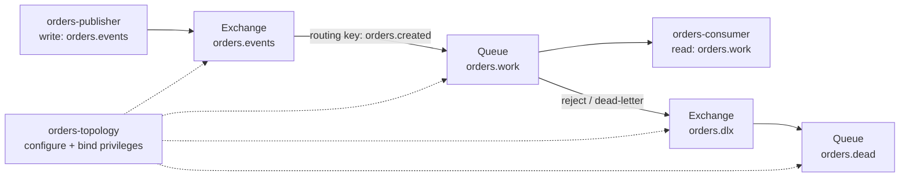
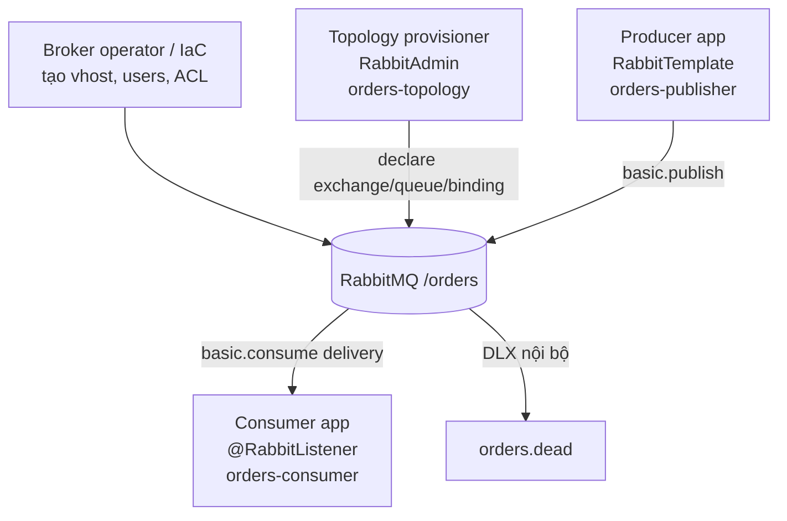

# Phân tách quyền producer, consumer và quản trị topology trong Spring AMQP

## 1. Vì sao không nên cho mọi ứng dụng cùng một tài khoản RabbitMQ?

Một ứng dụng **Spring AMQP** có thể dùng `RabbitTemplate` để phát sự kiện, `@RabbitListener` để tiêu thụ message, và `RabbitAdmin` để khai báo exchange, queue, binding. Ba công việc đó có **mục đích và quyền hạn khác nhau**. Nếu tất cả service kết nối bằng tài khoản có quyền `configure = write = read = ".*"`, một lỗi cấu hình hoặc một credential bị lộ có thể cho phép:

- Producer không chỉ gửi message mà còn sửa/xóa queue, exchange hoặc binding.
- Consumer không chỉ đọc queue của mình mà còn truy cập các queue nghiệp vụ khác.
- Ứng dụng runtime vô tình khai báo lại topology, gây `PRECONDITION_FAILED` hoặc thay đổi hành vi định tuyến.
- Kẻ tấn công có được mật khẩu producer tiến hành những thao tác ngoài phạm vi công việc gửi sự kiện.

Chủ đề này thuộc chương **Bảo mật** của module **SPRING_AMQP**: áp dụng nguyên tắc **least privilege** (quyền tối thiểu) ở RabbitMQ, phối hợp cấu hình Spring Boot, rồi kiểm chứng bằng các thử nghiệm cho phép/từ chối. Mục tiêu là xây pipeline bất đồng bộ có retry, dead-letter, transaction và quan sát nhưng không cấp quyền rộng hơn chức năng thực sự cần.

**Ba danh tính mẫu xuyên suốt bài:**

1. `orders-publisher`: chỉ publish lên exchange `orders.events`.
2. `orders-consumer`: chỉ consume queue `orders.work`.
3. `orders-topology`: khai báo `orders.events`, `orders.work`, DLX `orders.dlx`, DLQ `orders.dead` và các binding cần thiết.

Ba tài khoản dùng cùng virtual host `/orders` nhưng có **bộ permission khác nhau**. Không dùng chung mật khẩu và không cấp user tag `administrator` cho service ứng dụng.

## 2. Ba tầng kiểm soát truy cập cần phân biệt



| Tầng | Câu hỏi bảo mật | Cơ chế RabbitMQ |
| --- | --- | --- |
| **Authentication (xác thực)** | Kết nối này là ai? | User/password, TLS client certificate hoặc cơ chế xác thực được cấu hình. |
| **Virtual host** | User có thể truy cập namespace broker nào? | Quyền của user được gán **theo vhost**; cùng tên queue ở hai vhost là hai tài nguyên khác nhau. |
| **Resource authorisation** | User được tạo/sửa, publish hoặc đọc tài nguyên nào? | Bộ regex `configure`, `write`, `read` cho tên queue/exchange trong vhost. |

Ngoài ra RabbitMQ có **topic authorisation** để hạn chế theo routing key trên topic exchange, và **user tags** để kiểm soát truy cập Management UI. User tag `management`/`administrator` **không thay thế** permission `configure/write/read` trên tài nguyên AMQP.

> **Lưu ý phạm vi:** Các bảng quyền ở bài này nói về **AMQP 0-9-1**, giao thức mà `spring-rabbit`/`RabbitTemplate`/`@RabbitListener` dùng phổ biến. RabbitMQ Stream protocol, MQTT và AMQP 1.0 có chi tiết kiểm tra quyền riêng; không sao chép mù quáng cùng bảng cho mọi giao thức.

## 3. `configure`, `write`, `read` có ý nghĩa gì?

RabbitMQ diễn tả permission của một user trong **một vhost** bằng **ba regular expression** theo thứ tự:

```text
set_permissions -p <vhost> <user> <configure-regex> <write-regex> <read-regex>
```

- **`configure`**: khai báo hoặc xóa exchange/queue, thay đổi một số thuộc tính tài nguyên.
- **`write`**: publish vào exchange và một số thao tác liên kết tài nguyên.
- **`read`**: consume/get từ queue và một số thao tác quản lý binding.

Không nên suy từ tên quyền rằng `write` chỉ có nghĩa “gửi message” hay `read` chỉ có nghĩa “nhận message”. **Các lệnh AMQP cụ thể có kiểm tra quyền khác nhau.**

### 3.1. Bảng kiểm tra quyền quan trọng

| AMQP 0-9-1 operation | `configure` | `write` | `read` |
| --- | --- | --- | --- |
| `exchange.declare` / `exchange.delete` | Exchange được khai báo/xóa. | — | — |
| `queue.declare` / `queue.delete` | Queue được khai báo/xóa. | — | — |
| `basic.publish` | — | **Exchange** đích. | — |
| `basic.consume` / `basic.get` | — | — | **Queue** đích. |
| `queue.purge` | — | — | **Queue** bị purge. |
| `queue.bind` / `queue.unbind` | — | **Queue** đích. | **Exchange** nguồn. |
| `exchange.bind` / `exchange.unbind` | — | **Exchange** đích. | **Exchange** nguồn. |
| `queue.declare` có `x-dead-letter-exchange` | **Queue**. | **DLX exchange**. | **Queue**. |
| `exchange.declare` có alternate exchange | **Exchange**. | **Alternate exchange**. | **Exchange**. |

**Hai bẫy quan trọng:**

1. `queue.bind` yêu cầu **write trên queue và read trên exchange**, **không phải** configure trên cả hai. Tài khoản chỉ có quyền `configure` chưa chắc tạo được binding.
2. `queue.declare` với `x-dead-letter-exchange` yêu cầu **configure trên queue, read trên queue, write trên DLX exchange** ở thời điểm khai báo. Tài khoản chỉ có configure queue có thể gặp `ACCESS_REFUSED`.

Quyền `read` trên queue cũng có thể cho phép lệnh `queue.purge` trong AMQP 0-9-1. Điều này cho thấy **resource permissions không phải một mô hình phân quyền từng thao tác với độ hạt tuyệt đối**. Cần quản lý credential, truy cập mạng, Management API và audit; không tuyên bố user consumer chỉ có khả năng gọi `basic.consume`.

### 3.2. Regex và default exchange

RabbitMQ so regex với **tên tài nguyên**. Vì thế:

- `^orders\.events$` chỉ khớp tên exchange `orders.events`.
- `orders.*` là regex rộng và thiếu anchor; dấu `.` còn có nghĩa “một ký tự bất kỳ”.
- `.*` là quyền rộng trên mọi tên tài nguyên trong vhost.
- `^$` là regex chỉ khớp chuỗi rỗng, được dùng để **không cấp quyền cho các resource thông thường**.

Trong giao thức, default exchange có tên rỗng `""`; **RabbitMQ dùng tên `amq.default` khi kiểm tra permission**. Producer gọi `RabbitTemplate.convertAndSend("", "orders.work", payload)` có thể phải được cấp **write trên `amq.default`**. Đây là quyền khá rộng trong vhost vì default exchange có đường đi trực tiếp tới nhiều queue qua tên queue.

**Khuyến nghị:** khi cần giới hạn producer chỉ được phát một loại sự kiện, dùng **exchange có tên riêng** như `orders.events` và chỉ cấp `write` trên exchange đó. Đừng cấp `amq.default` trừ khi thực sự cần và hiểu phạm vi cho phép.

## 4. Thiết kế ma trận least privilege

Hệ thống mẫu có:

- Exchange `orders.events` (kiểu direct): nhận sự kiện do producer gửi với routing key `orders.created`.
- Queue `orders.work` (durable): consumer xử lý nghiệp vụ.
- Exchange `orders.dlx` và queue `orders.dead`: dead-letter các message bị reject không requeue.
- Binding `orders.events` —`orders.created`→ `orders.work` và `orders.dlx` —`orders.failed`→ `orders.dead`.

### 4.1. Ma trận mục tiêu

| Danh tính | `configure` | `write` | `read` | Dùng cho |
| --- | --- | --- | --- | --- |
| `orders-publisher` | Không | `orders.events` | Không | `RabbitTemplate.convertAndSend(...)`. |
| `orders-consumer` | Không | Không | `orders.work` | `@RabbitListener(queues = "orders.work")`. |
| `orders-topology` | Hai exchange, hai queue | `orders.work`, `orders.dead`, `orders.dlx` | `orders.events`, `orders.dlx`, `orders.work` | Declare exchange/queue/binding, khai báo DLX của queue. |
| Broker operator | Quyền theo quy trình vận hành/cluster | Quyền theo nhu cầu | Quyền theo nhu cầu | Tạo vhost, user, cấp/thu hồi quyền, chính sách. |

Tài khoản `orders-topology` có `read` trên `orders.work` **không phải để chạy consumer**, mà bởi khai báo queue có DLX yêu cầu quyền này. Nó có `write` trên `orders.work` và `orders.dead` cho `queue.bind`. Nó có `write` trên `orders.dlx` cho `queue.declare` với DLX. Phạm vi quyền khác nhau vì nhu cầu thao tác khác nhau, chứ không phải admin được cấp tự động `.*`.

**Trường hợp dùng policy cho DLX:** Nếu DLX được gán bằng RabbitMQ policy thay vì x-arguments tại client, chi tiết kiểm tra ở thời điểm khai báo thay đổi theo operation thực tế. Tuy nhiên vẫn phải quản lý quyền của người cấu hình policy và bảo đảm DLX/binding đích có thật. Không mặc định một user thiếu quyền có thể tự sửa policy.

### 4.2. Phân biệt user tags và tài khoản topology

Tài khoản `orders-topology` trong bảng chỉ được cấp **resource permissions** để khai báo tài nguyên cần thiết qua AMQP. Nó **không** cần tag `administrator` chỉ để `RabbitAdmin` chạy `exchange.declare`, `queue.declare` và `queue.bind` trong vhost. Ngược lại, người quản trị thực sự cần thao tác tạo user/vhost/chỉnh permission và policy trên broker phải dùng một quy trình vận hành riêng.

## 5. Cấp quyền bằng `rabbitmqctl`

Các lệnh sau giả định **user và vhost đã được tạo bởi nhà quản trị** trong môi trường thử nghiệm. Không dùng tài khoản `guest` cho ứng dụng production và không đưa mật khẩu thật vào tài liệu, source code hoặc shell history.

### 5.1. Tạo vhost và user bởi người quản trị

Ví dụ với broker thử nghiệm:

```bash
# Chỉ người vận hành có quyền quản trị chạy lệnh này.
rabbitmqctl add_vhost /orders

# Tạo ba user riêng qua quy trình provision của tổ chức
# (CLI, HTTP API, definitions, IaC hoặc secret manager).
# Tên user: orders-publisher, orders-consumer, orders-topology.
```

`rabbitmqctl add_user` có cách cung cấp mật khẩu tùy phiên bản/công cụ và môi trường. Không dùng mật khẩu mẫu cố định trong bài; hãy thiết lập secret riêng từng danh tính và phân phối chúng qua cơ chế bảo mật của hệ thống.

### 5.2. Cấp quyền producer

```bash
rabbitmqctl set_permissions -p /orders orders-publisher \
  '^$' \
  '^orders\.events$' \
  '^$'
```

Giải thích theo đúng thứ tự `configure write read`:

- `configure = ^$`: producer không thể declare/xóa queue hay exchange.
- `write = ^orders\.events$`: producer được publish vào `orders.events`.
- `read = ^$`: producer không có quyền consume queue.

Một lệnh `basic.publish` vào `orders.dlx` hoặc default exchange `amq.default` phải bị từ chối vì regex write không khớp.

### 5.3. Cấp quyền consumer

```bash
rabbitmqctl set_permissions -p /orders orders-consumer \
  '^$' \
  '^$' \
  '^orders\.work$'
```

Consumer được `basic.consume`/`basic.get` trên `orders.work`. Nó không thể `exchange.declare`, `queue.declare` thông thường hay `basic.publish`. Broker thực hiện dead-letter khi consumer reject message; **consumer không cần được cấp write trên `orders.dlx` chỉ để gọi nack/reject**.

### 5.4. Cấp quyền cho tài khoản khai báo topology

```bash
rabbitmqctl set_permissions -p /orders orders-topology \
  '^(orders\.events|orders\.dlx|orders\.work|orders\.dead)$' \
  '^(orders\.work|orders\.dead|orders\.dlx)$' \
  '^(orders\.events|orders\.dlx|orders\.work)$'
```

Vì tài khoản này sẽ:

1. `exchange.declare`: `configure` trên `orders.events` và `orders.dlx`.
2. `queue.declare`: `configure` trên `orders.work` và `orders.dead`.
3. `queue.declare` có DLX: thêm `write` trên `orders.dlx` và `read` trên `orders.work`.
4. `queue.bind` cho queue work: `write` trên `orders.work` và `read` trên `orders.events`.
5. `queue.bind` cho queue dead: `write` trên `orders.dead` và `read` trên `orders.dlx`.

Regex này chỉ minh họa **một topology cụ thể**. Nếu thêm alternate exchange, retry queue, reply queue hoặc resource khác, phải lập lại ma trận theo operation thực sự; **không mở rộng ngay thành `.*`** chỉ để né lỗi.

### 5.5. Xác minh quyền và thu hồi

```bash
rabbitmqctl list_permissions -p /orders
rabbitmqctl list_user_permissions orders-publisher
rabbitmqctl list_user_permissions orders-consumer
rabbitmqctl list_user_permissions orders-topology

# Ví dụ thu hồi hoàn toàn quyền truy cập vhost của một user:
# rabbitmqctl clear_permissions -p /orders orders-publisher
```

Quyền được tính **theo vhost**. Việc user có quyền ở `/orders` không có nghĩa user được kết nối `/payments`; đồng thời vhost không phải firewall vật lý, không thay thế phân đoạn mạng, TLS, quản lý user và giám sát.

## 6. Triển khai Spring AMQP: tách provisioner khỏi ứng dụng runtime

Sơ đồ triển khai:



**Nguyên tắc kiến trúc:** topology là hạ tầng được provision trước; producer/consumer runtime **không cần** quyền configure. Nhiều hệ thống có thể quản lý topology bằng Terraform, Helm, RabbitMQ definitions hoặc công cụ vận hành thay vì một Spring app riêng. Bài này dùng `RabbitAdmin` để minh họa khả năng Spring AMQP và trách nhiệm phân quyền.

### 6.1. Cấu hình chung cho từng ứng dụng runtime

```yaml
# application.yml của producer hoặc consumer runtime.
spring:
  rabbitmq:
    host: rabbitmq.internal
    port: 5672
    virtual-host: /orders
    username: ${RABBITMQ_USERNAME}
    password: ${RABBITMQ_PASSWORD}
    dynamic: false
```

Mỗi deployment truyền **cặp credential riêng**: producer dùng `orders-publisher`, consumer dùng `orders-consumer`. `spring.rabbitmq.dynamic=false` bảo Spring Boot **không tự tạo bean `AmqpAdmin`**; trong ứng dụng chỉ cần gửi/nhận, không có lý do tự khai báo lại exchange/queue/binding.

**Quan trọng:** cấu hình `dynamic=false` không xóa bean `RabbitAdmin` nếu ứng dụng **tự khai báo** một bean; hãy kiểm tra component scan, auto-configuration, profile, thư viện và các khai báo `Queue`/`Exchange`/`Binding` để không vô tình giữ một admin khác ở runtime.

Nếu listener dùng `@RabbitListener(queues = "...")`, hãy bảo đảm queue đã được provision trước. Listener container có thể kiểm tra queue tồn tại bằng **passive declaration**. Theo tài liệu RabbitMQ **từ 4.3.1**, passive declaration đòi ít nhất một trong `configure`, `write` hoặc `read` trên tài nguyên; consumer đã có `read` của `orders.work` là phù hợp. Phiên bản broker khác có thể khác về chi tiết kiểm tra passive declaration.

### 6.2. Producer chỉ publish

```java
package example.orders;

import org.springframework.amqp.rabbit.core.RabbitTemplate;
import org.springframework.context.annotation.Profile;
import org.springframework.stereotype.Service;

@Profile("producer")
@Service
public class OrderEventPublisher {
    private final RabbitTemplate rabbitTemplate;

    public OrderEventPublisher(RabbitTemplate rabbitTemplate) {
        this.rabbitTemplate = rabbitTemplate;
    }

    public void created(String eventId, String orderId) {
        String payload = eventId + "|" + orderId;
        rabbitTemplate.convertAndSend(
                "orders.events", "orders.created", payload);
    }
}
```

Hành động `convertAndSend` dùng `basic.publish` nên user `orders-publisher` chỉ cần **write trên `orders.events`**. Producer không cần `read` trên `orders.work`, và không cần declare queue nếu topology đã có.

Không dùng:

```java
// Không phù hợp với ACL chỉ cho phép orders.events:
rabbitTemplate.convertAndSend("", "orders.work", "EVENT-1|ORDER-1");
```

Lệnh trên gửi qua **default exchange**, tức `amq.default` khi RabbitMQ kiểm tra quyền. Producer mẫu không được cấp quyền này, và đây là hành vi từ chối **đúng thiết kế**, không phải lỗi cần giải quyết bằng cách cấp thêm `.*`.

**Bảo đảm gửi:** `convertAndSend` trả về không có nghĩa broker đã lưu/route hay consumer đã xử lý; khi cần độ tin cậy, bật correlated publisher confirms, publisher returns và `mandatory`, đồng thời dùng event ID/outbox để chịu được retry tạo bản sao.

### 6.3. Consumer chỉ consume

```java
package example.orders;

import org.springframework.amqp.AmqpRejectAndDontRequeueException;
import org.springframework.amqp.rabbit.annotation.RabbitListener;
import org.springframework.context.annotation.Profile;
import org.springframework.stereotype.Component;

@Profile("consumer")
@Component
public class OrderEventConsumer {

    @RabbitListener(queues = "orders.work")
    public void onCreated(String payload) {
        String[] parts = payload.split("\\|", -1);
        if (parts.length != 2 || parts[0].isBlank() || parts[1].isBlank()) {
            throw new AmqpRejectAndDontRequeueException(
                    "Message không đúng định dạng");
        }

        // Thực tế: gọi service @Transactional và xử lý idempotent theo eventId.
        System.out.println("Received eventId=" + parts[0]);
    }
}
```

Consumer cần `read` trên `orders.work` cho `basic.consume`. Với `AcknowledgeMode.AUTO`, Spring AMQP ack sau khi listener xử lý thành công; exception kích hoạt reject/nack theo chính sách. Nếu message được reject với `requeue=false` và queue đã có DLX/binding hợp lệ, **broker** thực hiện dead-letter sang `orders.dead` mà không đòi user consumer phải publish vào DLX.

Khi consumer phải **tự publish reply, retry message hoặc audit event** bằng `RabbitTemplate`, vai trò “consumer chỉ đọc” không còn phản ánh đúng tác vụ thực tế. Nên dùng tài khoản/connection factory dành cho output với quyền `write` đúng exchange, thay vì nâng tất cả consumer lên `write = ".*"`. Đối với xử lý DB, bảo đảm ack sau transaction thành công và có idempotency cho redelivery.

### 6.4. Topology provisioner dùng `RabbitAdmin`

Trong ứng dụng chạy **profile `topology`** và dùng credential `orders-topology`, bật `spring.rabbitmq.dynamic=true` để Spring Boot có thể tạo `RabbitAdmin`. Hoặc tạo `RabbitAdmin` tường minh từ connection factory phù hợp.

```java
package example.orders;

import org.springframework.amqp.core.Binding;
import org.springframework.amqp.core.BindingBuilder;
import org.springframework.amqp.core.DirectExchange;
import org.springframework.amqp.core.Queue;
import org.springframework.amqp.core.QueueBuilder;
import org.springframework.beans.factory.annotation.Qualifier;
import org.springframework.context.annotation.Bean;
import org.springframework.context.annotation.Configuration;
import org.springframework.context.annotation.Profile;

@Configuration
@Profile("topology")
public class OrdersTopology {

    @Bean
    DirectExchange ordersEventsExchange() {
        return new DirectExchange("orders.events", true, false);
    }

    @Bean
    DirectExchange ordersDeadLetterExchange() {
        return new DirectExchange("orders.dlx", true, false);
    }

    @Bean
    Queue ordersWork() {
        return QueueBuilder.durable("orders.work")
                .deadLetterExchange("orders.dlx")
                .deadLetterRoutingKey("orders.failed")
                .build();
    }

    @Bean
    Queue ordersDead() {
        return QueueBuilder.durable("orders.dead").build();
    }

    @Bean
    Binding ordersWorkBinding(
            @Qualifier("ordersWork") Queue ordersWork,
            @Qualifier("ordersEventsExchange") DirectExchange ordersEventsExchange) {
        return BindingBuilder.bind(ordersWork)
                .to(ordersEventsExchange).with("orders.created");
    }

    @Bean
    Binding ordersDeadBinding(
            @Qualifier("ordersDead") Queue ordersDead,
            @Qualifier("ordersDeadLetterExchange") DirectExchange ordersDeadLetterExchange) {
        return BindingBuilder.bind(ordersDead)
                .to(ordersDeadLetterExchange).with("orders.failed");
    }
}
```

**Đối chiếu quyền:** `RabbitAdmin` của provisioner cần `configure` trên hai queue và hai exchange, `write` trên hai queue để tạo binding, `read` trên exchange để tạo binding, cộng `write` trên DLX và `read` trên queue nguồn khi declare queue có DLX. Đó là lý do regex `orders-topology` ở mục 5 trông phức tạp hơn “có configure là đủ”.

Để chạy như một tác vụ provision **một lần**, có thể khởi động một deployment/command riêng với profile `topology`, credential `orders-topology`, tạo connection để admin chạy auto-declaration, xác minh topology, rồi kết thúc. Trong ví dụ, hai class runtime đã có `@Profile("producer")` và `@Profile("consumer")`; khi chạy **chỉ profile `topology`**, chúng sẽ không được khởi tạo. Đặt `spring.rabbitmq.dynamic=true` riêng cho lần provision này, trong khi runtime giữ `false`. Không nhất thiết để topology provisioner chạy lâu dài. Kiểm tra quyền và điều kiện khởi động để producer/consumer **không** chạy trước khi topology được provision.

**Chú ý về `RabbitAdmin` auto-declare:** auto-declaration thường được kích hoạt theo vòng đời connection và các bean `Declarable` trong Spring context. Chỉ định `@Profile("topology")` không tự tạo connection nếu không có thành phần nào sử dụng kết nối; provisioner cần có bước chủ động tạo connection/khởi tạo declaration hoặc sử dụng công cụ IaC/CLI được kiểm soát. Với nhiều `RabbitAdmin`/nhiều broker, dùng `setExplicitDeclarationsOnly(true)` và `setAdminsThatShouldDeclare(...)` để giới hạn phạm vi mỗi admin.

## 7. Khi nào nên dùng policy thay vì x-arguments?

Ví dụ `orders.work` ở trên khai báo DLX bằng:

```java
QueueBuilder.durable("orders.work")
    .deadLetterExchange("orders.dlx")
    .deadLetterRoutingKey("orders.failed")
    .build();
```

Đây là **queue arguments** được gửi bởi tài khoản topology. Trong vận hành production, RabbitMQ khuyến nghị sử dụng **policies** cho những thuộc tính có thể điều chỉnh động như dead-letter exchange, TTL và giới hạn queue phù hợp. Quản trị policy là hành động ở tầng vận hành và cần được cấp phép qua CLI/Management API/role của hệ thống; không biến producer/consumer thành admin chỉ để tự đổi retry/DLX.

Khi dùng policy, đảm bảo có đúng queue đích, DLX, binding và permission cần thiết. Nếu queue đã tồn tại với x-arguments khác, redeclare có thể thất bại `PRECONDITION_FAILED - inequivalent arg`: đây là vấn đề migration/configuration, không giải quyết bằng cách cấp toàn quyền cho app.

## 8. Topic authorisation: giới hạn routing key khi cần

Resource `write` chỉ kiểm tra **tên exchange**, không tự giới hạn mọi routing key mà producer có thể sử dụng trên exchange đó. Ví dụ user có `write` trên `orders.events` có thể thử publish với routing key khác `orders.created`; nếu các binding mới xuất hiện sau này, message có thể tới queue ngoài dự định.

Với **topic exchange** và nhu cầu hạn chế routing key theo ứng dụng/tenant, RabbitMQ hỗ trợ **topic permissions** (một lớp authorization bổ sung). Ví dụ **nếu `orders.events` được đổi sang topic exchange theo kiến trúc và policy phù hợp**:

```bash
rabbitmqctl set_topic_permissions -p /orders \
  orders-publisher orders.events \
  '^orders\.created$' '^$'
```

Cú pháp: `set_topic_permissions -p <vhost> <user> <topic-exchange> <write-regex> <read-regex>`. Nó **không thay thế** bộ `configure/write/read` cơ bản. Topic permission giúp kiểm soát routing key của thao tác tương ứng; với AMQP 0-9-1, consumer bình thường tiêu thụ **queue**, nên `read` trên queue vẫn là cơ chế chính của `basic.consume`.

**Giới hạn của ví dụ:** topology ở mục 6 dùng `DirectExchange`, vì thế **không chạy lệnh topic permission rồi nghĩ nó tự hạn chế routing key trên direct exchange**. Nếu cần phân quyền tới mức event type trên direct exchange, hãy thiết kế exchange riêng, routing policy hoặc cơ chế bảo vệ khác, rồi kiểm tra trên phiên bản RabbitMQ/broker auth backend đang dùng.

## 9. Kết nối bảo mật: TLS, secrets và rotation

Least privilege không có tác dụng nếu mật khẩu bị lộ qua source code, log hay kết nối không được bảo vệ.

### 9.1. Cấu hình TLS và secret injection

```yaml
# Ví dụ khi broker có TLS listener và CA trust đã cấu hình đúng.
spring:
  rabbitmq:
    host: rabbitmq.internal
    port: 5671
    virtual-host: /orders
    username: ${RABBITMQ_USERNAME}
    password: ${RABBITMQ_PASSWORD}
    ssl:
      enabled: true
      validate-server-certificate: true
      verify-hostname: true
    dynamic: false
```

Trên môi trường thực tế phải cấu hình truststore/CA và các tùy chọn SSL phù hợp với phiên bản Spring Boot. Không tắt certificate validation hoặc hostname verification để “sửa nhanh” lỗi TLS. Trong hệ thống cần mTLS, dùng cơ chế client certificate và auth backend tương ứng của RabbitMQ.

### 9.2. Quản lý vòng đời thông tin xác thực

- Mỗi ứng dụng/deployment có credential riêng, không dùng `guest/guest` từ xa hoặc tài khoản người vận hành.
- Secrets được cung cấp bởi secret manager, Kubernetes Secret có cơ chế bảo vệ phù hợp, hoặc biến môi trường bảo mật theo quy trình tổ chức.
- Không ghi password vào `application.yml` đã commit, log, Git, câu lệnh support copy/paste hoặc headers của message.
- Khi đổi mật khẩu/quyền, kết nối RabbitMQ cũ có thể tiếp tục tồn tại và broker có thể cache kết quả permission; cần **reconnect/rotate connection có kiểm soát** để kiểm tra quyền mới có hiệu lực như mong đợi.
- Thu hồi user hoặc quyền ở vhost không phải là phương pháp duy nhất để đóng mọi kết nối đang chạy; hãy kiểm tra và xử lý kết nối cần cắt trong quy trình incident response.

## 10. Kiểm thử cả quyền được phép và hành động bị cấm

Chạy các ca sau trên **broker/vhost thử nghiệm** sau khi provision topology, không dùng dữ liệu production.

### 10.1. Bảng kiểm thử ACL

| User thực hiện | Operation | Kỳ vọng |
| --- | --- | --- |
| `orders-publisher` | Publish vào `orders.events`. | **Cho phép**. |
| `orders-publisher` | Publish vào `orders.dlx`. | **Từ chối** vì không có write DLX. |
| `orders-publisher` | Declare `orders.work`. | **Từ chối** vì không có configure queue. |
| `orders-publisher` | Consume `orders.work`. | **Từ chối** vì không có read queue. |
| `orders-consumer` | Consume `orders.work`. | **Cho phép**. |
| `orders-consumer` | Consume `orders.dead`. | **Từ chối** vì không có read DLQ. |
| `orders-consumer` | Publish vào `orders.events`. | **Từ chối** vì không có write exchange. |
| `orders-consumer` | Reject với `requeue=false` để broker dead-letter. | **Cho phép** trên queue nguồn; DLX do broker thực hiện nếu có cấu hình hợp lệ. |
| `orders-topology` | Declare đúng exchange, queue, binding ở mục 6. | **Cho phép**. |
| `orders-topology` | Declare queue ngoài namespace được cấp. | **Từ chối**. |

Các lỗi authorization thường được báo bằng `ACCESS_REFUSED`; broker có thể đóng **channel** hoặc từ chối thao tác tùy lệnh. Spring AMQP có thể bọc thành `AmqpException` hoặc một ngoại lệ con. **Không chỉ kiểm tra exception string** trong test; hãy đối chiếu AMQP reply code, logs broker và hành động thật có/không thành công.

### 10.2. Một số lệnh thử với Java Client trực tiếp

Chỉ dùng đoạn này trong integration test với credential thấp quyền, rồi đóng channel/connection sau mỗi ca để không làm ảnh hưởng listener đang phục vụ.

```java
import com.rabbitmq.client.Channel;
import com.rabbitmq.client.Connection;
import com.rabbitmq.client.ConnectionFactory;

ConnectionFactory raw = new ConnectionFactory();
raw.setHost("localhost");
raw.setVirtualHost("/orders");
raw.setUsername("orders-publisher");
raw.setPassword(System.getenv("RABBITMQ_PUBLISHER_PASSWORD"));

try (Connection connection = raw.newConnection();
     Channel channel = connection.createChannel()) {
    // Phải thành công nếu orders.events đã được provision:
    channel.basicPublish(
            "orders.events", "orders.created", null,
            "EVT-1001|ORDER-1001".getBytes(java.nio.charset.StandardCharsets.UTF_8));

    // Trong một test riêng, queue.declare thường phải bị ACCESS_REFUSED:
    // channel.queueDeclare("forbidden.q", true, false, false, null);
}
```

**Không** thực hiện “negative test” ngay trên connection/channel còn đang chạy công việc thật. Một lệnh protocol bị từ chối có thể đóng channel và khiến phần code sau báo lỗi dây chuyền, che nguyên nhân quyền ban đầu.

### 10.3. Kiểm thử DLX không cần quyền consumer publish

1. Provision `orders.dlx`, `orders.dead` và binding `orders.failed` bằng `orders-topology`.
2. Đăng nhập consumer bằng `orders-consumer` và nhận message lỗi.
3. Ném `AmqpRejectAndDontRequeueException` để framework reject không requeue.
4. Quan sát message trong `orders.dead` qua Management UI của **người vận hành được cấp quyền phù hợp**, không thêm read DLQ cho consumer chỉ để quan sát.
5. Kiểm tra `x-death`, queue depths, retry count và log để phân biệt poison message với lỗi tạm thời.

### 10.4. Kiểm thử tắt quyền topology ở runtime

- Chạy producer/consumer với `spring.rabbitmq.dynamic=false` và **không có `RabbitAdmin` bean tự tạo**.
- Xác minh startup và vận hành khi queue đã tồn tại, nhưng cả hai tài khoản không thể declare tài nguyên mới.
- Cố ý sai tên queue hoặc exchange trong môi trường test: hệ thống phải cảnh báo rõ topology thiếu, không âm thầm tạo tài nguyên bằng tài khoản có quyền rộng.
- Khi sửa ACL, restart/reconnect application để đối chiếu quyền mới, tránh hiểu sai kết quả do connection cache.

## 11. Quyền quản trị nhiều broker và giám sát

Trong môi trường nhiều RabbitMQ broker/cluster hoặc nhiều vhost, mỗi tài khoản nên chỉ có quyền trên **target/vhost** thật sự cần. `AbstractRoutingConnectionFactory` có thể lựa chọn broker bằng lookup key, nhưng **không cấp thêm quyền**; RabbitMQ kiểm tra credential của **connection factory đích** trên broker được chọn.

Nếu ứng dụng Spring có nhiều `RabbitAdmin`, mặc định admin có thể declare các bean `Queue`/`Exchange`/`Binding` mà nó nhìn thấy. Sử dụng `RabbitAdmin.setExplicitDeclarationsOnly(true)` và `Declarable.setAdminsThatShouldDeclare(...)` để không khai báo nhầm broker. Điều này là **giới hạn hành vi Spring**, không thay thế permission của RabbitMQ.

Trong vận hành, giám sát và audit cần thu thập:

| Thành phần | Nên theo dõi |
| --- | --- |
| Broker auth | Authentication failures, `ACCESS_REFUSED`, connection attempts, username/vhost, nguồn kết nối. |
| ACL | Mẫu regex được cấp, thay đổi permission, user tags, tài khoản không còn sử dụng, topic permissions. |
| Topology | Exchange/queue/binding, DLX/DLQ tồn tại và phù hợp, các lỗi `PRECONDITION_FAILED`. |
| Producer | Publish confirms/nacks, returns, timeout, duplicate retry, exchange được dùng. |
| Consumer | Consumer count, ready/unacked, ack/nack/requeue, DLQ depth, lỗi xử lý và idempotency. |
| Credentials/TLS | Ngày rotation, hết hạn certificate, TLS handshake failures, stale connections. |

**Không** đưa password, token hay message payload chứa dữ liệu nhạy cảm vào metrics/log. Username, vhost và resource name có thể hữu ích cho audit nhưng cũng phải kiểm soát quyền xem thông tin.

## 12. Những hiểu nhầm cần tránh

| Nhận định | Giải thích |
| --- | --- |
| “Producer cần `configure` để publish vào exchange.” | Sai. `basic.publish` cần **write trên exchange** đã tồn tại. |
| “Consumer cần quyền `write` trên DLX để reject message.” | Sai với trường hợp broker dead-letter nội bộ khi reject; quyền DLX liên quan đặc biệt ở **lúc declare queue có DLX**. |
| “Có `configure` trên queue thì chắc chắn bind được queue.” | Sai. `queue.bind` cần **write trên queue và read trên exchange**. |
| “`RabbitAdmin` bắt buộc phải có quyền `.*` trên vhost.” | Sai. Có thể cấp regex đủ cho resource và operation cụ thể. |
| “`AcknowledgeMode.AUTO` nghĩa là RabbitMQ tự ack ngay lập tức.” | Sai. Spring container thường ack sau khi listener thành công; mode `NONE` mới tương ứng broker auto-ack. |
| “Cho write trên `amq.default` chỉ cho phép gửi một queue.” | Sai. Default exchange có thể route theo tên queue trong vhost; phải cân nhắc phạm vi rộng. |
| “Tag `administrator` tự cấp tất cả permission AMQP.” | Không. User tags và resource permissions là hai cơ chế khác nhau. |
| “Chỉ cần thêm `spring.rabbitmq.dynamic=false` là mọi `RabbitAdmin` biến mất.” | Không. Property tắt auto-configuration `AmqpAdmin`, không xóa bean admin ứng dụng tự tạo. |
| “Quyền `read` trên queue chỉ dùng cho `basic.consume`.” | Không. `queue.purge` cũng dùng quyền read; quản lý credentials và audit tương ứng. |
| “Chỉnh permission thì kết nối đang mở cập nhật ngay mọi kiểm tra.” | Không được giả định; RabbitMQ có thể cache kết quả authorization theo connection/channel. |
| “Topic permission giúp hạn chế mọi routing key trên direct exchange.” | Không; topic authorisation có phạm vi áp dụng riêng và không thay thế resource ACL. |

## 13. Bài thực hành và câu hỏi tự đánh giá

### Bài thực hành

1. Trên RabbitMQ thử nghiệm, tạo vhost `/orders` và ba tài khoản tách biệt.
2. Chạy `set_permissions` ở mục 5.2–5.4; lưu output `list_permissions` để đối chiếu.
3. Dùng `orders-topology` và `RabbitAdmin` provision `orders.events`, `orders.work`, `orders.dlx`, `orders.dead` cùng binding.
4. Chạy producer bằng `orders-publisher`, consumer bằng `orders-consumer`, cả hai đặt `spring.rabbitmq.dynamic=false`.
5. Gửi message hợp lệ; xác minh queue nhận, consumer xử lý và ack.
6. Gửi payload không hợp lệ để consumer reject không requeue; xác minh broker dead-letter vào `orders.dead`.
7. Thử một lệnh bị cấm với producer/consumer trong test tách biệt; xác nhận broker trả `ACCESS_REFUSED`.
8. Tạm thu hồi quyền `write` của producer trong môi trường thử nghiệm, tạo kết nối mới và kiểm tra publish bị từ chối; khôi phục permission để hệ thống hoạt động lại.
9. Kiểm tra việc đổi routing key ngoài ý muốn; nếu cần quyền theo routing key, thiết kế topic exchange + topic permissions hoặc tách exchange.

### Câu hỏi

**Câu 1.** User `orders-publisher` chỉ có `write` trên `orders.events`. Có cần thêm `configure` để gửi qua `RabbitTemplate` không?

**Câu 2.** Để `queue.bind(orders.work, orders.events)` thành công, cần quyền trên tài nguyên nào?

**Câu 3.** Vì sao user topology khai báo queue với `x-dead-letter-exchange` cần quyền thêm trên DLX?

**Câu 4.** Consumer chỉ được read `orders.work` có thể khiến broker chuyển message vào DLQ bằng nack/reject không requeue không?

**Câu 5.** Vì sao gửi message qua default exchange `""` có thể vi phạm policy least privilege cho producer?

**Câu 6.** `spring.rabbitmq.dynamic=false` bảo đảm điều gì, và không bảo đảm điều gì?

**Câu 7.** `topic permissions` có thay thế quyền `write` trên exchange không?

**Câu 8.** Khi thay đổi permission nhưng connection đang mở vẫn có vẻ cho phép thao tác cũ, cần kiểm tra điều gì?

**Đáp án gợi ý:** (1) Không; `basic.publish` cần write trên exchange. (2) Write trên queue đích và read trên exchange nguồn. (3) Vì RabbitMQ kiểm tra thêm write trên DLX và read trên queue lúc declare queue với DLX. (4) Có nếu queue/DLX/binding hợp lệ; broker làm dead-letter nội bộ. (5) Quyền `amq.default` có thể route tới nhiều queue theo tên trong vhost. (6) Tắt auto-create `AmqpAdmin` của Spring Boot, không tắt admin bean tự khai báo hay sửa broker ACL. (7) Không; đây là lớp kiểm tra bổ sung. (8) Cache quyền theo connection/channel, việc reconnect/rotate credential và log authorization.

## 14. Kết luận

Muốn dùng **Spring AMQP** an toàn trong production, không nên cấp một tài khoản RabbitMQ toàn quyền cho `RabbitTemplate`, `@RabbitListener` và `RabbitAdmin`. Hãy tách:

- **Producer**: chỉ `write` trên exchange cần publish.
- **Consumer**: chỉ `read` trên queue cần tiêu thụ.
- **Topology provisioner**: `configure` trên resource cần khai báo, cùng các quyền `write`/`read` bổ sung theo thao tác binding/DLX.

Kết hợp **ACL theo vhost**, regex resource có anchor, không lạm dụng `amq.default`, topic permissions khi cần, `spring.rabbitmq.dynamic=false` ở runtime, khai báo topology qua công cụ kiểm soát, TLS/secrets, audit và các bài kiểm thử deny/allow. Bảo mật được thực thi **tại broker**; Spring chỉ là phía sử dụng quyền. Retry, dead-letter, transactions và idempotency vẫn phải được thiết kế để giao nhận bất đồng bộ đáng tin cậy.

## Tài liệu tham khảo

- [RabbitMQ — Authentication, Authorisation, Access Control](https://www.rabbitmq.com/docs/access-control): mô hình configure/write/read, bảng AMQP 0-9-1 operations, default exchange, passive declaration, topic authorisation và user tags.
- [RabbitMQ — rabbitmqctl Manual](https://www.rabbitmq.com/docs/man/rabbitmqctl.8): `set_permissions`, `list_permissions`, `list_user_permissions`, `set_topic_permissions` và `clear_permissions`.
- [RabbitMQ — Policies](https://www.rabbitmq.com/docs/policies): quản lý DLX, TTL và giới hạn queue bằng policy.
- [RabbitMQ — TLS Support](https://www.rabbitmq.com/docs/ssl): mã hóa transport, xác thực server/client và certificate validation.
- [Spring AMQP — Configuring the Broker](https://docs.spring.io/spring-amqp/reference/amqp/broker-configuration.html): `RabbitAdmin`, automatic declaration và conditional declaration.
- [Spring AMQP — Message Listener Container Configuration](https://docs.spring.io/spring-amqp/reference/amqp/containerAttributes.html): ack mode, container options và các trường hợp RabbitAdmin được listener container sử dụng.
- [Spring Boot — Common Application Properties](https://docs.spring.io/spring-boot/appendix/application-properties/): `spring.rabbitmq.dynamic`, kết nối AMQP và TLS-related properties theo phiên bản.
