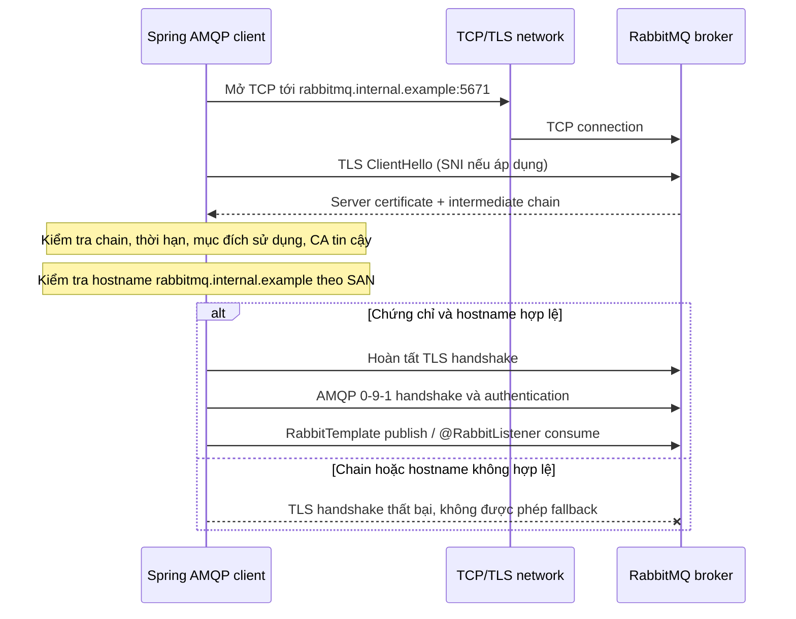
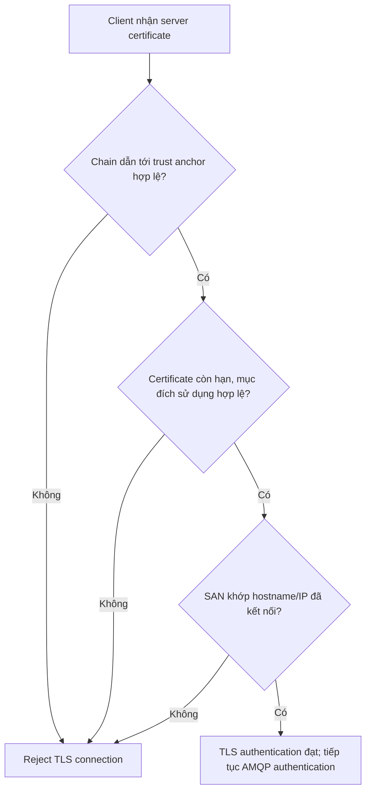
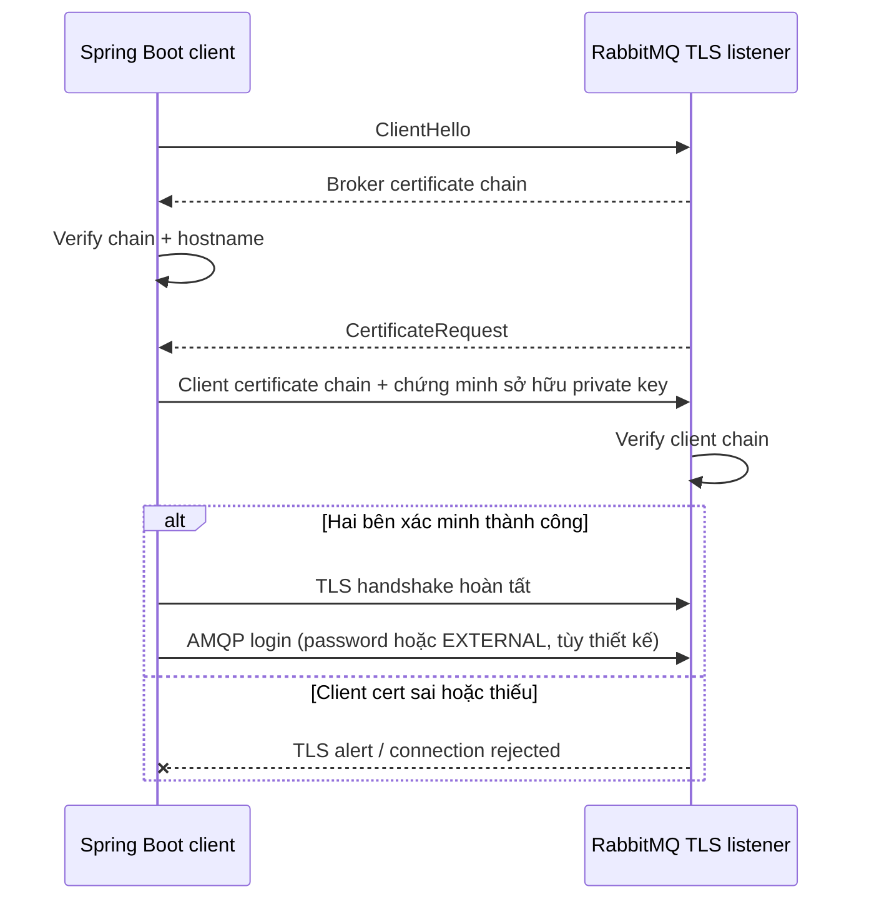
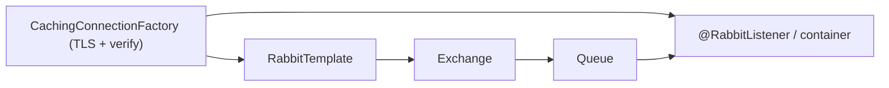
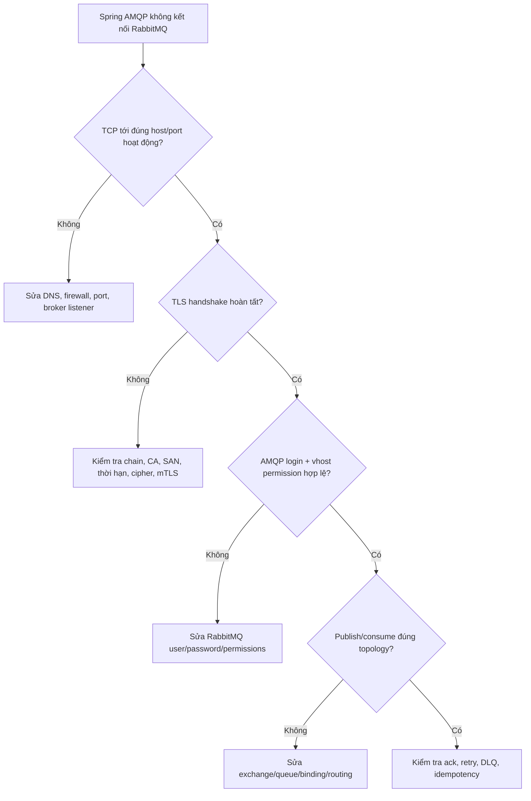
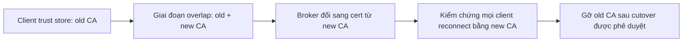

# TLS, trust store và xác minh danh tính broker

> **Chương:** Bảo mật  
> **Module:** SPRING_AMQP — tích hợp RabbitMQ với Spring AMQP qua `RabbitTemplate`, `@RabbitListener`, exchange, queue và binding; xây dựng luồng xử lý bất đồng bộ đáng tin cậy với acknowledgment, retry, dead-letter, giao dịch và khả năng quan sát.
>
> **Mục tiêu bảo mật:** Không chỉ mã hóa đường truyền, mà còn **xác minh ứng dụng thực sự đang kết nối tới broker RabbitMQ được tin cậy**. Nội dung tập trung vào giao thức RabbitMQ **AMQP 0-9-1**, Spring Boot 3.5/Spring AMQP 3.x; các phiên bản mới hơn có thể thay đổi tên starter hoặc API.

## 1. Sau bài này bạn làm được gì?

1. Phân biệt TLS, mã hóa truyền tải, xác thực chuỗi chứng chỉ, **hostname verification** và xác thực người dùng RabbitMQ.
2. Giải thích vai trò của CA, server certificate, SAN, private key, trust store, key store, `SSLContext` và vòng đời TLS handshake.
3. Cấu hình RabbitMQ TLS listener và Spring Boot client kết nối qua `amqps` hoặc port 5671 mà **không vô hiệu hóa kiểm tra chứng chỉ**.
4. Dùng `spring.rabbitmq.ssl.*` hoặc **Spring Boot SSL bundle** để cung cấp trust material và, khi cần, chứng chỉ client cho mTLS.
5. Chẩn đoán `PKIX path building failed`, hostname mismatch, expired certificate, missing intermediate, handshake failure và AMQP authentication failure.
6. Thử nghiệm những cấu hình **phải thất bại** trước khi triển khai; lập kế hoạch thay chứng chỉ/CA không làm mất an toàn xác thực.
7. Phân biệt lỗi kết nối TLS với lỗi `RabbitTemplate` publish, `@RabbitListener` xử lý message và cơ chế retry/DLQ.

### Bối cảnh

Một dịch vụ Spring Boot gửi `OrderCreated` bằng `RabbitTemplate` và nhận `PaymentConfirmed` bằng `@RabbitListener`. Ứng dụng kết nối tới tên DNS `rabbitmq.internal.example`. Đội vận hành bật TLS để chống nghe lén nhưng lại cấu hình client **tin mọi chứng chỉ**, hoặc chỉ kiểm tra CA mà **không kiểm tra hostname**.

Khi đó, dữ liệu trên mạng có thể được mã hóa nhưng client vẫn có nguy cơ kết nối nhầm tới endpoint giả mạo. Thiết kế đúng cần cả hai điều kiện:

- Chứng chỉ được ký bởi một **CA thuộc tập CA mà client tin cậy**, còn hiệu lực và có chuỗi hợp lệ.
- **Danh tính DNS/IP của endpoint** đang kết nối khớp với thông tin danh tính trong chứng chỉ (chủ yếu là SAN).

TLS không thay thế quyền `configure`/`write`/`read` của RabbitMQ, kiểm soát tenant, idempotency hoặc xác nhận đã giao message thành công.

## 2. Sơ đồ niềm tin: TLS giải quyết điều gì?



TLS thường bảo vệ:

| Yêu cầu | TLS cung cấp gì? | Còn phải làm thêm gì? |
|---|---|---|
| **Confidentiality** | Mã hóa các byte đi qua kênh truyền | Hạn chế quyền broker/management, mã hóa lưu trữ khi cần; TLS không mã hóa dữ liệu đã nằm trong queue |
| **Integrity** | Phát hiện dữ liệu bị sửa trên đường truyền | Validation và schema kiểm tra dữ liệu nghiệp vụ |
| **Server authentication** | Xác thực chứng chỉ của endpoint theo trust policy | Bật chain validation **và** hostname verification |
| **Client authentication** | Có thể trình chứng chỉ client nếu dùng **mTLS** | Quyết định xác thực AMQP bằng password/SASL EXTERNAL và phân quyền vhost |
| **AMQP delivery safety** | Không tự xác nhận broker đã lưu hoặc consumer đã xử lý message | Publisher confirms, returns, consumer ack/nack, idempotency |

**Nhớ:** Bật `ssl.enabled=true` chỉ nói rằng kết nối dùng TLS. Mức an toàn còn phụ thuộc cấu hình tin cậy, tên máy chủ và cách quản lý certificate/private key.

## 3. Trust store khác key store như thế nào?

| Thành phần | Chứa gì? | Được dùng bởi ai? | Có private key không? |
|---|---|---|---|
| **Server certificate** | Public certificate của RabbitMQ endpoint, SAN, thời hạn, public key | Broker gửi cho client trong TLS handshake | Không |
| **Server private key** | Khóa bí mật tương ứng với server certificate | RabbitMQ/TLS terminator chứng minh sở hữu khóa | **Có; phải giữ kín** |
| **CA certificate** | Public certificate của root/intermediate CA | Client dùng xây và kiểm tra chain of trust | Không |
| **Client trust store** | Những CA hoặc certificate được client tin cậy | `TrustManager` kiểm tra server certificate chain | Thường không |
| **Client key store** | Client certificate chain **kèm private key** | `KeyManager` trình danh tính client khi broker yêu cầu mTLS | **Có** |
| **Server CA bundle** | CA server tin để xác minh client certificate khi bật mTLS | Broker kiểm tra client certificate | Không |

### 3.1. Trust store không phải danh sách mật khẩu

Trong Java, trust store thường là file **PKCS12** (`.p12`/`.pfx`) hoặc **JKS** (`.jks`). Nó chứa trust anchor/certificate mà `TrustManager` dùng để xác minh chữ ký số.

**Mật khẩu trust store** bảo vệ việc truy cập/tính toàn vẹn của file store tùy định dạng; nó **không** thay thế việc xác minh tên broker, không phải mật khẩu AMQP, và không phải server private key.

Nếu RabbitMQ dùng CA nội bộ (`Example-Internal-Root-CA`), client cần có CA đó hoặc trust anchor thích hợp trong trust store. Nếu server certificate được ký bởi root CA công khai mà JVM đã tin theo policy, có thể dùng default JVM trust store; nhưng trong môi trường enterprise nên kiểm soát danh sách CA được phép một cách chủ động.

### 3.2. Vì sao cần intermediate certificates?

Ví dụ chain:

```text
Root CA (trust anchor trong Java trust store)
    |
    +-- Intermediate CA (broker gửi hoặc client có sẵn theo cấu hình)
              |
              +-- Broker certificate (SAN: rabbitmq.internal.example)
```

Client cần xây được chain hợp lệ từ leaf server certificate tới một trust anchor. Thiếu intermediate CA có thể dẫn tới lỗi `PKIX path building failed` dù root CA đã được tin. Cách sửa đúng thường là cấu hình broker/TLS terminator **gửi đủ certificate chain** hoặc cung cấp chain đúng qua hạ tầng PKI, không phải tắt certificate validation.

### 3.3. Chỉ tin đúng CA cần thiết

Import một CA rộng quyền vào trust store khiến client có thể tin nhiều chứng chỉ do CA đó phát hành. Do vậy phải kết hợp thêm **hostname verification**. Đối với CA nội bộ, cấp quyền phát chứng chỉ, giám sát issuance và rotation; với môi trường cực nhạy cảm có thể cân nhắc tập trust anchors nhỏ hơn theo policy tổ chức.

Không “sửa” lỗi TLS bằng cách nhập tất cả CA lạ hoặc certificate nhận được từ endpoint chưa tin vào trust store. Chỉ import sau khi xác minh nguồn, fingerprint và chuỗi phê duyệt của tổ chức.

## 4. Hostname verification: xác minh broker có đúng danh tính

Giả sử `rabbitmq.internal.example` trỏ tới địa chỉ `10.10.0.42`. Certificate có:

```text
Subject: CN=ignored-for-primary-check.example
X509v3 Subject Alternative Name:
  DNS:rabbitmq.internal.example
  DNS:rabbit-1.internal.example
```

Khi client kết nối bằng hostname `rabbitmq.internal.example` và kiểm tra hostname, DNS SAN phù hợp. Nếu cấu hình client kết nối trực tiếp qua `10.10.0.42`, certificate **không có IP SAN = 10.10.0.42**, việc xác minh danh tính có thể thất bại dù cùng một node.

| Client kết nối tới | SAN của server certificate | Kết quả mong đợi |
|---|---|---|
| `rabbitmq.internal.example` | `DNS:rabbitmq.internal.example` | Hợp lệ nếu chain và những kiểm tra khác cũng hợp lệ |
| `rabbit-1.internal.example` | Chỉ có `DNS:rabbitmq.internal.example` | **Hostname mismatch** |
| `10.10.0.42` | Chỉ có `DNS:rabbitmq.internal.example` | **IP address mismatch** |
| `10.10.0.42` | Có `IP:10.10.0.42` | Có thể hợp lệ nếu chain và thời hạn đúng |
| `rabbit-2.internal.example` | Có wildcard phù hợp chính sách, ví dụ `DNS:*.internal.example` | Có thể phù hợp; cần kiểm tra quy tắc wildcard của verifier |

**Ưu tiên Subject Alternative Name (SAN)**. Không dựa vào `Common Name (CN)` làm cơ chế xác thực chính; các thư viện/phiên bản TLS hiện đại dùng SAN và ngày càng hạn chế CN fallback. Certificate phải có SAN phản ánh **tên endpoint mà ứng dụng thực sự dùng**, không phải chỉ hostname của máy tạo chứng chỉ.

### 4.1. Chain validation và hostname verification là hai kiểm tra khác nhau



Nếu chỉ bật TLS encryption và chấp nhận mọi certificate, phần server identity **chưa được chứng minh**. Nếu có chain validation nhưng bỏ hostname verification, một server khác mang certificate hợp lệ của cùng CA có thể bị chấp nhận sai.

### 4.2. Cluster, load balancer và TLS termination

Khi `spring.rabbitmq.addresses` liệt kê nhiều node, **mỗi endpoint được client chọn** phải trình một certificate có SAN phù hợp với tên mà client dùng. Một trust store chung có thể tin cùng root CA của cluster; nhưng không vì cùng CA mà tự động coi mọi hostname là đúng.

Nếu TLS kết thúc tại load balancer/reverse proxy, client đang xác thực **certificate của TLS terminator**, không nhất thiết certificate của RabbitMQ phía sau. Đường từ terminator tới broker phải có bảo vệ riêng theo yêu cầu (TLS re-encryption/mTLS, network isolation). Không tuyên bố có end-to-end TLS tới broker nếu kết nối được giải mã ở proxy trung gian.

**SNI (Server Name Indication)** có thể giúp phía server/proxy chọn certificate tương ứng với hostname trong TLS handshake; nó không thay thế hostname verification.

## 5. Cấu hình TLS listener phía RabbitMQ

Ví dụ một **RabbitMQ broker thử nghiệm** sử dụng server certificate được cấp bởi CA nội bộ:

```ini
# rabbitmq.conf — ví dụ TLS server authentication, không bắt buộc mTLS
listeners.tcp = none
listeners.ssl.default = 5671

ssl_options.cacertfile = /etc/rabbitmq/tls/ca-chain.pem
ssl_options.certfile = /etc/rabbitmq/tls/server-chain.pem
ssl_options.keyfile = /etc/rabbitmq/tls/server-key.pem

# Với TLS một chiều: broker trình cert; không bắt buộc cert của client.
ssl_options.verify = verify_none
ssl_options.fail_if_no_peer_cert = false
```

**Diễn giải chính xác:**

- `listeners.ssl.default=5671` mở AMQP 0-9-1 TLS listener trên port 5671 (port mặc định thường dùng).
- `listeners.tcp=none` vô hiệu hóa AMQP TCP plaintext listener; cần có kế hoạch migration cho các ứng dụng cũ trước khi bật.
- `ssl_options.certfile` và `keyfile` là danh tính máy chủ, có certificate chain và private key tương ứng.
- `ssl_options.cacertfile` cung cấp CA material để phía broker xác minh peer nếu cấu hình dùng; nó **không tự tạo trust store cho Java client**.
- `ssl_options.verify=verify_none` ở ví dụ một chiều là **cách broker xử lý xác minh client certificate**, không phải lệnh tắt client-side verification của server. Java client vẫn phải xác minh RabbitMQ certificate chain và hostname.

Với môi trường yêu cầu client certificate, phần 8 sẽ thay đổi `ssl_options.verify`/`fail_if_no_peer_cert`. Đừng dùng một file private key được cấp quyền đọc toàn máy hoặc commit certificate private key vào repository. Tệp trên server cần quyền filesystem tối thiểu cho process RabbitMQ.

### 5.1. Phân biệt protocol và cổng

| Kết nối | Port thường gặp | Tình huống |
|---|---:|---|
| AMQP 0-9-1 plaintext | `5672` | Chỉ dùng khi được tổ chức cho phép (thường dev/internal legacy) |
| AMQP 0-9-1 qua TLS | `5671` | Client Spring AMQP cần xác minh broker |
| RabbitMQ Management HTTPS | Port riêng theo cấu hình | Không phải cùng listener với AMQP TLS |
| Native RabbitMQ Streams TLS | Port riêng của stream protocol | Không dùng `spring.rabbitmq.ssl.*` rồi mặc định đã bảo vệ native stream client |

Firewall, Kubernetes Service và ingress/proxy phải chuyển đúng protocol. Không trỏ `amqps` vào cổng chỉ hỗ trợ plaintext và hy vọng broker tự nâng cấp kết nối.

### 5.2. Kiểm tra cấu hình broker đang chạy

Ví dụ lệnh kiểm tra trong môi trường thử hoặc shell của broker:

```bash
rabbitmq-diagnostics listeners
rabbitmq-diagnostics status
```

Kỳ vọng nhìn thấy TLS listener trên port đã khai báo. Nếu broker không start, xem logs về quyền đọc private key, PEM format, key không khớp certificate, cipher/protocol không hỗ trợ. Có TLS listener **không có nghĩa** chain/hostname đã đúng; phải thử từ phía client.

## 6. Cấu hình Spring Boot 3.5 với trust store

Đây là phương án dễ hiểu khi tổ chức cấp một trust store PKCS12 (hoặc JKS) dành riêng cho ứng dụng. Trước khi chạy, trust store cần chứa CA tin cậy **đã được kiểm tra và phê duyệt**; file và mật khẩu phải được cung cấp ngoài repository.

```yaml
# application.yml — Spring Boot 3.5, RabbitMQ AMQP 0-9-1
spring:
  rabbitmq:
    host: rabbitmq.internal.example
    port: 5671
    virtual-host: /orders
    username: orders_service
    password: "<from-secret-manager>"
    ssl:
      enabled: true
      trust-store: file:/run/secrets/rabbitmq-trust.p12
      trust-store-type: PKCS12
      trust-store-password: "<from-secret-manager>"
      validate-server-certificate: true
      verify-hostname: true
    requested-heartbeat: 20s
    connection-timeout: 5s
    publisher-confirm-type: correlated
    publisher-returns: true
    template:
      mandatory: true
```

**Điểm cần hiểu:**

1. `ssl.enabled=true` yêu cầu TLS; client kết nối tới `rabbitmq.internal.example:5671`.
2. `trust-store`/`trust-store-type` cung cấp CA để validate server certificate.
3. `validate-server-certificate=true` bật chain validation; `verify-hostname=true` bật hostname matching. **Cả hai phải được giữ bật**.
4. `username/password` vẫn là thông tin đăng nhập AMQP thông thường; TLS không tự tạo account hay cấp quyền vhost.
5. `publisher-confirm-type`/`publisher-returns` bảo vệ khía cạnh publish outcome/routing; không liên quan trực tiếp tới tính hợp lệ của TLS certificate.

Các giá trị timeout chỉ là ví dụ cho môi trường thử; điều chỉnh theo network, broker và SLA. Với `spring.rabbitmq.addresses` (ví dụ danh sách `amqps://...`), Boot dùng danh sách address thay cho riêng `host`/`port`. Các hostname trong danh sách vẫn phải được chứng minh bằng SAN của endpoint tương ứng.

**Không sử dụng** `validate-server-certificate=false` hoặc `verify-hostname=false` như “sửa lỗi chứng chỉ” khi triển khai production. Hãy sửa CA chain hoặc SAN/hostname sai.

### 6.1. Tạo trust store từ CA công khai đã được phê duyệt

Sau khi đã lấy được CA certificate **từ nguồn đáng tin**, quản trị viên có thể tạo trust store dùng cho ứng dụng:

```bash
# Ví dụ tạo file PKCS12; keytool sẽ hỏi mật khẩu tương tác.
# Dùng ca-approved.pem, KHÔNG tự tải CA từ endpoint chưa xác thực.
keytool -importcert \
  -alias rabbitmq-approved-ca \
  -file ca-approved.pem \
  -keystore rabbitmq-trust.p12 \
  -storetype PKCS12

# Kiểm tra certificate/fingerprint/trust entry đã nhập.
keytool -list -v \
  -keystore rabbitmq-trust.p12 \
  -storetype PKCS12
```

Đừng đặt mật khẩu vào argument `-storepass` trên command line của hệ thống chia sẻ vì có thể bị lưu vào shell history hoặc process list. `-importcert` có thể hỏi xác nhận trust certificate; kiểm tra fingerprint qua kênh độc lập trước khi đồng ý. Root CA certificate là public material nhưng danh sách CA được tin cậy vẫn là cấu hình nhạy cảm cần thay đổi có kiểm soát.

### 6.2. JKS hay PKCS12?

- **PKCS12** là định dạng phổ biến cho cả trust store và key store trên JVM hiện đại.
- **JKS** vẫn được hỗ trợ khi tổ chức có sẵn các file `.jks`.
- Chọn đúng `trust-store-type` theo file thực tế. Một file có đuôi `.p12` không tự được đọc đúng nếu loại cấu hình là `JKS`.
- JVM có trust store mặc định (`cacerts`), nhưng nếu chỉ định trust store riêng, **đừng mặc nhiên cho rằng** JVM vẫn kết hợp toàn bộ CA mặc định với CA tùy chỉnh: phụ thuộc cách khởi tạo `TrustManager`.

Nếu cần nhiều CA do migration, có thể cho CA cũ và mới cùng tồn tại trong trust store tạm thời với thời hạn/approval rõ ràng; không để tập CA phình mãi theo thời gian.

## 7. Spring Boot SSL bundles: quản lý trust material theo tên

Spring Boot hỗ trợ **SSL bundles** để khai báo trust/key material một lần và tham chiếu ở nhiều client tích hợp. Với Spring Boot 3.5 có thể dùng `spring.ssl.bundle.jks` hoặc `spring.ssl.bundle.pem`.

### 7.1. Bundle với PKCS12 trust store

```yaml
spring:
  ssl:
    bundle:
      jks:
        rabbitmq-client:
          truststore:
            location: file:/run/secrets/rabbitmq-trust.p12
            password: "<from-secret-manager>"
            type: PKCS12

  rabbitmq:
    host: rabbitmq.internal.example
    port: 5671
    username: orders_service
    password: "<from-secret-manager>"
    ssl:
      bundle: rabbitmq-client
```

Bundle `rabbitmq-client` chứa trust material. `spring.rabbitmq.ssl.bundle` trỏ tới đúng tên đã khai báo. Dùng **một trong hai cách chính**: chỉ định SSL bundle, hoặc các thuộc tính key/trust store truyền thống theo tài liệu phiên bản đang chạy; đừng tạo cấu hình trùng mâu thuẫn.

### 7.2. Bundle PEM khi CA được cấp dạng .pem

```yaml
spring:
  ssl:
    bundle:
      pem:
        rabbitmq-client:
          truststore:
            certificate: file:/run/secrets/ca-approved.pem

  rabbitmq:
    host: rabbitmq.internal.example
    port: 5671
    username: orders_service
    password: "<from-secret-manager>"
    ssl:
      bundle: rabbitmq-client
```

Ưu điểm của PEM bundle là không cần chuyển file CA sang PKCS12 chỉ để cấu hình trust material. Để bảo vệ private key nếu chuyển sang mTLS, dùng secret store, quyền file tối thiểu và quy trình rotation. **SSL bundle** là cách biểu diễn cấu hình; nó không tự cho phép một certificate không khớp SAN vượt qua hostname verification.

### 7.3. Thận trọng với version

Ví dụ trong bài dùng các thuộc tính đã có trong Spring Boot 3.5. Trên Spring Boot 4.x, tài liệu phân biệt thêm AMQP 1.0 và AMQP 0-9-1; phải chọn đúng dependency/starter và prefix cấu hình cho giao thức đang dùng. Đừng sao chép ví dụ AMQP 1.0 (`spring.amqp.*`) vào ứng dụng Spring Rabbit AMQP 0-9-1 (`spring.rabbitmq.*`) mà không kiểm tra.

## 8. Khi broker yêu cầu mTLS: thêm danh tính client

**TLS một chiều:** client xác minh server certificate, sau đó client thường đăng nhập RabbitMQ bằng username/password/SASL.

**mTLS:** broker còn yêu cầu **client certificate** và xác minh nó qua CA mà broker tin. Đây là xác minh hai chiều ở **lớp TLS**. Nhưng nó **không tự động** đồng nghĩa RabbitMQ chọn username từ certificate: muốn dùng TLS certificate để làm AMQP authentication cần cơ chế xác thực phù hợp (ví dụ SASL EXTERNAL và RabbitMQ SSL auth plugin), cấu hình mapping/authorization rõ ràng.



### 8.1. Broker yêu cầu client certificate

```ini
# rabbitmq.conf — bổ sung trên broker test khi muốn mTLS
listeners.ssl.default = 5671
ssl_options.cacertfile = /etc/rabbitmq/tls/client-ca-chain.pem
ssl_options.certfile = /etc/rabbitmq/tls/server-chain.pem
ssl_options.keyfile = /etc/rabbitmq/tls/server-key.pem
ssl_options.verify = verify_peer
ssl_options.fail_if_no_peer_cert = true
```

`ssl_options.verify=verify_peer` và `fail_if_no_peer_cert=true` yêu cầu client trình certificate và broker xác minh chain. Đây chỉ là bước TLS client authentication; quy trình AMQP authentication/authorization phải được thiết kế riêng. Đừng nhầm **client CA file trên broker** với **trust store dùng để Java xác minh broker**.

### 8.2. Client keystore + truststore cho mTLS

```yaml
# Spring Boot 3.5, AMQP 0-9-1
spring:
  rabbitmq:
    host: rabbitmq.internal.example
    port: 5671
    username: orders_service
    password: "<from-secret-manager>"
    ssl:
      enabled: true
      trust-store: file:/run/secrets/rabbitmq-trust.p12
      trust-store-type: PKCS12
      trust-store-password: "<from-secret-manager>"
      key-store: file:/run/secrets/orders-client.p12
      key-store-type: PKCS12
      key-store-password: "<from-secret-manager>"
      validate-server-certificate: true
      verify-hostname: true
```

- `key-store` chứa certificate và **private key của orders_service** để trình cho broker.
- `trust-store` chứa CA để xác minh **broker**. Không thay trust store bằng client key store trừ khi file thực sự chứa đúng các trust anchors yêu cầu.
- Username/password vẫn có thể được sử dụng **sau TLS handshake** nếu broker cấu hình AMQP authentication như vậy; TLS client cert không tự thay thế chúng.
- Nếu muốn certificate-based AMQP user login, cấu hình SASL EXTERNAL và plugin/mechanism tương ứng theo tài liệu RabbitMQ, sau đó thử cả authentication lẫn permission trên vhost.

### 8.3. Những chính sách cần quyết định

| Câu hỏi | Quyết định kiến trúc |
|---|---|
| Có bắt buộc certificate của mọi client không? | Bật `fail_if_no_peer_cert=true` hoặc giữ TLS một chiều nếu chỉ yêu cầu server auth |
| CA nào được tin cho client cert? | Dùng client CA bundle có kiểm soát trên RabbitMQ |
| Certificate client dùng được để truy cập vhost nào? | Ánh xạ identity sang RabbitMQ user và cấp `read/write/configure` tối thiểu |
| Private key của client nằm ở đâu? | Secret store/Kubernetes Secret có quyền file tối thiểu; không commit source control |
| Cert bị thu hồi hoặc thay mới xử lý ra sao? | Quy trình revoke/rotation, kết nối cũ và mới, session teardown khi cần |
| TLS terminates ở proxy? | Có thực sự truyền danh tính client tới broker không? Cần quyết định pass-through hoặc TLS re-encryption |

## 9. Ví dụ RabbitTemplate và @RabbitListener sau TLS handshake

Khi `spring.rabbitmq.ssl.*` hoặc SSL bundle được cấu hình qua Boot auto-configuration, `RabbitTemplate` và listener containers sử dụng `ConnectionFactory` tương ứng. Không cần tự đưa TLS logic vào từng callback gửi/nhận:



### 9.1. Producer minh họa

```java
import java.nio.charset.StandardCharsets;
import org.springframework.amqp.core.Message;
import org.springframework.amqp.core.MessageDeliveryMode;
import org.springframework.amqp.core.MessageProperties;
import org.springframework.amqp.rabbit.core.RabbitTemplate;
import org.springframework.stereotype.Service;

@Service
public class SecureOrderPublisher {
    private final RabbitTemplate rabbit;

    public SecureOrderPublisher(RabbitTemplate rabbit) {
        this.rabbit = rabbit;
    }

    public void publish(String eventId, String json) {
        MessageProperties props = new MessageProperties();
        props.setContentType(MessageProperties.CONTENT_TYPE_JSON);
        props.setDeliveryMode(MessageDeliveryMode.PERSISTENT);
        props.setMessageId(eventId);

        rabbit.send(
            "orders.events.x",
            "order.created",
            new Message(json.getBytes(StandardCharsets.UTF_8), props)
        );
    }
}
```

Lệnh `rabbit.send` cần TLS/AMQP connection hợp lệ trước khi publish. Nếu certificate không tin cậy, hostname không khớp hoặc broker yêu cầu client certificate bị thiếu, connection phải thất bại **trước khi** thao tác publish được chấp nhận.

**Nhưng:** `send()` trả về bình thường không chứng minh consumer đã xử lý. Khi cần độ tin cậy, kết hợp publisher confirms, returns, eventId ổn định và outbox nếu event được tạo trong database transaction.

### 9.2. Listener minh họa

```java
import org.springframework.amqp.core.Message;
import org.springframework.amqp.rabbit.annotation.RabbitListener;
import org.springframework.stereotype.Component;

@Component
public class SecureOrderListener {
    private final OrderProcessor processor;

    public SecureOrderListener(OrderProcessor processor) {
        this.processor = processor;
    }

    @RabbitListener(queues = "orders.created.q")
    public void onMessage(Message raw) {
        processor.processIdempotently(raw);
    }
}
```

`OrderProcessor` là service nghiệp vụ do dự án triển khai, chịu trách nhiệm xác thực schema, xử lý idempotency và transaction cần thiết. Listener container có thể tự phục hồi connection sau sự cố mạng, nhưng không được **tắt hostname verification để reconnect bằng mọi giá**.

### 9.3. Kiểm tra TLS trước khi test message

Không dùng việc một request HTTP tới service trả 200 làm bằng chứng TLS với RabbitMQ đang hoạt động: RabbitMQ connection có thể chỉ được tạo **lazily** khi phát message hoặc khi listener khởi động. Hãy kiểm tra log handshake, management connection details, publish confirm và consumer registration trên đúng vhost/connection.

Nếu có nhiều `ConnectionFactory` cho nhiều broker/vhost, mỗi factory phải được cấu hình trust material và hostname verification đúng endpoint của nó. Một factory có TLS không chứng minh mọi factory đều có TLS.

## 10. Chẩn đoán TLS: làm đúng thứ tự

**Quy tắc điều tra:** tách lỗi **TCP**, **TLS handshake**, **AMQP authentication/permission** và **message processing**. Đặt nhầm một lỗi hostname vào danh mục “RabbitTemplate retry failed” sẽ dẫn đến retry storm mà không sửa nguyên nhân.

| Triệu chứng | Nguồn lỗi thường gặp | Kiểm tra/khắc phục |
|---|---|---|
| `Connection refused` ở port 5671 | Broker không lắng nghe TLS port, service/firewall sai | `rabbitmq-diagnostics listeners`, service/port, NetworkPolicy |
| `Read timed out`/`Connection reset` | Mạng, proxy, timeout hoặc broker restart; đôi khi handshake thất bại | Client và broker logs, TLS handshake, packet/path |
| `PKIX path building failed` | CA không tin cậy, thiếu intermediate, sai trust store | Kiểm tra server chain và trust anchor được cấp đúng |
| `No subject alternative DNS name matching ...` | SAN không khớp hostname kết nối | Cấp lại certificate có DNS SAN đúng hoặc sửa endpoint DNS theo thiết kế |
| `No subject alternative names matching IP address ...` | Kết nối bằng IP nhưng cert chỉ có DNS SAN | Dùng DNS name được cấp chứng chỉ hoặc cấp cert có IP SAN phù hợp |
| `CertificateExpiredException`/`not yet valid` | Certificate quá hạn, chưa đến ngày hiệu lực hoặc đồng hồ lệch | Kiểm tra `notBefore/notAfter`, NTP, rotate certificate |
| `bad_certificate`, `unknown_ca` từ broker | Broker không tin client cert trong mTLS hoặc client không gửi chain | Kiểm tra CA bundle của broker, client key store và chain |
| `handshake_failure` | Không có bộ TLS protocol/cipher phù hợp, thiếu client cert hoặc chính sách crypto | So sánh TLS1.2/1.3, cipher suites, key algorithm, broker/JVM versions |
| Trust store load error/`UnrecoverableKeyException` | Password, store type hoặc file path sai | Kiểm tra PKCS12/JKS, quyền file và secret mount |
| TLS handshake thành công nhưng `ACCESS_REFUSED` | RabbitMQ user/vhost permission hoặc AMQP authentication fail | Kiểm tra RabbitMQ user, vhost, configure/read/write |
| Connected nhưng publish bị returned/unroutable | Exchange/binding/routing key không phù hợp | Kiểm tra topology, mandatory returns và publisher confirms |

**Không nhầm lỗi:** `403 ACCESS_REFUSED` hoặc `406 PRECONDITION_FAILED` của AMQP channel sau khi TLS hoàn tất **không phải** chứng cứ TLS bị sai. Tương tự JSON parser exception trong `@RabbitListener` không làm client mất xác thực server certificate.

### 10.1. Dùng OpenSSL để quan sát certificate chain

Ví dụ thực hiện từ **máy/pod có cùng đường mạng với ứng dụng**, trong môi trường được phép:

```bash
# Xem broker gửi những certificate nào và kiểm tra chain + hostname.
openssl s_client \
  -connect rabbitmq.internal.example:5671 \
  -servername rabbitmq.internal.example \
  -CAfile ca-approved.pem \
  -verify_return_error \
  -verify_hostname rabbitmq.internal.example \
  -showcerts
```

Đầu ra giúp kiểm tra chain, TLS version và kết quả verification của OpenSSL. Đặt `-servername` phù hợp với hostname TLS endpoint để kiểm tra SNI nếu có proxy. Đặt `-verify_hostname` để **kiểm tra danh tính**, không chỉ CA chain.

Không lấy `Verify return code: 0` làm bằng chứng cho **một ứng dụng JVM** nếu ứng dụng dùng trust store khác hoặc đường network khác. OpenSSL dùng trust material từ `-CAfile`, còn Java dùng cấu hình trust manager được áp dụng trong ứng dụng.

### 10.2. Kiểm tra certificate SAN và thời hạn

```bash
# Khi đã có bản certificate từ nguồn tin cậy:
openssl x509 -in broker-server.pem -noout -subject -issuer -dates
openssl x509 -in broker-server.pem -noout -ext subjectAltName

# Liệt kê trust store (keytool hỏi password).
keytool -list -v \
  -storetype PKCS12 \
  -keystore rabbitmq-trust.p12
```

Khi xem output, cần đối chiếu:

- SAN có đúng DNS/IP đang được Spring AMQP sử dụng?
- NotBefore/NotAfter có hợp lệ ở thời điểm kết nối và đồng hồ hệ thống không?
- Issuer có phải intermediate CA đúng và chain có về CA được tin không?
- Key usage/extended key usage có phù hợp cho TLS server certificate không?
- Certificate/private key có tương ứng và broker có được phép đọc file không?

Không in private key ra log, Slack hay tài liệu chia sẻ. Log Java SSL debug có thể chứa thông tin certificate, endpoint và một số chi tiết handshake; chỉ bật tạm với quyền truy cập hạn chế.

### 10.3. JVM SSL handshake debug (dùng có kiểm soát)

Khi OpenSSL thành công nhưng ứng dụng Java vẫn thất bại, có thể bật logging chẩn đoán tạm thời:

```text
-Djavax.net.debug=ssl,handshake
```

Kiểm tra JVM thực dùng trust store nào, TLS protocol đã thương lượng, cảnh báo chứng chỉ và tên host. **Không bật lâu dài trong production** vì log có thể nhiều, tiết lộ cấu trúc PKI và làm tăng chi phí ghi log.

### 10.4. Phân loại nguyên nhân theo thứ tự



## 11. Thay certificate và xoay vòng CA an toàn

Certificate có thời hạn; hệ thống cần kế hoạch rotation trước khi hết hạn. Đặc biệt nếu client chỉ tin một private CA, việc thay root/intermediate CA mà chưa cập nhật trust stores của mọi client có thể gây **mất kết nối đồng loạt**.

### 11.1. Rotation thông thường khi vẫn cùng CA

1. Phát hành certificate mới cho hostname/SAN cần dùng, kiểm tra key usage, thời hạn và chữ ký của CA.
2. Triển khai certificate chain và private key mới lên RabbitMQ/TLS terminator với quyền file tối thiểu.
3. Áp dụng phương thức reload/restart phù hợp với RabbitMQ/OTP và topology của môi trường; không giả định mọi phiên bản tự reload file certificate tức thì.
4. Mở **kết nối TLS mới** từ ứng dụng test và xác minh chain, hostname.
5. Quan sát publisher confirms, consumer restart/redelivery và số lượng connection theo node.

Các connection TLS đã thiết lập có thể tiếp tục dùng session cũ trong một khoảng thời gian; **không** coi kết nối đang sống là bằng chứng certificate mới đã được sử dụng cho **mọi kết nối mới**.

### 11.2. Rotation khi thay CA



Các bước chi tiết:

- Trước khi broker đổi certificate sang CA mới, phân phối trust store **chứa cả CA cũ lẫn CA mới** tới tất cả client cần thiết.
- Khởi động lại/reload client TLS context theo khả năng framework; không mặc định một file trust store thay trên disk sẽ khiến `CachingConnectionFactory` đang chạy đọc lại ngay.
- Sau khi chứng minh mọi client đã nhận CA mới, đổi broker certificate và buộc kết nối thử nghiệm mới để xác minh.
- Đối soát consumer recovery và publisher outcomes trong lúc từng node/instance restart.
- Sau khi hết giai đoạn overlap và xác nhận không còn broker dùng CA cũ, gỡ CA cũ khỏi trust store.

Nếu dùng mTLS, cần rotation **cả client certificates** và server-side client CA bundle. Khi thu hồi certificate do lộ private key, cần quy trình khẩn cấp: thay khóa, thu hồi quyền/identity và chấm dứt session cũ khi cần, không chỉ chờ certificate tự hết hạn.

### 11.3. Không để retry che khuất sai cấu hình

Lỗi `PKIX path building failed` hoặc hostname mismatch do cấu hình không phù hợp thường **không tự khỏi** bằng cách thử kết nối lại mỗi giây. Spring AMQP container có cơ chế reconnect, nhưng phải alert rõ nguyên nhân và tránh tạo log/retry storm. Chọn fail-fast hoặc degraded readiness theo tính thiết yếu của RabbitMQ đối với nghiệp vụ; không cho phép tự động rơi về plaintext.

## 12. Kiểm thử TLS và broker identity trước production

Thực hiện trên broker/vhost **thử nghiệm riêng**, không chủ động phá certificate hay tắt TLS trên hệ thống production.

| Test | Cách tạo tình huống | Kỳ vọng bắt buộc |
|---|---|---|
| **T1 — Happy path** | CA đúng, cert còn hạn, DNS SAN khớp, port 5671 | TLS handshake và AMQP login thành công; publish/consume được |
| **T2 — CA không tin cậy** | Server dùng cert ký bởi CA không nằm trong trust store client test | TLS connection **bị từ chối** |
| **T3 — Hostname mismatch** | Kết nối bằng `rabbit-other.internal.example` nhưng cert chỉ có SAN cho `rabbitmq.internal.example` | TLS connection **bị từ chối** dù CA ký hợp lệ |
| **T4 — IP mismatch** | Kết nối qua IP nhưng cert chỉ có DNS SAN | TLS connection **bị từ chối** |
| **T5 — Thiếu intermediate** | Broker test không gửi intermediate cần thiết | Chain validation thất bại trong môi trường client không có sẵn intermediate |
| **T6 — Cert expired/not-yet-valid** | Dùng bộ certificate test với thời hạn không hợp lệ | Client từ chối; không sửa bằng cách tắt verify |
| **T7 — Trust store sai password/type** | Trỏ tới store test không đọc được | Application connection setup thất bại có log nguyên nhân |
| **T8 — mTLS thiếu client cert** | Broker yêu cầu `fail_if_no_peer_cert=true`, client không cấu hình key store | TLS handshake bị từ chối |
| **T9 — mTLS client cert không được tin** | Client cert ký bởi CA không nằm trong server-side client CA bundle | Broker từ chối client cert |
| **T10 — TLS đúng, AMQP user sai** | Username/password sai hoặc thiếu quyền vhost | TLS handshake thành công nhưng AMQP login/authorization thất bại |
| **T11 — Sai exchange/binding** | TLS và login đúng nhưng routing sai | Kết nối vẫn an toàn; kiểm tra publisher return/confirm và topology |
| **T12 — Broker restart/CA rotation** | Thay certificate đúng quy trình và restart broker test | Client reconnect, vẫn xác minh chain/SAN; unacked có thể redeliver |
| **T13 — Hai địa chỉ cluster** | Client có `addresses` gồm hai host, mỗi host cert SAN phù hợp | Failover không bỏ kiểm tra hostname trên node thứ hai |
| **T14 — TLS terminator** | Dùng load balancer termination trong test | Xác thực certificate của endpoint thực sự, phân tích đường TLS tới broker |

### 12.1. Những bằng chứng phải lưu khi báo cáo test

```text
springBootVersion / springAmqpVersion / rabbitMqVersion / javaVersion
clientHostname / targetPort / TLS protocol version
certificate SAN / issuer / notBefore / notAfter
truststore type / trust anchor fingerprint (không lưu password)
hostnameValidation enabled / certificateValidation enabled
client certificate required? / mTLS authenticated?
AMQP username / vhost authorization result
connection open/close reason / RabbitTemplate confirm
listener consumer registered / redelivery / DB idempotency result
```

Không đính kèm private key, client secret hoặc toàn bộ file keystore vào báo cáo. Có thể lưu certificate public fingerprint và issuer để đối soát.

### 12.2. Điều gì được coi là PASS?

Một cấu hình TLS an toàn không chỉ pass test T1. **Các test âm tính T2–T9 cũng phải thất bại đúng cách**. Nếu ứng dụng vẫn kết nối được khi hostname sai, trust anchor không hợp lệ hoặc thiếu client cert bắt buộc, không thể chấp nhận cấu hình đó chỉ vì producer và consumer vẫn gửi/nhận message.

## 13. Những hiểu nhầm thường gặp

| Hiểu nhầm | Điều cần hiểu đúng |
|---|---|
| “Dùng port 5671 là chắc chắn xác minh broker.” | Port/TLS chỉ là điều kiện đầu; phải xác minh chain và hostname. |
| “Chỉ cần tin CA, không cần SAN.” | CA nói ai phát hành cert; SAN nói endpoint này có đúng danh tính được yêu cầu hay không. |
| “CN của certificate đúng là đủ.” | SAN là trường danh tính chính cho hostname validation hiện đại. |
| “Trust store chứa private key của server.” | Trust store chứa trust anchors/certificates; private key server chỉ thuộc broker/TLS terminator. |
| “mTLS tự cấp quyền RabbitMQ.” | mTLS xác minh certificate ở TLS layer; quyền AMQP/vhost cần mapping và authorization. |
| “SSL bundle tự sửa mọi lỗi TLS.” | Bundle chỉ quản lý key/trust material; CA/SAN vẫn phải hợp lệ. |
| “Lỗi handshake cứ retry mãi sẽ hết.” | Sai CA, SAN, password hoặc certificate hết hạn là lỗi cấu hình, cần sửa nguyên nhân. |
| “OpenSSL kết nối được thì JVM chắc chắn được.” | OpenSSL và JVM có thể dùng trust store, đường mạng và TLS settings khác nhau. |
| “Kết nối đã mở trước rotation chứng minh cert mới đúng.” | Phải thử một kết nối TLS **mới** sau khi cập nhật. |
| “TLS đảm bảo message không bị xử lý hai lần.” | TLS không thay đổi semantics ack/redelivery; cần idempotency. |
| “Phải dùng mTLS thay cho username/password.” | Có thể dùng mTLS để xác thực client TLS nhưng AMQP authentication và permissions là lựa chọn cấu hình riêng. |
| “Khi bật TLS không cần phân quyền exchange/queue nữa.” | TLS bảo vệ kênh; RabbitMQ permissions, tenant isolation và secret management vẫn bắt buộc. |

## 14. Bài tập tình huống

**Đề bài:** Một ứng dụng `spring.rabbitmq.host=rabbitmq-service.internal` dùng TLS 5671. Khi broker node A chạy, ứng dụng kết nối thành công; khi failover sang node B với địa chỉ `rabbit-b.internal`, log xuất hiện:

```text
javax.net.ssl.SSLHandshakeException:
  No subject alternative DNS name matching rabbit-b.internal found
```

Node B có certificate do **cùng CA** với node A ký, nhưng SAN chỉ có `rabbit-a.internal`.

**Yêu cầu:**

1. Xác định đây là lỗi chain validation hay hostname verification. Vì sao CA hợp lệ vẫn chưa đủ?
2. Nếu ứng dụng sử dụng `spring.rabbitmq.addresses` để kết nối trực tiếp từng node, certificate của mỗi node phải có những SAN nào?
3. Nếu ứng dụng đi qua load balancer có một tên DNS ổn định, bạn sẽ quản lý certificate và TLS termination ra sao?
4. Giải thích tại sao không sửa bằng `verify-hostname=false`.
5. Lập kế hoạch cấp lại certificate cho node B, kiểm thử negative/positive trước khi chuyển production.
6. Sau khi sửa TLS, có cần kiểm tra `@RabbitListener` redelivery hoặc `RabbitTemplate` publisher confirms không? Vì sao?

**Hướng xử lý:** Cấp certificate có SAN cho **tên endpoint thực sự kết nối tới**, phát hành bởi CA ứng dụng tin; giữ hostname verification bật, kiểm tra kết nối mới và đối soát các publish/consume có kết quả không chắc chắn trong lúc failover. Nếu kết nối mất sau khi database commit nhưng trước khi consumer ack, RabbitMQ có thể redeliver và nghiệp vụ phải idempotent.

## 15. Ghi nhớ và tài liệu tham khảo

Kết nối Spring AMQP an toàn đến RabbitMQ cần **ba lớp tách biệt**: (1) TLS mã hóa đường truyền, (2) client xác minh **server certificate chain + hostname SAN**, và (3) RabbitMQ thực hiện **AMQP authentication và authorization** đúng user/vhost/queue/exchange. `Trust store` xác định những CA client được tin; `key store` chỉ cần cho danh tính client khi cấu hình mTLS; Spring Boot hỗ trợ cấu hình trực tiếp `spring.rabbitmq.ssl.*` và SSL bundles.

Việc sửa lỗi TLS phải dựa trên chứng cứ về trust anchor, SAN, thời hạn và chain, **không bằng cách tắt kiểm tra chứng chỉ**. Khi rotate CA/certificate hoặc reconnect sau sự cố, tiếp tục kiểm tra broker identity trên **kết nối mới**, đồng thời quan sát publisher confirms, consumer redelivery, retry/DLQ và idempotency để bảo đảm hệ thống xử lý bất đồng bộ đáng tin cậy.

**Tài liệu tham khảo chính thức:**

- RabbitMQ — TLS Support: https://www.rabbitmq.com/docs/ssl
- RabbitMQ — Troubleshooting TLS-enabled Connections: https://www.rabbitmq.com/docs/troubleshooting-ssl
- RabbitMQ — URI Query Parameters (TLS parameters): https://www.rabbitmq.com/docs/uri-query-parameters
- RabbitMQ — Authentication and Authorization: https://www.rabbitmq.com/docs/access-control
- Spring AMQP — Connection and Resource Management (`RabbitConnectionFactoryBean`, SSL): https://docs.spring.io/spring-amqp/reference/amqp/connections.html
- Spring Boot 3.5 — Common Application Properties (`spring.rabbitmq.ssl.*`): https://docs.spring.io/spring-boot/3.5/appendix/application-properties/
- Spring Boot — SSL Bundles: https://docs.spring.io/spring-boot/reference/features/ssl.html
- Spring Boot — RabbitMQ / AMQP 0-9-1: https://docs.spring.io/spring-boot/reference/messaging/amqp.html
- RabbitMQ — Consumer Acknowledgements and Publisher Confirms: https://www.rabbitmq.com/docs/confirms
