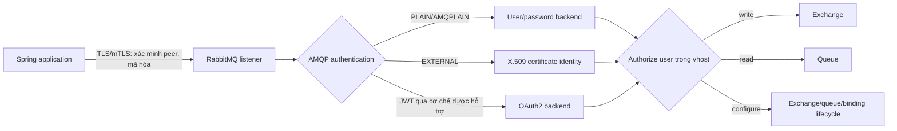
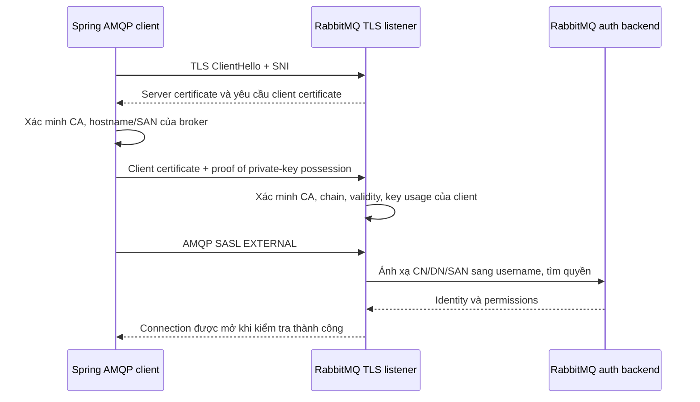
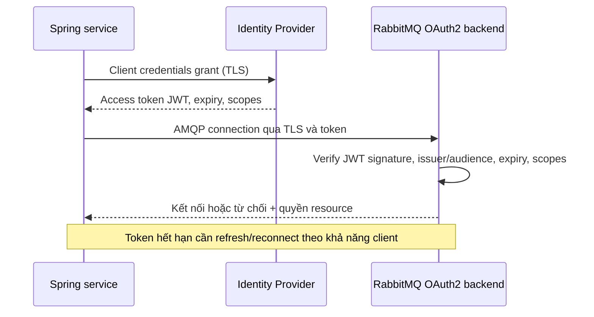

# mTLS hoặc cơ chế xác thực khác theo khả năng client/broker

> **Chương:** Bảo mật  
> **Công nghệ:** Spring AMQP, Spring Boot, RabbitMQ  
> **Trọng tâm:** Phân biệt bảo vệ đường truyền TLS, xác thực hai chiều mTLS, cơ chế đăng nhập AMQP/SASL và phân quyền RabbitMQ. Triển khai kết nối an toàn cho `RabbitTemplate` và `@RabbitListener`, đồng thời lựa chọn username/password, X.509 `EXTERNAL`, OAuth 2.0/JWT hoặc LDAP theo khả năng của **cả client và broker**.

## 1. Vì sao kết nối TLS chưa đồng nghĩa đã xác thực ứng dụng bằng chứng chỉ?

Giả sử dịch vụ `PaymentService` dùng Spring AMQP để publish vào exchange `payments.events`. Consumer dùng `@RabbitListener` xử lý sự kiện thanh toán. Một người vận hành bật TLS trên RabbitMQ và cấu hình certificate ở Spring Boot, rồi kết luận: “Giờ mọi ứng dụng đã đăng nhập bằng mTLS và không cần quản lý quyền truy cập nữa”. Kết luận này sai ở **hai tầng khác nhau**:

1. **TLS bảo mật đường truyền:** client xác minh danh tính **máy chủ** RabbitMQ qua chứng chỉ server; dữ liệu được mã hóa và bảo vệ tính toàn vẹn. Đây là **server-authenticated TLS**, chưa nhất thiết có chứng chỉ client.
2. **mTLS xác minh hai chiều:** broker yêu cầu và xác minh **chứng chỉ client** trong TLS handshake. Nhưng để dùng danh tính đó làm **RabbitMQ user** thay cho username/password, client và broker còn phải thống nhất **cơ chế xác thực ứng dụng**, chẳng hạn SASL `EXTERNAL` với plugin X.509 của RabbitMQ.

Sau khi xác thực thành công, RabbitMQ vẫn phải kiểm tra **authorization**: user có quyền truy cập virtual host nào, được `configure` exchange/queue nào, được `write` vào exchange và `read` từ queue nào. Không có certificate nào tự động cấp toàn quyền publish, consume, khai báo exchange, binding hay dead-letter.

**Mục tiêu bài học:** chọn mô hình xác thực phù hợp, cấu hình TLS/mTLS an toàn ở broker và Java client, tách danh tính khỏi quyền, kiểm thử bằng `RabbitTemplate` và `@RabbitListener`, chẩn đoán các lỗi handshake/ACCESS_REFUSED, và lập kế hoạch xoay vòng certificate/token không làm hỏng luồng xử lý message.

## 2. Mô hình bảo mật theo từng lớp



| Lớp | Câu hỏi được giải quyết | Công cụ thường dùng | Điều không được suy diễn |
| --- | --- | --- | --- |
| Mã hóa đường truyền | Dữ liệu trên mạng có bị nghe lén/sửa không? | TLS 1.2/1.3 với cipher và cấu hình an toàn. | Không chứng minh user ứng dụng được quyền truy cập queue. |
| Danh tính broker | Đây có đúng broker mà client cần kết nối? | CA/truststore, xác minh SAN/hostname chứng chỉ server. | Không xác minh danh tính của client. |
| Danh tính client ở TLS | Client có sở hữu private key cho chứng chỉ đáng tin cậy? | mTLS, CA của client, `verify_peer` và `fail_if_no_peer_cert`. | Không tự động thay thế login AMQP. |
| Xác thực ứng dụng | Connection đang được broker gán cho user nào? | `PLAIN`, `EXTERNAL`, token/JWT và backend thích hợp. | Không tự cấp quyền trên mọi vhost. |
| Phân quyền | User được làm thao tác nào lên resource nào? | Vhost, regex `configure/write/read`, topic permissions, policy. | Không thể sửa bằng việc tắt kiểm tra TLS. |
| An toàn nghiệp vụ | Message có thể bị gửi/giao trùng, dữ liệu có được xử lý đúng không? | Publisher confirms, acknowledgements, retry, idempotency, DLQ, transaction/outbox. | TLS/mTLS không bảo đảm exactly-once delivery/effect. |

**Authentication** là “bạn là ai?”, còn **authorization** là “bạn được làm gì?”. Một certificate hợp lệ chỉ là một phần của authentication. Phải phân quyền cả các kết nối Shovel/Federation, ứng dụng quản trị, producer, consumer, và các công cụ quan sát theo nguyên tắc least privilege.

## 3. Các lựa chọn xác thực: chọn theo khả năng thực tế

RabbitMQ hỗ trợ nhiều lớp authentication/authorization backend. Với Spring AMQP, khả năng chọn cơ chế tùy **wire protocol** (AMQP 0-9-1, RabbitMQ AMQP 1.0, MQTT/STOMP...), **Java client** tương ứng và cấu hình plugin ở broker. Đừng suy rằng một thuộc tính `spring.rabbitmq.*` hoạt động cho tất cả giao thức.

| Phương án | TLS yêu cầu? | Cách RabbitMQ nhận danh tính | Điều kiện triển khai | Phù hợp khi |
| --- | --- | --- | --- | --- |
| **Username/password qua TLS**, thường SASL `PLAIN` | **Phải dùng TLS trong production** để bảo vệ mật khẩu trên mạng. | Kiểm tra username/password với internal backend hoặc LDAP/HTTP backend theo cấu hình. | Broker cho phép PLAIN; client có credential, vhost và quyền. | Đơn giản, tương thích rộng, dễ tích hợp secret manager. |
| **mTLS + vẫn dùng PLAIN** | Có, hai phía trao đổi và xác minh certificate. | Mặc dù client đã xuất trình cert, RabbitMQ vẫn đăng nhập theo username/password. | Server yêu cầu cert, client có keypair/trust; PLAIN vẫn được bật. | Cần thêm một tầng bảo vệ thiết bị/service nhưng chưa chuyển sang certificate-only login. |
| **mTLS + X.509 `EXTERNAL`** | Có, bắt buộc broker xác minh certificate. | Plugin `rabbitmq_auth_mechanism_ssl` trích danh tính (DN/CN/SAN) làm RabbitMQ user; password bị bỏ qua. | Plugin + `EXTERNAL` ở broker; client chọn `EXTERNAL`; user/backend permissions tương ứng. | Muốn xác thực workload theo PKI, giảm quản lý mật khẩu ứng dụng. |
| **OAuth 2.0/JWT** | Có, cần TLS để bảo vệ token. | `rabbitmq_auth_backend_oauth2` xác minh token JWT và scope/permissions. | IdP, plugin/broker cấu hình đúng, client có cách lấy và làm mới token. | Hạ tầng dùng OAuth/OIDC, service identity, credential ngắn hạn. |
| **LDAP/HTTP auth backend** | Có cho luồng AMQP và kênh đi tới backend nếu qua mạng không tin cậy. | Client thường vẫn gửi username/password bằng PLAIN; **broker** hỏi backend. | Plugin backend và đường kết nối broker–directory/API. | Danh tính tập trung, cần đồng bộ quy định tài khoản/quyền. |

**LDAP không phải một SASL mechanism khác mà `RabbitTemplate` phải tự bật.** Đó là lựa chọn xác thực/ủy quyền ở phía RabbitMQ: Java client vẫn dùng cách đăng nhập mà server chấp nhận. Tương tự, OAuth/OIDC login cho **Management UI** không đồng nghĩa Java AMQP client tự nhận JWT; cần tích hợp riêng đường lấy token và lifecycle của token.

AMQP 0-9-1 thường dùng SASL `PLAIN` hoặc `AMQPLAIN`; `EXTERNAL` cần plugin và được cả hai bên hỗ trợ. RabbitMQ AMQP 1.0 có negotiation và client API riêng (ví dụ `RabbitAmqpTemplate` thay cho `RabbitTemplate`); khi thiết kế `EXTERNAL` hoặc token với AMQP 1.0, **kiểm tra cụ thể khả năng cấu hình SASL/TLS của thư viện và phiên bản đang dùng**, không sao chép API `DefaultSaslConfig` của client 0-9-1 sang client 1.0.

## 4. Hai mô hình TLS phổ biến và ranh giới của chúng

### 4.1. Server-authenticated TLS + PLAIN

```text
Spring app                               RabbitMQ
  Trust CA -------- xác minh --------->  Server certificate + private key
  TLS channel được mã hóa ======================================>
  AMQP SASL PLAIN(username/password) ---------------------------->
                                       User backend + quyền vhost
```

Ứng dụng có truststore chứa CA để xác minh certificate server, nhưng **không cần gửi certificate riêng**. Broker có thể dùng `ssl_options.verify = verify_none`, hoặc đặt `verify_peer` với `fail_if_no_peer_cert=false` nếu muốn kiểm tra certificate khi client có gửi mà không bắt mọi client phải có. Với security production, nên chọn một policy nhất quán, tránh tạo listener dễ gây hiểu nhầm về yêu cầu client certificate.

### 4.2. Mutual TLS + SASL EXTERNAL



Ở mô hình này, broker cần **hai lớp cấu hình**: (1) TLS listener yêu cầu/xác minh certificate client, và (2) cơ chế `EXTERNAL` cùng plugin ánh xạ certificate thành RabbitMQ user. Client phải (1) có keypair, trust CA server, và (2) chủ động chọn `EXTERNAL` trong protocol handshake. Nếu chỉ làm một nửa, việc thiết lập kết nối có thể bị từ chối hoặc rơi về PLAIN nếu cấu hình server còn cho phép.

### 4.3. Vì sao TLS termination qua proxy cần kiểm tra kỹ?

Khi proxy/load balancer **kết thúc TLS** từ app và nối một TLS connection khác đến RabbitMQ, RabbitMQ **không mặc nhiên thấy certificate gốc của ứng dụng**. mTLS ở đoạn app → proxy không có nghĩa broker có thể dùng `EXTERNAL` để xác thực đúng client. Nếu kiến trúc bắt buộc dùng certificate ở RabbitMQ, ưu tiên end-to-end TLS đến broker hoặc cơ chế proxy chuyển danh tính được hỗ trợ, được xác minh riêng và có threat model rõ ràng; **không tin tùy tiện một HTTP header chứa tên user**.

## 5. Cấu hình RabbitMQ: từ listener TLS đến certificate-only auth

Các đoạn sau là **mẫu cấu hình** cho môi trường thử nghiệm hoặc triển khai do đội vận hành quản lý. Certificate, CA, DNS, khóa, permission và RabbitMQ version phải được chuẩn bị trước. Không ghi private key, certificate thật hoặc mật khẩu production vào repository.

### 5.1. TLS listener có xác minh chứng chỉ server (chưa bắt buộc client cert)

Ví dụ phần tương ứng trong `rabbitmq.conf`:

```ini
# TLS termination trực tiếp tại RabbitMQ; port chuẩn AMQPS
listeners.ssl.default = 5671

ssl_options.cacertfile = /etc/rabbitmq/pki/ca.pem
ssl_options.certfile   = /etc/rabbitmq/pki/server-cert.pem
ssl_options.keyfile    = /etc/rabbitmq/pki/server-key.pem

# Demo: cho phép client không có certificate, vì vẫn dùng SASL PLAIN.
ssl_options.verify = verify_peer
ssl_options.fail_if_no_peer_cert = false

auth_mechanisms.1 = PLAIN
```

Đây **không phải mTLS bắt buộc**: `fail_if_no_peer_cert=false` cho phép client không gửi chứng chỉ. Nếu client có chứng chỉ, broker vẫn cần kiểm tra certificate theo cấu hình `verify_peer`. Mật khẩu của PLAIN đi trong kênh TLS đã được bảo vệ. Production nên cấu hình firewall và cân nhắc `listeners.tcp = none` để **không mở thêm cổng 5672 không mã hóa**, nếu các client đều đã chuyển sang TLS.

```ini
# Chỉ bật khi xác nhận mọi client không còn cần plain TCP:
listeners.tcp = none
```

### 5.2. Bật mTLS + xác thực X.509 EXTERNAL

RabbitMQ cần plugin certificate authentication (tên plugin `rabbitmq_auth_mechanism_ssl`). Quản trị viên chạy trên node/cluster phù hợp theo quy trình triển khai:

```bash
rabbitmq-plugins enable rabbitmq_auth_mechanism_ssl
```

Trong `rabbitmq.conf`, thay chính sách ở mục trước bằng:

```ini
listeners.tcp = none
listeners.ssl.default = 5671

ssl_options.cacertfile = /etc/rabbitmq/pki/trusted-client-ca.pem
ssl_options.certfile   = /etc/rabbitmq/pki/server-cert.pem
ssl_options.keyfile    = /etc/rabbitmq/pki/server-key.pem
ssl_options.verify     = verify_peer
ssl_options.fail_if_no_peer_cert = true

# Chỉ chấp nhận certificate authentication ở tầng AMQP.
auth_mechanisms.1 = EXTERNAL

# Lấy danh tính từ CN, ví dụ certificate client có CN=svc-orders.
ssl_cert_login_from = common_name
```

**Điều kiện quan trọng:** `ssl_options.fail_if_no_peer_cert = true` bảo broker từ chối TLS client không gửi certificate; `auth_mechanisms.1 = EXTERNAL` bảo broker dùng danh tính do cơ chế xác thực ngoài cung cấp. Trường `ssl_cert_login_from` còn có tùy chọn `distinguished_name` (subject DN) hoặc `subject_alternative_name` với loại/vị trí SAN theo cấu hình plugin. Hãy ưu tiên **cấu trúc định danh ổn định và duy nhất** theo chính sách PKI của tổ chức; dùng CN chung chung dễ trùng danh tính.

Đối với chế độ EXTERNAL, **mật khẩu do client gửi sẽ bị bỏ qua**, nhưng RabbitMQ vẫn cần ánh xạ tên được trích từ certificate tới một user tồn tại ở internal/LDAP/backend phù hợp và user đó phải có permissions. Một certificate có chain hợp lệ nhưng user không tồn tại hoặc không có quyền vhost **vẫn bị từ chối**.

Nếu cần hỗ trợ **cả** EXTERNAL và PLAIN khi chuyển đổi hệ thống, có thể cấu hình:

```ini
auth_mechanisms.1 = EXTERNAL
auth_mechanisms.2 = PLAIN
```

Nhưng đây **không phải chính sách certificate-only** nữa: một client dùng PLAIN vẫn có thể xác thực nếu có credentials hợp lệ. Dù broker yêu cầu chứng chỉ ở tầng TLS, PLAIN vẫn được phép ở tầng AMQP. Đội bảo mật phải xác định **có chấp nhận mTLS + PLAIN trong giai đoạn chuyển tiếp hay không**, thay vì đánh đồng chúng với certificate login.

## 6. Danh tính và phân quyền: cert không thay thế least privilege

Ví dụ certificate dùng `CN=svc-orders`, RabbitMQ được cấu hình `ssl_cert_login_from=common_name`. Để connection thành công, user `svc-orders` phải được provision ở backend đã chọn. Với internal backend, có thể dùng definitions import hoặc công cụ quản trị để tạo user; RabbitMQ hỗ trợ user không cần mật khẩu cho certificate-based login. Trong một lab có account nội bộ sẵn và mật khẩu phát ngẫu nhiên, EXTERNAL **không kiểm tra password đó**.

RabbitMQ phân quyền **theo virtual host**, mỗi user có ba regex:

- `configure`: khai báo/xóa hoặc thay đổi queue/exchange và các tài nguyên cần quyền cấu hình.
- `write`: publish tới exchange và các thao tác ghi được broker xác định.
- `read`: consume từ queue và các thao tác đọc tương ứng.

Ví dụ lệnh grant cho một demo app vừa publish vừa consume, đồng thời `RabbitAdmin` cần declare topology. User và vhost **đã được tạo trước**:

```bash
rabbitmqctl set_permissions -p /orders svc-orders \
  '^(orders\.events|orders\.received)$' \
  '^(orders\.events|orders\.received)$' \
  '^(orders\.events|orders\.received)$'
```

Regex ở trên giới hạn quyền vào **hai resource tên cụ thể** thay vì `.*`. Với production, thường nên **tách danh tính** theo vai trò: `orders-publisher` có `write` vào `orders.events`, `orders-consumer` có `read` từ `orders.received`; một tài khoản bootstrap/admin riêng khai báo exchange, queue, binding và các chính sách như DLX. Khi app runtime không cần tự tạo topology, đặt `configure=^$` để giảm phạm vi ảnh hưởng nếu credential bị lộ.

**Lưu ý về binding:** tạo binding có thể yêu cầu quyền `read` trên exchange nguồn và `write` trên queue đích, bên cạnh quyền `configure` của những declarable. Khi dùng `RabbitAdmin` tự declare, cấp đủ quyền **chỉ cho topology nó quản lý**; đừng sửa các permission thành `.*` toàn vhost chỉ để vượt lỗi khởi động mà không tìm nguyên nhân.

### 6.1. Cần kiểm tra thêm topic authorization

Quyền `write` trên topic exchange **không đồng nghĩa** được publish mọi routing key nếu RabbitMQ đang dùng **topic permissions**. Với sự kiện phân vùng theo tenant (`tenant-A.order.paid`), cân nhắc topic permissions hoặc vhost riêng để tránh một publisher ghi vào namespace tenant khác. Chỉ dùng payload field `tenantId` trong JSON mà không kiểm soát quyền ở broker **không phải** cách phân lập dữ liệu an toàn.

## 7. Spring Boot + `RabbitTemplate`: kết nối TLS với username/password

Trước tiên xét cấu hình phổ biến nhất cho Spring AMQP **AMQP 0-9-1**. Ứng dụng cần module/starter RabbitMQ AMQP 0-9-1 tương ứng với phiên bản Spring Boot (ví dụ `spring-boot-starter-rabbitmq` ở Boot 4.x; ở các dòng Boot cũ tên starter có thể khác). Boot auto-configure `CachingConnectionFactory`, `RabbitTemplate` và `@RabbitListener` khi dependency phù hợp hiện diện.

### 7.1. Trust CA server bằng SSL bundle

```yaml
spring:
  rabbitmq:
    host: mq.internal.example
    port: 5671
    virtual-host: /orders
    username: ${RABBIT_USER}
    password: ${RABBIT_PASSWORD}
    ssl:
      enabled: true
      bundle: rabbit-trust

  ssl:
    bundle:
      pem:
        rabbit-trust:
          truststore:
            certificate: file:/run/secrets/rabbit/ca.pem
```

`spring.rabbitmq.ssl.bundle` trỏ tới `spring.ssl.bundle.pem.rabbit-trust`, nơi client biết CA đáng tin cậy để xác minh server certificate. **Không cần private key/certificate của client** nếu broker ở mục 5.1 không yêu cầu mTLS. Username/password phải được cung cấp từ secret injection, không commit vào git hoặc log. Dùng hostname khớp SAN của server certificate; đừng kết nối bằng IP tùy tiện khi cert chỉ có tên DNS.

Nếu dùng keystore/truststore dạng PKCS12/JKS thay vì PEM, Spring Boot cũng hỗ trợ `spring.ssl.bundle.jks.<ten>` cùng `keystore.location/password`, `truststore.location/password`; chọn một kiểu quản lý rõ ràng và bảo đảm mật khẩu file keystore đến từ secrets. Với Spring Boot có hỗ trợ `spring.rabbitmq.ssl.key-store`/`trust-store` trực tiếp, đó là cách khác để cấu hình, nhưng **tránh trộn nhiều nguồn cấu hình TLS** khiến rất khó xác định certificate nào thực sự được sử dụng.

### 7.2. URI `amqps://` và namespace chính xác

Trong Spring Boot dùng AMQP 0-9-1, `spring.rabbitmq.addresses` có thể chứa URI `amqps://...`; khi dùng addresses, cấu hình host/port riêng có thể bị bỏ qua theo quy tắc của Boot. Đừng để username/password trong URI ở log/debug output nếu có thể dùng property được quản lý. `amqps://` nghĩa là **AMQP qua TLS**, chứ không chỉ ra **cơ chế login X.509**.

Nếu dự án đang dùng **RabbitMQ AMQP 1.0**, các bean và property tương ứng ở Spring Boot 4.2+ thường thuộc `spring.amqp.rabbitmq.*` và `RabbitAmqpTemplate`, **không phải** `spring.rabbitmq.*`/`RabbitTemplate`. Hướng dẫn mTLS vẫn đúng ở tầng TLS, nhưng cấu hình SASL phải dùng API của client AMQP 1.0 thực tế.

## 8. Spring Boot + `RabbitTemplate`: mTLS và login bằng `EXTERNAL`

Muốn chuyển từ TLS + PLAIN sang **certificate login**, ta phải cho Java client 0-9-1 gửi certificate **và** chọn SASL `EXTERNAL`.

### 8.1. Cung cấp certificate/keypair cho client

```yaml
spring:
  rabbitmq:
    host: mq.internal.example
    port: 5671
    virtual-host: /orders
    ssl:
      enabled: true
      bundle: rabbit-mtls

  ssl:
    bundle:
      pem:
        rabbit-mtls:
          keystore:
            certificate: file:/run/secrets/rabbit/client-chain.pem
            private-key: file:/run/secrets/rabbit/client-key.pem
          truststore:
            certificate: file:/run/secrets/rabbit/server-ca.pem
```

`client-chain.pem` chứa chứng chỉ client và intermediate chain cần thiết, `client-key.pem` chứa private key tương ứng, và `server-ca.pem` cho client xác minh broker. Chứng chỉ client phải được broker tin cậy và có định danh khớp chính sách ánh xạ user, ví dụ `CN=svc-orders`. Certificate của server nên chứa SAN khớp `mq.internal.example`; không tắt hostname verification.

**Đoạn YAML này mới thiết lập phần mTLS.** Spring Boot không tự suy từ sự tồn tại của keypair rằng ứng dụng muốn đăng nhập AMQP bằng `EXTERNAL`. Cần cấu hình bước kế tiếp. Trên broker cũng phải có plugin và policy `EXTERNAL` tương ứng như mục 5.2.

### 8.2. Chọn SASL `EXTERNAL` ở Java client 0-9-1

Ví dụ cho **Spring Boot 4.2+**, khi đã dùng auto-configured native RabbitMQ 0-9-1 `ConnectionFactory`:

```java
import com.rabbitmq.client.DefaultSaslConfig;
import org.springframework.boot.rabbitmq.autoconfigure.ConnectionFactoryCustomizer;
import org.springframework.context.annotation.Bean;
import org.springframework.context.annotation.Configuration;

@Configuration(proxyBeanMethods = false)
public class RabbitClientAuthConfig {
    @Bean
    ConnectionFactoryCustomizer x509ExternalAuth() {
        return nativeFactory -> nativeFactory.setSaslConfig(
                DefaultSaslConfig.EXTERNAL);
    }
}
```

Customizer này tác động lên **native `com.rabbitmq.client.ConnectionFactory`** được Boot dùng để xây `CachingConnectionFactory`. Phần TLS certificate/truststore vẫn được cấu hình qua SSL bundle ở mục 8.1; `setSaslConfig(DefaultSaslConfig.EXTERNAL)` chỉ thay **cơ chế xác thực AMQP**. Với Spring Boot **3.x** hoặc cấu hình tự dựng, vị trí package `ConnectionFactoryCustomizer`/cách hook vào native factory khác; phải kiểm tra version đang chạy, không tự copy import của Boot 4.2 vào Boot 3.x.

Nếu tự dựng bean thay vì auto-configure, nguyên tắc tương đương:

```java
// Mẫu ý tưởng: nativeFactory đã được cấu hình SSLContext có keypair và CA.
com.rabbitmq.client.ConnectionFactory nativeFactory =
        new com.rabbitmq.client.ConnectionFactory();
nativeFactory.setHost("mq.internal.example");
nativeFactory.setPort(5671);
nativeFactory.setVirtualHost("/orders");
nativeFactory.useSslProtocol(sslContext);  // sslContext gồm KeyManager + TrustManager
nativeFactory.setSaslConfig(com.rabbitmq.client.DefaultSaslConfig.EXTERNAL);

org.springframework.amqp.rabbit.connection.CachingConnectionFactory springFactory =
        new org.springframework.amqp.rabbit.connection.CachingConnectionFactory(
                nativeFactory);
```

Đoạn này **minh họa cách nối API**, không phải class Java hoàn chỉnh: `sslContext` phải được tạo an toàn từ keystore/truststore (chẳng hạn thông qua `SslBundle.createSslContext()` của Spring Boot) và đăng ký `springFactory` thành Spring bean có lifecycle phù hợp. Nếu dùng native factory với `useSslProtocol(sslContext)`, hãy bảo đảm **hostname verification** được client bật theo phiên bản và thiết lập TLS hiện hành; bản Java client mới đã hướng tới TLS secure-by-default. Không dùng `useTlsWithNoVerification()` hoặc `skipServerCertificateValidation=true` trong production.

**Ghi nhớ:** password không còn được dùng khi `EXTERNAL` hoạt động đúng; nếu broker không bật `EXTERNAL`, hoặc client vẫn chọn `PLAIN`, kết nối có thể lỗi dù TLS handshake đã thành công. Muốn hỗ trợ fallback tạm thời, đó phải là **quyết định bảo mật có kiểm soát**, không tự thêm PLAIN vào server rồi tuyên bố certificate-only.

## 9. `RabbitTemplate` và `@RabbitListener` chạy trên connection bảo mật

Sự khác biệt của TLS/mTLS nằm chủ yếu ở **connection factory**, không phải tên phương thức gửi/nhận. Sau khi connection đã được xác thực và cấp quyền, exchange, queue, binding và consumer được sử dụng bằng Spring AMQP thông thường.

### 9.1. Khai báo topology cho môi trường thử nghiệm

```java
import org.springframework.amqp.core.Binding;
import org.springframework.amqp.core.BindingBuilder;
import org.springframework.amqp.core.DirectExchange;
import org.springframework.amqp.core.Queue;
import org.springframework.amqp.core.QueueBuilder;
import org.springframework.context.annotation.Bean;
import org.springframework.context.annotation.Configuration;

@Configuration(proxyBeanMethods = false)
public class SecureOrdersTopology {
    public static final String EXCHANGE = "orders.events";
    public static final String QUEUE = "orders.received";

    @Bean
    DirectExchange secureOrdersExchange() {
        return new DirectExchange(EXCHANGE);
    }

    @Bean
    Queue secureOrdersQueue() {
        return QueueBuilder.durable(QUEUE).build();
    }

    @Bean
    Binding secureOrdersBinding(DirectExchange secureOrdersExchange,
                                Queue secureOrdersQueue) {
        return BindingBuilder.bind(secureOrdersQueue)
                .to(secureOrdersExchange)
                .with("order.created");
    }
}
```

Các bean declarable sẽ được `RabbitAdmin` khai báo khi auto-declaration phù hợp được bật. Trong môi trường dùng **runtime least privilege** (`configure=^$`), hãy cho đội platform **pre-provision exchange, queue, binding** và cấu hình ứng dụng không cố tạo tài nguyên đó bằng user runtime thiếu quyền. Đừng cấp toàn quyền chỉ để code demo không báo lỗi `ACCESS_REFUSED`.

### 9.2. Publisher và listener

```java
import org.springframework.amqp.rabbit.core.RabbitTemplate;
import org.springframework.stereotype.Service;

@Service
public class SecureOrdersPublisher {
    private final RabbitTemplate rabbitTemplate;

    public SecureOrdersPublisher(RabbitTemplate rabbitTemplate) {
        this.rabbitTemplate = rabbitTemplate;
    }

    public void publish(String operationId) {
        rabbitTemplate.convertAndSend(
                SecureOrdersTopology.EXCHANGE,
                "order.created",
                "created:" + operationId);
    }
}
```

```java
import org.springframework.amqp.rabbit.annotation.RabbitListener;
import org.springframework.stereotype.Component;

@Component
public class SecureOrdersConsumer {
    @RabbitListener(queues = SecureOrdersTopology.QUEUE)
    public void onCreated(String body) {
        // Production: kiểm tra schema, ghi nghiệp vụ/idempotency và trả thành công
        // chỉ sau khi transaction dữ liệu hoàn tất.
        System.out.println("Received securely: " + body);
    }
}
```

Nếu cả publisher lẫn consumer dùng **cùng** `CachingConnectionFactory`, chúng cùng chịu chính sách xác thực của connection đó. Để có danh tính và quyền tách biệt, chạy hai service/process với identities riêng hoặc cấu hình hai `ConnectionFactory`/`RabbitTemplate`/listener factory riêng và inject đúng bean; không thể phân quyền producer/consumer khác nhau chỉ bằng cách đặt tên method Java.

TLS xác minh/kênh bảo mật **không loại bỏ** khả năng message bị gửi lặp khi publisher timeout hoặc consumer redelivery khi ack mất. Để hệ thống đáng tin cậy: publisher confirms/returns, idempotency theo `operationId`, retry hữu hạn, DLQ và transaction dữ liệu vẫn cần được thiết kế độc lập với authentication.

## 10. OAuth 2.0/JWT, LDAP và các lựa chọn không dựa vào client certificate

### 10.1. OAuth 2.0 cho workload có token ngắn hạn

RabbitMQ có plugin `rabbitmq_auth_backend_oauth2` để xác thực/ủy quyền dựa trên **JWT access token** từ Identity Provider đã cấu hình. Một luồng điển hình:



Với **RabbitMQ Java client AMQP 0-9-1**, có thể dùng một `CredentialsProvider`/`OAuth2ClientCredentialsGrantCredentialsProviderBuilder` hoặc provider thích hợp để lấy, cache và refresh token, thay vì cố định JWT trong `application.yml`. Nhiều cấu hình client truyền access token ở trường password của cơ chế tương thích PLAIN qua TLS; điều quan trọng là **client và plugin broker phải hỗ trợ cùng hợp đồng authentication**, không coi một JWT là mật khẩu vĩnh viễn. Cấu hình cụ thể thay đổi theo phiên bản thư viện/IdP, cần đối chiếu tài liệu của client thực tế.

Các rủi ro cần kiểm soát: token TTL, thời điểm refresh, kết nối đã mở khi token sắp hết hạn, giới hạn quyền scope theo vhost/resource, chuyển đổi issuer/key rotation và lỗi IdP. TLS vẫn cần thiết để bảo vệ token đang truyền; RabbitMQ chỉ xác minh JWT khi OAuth2 plugin/backend và trust configuration hoạt động đúng.

### 10.2. LDAP/HTTP backend

Với LDAP, broker có thể ủy quyền việc xác minh username/password và/hoặc quyền truy cập cho directory qua `rabbitmq_auth_backend_ldap`. Ứng dụng Spring thường **không đổi `RabbitTemplate`**: vẫn gửi credentials bằng SASL PLAIN **qua TLS**. Dùng LDAP không có nghĩa application dùng LDAP protocol trực tiếp; broker mới là nơi gọi directory. Nếu bật external backend cần theo dõi timeout/cache/sự cố backend, vì broker có thể từ chối những connection mới khi backend không sẵn sàng.

HTTP auth backend tương tự: nó là một plugin truy vấn dịch vụ xác thực/ủy quyền từ broker. Đừng dùng token ad-hoc do app gửi trong message header để thay việc xác thực connection AMQP; header là **payload/application metadata**, không phải danh tính kết nối được RabbitMQ kiểm tra tự động.

### 10.3. Đừng đánh đồng các protocol và plugins

| Trường hợp | Điều bắt buộc xác nhận |
| --- | --- |
| `RabbitTemplate` qua AMQP 0-9-1 | `com.rabbitmq.client.ConnectionFactory` có đúng `SaslConfig`, `SSLContext` và credentials provider? |
| `RabbitAmqpTemplate` qua RabbitMQ AMQP 1.0 | Client 1.0 có hỗ trợ SASL EXTERNAL/OAuth theo cách ứng dụng cần? Config TLS ở namespace AMQP 1.0 tương ứng? |
| RabbitMQ Stream protocol | Dùng Stream client/stream listener và cấu hình TLS/auth riêng; không suy từ `spring.rabbitmq.ssl.*` áp dụng cho mọi stream connection. |
| Shovel/Federation liên broker | Mỗi link có URI, TLS trust, credentials/cert, quyền ở broker nguồn và đích riêng. |
| RabbitMQ Management UI/HTTP API | HTTPS, session/OIDC/Basic auth thuộc endpoint quản trị; **khác** AMQP listener và không tự bảo vệ AMQP TCP port. |

Mỗi cơ chế ở trên cần được đánh giá theo **client library + plugin/backends + version broker + cách cấp quyền**. Với hạ tầng yêu cầu audit, bổ sung kiểm tra danh tính thật tại RabbitMQ sau khi connection được mở.

## 11. Kiểm tra và chẩn đoán TLS/mTLS có hệ thống

Khi kết nối thất bại, hãy phân tầng để tránh sửa sai vị trí:

1. **Network:** DNS, port 5671, firewall, load balancer, network policy.
2. **TLS server authentication:** CA/truststore, certificate chain, thời hạn, SAN/hostname.
3. **TLS client authentication:** client gửi certificate + private key, CA broker tin cậy, EKU phù hợp, `fail_if_no_peer_cert`.
4. **SASL authentication:** server cho phép `PLAIN` hay `EXTERNAL`? Client đang chọn cơ chế nào? Ánh xạ CN/DN/SAN có đúng user không?
5. **Authorization:** user có quyền vào vhost, exchange, queue, binding, DLX/topic không?
6. **Messaging:** exchange/queue/binding tồn tại chưa, consumer active, confirm/ack/return và DLQ ra sao?

### 11.1. Dùng OpenSSL để chẩn đoán TLS, không nhầm với test AMQP login

```bash
# Thử kiểm tra server certificate/hostname; broker mTLS strict có thể từ chối
# vì lệnh này chưa gửi certificate client.
openssl s_client -connect mq.internal.example:5671 \
  -servername mq.internal.example \
  -CAfile server-ca.pem -verify_return_error \
  -verify_hostname mq.internal.example

# Khi broker yêu cầu mTLS, bổ sung certificate và private key client:
openssl s_client -connect mq.internal.example:5671 \
  -servername mq.internal.example \
  -CAfile server-ca.pem -verify_return_error \
  -verify_hostname mq.internal.example \
  -cert client-chain.pem -key client-key.pem
```

Đây là lệnh kiểm tra ở **môi trường thử nghiệm có quyền**, không phải lệnh bài học đã thực thi. Thành công với `openssl s_client` chỉ chứng minh phần **TLS handshake**, **không** chứng minh SASL EXTERNAL, quyền vhost, `RabbitTemplate` publish hoặc `@RabbitListener` consume thành công.

Trên broker, quản trị viên có thể dùng `rabbitmq-diagnostics listeners`, `rabbitmqctl list_connections` (chọn các trường certificate/TLS được phiên bản hỗ trợ), TLS/auth logs và RabbitMQ Management UI để tìm nguyên nhân. Khi ghi log, chỉ ghi fingerprint/subject/issuer và dữ liệu vận hành cần thiết; **không ghi private key, JWT, password, hoặc payload nhạy cảm**.

### 11.2. Bảng lỗi thường gặp

| Dấu hiệu | Nguyên nhân khả dĩ | Cách xử lý đúng |
| --- | --- | --- |
| Connection refused ở 5671 | Broker chưa mở TLS listener, sai host/port hoặc firewall. | Kiểm tra `listeners.ssl.default`, DNS/port/listeners, network route. |
| `PKIX path building failed` / unknown CA | Client không tin CA của server hoặc chain thiếu intermediate. | Sửa truststore/chain, không tắt kiểm tra chứng chỉ. |
| `No subject alternative DNS name matching` | Host dùng để connect không nằm trong SAN server certificate. | Dùng đúng DNS/cấp lại certificate có SAN hợp lệ; không tắt hostname validation. |
| `bad certificate`, `certificate required` | Client không gửi cert, sai private key, chain/EKU không hợp lệ hoặc CA broker không tin. | Kiểm tra client keystore, chain, EKU `clientAuth`, policy `verify_peer`. |
| TLS thành công nhưng SASL `EXTERNAL` bị từ chối | Chưa bật `rabbitmq_auth_mechanism_ssl`, server không cho phép EXTERNAL, client còn chọn PLAIN, hoặc CN/DN/SAN không map đúng user. | Kiểm tra plugin, `auth_mechanisms`, `DefaultSaslConfig.EXTERNAL`, user/backend. |
| `ACCESS_REFUSED` khi mở vhost | User đã xác thực nhưng thiếu quyền trên vhost hoặc vhost không tồn tại. | Cấp quyền tối thiểu cho đúng vhost, không cấp user tag admin nếu không cần. |
| `ACCESS_REFUSED` khi declare/bind/publish/consume | Không có `configure`/`read`/`write` trên resource liên quan. | Kiểm tra regex permission và quyền binding/topic; tách account deploy/runtime. |
| Kết nối mất sau xoay cert/token | Connection mới thấy cert hết hạn/issuer mới chưa được trust, token hết hạn hoặc refresh chưa hoạt động. | Phối hợp CA overlap/secret rotation, reconnect có kiểm soát, giám sát trước expiry. |
| TLS kết nối được nhưng message không đến queue | Sai routing key, binding thiếu, exchange/queue topology hoặc consumer lỗi. | Chẩn đoán routing/confirm/return/ack riêng; không quy hết về TLS. |

## 12. Vận hành: cấp phát, xoay vòng và thu hồi danh tính

Certificate/token giúp giảm một số rủi ro mật khẩu tĩnh, nhưng chuyển trách nhiệm sang **PKI và lifecycle quản trị**:

| Công việc | Yêu cầu tối thiểu |
| --- | --- |
| Cấp chứng chỉ client | Định danh workload riêng, SAN/CN policy rõ ràng, private key được bảo vệ, EKU `clientAuth`, thời hạn phù hợp. |
| Cấp chứng chỉ broker | DNS trong SAN, EKU `serverAuth`, CA được client tin, mỗi endpoint/load balancer có identity hợp lệ. |
| Lưu secrets | Mount bảo mật/secret manager, file permission tối thiểu; không commit `.p12`, `.key`, token hoặc password vào git. |
| Xoay CA/leaf certificates | Có giai đoạn tin cậy chồng lấn CA cũ/mới, rollout client/server theo thứ tự, test reconnect mới trước khi thu hồi CA cũ. |
| Reconnect | Một connection TLS đang mở không tự đổi sang certificate mới chỉ vì file key đã thay. Cần cơ chế reload/recreate connection được client hỗ trợ hoặc rolling restart an toàn. |
| Thu hồi | Chặn user/role, thu hồi/loại CA hoặc leaf trust theo cơ chế PKI hỗ trợ; xử lý session đang mở và TLS session resumption theo chính sách. |
| Theo dõi | Số lần auth failure, TLS handshake error, certificate sắp hết hạn, cert subject, vhost denied, token refresh error, reconnect, publish/consume lag. |

**Đặc biệt với mTLS:** certificate đã bị xoay hoặc bị thu hồi ở nơi cấp **không bảo đảm connection hiện hữu bị cắt ngay**. Tùy cách broker/client xác minh hoặc cache TLS session, việc thu hồi có thể chỉ được áp dụng khi tạo handshake mới hoặc sau khi refresh trust. Phải có quy trình chủ động đóng các connection không còn được phép và kiểm tra TLS session resumption nếu chính sách yêu cầu thu hồi ngay.

Không sửa certificate/CA trực tiếp bằng tay trên một node rồi quên các node còn lại của cluster; quản lý secret đồng bộ, kiểm tra hostname/CA từng node và thực hiện deployment có thể rollback. Với Shovel/Federation, nhớ kiểm tra cả upstream và downstream khi CA hoặc token đổi.

## 13. Thực hành theo ba chặng và tiêu chí hoàn thành

Để xác nhận toàn bộ chuỗi **kết nối → authenticate → authorize → publish/consume**, làm các thử nghiệm **chỉ trên môi trường lab**:

### Chặng A: TLS + PLAIN

1. Bật TLS listener RabbitMQ ở 5671, cho phép PLAIN và cấu hình user/vhost riêng.
2. Chạy Spring Boot với `spring.rabbitmq.ssl.bundle` trust server CA, username/password lấy từ secret.
3. Gửi một `order.created` bằng `RabbitTemplate`, xác nhận `@RabbitListener` nhận và xử lý.
4. Dùng host sai SAN hoặc truststore sai để chắc rằng client **từ chối** broker không hợp lệ.

### Chặng B: mTLS + EXTERNAL

1. Cấp cert client với `CN=svc-orders` (hoặc SAN theo policy), cấp user/backend tương ứng và permissions cho `/orders`.
2. Bật plugin `rabbitmq_auth_mechanism_ssl`, đặt `verify_peer`, `fail_if_no_peer_cert=true`, cấu hình `EXTERNAL` và ánh xạ `common_name`.
3. Đặt client cert/private key/server CA trong SSL bundle; bổ sung `ConnectionFactoryCustomizer` chọn `DefaultSaslConfig.EXTERNAL`.
4. Thử **không gửi client certificate**: phải thất bại ở TLS khi broker yêu cầu certificate.
5. Thử cert được tin cậy nhưng CN không có user: TLS có thể thành công, còn authentication AMQP phải bị từ chối.
6. Thử user đúng CN nhưng không có quyền `write` exchange: connection có thể mở, còn publish phải bị từ chối.
7. Chạy thành công khi cả certificate, SASL, backend user, vhost và permissions đều đúng.

### Chặng C: thay cơ chế login nhưng vẫn giữ nguyên nghiệp vụ

1. Trong một môi trường độc lập, cấu hình OAuth2/JWT hoặc LDAP backend và dùng client version hỗ trợ phương án đó.
2. Giữ nguyên code `RabbitTemplate`/listener, chỉ thay wiring credentials provider, connection factory và cấu hình broker tương ứng.
3. Kiểm thử token expiry/refresh, sai scope, mất IdP/backend, các retry khi reconnect; bảo đảm không lộ token trong log.
4. So sánh nỗ lực vận hành, tính tương thích client, chi phí quản lý secrets và audit trước khi chọn phương án production.

### Ma trận đánh giá

| Kiểm thử | Kết quả mong đợi |
| --- | --- |
| Certificate server không được tin hoặc hostname sai | Client chặn handshake TLS. |
| mTLS strict, client không có certificate | Broker từ chối kết nối TLS. |
| EXTERNAL với certificate hợp lệ nhưng user không tồn tại | Broker từ chối authentication ở tầng AMQP. |
| User đúng nhưng thiếu quyền vhost | Không mở được vhost tương ứng. |
| User có `read` queue nhưng không có `write` exchange | Consume có thể thành công, publish không được phép. |
| Producer gửi và consumer nhận trên kết nối TLS/mTLS hợp lệ | Message được route đến queue như thường, business handling vẫn đúng. |
| Server/CA hoặc token được xoay | Connection mới được xác thực theo danh tính hiện tại, reconnect/refresh hoạt động có kiểm soát. |
| Consumer crash sau DB commit nhưng trước ack | Redelivery có thể xảy ra; idempotency ngăn tác động nghiệp vụ lặp. |

## 14. Checklist quyết định và kết luận

Trước khi triển khai Spring AMQP vào production, hãy trả lời đủ các câu hỏi sau:

1. **Protocol và client:** đang dùng `RabbitTemplate`/AMQP 0-9-1, `RabbitAmqpTemplate`/AMQP 1.0 hay client khác? Client thực sự hỗ trợ EXTERNAL, OAuth2 token refresh và TLS policy nào?
2. **Threat model:** chỉ cần mã hóa/xác minh broker, hay bắt buộc xác minh **workload client bằng cert**? Có proxy TLS termination nào làm mất danh tính certificate ở broker?
3. **Authentication:** broker bật SASL `PLAIN`, `EXTERNAL`, OAuth2/JWT hoặc LDAP/HTTP backend nào? Có cố ý cho phép fallback hay không?
4. **Authorization:** user được vào vhost nào; có đúng quyền `configure/write/read`, topic permission và quyền DLX/binding không? Có thể tách bootstrap admin khỏi account runtime không?
5. **PKI/secrets:** certificate chain, SAN, EKU, CA trust, thời hạn, rotation và revocation được quản lý ra sao?
6. **Reliability:** nếu auth/TLS lỗi làm reconnect liên tục, ứng dụng có backoff, alert và cách bảo toàn sự kiện không? Idempotency, publisher confirms và consumer ack đã được thiết kế riêng chưa?

**Kết luận:** mTLS là cơ chế xác minh **hai phía ở tầng TLS**; để đăng nhập RabbitMQ bằng **danh tính certificate X.509**, còn cần plugin ánh xạ và cơ chế AMQP **SASL `EXTERNAL`** thích hợp. Nếu chỉ cần giải pháp phổ biến, username/password qua TLS với secret rotation và quyền tối thiểu vẫn là lựa chọn có thể chấp nhận trong nhiều hệ thống; OAuth2/JWT và LDAP thích hợp khi hạ tầng danh tính, client và RabbitMQ hỗ trợ đầy đủ. Bất kể phương án nào, `RabbitTemplate`, `@RabbitListener`, exchange, queue, binding, retry, dead-letter và transaction nghiệp vụ vẫn hoạt động theo semantics AMQP; **bảo mật connection không thay cho độ tin cậy đầu cuối của message**.

### Tài liệu tham khảo

- [RabbitMQ — TLS Support](https://www.rabbitmq.com/docs/ssl): listeners, `verify_peer`, `fail_if_no_peer_cert`, certificate validation và mTLS.
- [RabbitMQ — Authentication, Authorisation, Access Control](https://www.rabbitmq.com/docs/access-control): authn/authz, vhost permissions, SASL `EXTERNAL` và quyền resource.
- [RabbitMQ — Credentials and Passwords](https://www.rabbitmq.com/docs/passwords): user/password, certificate login và chính sách secret.
- [RabbitMQ — X.509 Authentication Plugin](https://github.com/rabbitmq/rabbitmq-server/blob/main/deps/rabbitmq_auth_mechanism_ssl/README.md): certificate subject mapping và cơ chế EXTERNAL.
- [RabbitMQ — OAuth 2.0 Authentication Backend](https://www.rabbitmq.com/docs/oauth2): JWT validation, token scope và authorization integration.
- [RabbitMQ — Java Client API Guide](https://www.rabbitmq.com/client-libraries/java-api-guide): TLS, `CredentialsProvider`, OAuth2 client credentials và native factory.
- [Spring Boot — SSL Bundles](https://docs.spring.io/spring-boot/reference/features/ssl.html): PEM/JKS truststore, keystore và bundle quản lý cert/key.
- [Spring Boot — AMQP](https://docs.spring.io/spring-boot/reference/messaging/amqp.html): kết nối và factory cho AMQP 0-9-1/AMQP 1.0.
- [Spring AMQP — Connection and Resource Management](https://docs.spring.io/spring-amqp/reference/amqp/connections.html): `CachingConnectionFactory`, `RabbitConnectionFactoryBean` và TLS.
