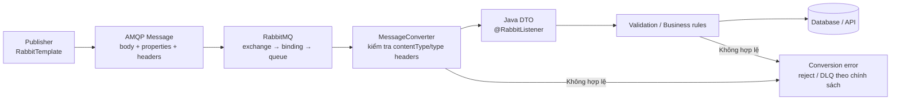

# Trusted packages, type headers và phòng tránh giải tuần tự không an toàn

## 1. Vấn đề bảo mật nằm ở đâu trong luồng Spring AMQP?

Trong chương **Bảo mật** của module **SPRING_AMQP**, ứng dụng sử dụng RabbitMQ qua `RabbitTemplate`, `@RabbitListener`, exchange, queue và binding để vận chuyển dữ liệu bất đồng bộ. Một message không chỉ có **body**; nó còn mang **properties/headers** như `contentType`, `messageId`, `correlationId` và các metadata mô tả kiểu Java.

Khi một consumer chuyển bytes nhận từ RabbitMQ thành object Java, có hai câu hỏi độc lập:

1. **Payload có hợp lệ theo contract nghiệp vụ không?** Chẳng hạn event `OrderPlacedV1` có `orderId`, `eventId` và `total` hợp lệ.
2. **Ai được quyền quyết định class Java nào sẽ được tạo ra?** Một producer hoặc tác nhân có quyền publish message có thể sửa `__TypeId__`, thậm chí gửi dữ liệu định dạng Java serialized object thay cho JSON.

Nếu consumer **tin hoàn toàn metadata từ message** và giải tuần tự tùy ý, nó có thể tạo ra các kiểu không được mong muốn, phát sinh lỗi khi resolve class, kích hoạt logic không an toàn trong thư viện có mặt trên classpath hoặc chịu các kiểu tấn công tài nguyên như payload quá lớn. Rủi ro cao hơn khi queue nhận dữ liệu từ bên thứ ba, hệ thống bị xâm nhập, tài khoản RabbitMQ dùng chung hoặc có một publisher phát message lỗi.

Vì vậy, **đừng coi message nhận từ broker là dữ liệu đáng tin chỉ vì đường truyền dùng TLS**. TLS bảo vệ kênh, không biến tất cả publisher trên kênh đó thành nguồn được phép chọn class Java.

Bài học làm rõ ba lớp bảo vệ:

- **Trusted packages** của Jackson JSON type mapper: hạn chế các package/class được phép dùng khi **resolve kiểu Java từ type headers**.
- **Kiểm soát type headers và định dạng message:** quyết định khi nào `__TypeId__` được sử dụng và khi nào listener chỉ nhận DTO cố định.
- **Chặn Java native deserialization nguy hiểm:** không tự chuyển body có `contentType=application/x-java-serialized-object` thành object; nếu thật sự bắt buộc thì dùng allow-list và phân vùng nguồn tin cậy.

Đây là các biện pháp **bổ trợ nhau**, không cái nào tự thay thế xác thực publisher, phân quyền vhost, xác minh dữ liệu nghiệp vụ, retry/DLQ và cập nhật dependency.

## 2. Message đi qua những bước chuyển đổi nào?



**Hai pha cần phân biệt trong Spring AMQP:**

- `MessageConverter` ở lớp AMQP chuyển bytes và properties thành Java object (ví dụ `Jackson2JsonMessageConverter` với Jackson 2 hoặc `JacksonJsonMessageConverter` với Jackson 3).
- Khi gọi method `@RabbitListener`, hạ tầng annotation còn có bước chuyển đổi tham số của Spring Messaging nếu cần. Một converter được khai báo cho `RabbitTemplate` **chưa chắc** đã được gắn cho listener container tương ứng.

Do đó, cấu hình converter phải được áp dụng đúng vào **cả phía gửi/nhận có liên quan**, hoặc dùng một shared bean qua auto-configuration đã được kiểm chứng.

### 2.1. Một AMQP message JSON điển hình

```text
routing key: orders.placed
contentType: application/json
messageId: 8f4d...               (định danh event logic)
headers:
  __TypeId__: com.example.orders.events.OrderPlacedV1
body:
  {"eventId":"8f4d...","orderId":"ORD-42","total":125000}
```

Trong ví dụ này, `__TypeId__` **không phải lệnh từ RabbitMQ bắt JVM tạo class đó**. Đây là header do Spring converter hoặc publisher khác có thể tạo, và **consumer** quyết định có dùng nó hay không.

Nếu thay header thành:

```text
__TypeId__: com.otherapp.internal.UnexpectedObject
```

consumer không nên tự động resolve class ngoài tập DTO được cấp phép, ngay cả khi JSON body có vẻ hợp lệ. Thực tế an toàn hơn là consumer **biết trước kiểu DTO được chấp nhận** theo queue và event contract.

## 3. Các type headers mà Jackson converter sử dụng

Các tên header mặc định thường xuất hiện khi Spring AMQP mã hóa kiểu:

| Header | Ý nghĩa | Rủi ro nếu tin trực tiếp |
| --- | --- | --- |
| `__TypeId__` | Class/alias của object hoặc phần tử chính | Publisher có thể gợi ý một class Java bất ngờ |
| `__ContentTypeId__` | Kiểu phần tử của collection | Một `List<?>` có thể chứa phần tử thuộc class không được phép |
| `__KeyTypeId__` | Kiểu key trong map | Có thể tạo key type lạ hoặc làm sai mapping |
| `contentType` | Kiểu nội dung wire, như `application/json` | Publisher có thể gắn sai để kích hoạt converter ngoài dự kiến |
| `contentEncoding` hoặc charset của `contentType` | Hướng dẫn giải mã bytes thành text | Giá trị sai làm parse thất bại hoặc lệch schema |
| `messageId`/`correlationId` | Định danh/tracing hoặc request-reply | Không phải thẩm quyền để chọn Java class |

Các header `__TypeId__` liên quan đến **Jackson mapping của Spring AMQP**, không phải quy tắc bắt buộc của AMQP 0.9.1. Producer viết bằng Go, Node.js hoặc Python có thể hoàn toàn không gửi các header đó. Vì vậy, dùng **tên Java class như một phần của protocol contract giữa các service** thường gây coupling và khó nâng cấp package.

Một hướng bền vững hơn là **event name + schema version**:

```json
{
  "eventId": "EVT-1001",
  "eventType": "order.placed",
  "schemaVersion": 1,
  "orderId": "ORD-42",
  "total": 125000
}
```

`eventType` và `schemaVersion` là dữ liệu nghiệp vụ cần được **so khớp theo allow-list tường minh** với một DTO; chúng không được phép làm tham số cho `Class.forName(...)`.

## 4. Trusted packages bảo vệ chính xác điều gì?

Spring AMQP cung cấp `DefaultJackson2JavaTypeMapper` (nhánh dùng Jackson 2) hoặc `DefaultJacksonJavaTypeMapper` (nhánh Jackson 3) để suy ra Java type từ thông tin trong `MessageProperties`.

Ví dụ cấu hình:

```java
mapper.setTrustedPackages(
    "java.lang",
    "java.util",
    "com.example.orders.events"
);
```

Khi cần **resolve class theo type headers**, mapper chỉ chấp nhận class phù hợp với package đã tin cậy, thay vì tùy ý tải class trong mọi package.

**Không dùng**:

```java
mapper.setTrustedPackages("*");  // Trust tất cả package: không nên dùng cho queue không đáng tin
```

Dấu `*` là cơ chế “tin tất cả” để tương thích trong một số kịch bản đặc biệt, không phải một giá trị tăng bảo mật.

### 4.1. Trusted packages không phải tường lửa toàn năng

| Hành vi | Trusted packages có chặn không? |
| --- | --- |
| `__TypeId__` chỉ tới class nằm ngoài allow-list | **Có thể chặn tại bước resolve class từ headers** |
| Publisher gửi JSON có `orderId` giả mạo nhưng dùng DTO hợp lệ | **Không**; cần xác thực nguồn và validate nghiệp vụ |
| Payload cực lớn gây tiêu thụ bộ nhớ khi parse | **Không**; cần giới hạn size và depth |
| Jackson `ObjectMapper` bật default typing/`@JsonTypeInfo` nguy hiểm trong **JSON body** | **Không bảo vệ toàn bộ**; cấu hình polymorphic deserialization là lớp khác |
| Java native serialized object được giải mã bằng `SimpleMessageConverter` | **Không**; cần `allowedListPatterns` hoặc không dùng Java serialization |
| Quản trị viên/broker hoặc tài khoản publisher bị xâm nhập | **Không**; cần network isolation, TLS, least privilege, audit |
| Gửi lặp một event hợp lệ để cộng tiền hai lần | **Không**; cần idempotent consumer/inbox |

**Tùy phiên bản và constructor, giá trị mặc định trusted packages cần được xác minh bằng tài liệu/Javadoc của bản đang chạy.** Tài liệu reference mô tả giới hạn `java.lang`/`java.util`, trong khi có Javadoc constructor ghi nhận chế độ tin rộng hơn. Để tránh phụ thuộc khác biệt mặc định, **khai báo tập package được phép một cách tường minh** và viết test xác nhận class lạ bị từ chối.

### 4.2. Đừng mở rộng allow-list thành toàn bộ ứng dụng

Cho phép cả `com.example.*` hoặc một package chứa entity/domain/internal infrastructure có thể không cần thiết. Nên tách DTO wire vào package nhỏ, chẳng hạn:

```text
com.example.orders.messaging.dto
    OrderPlacedV1
    OrderCancelledV1
    PaymentCapturedV1
```

Chỉ cho phép package này; không cho phép `com.example.orders.internal`, `com.example.orders.persistence` hay package chứa các object có side effect trong lifecycle. Dù DTO của bạn vô hại, một allow-list hẹp vẫn giảm vùng class có thể bị chọn ngoài ý muốn.

## 5. TypePrecedence: INFERRED và TYPE_ID

Khi listener viết:

```java
@RabbitListener(queues = "orders.placed.q")
public void onMessage(OrderPlacedV1 event) {
    ...
}
```

Spring AMQP có thể **suy luận kiểu `OrderPlacedV1` từ chữ ký method** rồi đưa thông tin này vào `MessageProperties.inferredArgumentType`.

Hai cách ưu tiên type:

| Chế độ | Quy tắc chính | Tác động bảo mật |
| --- | --- | --- |
| `INFERRED` (thường là mặc định) | Nếu có kiểu tham số cụ thể được suy luận hợp lệ, ưu tiên kiểu đó hơn `__TypeId__` của publisher | Giảm phụ thuộc vào header mà sender tự chọn |
| `TYPE_ID` | Ưu tiên kiểu được công bố trong type headers | Cần trust-list/alias mapping và validation chặt vì sender có nhiều ảnh hưởng hơn |

**Ngoại lệ quan trọng:** mặc định inferred type chỉ thắng inbound header khi parameter type **cụ thể**, hoặc là kiểu được hạ tầng xử lý trong `java.util`. Nếu method nhận interface, abstract class, hoặc kiểu trong container không được suy luận đủ rõ, mapper có thể quay về sử dụng `__TypeId__` và các header liên quan.

Ví dụ:

```java
// Thích hợp khi mỗi queue mang một schema/DTO cụ thể
@RabbitListener(queues = "orders.placed.q")
void onPlaced(OrderPlacedV1 event) { ... }

// Cần thiết kế mapping đa hình; không tự tin type headers của publisher
@RabbitListener(queues = "orders.events.q")
void onAnyOrderEvent(OrderEvent event) { ... } // interface OrderEvent
```

Nếu nhận nhiều event type, ưu tiên **eventType + schemaVersion + một bảng ánh xạ tường minh**, hoặc các handler riêng đã xác thực contract, thay vì bật `TYPE_ID` và tin mọi tên class.

### 5.1. Khi nào TYPE_ID có thể cần?

Có trường hợp một listener nhận lớp base nhưng payload thực sự là subclass của nó. Lúc này nếu inferred concrete base class thắng, thông tin subclass có thể bị mất. Khi chuyển sang `TYPE_ID`:

- Chỉ chấp nhận một tập type alias/class có kiểm soát.
- Không bật trust `*` chỉ để làm lỗi biến mất.
- Test các lớp không được phép, cả `__ContentTypeId__` và `__KeyTypeId__`.
- Kiểm tra Jackson polymorphism ở JSON body nếu DTO có `@JsonTypeInfo`.

**TypePrecedence là quy tắc chọn kiểu, không phải authentication hay authorization.** Một header nói `OrderPlacedV1` không chứng minh publisher được quyền tạo đơn hàng.

## 6. Ví dụ an toàn với Spring AMQP 3.x (Jackson 2)

Phần này dùng Spring AMQP **3.x**, Java 17+, Jackson 2 (`com.fasterxml.jackson`) và `spring-boot-starter-amqp` theo thế hệ Boot tương thích. Với Spring AMQP **4.x**, sử dụng các class Jackson 3 ở phần 7.

### 6.1. DTO chỉ chứa dữ liệu

```java
package com.example.orders.messaging.dto;

import java.math.BigDecimal;

public record OrderPlacedV1(
        String eventId,
        String orderId,
        BigDecimal total
) {}
```

DTO nên đơn giản: không chứa code thực thi trong constructor/setter, không tự gọi database hoặc API, và không nhúng class name vào field do bên ngoài có thể sửa. Sau khi parse, **validate** `eventId`/`orderId`, `total` và các invariant trước khi ghi DB.

### 6.2. Converter Jackson 2 với allow-list tường minh

```java
package com.example.orders.messaging.config;

import org.springframework.amqp.rabbit.config.SimpleRabbitListenerContainerFactory;
import org.springframework.amqp.rabbit.connection.ConnectionFactory;
import org.springframework.amqp.rabbit.core.RabbitTemplate;
import org.springframework.amqp.support.converter.DefaultJackson2JavaTypeMapper;
import org.springframework.amqp.support.converter.Jackson2JavaTypeMapper;
import org.springframework.amqp.support.converter.Jackson2JsonMessageConverter;
import org.springframework.context.annotation.Bean;
import org.springframework.context.annotation.Configuration;

@Configuration
public class SafeJsonMessagingConfig {

    @Bean
    Jackson2JsonMessageConverter safeJsonConverter() {
        DefaultJackson2JavaTypeMapper typeMapper =
                new DefaultJackson2JavaTypeMapper();

        typeMapper.setTrustedPackages(
                "java.lang",
                "java.util",
                "com.example.orders.messaging.dto"
        );
        typeMapper.setTypePrecedence(
                Jackson2JavaTypeMapper.TypePrecedence.INFERRED
        );

        Jackson2JsonMessageConverter converter =
                new Jackson2JsonMessageConverter();
        converter.setJavaTypeMapper(typeMapper);

        // Khi không có contentType hoặc là application/octet-stream,
        // không mặc định coi bytes là JSON.
        converter.setAssumeSupportedContentType(false);
        return converter;
    }

    @Bean("safeOrderListenerFactory")
    SimpleRabbitListenerContainerFactory safeOrderListenerFactory(
            ConnectionFactory connectionFactory,
            Jackson2JsonMessageConverter safeJsonConverter) {

        SimpleRabbitListenerContainerFactory factory =
                new SimpleRabbitListenerContainerFactory();
        factory.setConnectionFactory(connectionFactory);
        factory.setMessageConverter(safeJsonConverter);
        factory.setPrefetchCount(20);
        return factory;
    }

    @Bean("safeOrderRabbitTemplate")
    RabbitTemplate safeOrderRabbitTemplate(
            ConnectionFactory connectionFactory,
            Jackson2JsonMessageConverter safeJsonConverter) {

        RabbitTemplate template = new RabbitTemplate(connectionFactory);
        template.setMessageConverter(safeJsonConverter);
        return template;
    }
}
```

**Điểm cần hiểu chính xác:**

1. `setTrustedPackages(...)` giới hạn package khi mapper cần resolve class từ type headers; không phải validation của toàn bộ nội dung JSON.
2. `TypePrecedence.INFERRED` giúp listener nhận DTO cụ thể không phải chọn class bằng `__TypeId__` từ publisher.
3. `setAssumeSupportedContentType(false)` khiến converter **không tự coi** `application/octet-stream` hoặc thiếu content type là JSON. Với content type không hỗ trợ, converter có thể trả lại `byte[]`; không được hiểu rằng method này tự động reject mọi message sai content type. Khi cần bắt buộc `application/json`, kiểm tra ở **đường vào trước bước chuyển đổi** như phần 8.
4. Shared converter được gắn rõ cho cả `RabbitTemplate` và listener factory. Nếu dùng Boot autoconfiguration, cần xác minh Bean converter và những template/container tự động có nhận bean đó hay không.
5. Không đặt mapper `TYPE_ID` và không mở trusted package `*` chỉ để message từ một publisher không tương thích ngừng báo lỗi; cần sửa contract/schemas đúng cách.

### 6.3. Queue, DLX và publisher

```java
import org.springframework.amqp.core.Binding;
import org.springframework.amqp.core.BindingBuilder;
import org.springframework.amqp.core.DirectExchange;
import org.springframework.amqp.core.Queue;
import org.springframework.amqp.core.QueueBuilder;
import org.springframework.context.annotation.Bean;
import org.springframework.context.annotation.Configuration;

@Configuration
class OrderEventsTopology {

    @Bean
    DirectExchange ordersExchange() {
        return new DirectExchange("orders.x", true, false);
    }

    @Bean
    DirectExchange ordersDlx() {
        return new DirectExchange("orders.dlx", true, false);
    }

    @Bean
    Queue placedQueue() {
        return QueueBuilder.durable("orders.placed.q")
                .deadLetterExchange("orders.dlx")
                .deadLetterRoutingKey("orders.invalid")
                .build();
    }

    @Bean
    Queue invalidQueue() {
        return QueueBuilder.durable("orders.invalid.q").build();
    }

    @Bean
    Binding placedBinding(Queue placedQueue,
                          DirectExchange ordersExchange) {
        return BindingBuilder.bind(placedQueue)
                .to(ordersExchange)
                .with("orders.placed");
    }

    @Bean
    Binding invalidBinding(Queue invalidQueue,
                           DirectExchange ordersDlx) {
        return BindingBuilder.bind(invalidQueue)
                .to(ordersDlx)
                .with("orders.invalid");
    }
}
```

```java
import com.example.orders.messaging.dto.OrderPlacedV1;
import org.springframework.amqp.rabbit.core.RabbitTemplate;
import org.springframework.beans.factory.annotation.Qualifier;
import org.springframework.stereotype.Service;

@Service
class OrderEventPublisher {
    private final RabbitTemplate template;

    OrderEventPublisher(
        @Qualifier("safeOrderRabbitTemplate") RabbitTemplate template) {
        this.template = template;
    }

    void publish(OrderPlacedV1 event) {
        template.convertAndSend(
                "orders.x", "orders.placed", event,
                message -> {
                    message.getMessageProperties().setMessageId(
                            event.eventId());
                    return message;
                });
    }
}
```

Jackson converter thường đặt `contentType=application/json` và thêm type metadata tương ứng khi publish object. **Không coi việc producer gửi `__TypeId__` là bằng chứng xác thực về class.** Kiểu được chấp nhận do consumer contract quyết định.

### 6.4. Listener nhận DTO cụ thể

```java
import com.example.orders.messaging.dto.OrderPlacedV1;
import org.springframework.amqp.AmqpRejectAndDontRequeueException;
import org.springframework.amqp.rabbit.annotation.RabbitListener;
import org.springframework.stereotype.Component;

@Component
class SafeOrderListener {

    private final OrderService orderService;

    SafeOrderListener(OrderService orderService) {
        this.orderService = orderService;
    }

    @RabbitListener(
            queues = "orders.placed.q",
            containerFactory = "safeOrderListenerFactory")
    public void onOrderPlaced(OrderPlacedV1 event) {
        if (event.eventId() == null || event.eventId().isBlank()
                || event.orderId() == null || event.orderId().isBlank()
                || event.total() == null
                || event.total().signum() <= 0) {
            throw new AmqpRejectAndDontRequeueException(
                    "Invalid OrderPlacedV1 business contract");
        }

        // Phương thức ghi DB dùng idempotency key theo event/order.
        orderService.applyOnce(event);
    }
}
```

Ở đây `OrderService` là service nghiệp vụ của dự án, cần lưu ID và tác dụng vào database một cách nguyên tử. Listener đồng bộ hoàn tất thành công thì container `AUTO` có thể ack; khi parse/validate thất bại, cần reject/nack đúng chính sách.

**Chú ý thời điểm conversion lỗi:** nếu type header trỏ tới class không được phép và mapper thực sự cần resolve header đó, lỗi thường xảy ra **trước khi method `onOrderPlaced` được gọi**. `try/catch` nằm trong method listener sẽ **không bắt được lỗi của MessageConverter trước invocation**. Cần cấu hình error handler của container, DLX/DLQ và kiểm tra hành vi thực tế theo version.

Một số lỗi conversion được `ConditionalRejectingErrorHandler` xem là lỗi fatal và reject không requeue; đừng mặc định **mọi exception** đều tự tới DLQ. Phải khai báo DLX, phân loại lỗi và kiểm tra message đi đúng nhánh.

## 7. Phiên bản 4.x: Jackson 3 và tên class mới

Spring AMQP **4.0** giới thiệu converter dựa trên **Jackson 3**:

| Spring AMQP 3.x (Jackson 2) | Spring AMQP 4.x (Jackson 3) |
| --- | --- |
| `Jackson2JsonMessageConverter` | `JacksonJsonMessageConverter` |
| `DefaultJackson2JavaTypeMapper` | `DefaultJacksonJavaTypeMapper` |
| `Jackson2JavaTypeMapper.TypePrecedence` | `JacksonJavaTypeMapper.TypePrecedence` |
| `com.fasterxml.jackson.databind.*` | `tools.jackson.databind.*` |

Một số lớp cũ còn được đánh dấu deprecated-for-removal trong 4.0, nhưng mã mới nên dùng API Jackson 3 thay vì trộn các mapper từ hai thế hệ.

Ví dụ bean converter tương đương trên **Spring AMQP 4.0+**:

```java
import org.springframework.amqp.support.converter.DefaultJacksonJavaTypeMapper;
import org.springframework.amqp.support.converter.JacksonJavaTypeMapper;
import org.springframework.amqp.support.converter.JacksonJsonMessageConverter;
import org.springframework.context.annotation.Bean;

@Bean
JacksonJsonMessageConverter secureJackson3Converter() {
    DefaultJacksonJavaTypeMapper mapper =
            new DefaultJacksonJavaTypeMapper();

    mapper.setTrustedPackages(
            "java.lang",
            "java.util",
            "com.example.orders.messaging.dto"
    );
    mapper.setTypePrecedence(
            JacksonJavaTypeMapper.TypePrecedence.INFERRED
    );

    JacksonJsonMessageConverter converter =
            new JacksonJsonMessageConverter();
    converter.setJavaTypeMapper(mapper);
    converter.setAssumeSupportedContentType(false);
    return converter;
}
```

Bean này là **phương án thay thế** `safeJsonConverter()` ở phần 6.2, không phải một converter thứ hai cần dùng đồng thời. Áp dụng vào `RabbitTemplate` và listener factory cùng loại. Khi nâng cấp cần xác nhận dependency Jackson, cấu hình `ObjectMapper` và các module custom serializer/deserializer vì Jackson 3 có namespace khác.

**Đừng suy luận chế độ trusted packages mặc định chỉ từ constructor hoặc bài blog về version khác.** Cấu hình hẹp như ví dụ và viết unit test về header không được phép là cách dễ kiểm chứng hơn.

## 8. Mô hình an toàn hơn: nhận bytes, xác thực envelope, parse vào DTO cố định

Với nguồn ít tin cậy, queue có nhiều publisher hoặc yêu cầu chặn nghiêm ngặt các header, cách rõ nhất là **không dùng type headers để quyết định Java class**. Listener nhận raw `org.springframework.amqp.core.Message` rồi parse JSON thành **một DTO cụ thể đã được chọn trước theo queue/contract**.

Ví dụ này dùng Jackson 2 (Spring Boot 3.x) để minh họa ý tưởng; với Jackson 3, thay bằng `tools.jackson.databind.json.JsonMapper` và các exception tương ứng.

```java
import com.example.orders.messaging.dto.OrderPlacedV1;
import com.fasterxml.jackson.core.JsonProcessingException;
import com.fasterxml.jackson.databind.ObjectMapper;
import org.springframework.amqp.AmqpRejectAndDontRequeueException;
import org.springframework.amqp.core.Message;
import org.springframework.amqp.rabbit.annotation.RabbitListener;
import org.springframework.stereotype.Component;

@Component
class StrictJsonOrderListener {

    private static final int MAX_BODY_BYTES = 64 * 1024;

    // Mapper dành riêng cho DTO message;
    // KHÔNG kích hoạt default typing theo tên class trong payload.
    private final ObjectMapper mapper = new ObjectMapper();
    private final OrderService orderService;

    StrictJsonOrderListener(OrderService orderService) {
        this.orderService = orderService;
    }

    @RabbitListener(queues = "orders.placed.q")
    public void onRawMessage(Message raw) {
        String contentType =
                raw.getMessageProperties().getContentType();
        byte[] body = raw.getBody();

        if (contentType == null
                || !contentType.split(";", 2)[0].trim()
                        .equalsIgnoreCase("application/json")) {
            throw new AmqpRejectAndDontRequeueException(
                    "Expected application/json");
        }

        if (body.length == 0 || body.length > MAX_BODY_BYTES) {
            throw new AmqpRejectAndDontRequeueException(
                    "Invalid JSON message size");
        }

        final OrderPlacedV1 event;
        try {
            event = mapper.readValue(body, OrderPlacedV1.class);
        }
        catch (JsonProcessingException ex) {
            throw new AmqpRejectAndDontRequeueException(
                    "Invalid OrderPlacedV1 JSON", ex);
        }

        if (event == null
                || event.eventId() == null || event.eventId().isBlank()
                || event.orderId() == null || event.orderId().isBlank()
                || event.total() == null
                || event.total().signum() <= 0) {
            throw new AmqpRejectAndDontRequeueException(
                    "Invalid event fields");
        }

        // Chỉ một DTO cụ thể được parse, không dùng __TypeId__.
        orderService.applyOnce(event);
    }
}
```

**Chỉ dùng một listener trong hai phương án**: `SafeOrderListener` của phần 6 và `StrictJsonOrderListener` ở phần 8 là **hai cách thay thế nhau**. Nếu chạy đồng thời trên cùng queue, RabbitMQ sẽ phân phối message cạnh tranh, không phải cùng message đi qua hai lớp kiểm tra.

Lợi ích của kiểu raw-parse:

- Bỏ qua `__TypeId__`, `__ContentTypeId__`, `__KeyTypeId__` khi chọn DTO.
- Kiểm soát `contentType` trước khi parse; không vô tình nhận bytes của Java serialization.
- Có thể chặn body quá lớn trước khi Jackson cấp phát nhiều object.
- Dễ kiểm tra schemaVersion, tenant, signature và identity trước khi thực hiện nghiệp vụ.

**Giới hạn:** kiểm tra body size tại listener không thay thế giới hạn **message size tại broker/gateway**, vì bytes đã được broker chuyển tới JVM. Ngoài byte size cần giới hạn độ sâu JSON, kích thước chuỗi/mảng, số trường, và tránh default typing/polymorphic deserialization không kiểm soát. Đối với multi-tenant, tenantId trong body/header không tự là chứng chỉ nguồn; cần xác thực và ủy quyền theo identity của publisher.

## 9. Trường hợp cần nhiều event type: alias mapping thay cho Java FQCN

Một số hệ thống dùng một queue cho nhiều event. Khi đó có thể dùng schema registry hoặc **type aliases tường minh** thay cho tên class Java trần trong header.

Ví dụ mapping:

```text
Header contract:
  eventType: "order.placed"
  schemaVersion: 1

Server-side mapping:
  ("order.placed", 1) -> OrderPlacedV1.class
  ("order.cancelled", 1) -> OrderCancelledV1.class
```

Cấu trúc pseudocode an toàn:

```java
switch (eventType + ":" + schemaVersion) {
    case "order.placed:1" -> mapper.readValue(body, OrderPlacedV1.class);
    case "order.cancelled:1" -> mapper.readValue(body, OrderCancelledV1.class);
    default -> throw new UnsupportedEventTypeException();
}
```

Giá trị từ publisher chỉ được **so khớp** với các khóa đã biết, không ghép thành tên class hoặc truyền vào `Class.forName`.

Spring AMQP còn hỗ trợ `setIdClassMapping(Map<String, Class<?>>)` trên type mapper (hoặc `DefaultClassMapper`), dùng alias như `orderPlacedV1` thay cho FQCN ở `__TypeId__`. Ví dụ trên Spring AMQP 3.x:

```java
DefaultJackson2JavaTypeMapper mapper =
        new DefaultJackson2JavaTypeMapper();

mapper.setTrustedPackages(
        "java.lang",
        "java.util",
        "com.example.orders.messaging.dto"
);
mapper.setIdClassMapping(
        java.util.Map.of(
            "orderPlacedV1",
            OrderPlacedV1.class,
            "orderCancelledV1",
            OrderCancelledV1.class
        )
);
```

**Lưu ý bảo mật:** alias mapping và trusted packages không mặc nhiên biến một mapper tổng quát thành **chỉ-cho-phép-đúng-hai-type** trong mọi nhánh xử lý. Một số mapper vẫn có cơ chế nhận Java FQCN hoặc fallback từ inferred types. Nếu yêu cầu **allow-list chính xác từng event**, hãy tự kiểm tra alias trước khi chọn DTO như phần raw-parse, hoặc triển khai type mapper custom **từ chối mọi ID không có trong bảng mapping**.

Đừng cho rằng `setIdClassMapping` tự kiểm chứng quyền của producer gửi event đó. Publisher A có thể gửi alias hợp lệ nhưng **không được phép** phát sự kiện tương ứng; authorization phải tách riêng.

## 10. Rủi ro riêng: Java native serialization

`SimpleMessageConverter` — converter mặc định thường gặp khi không cấu hình khác — hỗ trợ:

- `text/*`: chuyển bytes thành `String`.
- `application/octet-stream` hoặc kiểu khác: thường giữ `byte[]`.
- `application/x-java-serialized-object`: có thể thực hiện **Java native deserialization** nếu cơ chế security filter cho phép.
- Khi gửi một object implement `Serializable`: có thể tự phát ra Java-serialized payload.

Java native serialization có lịch sử rủi ro liên quan **gadget chains** nếu dữ liệu đến từ nguồn không được tin cậy. **Đừng dùng Java object serialization làm định dạng message công khai hoặc liên service**. Dùng JSON với DTO cố định, Protobuf hoặc schema có kiểm soát sẽ tốt hơn cho tính tương thích và phân tách code.

### 10.1. Allowed list cho Java serialization khác trusted packages của JSON

Spring AMQP có interface `AllowedListDeserializingMessageConverter` và thuộc tính `allowedListPatterns` để giới hạn class có thể được giải tuần tự bởi `SimpleMessageConverter` hoặc `SerializerMessageConverter`.

Ví dụ **chỉ nếu hệ thống legacy buộc phải đọc Java serialized object trong phạm vi hoàn toàn tin cậy**:

```java
import org.springframework.amqp.support.converter.SimpleMessageConverter;

SimpleMessageConverter legacyConverter =
        new SimpleMessageConverter();

legacyConverter.setAllowedListPatterns(java.util.List.of(
        "java.lang.*",
        "java.util.*",
        "com.example.legacy.messages.SafeEvent"
));
```

Lưu ý:

1. **Đây không phải cấu hình được đề nghị cho message đến từ nguồn không tin cậy**. Ngay cả khi có allow-list, việc giữ Java serialization vẫn gây coupling và có thể còn rủi ro tùy lớp được cho phép.
2. Mẫu allow-list cho Java deserialization **không giống** danh sách package của Jackson. Đừng nghĩ một `setTrustedPackages` bên JSON sẽ chặn nội dung `application/x-java-serialized-object` ở `SimpleMessageConverter`.
3. Tài liệu Spring AMQP hiện hành ghi **allow-list mặc định trống, không class nào được cho phép**; hành vi thực tế ở **các phiên bản cũ** từng khác. Phải kiểm tra bản đang chạy và có regression test, không suy đoán mặc định.
4. Tránh bật biến `SPRING_AMQP_DESERIALIZATION_TRUST_ALL` hoặc system property `spring.amqp.deserialization.trust.all=true` trong production. Chúng mở rộng việc tin tưởng vào Java deserialization và làm suy yếu phòng vệ.
5. Nếu ứng dụng **không cần Java serialized payload**, chặn `contentType=application/x-java-serialized-object` từ lúc ingress và dùng converter chỉ hỗ trợ format hợp đồng.

### 10.2. ContentTypeDelegatingMessageConverter cần kiểm tra fallback

`ContentTypeDelegatingMessageConverter` có thể chọn converter theo `contentType`. Nếu không có delegate phù hợp, hành vi mặc định có thể **fallback sang `SimpleMessageConverter`**. Đây là điểm dễ bị bỏ qua: một người nghĩ “chỉ cấu hình JSON” nhưng message gắn content type khác lại đi qua nhánh hỗ trợ Java serialization.

Với queue chỉ dành cho `application/json`, hãy:

- Định nghĩa chính sách chấp nhận content type **trước conversion** nếu cần strict mode.
- Không cho delegate ngoài dự kiến dùng Java native deserialization.
- Dùng raw `Message` + explicit JSON DTO hoặc converter custom từ chối unsupported type.
- Kiểm thử `null`, thiếu content type, `application/octet-stream`, `application/x-java-serialized-object` và MIME type không biết.

**Đặt `setAssumeSupportedContentType(false)` trên Jackson converter không hoàn toàn tương đương với “strict reject”.** Khi type không khớp, converter có thể trả `byte[]` để tầng sau xử lý; cần kiểm soát toàn bộ pipeline.

## 11. Jackson polymorphism: lớp tấn công không nằm trong __TypeId__

Một đối tượng JSON có thể chứa metadata kiểu ngay trong body khi ứng dụng bật Jackson polymorphism, ví dụ `@JsonTypeInfo(use = JsonTypeInfo.Id.CLASS)` hoặc global default typing. Trong trường hợp đó, loại class được chọn có thể đến từ **JSON body**, không phải header Spring `__TypeId__`.

Vì vậy:

- Không bật `ObjectMapper.activateDefaultTyping(...)` với policy rộng trên payload không tin cậy.
- Nếu bắt buộc dùng đa hình, hạn chế subtype bằng `PolymorphicTypeValidator` / explicit `@JsonSubTypes` và test từng subtype được phép; kiểm tra API theo Jackson 2/3.
- DTO inbound nên chỉ biểu diễn dữ liệu đơn giản, không chứa hành vi ngoài cần thiết.
- Không dùng `@JsonTypeInfo(use = Id.CLASS)` một cách mặc định trong contract công khai, vì làm rò tên class Java và tăng coupling.
- Luôn cập nhật Jackson và các dependency parser; trusted packages không vá được mọi lỗ hổng trong thư viện.

**Ranh giới bảo vệ khác nhau:**

```text
AMQP headers __TypeId__
    -> Spring DefaultJackson...JavaTypeMapper + trustedPackages

JSON body với polymorphic type metadata
    -> Jackson ObjectMapper + PolymorphicTypeValidator / explicit subtype mapping

Java native serialized bytes
    -> SimpleMessageConverter / SerializerMessageConverter + allowedListPatterns
```

Ba cơ chế này **không thể dùng thay thế cho nhau**.

## 12. Retry, dead-letter và log khi gặp message đáng ngờ

Không để dữ liệu không thể chuyển đổi tạo **vòng lặp requeue vô hạn**. Đối với JSON sai schema, class không được trust, kích thước quá lớn hoặc content type không cho phép:

1. Ghi metric `message_conversion_rejected_total` theo **queue, lý do đã chuẩn hóa và schemaVersion**.
2. Log correlation/event ID và nguyên nhân ở mức đủ điều tra; tránh in body nguyên bản, secret hoặc toàn bộ type header không kiểm soát.
3. Reject không requeue khi lỗi không thể tự khắc phục; nếu queue có DLX/DLQ thì message có thể chuyển đến khu vực cách ly để kiểm tra.
4. Với lỗi DB/API tạm thời, dùng retry giới hạn và backoff; không gộp lỗi nghiệp vụ với lỗi parse/type.
5. Kiểm soát quyền đọc DLQ, tuổi lưu, cách replay và trách nhiệm xử lý, vì DLQ cũng có thể chứa payload nhạy cảm/độc hại.

Spring AMQP thường dùng `ConditionalRejectingErrorHandler` trong listener container; các lỗi conversion nghiêm trọng có thể được phân loại là fatal và không requeue. Tuy nhiên, việc một exception có được phân loại như vậy, có đi vào DLQ hay không còn phụ thuộc **version, error handler, `defaultRequeueRejected` và DLX thực tế**. Bài học không giả định tất cả lỗi conversion đều có một kết quả mặc định như nhau.

### 12.1. Đừng xử lý DLQ bằng bộ giải tuần tự rộng hơn

Nếu DLQ chứa message bị từ chối vì `__TypeId__` nguy hiểm, một công cụ replay tự động dùng `trustedPackages("*")` để “đọc cho dễ” có thể trở thành điểm tấn công thứ hai.

Workflow an toàn:

- Lưu/hiển thị payload như **bytes hoặc text đã escape**, không giải tuần tự thành class tùy ý.
- Chỉ cho phép người có quyền duyệt loại message và đích replay.
- Nếu replay, phát lại sau khi sửa hợp đồng/sanitization và vẫn giữ event ID để consumer xử lý lặp an toàn.
- Tách hẳn quyền publish tới queue nhạy cảm khỏi quyền chỉ đọc metrics.

## 13. Bộ kiểm thử bảo mật cần chạy

Các bài test dưới đây nên chạy trong môi trường cô lập, tạo các message JSON/headers lành tính nhưng **mô phỏng metadata không tin cậy**; không cần sử dụng gadget payload hay khai thác thực tế.

| Kịch bản | Kết quả mong muốn |
| --- | --- |
| JSON hợp lệ, type header khớp DTO được phép | Chuyển đổi thành công, validation và nghiệp vụ chạy |
| JSON hợp lệ, `__TypeId__` là class ngoài package cho phép | Khi mapper đọc header, phải từ chối; không tạo object lạ |
| JSON hợp lệ, `__TypeId__` giả nhưng listener nhận DTO cụ thể `INFERRED` | Listener có thể dùng DTO inferred; phải xác minh đã không lấy class từ header |
| Listener nhận interface/abstract với header không tin cậy | Không fallback sang class tùy ý |
| List/Map có `__ContentTypeId__`/`__KeyTypeId__` ngoài allow-list | Từ chối khi type mapper sử dụng các header đó |
| Thiếu `contentType` hoặc `application/octet-stream` | Theo chính sách strict phải không xử lý như JSON hợp lệ |
| `application/x-java-serialized-object` từ publisher lạ | Bị chặn hoặc Java deserializer an toàn từ chối |
| JSON cực lớn / nhiều phần tử / nested quá sâu | Bị chặn bởi giới hạn phù hợp; không gây memory pressure quá mức |
| JSON hợp lệ nhưng `total < 0` | Từ chối do validation nghiệp vụ, không commit |
| Cùng event hợp lệ bị gửi lại sau reconnect | Consumer idempotent không tạo side effect trùng |
| Lỗi conversion trước method listener | Container error handler và DLQ hoạt động như đã cấu hình |
| Metadata giả mạo `eventType` hoặc tenantId | Bị chặn bởi allow-list schema và authorization, không chỉ class mapping |

### 13.1. Unit test tập trung vào mapper Spring AMQP 3.x

Ví dụ dưới đây **không dùng listener có inferredArgumentType**, để kiểm tra rõ ràng trường hợp mapper phải resolve type header:

```java
import java.nio.charset.StandardCharsets;
import org.junit.jupiter.api.Test;
import org.springframework.amqp.core.Message;
import org.springframework.amqp.core.MessageProperties;
import org.springframework.amqp.support.converter.DefaultJackson2JavaTypeMapper;
import org.springframework.amqp.support.converter.Jackson2JsonMessageConverter;

import static org.junit.jupiter.api.Assertions.assertThrows;

class TrustedTypeHeadersTest {

    @Test
    void rejectsTypeHeaderOutsideTrustedPackages() {
        var typeMapper = new DefaultJackson2JavaTypeMapper();
        typeMapper.setTrustedPackages(
                "java.lang", "java.util",
                "com.example.orders.messaging.dto");

        var converter = new Jackson2JsonMessageConverter();
        converter.setJavaTypeMapper(typeMapper);

        var properties = new MessageProperties();
        properties.setContentType(MessageProperties.CONTENT_TYPE_JSON);
        properties.setHeader("__TypeId__",
                "com.untrusted.example.UnexpectedType");

        var message = new Message(
                "{\"eventId\":\"EVT-1\",\"orderId\":\"ORD-1\",\"total\":10}"
                    .getBytes(StandardCharsets.UTF_8),
                properties);

        assertThrows(RuntimeException.class,
                () -> converter.fromMessage(message));
    }
}
```

Test này kiểm tra một tình huống **resolve header**. Trong project, nên bổ sung assertion cụ thể cho exception type và message theo phiên bản library đang dùng. Nếu listener method nhận một DTO concrete và dùng `INFERRED`, type header có thể không được dùng; **không được lấy kết quả test kiểu đó để kết luận trusted packages đã bị vô hiệu hóa**.

### 13.2. Kiểm thử tích hợp với RabbitMQ

1. Bật RabbitMQ test container, topology queue + DLQ như phần 6.
2. Gửi một event JSON đúng schema qua `RabbitTemplate`, chờ được xử lý.
3. Gửi lại cùng event ID; kiểm tra idempotency.
4. Gửi message với header type lạ, content type sai và body quá cỡ; quan sát container error handler.
5. Xác minh message lỗi không được commit nghiệp vụ, được reject đúng nhánh và có thể xuất hiện ở DLQ khi DLX đã cấu hình.
6. Gửi burst message độc hại dạng invalid JSON để kiểm tra heap, log rate và không bị redelivery storm.
7. Lặp lại trên version Spring AMQP mục tiêu (3.x hay 4.x), vì converter và default có thể thay đổi khi nâng cấp.

Không xem các tình huống này là **đã được chạy** chỉ vì bài có mã kiểm thử. Phải thực thi và lưu kết quả trong pipeline QA riêng.

## 14. Phòng vệ nhiều lớp ở mức broker và hệ thống

Trusted packages là một chốt bảo vệ **bên trong JVM**. Một hệ thống messaging đáng tin cậy còn cần:

- **Virtual host và permission tối thiểu:** publisher chỉ có quyền write vào exchange cần thiết; consumer chỉ có quyền read từ queue; quyền configure topology giao cho admin/deployment riêng khi có thể.
- **TLS và quản lý credential:** bảo vệ đường truyền và rotation secret; tránh dùng tài khoản `guest`/credential chung từ bên ngoài.
- **Network segmentation:** chỉ cho các service được phép kết nối tới broker/port cụ thể; giới hạn đường vào Management UI.
- **Message size, quotas và resource limits:** giới hạn payload ở producer, broker và consumer; theo dõi queue depth, disk/memory alarms, prefetch, concurrent consumers.
- **Schema version và validation:** reject message có enum/field/giá trị sai; giữ tương thích schema nhưng không chấp nhận mọi object.
- **Dependency hygiene:** cập nhật Spring AMQP, Jackson, Java và thư viện serialization; kiểm tra CVE, SBOM và chính sách cập nhật.
- **Publisher confirms, consumer ack, retry/DLQ, idempotency:** bảo đảm độ tin cậy đầu-cuối; một message JSON đã qua type mapper vẫn có thể bị phát lại.
- **Observability:** số lần header bị từ chối, conversion errors, invalid schema, DLQ depth, tỷ lệ retry và p99 latency; không đưa raw payload/type header tùy ý vào metric label vì cardinality/log injection.

## 15. Checklist áp dụng khi thiết kế consumer

1. **Nguồn dữ liệu là ai?** Những publisher nào được phép gửi đến exchange/queue, có phân quyền RabbitMQ đủ hẹp không?
2. **Wire format là gì?** JSON/Protobuf/Avro; có tuyệt đối tránh Java native serialized object không?
3. **Consumer có biết trước DTO không?** Nếu biết, dùng concrete `@RabbitListener` parameter + `INFERRED`, hoặc raw bytes + explicit DTO.
4. **Có dùng `__TypeId__` không?** Nếu cần, đặt `trustedPackages` thật hẹp và mapping alias/allow-list; không dùng trust `*`.
5. **Content type sai sẽ ra sao?** Đã kiểm thử thiếu content type, `application/octet-stream` và serialized object chưa?
6. **Có Jackson polymorphism không?** Nếu có, đã giới hạn subtype/default typing riêng, không chỉ dựa vào type headers chưa?
7. **Java serialized payload có thể xuất hiện không?** Nếu bắt buộc, `allowedListPatterns` và version behavior đã kiểm thử chưa?
8. **Kích thước message và cấu trúc JSON được giới hạn chưa?** Broker size limit, DTO validation, JSON parser depth, số phần tử?
9. **Conversion lỗi trước method xử lý thế nào?** Đã xác minh error handler, requeue policy và DLQ trên môi trường thật chưa?
10. **Có bảo đảm độ tin cậy đầu-cuối không?** Publisher confirm, consumer ack, retry có backoff và idempotency sau redelivery?
11. **Khi nâng Spring AMQP 3.x → 4.x?** Đã chuyển đúng Jackson 2 → Jackson 3 converter/mapper và chạy regression test type headers?
12. **Logging có an toàn không?** Không in payload nhạy cảm, secret hoặc raw type header không escape; không ghi eventId vào metric label có cardinality cao.

**Kết luận:** `trustedPackages` giới hạn lớp Java mà Spring AMQP JSON type mapper được phép chọn từ type headers; `TypePrecedence.INFERRED` và DTO cụ thể giúp giảm phụ thuộc vào metadata của publisher; nhưng không bảo vệ mọi đường giải tuần tự. **Không nhận Java native serialization từ nguồn không tin cậy, không cho Jackson default typing rộng, kiểm tra schema/size/nguồn gửi và đưa message không hợp lệ vào quy trình reject/DLQ có kiểm soát.** Đây là lớp nền bảo mật cần đi cùng định tuyến, xác nhận giao nhận, retry và quan sát để xử lý bất đồng bộ an toàn trên RabbitMQ.

## Tài liệu tham khảo

- [Spring AMQP — Message Converters](https://docs.spring.io/spring-amqp/reference/amqp/message-converters.html): `SimpleMessageConverter`, `JacksonJsonMessageConverter`, trusted packages, `TypePrecedence`, `allowedListPatterns` và Java deserialization.
- [Spring AMQP 3.2 — Message Converters](https://docs.spring.io/spring-amqp/reference/3.2/amqp/message-converters.html): `Jackson2JsonMessageConverter`, quy tắc inferred type và type headers trước Jackson 3.
- [Spring AMQP 3.2 API — DefaultJackson2JavaTypeMapper](https://docs.spring.io/spring-amqp/docs/3.2.x/api/org/springframework/amqp/support/converter/DefaultJackson2JavaTypeMapper.html): `setTrustedPackages`, `setTypePrecedence`, `setIdClassMapping`.
- [Spring AMQP 4.0 API — DefaultJacksonJavaTypeMapper](https://docs.spring.io/spring-amqp/docs/4.0.0-M4/api/org/springframework/amqp/support/converter/DefaultJacksonJavaTypeMapper.html): Jackson 3 type mapper và các lựa chọn tin cậy package.
- [Spring AMQP — Message Conversion for Annotated Methods](https://docs.spring.io/spring-amqp/reference/amqp/receiving-messages/async-annotation-driven/conversion.html): hai bước conversion trong `@RabbitListener` và cách gắn converter cho listener factory.
- [RabbitMQ — Access Control](https://www.rabbitmq.com/docs/access-control): user/vhost/permissions, xác thực và kiểm soát ai được publish/consume.
- [RabbitMQ — Dead Letter Exchanges](https://www.rabbitmq.com/docs/dlx): chuyển message bị reject không requeue sang DLX/DLQ.
