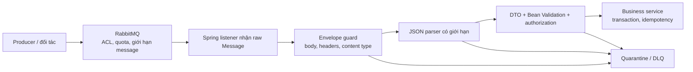
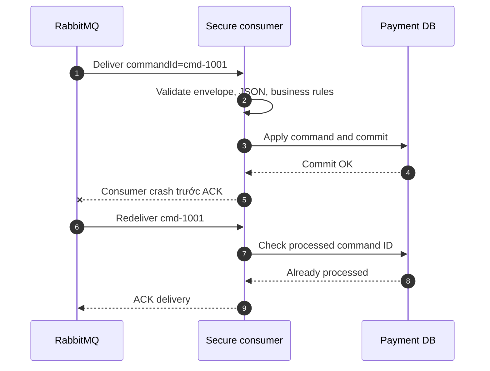

# Giới hạn nội dung, header và dữ liệu đầu vào không tin cậy

## 1. Vì sao message trong RabbitMQ phải được xem là dữ liệu không tin cậy?

Trong module **SPRING_AMQP**, producer dùng `RabbitTemplate` để gửi message tới exchange và queue, còn consumer dùng `@RabbitListener` để nhận và xử lý. RabbitMQ cung cấp cơ chế định tuyến, xác nhận giao nhận, retry và dead-letter; tuy nhiên **broker giao được message không có nghĩa nội dung message an toàn hoặc hợp lệ về nghiệp vụ**.

Xét hệ thống thanh toán nhận lệnh:

```json
{
  "commandId": "cmd-1001",
  "accountId": "acct-20",
  "amount": 125000.00,
  "currency": "VND"
}
```

Một message khác có thể cố ý hoặc vô tình chứa:

- Payload nhiều megabyte, JSON lồng quá sâu hoặc một chuỗi dài bất thường làm tốn bộ nhớ/CPU.
- Header rất lớn, nhiều phần tử hoặc kiểu giá trị phức tạp khiến parser/converter xử lý tốn kém.
- Header `__TypeId__` giả danh một class Java không được phép.
- `contentType` khai báo JSON nhưng body là dữ liệu nhị phân hoặc chuỗi UTF-8 lỗi.
- `accountId` hoặc `tenantId` giả mạo; dữ liệu hợp lệ về cú pháp nhưng sai quyền nghiệp vụ.
- `replyTo`, `routingKey`, `x-delay`, `priority` hoặc một URL trong payload được dùng để điều khiển hành vi không dự kiến.
- Một message lỗi cố định bị retry vô hạn, liên tục chiếm consumer thread và DLQ.

**Giới hạn nội dung và xác thực dữ liệu là một phần của thiết kế độ tin cậy, không chỉ là kiểm tra cú pháp JSON.** Nếu consumer chỉ bắt đầu kiểm tra sau khi một converter đã giải mã payload thành object, một phần chi phí và rủi ro đã xảy ra trước khi code kiểm tra được gọi.

Bài học thuộc chương **Bảo mật** của module **SPRING_AMQP**, gắn vấn đề dữ liệu đầu vào với `RabbitTemplate`, `@RabbitListener`, exchange, queue, binding, consumer ACK, retry, DLQ, transaction và quan sát hệ thống.

### Mục tiêu

Sau bài học, bạn có thể:

1. Xác định các **ranh giới tin cậy** giữa publisher, broker, listener container, message converter và nghiệp vụ.
2. Đặt giới hạn kích thước message ở **broker**, ở **consumer trước parse** và trong **JSON parser**.
3. Kiểm soát số lượng, tên, kiểu và kích thước của **application headers**; không tin header chỉ vì chúng nằm trong AMQP envelope.
4. Dùng JSON DTO cố định, Bean Validation và parser constraints; tránh Java serialization và dynamic class resolution do nguồn không tin cậy điều khiển.
5. Ngăn dữ liệu đầu vào điều khiển route, reply destination, URL, file path, SQL hoặc biểu thức động không được phép.
6. Phân loại lỗi dữ liệu cố định và lỗi hạ tầng để ACK/NACK/retry/DLQ không tạo vòng lặp hay mất dấu vết.
7. Thiết kế logging, error store, idempotency và bài kiểm thử bảo mật cho pipeline bất đồng bộ.

## 2. Mô hình mối đe dọa và các lớp bảo vệ

Ngay cả khi RabbitMQ không mở trực tiếp ra Internet, message vẫn có thể đến từ hệ thống khác, đối tác, môi trường triển khai khác hoặc producer bị cấu hình sai. Authentication/TLS đảm bảo một mức độ bảo vệ **kênh kết nối và danh tính**, nhưng **không chứng minh payload đáp ứng business contract**.



Mỗi lớp giải quyết một rủi ro khác nhau:

| Lớp | Trách nhiệm | Không thể thay thế |
|---|---|---|
| Producer/gateway | Validate trước publish; giới hạn body/header; dùng schema hợp lệ | Consumer vẫn phải tự kiểm tra khi nguồn thay đổi/bị chiếm quyền |
| RabbitMQ | Authentication, authorization theo vhost/exchange/queue, TLS, giới hạn message và tài nguyên | Kiểm tra từng trường nghiệp vụ trong JSON |
| Listener raw message | Bỏ qua sớm body/header vượt giới hạn, kiểm tra media type và encoding | Phát hiện mọi kiểu lồng sâu trong JSON trước parser |
| JSON parser | Giới hạn độ sâu, độ dài string, con số; phát hiện JSON sai | Quyền truy cập tài khoản hoặc tính hợp lệ của amount |
| DTO/Bean Validation | Contract, độ dài field, enum/range/precision | Quyền sở hữu business resource |
| Business service | Authorize trong đúng tenant, idempotency, transaction | An toàn bộ nhớ trước parse |
| Error pipeline | Lưu lỗi có kiểm soát, tránh retry vô hạn, bảo vệ dữ liệu nhạy cảm | Tự sửa message hoặc biến dữ liệu lỗi thành hợp lệ |

**Nguyên tắc chính: “không tin trước khi kiểm chứng”.** `contentType`, `messageId`, `correlationId` và custom header đều là thông tin thuộc message envelope; nhiều thuộc tính do publisher chủ động thiết lập.

## 3. Giới hạn kích thước: ở đâu mới đủ?

### 3.1. Phân biệt frame, message, queue backlog và payload sau giải nén

Trong RabbitMQ AMQP 0-9-1 có các khái niệm dễ nhầm:

| Khái niệm | Bảo vệ gì? | Không bảo vệ gì? |
|---|---|---|
| `frame_max` | Giới hạn kích thước **một frame giao thức** | Không phải trần tổng body của message: body lớn có thể chia nhiều frame |
| `max_message_size` ở RabbitMQ | Giới hạn message broker chấp nhận theo cấu hình/phiên bản | Không thay thế contract JSON riêng của từng consumer |
| Queue `max-length`, `max-length-bytes` | Hạn chế backlog/chiếm dụng tài nguyên trong queue | Không phải validator chi tiết cho từng message |
| `prefetch` | Giới hạn delivery chưa ACK đang ở consumer theo cơ chế QoS | Không chặn một payload quá lớn hoặc JSON quá sâu |
| Giới hạn `body.length` tại listener | Tránh parse/allocate thêm cho một body đã nhận | Không ngăn client/broker đã phải nhận/allocate bytes trước listener |
| JSON stream constraints | Giới hạn token nesting, string, number trong parser | Không kiểm tra tenant authorization hoặc business invariant |
| Giới hạn dữ liệu **sau giải nén** | Ngăn zip/gzip bomb trong đường xử lý nén | Không đạt được nếu chỉ kiểm tra kích thước compressed body |

**Một giới hạn không thay cho các giới hạn còn lại.** Ví dụ message 10 KiB có thể chứa JSON lồng hàng nghìn tầng; hoặc 5 KiB gzip có thể bung thành nhiều megabyte. Ngược lại, `prefetch=1` vẫn có thể đưa một body rất lớn vào bộ nhớ trước khi application kiểm tra.

### 3.2. Chọn ngân sách theo hợp đồng ứng dụng

Ví dụ với lệnh thanh toán có JSON rất nhỏ:

| Giới hạn mẫu | Giá trị minh họa | Ý nghĩa |
|---|---:|---|
| JSON body (trước parse) | 64 KiB | Đủ cho payload nhỏ; reject nếu vượt |
| Application headers | Tối đa 8 header | Chỉ chấp nhận trường đã định nghĩa |
| Một custom header | 256 byte UTF-8 | Tránh ID/correlation text khổng lồ |
| Tổng custom header đã cho phép | 1 KiB | Không cho nhiều giá trị nhỏ cộng dồn quá lớn |
| JSON nesting depth | 24 | Chặn cấu trúc lồng quá sâu |
| JSON string token | 8 KiB | Chặn một giá trị string bất thường |
| JSON numeric token | 64 ký tự | Chặn biểu diễn số quá dài |
| Độ dài `commandId` | 1–64 ký tự | Hợp đồng nghiệp vụ |
| Độ dài `accountId` | 1–64 ký tự | Hợp đồng nghiệp vụ |

Các con số **chỉ là bộ giả định cho bài học**, không phải mặc định RabbitMQ/Spring AMQP hay đề xuất dùng nguyên xi cho mọi hệ thống. Message chứa chứng từ hoặc batch có thể cần ngân sách khác, song vẫn phải có giới hạn rõ và kiểm thử được.

Ví dụ cấu hình broker RabbitMQ (kiểm tra khả năng áp dụng của phiên bản và quy mô trước khi dùng):

```ini
# rabbitmq.conf — ví dụ giới hạn body/message broker-wide, đơn vị byte
max_message_size = 131072
```

Đây là một **giới hạn chung cấp broker**; có thể ảnh hưởng tới tất cả ứng dụng dùng broker, nên không thay đổi production khi chưa đánh giá workload. Các cơ chế quota, permission và policy phù hợp cần thiết để không cho publisher tùy ý chiếm tài nguyên.

## 4. Vì sao nên kiểm tra raw Message trước khi convert?

Pipeline phổ biến:

```text
RabbitMQ delivery
  -> Spring listener container
  -> MessageConverter / argument resolver
  -> @RabbitListener method nhận DTO
  -> @Valid / business handler
```

Nếu method nhận thẳng DTO:

```java
@RabbitListener(queues = "payment.commands")
public void handle(PaymentCommand command) {
    // Khi vào đây, converter có thể đã parse body.
}
```

thì một số công việc giải mã/khởi tạo object diễn ra **trước method**. `@Valid` trên DTO giúp kiểm tra dữ liệu sau convert, nhưng **không thay thế** giới hạn đầu vào trước parser.

Một lựa chọn rõ ràng cho ingress không tin cậy là nhận:

```java
@RabbitListener(queues = "payment.commands")
public void handle(org.springframework.amqp.core.Message raw) {
    // 1. Kiểm tra body bytes và application headers.
    // 2. Kiểm tra JSON encoding và parse bằng mapper bị giới hạn.
    // 3. Bean Validation và business authorization.
}
```

Trong Spring AMQP, tham số raw `Message` cho phép thao tác với body và properties. Điều này **không có nghĩa** RabbitMQ client chưa cấp phát body/header: những bytes đó đã tới ứng dụng. Nếu muốn bảo vệ trước khi body tới JVM, cần bổ sung giới hạn ở publisher/gateway và broker. Với các adapter nhận String/DTO tự động, cần đảm bảo bộ giới hạn chạy **trước** conversion, ví dụ một `afterReceivePostProcessor` của listener container phù hợp, rồi mới đến adapter.

Các ví dụ dưới đây cố ý chọn **raw Message** và tự parse để minh họa thứ tự kiểm tra chính xác, tránh phụ thuộc vào timing của converter.

## 5. Topology bảo vệ luồng lỗi

Ta sử dụng queue nguồn `payment.commands.secure` và queue cách ly `payment.commands.quarantine`. RabbitMQ chỉ dead-letter message khi có điều kiện tương ứng, ví dụ reject không requeue, và exchange/binding đích tồn tại.

```java
import org.springframework.amqp.core.Binding;
import org.springframework.amqp.core.BindingBuilder;
import org.springframework.amqp.core.DirectExchange;
import org.springframework.amqp.core.Queue;
import org.springframework.amqp.core.QueueBuilder;
import org.springframework.beans.factory.annotation.Qualifier;
import org.springframework.context.annotation.Bean;
import org.springframework.context.annotation.Configuration;

@Configuration
public class SafeTopology {
    public static final String IN = "payment.commands.secure";
    public static final String DLX = "payment.security.dlx";
    public static final String BAD = "payment.commands.quarantine";
    public static final String DEAD_ROUTING_KEY = "invalid";

    @Bean("securePaymentQueue")
    Queue securePaymentQueue() {
        return QueueBuilder.durable(IN)
                .deadLetterExchange(DLX)
                .deadLetterRoutingKey(DEAD_ROUTING_KEY)
                .build();
    }

    @Bean("paymentSecurityDlx")
    DirectExchange paymentSecurityDlx() {
        return new DirectExchange(DLX);
    }

    @Bean("paymentQuarantineQueue")
    Queue paymentQuarantineQueue() {
        return QueueBuilder.durable(BAD).build();
    }

    @Bean
    Binding quarantineBinding(
            @Qualifier("paymentQuarantineQueue") Queue errorQueue,
            @Qualifier("paymentSecurityDlx") DirectExchange dlx) {
        return BindingBuilder.bind(errorQueue)
                .to(dlx)
                .with(DEAD_ROUTING_KEY);
    }
}
```

Đây là topology học tập. Trong production, nên kiểm soát thay đổi topology qua IaC/policies, tách ACL của quarantine queue, giới hạn retention và kích thước backlog. **DLQ cũng chứa nội dung không tin cậy**; tuyệt đối không coi message trong DLQ an toàn chỉ vì broker đã chuyển nó đến đó.

## 6. Tạo lớp kiểm tra envelope trước khi parse

### 6.1. Kiểm tra body và media type

Một utility có thể kiểm tra body size, content type, content encoding rồi kiểm tra custom headers. Nó **không tự giải mã** dữ liệu dựa trên metadata do publisher gửi.

```java
import java.nio.charset.StandardCharsets;
import java.util.Map;
import java.util.Set;

import org.springframework.amqp.core.Message;
import org.springframework.amqp.core.MessageProperties;
import org.springframework.stereotype.Component;

@Component
public class UntrustedEnvelopeGuard {
    private static final int MAX_BODY_BYTES = 64 * 1024;
    private static final int MAX_HEADERS = 64;
    private static final int MAX_APP_HEADERS = 8;
    private static final int MAX_APP_HEADER_BYTES = 1024;
    private static final int MAX_SINGLE_HEADER_BYTES = 256;

    private static final Set<String> ALLOWED_APP_HEADERS = Set.of(
            "x-app-event-id",
            "x-app-schema-version",
            "x-app-tenant-id"
    );

    public void check(Message message) {
        byte[] body = message.getBody();
        if (body == null || body.length == 0
                || body.length > MAX_BODY_BYTES) {
            throw new InvalidInboundMessage("Body rỗng hoặc quá lớn");
        }

        MessageProperties props = message.getMessageProperties();

        // Hợp đồng ứng dụng chọn một media type cố định.
        // Content type tự nó KHÔNG xác thực body có đúng JSON.
        if (!MessageProperties.CONTENT_TYPE_JSON.equals(
                props.getContentType())) {
            throw new InvalidInboundMessage("Không hỗ trợ content type");
        }

        String encoding = props.getContentEncoding();
        if (encoding != null && !encoding.equalsIgnoreCase("UTF-8")) {
            throw new InvalidInboundMessage("Chỉ chấp nhận UTF-8");
        }

        checkApplicationHeaders(props.getHeaders());
    }

    private void checkApplicationHeaders(Map<String, Object> headers) {
        if (headers.size() > MAX_HEADERS) {
            throw new InvalidInboundMessage("Quá nhiều header");
        }

        int appCount = 0;
        int appBytes = 0;

        for (Map.Entry<String, Object> entry : headers.entrySet()) {
            String name = entry.getKey();

            // Header broker/framework như x-death có thể mang metadata
            // phức tạp; không dùng chúng để ra quyết định tin cậy.
            if (!name.startsWith("x-app-")) {
                continue;
            }

            if (!ALLOWED_APP_HEADERS.contains(name)) {
                throw new InvalidInboundMessage(
                        "Header ứng dụng không được phép");
            }

            appCount++;
            if (appCount > MAX_APP_HEADERS) {
                throw new InvalidInboundMessage(
                        "Quá nhiều application headers");
            }

            Object value = entry.getValue();
            if (!(value instanceof String text)) {
                // Không ép toString() trên Map/List/LongString không tin cậy.
                throw new InvalidInboundMessage(
                        "Kiểu custom header không hợp lệ");
            }

            int bytes = name.getBytes(StandardCharsets.UTF_8).length
                    + text.getBytes(StandardCharsets.UTF_8).length;

            if (bytes > MAX_SINGLE_HEADER_BYTES) {
                throw new InvalidInboundMessage(
                        "Custom header quá dài");
            }

            appBytes += bytes;
            if (appBytes > MAX_APP_HEADER_BYTES) {
                throw new InvalidInboundMessage(
                        "Tổng custom headers quá lớn");
            }
        }

        Object eventId = headers.get("x-app-event-id");
        if (!(eventId instanceof String id)
                || !id.matches("[A-Za-z0-9:_-]{1,64}")) {
            throw new InvalidInboundMessage(
                    "Thiếu hoặc sai x-app-event-id");
        }

        Object version = headers.get("x-app-schema-version");
        if (!"1".equals(version)) {
            throw new InvalidInboundMessage(
                    "Schema version không hỗ trợ");
        }
    }
}

class InvalidInboundMessage extends RuntimeException {
    InvalidInboundMessage(String message) {
        super(message);
    }
}
```

**Các giới hạn là hợp đồng ví dụ** và cần điều chỉnh theo nguồn gửi hợp lệ. Một số header do broker/framework thêm, chẳng hạn `x-death` sau dead-letter, có cấu trúc nested list/map. Đoạn code chỉ kiểm tra sâu **namespace custom `x-app-*`**, không cố `toString()` tất cả headers. Nếu ứng dụng cần giới hạn **toàn bộ kích thước header table**, hãy bổ sung chặn ở broker/client theo phiên bản và dùng bộ ước lượng an toàn cho từng kiểu dữ liệu/độ sâu; `headers.size()` **chỉ giới hạn số mục**, không đo tổng bytes của header ngoài namespace custom.

### 6.2. Những giới hạn mà guard trên chưa giải quyết

- Broker/RabbitMQ Java Client đã xử lý frame và tạo object header trước khi `check` chạy.
- Một header không có tiền tố `x-app-` vẫn có thể rất lớn; vì vậy cấu hình giới hạn broker và policy/gateway vẫn cần thiết.
- `contentType=application/json` chỉ là lời khai của publisher, không chứng minh payload hợp lệ.
- `messageId`, `correlationId`, `replyTo`, `expiration`, `priority` và `__TypeId__` không tự có quyền điều khiển business service.
- Một body JSON 64 KiB có thể chứa field sai quyền, một regex khó xử lý hoặc URL trỏ vào mạng nội bộ; kiểm tra size không phát hiện hết.

**Khi yêu cầu bảo đảm nghiêm ngặt về memory**, hãy áp dụng nhiều lớp: trần message ở broker, giới hạn tại ingress publisher, guard trước parser và parser token limits. Không tuyên bố listener guard là hàng rào ngăn mọi kiểu DoS.

## 7. Parser JSON có giới hạn và DTO được định nghĩa trước

### 7.1. Tránh class resolution do message quyết định

Một message có thể chứa header:

```text
__TypeId__: com.example.internal.AdminJob
__ContentTypeId__: java.lang.Object
__KeyTypeId__: java.lang.String
```

Đây là các header liên quan đến type mapping trong một số cách dùng Spring AMQP JSON converter. Nếu mặc định tin tên class do publisher cung cấp, hệ thống có thể tạo object hoặc đi theo nhánh xử lý không được cho phép. Cần:

- Không bật Jackson **polymorphic default typing** cho JSON không tin cậy; tránh `@JsonTypeInfo(use = Id.CLASS)` để message tự chọn class.
- Không chuyển sang **Java native serialization** từ body không tin cậy.
- Dùng một **DTO đã chọn cố định theo endpoint/queue**, không chọn class chỉ bằng `__TypeId__` từ bên ngoài.
- Khi buộc phải dùng type mapper của Spring AMQP, dùng **allowlist trusted packages/type mappings** và kiểm thử header giả mạo trên đúng phiên bản. Không dùng `*` hoặc trusted package quá rộng.
- Nếu có nhiều schema, dùng **schema version đã allowlist** rồi chọn parser/DTO từ mapping nội bộ. Không dùng `Class.forName(...)` với input từ message.

Ví dụ sau bỏ qua các type header và parse thành **`PaymentCommand.class` cố định**.

### 7.2. ObjectMapper dành riêng cho dữ liệu không tin cậy

Ví dụ cho **Spring Boot 3.x, Jackson 2.15+**. `StreamReadConstraints` giới hạn token parser *trước khi* Jackson tạo DTO:

```java
import com.fasterxml.jackson.core.JsonFactory;
import com.fasterxml.jackson.core.StreamReadConstraints;
import com.fasterxml.jackson.databind.DeserializationFeature;
import com.fasterxml.jackson.databind.ObjectMapper;
import org.springframework.context.annotation.Bean;
import org.springframework.context.annotation.Configuration;

@Configuration
public class SecureJsonConfig {

    @Bean("untrustedJsonMapper")
    ObjectMapper untrustedJsonMapper() {
        JsonFactory jsonFactory = JsonFactory.builder()
                .streamReadConstraints(
                    StreamReadConstraints.builder()
                        .maxNestingDepth(24)
                        .maxStringLength(8_192)
                        .maxNumberLength(64)
                        .build())
                .build();

        return new ObjectMapper(jsonFactory)
                .enable(DeserializationFeature.FAIL_ON_UNKNOWN_PROPERTIES)
                .disable(DeserializationFeature.ACCEPT_FLOAT_AS_INT);
    }
}
```

Mapper này nên dùng **riêng cho ingress không tin cậy**, tránh vô tình thay đổi converter REST hoặc phần khác của ứng dụng. Không đăng ký các module cho phép deserialize kiểu nguy hiểm nếu không cần. Các tên API và hạn mức mặc định có thể thay đổi theo version Jackson; ví dụ gắn rõ với Jackson 2.15+.

**Không nên chỉ dùng `@Size(max=8192)` trong DTO** để giới hạn memory: Bean Validation chạy sau khi parser đã xử lý token string. Dùng cả giới hạn parser lẫn validation.

### 7.3. DTO và Bean Validation

```java
import java.math.BigDecimal;

import jakarta.validation.constraints.DecimalMin;
import jakarta.validation.constraints.Digits;
import jakarta.validation.constraints.NotBlank;
import jakarta.validation.constraints.NotNull;
import jakarta.validation.constraints.Pattern;
import jakarta.validation.constraints.Size;

public record PaymentCommand(
    @NotBlank
    @Pattern(regexp = "[A-Za-z0-9:_-]{1,64}")
    String commandId,

    @NotBlank
    @Size(max = 64)
    String accountId,

    @NotNull
    @DecimalMin("0.01")
    @Digits(integer = 12, fraction = 2)
    BigDecimal amount,

    @NotBlank
    @Pattern(regexp = "VND|USD|EUR")
    String currency
) {}
```

Để dùng Bean Validation với Spring Boot 3.x, thêm `spring-boot-starter-validation` nếu chưa có:

```xml
<dependency>
    <groupId>org.springframework.boot</groupId>
    <artifactId>spring-boot-starter-validation</artifactId>
</dependency>
```

Lựa chọn `BigDecimal` tránh dùng `double` cho số tiền. Giới hạn `@Digits` và `@DecimalMin` là minh họa; production phải có hợp đồng tiền tệ, làm tròn, định dạng và hạn mức nghiệp vụ cụ thể. Một DTO hợp lệ về số tiền **vẫn chưa được phép trừ tiền của bất kỳ accountId nào**; đó là trách nhiệm authorization trong service.

## 8. Listener an toàn: raw bytes → parse → validate → authorize → commit

### 8.1. Cấu hình container

```java
import org.springframework.amqp.core.AcknowledgeMode;
import org.springframework.amqp.rabbit.config.SimpleRabbitListenerContainerFactory;
import org.springframework.amqp.rabbit.connection.ConnectionFactory;
import org.springframework.context.annotation.Bean;
import org.springframework.context.annotation.Configuration;

@Configuration
public class SecureConsumerFactoryConfig {

    @Bean("secureListenerFactory")
    SimpleRabbitListenerContainerFactory secureListenerFactory(
            ConnectionFactory connectionFactory) {

        SimpleRabbitListenerContainerFactory factory =
                new SimpleRabbitListenerContainerFactory();
        factory.setConnectionFactory(connectionFactory);
        factory.setAcknowledgeMode(AcknowledgeMode.AUTO);

        // Demo: mọi exception còn lại cuối cùng không requeue.
        // Production nên phân loại và retry giới hạn cho transient errors.
        factory.setDefaultRequeueRejected(false);
        factory.setConcurrentConsumers(2);
        factory.setMaxConcurrentConsumers(2);
        factory.setPrefetchCount(5);
        return factory;
    }
}
```

`AcknowledgeMode.AUTO` nghĩa là **Spring container gửi consumer ACK sau khi listener trả về thành công**; nó không phải RabbitMQ auto-ack. Với message không hợp lệ, listener ném `AmqpRejectAndDontRequeueException`. Broker sẽ dead-letter bản gốc **nếu** queue có DLX/binding phù hợp như ở mục 5.

**Lưu ý:** `defaultRequeueRejected(false)` trong ví dụ làm các exception khác cũng không requeue. Nếu lỗi DB tạm thời xảy ra, một cú thất bại có thể chuyển message vào DLQ. Ở production nên lắp retry với số lần giới hạn, backoff và exception classification cho lỗi transient, đồng thời đưa lỗi dữ liệu cố định đến quarantine sớm.

### 8.2. Code listener

```java
import com.fasterxml.jackson.core.JsonProcessingException;
import com.fasterxml.jackson.databind.ObjectMapper;

import java.nio.ByteBuffer;
import java.nio.charset.CharacterCodingException;
import java.nio.charset.CodingErrorAction;
import java.nio.charset.StandardCharsets;
import java.util.Set;

import jakarta.validation.ConstraintViolation;
import jakarta.validation.Validator;
import org.springframework.amqp.core.Message;
import org.springframework.amqp.rabbit.annotation.RabbitListener;
import org.springframework.amqp.AmqpRejectAndDontRequeueException;
import org.springframework.beans.factory.annotation.Qualifier;
import org.springframework.stereotype.Component;

@Component
public class SecurePaymentListener {
    private final UntrustedEnvelopeGuard guard;
    private final ObjectMapper jsonMapper;
    private final Validator validator;
    private final PaymentService paymentService;

    public SecurePaymentListener(
            UntrustedEnvelopeGuard guard,
            @Qualifier("untrustedJsonMapper") ObjectMapper jsonMapper,
            Validator validator,
            PaymentService paymentService) {
        this.guard = guard;
        this.jsonMapper = jsonMapper;
        this.validator = validator;
        this.paymentService = paymentService;
    }

    @RabbitListener(
            queues = SafeTopology.IN,
            containerFactory = "secureListenerFactory")
    public void onPayment(Message raw) {
        PaymentCommand command;
        try {
            guard.check(raw);

            // Giải mã UTF-8 nghiêm ngặt: không thay byte lỗi bằng ký tự �.
            String json = StandardCharsets.UTF_8.newDecoder()
                    .onMalformedInput(CodingErrorAction.REPORT)
                    .onUnmappableCharacter(CodingErrorAction.REPORT)
                    .decode(ByteBuffer.wrap(raw.getBody()))
                    .toString();

            // Parse tới class đã chọn tại compile time.
            command = jsonMapper.readValue(json, PaymentCommand.class);

            Set<ConstraintViolation<PaymentCommand>> violations =
                    validator.validate(command);
            if (!violations.isEmpty()) {
                throw new InvalidInboundMessage(
                        "Payload không đạt Bean Validation");
            }

            // Envelope ID cũng không được tự động tin tưởng.
            String headerId = (String) raw
                    .getMessageProperties()
                    .getHeaders()
                    .get("x-app-event-id");

            if (!command.commandId().equals(headerId)) {
                throw new InvalidInboundMessage(
                        "commandId không khớp event id");
            }
        } catch (InvalidInboundMessage
                | JsonProcessingException
                | CharacterCodingException invalid) {
            // Không log toàn bộ body/header chứa dữ liệu không tin cậy.
            throw new AmqpRejectAndDontRequeueException(
                    "INVALID_PAYMENT_MESSAGE", invalid);
        }

        // Gọi sau parse/validation. Authorization và commit phải diễn ra
        // bên trong service; nếu lỗi thì callback ném exception.
        paymentService.applyOnceAndCommit(command);
    }
}
```

`PaymentService` là service nghiệp vụ do ứng dụng định nghĩa; ví dụ sau minh họa trách nhiệm của nó. Listener dùng **raw Message**, nên kiểm tra body/header trước khi gọi Jackson. `readValue(json, PaymentCommand.class)` không chọn class theo header `__TypeId__`.

Trong code trên, một số biến/thành phần phải được Spring cấu hình tương ứng (`Validator` từ starter validation, `PaymentService` từ ứng dụng). Để giảm lộ thông tin nhạy cảm, exception gửi ra error pipeline nên dùng **mã lỗi có kiểm soát**; stack trace trong log nội bộ phải tuân thủ chính sách bảo vệ dữ liệu.

### 8.3. Tại sao không chỉ bắt mọi Exception rồi ACK?

Anti-pattern:

```java
@RabbitListener(queues = "payment.commands.secure")
public void unsafe(String json) {
    try {
        handlePayment(json);
    } catch (Exception ex) {
        log.warn("Bad message: {}", ex.getMessage());
    }
    // Method return bình thường -> Spring AUTO có thể ACK.
}
```

Nếu xử lý lỗi chỉ bằng log, message có thể được ACK và biến mất khỏi queue dù nghiệp vụ chưa xử lý. Một cách khác cũng nguy hiểm là NACK requeue vô hạn với JSON cố định sai, gây hot loop. Chọn trạng thái rõ: **đã xử lý**, **lỗi cố định đã lưu để phục hồi**, hoặc **lỗi tạm thời sẽ retry có giới hạn**.

## 9. Header: dữ liệu có cấu trúc nhưng vẫn không đáng tin

AMQP headers là **bảng key-value** do publisher, broker hoặc framework thêm vào. Bất kỳ header nào dùng để quyết định logic cần có nguồn và contract rõ ràng.

| Header/property | Rủi ro nếu tin vô điều kiện | Cách xử lý |
|---|---|---|
| `contentType`, `contentEncoding` | Khai sai định dạng để đưa dữ liệu vào converter không mong muốn | Allowlist MIME/encoding rồi parse thật |
| `__TypeId__`, `__ContentTypeId__`, `__KeyTypeId__` | Cố điều khiển Java type mapping | Parse DTO cố định hoặc allowlist type mapper |
| `messageId` / `correlationId` | Giả mạo identity/tracing hoặc ID trùng | Kiểm tra format/length; không xem là quyền truy cập |
| `replyTo` | Dịch vụ vô tình gửi dữ liệu nhạy cảm tới destination không được phép | Không lấy tùy ý từ untrusted header; allowlist đích |
| `tenantId`, `accountId` | Truy cập chéo tenant/account | Derive từ nguồn được xác thực và authorize với DB |
| `priority` / `expiration` | Gây starvation hoặc TTL bất thường nếu sender có quyền | Quy định/cap tại producer, broker, không dùng làm quyền nghiệp vụ |
| `x-delay` | Trì hoãn hoặc tạo hành vi bất thường | Chỉ cho phép luồng đã được cấp quyền |
| `x-death` | Bị dùng sai làm bộ đếm retry/nguồn sự thật | Kiểm tra semantics broker; không dựa hoàn toàn vào header client có thể giả mạo |
| `traceId`, `baggage` | Log/trace injection, lộ dữ liệu nhạy cảm, quá tải telemetry | Giới hạn độ dài, allowlist và sanitize |

### 9.1. Header count không bằng header bytes

Một message có 3 header, mỗi header dài 2 MiB, vẫn chỉ có **3 mục** trong `Map`. Ngược lại, một header chứa list/map lồng nhau có thể có ít top-level keys nhưng tốn nhiều byte khi parse. Vì vậy:

- Giới hạn **số custom headers** và **tổng byte** của các header theo hợp đồng.
- Chỉ chấp nhận kiểu dữ liệu cần thiết (string ngắn, number/boolean trong range). Không tự ép một object bất kỳ thành String.
- Không gọi `toString()` trên một cấu trúc header tùy ý rồi tin nó là dữ liệu nhỏ/an toàn.
- Nếu dùng header có nested list/map, đặt giới hạn độ sâu, số phần tử và byte tổng trước khi xử lý sâu.
- Giới hạn **message/frame** tại broker để giảm nguy cơ trước khi đến JVM; kiểm thử các AMQP table type mà RabbitMQ Java Client chuyển thành Java object.
- Header broker/framework không mặc định đáng tin về mặt authorization. Tránh dùng `x-death` hay `replyTo` làm căn cứ cấp quyền.

### 9.2. Tránh sử dụng header để tạo đường thực thi động

Không nên viết:

```java
String className = (String) message.getMessageProperties()
        .getHeaders().get("__TypeId__");
Class<?> type = Class.forName(className); // Không dùng input để chọn class.
```

Tương tự, không lấy header rồi đánh giá bằng `SpEL`, template expression, shell command hoặc SQL fragment. Nếu business cần chọn handler theo `eventType`, dùng bảng ánh xạ nội bộ:

```java
switch (eventType) {
    case "PAYMENT_CREATED" -> handlePaymentCreated(command);
    case "PAYMENT_CANCELLED" -> handlePaymentCancelled(command);
    default -> throw new InvalidInboundMessage("eventType không hỗ trợ");
}
```

Tên handler và message type phải được allowlist **trong code**, không lấy từ `Class.forName` hoặc script do publisher gửi.

## 10. Dữ liệu hợp lệ về cú pháp vẫn có thể vi phạm quyền

Đây là phần thường bị bỏ sót khi chỉ tập trung JSON schema.

Ví dụ:

```json
{
  "commandId": "cmd-1002",
  "accountId": "acct-of-another-tenant",
  "amount": 100,
  "currency": "USD"
}
```

Body có thể hợp lệ về JSON/Bean Validation, nhưng producer hoặc tenant hiện tại không được phép cập nhật account đó. Consumer phải:

1. Biết **danh tính producer/tenant đáng tin** qua topology và cơ chế authentication/authorization được thiết kế, hoặc một event signature được xác minh.
2. Xác định account thuộc tenant nào bằng database/trusted service.
3. Kiểm tra tenant có quyền cho command này.
4. Thực hiện kiểm tra và cập nhật trong phạm vi transaction/consistency phù hợp.
5. Đối với message trùng, dùng stable command ID và unique constraint để tránh ghi lặp.

**Không chỉ dựa vào `x-app-tenant-id` do publisher gửi để cấp quyền.** Với một shared queue cho nhiều producer, RabbitMQ consumer thường không có bằng chứng đủ mạnh để gắn một header tùy ý với người gửi. Có thể tách queue/vhost/credential theo tenant, hoặc ký message ở producer và xác minh chữ ký ở ingress, tùy kiến trúc.

Trong service mẫu, phải có logic kiểu:

```java
@Transactional
public void applyOnceAndCommit(PaymentCommand cmd) {
    // 1. Xác thực quyền cập nhật account dựa trên trusted identity.
    // 2. Kiểm tra schema/business invariant của account.
    // 3. Insert commandId vào inbox/processed_messages (unique).
    // 4. Cập nhật business state trong CÙNG transaction.
    // 5. Return chỉ khi commit thành công.
}
```

Đây là pseudocode nghiệp vụ, không phải triển khai hoàn chỉnh. Nếu caller identity không thể tin cậy được gắn với message, hãy thiết kế lại trust boundary trước khi xử lý dữ liệu nhạy cảm.

## 11. Những kiểu tấn công khác qua payload

### 11.1. JSON depth, array length và số lớn

Một body nhỏ vẫn có thể tiêu tốn tài nguyên khi có hàng nghìn object/array lồng nhau, số rất dài hoặc chuỗi chứa nhiều escape. `StreamReadConstraints` chặn một số dạng, nhưng cần thêm quy tắc giới hạn **số phần tử collection** hoặc kích thước logic của DTO. Không cho phép một `List<Item>` chứa hàng trăm nghìn phần tử chỉ vì từng item riêng lẻ hợp lệ.

Nếu dùng DTO có list:

```java
record PaymentBatch(
    @jakarta.validation.constraints.Size(max = 100)
    java.util.List<PaymentCommand> commands
) {}
```

Đây là hạn mức sau parse; kết hợp với giới hạn bytes và parser để chặn chi phí ngay từ đầu.

### 11.2. Dữ liệu nén và zip bomb

Nếu message có header `contentEncoding=gzip`, **đừng tự động giải nén chỉ dựa vào lời khai từ publisher**. Nếu hợp đồng thực sự cho phép compression:

- Allowlist thuật toán nén và loại nội dung.
- Giới hạn **compressed bytes** lẫn **decompressed bytes**.
- Giới hạn tỷ lệ giãn nở, thời gian CPU và số phần tử archive.
- Đóng stream và dừng giải nén ngay khi vượt ngân sách.
- Chỉ parse JSON **sau** khi đã xác nhận đầu ra giải nén không vượt giới hạn.

Ví dụ minh họa thuật toán ngăn zip bomb:

```text
decompressedBytes = 0
while (read next chunk):
    decompressedBytes += chunk.length
    if decompressedBytes > MAX_DECOMPRESSED_BYTES:
        reject("decompression limit exceeded")
    forward chunk to bounded parser
```

Không gom toàn bộ stream đã giải nén vào `ByteArrayOutputStream` không giới hạn trước khi kiểm tra; đó là thời điểm nguy cơ OOM xuất hiện.

### 11.3. URL, path, SQL và biểu thức

Nếu payload chứa một URL để callback hoặc download:

- Chỉ cho phép protocol, hostname và port được allowlist.
- Chặn private/loopback/link-local/metadata IP và kiểm tra redirect/DNS rebinding nếu thực hiện HTTP.
- Không lấy header làm đường dẫn filesystem hoặc shell command.
- SQL phải tham số hóa, không nối chuỗi từ `accountId`, `sortColumn` hay `filter`.
- Không thực thi script/SpEL do producer cung cấp.

Những rủi ro này không được giải quyết bằng `contentType=application/json` hoặc Spring Bean Validation đơn thuần. Cần kiểm tra **ngữ nghĩa** tại nơi sử dụng dữ liệu.

### 11.4. Regex DoS và Unicode

Dữ liệu ngắn chưa hẳn an toàn nếu một regex có backtracking cực lớn. Ưu tiên pattern đơn giản, giới hạn độ dài trước regex và tránh cho user cung cấp pattern. Với ID nghiệp vụ, nên chọn tập ký tự rõ như `[A-Za-z0-9:_-]`, thay vì cho Unicode tùy ý rồi so sánh chuỗi chưa chuẩn hóa.

Nếu business cho phép Unicode, quy định normalization (ví dụ NFC), độ dài theo ký tự/byte và quy tắc so sánh. Đừng áp dụng `toLowerCase()` không chỉ định locale khi làm khóa định danh quan trọng.

## 12. Làm sao ACK/NACK khi gặp message không tin cậy?

### 12.1. Phân loại exception, đừng requeue vô hạn

| Tình huống | Bản chất | Chiến lược |
|---|---|---|
| Body vượt 64 KiB | Lỗi contract cố định | Reject không requeue, lưu lỗi có kiểm soát |
| Content type sai / UTF-8 không hợp lệ | Lỗi contract cố định | Reject không requeue |
| JSON sai hoặc quá độ sâu | Lỗi parser/schema cố định | Reject không requeue, quarantine |
| Header không allowlist / giả TypeId | Lỗi security contract | Reject/quarantine và cảnh báo khi cần |
| Account không thuộc tenant | Vi phạm authorization | Không thực hiện side effect; ghi audit an toàn, reject |
| DB timeout tạm thời | Lỗi hạ tầng | Retry giới hạn với backoff; không xóa message sớm |
| API đối tác timeout sau side effect | Kết quả chưa xác định | Đối soát theo idempotency key trước khi retry |
| Message đã xử lý trước đó | Duplicate/redelivery | Bỏ qua side effect, ACK thành công |

`AmqpRejectAndDontRequeueException` trong Spring AMQP giúp container reject mà không requeue khi xử lý một message không hợp lệ. Cần DLX/binding phù hợp; nếu thiếu, không thể khẳng định message nằm trong DLQ.

**Không** để lỗi hợp đồng cố định đi vào một cơ chế retry 1.000 lần. Nhưng cũng không chọn `defaultRequeueRejected=false` rồi quên retry cần thiết cho lỗi mạng tạm thời: có thể đưa message lành vào DLQ quá sớm.

### 12.2. Phân biệt DLQ của broker và error event của ứng dụng

Broker DLX chuyển **message gốc** đến dead-letter queue, thường với metadata về lý do dead-letter. Nó **không tự tạo một error report được sanitize** theo schema ứng dụng.

Nếu payload chứa thông tin thanh toán hoặc dữ liệu cá nhân, raw DLQ có thể lưu lại dữ liệu nhạy cảm dù listener đã cố không log body. Một thiết kế tốt gồm:

- ACL chặt cho DLQ/quarantine, không mở quyền đọc cho mọi developer.
- TTL/retention phù hợp và giới hạn backlog để tránh tăng lưu trữ không kiểm soát.
- Mã hóa đường truyền, dữ liệu lưu trữ hoặc tokenization theo chính sách của tổ chức.
- Error report tách riêng, chỉ chứa `eventId`, queue, mã lỗi, thời điểm và trace an toàn; **không copy toàn bộ payload** vào logs.
- Quy trình sửa rồi replay có phê duyệt/đối soát khi liên quan tới dữ liệu nhạy cảm.
- Khi replay, **chạy lại cùng bộ kiểm tra bảo mật**; DLQ không biến input xấu thành input tốt.

### 12.3. Crash giữa DB commit và consumer ACK

Một message hợp lệ có thể được xử lý xong, transaction commit rồi consumer crash trước khi RabbitMQ nhận ACK:



Giới hạn dữ liệu, schema validation và ACK đúng lúc vẫn chưa tạo **exactly-once delivery**. Với pipeline tin cậy, cần **idempotent business processing** trong transaction, ví dụ unique constraint theo command ID hoặc inbox. Đừng dùng `deliveryTag` làm command ID: tag chỉ có ý nghĩa trên channel hiện tại và có thể thay đổi khi broker redeliver.

## 13. Quyền RabbitMQ và cách giảm nguồn message độc hại

Bảo mật payload không nên đứng riêng lẻ với kiểm soát quyền publish:

- **Tách vhost, exchange, queue và quyền read/write/configure** theo vai trò ứng dụng. Producer audit không nên được publish tự do vào command queue thanh toán.
- Dùng tài khoản ứng dụng riêng, credential trong secret manager, TLS và chính sách rotation. Không dùng `guest/guest` trong môi trường mạng production.
- Chỉ cấp quyền declare/admin cho thành phần quản lý topology. Consumer không nhất thiết cần quyền tạo exchange hoặc queue tùy ý.
- Với message nhiều tenant, cân nhắc queue hoặc routing boundary riêng theo tenant để không để một publisher giả danh tenant khác qua custom header.
- Đặt hạn mức ở broker hoặc gateway cho message size, queue backlog, connection/channel và tốc độ publish theo chính sách hệ thống.
- Kiểm thử trường hợp một publisher có quyền gửi vào exchange nhưng định tuyến sai. `mandatory` và publisher returns giúp **producer** phát hiện unroutable messages, không thay thế kiểm tra security ở consumer.

**Định tuyến không đồng nghĩa phân quyền.** Direct/topic exchange routing key phù hợp chỉ cho biết message được route theo binding, không chứng minh người gửi có quyền trên `accountId` trong body.

## 14. Quan sát và xử lý sự cố

### 14.1. Metrics nên có

| Phạm vi | Chỉ số |
|---|---|
| Kích thước | p50/p95/max body bytes, số reject do size, custom header bytes |
| Parser | Số JSON parse errors, nesting/number/string constraint violations |
| Contract | Bean Validation failures, sai schema version, type header không cho phép |
| Authorization | Số lệnh bị từ chối do tenant/account, theo nguồn và queue |
| Broker | `messages_ready`, `messages_unacknowledged`, publish/ack/reject, DLQ depth |
| Reliability | Retry attempt, redelivery, idempotency hit, poison-message rate |
| Resource | JVM heap, GC, CPU parser, executor queue, DB pool, listener latency |

Không dùng toàn bộ `accountId` hoặc email làm metric label vì có thể tạo cardinality cao và lộ dữ liệu. Dùng mã lỗi, queue, producer class đã chuẩn hóa và mức độ vi phạm để phân nhóm.

### 14.2. Error logging an toàn

Ví dụ log hợp lý:

```text
security_ingress_rejected
queue=payment.commands.secure
eventId=cmd-1001
reason=INVALID_SCHEMA
bodyBytes=483
headerCount=5
traceId=t-xxx
```

Không log:

```text
Full body: {"accountId":"...", "paymentToken":"..."}
Headers: {Authorization: "...", secret: "..."}
Stacktrace with all raw payload fragments...
```

`eventId` cũng có thể do publisher giả mạo; trước khi ghi vào log cần giới hạn độ dài và escape/sanitize. Bản thân `traceId`/`baggage` từ message không phải dữ liệu đã được xác thực. Giảm dữ liệu log còn giúp tránh **log injection** qua newline/control characters.

### 14.3. Bảng chẩn đoán

| Hiện tượng | Nguyên nhân có thể | Cần kiểm tra |
|---|---|---|
| CPU tăng khi nhận một message nhỏ | JSON nested sâu, regex/backtracking, decompression bomb | Parser constraints và đường xử lý payload |
| Listener không bao giờ vào method | MessageConverter/argument resolver lỗi trước listener | Converter, content type, raw Message hoặc after-receive guard |
| Vẫn OOM dù `body.length` được giới hạn trong listener | Bytes/header đã được client cấp phát trước method | Broker max message size, ingress, header table |
| Quarantine tăng nhanh | Producer sai schema, client lỗi hoặc hành vi lạm dụng | Error code, phiên bản publisher, allowlist |
| Cùng message quay lại liên tục | Requeue lỗi cố định, retry không giới hạn | Error policy, retry backoff, DLQ |
| Một message giả `__TypeId__` làm converter sai | Type header không được hạn chế | DTO cố định, trusted packages/type mapper |
| Có quyền queue nhưng thao tác sai tenant | Thiếu business authorization | Nguồn identity, tenant/account lookup |
| Message lỗi biến mất và không có DLQ | Listener nuốt exception hoặc thiếu DLX | ACK mode, recoverer, binding |
| Retry xong bị tính tiền hai lần | Transaction commit trước ACK rồi redelivery | Unique command ID, idempotency |
| DLQ lưu token ngoài ý muốn | DLQ chứa nguyên message gốc | ACL, retention, redaction, replay |
| Nhiều message gửi tới queue sai | Producer routing key không hợp lệ | Exchange/binding, mandatory returns |
| Header có nested map khổng lồ | Kiểm tra số header nhưng không kiểm soát bytes/depth | Broker limit, strict app header schema |

## 15. Bài thực hành

### Bài 1 — Giới hạn body trước Jackson

Dùng `payment.commands.secure` và listener raw ở mục 8. Gửi JSON hợp lệ 1 KiB, sau đó body 70 KiB. Kiểm tra message lớn bị reject **trước** `ObjectMapper.readValue` và xuất hiện ở quarantine khi DLX/binding hợp lệ.

### Bài 2 — Header allowlist

Gửi message có `x-app-event-id` và `x-app-schema-version` hợp lệ. Sau đó thêm `x-app-random-code` và một `x-app-tenant-id` dài quá 256 byte. Giải thích vì sao `contentType` đúng không làm các header này hợp lệ.

### Bài 3 — Type spoofing

Tạo message với `__TypeId__` chỉ tới một Java class nội bộ khác với `PaymentCommand`. Chứng minh listener raw luôn parse `PaymentCommand.class` và không để header chọn class. So sánh với cấu hình converter tự động mà không có trusted-type mapping.

### Bài 4 — JSON parser constraints

Gửi JSON nested hơn 24 tầng, số dài hơn 64 ký tự và một string vượt 8 KiB. Kiểm tra mỗi case bị chặn, đồng thời đo heap/CPU khi tăng kích thước trong giới hạn lab.

### Bài 5 — Invalid UTF-8 và content type

Gửi body không phải UTF-8 hợp lệ nhưng đặt `contentType=application/json`, rồi thử `contentType=application/x-java-serialized-object`. Kiểm tra listener từ chối và không dùng native Java deserializer.

### Bài 6 — Business authorization

Gửi message hợp lệ về schema nhưng `accountId` thuộc tenant khác. Thiết kế cơ chế xác định identity đáng tin và chặn update trong `PaymentService`. Trình bày vì sao kiểm tra `tenantId` trong chính body vẫn chưa đủ.

### Bài 7 — Retry không tạo hot loop

Gửi một message JSON sai không thể sửa tự động và quan sát đường reject không requeue. Gửi một message DB timeout tạm thời và thêm retry có giới hạn/backoff. So sánh số callback, queue depth, CPU và DLQ với trường hợp requeue vô hạn.

### Bài 8 — Crash sau DB commit

Dừng consumer ngay sau khi `PaymentService` commit nhưng trước khi Spring gửi ACK. Cho broker redeliver, kiểm tra unique command ID ngăn side effect trùng.

### Bài 9 — Data leak qua DLQ/log

Gửi payload có trường giả lập `paymentToken` trong môi trường thử nghiệm. Quan sát raw DLQ có thể chứa payload gốc; viết error report đã redacted, giới hạn quyền đọc và retention. Không dùng token thật.

### Bài 10 — Kết hợp giới hạn broker và app

Giữ body giới hạn 64 KiB trong ứng dụng, đặt giới hạn broker lớn hơn một chút trong môi trường lab. Thử message vượt giới hạn broker và một message không vượt broker nhưng vượt giới hạn app. Giải thích lỗi xảy ra ở lớp nào, và vì sao `frame_max`/`prefetch` không thay thế giới hạn body.

### Bài 11 — Kiểm tra compressed payload

Mô phỏng một producer gửi body nén có tỷ lệ giải nén cao. Nếu ứng dụng cho phép gzip, giới hạn tổng bytes sau giải nén rồi mới parse. Quan sát trường hợp chỉ kiểm tra kích thước nén tạo rủi ro.

### Bài 12 — Security regression suite

Thiết lập bộ kiểm thử tự động gồm: payload quá lớn, header sai kiểu, sai schema version, type header spoof, invalid UTF-8, nested JSON, unknown property, wrong tenant, duplicate command, DLX không có binding và message replay từ DLQ. Với mỗi case, xác định outcome mong đợi (**ACCEPT**, **REJECT/quarantine**, **bounded retry**) và xác minh không có side effect trái phép.

## 16. Câu hỏi tự kiểm tra

1. Vì sao một message đã qua RabbitMQ/TLS vẫn phải được coi là đầu vào không tin cậy?
2. `frame_max` khác `max_message_size` và `prefetch` như thế nào?
3. Tại sao kiểm tra `body.length` trong listener **không thể** ngăn mọi kiểu OOM?
4. Vì sao `@Valid` trên DTO không đủ để chống JSON nested quá sâu?
5. Header `contentType=application/json` có chứng minh body là JSON hợp lệ không?
6. Những rủi ro gì xảy ra nếu tin `__TypeId__` để tải Java class theo tên?
7. Vì sao không dùng Java serialization cho payload nhận từ publisher không tin cậy?
8. Kiểm tra `headers.size() <= 10` có đủ để giới hạn tổng byte của header không?
9. `tenantId` trong header có được xem như danh tính người gửi đã xác thực không?
10. Lỗi JSON sai cố định nên retry bao nhiêu lần? Vì sao việc requeue vô hạn nguy hiểm?
11. Có DLX trên queue nguồn đã đủ để kết luận mọi message lỗi vào DLQ chưa?
12. Tại sao raw DLQ vẫn là kho dữ liệu nhạy cảm cần phân quyền/retention?
13. Vì sao consumer cần idempotency dù đã validate payload và ACK sau DB commit?
14. Nếu ứng dụng chấp nhận gzip, phải giới hạn những đại lượng nào?
15. Nếu người gửi có quyền publish vào exchange, điều đó có chứng minh họ được sửa mọi accountId không?
16. Vì sao phải chạy lại kiểm tra bảo mật khi replay message từ DLQ?

## Ghi nhớ

- **Message envelope cũng không tin cậy**: body, content type, encoding, type headers, message ID, reply-to và custom headers phải được kiểm tra trước khi chúng ảnh hưởng logic.
- Giới hạn theo **nhiều lớp**: broker/gateway, body bytes trước parse, application header budget, JSON token constraints, Bean Validation và business authorization.
- Dùng **DTO cố định**, parser có giới hạn, trusted type allowlist nếu cần converter; **không deserialize Java object hay thực thi class/script theo header không tin cậy**.
- **ACK sau khi xử lý đúng**; dữ liệu sai cố định cần reject/quarantine, lỗi transient retry có giới hạn. Có DLQ không đồng nghĩa error report đã an toàn hoặc đã được sanitize.
- **Transaction và idempotency** giúp chống side effect lặp khi message redeliver; **ACL, TLS, log redaction, retention và quan sát** bảo vệ toàn bộ vòng đời message.
- Trong Spring AMQP, bảo vệ payload/header là nền tảng để `RabbitTemplate`, `@RabbitListener`, exchange, queue, binding và cơ chế retry/dead-letter thực sự vận hành tin cậy.

## Tài liệu tham khảo

- [RabbitMQ — Security](https://www.rabbitmq.com/docs/security)
- [RabbitMQ — Configuration](https://www.rabbitmq.com/docs/configure)
- [RabbitMQ — Consumer Prefetch](https://www.rabbitmq.com/docs/consumer-prefetch)
- [RabbitMQ — Dead Letter Exchanges](https://www.rabbitmq.com/docs/dlx)
- [RabbitMQ — Resource Alarms](https://www.rabbitmq.com/docs/alarms)
- [Spring AMQP — Message Converters](https://docs.spring.io/spring-amqp/reference/amqp/message-converters.html)
- [Spring AMQP — Exception Handling and Retry](https://docs.spring.io/spring-amqp/reference/amqp/resilience-recovering-from-errors-and-broker-failures.html)
- [Jackson — StreamReadConstraints](https://javadoc.io/doc/com.fasterxml.jackson.core/jackson-core/latest/com/fasterxml/jackson/core/StreamReadConstraints.html)
- [OWASP — Deserialization Cheat Sheet](https://cheatsheetseries.owasp.org/cheatsheets/Deserialization_Cheat_Sheet.html)
- [OWASP — Input Validation Cheat Sheet](https://cheatsheetseries.owasp.org/cheatsheets/Input_Validation_Cheat_Sheet.html)
