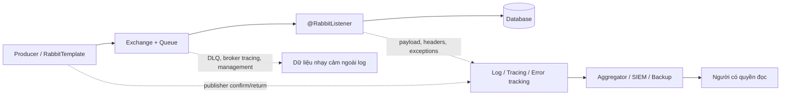

# Che payload, token và thông tin nhận diện khỏi log

## 1. Vì sao bảo mật log là một phần của bảo mật RabbitMQ?

Trong chương **Bảo mật** của **Spring AMQP**, chúng ta không chỉ bảo vệ kết nối RabbitMQ bằng TLS hay phân quyền exchange/queue. Ứng dụng còn phải bảo vệ **dữ liệu mà chính nó ghi ra log**. Một service có thể dùng `RabbitTemplate`, `@RabbitListener`, exchange, queue và binding đúng cách, nhưng vẫn làm lộ token hoặc dữ liệu cá nhân khi debug một message thất bại.

Xét consumer nhận sự kiện thanh toán có cấu trúc minh họa:

```json
{
  "eventId": "69a10418-7a57-47b3-8a17-224047bfd908",
  "eventType": "PAYMENT_REQUESTED",
  "customerEmail": "person@example.invalid",
  "accessToken": "example-secret-do-not-use",
  "paymentReference": "ref-sensitive-001"
}
```

Nếu developer viết:

```java
@RabbitListener(queues = "payments.requests")
public void handle(Message message) {
    log.info("Received message: {}", message);
    // ...
}
```

thì log có thể chứa body, message properties và headers tùy cách `toString()` biểu diễn message. Ngay cả khi logger chỉ chạy trên máy nội bộ, dữ liệu này có thể được chuyển tiếp đến log aggregator, hệ thống quan sát, nền tảng báo lỗi, bản sao lưu và tài khoản của nhiều nhóm vận hành.

**Mục tiêu:** ghi đủ thông tin để chẩn đoán **message nào, tuyến nào, trạng thái gì, lỗi loại nào, mất bao lâu**, nhưng không ghi nguyên payload, token, mật khẩu, định danh cá nhân hoặc bí mật cấu hình.

Sau bài học, bạn có thể:

1. Phân loại dữ liệu được phép và không được phép ghi log trong producer, listener, error handler, retry và DLQ.
2. Thiết kế **structured logging với allowlist** thay vì dump object/header rồi thử che bằng regex.
3. Tạo trường correlation không mang dữ liệu nhạy cảm; dùng HMAC để tạo mã tham chiếu giả danh khi thật sự cần.
4. Tránh rò rỉ qua exception, `MDC`, tracing baggage, publisher confirms/returns và framework debug logs.
5. Viết test phát hiện token/PII xuất hiện ở log, kiểm chứng trên toàn tuyến từ `RabbitTemplate` tới `@RabbitListener`.
6. Áp dụng kiểm soát truy cập, retention và quy trình phản ứng khi log đã chứa dữ liệu nhạy cảm.

## 2. Những gì cần được che hoặc loại khỏi log

Không phải mọi trường đều có cùng mức độ nhạy cảm. Hãy xây danh mục dữ liệu trước khi instrument message:

| Nhóm | Ví dụ trong RabbitMQ | Quy tắc log đề xuất |
|---|---|---|
| **Bí mật xác thực** | `Authorization: Bearer ...`, JWT, API key, refresh token, cookie session | **Không bao giờ ghi giá trị**; chỉ có thể ghi `auth_present=true/false` nếu cần |
| **Mật khẩu/khóa** | Mật khẩu RabbitMQ, URI chứa credentials, private key, HMAC key | **Không ghi**; không đưa vào exception hay cấu hình được dump |
| **PII trực tiếp** | Email, số điện thoại, tên, địa chỉ, số định danh | Mặc định **không ghi**; khi cần correlation dùng token nội bộ hoặc pseudonym |
| **Dữ liệu tài chính/y tế** | Số tài khoản, thẻ, chẩn đoán, lịch sử giao dịch | Không ghi payload; phân quyền và bảo vệ dữ liệu nguồn |
| **Định danh gián tiếp** | `customerId`, `orderId`, `userId`, IP, deviceId | Đánh giá tính liên kết và rủi ro; ưu tiên ID sự kiện ngẫu nhiên |
| **Payload nghiệp vụ** | JSON/Avro/byte[], `Message.getBody()` | Không dump nguyên body; có thể ghi loại sự kiện, mã kết quả |
| **Metadata không tin cậy** | Headers tùy biến, routing key có chứa customer ID, message ID bên ngoài | Không log nguyên bản; chỉ chọn trường và validate định dạng |
| **Thông tin vận hành đã duyệt** | Mã event type từ enum, alias queue, thời lượng, kết quả, mã lỗi | Có thể ghi theo allowlist và giới hạn kích thước |

**Quan trọng:** Một `correlationId` hay `messageId` cũng có thể chứa email hoặc token vì publisher tự đặt giá trị. Đừng mặc định các trường có tên “metadata” là an toàn. Với mọi dữ liệu do client, đối tác hoặc producer không kiểm soát truyền tới, áp dụng cùng nguyên tắc kiểm tra và giới hạn như payload.

### 2.1. Những câu lệnh dễ vô tình ghi lộ dữ liệu

```java
// Không nên sử dụng trong log production:
log.debug("AMQP payload={}", new String(message.getBody(), UTF_8));
log.info("Headers={}", message.getMessageProperties().getHeaders());
log.error("Listener failed: message={}", message, exception);
log.warn("Returned publication: {}", returnedMessage);
log.debug("Order={}", orderDto);
log.info("Bearer token={}", accessToken);
log.info("Failed request: {}", exception.getMessage());
```

Không cần thấy được dữ liệu bí mật ngay trong mã nguồn mới có rủi ro: `orderDto.toString()` có thể được IDE hoặc Lombok sinh tự động, `exception.getMessage()` có thể chứa một phần payload/SQL/URL, còn `returnedMessage` thường mang bản sao message gửi không route được.

### 2.2. Không chỉ log ứng dụng



Che log tại listener không tự che dữ liệu trong **DLQ**, log broker, plugin tracing, packet capture hay APM. DLQ lưu message gốc và headers (tùy cơ chế dead-letter); đây vẫn là dữ liệu cần bảo vệ bằng quyền truy cập, encryption, retention và quy trình replay riêng.

## 3. Nguyên tắc thiết kế: log theo allowlist, không theo denylist

**Denylist** bắt đầu từ một object chứa tất cả thông tin, rồi xóa các field như `password`, `token`, `email`. Cách này dễ bỏ sót tên mới (`authorizationHeader`, `refreshJwt`, `metadata.secret`), các trường lồng nhau, dữ liệu base64 hoặc stacktrace.

**Allowlist** tạo một **bản ghi log mới** chỉ gồm các trường đã được phê duyệt:

```json
{
  "event": "amqp_consume_completed",
  "queue": "payments.requests",
  "eventType": "PAYMENT_REQUESTED",
  "messageRef": "69a10418-7a57-47b3-8a17-224047bfd908",
  "status": "PROCESSED",
  "elapsedMs": 18
}
```

Không có `customerEmail`, `accessToken`, `paymentReference` hoặc payload nguyên văn trong record log. Giá trị `messageRef` ở ví dụ là UUID ngẫu nhiên do hệ thống tạo, **không phải** khách hàng ID. Nếu producer có thể gửi ID tùy ý, phải validate định dạng trước khi log hoặc thay bằng giá trị như `invalid_id`.

### 3.1. Một hợp đồng log tối thiểu

| Trường | Nguồn | Cách kiểm soát |
|---|---|---|
| `event` | Mã sự kiện của logger, ví dụ `amqp_consume_failed` | Enum/hằng số trong code |
| `queue` | Alias logic của queue | Hằng số nội bộ, không dùng routing key tùy ý |
| `eventType` | Header `eventType` | Map vào enum allowlist; các giá trị khác thành `OTHER` |
| `messageRef` | UUID phát bởi producer tin cậy | Validate UUID canonical; không dùng email/orderId |
| `status` | `RECEIVED`, `PROCESSED`, `FAILED` | Enum do ứng dụng định nghĩa |
| `errorCode` | `BAD_SCHEMA`, `STORE_TEMPORARY` | Mã lỗi tĩnh, không dùng `exception.getMessage()` |
| `elapsedMs` | Stopwatch monotonic | Chỉ số số học, không chứa payload |
| `bodySizeBand` | Kích thước body theo khoảng | Chỉ bật nếu hữu ích và được duyệt; kích thước chính xác có thể là metadata nhạy cảm |

Ngoài bảo mật, allowlist giúp **cardinality** thấp hơn khi làm metrics/monitoring. Không dùng email, token hay payload làm label của Prometheus/Micrometer: ngoài rò rỉ còn khiến số time series tăng không kiểm soát.

### 3.2. Chống log injection

Message headers là đầu vào có thể bị kẻ khác kiểm soát. Nếu ghi thẳng một chuỗi chứa `\n`, `\r` hoặc mã ANSI vào text log, attacker có thể tạo dòng log giả hoặc gây nhiễu giao diện.

Hãy dùng giá trị từ enum/allowlist, giới hạn chiều dài, và để structured logger xử lý escaping. Việc dùng `log.info("value={}", untrustedText)` **không đủ** bảo vệ trong mọi formatter: nó vẫn ghi nguyên nội dung; khi ghi theo format text, newline có thể tách dòng. **Không coi parameterized logging là redaction**.

## 4. Ví dụ Java: SafeAmqpAudit không nhận payload

Thay vì truyền cả `Message`/DTO cho logger, tách một lớp audit chỉ lấy các trường an toàn. Ví dụ dưới đây dùng **SLF4J** đã có trong ứng dụng Spring Boot thông dụng. Một UUID ngẫu nhiên trong `messageId` được phép dùng làm mã tham chiếu **sau khi validate**; ID liên quan người dùng cần xem xét riêng.

```java
import java.util.Set;
import java.util.UUID;
import org.slf4j.Logger;
import org.slf4j.LoggerFactory;
import org.springframework.amqp.core.Message;
import org.springframework.amqp.core.MessageProperties;
import org.springframework.stereotype.Component;

@Component
public final class SafeAmqpAudit {
    private static final Logger log =
            LoggerFactory.getLogger(SafeAmqpAudit.class);

    private static final Set<String> SAFE_TYPES = Set.of(
            "ORDER_CREATED", "ORDER_PAID", "ORDER_CANCELLED");

    public void received(Message message) {
        MessageProperties props = message.getMessageProperties();
        Object rawType = props.getHeaders().get("eventType");

        log.info("event=amqp_received queue={} type={} ref={} size_band={}",
                "orders.events",
                safeType(rawType),
                safeRef(props.getMessageId()),
                bodySizeBand(message.getBody().length));
    }

    public void completed(String rawMessageId, long elapsedMs) {
        log.info("event=amqp_completed queue={} ref={} status={} elapsed_ms={}",
                "orders.events", safeRef(rawMessageId),
                "PROCESSED", Math.max(0L, elapsedMs));
    }

    public void failed(String rawMessageId, FailureCode code) {
        log.warn("event=amqp_failed queue={} ref={} error_code={}",
                "orders.events", safeRef(rawMessageId), code.name());
    }

    private static String safeType(Object input) {
        if (!(input instanceof String type)) {
            return "OTHER";
        }
        return SAFE_TYPES.contains(type) ? type : "OTHER";
    }

    private static String safeRef(String input) {
        if (input == null) {
            return "missing_id";
        }
        try {
            String canonical = UUID.fromString(input).toString();
            return canonical.equalsIgnoreCase(input)
                    ? canonical : "invalid_id";
        } catch (IllegalArgumentException ex) {
            return "invalid_id";
        }
    }

    private static String bodySizeBand(int bytes) {
        if (bytes < 1024) {
            return "LT_1KB";
        }
        if (bytes < 16 * 1024) {
            return "LT_16KB";
        }
        return "GE_16KB";
    }
}

enum FailureCode {
    BAD_SCHEMA,
    STORE_TEMPORARY,
    BUSINESS_REJECTED,
    UNKNOWN
}
```

Điểm đáng chú ý:

1. Logger chỉ có các phương thức nhận **message ID, mã lỗi, loại sự kiện và chỉ số**; không có phương thức `logBody(byte[])`.
2. `eventType` chỉ được ghi nếu nằm trong tập mã được chấp nhận. Giá trị lạ không được đưa nguyên văn vào log.
3. `messageId` phải là **UUID canonical**. Nếu chứa email, token hoặc ký tự điều khiển, log ghi `invalid_id`.
4. `FailureCode` là enum cố định, không bao giờ thay bằng `ex.getMessage()`.
5. Kích thước body được chia theo khoảng, giúp quan sát message quá lớn mà không ghi raw size; nếu chính kích thước cũng nhạy cảm, bỏ trường này.

**Hạn chế có chủ đích:** Logger an toàn tại mã ứng dụng không bảo đảm thư viện bên dưới, error handler mặc định, APM hoặc một logger khác không ghi raw message. Cần kiểm soát cả đường đi của exception và cấu hình/framework logs.

## 5. @RabbitListener: log an toàn mà vẫn xử lý lỗi đúng

Một listener điển hình nhận `Message` để lấy body và metadata. **Không gọi `toString()` hoặc log JSON body** khi sự kiện bị lỗi; phân loại exception và ghi một mã lỗi cố định.

```java
import org.springframework.amqp.AmqpRejectAndDontRequeueException;
import org.springframework.amqp.core.Message;
import org.springframework.amqp.rabbit.annotation.RabbitListener;
import org.springframework.stereotype.Component;

@Component
public class SafeOrderListener {
    private final SafeAmqpAudit audit;
    private final OrderEventParser parser;
    private final OrderEventProcessor processor;

    public SafeOrderListener(SafeAmqpAudit audit,
            OrderEventParser parser, OrderEventProcessor processor) {
        this.audit = audit;
        this.parser = parser;
        this.processor = processor;
    }

    @RabbitListener(queues = "orders.events")
    public void handle(Message message) {
        String rawId = message.getMessageProperties().getMessageId();
        long start = System.nanoTime();
        audit.received(message);

        try {
            OrderEvent event = parser.parse(message.getBody());
            processor.processOnce(event); // DB transaction + idempotency.
            long elapsedMs =
                    (System.nanoTime() - start) / 1_000_000L;
            audit.completed(rawId, elapsedMs);
        } catch (InvalidOrderEventException invalid) {
            audit.failed(rawId, FailureCode.BAD_SCHEMA);
            // Chỉ dùng mã an toàn; không kèm raw payload/cause nhạy cảm.
            throw new AmqpRejectAndDontRequeueException("BAD_SCHEMA");
        } catch (TemporaryStoreException temporary) {
            audit.failed(rawId, FailureCode.STORE_TEMPORARY);
            // Retry policy của container phải hữu hạn, có backoff.
            throw new SafeTransientProcessingException("STORE_TEMPORARY");
        }
    }
}

interface OrderEventParser {
    OrderEvent parse(byte[] body);
}

interface OrderEventProcessor {
    void processOnce(OrderEvent event);
}

record OrderEvent(String eventId, String customerId, String type) {}

class InvalidOrderEventException extends RuntimeException {}
class TemporaryStoreException extends RuntimeException {}

class SafeTransientProcessingException extends RuntimeException {
    SafeTransientProcessingException(String safeCode) {
        super(safeCode);
    }
}
```

Các interface trên là **hợp đồng cần triển khai** theo domain; mã minh họa tập trung vào logging boundary. Phần `processOnce` phải hoàn tất transaction và deduplicate theo `eventId` trước khi listener trả về bình thường. `TemporaryStoreException` phải được tạo **chỉ khi đúng là lỗi có thể retry**, không bọc mọi exception thành lỗi tạm thời.

**Lưu ý về exception cause:** Nếu một exception chứa SQL parameters, body JSON, URL có token hoặc giá trị bí mật trong `getMessage()`, việc log `log.error("...", ex)` có thể rò dữ liệu. Ví dụ trên ném exception có **mã lỗi an toàn** mà không nối cause nhạy cảm vào nhánh log chung. Đổi lại, để phục vụ điều tra sâu, hệ thống cần telemetry đã phân loại hoặc một kênh chẩn đoán có kiểm soát đặc biệt; **không sao chép raw cause** vào log aggregator phổ thông.

### 5.1. Lỗi xảy ra trước khi vào method listener

Nếu cấu hình `@RabbitListener` nhận một DTO và conversion thất bại, lỗi có thể xảy ra **trước khi method được gọi**. Cấu hình logger trong method vì thế không đủ. Một số lỗi container/converter được `ConditionalRejectingErrorHandler` coi là fatal; các exception có thể được bọc thành `ListenerExecutionFailedException` kèm thông tin message gây lỗi.

Spring AMQP hỗ trợ `RabbitListenerErrorHandler` được chọn qua `@RabbitListener(errorHandler = "...")`. Handler có quyền truy cập **AMQP Message gốc**, message đã convert (có thể `null` khi conversion hỏng) và exception. Đây chính là nơi có thể vô tình dump toàn bộ body nếu viết:

```java
// KHÔNG dùng:
log.error("failedMessage={} exception={}", amqpMessage, exception);
```

Nếu viết custom error handler, chỉ log `FailureCode`, queue alias và trace ID an toàn. Phải tiếp tục ném/hoàn tất theo chính sách ack/retry phù hợp; **không nuốt exception** khiến container ack message lỗi. Cần kiểm tra **thực tế** version Spring AMQP đang dùng vì container cũng có thể tự ghi exception khi error handler ném lỗi. Redaction tại code của bạn là một lớp phòng vệ, không phải bảo đảm duy nhất.

### 5.2. Retry và dead-letter không được thay thế bằng log nguyên message

- **Lỗi nghiệp vụ cuối cùng** như “đơn đã hủy” nên ghi kết quả `REJECTED` có cấu trúc rồi ack nếu hợp đồng domain coi đó là kết quả hợp lệ.
- **Payload sai schema** có thể reject không requeue và dead-letter nếu đã cấu hình DLX; không retry mãi một message không thể parse.
- **Lỗi hạ tầng tạm thời** nên retry hữu hạn với backoff, sau đó chuyển sang kênh lỗi phù hợp. Không đưa exception chứa token vào diagnostic log của retry interceptor.
- **DLQ vẫn chứa message gốc** và có thể cả token/PII trong body/headers. Redaction log không tự xóa dữ liệu này. Giới hạn người truy cập, thời gian lưu, replay và khả năng xuất message qua RabbitMQ Management UI.

## 6. RabbitTemplate và publisher confirms/returns cũng có thể làm lộ payload

Khi gửi qua `RabbitTemplate`, publisher có thể nhận confirm, nack hoặc returned message khi routing thất bại. Returned message mang body/properties của message gửi, vì vậy **không log nguyên `ReturnedMessage`**.

Ví dụ producer dùng `CorrelationData` với ID ngẫu nhiên để đối soát, đồng thời log **kết quả** chứ không log message:

```java
import java.util.UUID;
import org.springframework.amqp.core.Message;
import org.springframework.amqp.core.MessageBuilder;
import org.springframework.amqp.core.MessageProperties;
import org.springframework.amqp.rabbit.connection.CorrelationData;
import org.springframework.amqp.rabbit.core.RabbitTemplate;
import org.springframework.stereotype.Service;

@Service
public class SafeOrderPublisher {
    private final RabbitTemplate rabbitTemplate;
    private final SafeAmqpAudit audit;

    public SafeOrderPublisher(RabbitTemplate rabbitTemplate,
                              SafeAmqpAudit audit) {
        this.rabbitTemplate = rabbitTemplate;
        this.audit = audit;
    }

    public void send(byte[] jsonBody) {
        // Event ID ngẫu nhiên, không nhúng customerId/token/email.
        String eventId = UUID.randomUUID().toString();
        Message message = MessageBuilder.withBody(jsonBody)
                .setContentType(MessageProperties.CONTENT_TYPE_JSON)
                .setMessageId(eventId)
                .setHeader("eventType", "ORDER_CREATED")
                .build();

        CorrelationData correlation = new CorrelationData(eventId);
        rabbitTemplate.send("orders.exchange", "orders.created",
                message, correlation);

        correlation.getFuture().whenComplete((confirm, error) -> {
            if (error != null) {
                audit.failed(eventId, FailureCode.UNKNOWN);
            } else if (!confirm.isAck()) {
                audit.failed(eventId, FailureCode.UNKNOWN);
            } else if (correlation.getReturned() != null) {
                // Tuyệt đối không log correlation.getReturned()!
                audit.failed(eventId, FailureCode.UNKNOWN);
            } else {
                // Ghi publish CONFIRMED ở metric/outbox riêng.
                // Không đồng nghĩa consumer đã xử lý nghiệp vụ.
            }
        });
    }
}
```

Ví dụ cần bật **publisher confirms** và **publisher returns/mandatory** trong cấu hình tương ứng nếu muốn theo dõi đầy đủ:

```yaml
spring:
  rabbitmq:
    publisher-confirm-type: correlated
    publisher-returns: true
    template:
      mandatory: true
```

Publisher confirm và returned message thuộc đường truyền broker; nếu future timeout, kết quả có thể chưa xác định. Khi retry cần giữ **event ID nghiệp vụ ban đầu**. Đoạn demo tạo UUID ở `send` chỉ phù hợp cho một sự kiện mới; với outbox hoặc publish retry, caller phải cấp event ID ổn định **từ lúc tạo sự kiện**, không sinh UUID khác cho mỗi attempt.

**Không dùng `CorrelationData.id` chứa access token** hoặc customer email. Khi framework, observability hay callback log correlation ID, metadata đó có thể bị thu thập. Nếu event ID có thể mang dữ liệu tùy ý từ người gửi, validate hoặc tạo ID nội bộ.

## 7. Header, MDC và tracing: rò rỉ ngoài body

### 7.1. Chỉ truyền header cần thiết

`MessageProperties.getHeaders()` có thể chứa `Authorization`, `X-Api-Key`, `sessionId`, `customerEmail`, `tenantId` hoặc thuộc tính tùy biến. Với producer:

```java
// Không nên:
message.getMessageProperties().setHeader("Authorization", bearerToken);

// Tốt hơn: chỉ gửi metadata thực sự cần thiết cho xử lý.
message.getMessageProperties().setHeader("eventType", "ORDER_CREATED");
message.getMessageProperties().setHeader("schemaVersion", 1);
```

Nếu một downstream phải xác thực với dịch vụ khác, hãy sử dụng credential riêng/short-lived token lấy từ secret manager theo nguyên tắc least privilege, thay vì lan truyền bearer token của người dùng qua nhiều queue khi không cần thiết. Trường hợp hợp đồng **bắt buộc** mang thông tin nhạy cảm, bảo vệ dữ liệu ở application layer và đảm bảo mọi điểm log, DLQ, tracing và quyền broker được đánh giá.

### 7.2. MDC không phải kho dữ liệu an toàn

`MDC` thường được đưa tự động vào **mọi dòng log** theo pattern/structured logging. Chỉ đặt trace ID không nhạy cảm và bảo đảm dọn sau xử lý:

```java
import org.slf4j.MDC;

try (MDC.MDCCloseable ignored =
        MDC.putCloseable("trace_id", safeTraceId)) {
    // Thực hiện nghiệp vụ, log không có customer/email/token.
} // MDC entry được dọn khi thoát scope.
```

Không đặt `accessToken`, email, userId trực tiếp vào MDC, tracing baggage, span attributes hoặc metric tags. Dữ liệu trong baggage có thể được propagate qua nhiều service và lưu ở nền tảng observability. Khi dùng executor, không giả định MDC được tự truyền và dọn đúng giữa thread; phải kiểm soát context propagation và không để dữ liệu phiên trước rò sang phiên tiếp theo.

### 7.3. Tracing theo định danh vô hại

Để đối soát, tạo `traceId`/`eventId` là UUID ngẫu nhiên không mang ý nghĩa cá nhân; tách nó khỏi `customerId`. Nếu cần tương quan nhiều event của cùng khách hàng, hãy hỏi liệu **giữ một token giả danh ổn định** có thật sự cần thiết hay không. Token giả danh vẫn có thể là dữ liệu cá nhân theo phạm vi pháp lý/khả năng liên kết, cần chính sách truy cập và thời hạn lưu.

## 8. Khi thật sự cần đối chiếu customerId: HMAC thay vì ghi ID thô

Một số hệ thống cần biết “hai lỗi có thuộc cùng khách hàng không” mà không muốn ghi `customerId`. Không nên log `SHA-256(customerId)` trực tiếp nếu ID có không gian giá trị nhỏ hoặc có thể đoán: attacker có thể thử từ điển. Hãy dùng **HMAC-SHA256 với khóa bí mật** do hệ thống quản lý, và chỉ xuất phần mã giả danh nếu yêu cầu cho phép.

```java
import java.nio.charset.StandardCharsets;
import java.security.GeneralSecurityException;
import java.util.HexFormat;
import javax.crypto.Mac;
import javax.crypto.SecretKey;

public final class CustomerPseudonym {
    private final SecretKey key;

    // Key được cấp từ secret manager; KHÔNG hardcode và KHÔNG ghi log.
    public CustomerPseudonym(SecretKey key) {
        this.key = key;
    }

    public String tag(String customerId) {
        if (customerId == null || customerId.isBlank()) {
            return "missing";
        }
        try {
            Mac mac = Mac.getInstance("HmacSHA256");
            mac.init(key);
            byte[] digest = mac.doFinal(
                    customerId.getBytes(StandardCharsets.UTF_8));
            // 12 byte đầu chỉ để giảm độ dài log;
            // đánh giá collision theo quy mô dữ liệu thực tế.
            return HexFormat.of().formatHex(digest, 0, 12);
        } catch (GeneralSecurityException ex) {
            throw new IllegalStateException("PSEUDONYM_UNAVAILABLE");
        }
    }
}
```

Thực hành vận hành:

- Khóa HMAC đủ mạnh, lưu trong secret manager, **khác** khóa ký JWT/khóa mã hóa dữ liệu.
- Xác định phạm vi và cách **rotation**: đổi khóa làm thay đổi pseudonym; đừng giữ khóa mãi chỉ vì muốn correlate log vô hạn.
- Mã giả danh không giúp che payload ở các logger khác. Dùng nó chỉ trên trường đã phân loại và có mục đích quan sát cụ thể.
- Không dùng HMAC để “làm an toàn” access token hoặc password: **tốt nhất không log bất kỳ biểu diễn nào của bí mật xác thực**.
- Nếu log hệ thống cần truy ngược tới dữ liệu người dùng, việc liên kết phải thông qua dịch vụ được phân quyền, không nhúng khả năng giải ngược vào log aggregator.

## 9. Cấu hình logging và log pipeline

### 9.1. Cấp độ log trong Spring Boot

Ở production, không mở `TRACE`/`DEBUG` rộng cho `org.springframework.amqp`, `com.rabbitmq.client` hoặc logger nghiệp vụ có khả năng dump message. Ví dụ:

```yaml
logging:
  level:
    root: INFO
    org.springframework.amqp: INFO
    com.rabbitmq.client: WARN
    com.example.orders: INFO
```

**Giảm log level không phải redaction**. Một logger `ERROR` vẫn có thể lộ thông tin khi log cả exception hoặc message. Phải kiểm tra nội dung từng đường log quan trọng và dùng allowlist tại nguồn. Nếu cần mở debug tạm thời, sử dụng quy trình phê duyệt, giới hạn thời gian và kiểm chứng dữ liệu được ghi.

Spring Boot các phiên bản hỗ trợ structured logging có thể xuất JSON theo định dạng như Logstash/ECS/GELF:

```yaml
logging:
  structured:
    format:
      console: logstash
```

Ví dụ chỉ áp dụng khi Spring Boot version đang dùng hỗ trợ thuộc tính trên. **JSON/structured logging tự nó không tự động che secret**. Một field đã rò trong log text sẽ vẫn rò khi xuất JSON nếu không được loại bỏ từ nguồn; cấu hình `logging.structured.json.exclude` chỉ hữu ích cho các field rõ ràng mà formatter hỗ trợ, không giải được payload đã được chèn trong `message` string.

### 9.2. Defense in depth ở aggregator

- **Application:** chỉ tạo event log an toàn theo allowlist, không truyền payload/header/exception raw.
- **Framework:** kiểm tra listener error handler, converter failure, retry recoverer, publisher callbacks, `Message.toString()` và mức log của thư viện.
- **Agent/collector:** có filter/detector cho chuỗi bí mật như JWT, bearer token, email; dùng để cảnh báo và chặn bổ sung, **không dùng thay allowlist**.
- **Log store:** mã hóa khi truyền/lưu, role-based access, audit đọc log, retention, chính sách xóa và phân loại dữ liệu.
- **Ops:** kiểm tra export/support bundles, màn hình debug, screenshot, crash dump, backup và sự cố chia sẻ log ra bên ngoài.

Chỉ dựa vào regex ở collector rất dễ lọt secret trong JSON lồng nhau, URL-encoding, base64, exception cause hoặc field mới. Collector filter là một **lớp bổ sung**, không phải hợp đồng bảo mật chính.

## 10. Kiểm thử: chứng minh không có token/PII trong log

Một test quan trọng nhất là tạo **payload cố tình chứa canary secret và PII giả** rồi tìm trong log output. Dùng dữ liệu test vô hại, **không dùng token thực của môi trường**.

### 10.1. Unit test với Logback ListAppender

Ví dụ dưới đây giả định Logback classic ở test runtime, dùng JUnit 5 và Spring AMQP:

```java
import static org.junit.jupiter.api.Assertions.assertFalse;
import static org.junit.jupiter.api.Assertions.assertTrue;

import ch.qos.logback.classic.Level;
import ch.qos.logback.classic.Logger;
import ch.qos.logback.classic.spi.ILoggingEvent;
import ch.qos.logback.core.read.ListAppender;
import java.nio.charset.StandardCharsets;
import java.util.UUID;
import java.util.stream.Collectors;
import org.junit.jupiter.api.Test;
import org.slf4j.LoggerFactory;
import org.springframework.amqp.core.Message;
import org.springframework.amqp.core.MessageProperties;

class SafeAmqpAuditTest {
    @Test
    void neverLogsBodyOrTokenHeaders() {
        Logger logger = (Logger) LoggerFactory.getLogger(
                SafeAmqpAudit.class);
        Level previousLevel = logger.getLevel();
        ListAppender<ILoggingEvent> appender = new ListAppender<>();
        appender.start();
        logger.addAppender(appender);
        logger.setLevel(Level.INFO);

        try {
            String fakeToken = "Bearer test-secret-123456";
            String fakeEmail = "tester@example.invalid";
            MessageProperties props = new MessageProperties();
            props.setMessageId(UUID.randomUUID().toString());
            props.setHeader("eventType", "ORDER_CREATED");
            props.setHeader("Authorization", fakeToken);
            props.setHeader("customerEmail", fakeEmail);

            String payload = "{\"email\":\"" + fakeEmail +
                    "\",\"accessToken\":\"" + fakeToken + "\"}";
            Message incoming = new Message(
                    payload.getBytes(StandardCharsets.UTF_8), props);

            new SafeAmqpAudit().received(incoming);

            String logs = appender.list.stream()
                    .map(ILoggingEvent::getFormattedMessage)
                    .collect(Collectors.joining("\n"));

            assertTrue(logs.contains("event=amqp_received"));
            assertFalse(logs.contains(fakeToken));
            assertFalse(logs.contains(fakeEmail));
            assertFalse(logs.contains("Authorization"));
            assertFalse(logs.contains("accessToken"));
        } finally {
            logger.detachAppender(appender);
            logger.setLevel(previousLevel);
            appender.stop();
        }
    }
}
```

Test này chỉ xác minh **một logger**. Để bảo vệ thực tế, cần integration test với `@RabbitListener`, JSON converter, retry và container error handler; đồng thời thu thập **toàn bộ** console/file log sau khi gửi message malformed hoặc cố tình làm fail publish.

### 10.2. Bộ kiểm thử tình huống thực tế

| Kịch bản | Dữ liệu giả dùng để thử | Kết quả mong đợi |
|---|---|---|
| Listener nhận message hợp lệ | Body có email/token giả, headers chứa `Authorization` | Chỉ xuất event type/UUID/queue alias đã duyệt |
| JSON conversion lỗi trước listener | Body chứa chuỗi giả bí mật rồi phá JSON | Log lỗi có mã `BAD_SCHEMA`, không dump body |
| Error handler ném exception | Exception message cố tình có token giả | Container/error log không lộ nội dung exception gốc |
| Publisher return do routing key sai | Body chứa dữ liệu giả nhạy cảm | Log mã `UNROUTABLE` và event ID, không dump `ReturnedMessage` |
| Retry hết lần, dead-letter | Message lỗi có PII trong body | Không lộ trong log; DLQ được phân quyền và có retention |
| MDC/tracing | Header giả mang email hoặc token | Không xuất token/email vào MDC, span attributes, baggage |
| App shutdown/restart | Unacked message được redeliver | Không in raw message; idempotency không tạo side effect trùng |
| Log injection | Header chứa newline, ANSI và chuỗi rất dài | Giá trị không được log nguyên bản; không tạo dòng giả |

Đặc biệt hãy test **từng phiên bản framework khi nâng cấp**, vì cách thư viện format exception hoặc metadata có thể thay đổi. Không có kết quả “không thấy secret ở một log line” nào bảo đảm mọi plugin, agent và collector đều sạch.

### 10.3. Phát hiện rò rỉ ở pipeline

Trong staging, có thể sử dụng chuỗi canary dễ nhận diện và truy vấn chúng trên **console log, collector, log index, trace export và error tracker**. Nếu tìm thấy, ghi lại nguồn sinh, đường truyền và quyền truy cập; không sao chép canary hoặc bí mật thực vào ticket công khai. Cần kiểm tra sampling: nếu log/tracing được lấy mẫu, test phải bảo đảm event cần kiểm tra đã được capture.

## 11. Khi đã lỡ ghi token hoặc PII vào log

Redaction mới **không xóa dữ liệu cũ**. Cần quy trình phản ứng:

1. **Ngăn phát sinh thêm:** tắt code dump body/header hoặc thay bằng allowlist, giới hạn debug logging; đánh giá tác động đến xử lý message và DLQ.
2. **Đánh giá loại dữ liệu và phạm vi:** token, PII, dữ liệu tài chính, khoảng thời gian, hệ thống nào đã nhận log/trace/backup; chỉ lưu thông tin phân loại an toàn khi điều tra.
3. **Vô hiệu hóa/rotate bí mật đã lộ** như access token, API key, credentials nếu phù hợp; đánh giá quyền mà token đó cho phép.
4. **Hạn chế truy cập và xử lý bản sao:** log aggregator, cache, backup, ảnh chụp, crash report, support ticket; xóa theo chính sách và yêu cầu pháp lý, không phá bằng chứng cần bảo toàn.
5. **Thông báo/đánh giá nghĩa vụ:** phối hợp nhóm bảo mật, pháp chế, vận hành theo quy trình xử lý sự cố và các yêu cầu áp dụng.
6. **Bổ sung regression test và guardrail** để lỗi không tái diễn, đánh giá các điểm log tương tự của các consumer/producer khác.

Không nên chỉ “grep rồi xóa một dòng” ở máy đang chạy: dữ liệu đã có thể nằm ở nhiều hệ thống downstream. Việc xóa cũng cần tuân thủ yêu cầu lưu trữ/bằng chứng và được thực hiện bởi người có thẩm quyền.

## 12. Checklist đưa vào production

| Kiểm tra | Câu hỏi cần trả lời |
|---|---|
| Hợp đồng log | Mỗi loại event đã có schema log allowlist, có người chịu trách nhiệm duyệt? |
| Payload và headers | Có nơi nào log `getBody()`, `Message.toString()`, `getHeaders()`, DTO nguyên vẹn? |
| Secrets | Có bearer/API key/password/JWT/cookie trong body, headers, MDC, exception? |
| Correlation | Message ID/trace ID do ứng dụng tạo ngẫu nhiên và validate? |
| Error path | Converter lỗi, `@RabbitListener` lỗi, retry/DLQ, returned messages có test rò rỉ? |
| Framework levels | DEBUG/TRACE có giới hạn và được đánh giá; thay đổi config có audit? |
| Observability | Tracing baggage/span tags và metrics labels có chỉ chứa dữ liệu được duyệt? |
| DLQ/broker | Queue DLQ, management UI, broker tracing và export có quyền truy cập/retention? |
| Pipeline | Collector, aggregator, archive, backup được mã hóa, phân quyền và có retention? |
| Incident response | Có quy trình rotate credentials và xử lý log cũ nếu lộ thông tin? |

## 13. Câu hỏi ôn tập và bài tập

1. Vì sao `log.info("{}", message)` nguy hiểm dù message chỉ là một object Java? `Message.toString()` và headers có thể mang gì?
2. Tại sao **denylist regex** không đủ để che token và PII? Hãy thiết kế schema log allowlist cho event `OrderPaid`.
3. Phân biệt một `eventId` là UUID ngẫu nhiên với `customerId` làm correlation key. Khi nào UUID vẫn cần được đánh giá quyền riêng tư?
4. Exception ở bước JSON conversion trước khi listener chạy có thể được ghi bởi lớp nào? Bạn sẽ kiểm chứng thế nào?
5. `RabbitTemplate` nhận returned message có payload nhạy cảm. Hãy đề xuất 4 trường an toàn để log khi unroutable.
6. Vì sao không nên đưa bearer token vào `MDC` hoặc tracing baggage, ngay cả khi log business không in token?
7. Trong trường hợp cần correlate theo `customerId`, vì sao HMAC với khóa bí mật thường tốt hơn hash thường? Những rủi ro nào vẫn còn?
8. DLQ có body chứa PII. Nếu log đã được redact, có được xem DLQ là an toàn chưa? Cần những biện pháp gì?
9. Viết test với token và email giả cho cả đường **receive success**, **conversion failure**, **publisher return** và **retry exhausted**.
10. Nếu phát hiện access token thực đã lọt vào log aggregator, hãy nêu cách chặn phát sinh mới, xác định phạm vi và xử lý token đã lộ.

## 14. Tài liệu tham khảo

- [OWASP Logging Cheat Sheet](https://cheatsheetseries.owasp.org/cheatsheets/Logging_Cheat_Sheet.html): dữ liệu không nên log, sanitization, chống log injection, bảo vệ log store.
- [Spring AMQP — Handling Exceptions](https://docs.spring.io/spring-amqp/reference/amqp/receiving-messages/async-annotation-driven/error-handling.html): `RabbitListenerErrorHandler`, `ListenerExecutionFailedException` và xử lý lỗi trước/sau listener.
- [Spring AMQP — Exception Handling](https://docs.spring.io/spring-amqp/reference/amqp/exception-handling.html): `ConditionalRejectingErrorHandler`, reject/requeue và exception.
- [Spring AMQP — Publisher Confirms and Returns](https://docs.spring.io/spring-amqp/reference/amqp/publisher-confirms-returns.html): returned message, publish confirmation và callback.
- [Spring Boot — Logging](https://docs.spring.io/spring-boot/reference/features/logging.html): log levels, MDC, structured logging và định dạng output.
- [RabbitMQ — Access Control](https://www.rabbitmq.com/docs/access-control): phân quyền broker, virtual host, tài khoản.
- [RabbitMQ — TLS Support](https://www.rabbitmq.com/docs/ssl): bảo vệ đường truyền tới broker, **không thay thế log redaction**.

**Ghi nhớ:** Bảo vệ RabbitMQ bằng TLS và quyền truy cập là cần thiết nhưng không đủ. Khi dùng `RabbitTemplate` và `@RabbitListener`, mọi body, token, header, message ID, exception và dữ liệu tracing phải được coi là **không an toàn để log mặc định**. Cách vững chắc nhất là tạo **schema log allowlist**, dùng ID vô hại, hạn chế dữ liệu quan sát, kiểm thử các đường lỗi/DLQ và bảo vệ log pipeline bằng quyền truy cập, retention cùng quy trình ứng phó sự cố.
