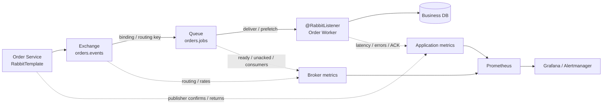
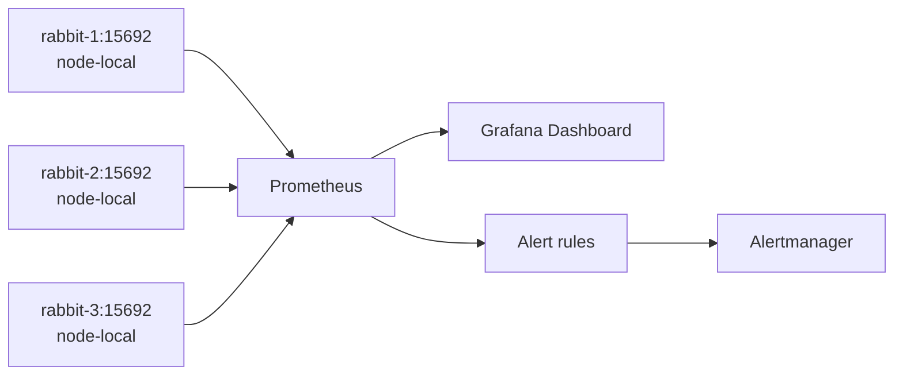
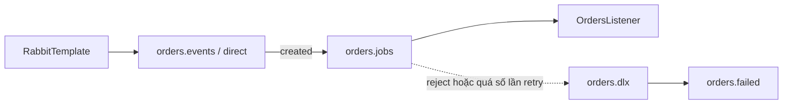

# RabbitMQ Management, Prometheus và số liệu của broker

> **Chương:** Quan sát hệ thống. **Ngữ cảnh:** trong **SPRING_AMQP**, ứng dụng sử dụng `RabbitTemplate` để publish, `@RabbitListener` để consume, định tuyến qua exchange, queue và binding, đồng thời xử lý acknowledgement, retry, dead-letter và giao dịch. Bài này tập trung vào **đo lường phía RabbitMQ broker** bằng Management UI/HTTP API và plugin Prometheus, sau đó ghép với số liệu từ ứng dụng để hiểu độ tin cậy đầu cuối.

## 1. Vì sao quan sát broker là một phần của thiết kế messaging?

Một dịch vụ tạo đơn hàng publish sự kiện `order.created` vào exchange `orders.events`. Binding định tuyến sự kiện tới queue `orders.jobs`; listener Spring AMQP đọc và cập nhật cơ sở dữ liệu. Khi người dùng phản ánh rằng đơn hàng bị xử lý chậm, ít nhất bốn nguyên nhân có thể tạo triệu chứng giống nhau:

1. Producer không gửi được tới broker hoặc message không được định tuyến vào queue.
2. Message nằm trong queue quá lâu vì consumer chưa chạy hoặc không đủ concurrency.
3. Broker đã giao message nhưng consumer xử lý lâu, chưa ACK hoặc liên tục redelivery.
4. Broker chịu áp lực RAM/disk/connection và đang hạn chế publisher dù code ứng dụng không thay đổi.

Chỉ nhìn log `@RabbitListener` sẽ không cho biết phần nào đang xảy ra. Chỉ nhìn số message trong queue cũng chưa đủ để kết luận broker hoặc ứng dụng bị lỗi.



**Mục tiêu:** từ metric có thể trả lời được **“nút nghẽn nằm ở đâu, tác động đến ai, đang xấu đi hay phục hồi?”**. Hệ thống quan sát tốt có ba tầng:

| Tầng | Ví dụ dữ liệu | Dùng để trả lời |
| --- | --- | --- |
| **Broker** | Queue ready/unacked, consumer count, publish/deliver/ack rates, connections, RAM/disk, alarms | RabbitMQ đã nhận, giữ, giao message và còn đủ tài nguyên không? |
| **Ứng dụng Spring AMQP** | `RabbitTemplate` confirm/return, listener duration/error, retry, DLQ, executor/DB latency | Producer/consumer đã hoàn tất **nghiệp vụ** chưa? |
| **Hạ tầng và người dùng** | CPU, I/O, network, event age, thời gian đơn hàng hoàn tất, SLO | Sự cố ảnh hưởng SLA ra sao và có cần can thiệp không? |

**Phân biệt mốc giao nhận:** publisher confirm ACK nói broker nhận trách nhiệm với publish theo ngữ nghĩa của nó; **không chứng minh** consumer đã hoàn tất. Consumer ACK nói delivery được xử lý/settle ở phía RabbitMQ; nó **không tự chứng minh** một giao dịch DB hay API ngoài broker đã thành công trừ khi ứng dụng ACK đúng sau khi hoàn tất side effect.

## 2. Hai công cụ chính: Management và Prometheus

RabbitMQ có hai plugin phục vụ những mục tiêu bổ sung nhau:

| Khía cạnh | `rabbitmq_management` | `rabbitmq_prometheus` |
| --- | --- | --- |
| Giao diện | Web UI + HTTP API | HTTP endpoint kiểu Prometheus |
| Cổng HTTP mặc định | **15672** | **15692** |
| Điểm truy cập | `http://node:15672/`, `/api/overview`, `/api/queues/...` | `http://node:15692/metrics`, `/metrics/detailed` |
| Cách thu thập | Management DB thu thập, tổng hợp thống kê để hiển thị | Plugin xuất metric **node-local** cho Prometheus scrape |
| Thời gian lưu trữ | Ngắn, phù hợp quan sát tại chỗ | Prometheus/remote storage lưu dài ngày, tuần, tháng |
| Dùng tốt nhất cho | Troubleshooting thủ công, xem queue, exchange, channel, policy, binding | Dashboard dài hạn, PromQL, alert, capacity planning |
| Cluster | Management HTTP API có thể hỏi dữ liệu nhiều node trong cluster qua một node | **Scrape từng node** để thấy số liệu của từng node |
| Lưu ý performance | Có overhead bộ nhớ và thống kê; không ưu tiên cho long-term monitoring | `/metrics` aggregated tương đối nhẹ; per-object có thể rất tốn CPU/response size |
| Bảo mật | Đăng nhập, user tag/permission, có thể bật HTTPS | Endpoint mặc định cần bảo vệ bằng mạng/private access; có thể bật HTTP authentication/TLS |

Hai plugin **không thay thế** cổng AMQP 0-9-1 5672, AMQP 1.0 hay stream protocol 5552. Việc Management UI hoạt động không đảm bảo producer/consumer dùng đúng protocol còn kết nối được.

### 2.1. Bật plugin trong môi trường lab

Trên RabbitMQ node có quyền quản trị:

```bash
rabbitmq-plugins enable rabbitmq_management
rabbitmq-plugins enable rabbitmq_prometheus

rabbitmq-diagnostics -s listeners
```

Kiểm tra các HTTP endpoint từ máy có quyền truy cập:

```bash
# Không cần đăng nhập với Prometheus plugin khi auth chưa bật.
curl -fsS http://localhost:15692/metrics | head -n 20

# curl sẽ yêu cầu nhập password của tài khoản được cấp quyền.
curl -fsS -u monitoring-user \
  http://localhost:15672/api/overview
```

Chỉ dùng `guest/guest` trên localhost cho bài lab; không expose Management UI hoặc Prometheus endpoint ra Internet công khai. Khi triển khai container hoặc Kubernetes, hãy kiểm tra mapping cổng, network policy và danh sách IP được phép truy cập.

Ví dụ chạy một RabbitMQ node thử nghiệm và bật Prometheus:

```bash
docker run -d --rm --name rabbitmq-observability \
  -p 5672:5672 -p 15672:15672 -p 15692:15692 \
  rabbitmq:4.2-management

docker exec rabbitmq-observability \
  rabbitmq-plugins enable rabbitmq_prometheus
```

Đây là ví dụ **chạy trên máy phát triển** có Docker và image phù hợp. Plugin Management đã được kích hoạt bởi image `-management`; cổng Prometheus vẫn cần được expose và plugin cần được bật. Production nên pin image/tag phù hợp, quản lý cấu hình và credentials bằng deployment system.

## 3. Đọc đúng RabbitMQ Management UI

Sau khi truy cập `http://localhost:15672/`, những màn hình quan trọng:

| Màn hình | Thông tin nên xem | Câu hỏi cần đặt |
| --- | --- | --- |
| **Overview** | Tổng queue, connection, channel, consumer, publish/deliver/ack rates | Broker có nhận và xử lý traffic không? |
| **Queues and Streams** | `orders.jobs`: ready/unacked/total/consumer count, kiểu queue, node/leader, rate | Có backlog ở queue cụ thể hay message đang bị giữ bởi consumer? |
| **Exchanges** | Exchange tồn tại, exchange type, bindings, routing | `orders.events` có binding đúng `created` không? |
| **Connections** | Client address, user, vhost, state, traffic, heartbeat | Có quá nhiều kết nối được tạo/đóng liên tục? |
| **Channels** | Channel/consumer, prefetch, unacked, confirm/transaction state | Message có bị giữ ở một channel nào đó? |
| **Nodes** | Memory, disk, file descriptors, sockets, alarms | Broker có đang bị giới hạn tài nguyên? |
| **Admin/Policies** | User, permission, queue policy, DLX, TTL, limits | Retry/DLQ và quyền truy cập có được cấu hình đúng không? |

**Chỉ số cốt lõi của queue:**

```text
messages_ready           = số message chờ được giao cho consumer
messages_unacknowledged  = số message đã giao nhưng broker chưa nhận ACK
messages                = ready + unacknowledged (ở queue AMQP thông thường)
consumers               = số consumer đang đăng ký trên queue
```

Nếu `ready` tăng đều trong khi `consumers=0`, ưu tiên kiểm tra listener/container, queue name và quyền. Nếu `unacked` cao và tăng, phải xem concurrency, prefetch, tốc độ xử lý, downstream timeout và ACK logic. Nếu `ready≈0` nhưng khách hàng vẫn chờ lâu, có thể message đang **unacked**, đã được prefetch trong JVM hoặc nghiệp vụ chậm sau khi listener nhận.

Không dùng `messages_ready==0` để tuyên bố “mọi event đã được xử lý”. Nó chỉ nói queue không có message **sẵn sàng giao** tại thời điểm đo.

### 3.1. HTTP API để đối chiếu và điều tra

Management UI sử dụng HTTP API phía sau. Những endpoint thông dụng:

| Endpoint | Phạm vi |
| --- | --- |
| `GET /api/overview` | Thống kê tổng hợp cluster, `queue_totals`, `object_totals` |
| `GET /api/nodes` | Thống kê các RabbitMQ node |
| `GET /api/connections` | Các connection đang mở |
| `GET /api/channels` | Các AMQP channel |
| `GET /api/queues` | Danh sách queue trong vhost được quyền |
| `GET /api/queues/{vhost}/{name}` | Queue cụ thể, message count/rate/consumer |
| `GET /api/exchanges/{vhost}` | Exchange theo virtual host |
| `GET /api/bindings/{vhost}` | Binding giữa exchange và queue |

Ví dụ với virtual host mặc định là `/` phải **URL encode thành `%2F`**:

```bash
# Chỉ thao tác GET/đọc trong môi trường được cấp quyền.
curl -fsS -u monitoring-user \
  http://localhost:15672/api/overview \
  | jq '{queue_totals, object_totals, message_stats}'

curl -fsS -u monitoring-user \
  'http://localhost:15672/api/queues/%2F/orders.jobs' \
  | jq '{name, messages, messages_ready,
          messages_unacknowledged, consumers, message_stats}'
```

Một số field `message_stats` hoặc `*_details.rate` có thể **không xuất hiện** khi chưa có hoạt động hoặc do cấu hình thống kê/version. Client đọc JSON phải xử lý field thiếu; đừng coi thiếu field là số 0 một cách vô thức. Với danh sách queue rất lớn, tránh gọi `/api/queues` liên tục để tổng hợp metrics mỗi vài giây: dùng Prometheus plugin chuyên dụng.

### 3.2. Quản lý truy cập

Management yêu cầu authentication và user tag. Tag `monitoring` cho phép xem số liệu rộng hơn qua UI/API, nhưng không thay thế quyền AMQP. Theo tài liệu RabbitMQ, có thể tạo user **chỉ để giám sát** bằng tag `monitoring` và các regex permission không match bất kỳ queue/exchange nào:

```bash
# Dùng trong môi trường do bạn quản trị; cấp secret ngoài shell history.
rabbitmqctl add_user monitoring-user
rabbitmqctl set_user_tags monitoring-user monitoring
rabbitmqctl set_permissions --vhost / monitoring-user '^$' '^$' '^$'
```

Trong production, ưu tiên cơ chế secret manager, TLS, audit và hạn chế network. `monitoring` cho quyền xem trạng thái cluster/vhost rộng, nên chỉ cấp cho đội/agent cần thiết. Không dùng tài khoản quản trị toàn quyền cho mọi dashboard hoặc script.

## 4. Plugin `rabbitmq_prometheus`: từ endpoint tới metric lưu dài hạn

Plugin Prometheus cung cấp metric ngay tại **RabbitMQ node** trên cổng mặc định **15692**. RabbitMQ không cần `rabbitmq_management` để xuất metric qua Prometheus plugin. Trong một cluster ba node, Prometheus nên scrape cả **ba endpoint node-local**; nếu chỉ scrape một node qua load balancer, có thể bỏ sót số liệu của node khác.



### 4.1. Config plugin

Ví dụ trong cấu hình RabbitMQ (`rabbitmq.conf`):

```ini
prometheus.tcp.port = 15692

# Endpoint mặc định nên chỉ được các monitoring agents truy cập.
# Khi cần yêu cầu HTTP authentication:
# prometheus.authentication.enabled = true

# Trả aggregated metrics trên /metrics (giữ mặc định cho cluster lớn):
prometheus.return_per_object_metrics = false
```

**Lưu ý vận hành:** RabbitMQ phải đọc được file cấu hình và plugin phải được bật trên **mỗi node** cần scrape. Cấu hình `prometheus.tcp.ip`/TLS/HTTP auth và firewall cần được chọn theo môi trường. Endpoint không có auth nên chỉ truy cập qua mạng tin cậy; nếu bật auth, cấu hình credential an toàn ở Prometheus scrape job.

### 4.2. Bốn endpoint quan trọng

| Endpoint | Phạm vi dữ liệu | Khuyến nghị |
| --- | --- | --- |
| `GET /metrics` | **Aggregated** theo nhóm metric, mặc định không gắn mỗi metric với một queue/connection riêng | Dùng mặc định cho dashboard tổng hợp, có chi phí dự đoán được |
| `GET /metrics/detailed` | **Chọn lọc các nhóm metric chi tiết** qua query `family`, `vhost`, `queue` | Ưu tiên khi cần theo dõi từng queue mà broker có nhiều đối tượng |
| `GET /metrics/per-object` | Mọi metric theo đối tượng, không phụ thuộc `prometheus.return_per_object_metrics` | Chỉ dùng có chủ đích ở môi trường ít đối tượng; response/CPU có thể rất lớn |
| `GET /metrics/memory-breakdown` | Phân rã sử dụng bộ nhớ RabbitMQ theo thành phần | Scrape thưa hoặc chỉ khi điều tra, vì phải duyệt nhiều Erlang processes |

**Điểm dễ nhầm:** `/metrics` mặc định cung cấp **aggregated** metrics, nên không thể lấy `queue="orders.jobs"` từ mọi series ở endpoint này. Những chỉ số có prefix `rabbitmq_detailed_*` chỉ đến từ `/metrics/detailed`, trong khi tên `rabbitmq_*` từ các endpoint aggregated/per-object có thể khác. Không copy PromQL từ nguồn dùng loại endpoint khác rồi kỳ vọng cùng tên metric.

Ví dụ lấy riêng số liệu quan trọng của queue:

```bash
# Lấy ready, unacked, total và consumer count theo queue.
curl -fsS \
  'http://localhost:15692/metrics/detailed?family=queue_coarse_metrics&family=queue_consumer_count'

# Chỉ lấy những queue bắt đầu bằng "orders." trong vhost được chỉ định.
curl -fsSG \
  --data-urlencode 'family=queue_coarse_metrics' \
  --data-urlencode 'vhost=/' \
  --data-urlencode 'queue=^orders\.' \
  http://localhost:15692/metrics/detailed
```

`/metrics/detailed` mặc định **không trả metric khi thiếu tham số `family`**. Query chọn các họ metric:

- `queue_coarse_metrics`: ready/unacked/total, theo queue.
- `queue_consumer_count`: số consumer theo queue.
- `queue_delivery_metrics`: các bộ đếm delivery, ACK, redelivery.
- `node_coarse_metrics`: thông tin node nhẹ như memory/disk/file descriptors.
- `node_metrics`: thêm giới hạn node như memory watermark, disk watermark, file-descriptor limit.
- `connection_churn_metrics`: số connection/channel tạo và đóng theo thời gian.

Chọn **nhóm nhỏ nhất đủ đáp ứng câu hỏi vận hành**, tránh yêu cầu toàn bộ `queue_metrics`, `channel_metrics` và `connection_metrics` trong mỗi lần scrape nếu không thật sự cần.

### 4.3. Prometheus scrape configuration minh họa

Ví dụ Prometheus có thể truy cập trực tiếp ba DNS RabbitMQ node:

```yaml
global:
  scrape_interval: 30s

scrape_configs:
  - job_name: rabbitmq-broker
    metrics_path: /metrics
    scrape_interval: 15s
    static_configs:
      - targets:
          - rabbit-1.internal:15692
          - rabbit-2.internal:15692
          - rabbit-3.internal:15692

  - job_name: rabbitmq-queues
    metrics_path: /metrics/detailed
    scrape_interval: 30s
    params:
      family:
        - queue_coarse_metrics
        - queue_consumer_count
        - queue_delivery_metrics
        - node_coarse_metrics
        - node_metrics
        - connection_churn_metrics
      vhost: ['/']
      queue: ['^orders\.']
    static_configs:
      - targets:
          - rabbit-1.internal:15692
          - rabbit-2.internal:15692
          - rabbit-3.internal:15692
```

Prometheus tự URL encode query parameters. Bộ lọc `queue` áp dụng cho metric theo queue; các `node_*` hay `connection_churn_*` vẫn mô tả node, không phụ thuộc tên queue.

**Các khoảng 15s và 30s là đề xuất để thực hành**, không phải cấu hình bắt buộc. Chọn scrape interval dựa trên số node, metric series, độ trễ cảnh báo mong muốn và overhead thực đo. Nếu dùng Kubernetes, thay `static_configs` bằng service discovery/`ServiceMonitor` phù hợp, nhưng phải bảo đảm từng RabbitMQ node được scrape riêng và series có nhãn phân biệt instance.

Khi bật authentication ở plugin, thêm cấu hình `basic_auth` hoặc secret file phù hợp vào Prometheus; không hardcode password vào file được commit. Trong production, cấu hình `scrape_timeout` nhỏ hơn `scrape_interval` và kiểm tra độ ổn định của mục tiêu ở trang **Targets** của Prometheus.

## 5. Định nghĩa chính xác những metric quan trọng

### 5.1. Queue state: đừng nhầm ready và unacked

Các metric sau thuộc `/metrics/detailed?family=queue_coarse_metrics&family=queue_consumer_count`:

| Metric (RabbitMQ 4.x) | Kiểu | Ý nghĩa |
| --- | --- | --- |
| `rabbitmq_detailed_queue_messages_ready` | Gauge | Message **đang chờ** được giao cho consumer |
| `rabbitmq_detailed_queue_messages_unacked` | Gauge | Message **đã giao** nhưng chưa ACK |
| `rabbitmq_detailed_queue_messages` | Gauge | Tổng ready + unacked theo queue |
| `rabbitmq_detailed_queue_consumers` | Gauge | Số consumer đăng ký trên queue |

Với `@RabbitListener`, nếu queue có nhiều consumer, `unacked` có thể lên tới xấp xỉ `concurrency × prefetch` cho các consumer đang hoạt động, kể cả các message đã được broker cấp nhưng vẫn chờ trong client. **Unacked cao không luôn là lỗi**; so với baseline, khả năng xử lý downstream và số consumer mới biết có đang nghẽn hay không.

Ví dụ:

| `ready` | `unacked` | `consumers` | Nhận định ban đầu |
| ---: | ---: | ---: | --- |
| 0 | 0 | 4 | Queue đã được tiêu thụ hết tại thời điểm đo; cần thêm metric ứng dụng để xác nhận business hoàn tất |
| 10.000 | 0 | 0 | Không có consumer; xem listener config/kết nối |
| 10.000 | 32 | 4 | Consumer đang làm việc nhưng publish rate có thể lớn hơn throughput |
| 0 | 1.000 | 4 | Prefetch lớn hoặc xử lý/ACK chậm; cần xem prefetch, DB, timeouts |
| 0 | 0 | 0 | Không có message và consumer; có thể bình thường với queue không được sử dụng |

Các số **chỉ minh họa**, không được coi là threshold chung cho mọi hệ thống. Với quorum queue hoặc stream, kiến trúc queue/retention có đặc điểm riêng; không suy luận throughput, số message trên disk hay event đã hết hạn từ riêng queue depth.

### 5.2. Message flow: tăng queue vì producer nhanh hay consumer lỗi?

Lấy thêm `queue_delivery_metrics`:

| Counter | Ý nghĩa |
| --- | --- |
| `rabbitmq_detailed_queue_messages_delivered_ack_total` | Message được giao cho consumer ở manual acknowledgement mode |
| `rabbitmq_detailed_queue_messages_delivered_total` | Message được giao cho consumer trong automatic acknowledgement mode của AMQP 0-9-1 |
| `rabbitmq_detailed_queue_messages_acked_total` | Message được consumer ACK |
| `rabbitmq_detailed_queue_messages_redelivered_total` | Số message bị giao lại (redelivery), **không đồng nghĩa số lỗi nghiệp vụ duy nhất** |
| `rabbitmq_detailed_queue_get_ack_total` | Message lấy bằng `basic.get` có manual ack |
| `rabbitmq_detailed_queue_get_empty_total` | Số lần `basic.get` nhận kết quả rỗng (polling không hiệu quả) |

Tên `_total` là **counter**, vì vậy dùng `rate(metric[5m])` hay `increase(metric[5m])` thay vì lấy hiệu hai snapshot một cách tùy tiện (counter có thể reset khi broker restart).

**Dễ nhầm:** `@RabbitListener` mặc định `AcknowledgeMode.AUTO` trong Spring nghĩa là **Spring container ACK sau khi listener thành công**; ở mức broker đây vẫn là **manual acknowledgement mode** (không phải `autoAck=true` của giao thức). Vì vậy việc nhìn metric `*_delivered_ack_total` quan trọng hơn việc suy ra từ tên `AUTO` trong Spring.

### 5.3. Broker node: RAM, disk, file descriptor và Erlang VM

Hai họ metric `node_coarse_metrics` và `node_metrics` cung cấp:

| Metric | Điều cần quan sát |
| --- | --- |
| `rabbitmq_detailed_process_resident_memory_bytes` | Bộ nhớ resident được Erlang VM sử dụng |
| `rabbitmq_detailed_resident_memory_limit_bytes` | Ngưỡng memory high watermark |
| `rabbitmq_detailed_disk_space_available_bytes` | Disk free của node |
| `rabbitmq_detailed_disk_space_available_limit_bytes` | Disk free low watermark |
| `rabbitmq_detailed_process_open_fds` / `rabbitmq_detailed_process_max_fds` | File descriptors đã sử dụng / giới hạn |
| `rabbitmq_detailed_process_open_tcp_sockets` / `rabbitmq_detailed_process_max_tcp_sockets` | Socket mở / giới hạn |
| `rabbitmq_detailed_erlang_processes_used` / `rabbitmq_detailed_erlang_processes_limit` | Erlang processes dùng / giới hạn |
| `rabbitmq_detailed_erlang_scheduler_run_queue` | Áp lực chạy scheduler trong Erlang VM |

RabbitMQ phát **memory alarm** hoặc **disk alarm** khi vượt các ngưỡng bảo vệ; publisher có thể bị chặn/throttle, trong khi consumer có thể tiếp tục tiêu thụ để giảm áp lực. Đừng sửa bằng cách chỉ tăng timeout `RabbitTemplate`; cần xử lý nguồn gây đầy disk/RAM, backlog, message size hoặc giới hạn cấu hình.

Đo CPU, iowait, filesystem và network từ **node_exporter/cAdvisor/infrastructure metrics** riêng: metrics của RabbitMQ không thay thế metrics của kernel/hệ điều hành. Đặc biệt với RabbitMQ Streams, page cache và dung lượng segment phải được theo dõi cùng với memory/disk của broker.

### 5.4. Connection/channel churn

Họ `connection_churn_metrics` có các counter:

```text
rabbitmq_detailed_connections_opened_total
rabbitmq_detailed_connections_closed_total
rabbitmq_detailed_channels_opened_total
rabbitmq_detailed_channels_closed_total
```

Nếu `connections_opened_total` và `connections_closed_total` cùng tăng rất nhanh, kiểm tra **reconnect storm**, credential, heartbeat, network path, `CachingConnectionFactory` hoặc code tự tạo connection trên mỗi message. Số channel có thể lớn hơn số physical connection vì **nhiều channel dùng chung một connection**.

## 6. PromQL thực dụng cho broker và queue

Các truy vấn dưới đây giả định Prometheus scrape job `rabbitmq-queues` từ mục 4 và RabbitMQ có vhost `/`, queue `orders.jobs`. Tên metric được lấy từ nhóm `/metrics/detailed`, **không** phải từ `/metrics` aggregated. Khi ứng dụng dùng tên queue/vhost khác, thay bộ lọc tương ứng.

### 6.1. Backlog theo queue

```promql
# Message chờ được giao trên tất cả queue đã scrape.
sum by (vhost, queue) (
  rabbitmq_detailed_queue_messages_ready
)
```

```promql
# Queue đơn hàng: số message đang chờ.
rabbitmq_detailed_queue_messages_ready{
  vhost="/", queue="orders.jobs"
}
```

Lưu ý: nếu một queue được thể hiện trên **nhiều node/replica** hoặc hệ thống scrape cùng một node hai lần, `sum` có thể cộng trùng dữ liệu. Kiểm tra labels `instance`, `node` và queue placement; khi cần quan sát giá trị từ một node chịu trách nhiệm, giới hạn đúng target hoặc dùng phép tổng hợp phù hợp với loại queue và deployment. Đừng dùng `sum` bừa bãi cho mọi metric có label `node`.

### 6.2. Message đã giao nhưng chưa ACK

```promql
rabbitmq_detailed_queue_messages_unacked{
  vhost="/", queue="orders.jobs"
}
```

Đặt cạnh `ready` và `consumers`. Nếu `unacked` gần đúng `consumers × prefetch` trong thời gian dài và `ready` tiếp tục tăng, có thể consumer bị chậm hoặc prefetch quá cao. Nếu `unacked` bằng 0 mà `ready` lớn, có thể consumer vắng mặt hoặc không nhận được message; chưa đủ dữ liệu để khẳng định nguyên nhân.

### 6.3. Queue không có consumer

```promql
rabbitmq_detailed_queue_consumers{
  vhost="/", queue="orders.jobs"
} == 0
```

Với queue không còn series (do queue bị xóa, scrape lỗi hoặc filter loại bỏ), biểu thức trên **không tự phát ra giá trị 0**. Cần quan sát `up`/`absent(...)` và inventory queue để phân biệt “consumer count = 0” với “không có dữ liệu”.

### 6.4. ACK throughput và redelivery rate

```promql
# ACK/giây trung bình 5 phút trên queue đơn hàng.
sum by (vhost, queue) (
  rate(rabbitmq_detailed_queue_messages_acked_total{
    vhost="/", queue="orders.jobs"
  }[5m])
)
```

```promql
# Redelivery/giây — phát hiện vòng lặp retry nóng.
sum by (vhost, queue) (
  rate(rabbitmq_detailed_queue_messages_redelivered_total{
    vhost="/", queue="orders.jobs"
  }[5m])
)
```

```promql
# Số lượt redelivery xảy ra trong 15 phút vừa qua.
sum by (vhost, queue) (
  increase(rabbitmq_detailed_queue_messages_redelivered_total{
    vhost="/", queue="orders.jobs"
  }[15m])
)
```

Các phép `rate`/`increase` chỉ dùng cho **counter**. Đừng dùng `rate` cho `messages_ready`: đó là **gauge** (giá trị tăng/giảm tùy lượng message). Muốn xem ready có đang tăng, nhìn slope của biểu đồ hoặc dùng `delta(gauge[5m])` với ý nghĩa thay đổi ròng trong cửa sổ.

```promql
delta(
  rabbitmq_detailed_queue_messages_ready{
    vhost="/", queue="orders.jobs"
  }[5m]
)
```

Giá trị dương nghĩa là tại hai đầu cửa sổ số message ready tăng ròng, **không tự chứng minh** producer đã gửi bao nhiêu message hay listener xử lý bao nhiêu. Redelivery, purge, TTL, DLX và thay đổi consumer đều có thể ảnh hưởng queue depth.

### 6.5. Broker memory/disk headroom

```promql
# RAM hiện dùng so với memory watermark.
rabbitmq_detailed_process_resident_memory_bytes
/
rabbitmq_detailed_resident_memory_limit_bytes
```

```promql
# Dung lượng còn trống so với disk low watermark.
rabbitmq_detailed_disk_space_available_bytes
/
rabbitmq_detailed_disk_space_available_limit_bytes
```

RAM ratio tới 1 hoặc disk ratio xuống tới 1 là tín hiệu đáng điều tra. Đây **không phải** ngưỡng đặt chung cho mọi hệ thống; kiểm tra cách RabbitMQ tính memory, disk watermark, filesystem mount và resource alarms. Metric từ Prometheus plugin có thể không phản ánh một sự cố của hạ tầng như disk I/O tăng đột biến; phải xem thêm metrics OS.

### 6.6. Churn của connection/channel

```promql
rate(rabbitmq_detailed_connections_opened_total[5m])
```

```promql
rate(rabbitmq_detailed_connections_closed_total[5m])
```

```promql
rate(rabbitmq_detailed_channels_opened_total[5m])
```

Nếu cả connection opened và closed đều liên tục tăng, so với lưu lượng message thực tế và baseline. Khi RabbitMQ mất kết nối hàng loạt, nhiều `CachingConnectionFactory` / listener container có thể reconnect gần cùng thời điểm. Kiểm tra DNS, TLS/auth, broker restart, heartbeat và chiến lược backoff có jitter.

### 6.7. Scrape target có sống không?

```promql
up{job="rabbitmq-broker"} == 0
```

`up=0` báo Prometheus không scrape được target đã được discover. Nó **không** đồng nghĩa chắc chắn broker ngừng xử lý message: có thể chỉ HTTP metrics port/plugin/firewall gặp lỗi. Ngoài ra, khi target biến mất **khỏi service discovery**, series `up` có thể biến mất hoàn toàn, nên cần thêm kiểm tra số target mong đợi, `absent(...)` hoặc giám sát discovery. Không lấy `up=1` làm bằng chứng consumer/producer vẫn hoạt động.

## 7. Từ metric tới dashboard có thể điều tra sự cố

Một dashboard tốt trả lời theo thứ tự **“broker có khỏe không → message đi đâu → consumer có đang xử lý không?”**, thay vì chỉ có hàng chục biểu đồ không rõ ngữ cảnh.

### 7.1. Gợi ý tổ chức dashboard

| Nhóm | Panel nên có | Ý nghĩa |
| --- | --- | --- |
| **Sức khỏe cluster** | Số node up, memory headroom, disk headroom, FD/socket usage | Broker có nguy cơ chặn publisher hoặc hết tài nguyên? |
| **Lưu lượng** | Publish/deliver/ACK rate, connection/channel churn | Hệ thống có luồng message đều và ổn định? |
| **Độ sâu queue** | Ready, unacked, total theo queue quan trọng | Backlog nằm ở broker hay đã vào consumer? |
| **Tiến độ consumer** | Consumers, ACK/s, redelivery/s, consumer capacity (khi có) | Có consumer chết, nghẽn hoặc retry storm? |
| **Đường xử lý lỗi** | DLQ depth, message age ở outbox/ứng dụng, retry count | Có message bị bỏ qua hoặc nằm chờ xử lý lâu? |
| **Độ trễ nghiệp vụ** | p95/p99 listener duration, DB/HTTP latency, event end-to-end age | Người dùng chịu độ trễ bao nhiêu? |

Đội RabbitMQ cung cấp **Grafana dashboard chính thức** cho Overview, Erlang runtime, inter-node communication và Raft/quorum. Có thể import rồi điều chỉnh ngưỡng/nhãn cho cluster thực tế; không cần tự xây toàn bộ dashboard từ đầu.

### 7.2. Liên kết panel để rút ngắn thời gian tìm lỗi

Ví dụ khi queue `orders.jobs` có ready tăng nhanh, operator nên xem trong cùng khoảng thời gian:

1. `ready` và `unacked` của queue này.
2. `consumer count`, ACK rate và redelivery rate.
3. RabbitMQ memory/disk/resource alarms.
4. Spring `@RabbitListener` duration/error count, executor active threads và JDBC pool.
5. DLQ depth, số event đã retry và publish confirm/return ở producer.

**Không suy ra nguyên nhân từ một đường biểu đồ.** Ví dụ ready tăng và consumer count không đổi có thể do producer tăng nhanh, API downstream chậm hoặc payload lớn. Cần so với ACK throughput và độ trễ ứng dụng. Nếu publish rate bằng 0, kiểm tra `RabbitTemplate` errors, exchange/binding và producer connections trước khi tăng consumer.

### 7.3. Số liệu broker không thay thế thời gian chờ thực của message

Thấy queue có `ready=500` và ACK rate `100/s` có thể khiến ta ước lượng thời gian rút hết backlog ~5 giây **nếu** không có message mới và throughput duy trì. Đây chỉ là phép ước lượng rất thô, **không phải** percentile latency hay cam kết SLA.

Muốn đo “event sinh ra lúc nào, xử lý hoàn tất lúc nào”, cần timestamp và metric tại ứng dụng, ví dụ:

```text
event_created_at: thời điểm tạo business event
message_published_at: broker publish được confirm hoặc log outbox
listener_started_at: lần xử lý bắt đầu
business_committed_at: side effect nghiệp vụ commit

end_to_end_latency = business_committed_at - event_created_at
```

Tránh dùng clock của các máy khác nhau để tính latency mà không đồng bộ NTP hoặc không xét clock skew. Nếu lưu timestamp vào message headers, đảm bảo schema và timezone nhất quán; đừng gắn timestamp hoặc event ID làm **metric label** vì sẽ tăng cardinality rất mạnh.

## 8. Cảnh báo: đo đúng điều đáng thức dậy để xử lý

Một alert tốt cần ba phần: **điều kiện**, **thời gian kéo dài** và **hành động/runbook**. Nếu cứ một lần `messages_ready > 0` đã page trực ca, hệ thống có thể báo động liên tục ngay cả khi hoạt động bình thường.

### 8.1. Những tín hiệu đáng cảnh báo

| Tình huống | Ví dụ điều kiện | Mức ưu tiên phụ thuộc |
| --- | --- | --- |
| Broker node metrics endpoint mất | `up=0` kéo dài nhiều phút | Có còn node/replica phục vụ traffic? |
| Memory headroom giảm mạnh | Tỷ lệ memory used / memory watermark gần 1 | Có resource alarm, publisher bị chặn? |
| Disk free gần low watermark | Disk free / low watermark gần hoặc dưới 1 | Có nguy cơ không thể lưu message? |
| Queue nghiệp vụ **không có consumer** | `consumers=0` và `ready>0` kéo dài | Queue có bắt buộc xử lý liên tục không? |
| Backlog vượt SLA | Ready tăng và oldest event age vượt SLO | Tốc độ xử lý có bắt kịp producer không? |
| Redelivery storm | `rate(redelivered_total[5m])` tăng nhiều lần baseline | Poison message, retry nóng hay consumer crash? |
| DLQ tồn đọng | DLQ depth > 0 quá thời gian cho phép | Có quy trình triage và replay không? |
| Connection churn tăng đột ngột | Opened/s và closed/s tăng đồng thời | Reconnect storm, credential, network, broker restart? |

Ngưỡng trong ví dụ dưới **chỉ dùng cho phòng lab**; ứng dụng production phải đặt theo traffic bình thường, retention, sự quan trọng của queue và thời gian phục hồi mong muốn.

### 8.2. Ví dụ Prometheus alert rules

Lưu các rule sau trong **cấu hình hệ thống giám sát riêng**, không chèn vào `rabbitmq.conf`. `Prometheus` hoặc Prometheus Operator phải nạp nhóm rule này.

```yaml
groups:
  - name: rabbitmq-orders
    rules:
      - alert: RabbitMQBrokerScrapeDown
        expr: up{job="rabbitmq-broker"} == 0
        for: 3m
        labels:
          severity: warning
        annotations:
          summary: "Không scrape được metrics của RabbitMQ node"
          description: "Kiểm tra node, plugin, cổng 15692, TLS và network."

      - alert: OrdersQueueNoConsumers
        expr: |
          (
            rabbitmq_detailed_queue_consumers{
              vhost="/", queue="orders.jobs"
            } == 0
          )
          and on(instance, vhost, queue)
          (
            rabbitmq_detailed_queue_messages_ready{
              vhost="/", queue="orders.jobs"
            } > 0
          )
        for: 5m
        labels:
          severity: warning
        annotations:
          summary: "Queue đơn hàng còn message nhưng không có consumer"

      - alert: OrdersQueueBacklogHigh
        expr: |
          rabbitmq_detailed_queue_messages_ready{
            vhost="/", queue="orders.jobs"
          } > 1000
        for: 10m
        labels:
          severity: warning
        annotations:
          summary: "Ready messages của orders.jobs vượt ngưỡng thử nghiệm"
```

**Giới hạn của rule mẫu:**

- Các threshold `1000`, `5m`, `10m` chỉ minh họa; thay theo SLO và baseline thực tế.
- `OrdersQueueNoConsumers` dùng labels của Prometheus target (`instance`) để ghép hai metric cùng queue. Nếu hệ thống relabel hoặc queue metric phân bố trên nhiều node theo cách khác, cần điều chỉnh phép join.
- Rule chỉ chạy nếu job `rabbitmq-queues` đã scrape `queue_coarse_metrics` và `queue_consumer_count`, đúng vhost/queue và metric tồn tại.
- `up=0` không phát hiện target **biến mất khỏi service discovery**; phải có thêm giám sát số node mong đợi hoặc `absent(...)` tùy deployment.
- Khi alert lên, không lập tức purge queue hoặc restart mọi consumer. Cần xác định vì sao chúng không xử lý được.

### 8.3. Runbook theo triệu chứng

| Alert/triệu chứng | Bước điều tra | Hành động an toàn ban đầu |
| --- | --- | --- |
| `up=0` | Ping/HTTP tới 15692; `rabbitmq-diagnostics -s listeners`; plugin/node logs | Khôi phục endpoint/đường mạng, phân biệt lỗi metrics với lỗi AMQP |
| `ready` tăng + consumer=0 | Management UI Queue, Spring listener startup logs, queue name/vhost | Sửa quyền/connection/container; không tăng prefetch vô thức |
| `unacked` tăng + ACK rate giảm | Channel/prefetch, thread dump, JDBC/HTTP timeouts | Giảm concurrency/giới hạn downstream; kiểm tra stuck listener |
| `redelivered_total` tăng nhanh | Listener errors, retry config, DLX, delivery-limit | Ngăn vòng requeue nóng; retry backoff hữu hạn và đưa poison message vào DLQ |
| Memory/disk alarm | `/api/nodes`, watermark, disk mount, queue sizes, infrastructure I/O | Giảm publish/load, xử lý backlog theo kế hoạch; không xóa dữ liệu tùy tiện |
| Connection churn | Connections page, heartbeat, TLS/auth, factory lifecycle | Khắc phục lỗi kết nối và phân tán reconnect bằng backoff/jitter |

**Thiết kế tốt có hai loại thông báo:** (1) Alert cần trực ca xử lý ngay vì SLO có nguy cơ bị vi phạm; (2) dashboard/sự kiện mức thấp để phục vụ phân tích khi chưa cần hành động. Giảm alert noise giúp những cảnh báo nghiêm trọng không bị bỏ qua.

## 9. Ghép broker metrics với Spring AMQP / Micrometer

Broker metrics là “broker thấy gì”. Ứng dụng còn cần đo **method xử lý nghiệp vụ có chạy thành công không**, kết quả publish confirm/return và độ trễ end-to-end. Trên Spring AMQP **3.0+**, `RabbitTemplate` và listener container hỗ trợ **Micrometer Observation**.

### 9.1. Bật Observation trên template và listener factory

Nếu tự cấu hình bean:

```java
import org.springframework.amqp.rabbit.config.SimpleRabbitListenerContainerFactory;
import org.springframework.amqp.rabbit.connection.ConnectionFactory;
import org.springframework.amqp.rabbit.core.RabbitTemplate;
import org.springframework.context.annotation.Bean;
import org.springframework.context.annotation.Configuration;

@Configuration(proxyBeanMethods = false)
class OrderObservabilityConfig {

    @Bean
    RabbitTemplate observedRabbitTemplate(ConnectionFactory connectionFactory) {
        RabbitTemplate template = new RabbitTemplate(connectionFactory);
        template.setObservationEnabled(true);
        return template;
    }

    @Bean("observedOrderListenerFactory")
    SimpleRabbitListenerContainerFactory observedOrderListenerFactory(
            ConnectionFactory connectionFactory) {
        SimpleRabbitListenerContainerFactory factory =
            new SimpleRabbitListenerContainerFactory();
        factory.setConnectionFactory(connectionFactory);
        factory.setConcurrentConsumers(2);
        factory.setPrefetchCount(10);
        factory.setObservationEnabled(true);
        return factory;
    }
}
```

```java
import org.springframework.amqp.rabbit.annotation.RabbitListener;
import org.springframework.stereotype.Component;

@Component
class ObservedOrdersListener {
    private final OrderService orderService;

    ObservedOrdersListener(OrderService orderService) {
        this.orderService = orderService;
    }

    @RabbitListener(
        id = "observedOrders",
        queues = "orders.jobs",
        containerFactory = "observedOrderListenerFactory")
    public void receive(String orderId) {
        orderService.process(orderId);
    }
}
```

`OrderService` là thành phần ứng dụng tự cung cấp. Nếu dùng Spring Boot auto-config thay vì tự khai báo bean, có thể bật các property tương ứng của **Spring Boot 3.x**:

```yaml
spring:
  rabbitmq:
    template:
      observation-enabled: true
    listener:
      simple:
        observation-enabled: true

management:
  endpoints:
    web:
      exposure:
        include: health,info,prometheus
```

Để dùng `/actuator/prometheus`, cần có Spring Boot Actuator và Micrometer Prometheus registry cùng quyền expose endpoint theo chính sách bảo mật. Với Spring Boot **4.x** hoặc AMQP 1.0 modules, kiểm tra lại **starter/namespace thuộc tính** đang dùng, không sao chép mù cấu hình Boot 3.x.

### 9.2. Đừng nhầm metric của ứng dụng và metric của broker

| Nguồn | Endpoint | Dữ liệu tiêu biểu |
| --- | --- | --- |
| RabbitMQ Prometheus plugin | `rabbit-node:15692/metrics` | Memory/disk/connection/queue/routing/delivery phía broker |
| Spring Boot Actuator | `app-instance:8080/actuator/prometheus` | Request latency, JVM, executor, listener observation, business counters |
| RabbitMQ Management HTTP API | `rabbit-node:15672/api/...` | Thông tin topology, permission, queue/connection cho điều tra |

Nếu chỉ scrape `/actuator/prometheus`, bạn không tự có tất cả metric broker. Nếu chỉ scrape `15692/metrics`, bạn không tự có listener duration, JDBC pool, HTTP errors hay producer confirm timeout trong ứng dụng.

Spring AMQP định nghĩa các observation như `spring.rabbit.template` và `spring.rabbit.listener` (và observation đang active). **Tên metric Prometheus cụ thể có thể được chuyển đổi dấu chấm/đơn vị thành dấu gạch dưới hoặc suffix theo Micrometer và registry/version**, vì vậy hãy xem dữ liệu thực tế ở `/actuator/prometheus` trước khi viết PromQL. Khi bật observation, timer Micrometer cũ của listener/template có thể được thay bằng metric do observation quản lý; đừng cộng hai nguồn như hai lần xử lý khác nhau.

### 9.3. Thêm metric nghiệp vụ khi cần

Metric broker không biết liệu `OrderService.process(...)` đã cập nhật database hay gọi HTTP downstream thành công. Trong ứng dụng, có thể đếm sự kiện xử lý bằng Micrometer:

```java
import io.micrometer.core.instrument.Counter;
import io.micrometer.core.instrument.MeterRegistry;
import org.springframework.stereotype.Service;

@Service
class OrderProcessingMetrics {
    private final Counter success;
    private final Counter failure;

    OrderProcessingMetrics(MeterRegistry registry) {
        this.success = Counter.builder("orders.processed")
            .tag("result", "success")
            .register(registry);
        this.failure = Counter.builder("orders.processed")
            .tag("result", "failure")
            .register(registry);
    }

    void onSuccess() { success.increment(); }
    void onFailure() { failure.increment(); }
}
```

Gắn counter vào đúng **điểm commit nghiệp vụ** chứ không chỉ điểm listener nhận message. Nếu listener có retry, tính số lượt attempt và số business events hoàn tất riêng; không trộn chúng thành một chỉ số. Để phân tích latency, dùng Timer/Observation cho business work và lưu event ID/trace ID vào **log/tracing**, không biến chúng thành metric label.

## 10. Chi phí quan sát và bảo mật: metric cũng cần ngân sách

### 10.1. Tránh cardinality bùng nổ

Mỗi tổ hợp giá trị label tạo một **time series** riêng. Ví dụ:

```text
10 vhost × 1.000 queue × 3 RabbitMQ nodes × 12 metrics
≈ 360.000 time series (ước lượng để hình dung)
```

Đây chỉ là minh họa; số series thực tế phụ thuộc labels, loại metric, queue placement, replication và kết quả scrape. Nếu đưa cả connection ID/channel ID/client IP vào label, số series có thể lớn hơn nhiều khi connection churn nhanh.

**Khuyến nghị theo quy mô:**

1. Dùng `/metrics` aggregated cho biểu đồ sức khỏe broker trên mọi node.
2. Chỉ chọn queue quan trọng cần điều tra bằng `/metrics/detailed` với `family` và `queue`/`vhost` filter.
3. Tránh `/metrics/per-object` trên broker có hàng chục nghìn connection/queue, trừ khi đã đánh giá chi phí.
4. Đặt `/metrics/memory-breakdown` ở job scrape thưa hơn, ví dụ vài phút, nếu thật sự cần.
5. Không thêm `messageId`, `orderId`, correlation ID, exception text hay payload vào labels.
6. Theo dõi chính **Prometheus**: scrape duration, response size, số series, sample ingestion, retention/storage.

Trong RabbitMQ, Management plugin tự thu thập và tổng hợp thống kê nên cũng có overhead, nhất là số lượng entity rất lớn. Với production quy mô lớn, hệ thống giám sát ngoài như Prometheus/Grafana thường phù hợp hơn quản lý time series trực tiếp qua Management HTTP API.

### 10.2. Phân biệt node-local và cluster-wide

**Management HTTP API** có thể hỏi một RabbitMQ node rồi tổng hợp dữ liệu **toàn cluster**. Khi có network partition hoặc node không phản hồi, một số câu hỏi cluster-wide có thể chậm.

**Prometheus endpoint** xuất metric **node-local**. Vì vậy:

- Scrape **mỗi node** trong cluster, không chỉ một VIP ngẫu nhiên nếu VIP đưa request tới node bất kỳ.
- Giữ labels `cluster`, `node`/`instance` nhất quán để biết node nào đang mất.
- Khi tạo panel tổng cluster, hiểu metric nào cộng được (counter các event riêng biệt trên node), metric nào cần maximum/minimum hoặc giới hạn node sở hữu (queue replicas/leader).
- Khi một target biến mất, dashboard có thể **giảm số liệu** vì thiếu node, không phải vì traffic thật giảm.

Với RabbitMQ Operator trong Kubernetes, Prometheus plugin có thể được bật và ServiceMonitor có thể được cấp theo chart/operator đang dùng; vẫn cần kiểm tra số endpoint được discover và mỗi node có thực sự scrape thành công.

### 10.3. Bảo mật endpoint và thông tin nhạy cảm

**Management UI/API** chứa tên queue, exchange, vhost, user, thông tin connection và có thể có chức năng gửi/nhận/đọc message tùy permission. **Prometheus metrics** có thể tiết lộ topology, host, số lượng consumer hoặc nội dung tên queue. Vì vậy:

- Chỉ cho phép scraping từ network/namespace giám sát; hạn chế inbound bằng firewall/NetworkPolicy.
- Bật TLS/HTTPS và auth ở những vị trí cần thiết; không đưa credential vào Git hoặc URL.
- Quản lý user theo nguyên tắc quyền tối thiểu, đặc biệt khi ai đó có `monitoring` tag.
- Không bật tracing/firehose/payload sampling toàn bộ message trên production để “thu thập nhiều hơn” khi chưa đánh giá độ nhạy dữ liệu và performance.
- Đặt retention của Prometheus/log/traces theo nhu cầu vận hành và quy định dữ liệu nội bộ.

## 11. Thực hành: từ backlog đến root cause

### 11.1. Môi trường

Chuẩn bị RabbitMQ với hai plugin `rabbitmq_management` và `rabbitmq_prometheus`, Prometheus scrape hai job ở mục 4, Grafana hoặc trang query Prometheus, cùng một ứng dụng Spring Boot gửi/nhận bằng `RabbitTemplate` và `@RabbitListener`.

Topology đề xuất:



Có thể khai báo topology bằng các bean `DirectExchange`, `QueueBuilder.durable(...)`, `BindingBuilder`; nếu muốn dead-letter thực tế, queue `orders.jobs` phải có DLX/dead-letter routing key tương ứng. Không phải mọi exception đều tự vào DLQ: trong Spring AMQP, lựa chọn `defaultRequeueRejected`, exception, retry interceptor và loại queue quyết định reject/requeue/delivery limit.

### 11.2. Kịch bản kiểm thử

| Kịch bản | Thao tác | Dự kiến trên Management/Prometheus | Ý nghĩa |
| --- | --- | --- | --- |
| A — Baseline | Publish 100 message, 2 listener chạy bình thường | Ready tăng rồi giảm; ACK rate tăng; consumers=2 | Xác nhận pipeline đo lường hoạt động |
| B — Stop consumer | Dừng listener container có chủ đích, tiếp tục publish 200 message | Consumers giảm; ready tăng; unacked giảm sau khi delivery cũ được xử lý/giải phóng | Queue chưa xử lý, không phải lỗi publisher |
| C — Consumer chậm | Giả lập xử lý 2 giây/message | Ready tăng; unacked có thể đến giới hạn prefetch/concurrency; ACK/s thấp | Downstream/worker chậm, tăng prefetch chưa chắc hữu ích |
| D — Consumer exception | Cho xử lý ném lỗi và có retry/DLQ hữu hạn | Redelivery có thể tăng; DLQ depth tăng sau retry/reject tùy chính sách | Phân biệt lỗi dữ liệu và lỗi consumer |
| E — Sai routing | Publish với routing key không có binding | Queue target không tăng; nếu bật mandatory returns, producer nhận return | Broker không route được, queue metrics không đủ để chỉ ra nguyên nhân |
| F — Reconnect | Khởi động lại broker **chỉ trong lab** | `up` tạm 0; connection churn tăng khi phục hồi; listener register trở lại | Kiểm tra recovery và alert tránh false positives |
| G — DLQ tồn đọng | Để 5 message vào `orders.failed` rồi ngừng replay | DLQ ready còn >0; có thể alert theo SLA | Cần triage, không purge để che lỗi |
| H — Resource pressure | Quan sát disk/RAM và watermark từ metric; **không cố làm đầy broker sản xuất** | Headroom giảm gần alarm threshold | Tập thao tác đọc/giám sát an toàn |

Đối với thử nghiệm B, cách stop và thời gian giải phóng unacked phụ thuộc container, `shutdownTimeout`, `forceStop` và broker; không mặc định unacked luôn về 0 ngay lập tức. Đối với thử nghiệm D, nếu listener cố tình requeue vô hạn, có thể gây retry storm; **chỉ bật trong lab rất hạn chế** rồi chuyển sang retry backoff/DLQ.

### 11.3. Các bước quan sát cụ thể

1. Vào Management UI, chọn `orders.jobs` và ghi giá trị `messages_ready`, `messages_unacknowledged`, `consumers` cùng thời điểm.
2. Truy cập `/api/queues/%2F/orders.jobs` để đối chiếu chính các trường JSON đó.
3. Query `rabbitmq_detailed_queue_messages_ready{queue="orders.jobs",vhost="/"}` ở Prometheus. Xem label `instance` để biết node được scrape; không cộng trùng replica một cách vô ý.
4. Xem `rate(rabbitmq_detailed_queue_messages_acked_total[5m])` và `rate(rabbitmq_detailed_queue_messages_redelivered_total[5m])` trên cùng trục thời gian.
5. Xem thêm `/actuator/prometheus` của ứng dụng (nếu bật Micrometer), log listener, DB latency và publish confirm/return.
6. Điền chẩn đoán vào bảng dưới; chỉ điều chỉnh concurrency, prefetch, retry hoặc binding **sau khi xác định nguyên nhân**.

| Lượt thử | Ready | Unacked | Consumers | ACK/s | Redelivery/s | Kết luận và hành động |
| --- | ---: | ---: | ---: | ---: | ---: | --- |
| A | Đo | Đo | Đo | Đo | Đo | Pipeline bình thường? |
| B | Đo | Đo | Đo | Đo | Đo | Vì sao consumer không có mặt? |
| C | Đo | Đo | Đo | Đo | Đo | Do thread/prefetch hay DB/API? |
| D | Đo | Đo | Đo | Đo | Đo | Có lỗi poison message và DLQ? |
| E | Đo | Đo | Đo | Đo | Đo | Routing key/binding/mandatory return? |
| F | Đo | Đo | Đo | Đo | Đo | Recovery và scrape có ổn định không? |

Khi `ready` tiếp tục tăng nhưng ACK/s vẫn thấp và consumers đã có đủ, **không tự động tăng số consumer lên 10 lần** nếu database connection pool/HTTP downstream đang cạn: việc đó có thể khiến lỗi lan rộng. Dùng chỉ số hệ thống ngoài broker trước khi thay đổi tải.

### 11.4. Câu hỏi tự kiểm tra

1. RabbitMQ Management UI và Prometheus plugin lắng nghe ở hai cổng nào? Cổng nào dành cho publish/consume AMQP?
2. `messages_ready=0` có đủ chứng minh không còn message cần xử lý không? Vì sao?
3. Khi consumer count bằng 4, prefetch bằng 250, unacked khoảng 1.000 có nhất thiết là lỗi không?
4. Vì sao `/metrics` mặc định không cung cấp từng queue như `/metrics/detailed`?
5. Khi cluster ba node, vì sao Prometheus phải scrape cả ba node thay vì chỉ một VIP bất kỳ?
6. `rabbitmq_detailed_queue_messages_redelivered_total` nên dùng `rate` hay `delta`? Vì sao?
7. `up=1` có xác nhận RabbitTemplate gửi thành công và consumer đã commit DB không?
8. Nếu publish rate tăng nhưng queue ready không đổi, còn những khả năng nào ngoài “consumer xử lý tốt”?
9. Vì sao alert `ready>0` ngay lập tức thường gây nhiễu?
10. RabbitMQ memory/disk alarm có thể làm producer bị ảnh hưởng thế nào, và cần xem thêm những metric nào của OS?

## 12. Checklist triển khai giám sát production

| Hạng mục | Điều phải kiểm tra |
| --- | --- |
| Plugins | `rabbitmq_management` dùng cho UI/API, `rabbitmq_prometheus` cho scrape |
| Ports và bảo mật | 15672/15692 được bảo vệ, TLS/auth/firewall phù hợp, không public |
| Targets | Prometheus scrape **từng node**, labels cluster/node/instance chính xác |
| Cardinality | Aggregated mặc định; `/metrics/detailed` chọn đúng family/queue/vhost |
| Queue SLO | Theo dõi ready, unacked, consumers, ACK throughput, redelivery và DLQ |
| Broker health | RAM/disk vs watermark, file descriptors, sockets, connection churn |
| Infrastructure | CPU, iowait, filesystem, network; không chỉ RabbitMQ VM metrics |
| Application | Publisher confirms/returns, listener duration/errors, DB/HTTP latency, event age |
| Alerting | Quy tắc có `for`, severity, owner, dashboard/runbook và ngưỡng theo SLO |
| Recovery | Dashboard phân biệt broker crash, scrape failure và ứng dụng mất kết nối |
| High availability | Không phụ thuộc một Management node hay một target load-balanced |
| Operational safety | Không purge/requeue dữ liệu production khi chưa có quy trình xử lý |
| Verification | Đã thử consumer stop, poison message, routing lỗi, broker restart trong lab |

## 13. Tài liệu tham khảo chính thức

- [RabbitMQ — Monitoring](https://www.rabbitmq.com/docs/monitoring): ba lớp metric, Management HTTP API, node/queue/cluster, giám sát hạ tầng và health check.
- [RabbitMQ — Management Plugin](https://www.rabbitmq.com/docs/management): UI, API, port 15672, truy cập, user tags, chi phí thống kê.
- [RabbitMQ — HTTP API Reference](https://www.rabbitmq.com/docs/http-api-reference): `/api/overview`, `/api/nodes`, `/api/queues/{vhost}/{name}` và ý nghĩa JSON.
- [RabbitMQ — Monitoring with Prometheus and Grafana](https://www.rabbitmq.com/docs/prometheus): plugin, port 15692, `/metrics`, `/metrics/detailed`, danh sách metric families, dashboards.
- [RabbitMQ — Resource Alarms](https://www.rabbitmq.com/docs/alarms): memory/disk alarms và tác động tới publisher.
- [RabbitMQ — Access Control](https://www.rabbitmq.com/docs/access-control): xác thực, phân quyền và user quản trị/giám sát.
- [Spring AMQP — Micrometer Observation](https://docs.spring.io/spring-amqp/reference/amqp/receiving-messages/micrometer-observation.html): observation của `RabbitTemplate` và listener containers.
- [Spring Boot — AMQP](https://docs.spring.io/spring-boot/reference/messaging/amqp.html): listener/template settings và tích hợp Spring Boot theo version.
- [Prometheus — Scrape Configuration](https://prometheus.io/docs/prometheus/latest/configuration/configuration/): `scrape_configs`, `metrics_path`, `params`, target labels và scrape intervals.
- [Prometheus — Querying Functions](https://prometheus.io/docs/prometheus/latest/querying/functions/): `rate`, `increase`, `delta`, `absent` và ý nghĩa với counter/gauge.

**Ghi nhớ:** **Management UI/API** giúp điều tra RabbitMQ tại chỗ; **Prometheus + Grafana** giúp quan sát dài hạn và cảnh báo. Hãy hiểu đúng **ready, unacked, consumers, ACK/redelivery rates** và tài nguyên node; chọn `/metrics/detailed` có lọc để tránh quá nhiều series. Cuối cùng, nối metric broker với **`RabbitTemplate`, `@RabbitListener` và giao dịch nghiệp vụ** — chỉ như vậy mới giải thích được độ tin cậy đầu cuối của xử lý bất đồng bộ.
