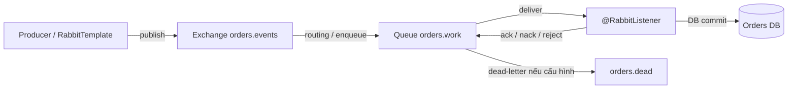
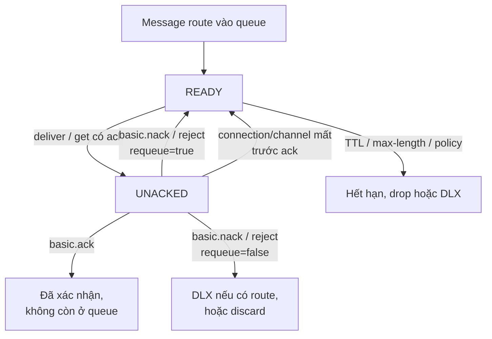

# Queue depth, ready, unacked và tốc độ publish/deliver/ack trong RabbitMQ

## 1. Vì sao cần quan sát từng giai đoạn của luồng message?

Trong module **SPRING_AMQP**, ứng dụng thường dùng `RabbitTemplate` publish message lên exchange; routing key và binding quyết định queue nhận; `@RabbitListener` lấy message, cập nhật dữ liệu và xác nhận hoàn tất. Hệ thống có thể kết hợp retry, dead-letter exchange (DLX), transaction và phục hồi kết nối. Khi độ trễ tăng, một log “đã gửi” hay “đã nhận” **không đủ** để biết hệ thống đang nghẽn ở đâu.



Những câu hỏi cần trả lời:

- Bao nhiêu message **đang chờ giao** và bao nhiêu message **đã giao nhưng chưa được ack**?
- Publish nhanh hơn tốc độ xử lý bao nhiêu? Backlog tăng có kéo dài?
- Consumer thật sự không hoạt động, bị kẹt sau khi nhận, hay chỉ đang xử lý batch dài?
- Tốc độ deliver rất cao là tín hiệu tốt, hay là vòng requeue/redelivery?
- Metric broker kết hợp với latency, exception và transaction của Spring AMQP như thế nào?

Bài học giải thích chính xác **queue depth, ready, unacked** cùng **publish, deliver, ack, redeliver rates**; thực hành bằng RabbitMQ CLI, Management HTTP API, Prometheus/Grafana và Spring Micrometer Observation. Trọng tâm là **classic/quorum queue trên AMQP 0-9-1**. RabbitMQ Streams có log retention và offset/consumer lag riêng, không nên dùng nguyên cách diễn giải queue này cho stream.

## 2. Phân biệt queue depth, ready và unacked

| Trường RabbitMQ | Tên gọi | Ý nghĩa |
| --- | --- | --- |
| `messages_ready` | Ready | Message ở queue **có thể giao** cho consumer nhưng chưa giao. |
| `messages_unacknowledged` | Unacked | Message **đã giao** nhưng broker còn chờ consumer acknowledgment. |
| `messages` | Queue depth / Total | Tổng message còn ở queue theo hai trạng thái trên. |

\[
\boxed{\text{Queue depth}=\text{Ready}+\text{Unacked}}
\]

Ví dụ một queue có:

```text
Queue: orders.work
Ready:       760
Unacked:      40
Total:       800
Consumers:     2
```

**Cách đọc:** có 760 message đang chờ được giao và 40 message đã giao nhưng chưa nhận ack. Không thể suy rằng “40 message đang thực thi SQL” vì chúng có thể đang chờ trong client prefetch buffer, đang ở mạng, bị chặn trong thread pool hoặc đang chạy handler.

### 2.1. Vòng đời message trong queue



Với **no-ack delivery**, message được broker coi là đã giao ngay, nên không đi vào unacked như cơ chế manual acknowledgments. Khi dùng Spring AMQP `AcknowledgeMode.AUTO`, container **tự phát ack sau khi listener thành công**; nó **không tương đương** RabbitMQ no-ack. Spring `AcknowledgeMode.NONE` mới tương ứng broker auto-ack.

### 2.2. Cách tránh đọc sai các gauge

- **Ready = 0** không đồng nghĩa đã xử lý hết: có thể còn nhiều unacked.
- **Unacked lớn** không tự chứng minh worker treo: prefetch lớn hoặc xử lý chậm có thể là bình thường trong một thời gian ngắn.
- **Depth = 0** không chứng minh producer gửi đúng queue: message có thể không route, bị TTL/drop hoặc đang ở DLQ khác.
- **Depth đếm message chứ không phải byte**: cần xem message bytes, RAM, disk và tài nguyên broker riêng.
- **Ack không bảo đảm toàn bộ nghiệp vụ đã commit** nếu ứng dụng ack quá sớm hoặc chạy công việc bất đồng bộ sau khi listener trả về.

## 3. Publish, deliver, ack và redeliver: bốn tốc độ khác nhau

Rate là số message/s (hoặc sự kiện giao thức/s) trong một khoảng lấy mẫu. Các metric có cùng đơn vị nhưng **không đo cùng giai đoạn**.

| Metric | Đang đếm điều gì? | Điểm cần chú ý |
| --- | --- | --- |
| **Publish rate** | Lần publish vào exchange; ở cấp queue có thể là số message ingress vào queue. | Publish lên exchange không đồng nghĩa được route tới queue mong muốn. |
| **Deliver rate** | Lần broker giao message cho consumer hoặc `basic.get` tùy metric. | Redelivery khiến một message được giao nhiều lần. |
| **Ack rate** | Message được broker xác nhận bởi consumer acknowledgments. | Khác hoàn toàn với publisher confirm. |
| **Redeliver rate** | Lần giao lại message đã từng được giao. | Có thể do reconnect, requeue hoặc retry. |
| **Nack/reject rate** | Lần consumer từ chối hoặc negative-ack. | Có thể requeue, dead-letter hay discard tùy cấu hình. |

### 3.1. Exchange publish và queue ingress không nhất thiết bằng nhau

```text
RabbitTemplate --1 publish--> orders.events
                                  |
                    +-------------+-------------+
                    |                           |
               orders.work                 orders.audit
                 1 copy                      1 copy
```

Một publish tới exchange có thể:

1. **Không route tới queue nào** vì routing key/binding không khớp.
2. Route tới **một queue**.
3. Route tới **nhiều queue** khi có các binding phù hợp.

Vì thế, publish rate của exchange **không luôn bằng** tổng số message vào tất cả queue. Nếu cần biết queue `orders.work` có thực sự nhận traffic, quan sát queue ingress và queue depth; để phát hiện publish unroutable, dùng `mandatory`, publisher returns và kiểm tra routing topology.

### 3.2. Deliver cao không có nghĩa xử lý nhanh

Với `prefetch=20`, một consumer có thể được giao trước 20 message và giữ chúng ở trạng thái unacked trong khi xử lý từng message. `Deliver` tăng nhanh ở đầu đợt nhưng `ack` chỉ tăng theo tiến độ handler.

Khi consumer reject rồi requeue, cùng một message có thể được deliver nhiều lần. Bởi vậy **deliver > ack** không đủ để khẳng định queue tăng backlog; cần nhìn thêm ready, unacked, redelivery và thời gian lấy mẫu.

### 3.3. Ack của consumer khác confirm của publisher

- **Publisher confirm** cho producer biết broker đã xử lý lần publish theo cơ chế confirm; không chứng minh consumer đã chạy xong.
- **Consumer ack** xác nhận việc giao message ở broker; không chứng minh mọi side effect bên ngoài hệ thống đều hoàn tất nếu ứng dụng thiết kế sai thứ tự.

Spring AMQP `RabbitTemplate.convertAndSend(...)` có thể trả về trước khi application biết broker confirm. Ngược lại, listener được container ack sau khi handler hoàn tất ở `AcknowledgeMode.AUTO`. Hai số liệu phải được theo dõi độc lập.

### 3.4. Trường Management API thường gặp

```text
message_stats.publish_details.rate       # publish / giây
message_stats.deliver_get_details.rate   # deliver + get / giây
message_stats.ack_details.rate           # ack / giây
message_stats.redeliver_details.rate     # redeliver / giây
```

Phạm vi thống kê phụ thuộc endpoint (cluster overview, exchange, queue). `deliver_get` bao gồm delivery và thao tác `basic.get`; nếu workload dùng polling, cần phân biệt `deliver`, `get`, `get_no_ack` để diễn giải. `...details.rate` là tốc độ trong cửa sổ thống kê gần đây, không phải bộ đếm tích lũy; một số field có thể không xuất hiện khi chưa có dữ liệu.

## 4. Backlog tăng và giảm như thế nào?

Giả sử **một queue**, mọi message ingress đều được xử lý thành công bằng ack, **không có TTL, purge, dead-letter, drop, no-ack delivery hoặc cơ chế loại bỏ khác**:

\[
\Delta\text{Depth}\approx \text{Enqueued}-\text{Acked}
\]

Với rate trung bình:

\[
\frac{\Delta\text{Depth}}{\Delta t}
\approx \lambda_{\text{queue ingress}}-\mu_{\text{ack}}
\]

Ở đây `λ` là **message vào queue mỗi giây**, không nhất thiết là publish rate của exchange; `μ` là message được ack mỗi giây. Công thức dùng để ước lượng xu hướng, **không phải định luật chính xác** trong pipeline có retry/requeue, DLX, TTL, drop, queue deletion hay consumers no-ack.

### 4.1. Ví dụ backlog tăng

```text
Thời điểm bắt đầu:
  ready=1.000, unacked=40, depth=1.040

Trong 5 phút:
  queue ingress = 100 message/giây
  ack rate      =  60 message/giây

Mức tăng depth xấp xỉ:
  (100 - 60) * 300 = 12.000 message

Depth dự kiến cuối kỳ:
  1.040 + 12.000 = 13.040 message
```

Consumer vẫn hoạt động và ack nhiều message mỗi giây, nhưng **hệ thống không theo kịp** lượng ingress.

### 4.2. Thời gian drain (ước lượng)

Nếu producer dừng hoàn toàn và consumer duy trì `60 ack/s`, backlog `12.000` message có thể cần xấp xỉ:

\[
12{,}000 / 60 = 200\ \text{giây}
\]

Nếu vẫn có `40 ingress/s`, tốc độ giảm ròng còn `60 - 40 = 20` message/s, cần khoảng `600` giây. Đó chỉ là phép tính lý tưởng: tốc độ xử lý thực tế có thể thay đổi bởi DB, network, retry, batch và tài nguyên broker.

**Không dùng publish - deliver để ước lượng công việc hoàn tất**. Deliver có thể chỉ chuyển message từ `ready` sang `unacked`; khi chưa ack, depth không giảm.

## 5. Ma trận chẩn đoán ready, unacked và các rate

| Tổ hợp tín hiệu | Nguyên nhân có thể | Kiểm tra tiếp |
| --- | --- | --- |
| Ready tăng, unacked ≈ 0, consumers = 0 | Không có consumer, listener chưa start hoặc sai queue/vhost. | Spring listener startup, connection/auth, queue name và consumer count. |
| Ready tăng, unacked gần giới hạn prefetch, ack thấp | Consumer đầy in-flight và xử lý không kịp. | Latency handler, DB lock, connection pool, timeout, concurrency. |
| Ready ≈ 0, unacked cao, ack gần 0 kéo dài | Consumer nhận rồi bị treo hoặc quên manual ack. | Thread dump, DB/HTTP timeout, channel, manual ack code. |
| Queue ingress > ack lâu dài | Năng lực xử lý thấp hơn lượng vào. | Tối ưu nghiệp vụ hoặc scale sau khi xác định bottleneck. |
| Deliver cao, redeliver cao, ack thấp | Vòng requeue/retry, consumer crash hoặc poison message. | Exception logs, retry budget, DLX/DLQ, recovery. |
| Exchange publish cao nhưng queue không có traffic | Không route, queue khác nhận hoặc policy loại bỏ. | Routing key, bindings, publisher returns, queue ingress. |
| Ack tăng nhưng DB dữ liệu sai | Ack trước commit, fire-and-forget hoặc thiếu idempotency. | Ranh giới transaction, listener code, event ID. |
| DLQ tăng dù main queue ít ready | Message bị reject/expire/drop. | `x-death`, retry strategy và policy DLX. |

### 5.1. Prefetch và số consumer

Ví dụ một `SimpleRabbitListenerContainerFactory` có **2 consumer**, mỗi consumer đặt `prefetch=20`. Trong điều kiện đơn giản, unacked có thể gần **40 message** nếu đủ nguồn và consumer vẫn đang giữ credit. Đây **không phải lúc nào cũng là lỗi**.

```text
Ready = 900
Unacked = 40
Consumers = 2
Prefetch = 20 / consumer
```

Nếu ack rate ổn định và processing latency thấp, unacked cao có thể là biểu hiện bình thường của prefetch. Nếu ack rate bằng 0 trong nhiều phút, đó là tín hiệu điều tra. Tăng prefetch không tự bảo đảm throughput tốt hơn; message có thể bị giữ trong client buffer, làm phân phối tải kém và tăng khối lượng redelivery khi connection mất.

### 5.2. Ack và transaction

Luồng lý tưởng với service `@Transactional` được listener gọi đồng bộ:

```text
Broker deliver
 -> Spring @RabbitListener
 -> service lưu dữ liệu DB
 -> DB commit
 -> listener trả về thành công
 -> container gửi ack
```

Nếu process chết sau DB commit nhưng trước ack, RabbitMQ có thể giao lại message. Vì thế **ack rate chỉ phản ánh trạng thái acknowledgement ở broker**; consumer vẫn cần unique event ID, idempotency và transaction phù hợp. Với `AcknowledgeMode.MANUAL`, quên `basicAck` làm message giữ unacked; với `AcknowledgeMode.NONE`, so ack rate với deliver theo cách manual acknowledgments là sai.

## 6. Một pipeline Spring Boot để tái hiện các biểu đồ

Ví dụ sử dụng Spring Boot với `spring-boot-starter-amqp`, actuator và Micrometer:

```xml
<dependency>
    <groupId>org.springframework.boot</groupId>
    <artifactId>spring-boot-starter-amqp</artifactId>
</dependency>
<dependency>
    <groupId>org.springframework.boot</groupId>
    <artifactId>spring-boot-starter-actuator</artifactId>
</dependency>
<dependency>
    <groupId>io.micrometer</groupId>
    <artifactId>micrometer-registry-prometheus</artifactId>
    <scope>runtime</scope>
</dependency>
```

Các version lấy từ Spring Boot BOM tương thích.

### 6.1. Cấu hình kết nối và listener

```yaml
spring:
  rabbitmq:
    host: localhost
    port: 5672
    virtual-host: /orders
    username: app
    password: ${RABBITMQ_PASSWORD}
    publisher-confirm-type: correlated
    publisher-returns: true
    template:
      mandatory: true
    listener:
      simple:
        acknowledge-mode: auto
        concurrency: 2
        max-concurrency: 2
        prefetch: 20
        default-requeue-rejected: false

management:
  endpoints:
    web:
      exposure:
        include: health,info,prometheus,metrics
```

`default-requeue-rejected=false` chỉ dành cho demo để lỗi không tạo vòng requeue nóng; nếu DLX được định tuyến đúng, message bị reject không requeue có thể chuyển DLQ. Trong production, phân loại lỗi tạm thời để retry có giới hạn/backoff, và không mở Actuator endpoints ra Internet không được bảo vệ.

### 6.2. Exchange, queue, binding, DLQ

```java
import org.springframework.amqp.core.BindingBuilder;
import org.springframework.amqp.core.Declarables;
import org.springframework.amqp.core.DirectExchange;
import org.springframework.amqp.core.Queue;
import org.springframework.amqp.core.QueueBuilder;
import org.springframework.context.annotation.Bean;
import org.springframework.context.annotation.Configuration;

@Configuration
public class OrdersTopology {
    @Bean
    Declarables ordersDeclarables() {
        DirectExchange events = new DirectExchange("orders.events");
        DirectExchange dlx = new DirectExchange("orders.dlx");
        Queue work = QueueBuilder.durable("orders.work")
                .deadLetterExchange("orders.dlx")
                .deadLetterRoutingKey("orders.failed")
                .build();
        Queue dead = QueueBuilder.durable("orders.dead").build();
        return new Declarables(
                events, dlx, work, dead,
                BindingBuilder.bind(work).to(events).with("orders.created"),
                BindingBuilder.bind(dead).to(dlx).with("orders.failed"));
    }
}
```

Nếu topology đã được IaC/`RabbitAdmin` riêng provision thì runtime chỉ sử dụng các tài nguyên có sẵn; không khai báo lại queue với arguments khác vì có thể gặp `PRECONDITION_FAILED`.

### 6.3. Producer

```java
import org.springframework.amqp.rabbit.core.RabbitTemplate;
import org.springframework.stereotype.Service;

@Service
public class OrdersPublisher {
    private final RabbitTemplate template;

    public OrdersPublisher(RabbitTemplate template) {
        this.template = template;
    }

    public void send(String eventId) {
        template.convertAndSend("orders.events", "orders.created", eventId);
    }
}
```

Khi gửi đều đặn, exchange publish rate tăng; nếu routing key đúng, queue `orders.work` nhận ingress. Producer cần quan sát publisher confirms và returns để phân biệt broker nhận publish với trường hợp unroutable.

### 6.4. Listener chậm xử lý (chỉ để mô phỏng)

```java
import org.springframework.amqp.rabbit.annotation.RabbitListener;
import org.springframework.stereotype.Component;

@Component
public class SlowOrdersListener {

    @RabbitListener(queues = "orders.work")
    public void onMessage(String eventId) throws InterruptedException {
        // CHỈ DÙNG ĐỂ THỬ NGHIỆM, không sleep trong production handler.
        Thread.sleep(300);
        System.out.println("Processed event=" + eventId);
    }
}
```

Với hai consumer, mỗi message mất khoảng 300 ms, throughput lý tưởng khoảng `2 / 0.3 ≈ 6,7 message/s` nếu không có overhead. Nếu producer gửi 30/s và không có tình huống đặc biệt, ready sẽ tăng. Ví dụ này chưa triển khai idempotency/transaction; handler production cần xử lý an toàn trước khi trả về để ack.

## 7. RabbitMQ CLI và Management API

### 7.1. Xem snapshot bằng `rabbitmqctl`

```bash
rabbitmqctl list_queues -p /orders \
  name messages messages_ready messages_unacknowledged consumers
```

Ví dụ:

```text
name         messages  messages_ready  messages_unacknowledged  consumers
orders.work  800       760             40                       2
orders.dead  12        12              0                        0
```

CLI hữu ích để xác định ngay queue nào tăng. Nhưng `list_queues` chỉ trả số tại một thời điểm; không có lịch sử rate, nên không dùng vòng lặp CLI tần suất cao thay hệ thống monitoring.

### 7.2. Management UI

```bash
rabbitmq-plugins enable rabbitmq_management
```

Vào Management UI (port **15672** mặc định) và chọn vhost `/orders`, queue `orders.work`. Xem **Ready / Unacked / Total / Consumers**, cùng message rates gồm publish, deliver/get, ack, redeliver khi có số liệu.

Thao tác “Get messages” trong Management UI là một hành động tiêu thụ message và có thể ảnh hưởng trạng thái tùy chế độ ack/requeue; chỉ làm khi được phép. Quản lý quyền truy cập Management UI độc lập với user app có least privilege.

### 7.3. Lấy số liệu queue bằng HTTP API

```text
GET /api/queues/{vhost}/{queue-name}
```

Vhost `/orders` cần encode dấu `/` đầu tiên thành `%2F` trong URL. Ví dụ:

```bash
# curl có thể hỏi mật khẩu observer nếu chưa có cấu hình credential.
curl -sS -u observer \
  'http://localhost:15672/api/queues/%2Forders/orders.work' |
  jq '{
    messages,
    messages_ready,
    messages_unacknowledged,
    consumers,
    publish_per_sec: (.message_stats.publish_details.rate // 0),
    deliver_get_per_sec: (.message_stats.deliver_get_details.rate // 0),
    ack_per_sec: (.message_stats.ack_details.rate // 0),
    redeliver_per_sec: (.message_stats.redeliver_details.rate // 0)
  }'
```

Kết quả **giả định**:

```json
{
  "messages": 800,
  "messages_ready": 760,
  "messages_unacknowledged": 40,
  "consumers": 2,
  "publish_per_sec": 25.4,
  "deliver_get_per_sec": 6.8,
  "ack_per_sec": 6.6,
  "redeliver_per_sec": 0
}
```

`message_stats` có thể vắng mặt/null nếu chưa có dữ liệu hoặc thu thập thống kê không hoạt động. Biểu thức `// 0` trong jq chỉ làm đẹp output, **không chứng minh rate thực sự bằng 0 khi metric không tồn tại**. Trong báo cáo vận hành, phân biệt “no data” với “zero”.

`GET /api/overview` trả thống kê tổng quan cluster; không lấy publish rate cluster-wide gán cho một queue. Xác định rõ dashboard đo **queue/exchange/vhost/node/cluster**.

## 8. Prometheus/Grafana: quan sát dài hạn và alert

RabbitMQ khuyến nghị plugin `rabbitmq_prometheus` cùng Prometheus/Grafana cho production. Management plugin phù hợp khám phá/debug nhưng có overhead và chỉ giữ dữ liệu ngắn hạn.

### 8.1. Bật plugin và chọn endpoint

```bash
rabbitmq-plugins enable rabbitmq_prometheus

# Aggregated metrics, mặc định không có breakdown theo queue.
curl -sS 'http://localhost:15692/metrics'

# Detailed metrics: chỉ lấy các family cần thiết.
curl -sS 'http://localhost:15692/metrics/detailed?family=queue_coarse_metrics&family=queue_consumer_count&family=queue_delivery_metrics&family=exchange_metrics'
```

Port Prometheus plugin thường là **15692**. Endpoint `/metrics` mặc định tổng hợp nhiều đối tượng để giảm overhead; `/metrics/per-object` cho nhiều metrics từng đối tượng nhưng có thể lớn và tốn CPU. `/metrics/detailed` cho phép chỉ định `family` và lọc `vhost`/`queue` nên phù hợp khi chỉ quan tâm những queue cụ thể.

### 8.2. Tên metric quan trọng tại `/metrics/detailed`

| Metric | Loại | Ý nghĩa |
| --- | --- | --- |
| `rabbitmq_detailed_queue_messages_ready` | Gauge | Ready hiện tại. |
| `rabbitmq_detailed_queue_messages_unacked` | Gauge | Unacked hiện tại. |
| `rabbitmq_detailed_queue_messages` | Gauge | Ready + unacked. |
| `rabbitmq_detailed_queue_consumers` | Gauge | Số consumer hiện tại. |
| `rabbitmq_detailed_queue_messages_delivered_ack_total` | Counter | Delivery cần ack tới consumer. |
| `rabbitmq_detailed_queue_messages_acked_total` | Counter | Số message được ack. |
| `rabbitmq_detailed_queue_messages_redelivered_total` | Counter | Số message được redeliver. |
| `rabbitmq_detailed_exchange_messages_published_total` | Counter | Publish tới exchange. |

`queue_coarse_metrics` cung cấp ready/unacked/depth; `queue_delivery_metrics` cung cấp deliver/ack/redeliver; `queue_consumer_count` cung cấp consumer count; `exchange_metrics` cung cấp publish theo exchange.

Ví dụ `prometheus.yml` tối giản:

```yaml
scrape_configs:
  - job_name: rabbitmq-detailed
    metrics_path: /metrics/detailed
    scrape_interval: 15s
    params:
      family:
        - queue_coarse_metrics
        - queue_consumer_count
        - queue_delivery_metrics
        - exchange_metrics
    static_configs:
      - targets: ['rabbitmq.internal:15692']
```

Với RabbitMQ cluster, scrape các node phù hợp và **kiểm tra label/node/cluster trước khi cộng hoặc tổng hợp**. Metrics chi tiết theo queue có thể phụ thuộc node đang host queue; metric cluster-wide không nên cộng lại từ mọi node.

### 8.3. PromQL cho queue `orders.work`

Giả sử metric thật có labels `vhost="/orders"`, `queue="orders.work"` (luôn kiểm tra labels trong Prometheus):

**Ready:**

```promql
rabbitmq_detailed_queue_messages_ready{
  vhost="/orders",queue="orders.work"
}
```

**Unacked:**

```promql
rabbitmq_detailed_queue_messages_unacked{
  vhost="/orders",queue="orders.work"
}
```

**Ack rate trung bình 5 phút:**

```promql
rate(rabbitmq_detailed_queue_messages_acked_total{
  vhost="/orders",queue="orders.work"
}[5m])
```

**Deliver rate cần ack:**

```promql
rate(rabbitmq_detailed_queue_messages_delivered_ack_total{
  vhost="/orders",queue="orders.work"
}[5m])
```

**Redelivery rate:**

```promql
rate(rabbitmq_detailed_queue_messages_redelivered_total{
  vhost="/orders",queue="orders.work"
}[5m])
```

**Publish rate ở exchange `orders.events`:**

```promql
rate(rabbitmq_detailed_exchange_messages_published_total{
  vhost="/orders",exchange="orders.events"
}[5m])
```

**Xu hướng ready (đơn vị message/s, xấp xỉ hồi quy):**

```promql
deriv(rabbitmq_detailed_queue_messages_ready{
  vhost="/orders",queue="orders.work"
}[10m])
```

**Chỉ dùng `rate`/`increase` cho counter** như `..._total`; ready và unacked là **gauge**, dùng độ chênh theo thời gian hoặc `deriv` khi xem xu hướng. Với queue trùng tên ở nhiều vhost, nhớ lọc `vhost`. Trước khi tạo alert, kiểm tra metric series có hiện đầy đủ, scrape không lỗi và tránh cộng trùng node.

## 9. Micrometer Observation ở Spring AMQP trả lời câu hỏi nào?

**Broker metrics** trả lời queue còn bao nhiêu message; **Spring application metrics** giúp tìm thời gian xử lý, lỗi và downstream bottleneck. Từ Spring AMQP 3.0, `RabbitTemplate` và listener container hỗ trợ **Micrometer Observation**.

### 9.1. Bật Observation

```java
import org.springframework.amqp.rabbit.config.SimpleRabbitListenerContainerFactory;
import org.springframework.amqp.rabbit.connection.ConnectionFactory;
import org.springframework.amqp.rabbit.core.RabbitTemplate;
import org.springframework.context.annotation.Bean;
import org.springframework.context.annotation.Configuration;

@Configuration
public class RabbitObservationConfig {
    @Bean("observedRabbitTemplate")
    RabbitTemplate observedRabbitTemplate(ConnectionFactory connectionFactory) {
        RabbitTemplate template = new RabbitTemplate(connectionFactory);
        template.setObservationEnabled(true);
        return template;
    }

    @Bean("observedListenerFactory")
    SimpleRabbitListenerContainerFactory observedListenerFactory(
            ConnectionFactory connectionFactory) {
        SimpleRabbitListenerContainerFactory factory =
                new SimpleRabbitListenerContainerFactory();
        factory.setConnectionFactory(connectionFactory);
        factory.setObservationEnabled(true);
        factory.setPrefetchCount(20);
        factory.setConcurrentConsumers(2);
        return factory;
    }
}
```

Để sử dụng: inject bean `observedRabbitTemplate` với `@Qualifier` vào producer, hoặc đặt `@RabbitListener(containerFactory = "observedListenerFactory")`. Đây là cấu hình **thay thế** cho factory listener mặc định khi muốn observation; không dùng hai factory cùng tiêu thụ một queue chỉ vì cần monitoring.

Những observation thường có tên `spring.rabbit.template` và `spring.rabbit.listener`. Khi bật `observationEnabled`, Micrometer timers cũ trên component đó bị thay bằng timer từ observation; không cộng cả hai như thể chúng là hai nguồn độc lập. Với tracing, hãy cấu hình Micrometer Tracing/propagation phù hợp và kiểm tra phiên bản thư viện.

### 9.2. Thời gian xử lý nghiệp vụ

Nếu cần phân biệt thời gian DB/handler với thời gian ở queue, có thể dùng Micrometer `Timer` cho service:

```java
import io.micrometer.core.instrument.MeterRegistry;
import io.micrometer.core.instrument.Timer;
import org.springframework.stereotype.Service;

@Service
public class OrderProcessor {
    private final MeterRegistry registry;
    private final OrderBusinessService business;

    public OrderProcessor(
            MeterRegistry registry, OrderBusinessService business) {
        this.registry = registry;
        this.business = business;
    }

    public void process(String eventId) {
        Timer.Sample sample = Timer.start(registry);
        String outcome = "success";
        try {
            business.applyIdempotently(eventId);
        } catch (RuntimeException ex) {
            outcome = "error";
            throw ex;
        } finally {
            sample.stop(Timer.builder("orders.processing")
                    .tag("outcome", outcome)
                    .register(registry));
        }
    }
}
```

`OrderBusinessService` là service nghiệp vụ giả định đã được triển khai, với transaction/idempotency phù hợp. Tag nên giới hạn ở các giá trị ít biến động như `outcome` và `operation`. **Không dùng `eventId`/`orderId`/payload làm metric label**, vì cardinality có thể tăng mạnh; các ID đó phù hợp với log/trace đã được kiểm soát và ẩn dữ liệu nhạy cảm.

## 10. Dashboard và cảnh báo có ý nghĩa

Một dashboard tối thiểu nên hiển thị trên **cùng khoảng thời gian**:

1. **Ready, unacked, depth** theo queue.
2. **Queue ingress, deliver/get, ack, redeliver** dưới dạng message/s.
3. **Consumers, prefetch, concurrency** để nhìn công suất thực tế.
4. **Latency listener** (trung bình/p95/p99 nếu bật histogram), error rate, DB connection pool và HTTP dependency latency.
5. **DLQ depth và retry count** để biết có đang chuyển vấn đề sang một queue khác.
6. **Publisher confirms/returns, connection recovery, memory/disk alarms** để phát hiện producer/broker nghẽn.

Ví dụ alert, **ngưỡng cần điều chỉnh theo SLO**:

| Cảnh báo | Điều kiện gợi ý | Cần kiểm tra |
| --- | --- | --- |
| Consumer mất | `ready > 0` và `consumers == 0` trên 2–5 phút. | Queue có chủ ý chạy theo lịch hay phải luôn có consumer? |
| Backlog tăng bền vững | `ready > 1.000` và `deriv(ready[10m]) > 0` kéo dài. | SLO latency, peak traffic và tốc độ xử lý bình thường. |
| Unacked không tiến triển | `unacked > 0`, `ack rate ≈ 0` nhiều phút. | Batch dài hay worker bị treo, timeout và DB locks. |
| Redelivery bất thường | Redeliver rate/Deliver rate tăng trên baseline. | Restart, lỗi mạng, poison message, requeue loop. |
| DLQ tăng | Queue DLQ depth tăng đều. | Lỗi schema, nghiệp vụ, retry budget và DLX route. |
| Publish không thành ingress | Publish/confirm tăng nhưng queue đích không nhận, returns tăng. | Exchange, binding, routing key, vhost. |

`1.000 message` có thể là lượng rất nhỏ với queue xử lý 10.000/s nhưng là nhiều phút chờ với queue xử lý 1/s. Hãy thiết kế alert xoay quanh **SLO thời gian chờ và xử lý**, không chỉ số tuyệt đối.

Ước lượng đơn giản về thời gian chờ khi consumer chạy ổn định:

\[
\text{Backlog delay (s)}\approx\frac{\text{Ready}}{\text{Ack rate}}
\]

Chỉ tính khi ack rate dương, tương đối ổn định và các giả định xử lý phù hợp. Nếu rate = 0, dashboard nên hiển thị “không ước lượng được”. Đây không phải cách tính latency chính xác của từng message hay SLA tuyệt đối, đặc biệt khi có prefetch, retry, DLX và lưu lượng đầu vào thay đổi.

## 11. Runbook chẩn đoán thực tế

### Trường hợp A: Ready tăng

1. Kiểm tra **consumer count**. Nếu 0, xem Spring listener đã start, connection/vhost/queue name có đúng và user có quyền read không.
2. Nếu consumer > 0, xem `unacked` có tiệm cận trần prefetch không.
3. So queue ingress với ack rate trong **cùng cửa sổ thời gian**.
4. Xem listener latency, DB locks/connection pool, HTTP timeouts, retry/error rate và CPU.
5. Chỉ scale consumer sau khi xác định bottleneck ở worker, tránh đẩy nghẽn xuống DB.

### Trường hợp B: Unacked cao, ack thấp

1. Nếu `AcknowledgeMode.MANUAL`, tìm thiếu `basicAck` hoặc nhầm channel/delivery tag.
2. Đọc thread dump, latency trace, lock, timeout, GC pause.
3. Kiểm tra consumer có đang giữ message trong buffer do prefetch lớn.
4. Đưa ra timeout và retry/DLQ hợp lý; **không purge/delete queue** để “xóa cảnh báo”.

### Trường hợp C: Deliver rất cao, redelivery tăng

1. Kiểm tra vòng lặp `reject/requeue=true`, đặc biệt poison message.
2. Xem retry interceptor, delayed retry queue, `x-death`, DLX binding.
3. Phân loại lỗi tạm thời và vĩnh viễn; giới hạn retry/backoff.
4. Bảo đảm consumer idempotent khi DB commit nhưng broker chưa nhận ack.

### Trường hợp D: Publish cao, queue đích không nhận

1. Kiểm tra exchange/routing key/binding, quyền publish và vhost.
2. Kiểm tra publisher confirms và returns khi `mandatory=true`.
3. Phân biệt publish ở **exchange** với ingress theo **queue**.
4. Kiểm tra TTL/max-length/DLX, queue khác hoặc broker khác có nhận không.
5. Truy vết theo correlation ID/event ID trong logs/traces, không chỉ dựa vào rate tổng.

## 12. Bài thực hành kiểm chứng từng chỉ số

Thực hiện trên **broker thử nghiệm**, không purge/delete dữ liệu production:

### Bài thử 1: Không có consumer

Tạm dừng listener, publish 100 message qua exchange vào `orders.work`. Nếu không TTL/drop và queue trước đó trống: **ready≈100, unacked=0, consumers=0**.

### Bài thử 2: Consumer chậm

Start hai consumer với `prefetch=20`, handler mô phỏng 300 ms. Publish nhanh hơn `6–7 message/s`. Dự kiến `unacked` có thể tiến gần 40, `ready` tăng; ack rate phản ánh công suất handler. Thử giảm latency xử lý để quan sát xu hướng backlog đổi chiều.

### Bài thử 3: Redelivery sau mất ack

Cho service commit DB rồi dùng fault injection khiến connection/channel mất trước khi broker nhận ack. Message có thể redeliver; kiểm tra `redeliver rate` tăng và logic idempotent không áp dụng nghiệp vụ hai lần.

### Bài thử 4: Poison message vào DLQ

Gửi payload sai schema; listener ném `AmqpRejectAndDontRequeueException`. Nếu DLX/binding đúng, depth `orders.work` giảm và `orders.dead` tăng. Đừng coi dead-letter là ack thành công; đối chiếu lỗi handler và `x-death`.

### Bài thử 5: Sai routing key

Publish vào `orders.events` với routing key không có binding. Exchange publish rate có thể tăng nhưng queue `orders.work` không nhận. Kiểm tra publisher returns khi `mandatory=true`.

Sau mỗi bài thử, ghi số liệu **trước/sau** bằng:

```bash
rabbitmqctl list_queues -p /orders \
  name messages messages_ready messages_unacknowledged consumers

curl -sS 'http://localhost:15692/metrics/detailed?family=queue_coarse_metrics&family=queue_consumer_count&family=queue_delivery_metrics'
```

## 13. Câu hỏi tự kiểm tra

1. Queue có `ready=900` và `unacked=100`. Depth bằng bao nhiêu? Có thể khẳng định 100 message đã hoàn tất nghiệp vụ không?
2. `ready=0`, `unacked=40` và `ack rate=0` trong 10 phút nói lên điều gì?
3. Một publish vào exchange có thể làm tăng message count của hai queue không? Vì sao?
4. Vì sao deliver rate có thể cao khi throughput nghiệp vụ gần như bằng 0?
5. `AcknowledgeMode.AUTO` của Spring AMQP có tương đương no-ack ở broker không?
6. Với 2 consumer và prefetch=20, `unacked≈40` có chứng minh worker treo không?
7. Vì sao không dùng `rate(rabbitmq_detailed_queue_messages_ready[5m])` như counter?
8. Micrometer Observation ở Spring AMQP trả lời câu hỏi nào mà broker queue depth không trả lời?
9. Vì sao redelivery vẫn xảy ra dù DB transaction đã commit?
10. Publish rate tăng nhưng queue không nhận message: nên kiểm tra gì trước khi tăng số consumer?

**Gợi ý đáp án:** (1) 1.000, chưa; (2) in-flight chưa được ack và có thể kẹt; (3) có, một exchange route tới nhiều queue; (4) requeue/redelivery hoặc prefetch, không có ack; (5) không, container ack sau xử lý; (6) không, xem latency/ack; (7) ready là gauge, dùng `deriv`/chênh lệch; (8) độ trễ handler, exception và trace; (9) ack có thể chưa tới broker khi kết nối mất; (10) binding, routing key, returns, vhost và queue ingress.

## 14. Tổng kết

- **Depth = Ready + Unacked**. Ready là chờ giao; unacked là đã giao nhưng chưa được broker nhận xác nhận.
- **Publish/queue ingress rate** cho biết lưu lượng vào; **deliver/get** cho biết lượt giao; **ack rate** phản ánh tiến độ xác nhận; **redeliver rate** phản ánh giao lại.
- **Ready tăng** gợi ý thiếu công suất xử lý hoặc consumer mất. **Unacked cao** cần kết hợp prefetch, latency và ack rate. **Deliver cao nhưng ack thấp** có thể là requeue loop hoặc consumer kẹt.
- **RabbitMQ broker metrics + Spring AMQP Micrometer/Observation + DB/HTTP metrics + logs/traces** mới đủ để quan sát chuỗi xử lý bất đồng bộ từ đầu tới cuối.

Mục tiêu không chỉ là queue có ít message, mà là **message được xử lý chính xác, có thể phục hồi và đạt SLO độ trễ**, kể cả khi retry, DLX, transaction và connection recovery xảy ra.

## Tài liệu tham khảo

- [RabbitMQ — Monitoring](https://www.rabbitmq.com/docs/monitoring): định nghĩa `messages`, `messages_ready`, `messages_unacknowledged`, Management API và rates.
- [RabbitMQ — Monitoring with Prometheus and Grafana](https://www.rabbitmq.com/docs/prometheus): `/metrics`, `/metrics/detailed`, gauge/counter theo queue và dashboard.
- [RabbitMQ — rabbitmqctl Manual](https://www.rabbitmq.com/docs/man/rabbitmqctl.8): `list_queues` và tên metric.
- [RabbitMQ — Consumer Acknowledgements and Publisher Confirms](https://www.rabbitmq.com/docs/confirms): ack, redelivery và publisher confirms.
- [Spring AMQP — Micrometer Observation](https://docs.spring.io/spring-amqp/reference/amqp/receiving-messages/micrometer-observation.html): `observationEnabled` trên template/listener.
- [Spring AMQP — Micrometer Observation Documentation](https://docs.spring.io/spring-amqp/reference/appendix/micrometer.html): `spring.rabbit.listener`, `spring.rabbit.template` và conventions/tags.
- [Spring AMQP — Message Listener Container Configuration](https://docs.spring.io/spring-amqp/reference/amqp/containerAttributes.html): ack mode, prefetch, concurrency và requeue policy.
